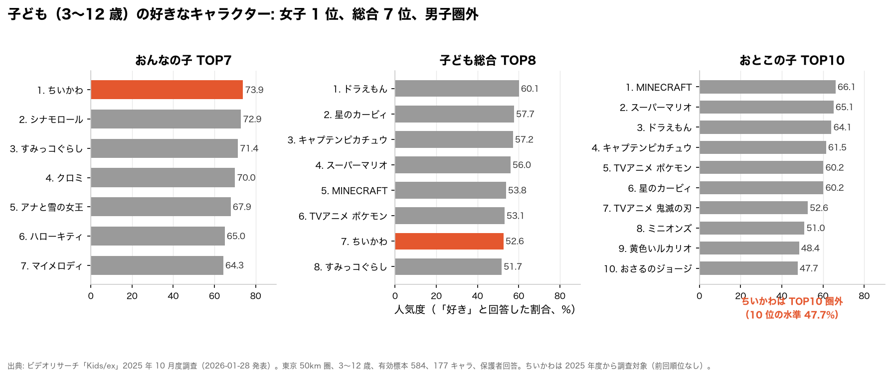
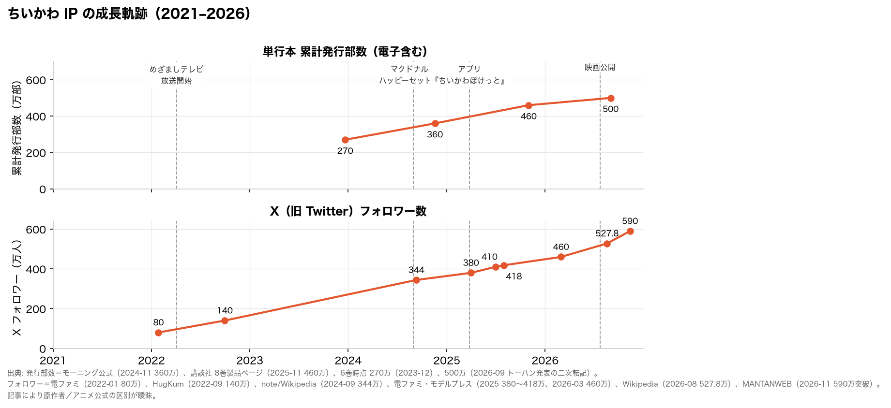
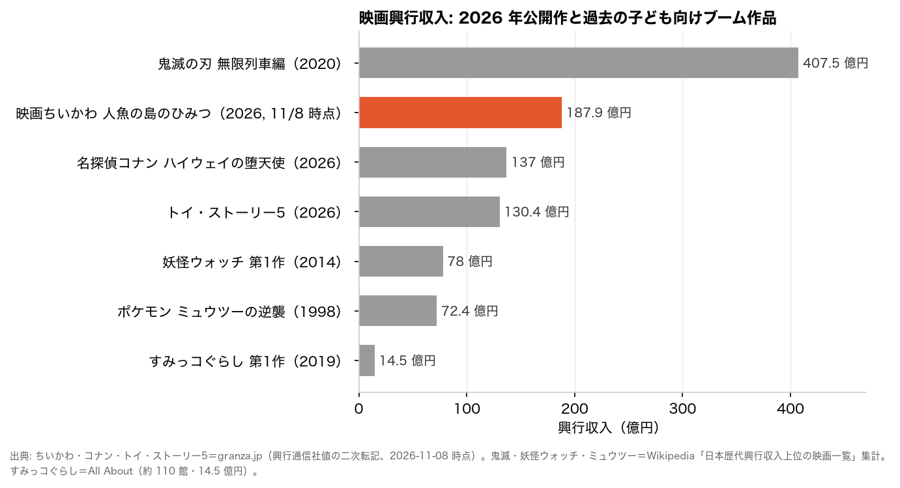
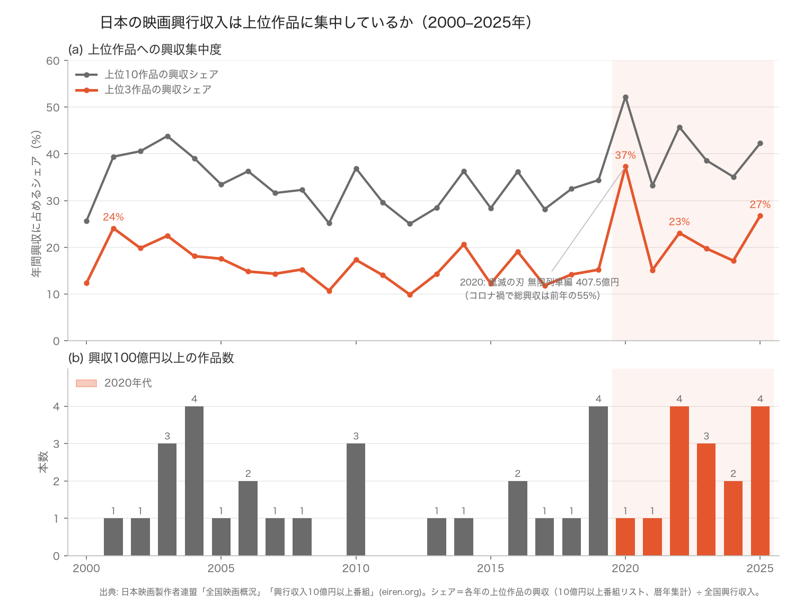
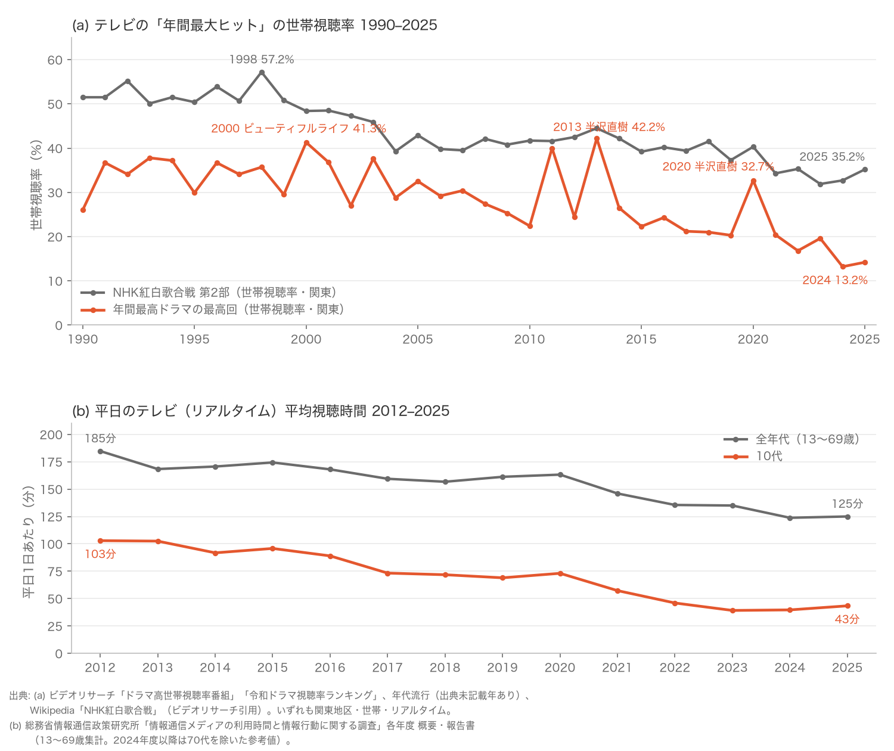
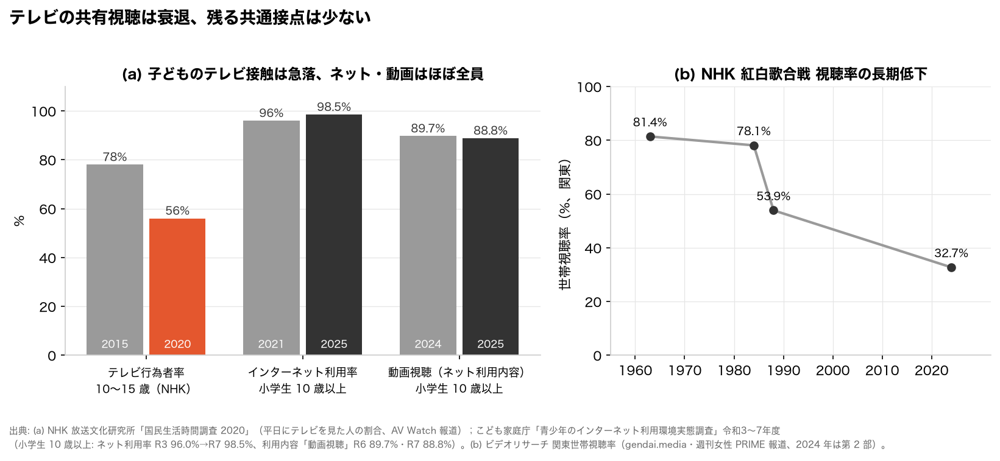
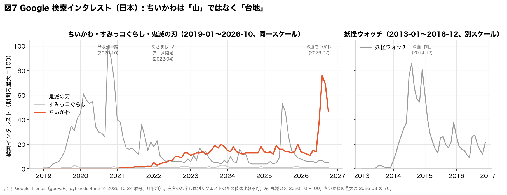

# ちいかわは「女児×母親」の共有接点を束ねて社会現象化した

**要旨（BLUF）**: 公開データで検証すると、「全小学生が知っている」という前提は半分正しく半分誤りである。代表性のある唯一の子ども調査（ビデオリサーチ Kids/ex、東京50km圏・3〜12歳・N=584、2025年10月）では、ちいかわは**女児で人気度1位（73.9%）だが男児ではTOP10圏外（10位の水準47.7%未満）、子ども総合では7位（52.6%）**であり、現象の実体は「小学生全体」ではなく「女児（特に高学年）＋その母親世代」に強く偏った性別コホート型のブームである（[ビデオリサーチ](https://www.videor.co.jp/press/images/press_20260128.pdf)）。一方で2026年7月公開の劇場版は公開87日で**興収181.0億円・動員1,242万人**に達し、2026年公開作1位、『名探偵コナン』シリーズ最高（158.0億円）を上回り歴代邦画12位圏に入った（[映画.com](https://eiga.com/news/20260921/8/)、[granza.jp](https://granza.jp/chiikawa-movie-box-office/)）。動員規模は映画ドラえもん（約320万人）の約4倍で、「特定コホートに閉じた人気」が「国民的アニメ映画」級の興行を生んだという、過去のブームにない形をしている。なぜ可能だったかを説明する最も整合的な仮説は、ちいかわが**テレビ断片化後に残った数少ない「共有接点」（朝の全国ネット情報番組・無料見逃し配信・コンビニ／ハッピーセット・100円帯コレクタブル）を同時に押さえ、接触コストをほぼゼロにしたうえで、女児と20〜40代女性という二世代に同じ物語を届けた**ことである。ただしこれは相関と業界関係者の証言に基づく説明であり、「どの経路で子どもが知ったか」を直接測った調査は存在しない。さらに三つの追加検証から、「社会現象が生まれにくい」という言説は**テレビ視聴率で測った場合にだけ成り立つ**ことが分かった。テレビ尺度（年間最高ドラマ視聴率 1990年代平均33.8%→2020–25年19.5%、紅白第2部 52.3%→34.9%、10代の平日リアルタイム視聴 2012年102.9分→2024年39.7分）は一貫して縮小した一方、映連の全作品データで見た映画興収は**上位3作のシェアが2000年代17.0%・2010年代14.9%から2020年代23.2%へ上がり、100億円超の作品数も年1.3〜1.4本から2022年以降3.25本へ増えている**。つまり巨大ヒットは消えたのではなく少数作品に集中した。また8つのIPを並べると、ちいかわは大人側の指標（SNS人気・業界賞・ヒット商品番付、2022年）が子ども調査1位（2025年）に3年、映画（2026年）に4年先行し、Google検索関心は2023〜2025年に低い台地（鬼滅2020年10月=100で14〜15）を保ったあと映画で76へ跳ねる「台地→山」型で、鬼滅・妖怪ウォッチの「山→減衰」型と形が異なる。社会現象の形は「全員が同じ番組を見る」から「特定コホートのほぼ全員が同じ物語を持つ」へ変わり、その先行指標は大人のSNS人気と業界賞、遅行指標は子ども調査と映画である。本報告は、前提の再定義、成長軌跡、興行、興行の集中度、過去ブーム比較、メディア環境、先行・遅行指標の順に数字を示し、最後に因果の確からしさを層別して考察する。

## 前提の検証：「全小学生」ではなく「女児1位・男児圏外・総合7位」

まず問いの前提そのものを調べる。子どもを対象に、代表性のある抽出（ARS抽出、保護者回答）でキャラクター人気を%付き・男女別に公表している調査は、2026年10月時点でビデオリサーチ「Kids/ex」2025年10月度（2026年1月28日発表）だけである。同調査（調査期間2025年10月3〜26日、東京50km圏、3〜12歳、有効標本584、177キャラ、「好き」と答えた割合）の結果は次の通り（[ビデオリサーチ PDF](https://www.videor.co.jp/press/images/press_20260128.pdf)）。

| 区分 | 1位 | 2位 | 3位 | … | ちいかわ |
|---|---|---|---|---|---|
| 子ども総合（3〜12歳） | ドラえもん 60.1% | 星のカービィ 57.7% | キャプテンピカチュウ 57.2% | 4位 マリオ 56.0%、5位 MINECRAFT 53.8%、6位 TVアニメ ポケモン 53.1% | **7位 52.6%**（前回調査対象外） |
| おとこの子 | MINECRAFT 66.1% | スーパーマリオ 65.1% | ドラえもん 64.1% | 7位 鬼滅の刃 52.6%、10位 おさるのジョージ 47.7% | **TOP10圏外**（47.7%未満） |
| おんなの子 | **ちいかわ 73.9%** | シナモロール 72.9% | すみっコぐらし 71.4% | 4位 クロミ 70.0%、5位 アナ雪 67.9% | **1位** |

ここから三つのことが言える。第一に、女児では4人に3人が「好き」と答える圧倒的首位である。第二に、男児では公表されていないが、総合52.6%と女児73.9%から男女比をほぼ半々と仮定して逆算すると男児はおよそ30%台前半（約31%）と推定され、男児TOP10下限の47.7%を大きく下回る（この推計は公表値ではない）。第三に、「好き」と「知っている」は別物であり、**ちいかわの子どもにおける認知率を測った全国代表調査は存在しない**。したがって「全小学生が知っている」は、認知率データで肯定も否定もできず、人気度データからは「女児はほぼ全員が好き、男児は半数未満が好き」と言い換えるのが正確である。

年齢の軸でも偏りがある。小学館 JS研究所の雑誌はがき調査（自己選択型、読者層に限定）では、2025年春に女子小学生で3位（『ちゃお』N=500）、2026年春には**高学年（『ちゃお』N=1,000）で1位、低学年（『ぷっちぐみ』N=888）で5位**で、低学年の首位は『ひみつのアイプリ』だった（[Web担当者Forum 2025](https://webtan.impress.co.jp/n/2025/10/07/50167)、[Web担当者Forum 2026](https://webtan.impress.co.jp/n/2026/06/26/52855)）。同調査で「女子小学生が行きたいテーマパーク」1位は「ちいかわパーク」で、ディズニー・USJを上回った。年齢が上がるほど強い、という傾向は Kids/ex が年齢別を公表していないため検証できないが、二つの自己選択調査の方向は一致している。

**時点の注意**: Kids/ex 2025 年 10 月度の調査期間（10 月 3〜26 日）は劇場版公開（2026 年 7 月 24 日）の約 9 か月前であり、映画後の子ども人気を反映していない。2026 年 10 月 22 日時点で、映画公開後に実施・公表された代表性のある子ども調査は見つからなかった（Kids/ex の次回分は例年 1 月末に公表される。小学館 JS 研究所 2026 年版は 2026 年春実施で、これも公開前）。したがって本節の数値は「映画前のベースライン」であり、映画が男児・低学年への浸透を広げた可能性は本報告では検証できない（追加仮説 H3・H4 を参照）。

Kids/ex の時系列も重要な制約を持つ。2023年度（N=604、141キャラ）・2024年度（N=604、161キャラ）のリリースにはちいかわへの言及がなく、2025年度リリースの「前回順位『-』」は前回調査対象外を意味する（[2023年度](https://digitalpr.jp/r/82235)、[2024年度](https://digitalpr.jp/r/103029)）。つまり**ちいかわが「子ども向け定番キャラ」として調査設計に組み込まれたのは2025年度が最初**で、2022〜2024年の子ども人気を同一指標で追う手段はない。一方、2023〜2024年の女児1位はすみっコぐらし（4連覇）であり、ちいかわは2025年に調査対象入りと同時に首位を奪った。

大人側の代表調査は、通説（「20〜40代女性が中心」「男女比7:3」）を支持しない。日本リサーチセンター（NRC）の全国訪問留置調査（15〜79歳、N=1,200、2024年7月）では、ちいかわの好感率は**15〜19歳で24%と最も高く、20代以下で2割以上**だった（[NRC 241112](https://www.nrc.co.jp/report/241112.html)）。NRC Web調査（15〜69歳、N=2,013、2023年12月）の「1年以内にグッズを購入したキャラクター」では**ちいかわが全体1位（5.5%、前年6位3.3%）で、男性1位、20代と40代で1位**（女性1位はSnoopy）だった（[NRC 240415](https://www.nrc.co.jp/report/240415.html)）。「40代で購入1位」は親が子のために買う分と40代自身のファン化を切り分けられない。「20〜40代女性中心」説は All About 型の自己選択アンケート（回答者の30代が212/500人）の分布に引きずられた可能性が高い（[All About](https://news.allabout.co.jp/articles/o/62849/)）。X フォロワーも2022年時点で男性44.1%・女性55.9%と、女性偏重ではあるが極端ではない（[Wikipedia ja（DIAMOND SIGNAL 引用）](https://ja.wikipedia.org/wiki/%E3%81%A1%E3%81%84%E3%81%8B%E3%82%8F_%E3%81%AA%E3%82%93%E3%81%8B%E5%B0%8F%E3%81%95%E3%81%8F%E3%81%A6%E3%81%8B%E3%82%8F%E3%81%84%E3%81%84%E3%82%84%E3%81%A4)）。

以上から、現象を正確に言い直すとこうなる。**ちいかわは「小学生女児（特に高学年）でほぼ全員が好きと答え、10代後半〜20代の大人で好感率が最高、大人男性でもグッズ購入率首位」という、性別と世代を跨ぐが男児と中高年男性には届いていない分布を持ち、その上で2026年に動員1,242万人の映画を成立させたIP**である。「特定年代に閉じている」という問いの前提は、より正確には「性別コホートに偏っている」である。

## 成長軌跡：6年かけた階段状の拡張で、2022年4月に変曲点がある

ちいかわは一夜で爆発したブームではない。累計発行部数（電子含む）とXフォロワーの推移は、節目ごとに段階的に増えている。

| 時期 | 出来事 | 定量指標 | 出典 |
|---|---|---|---|
| 2017-05 | ナガノが X に原画投稿（前史） | — | [JBpress](https://jbpress.ismedia.jp/articles/-/96895) |
| 2020-01 | X 専用アカウントで無料連載開始 | 2025年時点で680話超 | [President](https://president.jp/articles/-/117213) |
| 2021-02 | 『モーニング』読切、単行本1巻 | — | [Wikipedia ja](https://ja.wikipedia.org/wiki/%E3%81%A1%E3%81%84%E3%81%8B%E3%82%8F_%E3%81%AA%E3%82%93%E3%81%8B%E5%B0%8F%E3%81%95%E3%81%8F%E3%81%A6%E3%81%8B%E3%82%8F%E3%81%84%E3%81%84%E3%82%84%E3%81%A4) |
| 2021-08 | ちいかわらんど 梅田・原宿 開店 | — | 同上 |
| 2022-01 | X フォロワー80万突破（アニメ前） | 80万 | [電ファミ](https://news.denfaminicogamer.jp/news/220201a) |
| **2022-04-04** | **『めざましテレビ』内ショートアニメ開始** | 約1分枠、7:40頃 | [ファミ通](https://www.famitsu.com/news/202203/14254309.html) |
| 2022-06 | 日本キャラクター大賞 グランプリ（Twitter発初） | — | [Wikipedia ja](https://ja.wikipedia.org/wiki/%E6%97%A5%E6%9C%AC%E3%82%AD%E3%83%A3%E3%83%A9%E3%82%AF%E3%82%BF%E3%83%BC%E5%A4%A7%E8%B3%9E) |
| 2022-09 | X フォロワー140万超 | 140万 | [HugKum](https://hugkum.sho.jp/410100) |
| 2022-11 | 日経トレンディ ヒット商品2位、SNS流行語大賞「〇〇ってコト!?」 | つぶやき270万回超 | [東洋経済](https://toyokeizai.net/articles/-/650817?display=b)、[INTERNET Watch](https://internet.watch.impress.co.jp/docs/news/1461773.html) |
| 2023-06 | Z総研 Z世代上半期トレンド1位（13〜26歳 N=950） | — | [AdverTimes](https://www.advertimes.com/?p=422300) |
| 2023-12 | 6巻、累計270万部 | 270万部 | [モーニング公式](https://morning.kodansha.co.jp/news/6002.html) |
| 2024-03 | 上海 MINISO ポップアップ | 3日で800万元超 | [36Kr Japan](https://36kr.jp/286626/) |
| 2024-08-30 | マクドナルド ハッピーセット初回 | — | [inside-games](https://www.inside-games.jp/article/2024/08/30/158925.html) |
| 2024-09 | X フォロワー344万 | 344万 | [note JW（Wikipedia引用）](https://note.com/junwatanabe72/n/n48318e98bbe2) |
| 2024-11 | 7巻、累計360万部 | 360万部 | [モーニング公式](https://morning.kodansha.co.jp/news/6002.html) |
| 2025-03 | 市場規模100億円超（キャラクター・データバンク）、常設12店 | 100億円超 | [ITmedia](https://www.itmedia.co.jp/business/articles/2503/05/news037.html) |
| 2025-03-27 | アプリ『ちいかわぽけっと』配信（43の国と地域） | 2日で200万DL、累計500万DL超 | [gamebiz](https://gamebiz.jp/news/403394)、[ORICON](https://www.oricon.co.jp/news/2451103/full/) |
| 2025-05 | ハッピーセット第2弾が約1日で終了、第3弾中止・謝罪 | — | [KAI-YOU](https://kai-you.net/article/92493) |
| 2025-07 | めざまし YouTube 累計3.9億回再生、ちいかわパーク常設 | 3.9億回 | [電ファミ](https://news.denfaminicogamer.jp/news/250708b) |
| 2025-10 | Kids/ex 調査対象入り、女児1位 | 73.9% | [ビデオリサーチ](https://www.videor.co.jp/press/images/press_20260128.pdf) |
| 2025-11 | 8巻、累計460万部 | 460万部 | [講談社](https://www.kodansha.co.jp/comic/products/0000420127) |
| 2026-06-17 | 日本キャラクター大賞 4度目グランプリ（史上初3連覇）、殿堂入り | — | [eiga.com](https://eiga.com/news/20260621/9/) |
| **2026-07-24** | **劇場版公開（東宝、447館）** | 初日9.9億円 | [秋田魁（オリコン）](https://www.sakigake.jp/news/article/20260726OR0099/) |
| 2026-08 | X フォロワー527.8万 | 527.8万 | [Wikipedia ja](https://ja.wikipedia.org/wiki/%E3%81%A1%E3%81%84%E3%81%8B%E3%82%8F_%E3%81%AA%E3%82%93%E3%81%8B%E5%B0%8F%E3%81%95%E3%81%8F%E3%81%A6%E3%81%8B%E3%82%8F%E3%81%84%E3%81%84%E3%82%84%E3%81%A4) |

フォロワーの伸び率は2022年1月（80万）→2024年9月（344万）で年率約70%、2024年9月→2026年8月（527.8万）で年率約25%と鈍化しつつ絶対数は増え続け、**アニメ放送開始後の2年が最も急**だった（ノート内の算出）。発行部数は新刊ごとに約100万部刻みで増え、刊行ペースが年1冊に落ちた2023年以降も伸びているため、既刊の継続売上が主と読める。2022年にはキャラクター大賞・日経トレンディ2位・SNS流行語大賞が同時に揃っており、指標が揃って跳ねるのは (1) 2022年4月アニメ開始、(2) 2023〜24年のコラボ・体験型店舗の量産期、(3) 2025年のアプリ＋海外常設店、(4) 2026年7月劇場版の4段階である。Google急上昇ランキングには2022〜2025年とも入っておらず、Google Trends の月次データでも2023〜2025年は年平均14〜15（鬼滅2020年10月=100）の台地を保ったあと2026年8月に76へ跳ねる形で、検索急騰型ではなく常時高水準の「じわじわ型」の普及である（後述「先行・遅行」節）。

ここで注意すべきは、2022年4月の放送開始が「原因」と言えるかである。放送開始前の2022年1月にすでにフォロワー80万・占いコーナー改称があり、アニメ化は「すでに大人のSNS人気があったIPに、子ども・家庭への入口を付けた」出来事と解釈するのが整合的である。アニメ放送がフォロワー増を加速したことは時系列から支持されるが、放送がなければ同じ成長が起きなかったかは反事実であり検証できない。

## 映画：初動は「ファン型」、テールは「ファミリー型」で181億円

劇場版『映画ちいかわ 人魚の島のひみつ』（2026年7月24日公開、99分、G指定、原作・脚本ナガノ、アニメーション制作 サイピク、配給 東宝、447館うちIMAX 65館）の週次推移は、初動の大きさと長いテールの両方を持つ（[アニメハック](https://anime.eiga.com/movie/112975/)、[映画.com](https://anime.eiga.com/news/127122/)）。

| 集計日 | 公開日数 | 動員 | 興収 | 出典 |
|---|---|---|---|---|
| 7/24 | 初日 | — | 9.9億円 | [秋田魁（オリコン）](https://www.sakigake.jp/news/article/20260726OR0099/) |
| 7/26 | 3日 | 150.9万人 | 22.4億円 | [秋田魁（オリコン）](https://www.sakigake.jp/news/article/20260727OR0104/) |
| 8/2 | 10日 | 305万人 | 44.0億円 | [KAI-YOU](https://kai-you.net/article/96160) |
| 8/16 | 24日 | 645万人 | 92.8億円 | [電ファミ（東宝公式X引用）](https://news.denfaminicogamer.jp/news/2608173b) |
| 8/23 | 31日 | 766万人 | 110.5億円 | [granza.jp（二次）](https://granza.jp/chiikawa-movie-box-office/) |
| 9/13 | 52日 | 1,009万人 | 146.6億円 | [秋田魁](https://www.sakigake.jp/news/article/20260914OR0144/) |
| 9/20 | 59日 | 1,085.7万人 | 158.4億円 | [映画.com](https://eiga.com/news/20260921/8/) |
| 10/6 | 75日 | 1,178万人 | 171.6億円 | [MoneyForward](https://media.moneyforward.com/articles/11010) |
| 10/18 | 87日 | 1,242万人 | 181.0億円 | [granza.jp（二次、興行通信社値）](https://granza.jp/chiikawa-movie-box-office/) |

比較対象と並べると位置づけがはっきりする。

| 作品 | 公開年 | 興収 | 備考 | 出典 |
|---|---|---|---|---|
| 鬼滅の刃 無限列車編 | 2020 | 407.5億円 | 歴代1位 | [Wikipedia 歴代興収](https://ja.wikipedia.org/wiki/%E6%97%A5%E6%9C%AC%E6%AD%B4%E4%BB%A3%E8%88%88%E8%A1%8C%E5%8F%8E%E5%85%A5%E4%B8%8A%E4%BD%8D%E3%81%AE%E6%98%A0%E7%94%BB%E4%B8%80%E8%A6%A7) |
| 鬼滅の刃 無限城編 第一章 | 2025 | 403.6億円 | 歴代2位 | 同上 |
| アナと雪の女王 | 2014 | 255.0億円 | 歴代5位 | 同上 |
| 国宝 | 2025 | 209.0億円 | 実写 | [granza.jp](https://granza.jp/chiikawa-movie-box-office/) |
| **映画ちいかわ** | **2026** | **181.0億円（87日時点）** | **歴代12位圏、2026年1位** | [granza.jp](https://granza.jp/chiikawa-movie-box-office/) |
| 名探偵コナン 100万ドルの五稜星 | 2024 | 158.0億円 | コナン歴代最高 | [Yahoo（オリコン）](https://news.yahoo.co.jp/articles/a626db840040c58a67c20de1ae1296cbbdcdef35) |
| 名探偵コナン ハイウェイの堕天使 | 2026 | 137.0億円 | 2026年2位 | [granza.jp](https://granza.jp/chiikawa-movie-box-office/) |
| トイ・ストーリー5 | 2026 | 130.1億円 | 2026年3位 | 同上 |
| 妖怪ウォッチ 第1作 | 2014 | 78.0億円 | ブーム最盛期 | [Wikipedia 歴代興収](https://ja.wikipedia.org/wiki/%E6%97%A5%E6%9C%AC%E6%AD%B4%E4%BB%A3%E8%88%88%E8%A1%8C%E5%8F%8E%E5%85%A5%E4%B8%8A%E4%BD%8D%E3%81%AE%E6%98%A0%E7%94%BB%E4%B8%80%E8%A6%A7) |
| ポケモン ミュウツーの逆襲 | 1998 | 72.4億円 | 初期ブーム | 同上 |
| 映画ドラえもん 新・のび太の海底鬼岩城 | 2026 | 40億円超（4月中旬、318万人） | 定番ファミリー | [映画.com](https://eiga.com/ranking/20260420/) |
| クレヨンしんちゃん（2025作） | 2025 | 23.6億円 | 定番ファミリー | [秋田魁](https://www.sakigake.jp/news/article/20260701OR0105/) |
| すみっコぐらし 第1作 | 2019 | 14.5億円（約110館） | 女児雑貨系IP | [All About](https://news.allabout.co.jp/articles/o/124941/?page=3) |

三つの読みができる。第一に、初日9.9億円が土日を上回る「金曜最大」型で、オープニング3日間150.9万人は興収で歴代10位、続編でない作品では唯一である（[Real Sound](https://realsound.jp/movie/2026/07/post-2475418.html)）。これは夏休み中の子どもだけでなく平日に動ける大人のファンが初日に集中したことを示唆する。第二に、3日150万人→59日1,086万人と初動比で最終8倍超のロングランで、お盆の週に最大約30億円/週を積んだ（ノート内の算出）。第三に、**1人あたり単価は181.0億円÷1,242万人≒1,457円**で、コナン等の1,500〜1,600円台より低く、子ども料金の比率が高いことを示唆する（ノート内の算出）。つまり初動はファン型、テールはファミリー型の二層構造になっており、これは「女児＋母親」の二世代仮説と整合する。

興行を押し上げた供給側の仕掛けも記録しておく。入場者特典は第1弾「チャームミニフィギュア」全8種ランダム配布（1鑑賞1個、選べない）から第7弾（10月24日、ナガノ描き下ろしクリアカード全4種）まで連続投入され、第2弾配布開始の8月7〜9日週末には動員114.7万人で週末1位に返り咲いた（[AdverTimes 7/24](https://www.advertimes.com/?p=551506)、[AdverTimes 8/24](https://www.advertimes.com/?p=554188)）。公開初日朝からメルカリに特典が約2,000円で出品されたこと、「特典ありき」との批判記事が出たことも事実として残る（[週刊女性PRIME](https://news.yahoo.co.jp/articles/d81e88e1ee5ba9c6f4353b8b442eae84fbbe452d)）。特典がキャラ別コレクタブルで設計されている点は、ガチャと同じ「推しが出るまで」のリピート構造を興行に持ち込んだものと読める。JR東海「ちいかわ新幹線」（7月8日〜10月31日）、全国PARCO、ハッピーセット（5月15日）との同時タイアップ、夏休み初週の金曜公開という配置も重なった（[toy-people](https://www.toy-people.com/jp/?p=111013)、[PARCO](https://www.parco.co.jp/pdf/jp/store/storage/cname_20260706133019.pdf)）。客層構成（親子比率・年齢分布）の数値は見つからず、「シネコンは親子連れが多い」「幅広い」という定性評価が分かれる点はデータの空白である。

## 映画：ヒットは消えたのではなく集中した

「社会現象が起きにくい」が映画にも当てはまるかを、日本映画製作者連盟（映連）の一次資料で確かめた。映連「過去データ一覧表」の全国興行収入（[eiren.org data.html](https://www.eiren.org/toukei/data.html)）と、各年の「興行収入10億円以上番組」PDF（[2000〜2024年](https://www.eiren.org/toukei/img/eiren_kosyu/data_2000.pdf)、[2025年](https://www.eiren.org/toukei/img/eiren_kosyu/data_current_2025.pdf)）から、2000〜2025年の26年分・1,324作品を抽出し、各年の上位作品シェアを計算した（PDFの小計との照合は2000・2007〜2024年で一致、2020年はPDF側に3.2億円の不整合がある。詳細は末尾「データと再現」）。

| 指標（暦年、映連集計） | 2000年代平均 | 2010年代平均 | 2020年代平均（2020–25） | 2022–25平均（コロナ2年を除く） |
|---|---|---|---|---|
| 上位3作のシェア（÷全国興収） | 17.0% | 14.9% | **23.2%** | **21.7%** |
| 上位10作のシェア | 34.7% | 31.6% | **41.2%** | **40.4%** |
| 100億円以上の作品数（本/年） | 1.4 | 1.3 | 2.5 | **3.25** |
| 子ども・ファミリー向けIP（狭義）／上位10作 | 2.3 | 4.5 | 2.5 | 3.0 |
| アニメ（広義）／上位10作 | 2.4 | 4.8 | 4.3 | 5.0 |

結果は言説と逆である。上位作品への集中は2010年代が最も低く、2020年代に上がった。2020年は鬼滅の刃 無限列車編（407.5億円）1作で全国興収1,433億円の28.4%を占める外れ値だが、2020〜21年を除いた2022〜25年でも上位3作シェア21.7%・上位10作40.4%と、2000年代・2010年代を上回る。100億円超の作品は2000〜2019年の20年間で3本以上出た年が4回しかなかったのに対し、2022年以降は毎年2〜4本（2022年4、2023年3、2024年2、2025年4）出ている。映画で測ると、巨大ヒットは「起きにくくなった」のではなく「少数作品に集まった」。

ただし顔ぶれには注意が要る。狭義の子ども・ファミリー向けIP（ポケモン・ドラえもん・コナン・しんちゃん・妖怪ウォッチ・プリキュア・ジブリ・ディズニー／ピクサー長編アニメなど）が上位10作に入る本数は**2010年代が最多（平均4.5本、2015〜16年は6本）で、2020年代は2.5本に減っている**。代わりにアニメ全体では2020年代も4.3〜5.0本と2010年代並みを保っており、その中身は鬼滅の刃・呪術廻戦・SLAM DUNK・ハイキュー・SPY×FAMILY・チェンソーマンといった少年・青年向け漫画原作アニメである。つまり映画の上位は「子ども向けIP」から「大人も見る漫画原作アニメ」へ置き換わった。ちいかわ（2026年、映連未公表のため表には含まれない）はこの文脈では、子ども向けIPが上位から減った2020年代に、子ども・女性二世代で100億円超を取り戻した例になる。狭義／広義の分類は作品名キーワードによる判定で、境界例（細田守作品を狭義に含める等）は判断を伴う。洋画シェアが2000年代の40〜70%から2020年以降20〜30%台へ落ちたことも集中度上昇の一因になりうるが、要因分解はしていない。

## 過去ブーム比較：「全部盛り」ではなく「長期・性別コホート型」

昭和・平成の「社会現象」と比べると、ちいかわの形は異なる。

| ブーム | ピーク年 | 主な拡散チャネル | 映画最高興収 | TV視聴率 | 日経MJ横綱 | 流行語大賞トップテン | 日本キャラクター大賞 | 子ども調査 | 持続 |
|---|---|---|---|---|---|---|---|---|---|
| ポケモン | 1997–99 | ゲームボーイ→TVアニメ→映画 | 72.4億円（1998） | 最高18.6%（テレ東史上最高） | 2016（ポケモンGO） | 2016 | 2017 | — | 30年（恒常化） |
| たまごっち | 1997 | 玩具単体 | — | — | — | 1997 | 2026殿堂入り | — | 1〜2年で急減 |
| 妖怪ウォッチ | 2014 | 夕方TVアニメ＋3DS＋玩具 | 78.0億円（2014） | 5%台 | 2014 西横綱 | 2014 | 2015 | バンダイ調査 総合1位（2015・16） | 2〜3年、2019年専門店全店閉店 |
| 鬼滅の刃 | 2020 | 深夜TV→配信→映画→コミックス | 407.5億円（2020） | 未確認 | 2020 東横綱 | 2020 | 2020・2021 | Kids/ex 2025 男児7位 | 2019〜21、2025再燃 |
| すみっコぐらし | 2019–21 | 雑貨→映画 | 約15億円 | — | — | — | 2019 | Kids/ex 女児1位（〜2024、4連覇） | 恒常化 |
| **ちいかわ** | **2022〜継続** | **X連載→朝情報番組→雑貨・コラボ→映画** | **181.0億円（2026）** | 未確認（累計放送約6時間） | 未確認（トレンディ2022 2位） | 記載なし | **2022・2024・2025・2026（4回、史上最多）** | **Kids/ex 2025 女児1位・総合7位・男児圏外** | 5年目 |

出典: 日経MJ横綱・流行語大賞・キャラクター大賞は [Wikipedia ヒット商品番付](https://ja.wikipedia.org/wiki/%E3%83%92%E3%83%83%E3%83%88%E5%95%86%E5%93%81%E7%95%AA%E4%BB%98)、[新語・流行語大賞](https://ja.wikipedia.org/wiki/%E6%96%B0%E8%AA%9E%E3%83%BB%E6%B5%81%E8%A1%8C%E8%AA%9E%E5%A4%A7%E8%B3%9E)、[日本キャラクター大賞](https://ja.wikipedia.org/wiki/%E6%97%A5%E6%9C%AC%E3%82%AD%E3%83%A3%E3%83%A9%E3%82%AF%E3%82%BF%E3%83%BC%E5%A4%A7%E8%B3%9E)。ポケモン視聴率は [SoraNews24](https://soranews24.com/2018/12/20/abysmal-viewer-ratings-for-pokemon-anime-series-does-not-worry-its-broadcaster-the-slightest-bit/amp/)、妖怪ウォッチは [東洋経済](https://toyokeizai.net/articles/-/275703?display=b)、バンダイ調査は [Vol.228](https://www.bandai.co.jp/kodomo/pdf/question228.pdf)、すみっコ映画は [AV Watch](https://av.watch.impress.co.jp/docs/news/1221926.html)。

「日経MJ横綱＋流行語大賞トップテン＋キャラクター大賞＋映画興収50億円超」の4条件を同年に満たしたのは妖怪ウォッチ（2014）と鬼滅の刃（2020）だけで、ちいかわは横綱・流行語大賞に（確認できた範囲で）入っていない。代わりに**キャラクター大賞を4回受賞し、5年目に映画181億円に達する「ピークが鋭くなく長い」形**をしている。妖怪ウォッチは2014年に男児キャラ玩具を前年比+78.6%の799億円まで押し上げたが、玩具供給が追いつかず転売が横行し、2019年2月に専門店を全店閉店した（[Inside Games](https://www.inside-games.jp/article/2015/08/03/89949.html)、[東洋経済](https://toyokeizai.net/articles/-/275703?display=b)）。たまごっち・ムシキング・妖怪ウォッチは「玩具／ゲーム機器に依存した男児中心・短命型」、すみっコぐらしとちいかわは「雑貨中心・女児＋成人女性・長期型」という類型の違いがある。

コホートの閉じ方も違う。妖怪ウォッチはバンダイこどもアンケートでアンパンマンの11年連続総合1位を止めて2年連続総合1位（男女計）を取り、鬼滅はオリコン年間コミックランキング1〜22位を独占し「世代を超えた会話のきっかけ」と評された（[バンダイ Vol.202](https://www.bandai.co.jp/kodomo/pdf/question202.pdf)、[ORICON](https://www.oricon.co.jp/news/2179073/full/)）。ちいかわは子ども総合では7位に留まり、男児上位はMINECRAFT・マリオ・ポケモン・鬼滅が占める。つまり**「ちいかわは小学生に閉じている」という仮説は子ども調査と矛盾し、「男児と中高年男性に届いていない」が正確な記述**である。

## 環境：テレビは断片化したが、朝7:40の居間は残っていた

「社会現象が起きづらい」という言説の定量的根拠は、テレビ接触の縮小にある。これは1990年以降の時系列で確認できる。年間最高ドラマの最高回世帯視聴率（関東、ビデオリサーチ）は1990年代平均33.8%→2000年代31.6%→2010年代26.5%→2020〜25年19.5%へ下がり、30%超のドラマが出た年は1990年代に7回、2010年以降は3回（2011・2013・2020）だけである。2024年13.2%・2025年14.2%は36年間の最低2年にあたる（[ビデオリサーチ ドラマ高世帯視聴率番組](https://www.videor.co.jp/tvrating/past_tvrating/drama/01/post-2.html)、[令和ドラマ視聴率ランキング](https://www.videor.co.jp/digestplus/article/tv231219.html)、[年代流行](https://nendai-ryuukou.com/2025/drama.html)）。NHK紅白歌合戦第2部は1990年代平均52.3%（1998年57.2%が最高）から2020〜25年34.9%（2023年31.9%が最低）へ下がった（[Wikipedia NHK紅白歌合戦](https://ja.wikipedia.org/wiki/NHK紅白歌合戦)、脚注はビデオリサーチ調べ）。子ども側はさらに急で、総務省調査の10代の平日テレビ（リアルタイム）平均視聴時間は**2012年102.9分→2024年39.7分（約61%減）**、全年代（13〜69歳）の184.7分→123.8分（約33%減）より減り方が大きい（[総務省 令和元年度](https://www.soumu.go.jp/main_content/000708015.pdf)、[令和6年度報告書](https://www.soumu.go.jp/main_content/001017160.pdf)、[令和7年度](https://www.soumu.go.jp/main_content/001079136.pdf)）。NHK国民生活時間調査の平日テレビ行為者率は10〜15歳で**2015年78%→2020年56%→2025年42%**、16〜19歳で71%→47%→27%に落ちた（[president.jp](https://president.jp/articles/-/47695)、[マイナビニュース 2026](https://news.mynavi.jp/article/20260617-4594174/)）。子ども向け・ファミリーアニメの最高回も、1990年ちびまる子ちゃん39.9%、1997年ポケモン18.6%から、2014年妖怪ウォッチは期平均5.4%、2019年のテレ朝金曜19時台（ドラえもん・しんちゃん）は6〜7%の水準で、同年10月に両作は土曜夕方へ移った（[ビデオリサーチ アニメ高世帯視聴率番組](https://www.videor.co.jp/tvrating/past_tvrating/anime/01/post-3.html)、[デイリー](https://www.daily.co.jp/gossip/2019/11/26/0012909336.shtml)）。民放平日ゴールデン帯に残るアニメは『ドラえもん』『クレヨンしんちゃん』のみである（[ORICON特集](https://www.oricon.co.jp/special/51985/)）。

| テレビ尺度 | 1990年代 | 2000年代 | 2010年代 | 2020年代 | 備考 |
|---|---|---|---|---|---|
| 年間最高ドラマの最高回 世帯視聴率（年代平均） | 33.8% | 31.6% | 26.5% | 19.5%（2020–25） | 36年のうち18年は年代流行（出典未記載）のみ。2025年は世帯/個人の区別不明 |
| 紅白第2部 世帯視聴率（年代平均） | 52.3% | 43.5% | 41.0% | 34.9%（2020–25） | Wikipedia 経由（脚注ビデオリサーチ） |
| 10代 平日テレビリアルタイム視聴（分/日） | — | — | 102.9（2012）→69.0（2019） | 39.7（2024）、43.4（2025） | 総務省。2024年度から対象が13–79歳に拡大、系列は13–69歳参考値で揃えた |
| 10〜15歳 平日テレビ行為者率 | — | — | 78%（2015） | 56%（2020）→42%（2025） | NHK、二次報道経由 |
| 子ども向け・ファミリーアニメ 最高回 世帯視聴率 | 39.9%（1990 ちびまる子）→18.6%（1997 ポケモン） | — | 5.4%（2014 妖怪ウォッチ 期平均）、6〜7%（2019 金19時台） | — | 指標が行ごとに不揃い（最高回／期平均／水準） |

出典の質には差がある。ドラマ最高視聴率は36年のうち18年がビデオリサーチ公式と一致し、残り18年は出典未記載の二次サイト（年代流行）にしか値がない。視聴率はすべて**世帯・リアルタイム**で、個人視聴率・録画・配信を含む総合視聴率ではないため、ここで示した低下は「同時に同じ番組を見る」経験の縮小であり、コンテンツ接触総量の低下ではない。実際、NHK調査では国民全体の平日テレビ平均時間は2020年181分→2025年194分と増えており（70歳以上の増加）、行為者率の低下と逆方向に動いている。小学生のメディア利用は次の通り。

| 指標 | 値 | 調査 | 出典 |
|---|---|---|---|
| 小学生（10歳以上）インターネット利用率 | 98.5%（R7）、R3 96.0%→R7 98.5% | こども家庭庁 R7（N=860） | [こども家庭庁 R7](https://www.cfa.go.jp/assets/contents/node/basic_page/field_ref_resources/9a55b57d-cd9d-4cf6-8ed4-3da8efa12d63/23fcf9bc/20260226_policies_youth-kankyou_internet_research_results-etc_20.pdf) |
| 同 利用内容 | 動画視聴 88.8%、ゲーム 85.5% | 同上 | 同上 |
| 同 平日平均利用時間 | 約3時間54分（R6 3時間44分、R5 3時間46分） | 同上 | 同上 |
| 同 スマホ「こども専用」率 | 74.9%（R6 72.0%） | 同上 | 同上 |
| 小学生（6〜9歳）ネット利用率 | 91.0%、利用機器首位は「ネット接続テレビ」57.2% | 同上 低年齢層調査（N=1,907） | 同上 |
| 10〜15歳 平日テレビ行為者率 | 78%（2015）→56%（2020） | NHK 国民生活時間調査 | [AV Watch](https://av.watch.impress.co.jp/docs/news/1326218.html) |
| 小学生「テレビより動画配信を多く見る」 | 67%（中学生79%）、YouTube利用94% | ニフティキッズ 2024（N=1,733、自己選択） | [DIME](https://dime.jp/genre/1771795/) |
| 小学生 ゲーム・動画の毎日利用 | 52.8% | 新学社 2024（親子500組） | [Game*Spark](https://www.gamespark.jp/article/2024/06/13/142311.html) |
| 『めざましテレビ』第2部 年間平均視聴率 | 個人4.3%・世帯7.7%（2022年、関東）、5年連続同時間帯民放1位 | ビデオリサーチ | [マイナビ](https://news.mynavi.jp/article/20240102-2856172/) |

断片化は事実だが、全部が消えたわけではない。残った共有接点は三つある。(a) 6〜9歳ではネット利用の首位機器が「テレビ画面」（57.2%）で、リビングの共視聴環境が続く。(b) 10歳以上でも約25%はスマホが保護者と共用で、親のスマホ画面がコンテンツの入口になりうる。(c) 朝の全国ネット情報番組は同時間帯で世帯7.7%を維持している。ちいかわのアニメはこの (c) に置かれた。2022年4月4日からフジ系『めざましテレビ』内の**7:40頃、約1分の短尺で、放送後8:00頃からYouTube・TVer・FODで1週間無料見逃し**という設計で、新シリーズ（2025年7月15日〜）は火・金に放送されている（[ファミ通](https://www.famitsu.com/news/202203/14254309.html)、[電ファミ](https://news.denfaminicogamer.jp/news/250708b)）。めざまし公式YouTubeのちいかわ動画は2025年7月に累計3.9億回、同月末に4億回を超えた（[モデルプレス](https://mdpr.jp/news/amp/4617975)）。累計放送尺は約6時間（通常アニメ16話分相当）に過ぎず、地上波露出量は極端に少ない（[President](https://president.jp/articles/-/117213)）。

7:40は多くの小学校の登校（8:00〜8:15）直前で、居間のテレビが点いている時間帯である。保護者調査（HugKum総研、N=329、自己選択）には「朝テレビでちいかわを見るために支度が早くなった」というコメントがあり、キャラクターを知ったきっかけは「テレビ」134人、「学校や友だち」63人、「YouTube」62人だった（[HugKum](https://hugkum.sho.jp/746020)）。ただしこの設問はキャラクター一般についてであり、ちいかわ固有の経路ではない。**「子どもがどこでちいかわを知ったか」を直接測った調査は見つからなかった**。

## 先行・遅行：大人の人気が3〜4年先に出る

ちいかわを含む8つのIPについて、(2) 大人・オンライン側の最初の主流シグナル（日経トレンディ・日経MJ番付・SNS流行語大賞・Yahoo!検索大賞）、(3) 日本キャラクター大賞グランプリ、(4) 代表的な子ども調査（ビデオリサーチ Kids/ex、バンダイこどもアンケート）で初めて1位、(5) 映画ピーク年を並べ、年のラグを取った。

| IP | 大人側シグナル | キャラ大賞 | 子ども調査 初1位 | 映画ピーク（興収） | 流行語トップテン | 大人→子ども | 大人→映画 |
|---|---|---|---|---|---|---|---|
| **ちいかわ** | 2022（トレンディ2位・SNS流行語大賞・MJ西前頭） | 2022 | 2025（Kids/ex 女児1位） | 2026（181.0億、87日時点） | — | **3** | **4** |
| 鬼滅の刃 | 2019（Yahoo!検索大賞アニメ1位） | 2020 | 2021（Kids/ex 総合1位。2020調査は未確認） | 2020（407.5億） | 2020 | ≤2 | 1 |
| すみっコぐらし | 2019（MJ西前頭） | 2019 | 2018（Kids/ex 女児1位、同率） | 2019（14.5億） | — | **−1** | 0 |
| 妖怪ウォッチ | 2014（MJ西横綱・トレンディ2位） | 2015 | 2015（バンダイ 総合1位 19.9%） | 2014（78.0億） | 2014 | 1 | 0 |
| ポケモン | 1997（トレンディ7位、二次） | 2009（賞創設） | 1998（バンダイ 総合1位 27.4%） | 1998（72.4億） | 2016（GO） | 1 | 1 |
| アナと雪の女王 | 2014（トレンディ1位・MJ上期西横綱） | なし | 1位なし（バンダイ2015 3位、Kids/ex 2023 女児2位） | 2014（254.7億） | 2014 | n/a | 0 |
| SPY×FAMILY | 2022（Yahoo!アニメ1位・MJ東前頭） | なし | 1位なし（Kids/ex 2023 女児6位） | 2023（63.2億） | — | n/a | 1 |
| 推しの子 | 2023（Google/Yahoo!アニメ1位・トレンディ12位） | なし | 1位なし | 2024（5.8億、実写） | — | n/a | 1 |

出典: ちいかわ [ORICON（トレンディ2022）](https://www.oricon.co.jp/news/2255646/full/)、[INTERNET Watch](https://internet.watch.impress.co.jp/docs/news/1461773.html)、[日経（MJ 2022）](https://www.nikkei.com/article/DGXZQOUC01AMQ0R01C22A2000000/)、[ビデオリサーチ Kids/ex 2025](https://www.videor.co.jp/press/images/press_20260128.pdf)。鬼滅 [Wikipedia Yahoo!検索大賞](https://ja.wikipedia.org/wiki/Yahoo!検索大賞)、[ビデオリサーチ Digest plus 2021](https://www.videor.co.jp/digestplus/article/53282.html)。すみっコ [Digest plus 2018](https://www.videor.co.jp/digestplus/article/13057.html)、[Wikipedia ヒット商品番付](https://ja.wikipedia.org/wiki/ヒット商品番付)。妖怪ウォッチ [バンダイ Vol.222](https://www.bandai.co.jp/kodomo/pdf/question222.pdf)（[Inside Games 転記](https://www.inside-games.jp/article/2015/06/26/88861.html)）、[Inside Games（トレンディ2014）](https://www.inside-games.jp/article/2014/11/04/82227.html)。ポケモン [バンダイ Vol.37](https://www.bandai.co.jp/kodomo/pdf/question37.pdf)、[entamedata（二次）](https://entamedata.com/2020/11/08/%E3%83%92%E3%83%83%E3%83%88%E5%95%86%E5%93%81%E2%80%A5%E6%AD%B4%E4%BB%A3%E3%81%AE%E5%B9%B4%E9%96%93%E3%81%A7%E5%A3%B2%E3%82%8C%E3%81%9F%E5%95%86%E5%93%81%E3%81%A8%E4%BB%8A%E5%B9%B4%E3%81%AE%E3%83%92/)。アナ雪 [Wikipedia](https://ja.wikipedia.org/wiki/アナと雪の女王)、SPY×FAMILY [Yahoo! 2022](https://about.yahoo.co.jp/pr/release/2022/12/05a/)、[Wikipedia 劇場版](https://ja.wikipedia.org/wiki/劇場版_SPY×FAMILY_CODE:_White)、推しの子 [Google 2023](https://blog.google/intl/ja-jp/products/explore-get-answers/year-in-search-2023/)、[モデルプレス](https://mdpr.jp/news/detail/4033253)。キャラクター大賞・流行語大賞は [Wikipedia 日本キャラクター大賞](https://ja.wikipedia.org/wiki/日本キャラクター大賞)、[新語・流行語大賞](https://ja.wikipedia.org/wiki/新語・流行語大賞)。

ちいかわは大人側シグナル（2022年）から子ども調査1位（2025年）まで3年、映画ピーク（2026年）まで4年と、比較集合の中で最も遅い。鬼滅（1〜2年）、妖怪ウォッチ（0〜1年）、ポケモン（1年）は大人側と子ども側がほぼ同時に出ており、映画も大人側シグナルと同年か翌年に来る。すみっコぐらしは子ども側（2018年女児1位）が大人側（2019年）に先行する唯一の例で、雑貨中心の女児IPは大人側の指標に遅れて現れる。アナ雪・SPY×FAMILY・推しの子は大人側で1位級のシグナルを出しながら、代表的な子ども調査で1位を取っていない。ちいかわの映画は「ブームの着火点」ではなく「長い台地の末尾に乗せた山」と読める。ただし子ども調査1位の体系はIPごとに異なり（バンダイ＝0〜12歳の親・単一回答、Kids/ex＝3〜12歳・複数回答・東京50km圏）、鬼滅の2020年調査は未確認、ポケモン1997年と日経MJ前頭の東西・番号は二次情報のため、ラグは±1年の誤差を含む。

検索関心でも同じ形が見える。Google Trends（pytrends、地域JP、「ちいかわ」「すみっコぐらし」「鬼滅の刃」を2019年1月〜2026年10月で同一リクエスト、鬼滅の2020年10月=100）では、ちいかわの年平均は2022年7.6→2023年14.8→2024年14.1→2025年14.9と**3年間ほぼ同じ高さの台地**を保ち、2026年に映画で76（8月）へ跳ねた。鬼滅は2020年10月の100から翌年の年平均23.2（1/4以下）、2022年以降7〜9へ減衰し、2025年の無限城編でも年平均16.1・最大53にとどまる。妖怪ウォッチ（別リクエスト、2013〜2016年、別正規化のため値を跨いで比較できない）は2014年平均46.4から2015年27.5、2016年18.3と2年で1/3強に落ちた。すみっコぐらしは同スケールで年平均1〜1.5、最大3で、検索量ではブームとして観測されない（取得スクリプトと数値は末尾「データと再現」）。

ちいかわは「山→減衰」型（鬼滅・妖怪ウォッチ）ではなく「台地→山」型で、台地期の年平均14〜15は鬼滅の余熱期（2022〜24年、7〜9）を上回る。年間ランキング型の指標でも整合する。Google 日本の年間検索ランキング（急上昇）2022〜2025年、Yahoo!検索大賞2019〜2025年（アニメ・映画・ネクストブレイク部門含む）、新語・流行語大賞トップテンのいずれにも、確認できた範囲でちいかわは入っていない（[Google 2022](https://blog.google/intl/ja-jp/products/explore-get-answers/2022_12_year-in-search-2022)、[2023](https://blog.google/intl/ja-jp/products/explore-get-answers/year-in-search-2023/)、[2024](https://blog.google/intl/ja-jp/products/explore-get-answers/year-in-search-2024)、[2025](https://blog.google/intl/ja-jp/products/explore-get-answers/year-in-search-2025/)、[Wikipedia Yahoo!検索大賞](https://ja.wikipedia.org/wiki/Yahoo!検索大賞)、[新語・流行語大賞](https://ja.wikipedia.org/wiki/新語・流行語大賞)）。妖怪ウォッチ（2014）・鬼滅（2019・2020）・アナ雪（2014）はこれらに入っていた。急上昇ランキングは前年比の伸びを測るため、毎年同じ高さを保つIPは構造的に入りにくい。

この節が示すのは順序と形であり、因果ではない。大人側シグナルが子ども人気を「生んだ」のか、両方が別の要因（アニメ放送・雑貨展開）の結果として時間差で現れたのかは、この表では区別できない。検索関心は「調べる動機」の量であって認知や好感ではなく、すみっコぐらしが示す通り、子ども調査で女児1位を長期に取るIPでも検索ではほとんど現れない。妖怪ウォッチは別正規化のため形の比較にしか使えず、「ちいかわ」1語のみで派生語（「映画ちいかわ」「ハチワレ」）は含めていない。2024・2025年のGoogle年間ランキングのアニメ・映画部門3位以下は画像のみで未確認である。

## 考察：なぜ「社会現象が起きづらい時代」に起きたのか

以下では説明を供給側・需要側・環境の三層に分け、それぞれに「データが支持する」「整合するが未測定」「論者の見解のみ」の区別を付ける。因果と相関の区別を明示するため、各項に根拠の種類を書く。

### 供給側（データ支持の度合い: 高〜中）

**無料三層の入口**。原作はXで無料連載（680話超）、アニメは地上波の無料枠、見逃しは1週間無料（YouTube・TVer・FOD）、さらにアプリは無料配信で2日200万DL・累計500万DL超。ライセンス窓口スパイラルキュート代表の川上洋一は「Xは登録していれば誰もが無料で読め、アニメもテレビをつければ見られる」と述べ、「エバーグリーンなIP展開」を目標に掲げる（[日経クロストレンド](https://xtrend.nikkei.com/atcl/contents/18/01435/00008/)）。接触コストがゼロに近いことは事実として確認できる。ただし「無料だから広がった」は反事実が検証できず、有料配信依存のアニメとの比較データもない。**事実（無料であること）は確認済み、因果は未検証**。

**朝の情報番組という残存共有接点**。2000年代型の夕方・ゴールデン枠アニメが縮小する中、ちいかわは視聴率型の「放送枠」を使わず、世帯7.7%を維持する朝の情報番組内の1分枠に入った。これは「同じ時間に同じものを見る」経験が小学生で少数派になった後に残った数少ない同時性の場である。時系列（放送開始後2年でフォロワー年率70%増）と業界証言は整合するが、**放送分の子ども層個人視聴率は入手できず、相関止まり**。

**低価格・高接触のコレクタブル設計**。ハッピーセット（2024年8月初回、2025年5月第2弾が約1日で終了・第3弾中止・謝罪、2026年5月再登場）、ローソン約14,600店キャンペーン（2025年2月、非公式まとめサイト経由で要裏取り）、一番くじ、100円ショップのフィギュア、映画特典の全8種ランダム配布と、低単価で「全部揃えるには複数回」の設計が繰り返される（[KAI-YOU](https://kai-you.net/article/92493)、[電撃](https://dengekionline.com/article/202605/74169)）。2025年のハッピーセットは転売で「本来届くべき子どもに届かなかった」批判が出ており、到達チャネルとしては実物より認知効果（行列・報道）が大きかった可能性がある。**展開の事実は確認済み、数量データ（ガチャ台数・文具出荷）は未取得**。

**原作者統制と供給の分散**。映画は原作・脚本ナガノ、声優・音楽をショートアニメと揃え、有名人コラボを排した（中山淳雄、[President](https://president.jp/articles/-/117213)）。物販は雑貨・コラボ・常設店16店・海外常設店に分散し、妖怪ウォッチのような単一玩具の供給制約が生じていない。キデイランドの岸本天は「漫画の新展開が新商品・店舗装飾の種になる」と述べる（[AdverTimes](https://www.advertimes.com/?p=554188)）。妖怪ウォッチが供給不足と路線変更で失速した対比から、「供給制約の回避と原作者の統制」はブーム持続の説明変数の候補になる。**論者の見解＋対比事例であり、定量検証なし**。

### 需要側（データ支持の度合い: 中）

**女児＋母親の二世代構造**。Kids/ex 女児73.9%と、NRC の20代・40代で購入1位、15〜19歳で好感率最高という分布は、「小学生女児」と「その母親を含む20〜40代」の両方に支持があることを示す。映画の単価1,457円（子ども比率高）と初日集中（大人ファン）の二層構造も整合する。すみっコぐらし映画の配給担当者が「小学生女児＋両親と20〜30代女性」を客層としたのと同じ型である（[AV Watch](https://av.watch.impress.co.jp/docs/news/1221926.html)）。**分布は代表調査で確認済み。ただし「母が先に知り子に見せる」伝播経路は未測定**で、HugKum が2022年9月に親向け解説記事を出した事実が弱い傍証にすぎない。

**推し活・ショート形式との適合**。Z総研は「Z世代は推し活で支持」とし、SNS流行語大賞「〇〇ってコト!?」は270万回以上つぶやかれた（[東洋経済](https://toyokeizai.net/articles/-/650817?display=b)、[INTERNET Watch](https://internet.watch.impress.co.jp/docs/news/1461773.html)）。1分尺のアニメと数日おきのX投稿は、小学生の動画視聴率88.8%・ショート消費習慣に形式として合う。キャラ別コレクタブルは「推しが出るまで」のリピートを生む。**形式の適合は記述的に妥当だが、因果効果は測れていない**。

**内容の説明（論者の見解のみ）**。中山淳雄は「かわいい世界観に似合わない不条理さ」、Z総研は「草むしり検定」等の労働・不合格のリアルさへの社会人の共感、海外研究者は受験・就職・低賃金と重ねた読みを挙げる（[President](https://president.jp/articles/-/117213)、[AdverTimes 2026-10](https://www.advertimes.com/20261008/article559986/)）。鈴木洋仁は「深いメッセージ性も巧みな伏線回収もない。だからこそ大ヒット」と逆の説明をする（[livedoor](https://news.livedoor.com/article/detail/31961803/)）。内容説明は大人の支持を説明する候補だが、**小学生女児の支持（73.9%）を説明する根拠にはならない**。女児にとっては「かわいいキャラ＋サンリオ系と同じ雑貨IP」としての受容が主で、不条理性は大人側の付加価値と考えるのが分布と整合する。

### 環境（データ支持の度合い: 高）

**断片化は本物だが、ヒットの媒体が移っただけ**。年間最高ドラマ視聴率（1990年代33.8%→2020〜25年19.5%）、紅白（52.3%→34.9%）、10代のテレビ視聴時間（102.9分→39.7分）、10〜15歳の行為者率（78%→42%）は、どれも「全員が同じものを見る」基盤の縮小を示す。しかし映連データで映画を見ると、上位3作シェアは2000年代17.0%・2010年代14.9%から2020年代23.2%（2022〜25年21.7%）へ上がり、100億円超の作品は年1.3〜1.4本から3.25本に増えている。日本歴代興収上位20本のうち9本が2020年代公開であることとも整合する（[Wikipedia 歴代興収](https://ja.wikipedia.org/wiki/%E6%97%A5%E6%9C%AC%E6%AD%B4%E4%BB%A3%E8%88%88%E8%A1%8C%E5%8F%8E%E5%85%A5%E4%B8%8A%E4%BD%8D%E3%81%AE%E6%98%A0%E7%94%BB%E4%B8%80%E8%A6%A7)）。流行語大賞トップテンにキャラクターIPが入ったのは2020年鬼滅が最後でも、映画では巨大ヒットが少数作品に集中している。「社会現象が起きづらい」は正確には「TV視聴率型の国民的ヒットが起きづらい」であり、ちいかわは視聴率型の指標と急上昇型の検索ランキングでは測れない代わりに、映画興収・キャラクター大賞・子ども調査・SNS指標で突出している。ただし、テレビ尺度の低下と映画集中の上昇は同じ期間に起きた二つの傾向であり、前者が後者を引き起こしたことはこのデータでは示せない（洋画大作の不在、シネコンの増加、配信による原作の事前浸透など、別の説明が並立する）。ちいかわの到達設計（朝TV＋同日無料配信＋X原作＋無料ゲーム＋コンビニ・ファストフード）は、断片化後の「残存共有接点」を複数同時に押さえた形で、単一チャネル依存の2000年代型と構造が違う。これが本報告の中心的な解釈である。

### 統合的な説明

まとめると、ちいかわの「社会現象」は、(1) 大人（10代後半〜40代）のSNS人気を2020〜21年に先に作り、(2) 2022年4月に朝の情報番組という家庭の共有接点でその物語を子どもに開放し、(3) 低価格・高接触のコレクタブルと面的な小売接点で日常的な「持ち物」にし、(4) 2026年に原作連続性を保った映画で二世代を同時に動員した、という順序で成立した。性別コホートに偏っているのは、(2)(3) のチャネルが雑貨・サンリオ系の女児市場に重なるためで、男児市場（ゲーム・ポケモン・MINECRAFT）とは接点が薄い。「全員が知っている」のではなく「女児のほぼ全員と、その親世代の多くが同じ物語を共有している」ことが、断片化時代の社会現象の形である。

この順序は先行・遅行の表に現れている。大人側のシグナル（2022年）が先に出て、子ども調査1位（2025年）と映画（2026年）が3〜4年遅れた。鬼滅・妖怪ウォッチのように大人側と子ども側が同時に跳ねて短期間に減衰する「山→減衰」型とは異なり、検索関心は2023〜2025年に台地を保ってから映画で山を作った。映画の集中度が上がる一方で子ども向けIPが上位から減っていた2020年代に、ちいかわが100億円超を取ったのは、大人の支持を数年かけて子どもへ下ろし、二世代を同時に動員できたからだと解釈できる。ただしこれは順序と形の記述であり、大人の人気が子どもの人気を生んだという因果は測れていない。

### 限界とデータの空白

認知率については、ちいかわの全国代表サンプルの認知率は子ども・大人とも公表資料に存在しない（NRC第11回の認知率パートはちいかわ非掲載）。人気度（「好き」）を認知の代理にしている点が最大の限界である。子ども調査については、Kids/ex は東京50km圏・N=584・2025年度1回のみで、年齢別（低学年／高学年）と男児の実数値は非公表、2024年以前の時系列が存在しない。小学館 JS研究所は雑誌読者の自己選択で票数非公開。バンダイ・学研・ニフティキッズ・キャラクター・データバンクの2021〜2026年「好きなキャラクター」調査でちいかわの数値は見つからなかった。伝播経路については、「どこでちいかわを知ったか」の保護者調査、学校現場の記録、母→子のSNS経由伝播を示す調査はない。ランドセル・文具・上履きの売上ランキングも未取得。市場規模については、「100億円超」（キャラクター・データバンク、2025年3月、算出方法非開示）以外にライセンス売上・ロイヤルティ総額・年間SKU数の一次数字はなく、講談社・バンダイナムコ・フジ・東宝のいずれも個別開示していない。視聴率については、めざましテレビの子ども層個人視聴率、ちいかわ放送分の秒単位視聴率、2023〜2025年の視聴率は未取得。映画については、興行通信社の週次原典は二次転記に依存し、客層構成（親子比率）は未公表。最終興収は10月18日時点で未確定。論者についても、博報堂・電通・宇野常寛等のちいかわ論、査読論文は未発見で、内容説明は3系統の評論に依存する。

追加検証にも固有の限界がある。テレビ尺度については、ドラマ最高視聴率の36年のうち18年が出典未記載の二次サイト（年代流行）のみで一次確認ができておらず、紅白はWikipedia経由、NHK国民生活時間調査は二次報道経由で一次資料を参照していない。視聴率はすべて世帯・リアルタイムで、個人視聴率・録画・配信を含む総合視聴率ではない。総務省調査は2024年度から対象が13〜79歳に広がったため、系列は13〜69歳の参考値で揃えた。子ども向けアニメの年間最高回という一貫した系列は作れず、ゴールデン帯のアニメ本数の推移も未収集である。映画の集中度については、映連は暦年確定値しか公表せず、2026年（ちいかわを含む）は表に入らない。2025年の値は「上映中」作品を含む2026年1月時点の暫定値である。狭義／広義の分類はキーワード判定で、境界例は判断を伴う。集中度上昇の要因（洋画大作の不在、スクリーン数、配信）は分解していない。先行・遅行については、子ども調査の体系がIPごとに異なり、鬼滅の2020年調査、ポケモンの1997年トレンディ、日経MJ前頭の東西・番号は二次情報で、ラグは±1年の誤差を含む。Google Trendsは「ちいかわ」1語のみで派生語を含めず、妖怪ウォッチは別正規化のため形の比較にしか使えない。

### 検証可能な追加仮説

H1（二世代伝播）: 母親（20〜40代）がちいかわをXで先に認知した家庭ほど、子どもの認知時期が早い。保護者パネルで「親の認知時期」「子の認知時期」「認知経路」を同時に聞けば検証できる。H2（朝枠効果）: めざましテレビ視聴世帯の子どもは非視聴世帯より認知率が高く、火・金の放送日翌日に学校での話題頻度が上がる。ビデオリサーチの世帯単位データか学校日誌の時系列で検証できる。H3（性別コホートの境界）: 男児の人気度は女児の半分未満（推計31%）で、男児の認知率は女児と同程度に高い。認知と好感を分けて測る子ども調査で検証できる。H4（年齢勾配）: 小学校高学年女子で最も強く、低学年ではアイプリ等の玩具連動IPに劣る。Kids/ex の年齢別集計で検証できる。H5（コレクタブル効果）: 映画特典配布開始週の動員増分は、特典のない週より有意に大きい。週次動員の特典ダミー回帰で検証できる（7弾の日付は一部未確認）。H6（供給制約回避）: 妖怪ウォッチ型（単一玩具）と比べ、ちいかわはライセンシー分散度が高く、品薄報道の頻度がブーム持続年数と負に相関する。ライセンシー数と品薄記事数の年次集計で検証できる。H7（媒体移行、部分的に検証済み）: 2010年代以降、「流行語大賞トップテン入りしないが映画興収100億円超」のキャラクターIPが増えている。映連データで100億円超の作品数は2000年代1.4本/年・2010年代1.3本/年から2022〜25年3.25本/年へ増え、2022年以降の100億円超のうち流行語大賞トップテンに入ったIPはない（2020年鬼滅が最後）ことから、前半（100億円超の増加）は支持された。ただし「キャラクターIP」に限った突合と、流行語大賞側の選定基準の変化（番組・商品からフレーズへ）は分けておらず、後半は未検証である。H8（台地型と山型）: 検索関心が「台地→山」型のIP（ちいかわ）は「山→減衰」型（鬼滅・妖怪ウォッチ）より、子ども調査での首位持続年数と映画の最終興収/初動比が大きい。Google Trendsの形状分類と、子ども調査の首位年数・週次興行の初動比を10〜20IPで突合すれば検証できる。H9（先行指標の予測力）: 大人側シグナル（業界賞・ヒット商品番付・SNS流行語）が出た年から3〜4年後に、子ども調査で女児または男児1位になる確率は、シグナルのないIPより高い。1990年代以降の受賞IPをパネル化し、子ども調査の順位を追えば検証できる。すみっコぐらし（子ども側が先行）とアナ雪・SPY×FAMILY・推しの子（大人側のみ）が反例候補である。

## 結論

「メディアが多様化したから社会現象が起きない」という言説は、テレビ視聴率を社会現象の尺度にしている限りで正しく、それ以外の尺度では誤っている。テレビ尺度は1990年以降一貫して縮小した（年間最高ドラマ33.8%→19.5%、紅白52.3%→34.9%、10代の視聴時間102.9分→39.7分、10〜15歳の行為者率78%→42%）。しかし映画では上位3作のシェアが2000年代17.0%・2010年代14.9%から2020年代23.2%へ上がり、100億円超の作品は年1.3〜1.4本から3.25本へ増えた。子ども調査では女児の73.9%が一つのIPを「好き」と答え、検索関心ではちいかわは年間ランキングに一度も入らないまま3年間の台地を保った。巨大ヒットは消えたのではなく、少数作品と特定コホートに集中した。ちいかわが示したのは、断片化後の社会現象が「全員が同じ番組を見る」形ではなく、「特定コホートのほぼ全員が、無料で届く複数の接点を通じて同じ物語を持つ」形に変わったことである。その接点は朝の情報番組・無料配信・コンビニ・ファストフード・100円帯の雑貨と、どれも視聴率には現れないが、小学生女児の73.9%と1,242万人の動員には現れた。

この理解が示唆するのは、次の「社会現象」の候補を見つけるには、視聴率や急上昇型の検索ランキングではなく、大人側の先行指標（SNS人気・業界賞・ヒット商品番付）と、遅行指標としての子ども調査の性別・年齢別人気度、無料接点の数、低価格コレクタブルの展開密度、二世代同時支持の有無を追うべきだということである。8つのIPを並べると、ちいかわは2022年に大人側のシグナル（日経トレンディ2位・SNS流行語大賞・キャラクター大賞）が揃い、子ども調査1位（2025年）と映画（2026年）はそれから3〜4年遅れた。鬼滅・妖怪ウォッチ・ポケモンは大人側と子ども側がほぼ同時で、すみっコぐらしだけが子ども側が先だった。つまりちいかわ型では先行指標が3〜4年先に存在し、遅行指標が出た時点で「社会現象」として認識される。この順序は相関であり、大人の人気が子どもの人気を生んだとは言えない。本報告の空白（認知率・伝播経路・ライセンス売上）が埋まり、台地型／山型の分類を10〜20IPに広げれば、この先行・遅行の構造を定量的に検証できる。

## データと再現

本報告の図とデータは `reports/figures/chiikawa/` にある。数値はすべて `research_notes/ちいかわ 社会現象の要因分析/*.md` と下記CSVに記載のものだけを使い、推計・補完はしていない。

| ファイル | 内容・出力 |
|---|---|
| `make_figures.py` | fig1（累計発行部数・Xフォロワー）、fig2（映画興収の比較）、fig3（Kids/ex 2025ランキング）、fig4（子どものメディア環境）を生成。数値はノートに記載のもののみ |
| `build_boxoffice_dataset.py` | 映連の「興行収入10億円以上番組」PDF（2000〜2024年 `data_<年>.pdf`、2025年 `data_current_2025.pdf`）と「過去データ一覧表」から、`data/eiren_rows_parsed.json`（パース結果）、`data/boxoffice_films_over_10oku.csv`（10億円以上作品の全行、1,324行）、`data/boxoffice_concentration.csv`（年別の全国興収・上位3/10作シェア・100億円超本数・子ども向けIP／アニメ本数）を生成。狭義／広義の判定キーワードはスクリプト内に列挙 |
| `make_fig5.py` | `data/boxoffice_concentration.csv` から fig5（興収の集中度）を生成 |
| `make_fig6.py` | `data/tv_drama_top_rating.csv`（年間最高ドラマの最高回世帯視聴率 1990〜2025）、`data/tv_kohaku.csv`（紅白第1部・第2部 1989〜2025）、`data/tv_viewing_time.csv`（総務省 平日テレビ視聴時間 全年代・10代 2012〜2025、NHK 行為者率 2015/2020/2025）、`data/tv_anime_peak.csv`（子ども向けアニメの最高視聴率、時代別）から fig6（テレビ尺度の長期低下）を生成。各CSVは行ごとに `source_url` と `note` を持つ |
| `fetch_trends.py` | pytrends（`geo="JP"`、`hl="ja-JP"`）で「ちいかわ」「すみっコぐらし」「鬼滅の刃」（2019-01〜2026-10、月次）と「妖怪ウォッチ」（2013〜2016、週次→月平均）を2リクエストで取得し、`data/google_trends.csv` に保存。2リクエストは別正規化 |
| `make_fig7.py` | `data/google_trends.csv` から fig7（検索関心の推移。左: 3IP同一スケール、右: 妖怪ウォッチ別スケール）を生成 |
| `data/lead_lag.csv` | 8IPの起点・大人側シグナル・キャラクター大賞・子ども調査初1位・映画ピーク・流行語大賞と、各ラグ（年）。確認済み／上限値の区別を `kids_top_status` 列に持つ |
