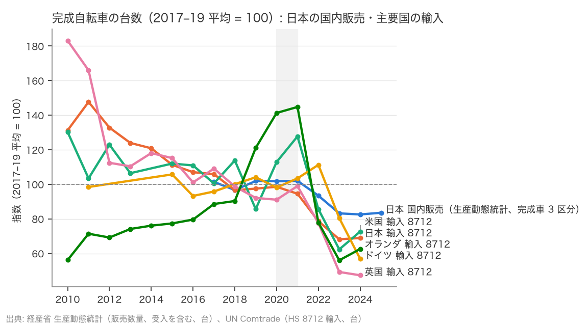
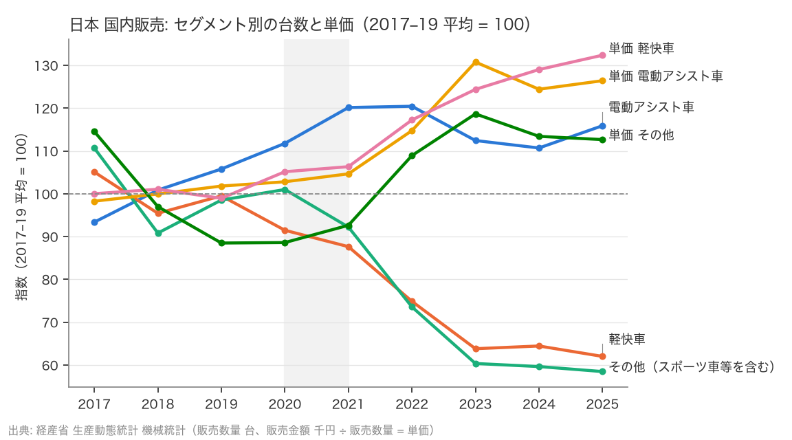
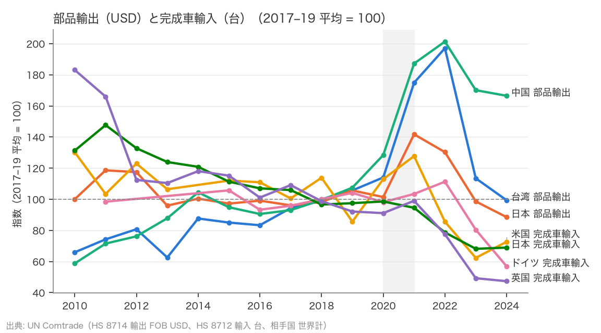
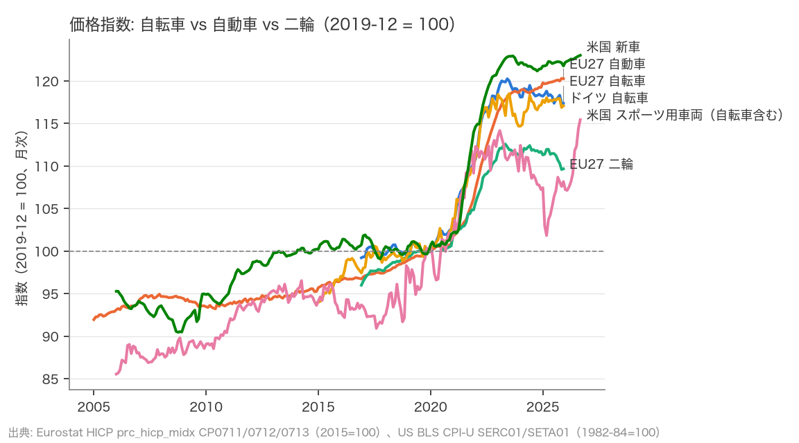
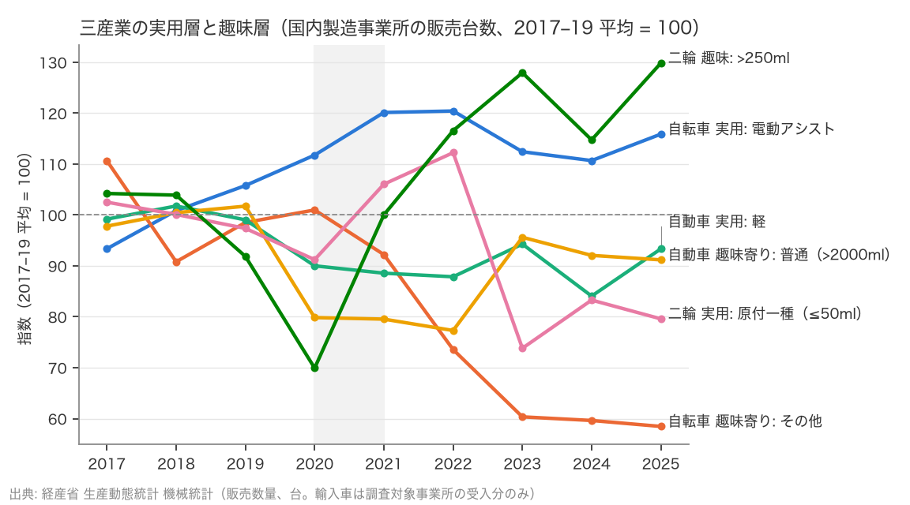

# R1: 自転車の量と価格はコロナ前に戻ったか（2026-10-22, theme: bicycle-industry）

## 要約（記述のみ、因果の主張はない）
- **H1（コロナ特需の反動で、2024–25 年の台数はコロナ前を下回らない）は不支持。** 完成自転車の台数は、日本の国内販売（生産動態統計、2024–25 平均）で 2017–19 年平均の 0.83 倍、輸入（Comtrade、2024 年のみ）は日本 0.69、米国 0.73、ドイツ 0.57、英国 0.47、オランダ 0.63 倍（いずれも事前基準の 0.85 を下回る）。事前登録の「EU」全体の系列はなく、国別の輸入で代えた。「特需からの正常化」では説明できず、コロナ前の水準自体を割り込んでいる。
- 日本の中では分かれている。電動アシスト車の販売台数は 2017–19 平均の 1.13 倍、軽快車 0.63 倍、「その他」（スポーツ車等を含む）0.59 倍。単価は電動アシスト 8.1 万円 → 10.3 万円、軽快車 1.6 → 2.1 万円に上がり、「その他」は 2.3 → 2.2 万円で横ばい（H2 の方向と整合的だが、スポーツ車単独は本データでは分離できない）。
- 部品輸出（HS 8714、USD）は事前登録の期間 2022 → 2023 に台湾 −42%、日本 −24%、中国 −16%。同じ期間の完成車輸入台数は米国 −27%、日本 −13%、ドイツ −28%、英国 −36%。部品の落ち幅と完成車の落ち幅の比は、比べる国の組み合わせで 1.5 倍を超えたり下回ったりする（ドイツ・英国の完成車輸入は日本の部品輸出より深く落ちている）ので、この代理では判定しない。H3 の判定はシマノの売上（未取得）で行う。ここは探索的な記述。
- 価格指数（HICP、EU27）は自転車が 2019 → 2022 に +17.8% 上がった後、2022 → 2025 は −0.4% と止まった。自動車は同じ期間 +15.7% → +3.9% と上がり続けている。二輪は自転車と同じく止まった（+10.7% → −0.9%）。米国も「スポーツ用車両（自転車含む）」は 2022 → 2025 に −3.7%、新車は +0.9%。
- 三産業の国内製造事業所の販売台数（生産動態統計、探索的。事前登録の区分とは異なる）では、2022 → 2025 に自転車の電動アシスト −4%、その他 −21%、自動車の軽 +6%、普通 +18%、二輪の原付一種 −29%、>250 ml +11%。H6 の判定は事前登録どおり輸入車の価格帯別登録・小型二輪・スポーツ車の系列を加えてから行う。

## 問いと仮説
`design/themes/bicycle-industry.md` の問い 1（量と価格）、仮説 H1 の判定、H2・H3・H4・H6 の記述的な前置き。判定基準は分析前に固定した（H1: 2024–25 平均 / 2017–19 平均 ≥ 0.95 で整合、< 0.85 で不支持）。H2（JBPI のスポーツ車系列）、H3（シマノ）、H4（CPI 自転車 A/B）、H5（経済センサス）の判定は、それぞれのデータを取得してから別レポートで行う。

推定したい量: 記述的な比（コロナ前平均に対する直近の水準）と、系列間の変化率の差。因果効果は推定しない。

## データ
| 変数 | 出典 | 定義・単位 | 期間・国 | 備考 |
|---|---|---|---|---|
| 国内販売台数・金額（自転車 3 区分、乗用車 3 区分、二輪 4 区分） | 経産省 生産動態統計 機械統計 年報 xlsx（2021–2025 年報） | 販売数量（台）・販売金額（千円）。**販売数量は受入（他社・輸入品の仕入）を含む**ので生産数量より大きい。暦年 2017–2023 は年報の暦年列、2024–25 は月次 12 本の合計 | 日本、2017–2025 | 「その他」自転車にスポーツ車・ミニサイクル・子供車が混在。秘匿 "X" なし |
| 完成自転車 輸入台数（HS 8712）、部品 輸出額（HS 8714） | UN Comtrade preview API | 台、USD（輸入 CIF／輸出 FOB）、相手国 世界計 | JPN USA DEU NLD FRA GBR ITA CHN TWN、2010–2024 | ドイツ 2010・2012–14 等は台数欠損（金額のみ）。8714 は台数なし |
| 価格指数 | Eurostat HICP `prc_hicp_midx` CP0711/0712/0713（2015=100）、US BLS CPI `CUUR0000SERC01`・`SETA01`（1982-84=100） | 月次。図では 2019-12 = 100 に再基準化 | HICP 2005-01–2025-12（自動車 CP0711 は EU27・DE とも 2005-01 から。自転車 CP0713 は DE 2014-12、EU27 2016-12 から）、US 2006-01–2026-09 | 米国に自転車単独の品目はない。2025-10 の BLS は未公表 |

mart: `data/marts/meti_production.parquet`（7,332 行）、`data/marts/bicycle_trade.parquet`（608 行）、`data/marts/price_indices.parquet`（8,210 行）。取得 2026-10-22（`data/raw/manifest.jsonl`）。

## 方法
記述のみ。各系列を 2017–19 年平均 = 100 に指数化して重ね、事前に固定した比で H1 を判定する。価格指数は 2019-12 = 100 に再基準化し、2019 → 2022（インフレ期）と 2022 → 2025（在庫調整期）の 12 月値の変化率を比べる。回帰・検定はしない。

## 結果

### H1: 完成自転車の台数はコロナ前を下回っている
| 系列 | 2017–19 平均 | 2024–25 平均 | 比 | 判定 |
|---|---|---|---|---|
| 日本 国内販売（生産動態統計、完成車 3 区分） | 1,597,091 | 1,326,346 | 0.83 | 不支持 |
| 日本 輸入 8712 | 6,399,869 | 4,412,904（2024 のみ） | 0.69 | 不支持 |
| 米国 輸入 8712 | 15,268,547 | 11,094,736（2024 のみ） | 0.73 | 不支持 |
| ドイツ 輸入 8712 | 2,867,995 | 1,631,090（2024 のみ） | 0.57 | 不支持 |
| 英国 輸入 8712 | 3,155,161 | 1,493,859（2024 のみ） | 0.47 | 不支持 |
| オランダ 輸入 8712 | 2,482,710 | 1,553,452（2024 のみ） | 0.63 | 不支持 |



2020–21 年に輸入が膨らんだ国（オランダ +45%、米国 +28%）でも、ほとんど膨らまなかった日本の国内販売（+2%）でも、2023 年には全系列がコロナ前を割り、2024 年も戻っていない。日本の輸入は 2010 年代を通じて減り続けており（840 万台 → 620 万台）、コロナ後の落ち込みは長期トレンドの上に乗っている。

### 日本のセグメント: 電動アシストは増え、軽快車と「その他」は 4 割減
| 系列 | 2017 | 2019 | 2021 | 2022 | 2023 | 2024 | 2025 | 2024–25/2017–19 |
|---|---|---|---|---|---|---|---|---|
| 電動アシスト車 台数 | 616,282 | 698,227 | 792,985 | 794,947 | 742,102 | 730,622 | 764,937 | 1.13 |
| 軽快車 台数 | 636,524 | 602,778 | 530,933 | 453,541 | 386,502 | 390,366 | 375,632 | 0.63 |
| その他 台数 | 366,520 | 326,317 | 305,439 | 243,652 | 199,867 | 197,507 | 193,628 | 0.59 |
| 電動アシスト車 単価（円） | 80,094 | 82,975 | 85,299 | 93,531 | 106,583 | 101,411 | 103,035 | |
| 軽快車 単価（円） | 16,093 | 15,919 | 17,108 | 18,863 | 20,013 | 20,758 | 21,297 | |
| その他 単価（円） | 22,859 | 17,662 | 18,487 | 21,738 | 23,683 | 22,635 | 22,484 | |



単価は販売金額 ÷ 販売数量で、生産動態統計の調査対象（製造事業所）の出荷段階の価格。小売価格ではない。販売数量には調査対象事業所が受入として仕入れた他社品・輸入品も入るが、輸入完成車の多くは調査対象外の輸入業者を通るため入らない（Comtrade の 8712 輸入 441 万台に対し生産動態統計の販売数量は 133 万台）。「その他」の単価 2 万円台はスポーツ車の小売価格帯（10 万円超）とかけ離れており、「その他」の大半はミニサイクル・子供車などの低価格車であることを示す。**スポーツ車の動きは本データでは見えない**（H2 は JBPI の車種別統計で判定する）。

### H3 の代理（探索的）: 部品輸出と完成車輸入の落ち幅
事前登録の H3 はシマノの売上で判定する（期間 2022 → 2023、部品の落ち幅 ÷ 完成車需要の落ち幅 ≥ 1.5）。ここでは代理として台湾・日本・中国の部品輸出額を並べる。

| 系列 | 2022 → 2023（事前登録の期間） | 2022 → 2024 | 2021 → 2024 |
|---|---|---|---|
| 台湾 部品輸出（8714 USD） | −42.4% | −49.6% | −43.2% |
| 日本 部品輸出（8714 USD） | −24.3% | −32.1% | −37.6% |
| 中国 部品輸出（8714 USD） | −15.5% | −17.3% | −11.1% |
| 米国 完成車輸入（8712 台） | −27.1% | −15.1% | −43.1% |
| ドイツ 完成車輸入（8712 台） | −27.7% | −48.9% | −45.0% |
| 日本 完成車輸入（8712 台） | −13.4% | −12.4% | −27.1% |
| 英国 完成車輸入（8712 台） | −36.4% | −38.9% | −52.2% |



図は部品輸出 3 か国と完成車輸入 4 か国（米・独・日・英）。

部品輸出は 2021–22 にコロナ前（2017–19 平均）の 台湾 約 2.0 倍（2022）、中国 約 2.0 倍（2022）、日本 約 1.4 倍（2021）まで膨らみ、2024 年にはコンポーネント輸出の多い台湾で 2022 年比で半減した。2022 → 2023 では台湾の部品 −42% に対し、完成車輸入は日本 −13%・米国 −27%・ドイツ −28%・英国 −36% で、台湾の部品の方が深い。日本の部品 −24% は米国・ドイツ・英国の完成車より浅い。「部品の落ち幅 ≥ 完成車の 1.5 倍」は、比較する国の組み合わせで変わるため、この代理データでは判定しない。部品輸出は金額（USD）で、完成車輸入は台数なので、為替と単価変化を含む。

### H4 国際側: 自転車の価格は 2022 年以降止まり、自動車は上がり続けた
| 系列（12 月値） | 2019 → 2022 | 2022 → 2025 |
|---|---|---|
| EU27 自転車（HICP CP0713） | +17.8% | −0.4% |
| EU27 自動車（CP0711） | +15.7% | +3.9% |
| EU27 二輪（CP0712） | +10.7% | −0.9% |
| ドイツ 自転車 | +16.7% | +0.3% |
| 米国 スポーツ用車両（自転車含む） | +12.3% | −3.7% |
| 米国 新車 | +20.7% | +0.9% |



HICP はヘドニック調整済みの消費者物価で、値引き（セール）の深さを直接は捉えない。それでも 2022 年以降の 3 年間、自転車（と二輪）の指数が横ばい〜下落で、自動車だけが上がり続けた差は明瞭。米国の「スポーツ用車両」は 2024 年に −6% まで落ちて 2026 年に反発しているが、自転車単独の系列ではない点に注意。

### H6 国内側（探索的）: 国内製造事業所の販売台数で見た実用層と趣味層
事前登録の H6 は 2022 → 2025 の変化率を、実用層（軽／原付／電動アシスト）と趣味層（輸入車 500 万円超／小型二輪／スポーツ車）で比べる。ここでは生産動態統計で取れる区分（趣味層は 普通乗用車 >2000 ml、二輪 >250 ml、自転車「その他」）に置き換えた探索的な記述で、判定はしない。

| 産業 | 実用層 | 2022→2025 | 2024–25/2017–19 | 趣味層（代理） | 2022→2025 | 2024–25/2017–19 |
|---|---|---|---|---|---|---|
| 自転車 | 電動アシスト | −3.8% | 1.13 | その他（スポーツ等を含む） | −20.5% | 0.59 |
| 自動車 | 軽 | +6.2% | 0.89 | 普通（>2000 ml） | +17.9% | 0.92 |
| 二輪 | 原付一種（≤50 ml） | −29.1% | 0.81 | >250 ml | +11.4% | 1.22 |



国内製造事業所の販売台数で見る限り、二輪は趣味層（大型）がコロナ後に伸び、実用層（原付一種、2025 年に排ガス規制で新基準原付へ移行）が縮む。自動車は軽より普通の方が伸びている。自転車だけが「実用層 > 趣味層」の形になるが、生産動態統計は調査対象事業所が受け入れた分しか輸入車を含まず（自動車の輸入高価格帯、二輪の輸入ブランド、輸入スポーツ車はほぼ入らない）、趣味層の代理区分も事前登録と違う。H6 の判定は輸入車の価格帯別登録（JAIA）・新車登録（自販連・全軽自協）・JBPI のスポーツ車を加えてから行う。

## 頑健性
- H1 の比を 2024 年のみ（2025 年を含めない）で計算しても、日本の国内販売は 0.83 で変わらない（2024 1,318,495、2025 1,334,197）。
- H1 の pre 期間を 2015–19 に広げると、日本の輸入は 0.67、米国 0.69、ドイツ 0.57、英国 0.46、オランダ 0.68 となり判定は変わらない。
- 日本の国内販売を「生産数量」で見ると、2017–19 平均 878,259 → 2024–25 平均 681,136（0.78）で同じ方向。
- ドイツの輸入台数は 2010・2012–14 が欠損で指数の起点が 2011 と 2015 以降になるが、判定は 2017–19 基準のため影響しない。

## 限界・言えないこと
- 記述のみ。台数が減った原因（特需の反動、在庫、価格、人口減、電動化による買い替え周期の長期化）は識別していない。
- 生産動態統計は調査対象の製造事業所の出荷（販売数量には受入として仕入れた他社品・輸入品の一部を含む）で、小売販売ではない。輸入完成車の大半は Comtrade の輸入台数で別に見たが、両者は一部重なりうるので足し合わせていない。輸入台数は輸入在庫の変動を含む。
- 「その他」自転車にスポーツ車が分離されていない。H2 は JBPI の車種別統計が必要。
- HICP・CPI は値引きの深さを捉えない。平均購入価格（家計調査・ZIV）と併置して H4 を判定する。
- 部品輸出（USD）と完成車輸入（台）は単位が違い、為替・単価の変化を含む。H3 本体はシマノの開示で判定する。

## 再現手順
```bash
uv run socioscope run bicycle-industry fetch && uv run socioscope run bicycle-industry stage && uv run socioscope run bicycle-industry mart
uv run python themes/bicycle-industry/src/theme_bicycle_industry/analysis/a20261022_r1_volume_price.py > themes/bicycle-industry/reports/2026-10-22-r1-volume-price.stdout.txt
```
判定は標準出力（`2026-10-22-r1-volume-price.stdout.txt`）に出る。

## チェックリスト回答
- A: 問い・H1〜H6・判定基準は `design/themes/bicycle-industry.md`（2026-10-22）にデータを見る前に固定。本レポートは H1 の判定と、H2・H3・H4・H6 の記述的前置き（H3 の代理と H6 は事前登録と期間・区分が異なるため「探索的」と明記）。推定量は「コロナ前平均に対する直近の比」。
- B: 出典・定義・単位・取得日は上表と manifest で一致。欠損（Comtrade の台数欠損、BLS 2025-10）は列挙し補完していない。サンプルは取得できた報告国・年の全部。
- C: 識別戦略なし（記述のみ）。因果は主張しない。国レベルの集計で個人・店舗レベルの主張はしない。
- D: 標準誤差なし（母集団統計の比）。試した仕様（2024 のみ、pre 2015–19、生産数量）は頑健性に全部書いた。
- E: 「不支持」「探索的」「判定しない」を使い分け、因果語は使っていない。図 5 枚に軸・基準年・単位・出典を明記。限界の節あり。再現手順と mart の行数を記載。LLM 構造化は使っていない。
