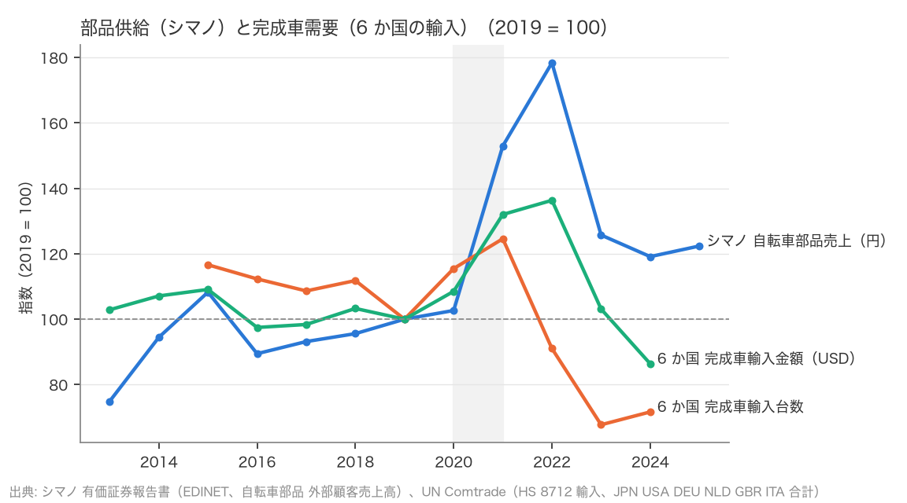
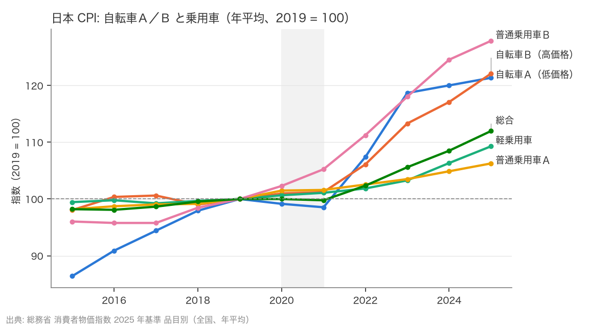

# R2: 部品のブルウィップと価格の二極化はあったか（2026-10-22, theme: bicycle-industry）

## 要約（記述のみ、因果の主張はない）
- **H3（シマノの自転車部品売上の落ち幅は、完成車需要の落ち幅の 1.5 倍以上）は不支持。** 2022 → 2023 の落ち幅は、シマノ 自転車部品売上 −29.5%（円建て）、6 か国（日・米・独・蘭・英・伊）の完成自転車輸入台数 −25.6%。比は 1.15 で、事前基準の 1.5 に届かない。金額（USD）で見ても比 1.21。日本の輸入だけと比べれば 2.21 だが、英国 0.81、伊 0.90 と比べれば 1 を下回る。
- 補助・探索的（主判定は不支持のまま）: 2022 → 2024 では比 1.56（部品 −33.2%、需要 −21.3%）となり、2024 年に需要が +5.8% 戻ったのに部品が −5.2% とさらに落ちた分、落ち幅の差が開いた。「部品の方が落ちた」のは 2023 年の 1 年ではなく、2024 年までの 2 年で見たときである。セグメント利益は 2022 → 2023 に −55.0%（1,450 億円 → 653 億円）と売上より深く落ち、2025 年も 428 億円にとどまる。
- 部品が 2021–22 に完成車需要より大きく膨らんだこと（2019 = 100 で部品 178、輸入台数 91）も含め、ピークとその反動の振幅は部品の方が大きい。これは事前に決めた「落ち幅の比 ≥ 1.5」とは別の見方で、探索的な記述。
- **H4（CPI 自転車Ａ（低価格）は自転車Ｂ（高価格）より 2022 → 2025 に 5pt 以上多く上がる）は不支持。** Ａ +13.0%、Ｂ +15.1%、差 −2.1pt。12 月値でも差 −4.7pt。予想と逆に、高価格帯の方が上がった。
- 一方、2015 → 2022 ではＡ +24.3%、Ｂ +8.2%（差 +16.1pt）で、低価格帯が先に上がり、2022 年以降に高価格帯が追いついた形。乗用車も 2022 → 2025 は普通乗用車Ｂ（高価格）+14.9% ＞ 軽 +7.3% ＞ 普通乗用車Ａ +3.6% で、高価格帯の上昇が大きい。
- CPI は銘柄を固定した消費者物価で、ヘドニック調整や銘柄入替を含み、セールの深さや売れ筋の価格帯の移動は捉えない。「セール連発」はこのデータでは観測できない（限界の節）。

## 問いと仮説
`design/themes/bicycle-industry.md` の問い 3（部品供給側）と問い 1（価格）、仮説 H3 と H4 の判定。判定基準はデータを見る前に固定した（H3: 2022 → 2023 の落ち幅の比 ≥ 1.5 で整合。H4: 2022 → 2025 の自転車Ａの上昇率 − Ｂの上昇率 ≥ 5pt で整合）。

推定したい量: 2 つの系列の変化率の比（H3）と差（H4）。因果効果は推定しない。

事前登録からの逸脱: H3 の需要の代理は「主要国輸入台数・EU 販売台数」としていたが、EU 販売台数（ZIV・CONEBI）は未取得のため 6 か国の輸入台数だけで判定した。H3 の付随判定（回復局面で部品が遅れる／2024–25 に完成車横ばい・部品増収なら在庫消化の終了）は下記に明示する。

## データ
| 変数 | 出典 | 定義・単位 | 期間 | 備考 |
|---|---|---|---|---|
| シマノ 自転車部品 売上高・セグメント利益 | 有価証券報告書（EDINET、12 本）セグメント情報 | 外部顧客に対する売上高、百万円（円建て、世界合計） | FY2013–2025 | 当期・前期の二重記載に食い違いなし。FY2010–2012 は取れない |
| 完成自転車 輸入台数・金額（HS 8712） | UN Comtrade preview API | 台、USD（CIF）。需要の代理は 日・米・独・蘭・英・伊 の合計 | 2015–2024（6 か国そろう年） | 仏は台数欠損のため除外。中国・台湾は輸出国。2025 は未公表 |
| CPI 自転車Ａ／Ｂ、乗用車 3 区分、総合 | 総務省 消費者物価指数 2025 年基準 品目別（全国、年平均・月次） | 2025 年 = 100。Ａ＝低価格銘柄、Ｂ＝高価格銘柄（2015 年から） | 1970–2025（Ｂは 2015–） | 銘柄規格は基準改定で見直される |

mart: `data/marts/shimano_segments.parquet`（156 行）、`data/marts/bicycle_trade.parquet`（608 行）、`data/marts/jp_cpi_vehicles.parquet`（4,393 行）。取得 2026-10-22。

## 方法
記述のみ。変化率は年次の値から計算し、事前に決めた期間・閾値で判定する。補助として、期間（2021 → 2023、2022 → 2024）、単位（台数／USD）、国別、12 月値、2019 → 2025 を並べる。回帰・検定はしない。

## 結果

### H3: 2023 年の落ち幅は部品と完成車でほぼ同じ、2024 年までで開く
| 指標 | 2022 | 2023 | 変化率 | 比（部品 ÷ 需要） | 判定 |
|---|---|---|---|---|---|
| シマノ 自転車部品売上（百万円） | 517,436 | 364,679 | −29.5% | | |
| 6 か国 完成車輸入台数 | 26,178,718 | 19,475,316 | −25.6% | **1.15** | **不支持** |
| 6 か国 完成車輸入金額（USD） | | | −24.4% | 1.21 | 不支持 |

国別の比（2022 → 2023 の輸入台数）: 日本 −13.4%（比 2.21）、米国 −27.1%（1.09）、ドイツ −27.7%（1.06）、オランダ −28.0%（1.05）、英国 −36.4%（0.81）、イタリア −32.6%（0.90）。

補助の期間:
| 期間 | 部品 | 需要（台数） | 比 |
|---|---|---|---|
| 2021 → 2023 | −17.8% | −45.6% | 0.39 |
| 2022 → 2023（主） | −29.5% | −25.6% | 1.15 |
| 2022 → 2024 | −33.2% | −21.3% | 1.56 |



| 年 | 部品売上 百万円 | 6 か国 輸入台数 | 6 か国 輸入 USD mn |
|---|---|---|---|
| 2019 | 290,038 | 28,756,730 | 4,111 |
| 2020 | 297,777 | 33,209,276 | 4,462 |
| 2021 | 443,678 | 35,830,892 | 5,428 |
| 2022 | 517,436 | 26,178,718 | 5,606 |
| 2023 | 364,679 | 19,475,316 | 4,239 |
| 2024 | 345,553 | 20,605,137 | 3,551 |
| 2025 | 354,972 | – | – |

完成車の輸入台数は 2021 年に山（2019 年比 +25%）を打ち、2022 年にはもう −9% に落ちていた。部品売上の山は 1 年遅れて 2022 年（+78%）で、2023 年に落ちた。山の時期がずれているため、同じ 2022 → 2023 で切ると比は 1.15 にしかならず、2021 → 2023 で切ると需要の方が深く落ちる（比 0.39）。2024 年は需要が +5.8% 戻ったのに部品は −5.2% と落ち続け、2025 年に +2.7% と小幅に戻った。セグメント利益は 2022 年 1,450 億円 → 2023 年 653 億円（−55%）→ 2025 年 428 億円。

付随判定: (a)「回復局面でも部品の方が遅れる」は整合（需要は 2024 年に +5.8%、部品は −5.2% で 1 年遅れて 2025 年に +2.7%）。(b)「2024–25 に完成車が横ばい・部品が増収」は 2025 年の輸入台数が未公表のため判定保留（2024 年時点では完成車 +5.8%・部品 −5.2% で、在庫消化の終了とは書けない）。

事前に決めた基準では H3 は不支持。「部品の振幅が完成車より大きい」ことは山（部品は 2022 年に 2019 年比 +78%、輸入台数は 2021 年に +25%、輸入金額は 2022 年に +36%）と、2024 年まで含めた落ち幅（比 1.56）で見える。これは期間の取り方で結論が変わるため、「2023 年単年のブルウィップ」とは言えないが、「2021–24 年の山と谷の振幅は部品の方が大きい」とは言える（探索的）。

### H4: 高価格帯の方が上がった
| 指標 | 2022 | 2025 | 上昇率 | 差（Ａ − Ｂ） | 判定 |
|---|---|---|---|---|---|
| CPI 自転車Ａ（低価格） | 88.5 | 100.0 | +13.0% | | |
| CPI 自転車Ｂ（高価格） | 86.9 | 100.0 | +15.1% | **−2.1pt** | **不支持** |

補助: 12 月値（2022-12 → 2025-12）Ａ +6.2%、Ｂ +10.9%、差 −4.7pt。2019 → 2025（年平均）Ａ +21.4%、Ｂ +22.1%、差 −0.7pt。2015 → 2022 はＡ +24.3%、Ｂ +8.2%、差 +16.1pt。

図は 2019 年 = 100 に再基準化（表は 2025 年 = 100）。



| 年 | 自転車Ａ | 自転車Ｂ | 自転車（類） | 軽乗用車 | 普通乗用車Ａ | 普通乗用車Ｂ | 総合 |
|---|---|---|---|---|---|---|---|
| 2015 | 71.2 | 80.3 | 74.1 | 91.0 | 92.4 | 75.1 | 87.7 |
| 2019 | 82.4 | 81.9 | 82.4 | 91.5 | 94.1 | 78.2 | 89.3 |
| 2022 | 88.5 | 86.9 | 87.8 | 93.2 | 96.5 | 87.0 | 91.4 |
| 2023 | 97.8 | 92.8 | 95.8 | 94.5 | 97.4 | 92.3 | 94.3 |
| 2024 | 98.9 | 95.9 | 97.7 | 97.3 | 98.7 | 97.4 | 96.9 |
| 2025 | 100.0 | 100.0 | 100.0 | 100.0 | 100.0 | 100.0 | 100.0 |

低価格の自転車Ａは 2015 → 2019 に +16% 上がり（Ｂは +2%）、2022 → 2023 に +10.5% と一段上がって頭打ちになった。高価格のＢは 2021 年まで横ばい（2015 → 2021 +3.2%）で、2022 年に +4.8%、2023 → 2025 に +7.8% 上がった。R1 で見た EU の HICP 自転車（2022 → 2025 −0.4%）と違い、日本の CPI は自転車Ａ・Ｂとも 2022 年以降も上がっている。乗用車は 2022 → 2025 に 普通乗用車Ｂ +14.9% ＞ 軽 +7.3% ＞ 普通乗用車Ａ +3.6% と、こちらも高価格帯の上昇が大きい。

## 頑健性
- H3 の需要を金額（USD）にしても比 1.21 で判定は変わらない。期間を 2022 → 2024 にすると比 1.56 で基準を超える（上記）。2021 → 2023 では 0.39。国を日本だけにすると 2.21、英国だけなら 0.81。
- H4 を 12 月値にすると差 −4.7pt、2019 → 2025 にすると −0.7pt で、いずれも 5pt に届かない。

## 限界・言えないこと
- 記述のみ。部品の落ち幅と完成車の落ち幅の比は、何が原因かを示さない（在庫調整、価格、シェア変化、為替）。
- シマノの売上は円建ての世界合計で、2022 → 2023 の円安は円建て売上を押し上げる方向に働く。現地通貨ベースの落ち幅は円建てより大きいと考えられ、その分だけ比 1.15 は H3 に不利な方向（小さく出る方向）に偏っている可能性がある。開示がないので計算していない（為替データも本テーマでは未取得）。
- 完成車需要の代理は 6 か国の輸入台数で、欧州の国内生産分（独・伊・蘭の自社生産）や、EU 域内の販売台数（ZIV・CONEBI）を含まない。輸入台数は輸入業者の在庫変動も含む。
- CPI の自転車Ａ・Ｂは銘柄規格を固定した指数で、セール（値引き）の深さや、売れ筋がエントリーからミドルに動く（または逆）といった構成変化を捉えない。「セール連発」を検証するには平均購入価格（ZIV、JBPI POS 単価）が必要で、家計調査には自転車の平均価格がない。
- 2025 年 = 100 の基準で、2022 → 2025 の上昇率は「2022 年にどれだけ 100 を下回っていたか」の比較になる。基準年の違いは比には影響しない。

## 再現手順
```bash
uv run socioscope run bicycle-industry fetch && uv run socioscope run bicycle-industry stage && uv run socioscope run bicycle-industry mart
uv run python themes/bicycle-industry/src/theme_bicycle_industry/analysis/a20261022_r2_bullwhip_price.py > themes/bicycle-industry/reports/2026-10-22-r2-bullwhip-price.stdout.txt
```
判定は標準出力（`2026-10-22-r2-bullwhip-price.stdout.txt`）に出る。

## チェックリスト回答
- A: H3・H4 の判定基準は `design/themes/bicycle-industry.md`（2026-10-22）にデータを見る前に固定。「振幅」の見方（2021–24 の山と谷）は事後の探索的記述と明記。推定量は変化率の比と差。
- B: 出典・定義・単位・取得日は上表と manifest で一致。欠損（仏の台数、2025 年の輸入、FY2010–12）は列挙し補完していない。需要の代理の国の選択理由（台数のそろう輸入国）を書いた。
- C: 識別戦略なし（記述のみ）。因果は主張しない。
- D: 標準誤差なし（母集団統計・開示値の比）。試した仕様（USD、2021 → 2023、2022 → 2024、国別、12 月値、2019 → 2025）は全部書いた。
- E: 「不支持」「探索的」「言えない」を使い分け、因果語は使っていない。図は軸・基準年・出典を明記。限界の節あり。再現手順と mart の行数を記載。LLM 構造化は使っていない。
