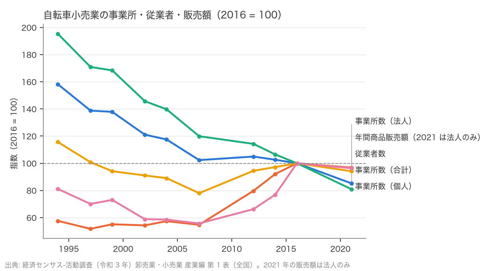
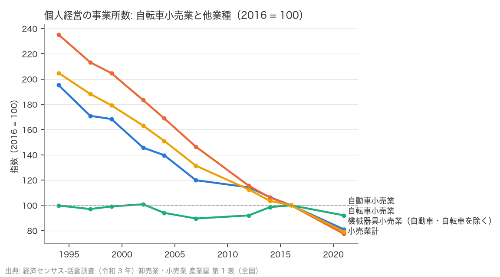

# R3: 自転車小売は集約したのか、小規模店は淘汰されたのか（2026-10-22, theme: bicycle-industry）

## 要約（記述のみ、因果の主張はない）
- **H5 (a)（事業所数の減少率 > 販売額の減少率）は事前基準では整合（定義差を含む）。** 自転車小売業の事業所数は 2016 → 2021 に 11,207 → 9,552（−14.8%）、年間商品販売額は 2,401 億円 → 2,313 億円（−3.7%）。ただし 2021 年の販売額は個人経営を含まない（表の注 7）ので、2016 年（法人＋個人）と 2021 年（法人のみ）の比較になっている。
- 定義をそろえた（法人同士の）比較は本表では**判定不能**。2016 年の法人だけの販売額は表に無く、上限（2,401 億円）しか分からない。法人の販売額変化率の下限は −3.7% で、法人の事業所数 −3.2% との差は 0.5pt。2016 年の個人経営 8,186 店の販売額が総販売額の 0.48%（約 12 億円、1 店当たり約 14 万円/年）を超えていれば法人同士でも整合になる。それを下回るとは考えにくいが、本表からは確かめられない。
- **H5 (b)（個人経営の減少率 > 法人）は整合。** 個人 8,186 → 6,628（−19.0%）、法人 3,021 → 2,924（−3.2%）。1994 → 2021 では個人 −58.5%、法人 +68.1% と、30 年かけて個人店が減り法人店が増えてきた。
- ただし個人店の減少は自転車小売業に固有ではない。小売業計の個人経営は 2016 → 2021 に −22.6%（自転車小売業 −19.0% より大きい）、機械器具小売業 −20.8%、自動車小売業 −7.9%。自転車小売業の個人店の減り方は小売業全体と同じか少し緩い。
- 事前に書いたとおり、Blue Lug のような小規模専門店の「成功」は数の上では観察できない。個人店が 2021 年も事業所数の 69% を占める、という記述にとどまる。

## 問いと仮説
`design/themes/bicycle-industry.md` の問い 4（ニッチ）、仮説 H5 の判定。判定基準はデータを見る前に固定した（(a) 2016 → 2021 の事業所数変化率 < 販売額変化率で整合。(b) 個人経営の事業所数の減少率 > 法人で整合）。

推定したい量: 事業所数・販売額・経営組織別事業所数の 5 年間の変化率の比較。因果効果は推定しない。

事前登録からの注意: 事前登録では 2021 年の販売額が個人経営を含まないことを想定していなかった。(a) は主判定を事前基準どおり出し「定義差を含む」と注記したうえで、法人同士の比較は閾値つきの「判定不能」として並べる。

## データ
| 変数 | 出典 | 定義・単位 | 期間 | 備考 |
|---|---|---|---|---|
| 事業所数（合計・法人・個人）、従業者数、年間商品販売額、売場面積 | 令和 3 年経済センサス-活動調査 卸売業・小売業 産業編（総括表）第 1 表（e-Stat xlsx） | 産業分類細分類別・年次別、全国。販売額は百万円 | 1994・1997・1999・2002・2004・2007・2012・2014・2016・2021 | 2007 年以前と 2014 年は商業統計調査。1999・2004 年は簡易調査。2016 年の個人経営は売場面積を含まず、**2021 年の個人経営は販売額・売場面積を含まない**。2012 年以降は格付不能の事業所を含む |

対象業種: 自転車小売業（592）、小売業計（I2）、自動車小売業（591）、二輪自動車小売業（5914）、機械器具小売業（自動車・自転車を除く、593）。

mart: `data/marts/jp_retail_census.parquet`（300 行）。取得 2026-10-22。

## 方法
記述のみ。2016 → 2021 の変化率を事前基準で判定し、法人同士の比較（上限・閾値）、長期（2012・2007・1994 → 2021）、他業種との対比を並べる。回帰・検定はしない。

## 結果

### H5: 事業所は減り、個人店が減った
| 指標 | 2016 | 2021 | 変化率 | 判定 |
|---|---|---|---|---|
| 事業所数（合計） | 11,207 | 9,552 | −14.8% | (a) 整合（vs 販売額 −3.7%、定義差を含む） |
| 年間商品販売額（百万円） | 240,079（法人＋個人） | 231,252（法人のみ） | −3.7% | |
| 事業所数（個人） | 8,186 | 6,628 | −19.0% | (b) 整合（vs 法人 −3.2%） |
| 事業所数（法人） | 3,021 | 2,924 | −3.2% | |
| 従業者数 | 27,204 | 25,609 | −5.9% | |
| 法人 1 事業所当たり販売額（百万円） | ≤ 79.5（上限。分子に個人の販売額を含む） | 79.1 | | |



(a) は事前基準どおりなら整合だが、2016 年の販売額には個人経営の分が含まれ、2021 年には含まれない。法人だけの 2016 年の販売額は 2,401 億円以下なので、法人の販売額変化率は −3.7% 以上（下限）。法人の事業所数は −3.2% で、差は 0.5pt。2016 年の個人経営の販売額が総販売額の 0.5%（約 12 億円、個人 1 店当たり約 14 万円/年）を超えていれば、法人同士でも (a) は整合になる。閾値は小さいが、本表に個人経営の販売額が無いため確かめられず、**法人同士の判定は判定不能**とする。法人 1 店当たり販売額も、2016 年は上限（79.5 百万円）しか分からないので「横ばい」とは言えない。

(b) は 2016 → 2021 だけでなく、2012 → 2021（個人 −29.1%、法人 +21.4%）、2007 → 2021（−32.5%、+77.0%）、1994 → 2021（−58.5%、+68.1%）のどの期間でも整合。自転車小売業は 1994 年に 90% が個人店だったが、2021 年は 69%。

| 年 | 事業所数 | 法人 | 個人 | 従業者数 | 販売額 百万円 |
|---|---|---|---|---|---|
| 1994 | 17,724 | 1,739 | 15,985 | 31,452 | 194,650 |
| 1997 | 15,551 | 1,562 | 13,989 | 27,409 | 168,128 |
| 1999 | 15,448 | 1,664 | 13,784 | 25,609 | 175,301 |
| 2002 | 13,566 | 1,639 | 11,927 | 24,762 | 141,208 |
| 2004 | 13,170 | 1,733 | 11,437 | 24,220 | 140,550 |
| 2007 | 11,467 | 1,652 | 9,815 | 21,212 | 133,654 |
| 2012 | 11,761 | 2,408 | 9,353 | 25,695 | 159,004 |
| 2014 | 11,497 | 2,780 | 8,717 | 26,434 | 184,579 |
| 2016 | 11,207 | 3,021 | 8,186 | 27,204 | 240,079 |
| 2021 | 9,552 | 2,924 | 6,628 | 25,609 | 231,252（法人のみ） |

販売額は 2012 → 2016 に 1,590 億円 → 2,401 億円と急増している。2012 年は経済センサスの初回で格付不能の事業所を含み、2014 年は商業統計調査で、系列が接続していない可能性がある（注 5・8）。2012 → 2021 の販売額 +45.4% はこの 2016 年の急増に支えられており、2016 → 2021 の −3.7% とは別の話。

### 他業種との対比: 個人店の減少は小売業全体の現象
| 業種 | 事業所数 | 個人 | 法人 | 販売額（2021 は法人のみ） | (a) 定義差込み | (b) |
|---|---|---|---|---|---|---|
| 自転車小売業 | −14.8% | −19.0% | −3.2% | −3.7% | 整合 | 整合 |
| 小売業計 | −11.1% | −22.6% | −3.6% | −4.8% | 整合 | 整合 |
| 自動車小売業 | −2.0% | −7.9% | +0.9% | +1.5% | 整合 | 整合 |
| 二輪自動車小売業 | −69.8% | – | −18.6% | – | 判定不能 | 判定不能 |
| 機械器具小売業（自動車・自転車を除く） | −12.7% | −20.8% | −7.5% | +0.5% | 整合 | 整合 |



(b) は小売業計でも整合で、個人店の減少は自転車小売業に固有ではなく 2016 → 2021 の小売業全体に共通する。自転車小売業の個人店の減少率（−19.0%）は小売業計（−22.6%）より小さい。(a) は他業種でも同じ定義差（2021 年の販売額が法人のみ）を含むため、ここでは整合の形が共通することだけを記し、業種間の販売額の比較はしない。二輪自動車小売業（5914）は 2016 年の個人経営の数値が表に無く（`-`）、事業所数 −69.8% は分類の変更を含む可能性があるため判定しない。

## 頑健性
- (a) の法人同士の比較は判定不能（上記。法人の販売額変化率の下限 −3.7% vs 事業所 −3.2%、整合に転じる個人販売額の閾値は総販売額の 0.5%）。
- 期間を 2012・2007・1994 → 2021 に変えると (a)(b) とも整合（いずれも終点の販売額は法人のみ）。ただし 2007 年以前と 2014 年は商業統計調査で、経済センサスとは対象事業所の定義が違う（注 5・8）。
- 対象を小売業計にしても (a)(b) とも整合で、自転車小売業に固有の結果ではない。

## 限界・言えないこと
- 記述のみ。個人店が減った原因（後継者不足、量販・チェーンとの競争、EC、人口減）は識別していない。
- 2021 年の販売額は法人のみ、2016 年は法人＋個人で、(a) の主判定はこの定義差を含む。法人だけの 2016 年販売額が表に無いため、定義をそろえた比較は閾値つきの判定不能にとどまる（第 3 表（経営組織別）は 2021 年のみ）。
- 事業所数には量販店（ホームセンター・家電量販）の自転車売場は含まれない（産業分類が別）。「自転車小売業」は専門店中心の分類で、販売チャネル全体の集約は見えない。
- Blue Lug のような特定の店や「趣味・ファッション専門店」というセグメントは産業分類では分離できない。本レポートは個人店の数の推移までしか言えない。
- 1999・2004 年は簡易調査、2007 年以前・2014 年は商業統計で、系列の断絶がある。

## 再現手順
```bash
uv run socioscope run bicycle-industry fetch --only estat_census && uv run socioscope run bicycle-industry stage --only estat_census && uv run socioscope run bicycle-industry mart
uv run python themes/bicycle-industry/src/theme_bicycle_industry/analysis/a20261022_r3_retail.py > themes/bicycle-industry/reports/2026-10-22-r3-retail.stdout.txt
```

## チェックリスト回答
- A: H5 (a)(b) の判定基準は `design/themes/bicycle-industry.md`（2026-10-22）にデータを見る前に固定。2021 年の販売額の定義（個人を含まない）は事前に想定しておらず、主判定を基準どおり出したうえで定義差を注記し、法人同士の比較を閾値つきの判定不能として要約・結果・頑健性に同じ内容で書いた。推定量は変化率の比較。
- B: 出典・定義・単位・取得日は上表と manifest で一致。系列の断絶（商業統計／経済センサス、簡易調査、2021 年の個人経営の販売額なし、2012→2016 の急増）を列挙し補完していない。業種の選択理由（対比用の近い業種）を書いた。
- C: 識別戦略なし（記述のみ）。因果は主張しない。産業分類レベルの集計で個別の店の主張はしない。
- D: 標準誤差なし（全数調査）。試した仕様（法人同士、期間 3 通り、他業種）は全部書いた。
- E: 「整合（定義差を含む）」「判定不能」「固有ではない」「言えない」を使い分け、因果語は使っていない。図は軸・基準年・出典を明記。限界の節あり。再現手順と mart の行数を記載。LLM 構造化は使っていない。
