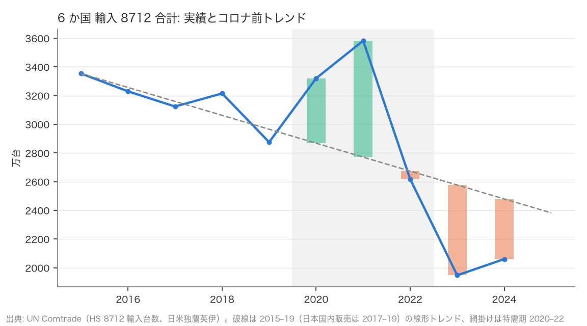
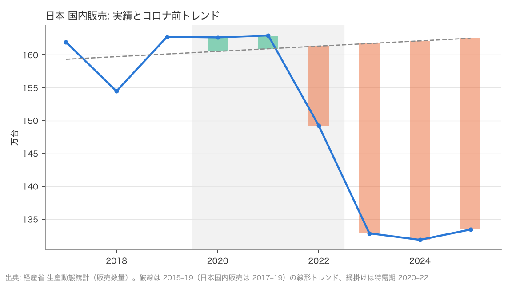
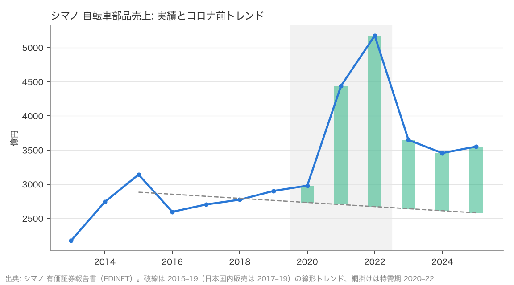
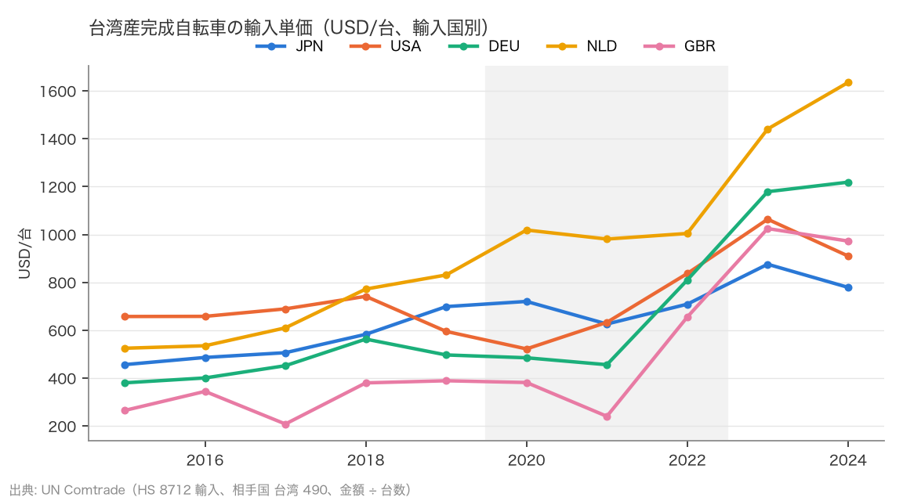
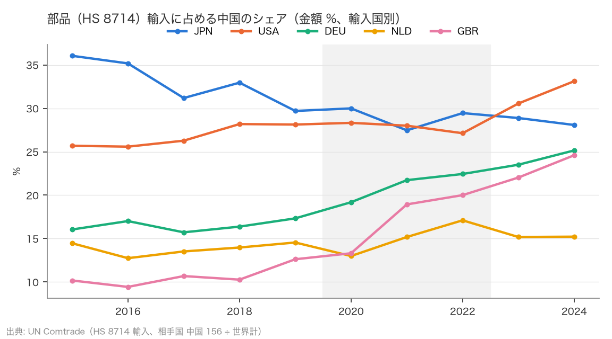

# R4: コロナ特需は「先食い」だったのか、エントリー層の苦戦は貿易統計に写るのか（2026-10-22, theme: bicycle-industry）

## 要約（記述のみ、因果の主張はない）
- 自転車の需要はコロナ前（〜2019）・特需（2020–22）・特需後（2023〜）で別の状態にある。**6 か国（日米独蘭英伊）合計の完成車輸入台数は、コロナ前 100 に対し特需 100、特需後 63。** 2015–19 トレンドからの 2020–21 の累積超過と 2022–24 の累積不足はほぼ等しく（R = 0.87、トレンドの取り方を変えても 0.52〜0.98）、**H7 は整合（先食いの形）**。しかし特需後の水準はトレンドの 0.79 倍（2024 年単年で 0.83）で「新しい常態（下方）」。穴は 2024 年時点でまだ埋まっていない。
- 国別の R はトレンド期間で判定が入れ替わるため（日本の輸入 0.20〜3.03、英国 −0.04〜18.24、米国 −0.41〜0.61）、断定できるのは 6 か国合計だけ。主仕様（2015–19）では米国は不足が小さく（R = 0.05、水準 0.93）、日本・英国・オランダは不足が大きい（R = 2.2〜7.4）が、これは条件付きの読み。水準 L は比較的安定で、特需後の水準はオランダ 0.31〜0.45、英国 0.57〜0.91、ドイツ 0.56〜0.67、米国 0.81〜1.14。
- 日本の国内販売（生産動態統計）は特需期にも上振れがほぼ無く（2020–22 平均 99）、特需後 83。セグメント別には電動アシスト 113、軽快車 63、その他 59。この系列のトレンドは 2017–19 の 3 点しか無く（事前登録からの逸脱）、R（17）は判定に使わず、3 局面の水準だけを結論にする。
- シマノの自転車部品売上は特需後も 2015–19 トレンドの 1.36 倍で、不足は生じていない（F > 0）。完成車の輸入台数が特需後に 0.63 まで落ちる一方で部品売上が 1.26 にとどまる差は、台当たり部品金額の上昇（電動化・高グレード化・円安）と整合するが、世界の円建て売上と 6 か国の輸入台数という別の母集団の比較であり、機構は観測していない。
- **H8 (a)（台湾産完成車の単価は 2022 → 2024 に下落＝セール）は不支持。** 5 か国すべてで上昇し、中央値 +48.5%。特需後／コロナ前は 1.48〜3.15 倍（中央値 2.35）。同時に台湾産の台数シェアは 2015–19 の 2.7〜12.5% から 2024 年の 0.9〜4.6% に落ちた。「少数・高額」への移行（e-bike・高級車の可能性）と整合するが、品目構成は観測していない。単価は構成変化を含むため、値引きの代理にはならなかった。
- **H8 (b)（部品輸入の中国シェア上昇）は中間（中央値 +4.99pt、基準 ≥ +5pt の直下）。** 明確に上がったのは英国 +11.97pt、ドイツ +7.82pt。米国は +4.99pt で閾値直下、日本 −1.62pt、オランダ +0.67pt は横ばい。「部品調達の中国シフト」は英独で見え、日本（28〜36%、2015 年 36.0% → 2024 年 28.1%）では見えない。

## 問いと仮説
`design/themes/bicycle-industry.md` の H7（2026-10-22 追加）と H8（同）。どちらも R1〜R3 の結果を見た後に立てた仮説で、判定手順・閾値・3 局面の扱いは追加計算の前に固定した。H8 は到達性確認のため 2023 年の 1 回分だけ目視した（台湾産単価が中国産より高いこと）。

推定したい量: H7 はトレンドからの累積乖離の比 R と特需後の水準 L。H8 は原産国別の単価とシェアの変化。因果効果は推定しない。

事前登録からの逸脱と期間の重なり:
- 日本の国内販売（生産動態統計）は 2017 年からしか無いため、トレンドは 2017–19 の 3 点で引いた。3 点を 6 年外挿するのは不安定で、この系列（と電動アシスト・軽快車・その他）の R は探索的な参考値にとどめ、判定には使わない。
- 特需期は 2020–22 と定義したが、E は事前登録どおり 2020–21、F は 2022–24 の和で、2022 年は F 側に入る（シマノと部品の 2022 年はピークだが、F の計算上は「不足期」に属する。シマノの 2022 年は F を押し上げる方向に働く）。

## データ
| 変数 | 出典 | 定義・単位 | 期間 | 備考（欠損・選択） |
|---|---|---|---|---|
| 完成車輸入台数（HS 8712）、世界計 | UN Comtrade preview API | 台 | 2010–2024 | 6 か国合計は日米独蘭英伊。フランスは台数欠損のため除外、中国・台湾は輸出国。ドイツは 2010・2012–14 の台数が欠損（2015 年以降は揃う）。2025 年は未公表 |
| 完成車・部品輸入の原産国別（中国 156・台湾 490） | 同上（相手国指定） | 台、USD。その他 = 世界 − 中国 − 台湾 | 2015–2024 | 日・米・独・蘭・英（台数の揃う主要輸入国） |
| 日本 国内販売台数（完成車 3 区分） | 経産省 生産動態統計 年報 | 台（受入を含む） | 2017–2025 | 2017 年以前は未取得（年報の形式が違う） |
| シマノ 自転車部品 売上高 | 有価証券報告書（EDINET） | 百万円 | FY2013–2025 | 円建て世界合計 |

mart: `data/marts/bicycle_trade.parquet`（608 行）、`bicycle_trade_by_origin.parquet`（560 行）、`meti_production.parquet`（7,332 行）、`shimano_segments.parquet`（156 行）。取得 2026-10-22。

## 方法
H7: 2015–19（日本国内販売は 2017–19）の年次値に最小二乗の直線を当て 2020–2025 に外挿。E = 2020–21 の（実績 − トレンド）の和、F = 2022–24 の和、R = −F/E。L = 2023–25（貿易系列は 2023–24）の実績平均 ÷ トレンド平均。判定は事前基準（R 0.8–1.5 整合、> 2 不支持、E ≤ 0 判定不能。L ≥ 0.9 戻り、< 0.8 新しい常態）。R < 0.8 の「不足小」は事後に付けた区分。頑健性にトレンド期間 2012–19・2017–19、対数線形、F を 2023–24 にした版。
H8: 原産国別の輸入金額 ÷ 台数で単価、部品の中国金額 ÷ 世界計でシェア。5 か国の中央値で判定（小数 2 桁）。コロナ前（2015–19 平均）と特需後（2023–24 平均）の比較を並べる。

## 結果

### H7: 合計では「先食い」の形、ただし穴は埋まっていない
| 系列 | E（2020–21） | F（2022–24） | R | 判定 | L | 水準 | 2024 実績／トレンド |
|---|---|---|---|---|---|---|---|
| 6 か国 輸入 8712 合計 | +12,641,955 | −11,052,451 | 0.87 | 整合（先食い） | 0.79 | 新しい常態（下方） | 0.83 |
| 米国 輸入 8712 | +10,126,764 | −540,042 | 0.05 | 不足小（事後区分） | 0.93 | 戻っている | 1.04 |
| 日本 輸入 8712 | +793,209 | −1,713,134 | 2.16 | 不支持 | 0.87 | 中間 | 0.89 |
| 英国 輸入 8712 | +551,316 | −1,529,611 | 2.77 | 不支持 | 0.67 | 新しい常態（下方） | 0.68 |
| オランダ 輸入 8712 | +858,590 | −6,317,351 | 7.36 | 不支持 | 0.38 | 新しい常態（下方） | 0.39 |
| ドイツ 輸入 8712 | −14,578 | −1,639,644 | – | 判定不能（特需なし） | 0.67 | 新しい常態（下方） | 0.56 |
| シマノ 自転車部品売上 | +198,183 | +435,378 | −2.20 | 不足なし（F > 0、事後区分） | 1.36 | 戻っている | 1.32 |
| 日本 国内販売（3 点トレンド、参考） | +41,533 | −712,136 | 17.15 | （判定に使わない） | 0.82 | 中間（参考） | 0.81 |
| 日本 電動アシスト（同） | +5,714 | −327,136 | 57.25 | （同） | 0.82 | 中間（参考） | 0.81 |
| 日本 軽快車（同） | −42,202 | −333,926 | – | （同、特需なし） | 0.76 | 新しい常態（参考） | 0.77 |
| 日本 その他（同） | +78,020 | −51,074 | 0.65 | （同） | 0.94 | 戻っている（参考） | 0.94 |



6 か国合計の輸入台数は 2020–21 に 1,264 万台の超過、2022–24 に 1,105 万台の不足で、比 0.87。「特需で前倒しされた需要の分だけ、その後に不足が出た」という先食いの形に合う。ただし 2024 年の水準はトレンドの 0.83 倍、2023–24 平均で 0.79 倍で、不足はまだ続いている。先食いなら 2025 年以降に穴が埋まるはず、構造的縮小なら埋まらない。2025 年の輸入台数が公表されれば区別できる（追跡項目）。

| 系列（コロナ前 2015–19 平均 = 100。日本国内販売は 2017–19） | 特需 2020–22 | 特需後 2023–25 |
|---|---|---|
| 6 か国 輸入 8712 合計 | 100 | 63 |
| 米国 | 104 | 65 |
| ドイツ | 104 | 69 |
| 英国 | 86 | 47 |
| オランダ | 133 | 65 |
| 日本 輸入 | 87 | 66 |
| 日本 国内販売 | 99 | 83 |
| 日本 電動アシスト | 117 | 113 |
| 日本 軽快車 | 85 | 63 |
| 日本 その他 | 89 | 59 |
| シマノ 自転車部品売上 | 149 | 126 |

国別には、主仕様（2015–19 トレンド）で米国は 2020–21 に 1,013 万台の超過を積み、2022–24 の不足は 54 万台（R = 0.05、2024 年はトレンドの 1.04）。英国・オランダ・日本は特需が小さく不足が大きい（R = 2.2〜7.4）。ドイツは 2020–21 の輸入がトレンドを下回っており、特需の反動という説明は成り立たない（ドイツの特需が輸入ではなく国内生産と価格に出た可能性は本データでは見えない）。ただし次の頑健性表のとおり、国別の R はトレンド期間でよく動き、判定が入れ替わる。国別について言えるのは水準 L の範囲（オランダ 0.31〜0.45、英国 0.57〜0.91、ドイツ 0.56〜0.67、米国 0.81〜1.14、日本の輸入 0.84〜0.97）まで。



日本の国内販売は特需期も 99（特需なし）で、特需後 83。電動アシストは特需後も 113 だが、2017–19 の年 +6% の伸びを外挿したトレンドには届かない。F の内訳は電動アシスト −327,136 と軽快車 −333,926 がほぼ同じ大きさで、「電動の伸びの鈍化」と「非電動の縮小」が同程度に効いている。3 点トレンドの外挿に依存するため、この系列からは「特需の上振れがほぼ無く、特需後の水準は 83（電動 113／軽快車 63／その他 59）」という水準の事実だけを採る。



シマノの部品売上は 2020–21 に 1,982 億円の超過、2022–24 にも 4,354 億円の超過で、トレンドを下回っていない（L = 1.36、2024 年 1.32）。完成車の輸入台数が特需後に 0.63 まで落ちる中で部品売上が 1.26 にとどまることは、台当たりの部品金額が上がったこと（電動化・高グレード化・円安）と整合するが、世界合計の円建て売上と 6 か国の台数という別の母集団の比較で、機構は観測していない。

### H7 頑健性
| 系列 | トレンド 2012–19 R / L | トレンド 2017–19 R / L | 対数線形 R / L | F を 2023–24 に R |
|---|---|---|---|---|
| 6 か国 輸入 合計 | 0.87 / 0.79 | 0.52 / 0.84 | 0.98 / 0.78 | 0.83 |
| 米国 | 0.61 / 0.81 | −0.41 / 1.14 | 0.14 / 0.90 | 0.14 |
| 日本 輸入 | 0.20 / 0.97 | 1.50 / 0.89 | 3.03 / 0.84 | 1.68 |
| 英国 | 18.24 / 0.57 | −0.04 / 0.91 | 3.84 / 0.64 | 2.69 |
| オランダ | 3.15 / 0.45 | 71.32 / 0.31 | 10.98 / 0.34 | 5.55 |
| ドイツ | – / 0.67 | – / 0.56 | – / 0.67 | – |
| 日本 国内販売 | 17.15 / 0.82 | 17.15 / 0.82 | 16.64 / 0.82 | 14.23 |
| シマノ | −1.98 / 1.10 | −1.81 / 1.05 | −2.18 / 1.35 | −0.93 |

6 か国合計の R は 0.52〜0.98 で、トレンドの取り方を変えても「先食いの形」は変わらない（2017–19 の 3 点トレンドでは 0.52 と 0.8 を下回るが、不足が超過を上回る方向には動かない）。国別の R は 2010 年代の輸入台数が国ごとに違う方向のトレンド（日本は減少、オランダは増加、英国は減少）を持ち、起点で「あるべき水準」が大きく変わるため不安定。水準 L は比較的安定している。

### H8 (a): 台湾産完成車は「少数・高額」に移った。単価は値引きの代理にならない
| 輸入国 | 単価 2015–19 平均 | 2022 | 2023 | 2024 | 2022 → 2024 | 特需後／コロナ前 | 中国産 2024 | 台湾／中国 |
|---|---|---|---|---|---|---|---|---|
| 日本 | 546 | 709 | 876 | 779 | +9.9% | 1.52 | 98 | 7.9 |
| 米国 | 668 | 837 | 1,064 | 910 | +8.8% | 1.48 | 48 | 18.9 |
| ドイツ | 458 | 810 | 1,179 | 1,218 | +50.5% | 2.61 | 169 | 7.2 |
| オランダ | 654 | 1,004 | 1,441 | 1,635 | +62.8% | 2.35 | 309 | 5.3 |
| 英国 | 317 | 655 | 1,025 | 972 | +48.5% | 3.15 | 81 | 11.9 |

中央値 +48.5% → **不支持**（USD/台）。特需後／コロナ前の中央値 2.35。



| 輸入国 | 台湾産 台数シェア 2015–19 | 2022 | 2024 | 台湾産 金額シェア 2015–19 | 2022 | 2024 | 中国産 台数 2024 | 中国産 金額 2024 |
|---|---|---|---|---|---|---|---|---|
| 日本 | 2.7 | 1.5 | 0.9 | 13.2 | 8.0 | 6.7 | 98.6 | 89.2 |
| 米国 | 4.4 | 6.6 | 3.1 | 30.8 | 32.5 | 29.0 | 85.3 | 41.9 |
| ドイツ | 5.8 | 3.2 | 3.2 | 10.0 | 6.9 | 8.3 | 6.4 | 2.3 |
| オランダ | 11.4 | 5.8 | 4.3 | 28.3 | 13.9 | 14.9 | 13.7 | 9.0 |
| 英国 | 12.5 | 5.1 | 4.6 | 22.9 | 16.7 | 20.1 | 26.1 | 9.6 |

台湾産完成車の単価は 2022 年以降も上がり続け、特需後はコロナ前の 1.48〜3.15 倍。同時に台湾産の台数シェアは半分以下に落ちた（英国 12.5% → 4.6%、オランダ 11.4% → 4.3%）。台湾が輸出する完成車が、台数の多い価格帯から台数の少ない高価格帯へ移ったことと整合する（e-bike・高級スポーツ車の可能性があるが、品目構成は観測していない）。この構成変化のため、原産国別の単価は「同じ車種の値引き」を捉えられない。日本の輸入は台数の 98.6%、金額の 89.2% が中国産で、台湾産は台数 0.9%、金額 6.7%。日本のスポーツ車市場で起きていることを貿易統計から読むには、台湾産（金額の 6.7%）だけを追っても母数が小さすぎる。

### H8 (b): 英国・ドイツの部品調達は中国へ寄った。日本は元から高く、変わらない
| 輸入国 | 中国シェア 2015 | 2015–19 平均 | 2019 | 2022 | 2024 | 2019 → 2024 | 特需後 − コロナ前 | 台湾シェア 2024 |
|---|---|---|---|---|---|---|---|---|
| 日本 | 36.0 | 33.0 | 29.7 | 29.5 | 28.1 | −1.62pt | −4.53pt | 14.2 |
| 米国 | 25.7 | 26.8 | 28.1 | 27.1 | 33.1 | +4.99pt | +5.07pt | 24.0 |
| ドイツ | 16.0 | 16.5 | 17.3 | 22.4 | 25.2 | +7.82pt | +7.83pt | 24.1 |
| オランダ | 14.5 | 13.9 | 14.6 | 17.1 | 15.2 | +0.67pt | +1.35pt | 22.5 |
| 英国 | 10.2 | 10.6 | 12.6 | 20.0 | 24.6 | +11.97pt | +12.67pt | 24.4 |

中央値 +4.99pt → **中間**（基準 ≥ +5pt の直下）。特需後 − コロナ前の中央値 +5.07pt。



英国とドイツでは 2019 → 2024 に部品輸入の中国シェアが 8〜12pt 上がり、特需期に上がった分が特需後も戻っていない。米国は +4.99pt で閾値直下、日本（2015 年 36.0% → 2024 年 28.1%）とオランダ（14〜17%）は横ばいか低下。「部品供給の中国シフト」は英独で見え、日本では見えない。

## 頑健性
- H7: 上記の表。6 か国合計の判定（先食いの形、新しい常態）はトレンド期間・対数線形・F の期間を変えても変わらない。国別は不安定で、条件付きの読みにとどめる。
- H8 (a): 中央値ではなく 5 か国のどの国でも 2022 → 2024 の単価は上昇。金額シェアで見ても台湾産は 2015–19 → 2024 に日本・オランダ・英国で低下、米国・ドイツは横ばい。
- H8 (b): 特需後 − コロナ前（+5.07pt）でも 2019 → 2024（+4.99pt）でも中央値は境界付近。上昇が明確な 2 か国（英独）、境界の 1 か国（米）、横ばいの 2 か国（日蘭）という構図は変わらない。

## 限界・言えないこと
- 記述のみ。R と L は「トレンドが続いていたら」という反事実に対する乖離で、トレンドの選び方（期間・形）に依存する。国別の R は特に不安定で、6 か国合計の結論だけが頑健。
- 2025 年の輸入台数が無いため、先食いの穴が埋まるかどうかは判定できない（追跡項目）。
- 日本の国内販売のトレンドは 3 点（2017–19）で、6 年の外挿は不安定。この系列の R は判定に使わず、水準だけを採った。
- 原産国は価格帯の代理にすぎない。台湾産にも低価格帯、中国産にも高価格帯があり、単価は品目構成と為替を含む。「セール（値引き）」は本データでは観測できず、H8 (a) の不支持は「台湾産の単価は下がらなかった」という事実の確認にとどまる。
- 台当たり部品金額の上昇や高価格帯へのシフトは、観測された数字と整合する解釈であり、機構を識別したものではない。
- 部品（8714）には e-bike のモーター・バッテリー（別 HS に分類される場合がある）が含まれない可能性がある。中国シェアの上昇が e-bike 部品か従来部品かは分からない。
- シマノの売上は円建てで、2022 年以降の円安は円建て売上を押し上げる。L = 1.36 は現地通貨ベースでは小さくなる。

## 再現手順
```bash
uv run socioscope run bicycle-industry fetch --only un_comtrade_origin && uv run socioscope run bicycle-industry stage --only un_comtrade_origin && uv run socioscope run bicycle-industry mart
uv run python themes/bicycle-industry/src/theme_bicycle_industry/analysis/a20261022_r4_pullforward_origin.py > themes/bicycle-industry/reports/2026-10-22-r4-pullforward-origin.stdout.txt
```

## チェックリスト回答
- A: H7・H8 は R1〜R3 の結果を見た後に立てた仮説で、判定手順・閾値・3 局面の扱いは追加計算の前に `design/themes/bicycle-industry.md` に固定した（H8 は 2023 年の 1 回分だけ目視したことを明記）。日本国内販売のトレンド期間（2017–19）は事前登録からの逸脱として明記し、判定には使わない。「不足小」は事後区分と明記。推定量はトレンドからの累積乖離の比・水準比、原産国別の単価・シェアの変化。
- B: 出典・定義・単位・取得日は上表と manifest で一致。欠損（2025 年の輸入、フランスの台数、ドイツの 2010・2012–14 の台数、生産動態統計の 2017 年以前）と 6 か国・5 か国の選択理由をデータの表に書き、補完していない。
- C: 識別戦略なし（記述のみ）。因果は主張しない。機構の解釈は「整合する」「可能性」にとどめた。国レベルの集計で店・個人レベルの主張はしない。
- D: 標準誤差なし。試した仕様（トレンド期間 3 通り、対数線形、F の期間、中央値と国別、特需後／コロナ前）は全部書いた。国別の R が不安定であることを要約・本文・限界に明記。
- E: 「整合」「不支持」「中間」「判定不能」「追跡項目」「整合するが観測していない」を使い分け、因果語は使っていない。図は軸・単位・トレンドの定義・出典を明記、混み合う図は凡例。限界の節あり。再現手順と mart の行数を記載。LLM 構造化は使っていない。
