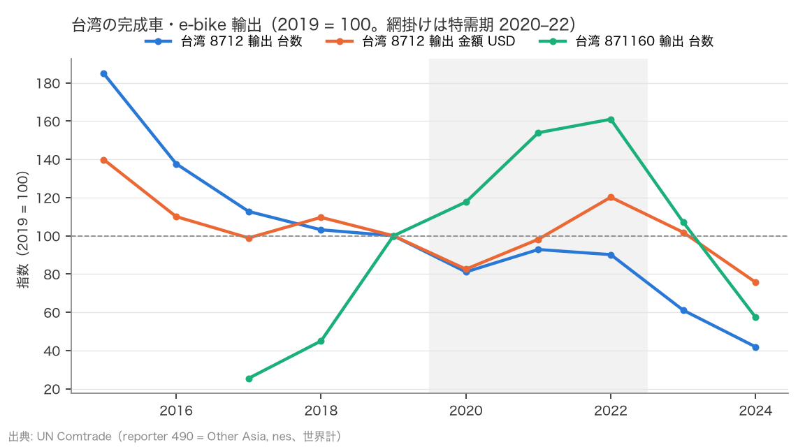
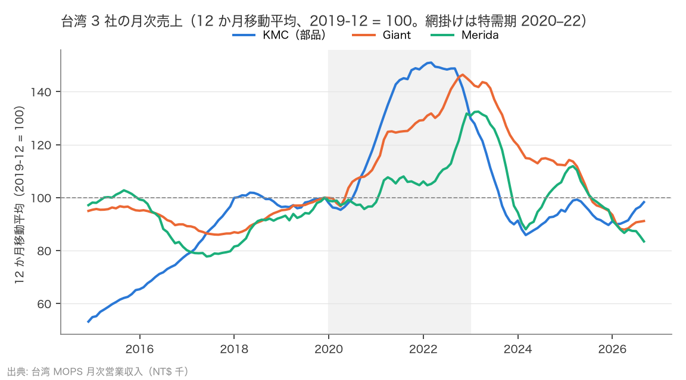
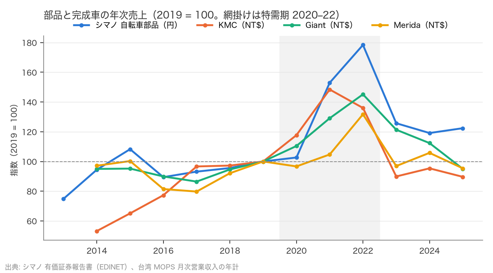

# R5: 世界のスポーツ車サイクル — 台湾の輸出と、部品 → 完成車の位相（2026-10-22, theme: bicycle-industry）

## 要約（記述のみ、因果の主張はない）
- **H9（台湾の完成車輸出は特需後に「少なく・高く」なる）は不支持。** 台数比 0.40（コロナ前 2015–19 平均 284 万台 → 特需後 2023–24 平均 114 万台）は基準を満たすが、金額比は 0.79（15.3 億ドル → 12.1 億ドル）で「金額では上回る」が成り立たない。単価は 538 ドル → 1,060 ドルと倍になったが、台数の落ち込みが大きすぎて金額も減った。
- ただし台湾の輸出台数はコロナ前から減り続けており（2015 → 2019 で 0.54 倍、2024 年は 2015 年の 0.23 倍）、これは生産の海外移転（Giant・Merida の中国・ベトナム工場）を含む。**台湾の輸出は「世界のスポーツ車需要」の代理として事前の想定より弱く、H9 の不支持は需要の判定というより代理指標の限界を示す。** 連結売上（海外工場を含む）で見ると、Giant は 2024 年に 2019 年の 1.12 倍、2025 年 0.95 倍。
- e-bike（871160）の台湾輸出は 2017–19 平均の 1.45 倍（台数）・1.92 倍（金額）で特需後も高いが、2022 年の 104 万台から 2024 年の 37 万台へ 3 分の 1 に落ちた。仕向地別には英国（特需後／コロナ前 0.17）・日本（0.30）・オランダ（0.36）・ドイツ（0.38）が深く、米国（0.62）が浅い。
- **H10（在庫サイクルは部品 → 完成車の順に山が来て、谷は上流ほど深い）は主仕様で整合（僅差・仕様依存）。** 12 か月移動平均のピークは KMC（チェーン）2022-03、Giant 2022-11、Merida 2023-03 の順で、位相の順序は移動平均の幅や起点を変えても変わらない。ピークからの最大落ち幅は KMC −43.1%、Giant −39.9%、Merida −37.0% で僅差（3〜6pt）。6 か月・3 か月移動平均では完成車の落ち幅の方が深くなり判定は「中間」に落ちる。頑健に言えるのは位相（部品が先）だけ。
- **特需後の 3 年目（2026 年）に、完成車の売上は 2019 年末を下回ったまま。** 2026 年 9 月時点の 12 か月移動平均は、KMC が 2024 年 3 月の底から戻って 2019 年末の 0.98 倍。Giant は 2026 年 4 月の谷（0.88 倍）から 0.91 倍へわずかに戻ったが 2019 年末を下回る。Merida 0.83 倍は直近月が谷で下げ止まっていない。Ideal Bike は 2026 年 4 月の谷からわずかに戻ったが 2019 年末の 0.56 倍。これを在庫調整の位相差と読めるかは未識別の解釈（限界）。
- 年次のピーク水準（2019 年比）は シマノ 1.78（2022 年）、KMC 1.48（2021 年）、Giant 1.45（2022 年）、Merida 1.32（2022 年）。シマノは高いが円建て（円安を含む）、KMC と Giant はほぼ同水準。2025 年は シマノ 1.22、Giant 0.95、Merida 0.95、KMC 0.90。

## 問いと仮説
`design/themes/bicycle-industry.md` の H9・H10（2026-10-22 追加、スポーツ車ドリルダウン Phase 1。データを見る前に判定基準を固定。到達性確認で台湾輸出の 2019・2023 年の日・米・世界計は目視した）。推定したい量: 台湾輸出の特需後／コロナ前比（台数・金額）、月次売上の移動平均のピーク月と最大落ち幅。因果効果は推定しない。

事前登録からの逸脱: Fox Factory（Specialty Sports Group）は SEC EDGAR が連絡先付き User-Agent を求めるため、環境変数 `SOCIOSCOPE_SEC_CONTACT` が無い本実行ではスキップした（事前登録に記載した fail-closed の扱い）。年次の比較はシマノ・KMC・Giant・Merida の 4 社。

## データ
| 変数 | 出典 | 定義・単位 | 期間 | 備考 |
|---|---|---|---|---|
| 台湾の完成車輸出（HS 8712）・電動二輪（871160）、仕向地別 | UN Comtrade preview（reporter 490 = Other Asia, nes） | 台、USD（FOB）。仕向地 日・米・独・蘭・英・世界計、その他 = 世界 − 5 か国 | 2015–2024（871160 は 2017–） | 台湾からの輸出のみ。Giant・Merida の海外工場（中国・ベトナム等）からの出荷は含まない |
| 月次営業収入 | 台湾 MOPS JSON API | NT$ 千、連結。Giant 9921、Merida 9914、KMC 桂盟 5306（チェーン）、Ideal Bike 愛地雅 8933（OEM） | 2014-01–2026-09 | 連結（海外工場を含む）。為替（NT$）の影響を含む |
| シマノ 自転車部品 売上高 | 有価証券報告書（EDINET） | 百万円、年次 | FY2013–2025 | 円建て |

mart: `data/marts/taiwan_bicycle_exports.parquet`（126 行）、`tw_bicycle_monthly_revenue.parquet`（612 行）、`shimano_segments.parquet`（156 行）。取得 2026-10-22。

## 方法
H9: 世界計の輸出台数・金額の特需後（2023–24 平均）÷ コロナ前（2015–19 平均）。判定は事前基準（台数 < 0.9 かつ 金額 > 1.1 で整合、台数 ≥ 0.9 または 金額 ≤ 1.0 で不支持）。
H10: 各社の月次売上の 12 か月後方移動平均を取り、2019-01 以降の最大値をピーク、その後の最小値を谷として最大落ち幅 = 谷 ÷ ピーク − 1。判定は事前基準（KMC のピーク月 ≤ Giant・Merida のピーク月、かつ KMC の落ち幅 > 両社平均で整合。片方だけなら中間、両方逆なら不支持）。補助に単月のピーク、年次（月次の年計）の 2019 年比。

## 結果

### H9: 台湾の輸出は「少なく・高く」なったが、金額も減った
| 指標 | コロナ前 2015–19 平均 | 特需後 2023–24 平均 | 比 | 判定 |
|---|---|---|---|---|
| 台数（8712、世界計） | 2,835,037 | 1,142,984 | 0.40 | |
| 金額（USD 百万） | 1,525 | 1,212 | 0.79 | **不支持**（金額 ≤ 1.0） |
| 単価（USD/台） | 538 | 1,060 | 1.97 | |

| 年 | 台数 | 金額 USD mn | 単価 USD | e-bike 871160 台数 | e-bike 金額 USD mn |
|---|---|---|---|---|---|
| 2015 | 4,104,579 | 1,910 | 465 | – | – |
| 2016 | 3,056,807 | 1,503 | 492 | – | – |
| 2017 | 2,503,288 | 1,350 | 539 | 164,613 | 232 |
| 2018 | 2,290,105 | 1,497 | 654 | 291,092 | 386 |
| 2019 | 2,220,408 | 1,366 | 615 | 647,354 | 871 |
| 2020 | 1,800,663 | 1,127 | 626 | 761,890 | 997 |
| 2021 | 2,060,800 | 1,341 | 651 | 996,505 | 1,333 |
| 2022 | 2,001,457 | 1,641 | 820 | 1,042,040 | 1,566 |
| 2023 | 1,356,048 | 1,390 | 1,025 | 693,420 | 1,218 |
| 2024 | 929,921 | 1,033 | 1,111 | 371,071 | 685 |



台湾の完成車輸出台数は 2015 年の 410 万台から 2019 年の 222 万台へ、コロナ前に半減している。2020–22 年は 180〜206 万台で特需の山が無く（金額だけ 2022 年に 16.4 億ドルの山）、2023–24 年に 136 万台 → 93 万台へ落ちた。単価は 2019 年の 615 ドルから 2024 年の 1,111 ドルへ上がり、e-bike（2022 年 104 万台 → 2024 年 37 万台）を含めても、台湾から出る自転車は「少なく・高く」なった。しかし金額は特需後にコロナ前を下回った（0.79）。

コロナ前からの減少は、台湾メーカーの生産が中国・ベトナムなどへ移ったことを含むため（本データでは分離できない）、台湾の輸出台数は世界のスポーツ車需要の代理として想定より弱い。事前登録の H9 はこの代理に基づいて立てたもので、不支持の主因は「金額が増えなかった」ことだが、台数の 0.40 を需要の縮小とそのまま読むことはできない。

| 仕向地 | 2015 | 2019 | 2022 | 2024 | 特需後／コロナ前 台数 | 同 金額 | 2024／2015 台数 |
|---|---|---|---|---|---|---|---|
| 米国 | 755,717 | 757,762 | 831,114 | 317,078 | 0.62 | 0.87 | 0.42 |
| ドイツ | 267,273 | 144,024 | 93,115 | 50,030 | 0.38 | 0.78 | 0.19 |
| オランダ | 432,768 | 204,323 | 152,847 | 85,515 | 0.36 | 0.77 | 0.20 |
| 英国 | 671,298 | 242,254 | 134,994 | 56,321 | 0.17 | 0.50 | 0.08 |
| 日本 | 269,078 | 92,656 | 64,903 | 33,515 | 0.30 | 0.49 | 0.12 |
| その他 | 1,708,445 | 779,389 | 724,484 | 387,462 | 0.39 | 0.85 | 0.23 |
| 世界計 | 4,104,579 | 2,220,408 | 2,001,457 | 929,921 | 0.40 | 0.79 | 0.23 |

米国向けだけがコロナ前の水準を 2022 年まで保ち（83 万台）、2024 年に半減した。欧州と日本向けは 2015 年から一貫して減っている。e-bike（871160）世界計は 2017–19 平均の 1.45 倍（台数）・1.92 倍（金額）で特需後もコロナ前を上回るが、2022 年のピークからは 3 分の 1 に落ちている。

### H10: 部品が先に山を打ち、先に底を打った。完成車はまだ底にいる
| 企業 | 役割 | ピーク月 | 谷の月 | 最大落ち幅 | 直近月 | 直近／ピーク | 直近／2019-12 |
|---|---|---|---|---|---|---|---|
| KMC | 部品（チェーン） | 2022-03 | 2024-03 | −43.1% | 2026-09 | 0.65 | 0.98 |
| Giant | 完成車 | 2022-11 | 2026-04 | −39.9% | 2026-09 | 0.62 | 0.91 |
| Merida | 完成車 | 2023-03 | 2026-09 | −37.0% | 2026-09 | 0.63 | 0.83 |
| Ideal Bike | 完成車 OEM（補助） | 2023-01 | 2026-04 | −66.4% | 2026-09 | 0.40 | 0.56 |

判定: KMC のピーク（2022-03）は Giant（2022-11）・Merida（2023-03）より前、KMC の落ち幅（−43.1%）は両社平均（−38.5%）より 4.6pt 深い → **整合（僅差・仕様依存）**。ただし落ち幅の差は 3〜6pt で僅差で、移動平均の幅を変えると深さの順序が逆転する（頑健性）。



KMC の 12 か月移動平均は 2022 年 3 月にピーク（2019 年末の 1.5 倍）を打ち、2024 年 3 月に底（0.86 倍）を打って 2026 年 9 月には 0.98 倍まで戻った。Giant は 2022 年 11 月ピーク（1.46 倍）、Merida は 2023 年 3 月（1.32 倍）で、いずれも 2025 年に一度 1.1 倍前後まで戻った後、2026 年に再び下げて 0.91 倍・0.83 倍にいる。Merida は直近月（2026 年 9 月）が谷で下げ止まっていない。Ideal Bike は 2026 年 4 月の谷から 9 月にかけてわずかに戻ったが 2019 年末の 0.56 倍。観測できるのは「KMC の売上は 2024 年 3 月に底を打って 0.98 まで戻り、Giant は 2026 年 4 月の谷（0.88）から 0.91 へわずかに戻ったが 2019 年末を下回り、Merida は 2026 年 9 月が谷で下げ止まっていない。Ideal Bike は 2026 年 4 月の谷からわずかに戻った」ことまでで、これが在庫の積み上げ・取り崩しによるものかは本データでは識別できない（Ideal Bike は図には無く表のみ）。

単月（季節性を含む）のピークは KMC 2021-06、Giant 2022-07、Merida 2022-11 で、移動平均より 4〜9 か月早いが順序は同じ。単月の最大落ち幅は −62〜−66% で、季節性を含むため移動平均より深く出る。

| 企業 | 2019 | ピーク年 | ピーク／2019 | 2023／2019 | 2024／2019 | 2025／2019 |
|---|---|---|---|---|---|---|
| シマノ 自転車部品（百万円） | 290,038 | 2022 | 1.78 | 1.26 | 1.19 | 1.22 |
| KMC（NT$ 千） | 5,225,596 | 2021 | 1.48 | 0.90 | 0.95 | 0.90 |
| Giant（NT$ 千） | 63,404,953 | 2022 | 1.45 | 1.21 | 1.12 | 0.95 |
| Merida（NT$ 千） | 28,024,473 | 2022 | 1.32 | 0.97 | 1.06 | 0.95 |



年次のピークは シマノ 1.78（2022 年）、KMC 1.48（2021 年）、Giant 1.45（2022 年）、Merida 1.32（2022 年）。シマノの山は高いが円建てで 2022 年以降の円安を含む。KMC と Giant はほぼ同水準で、ピーク年も揃っていない（KMC は 2021 年）。2025 年はシマノだけが 2019 年を 2 割上回り、台湾 3 社は 2019 年を下回る（0.90〜0.95）。

## 頑健性
- H9 の基準期間をコロナ前 2017–19 にすると台数比 0.49、金額比 0.86 で判定は変わらない。特需後を 2024 年だけにすると 0.33・0.68。
- H10 の移動平均を 6 か月にすると、ピークは KMC 2021-11、Giant 2022-10、Merida 2022-12 で順序は同じだが、落ち幅は KMC −48.2%、Giant −51.8%、Merida −51.3% と完成車の方が深くなり、判定は「中間（位相は整合、深さは不支持）」。3 か月でも同じ向き。単月（季節性を含む）でも位相の順序は同じ。「上流ほど深い」は 12 か月移動平均でだけ成り立つ僅差の結果で、頑健ではない。
- 起点を 2019-01 でなく 2020-01 にしてもピーク・谷は変わらない（ピークはすべて 2021 年以降）。

## 限界・言えないこと
- 記述のみ。ピーク月の順序と落ち幅は売上の観測であり、それを「在庫調整の位相差」と読むのは解釈の一つで、原因（在庫の積み上げ・取り崩し、受注から出荷までのリード、シェア変化）は識別していない。
- 台湾の輸出は台湾からの出荷に限られ、海外工場からの出荷を含まないため、世界需要の代理として弱い。コロナ前からの半減を需要減と生産移転に分けることは本データではできない。
- MOPS の月次売上は連結・NT$ 建てで、為替と製品構成（e-bike・高価格帯）を含む。台数は分からない。
- Fox Factory（ハイエンド部品）は取得していない（SEC の連絡先付き UA 未設定）。「上流ほど深い」は部品 1 社（KMC）と完成車 2 社の比較で、一般化はできない。
- 2026 年は 9 月までの月次で、年計は出していない。「下げ止まっていない」は 2026 年 9 月時点の記述で、その後の推移は分からない。

## 再現手順
```bash
uv run socioscope run bicycle-industry fetch --only un_comtrade_taiwan && uv run socioscope run bicycle-industry fetch --only tw_mops
uv run socioscope run bicycle-industry stage && uv run socioscope run bicycle-industry mart
uv run python themes/bicycle-industry/src/theme_bicycle_industry/analysis/a20261022_r5_world_cycle.py > themes/bicycle-industry/reports/2026-10-22-r5-world-cycle.stdout.txt
```

## チェックリスト回答
- A: H9・H10 の判定基準は `design/themes/bicycle-industry.md` にデータを見る前に固定（到達性確認で目視した値を明記）。Fox のスキップは事前登録どおり。推定量は特需後／コロナ前比、ピーク月と最大落ち幅。
- B: 出典・定義・単位・取得日は上表と manifest で一致。欠損（871160 の 2015–16、2013 年以前の MOPS、Fox）は列挙し補完していない。企業の選択理由（台湾の上場企業で月次が取れる完成車・部品）を書いた。
- C: 識別戦略なし（記述のみ）。因果は主張しない。台湾輸出の代理としての弱さを結果と限界に明記。
- D: 標準誤差なし（開示値・貿易統計）。試した仕様（基準期間、移動平均の幅 12・6・3 か月、単月、起点）は全部書いた。深さの判定が仕様で逆転することを要約・結果・頑健性に明記。
- E: 「不支持」「整合」「僅差」「代理として弱い」を使い分け、因果語は使っていない。図は軸・基準・出典・凡例を明記。限界の節あり。再現手順と mart の行数を記載。LLM 構造化は使っていない。
