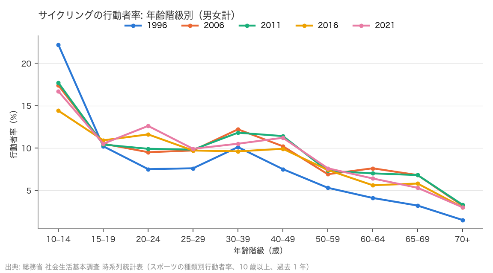
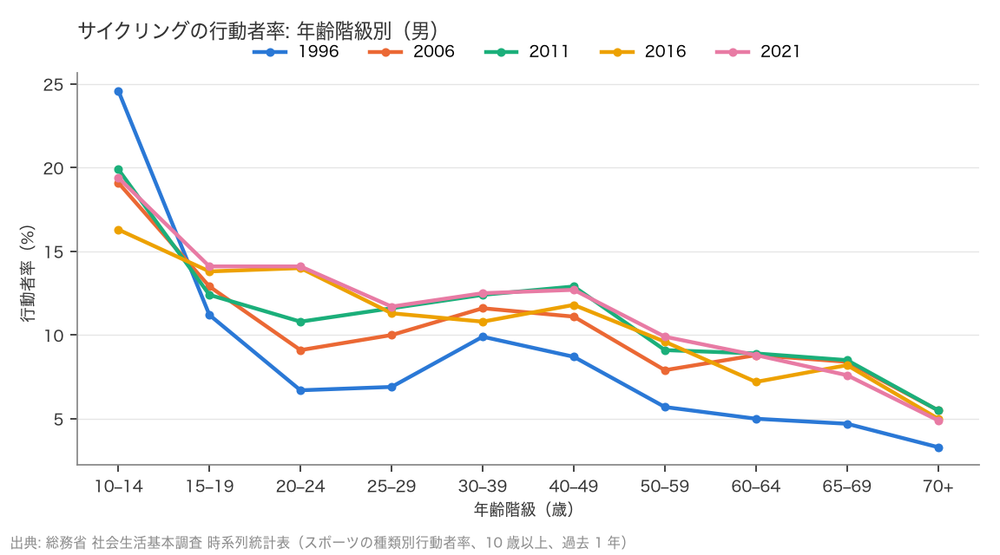

# R6: サイクリングの乗り手は高齢化しているのか（2026-10-22, theme: bicycle-industry）

## 要約（記述のみ、因果の主張はない）
- **H11（スポーツ車需要の縮小は乗り手の高齢化・非補充として現れる）は不支持。予想と逆に「若返り」。** 社会生活基本調査の「サイクリング」行動者率（過去 1 年、10 歳以上）は 2011 → 2021 に 20–39 歳で 10.5% → 11.0%（+0.5pt）、50–69 歳で 7.0% → 6.4%（−0.6pt）。行動者の年齢重心（行動者率 × 階級幅の加重、人口構成一定の近似）は 38.9 歳 → 38.1 歳（−0.7 歳）。男は 20–39 歳 +1.2pt、女は全年齢で低下。
- 若年層の上昇は 20–24 歳に集中する（9.9% → 12.6%、2016 年にすでに 11.6%）。高齢層の低下は 60–69 歳（7.0 → 6.4、6.8 → 5.3）。2006 年に 60 代だった世代（1937–46 年生まれ）の率の高さが、その世代が 70 歳以上へ抜けるにつれて 60 代の率を押し下げた、という読みは整合するが、コーホートは追えない（断面の比較、未検証）。団塊世代（1947–49 年生まれ）は 2011・2016 年に 60 代にいたので、60 代の低下を「団塊世代の退職」で読むのは年齢が合わない。
- 総数の行動者率は 1996 年 7.6% → 2006 年 8.8% → 2011 年 8.9% → 2016 年 7.9% → 2021 年 8.2% で、15 年間ほぼ横ばい。特需期（2021 年調査）の上振れは +0.3pt と小さい。
- 他種目と並べると、サイクリングは「つり」と同じ「若返り」型。ジョギングは全年齢で増加、登山・ゴルフは全年齢で減少（重心はゴルフだけ上昇）。自転車固有の高齢化は見えない。
- **示唆（未検証の仮説）**: 乗り手の**率**も、率で見た年齢構成も 10 年でほぼ変わっていないのに、完成車の台数はコロナ前から 4 割減っている（R1）。行動者数（人口の減少・高齢化を含む）は本表に無く未確認だが、率が横ばいなら、台数減の説明は「乗る人が減った・老いた」よりも、乗る人 1 人当たりの購入台数（買い替え周期・保有台数）側にある可能性がある。行動者数表と 1 人当たり購入台数のデータで確認が必要。

## 問いと仮説
`design/themes/bicycle-industry.md` の H11（2026-10-22 追加、スポーツ車ドリルダウン Phase 2。データを見る前に判定基準を固定）。推定したい量: 年齢階級別行動者率の 10 年変化と、行動者の年齢重心の変化。因果効果は推定しない。

局面: 2021 年調査は 2021 年 10 月実施で特需期に当たる。2016（コロナ前）→ 2021 と 2006 → 2016（コロナ前の 10 年）を並べる。特需後（2026 年調査）は未公表。

## データ
| 変数 | 出典 | 定義・単位 | 期間 | 備考 |
|---|---|---|---|---|
| スポーツの種類別 行動者率（男女 × 年齢階級） | 総務省 社会生活基本調査 時系列統計表「男女、年齢、スポーツの種類別行動者率の推移（10 歳以上）」（令和 3 年版、e-Stat xlsx） | 過去 1 年に当該スポーツをした人の割合（%）。年齢階級: 10–14、15–19、20–24、25–29、30–39、40–49、50–59、60–64、65–69、70 歳以上 | 1986・1991・1996・2001・2006・2011・2016・2021 | サイクリングは 2001 年に集計なし、1986・1991 は総数・10–14 歳なし。2011 年は東日本大震災で一部地域を除く。2021 年は種目区分に変更（ゲートボール削除、グラウンドゴルフ・ヨガ追加。サイクリングは不変） |

mart: `data/marts/jp_sports_participation.parquet`（5,890 行、23 種目）。取得 2026-10-22。

## 方法
記述のみ。(a) 20–39 歳と 50–69 歳の行動者率の単純平均の 2011 → 2021 変化の符号で 4 象限に分ける（事前基準）。(b) 年齢階級の中点（70 歳以上は 77 歳・幅 15）を 行動者率 × 階級幅 で加重した平均年齢を「行動者の年齢重心」とし、その変化の符号で判定。人口構成は一定とみなす近似（実際の行動者数の加重ではない）。

## 結果

### サイクリング 行動者率（%、男女計）
| 年齢 | 1996 | 2006 | 2011 | 2016 | 2021 |
|---|---|---|---|---|---|
| 10–14 | 22.2 | 17.4 | 17.7 | 14.4 | 16.7 |
| 15–19 | 10.2 | 10.5 | 10.4 | 10.9 | 10.5 |
| 20–24 | 7.5 | 9.5 | 9.9 | 11.6 | 12.6 |
| 25–29 | 7.6 | 9.7 | 9.8 | 9.7 | 9.9 |
| 30–39 | 10.1 | 12.2 | 11.8 | 9.6 | 10.5 |
| 40–49 | 7.5 | 10.2 | 11.4 | 9.9 | 11.2 |
| 50–59 | 5.3 | 6.9 | 7.3 | 7.4 | 7.6 |
| 60–64 | 4.1 | 7.6 | 7.0 | 5.6 | 6.4 |
| 65–69 | 3.2 | 6.8 | 6.8 | 5.8 | 5.3 |
| 70+ | 1.5 | 3.2 | 3.3 | 3.0 | 3.0 |
| 総数 | 7.6 | 8.8 | 8.9 | 7.9 | 8.2 |



### H11 (a): 若年層が上がり、高齢層が下がった
| | 20–39 歳 2011 → 2021 | 50–69 歳 2011 → 2021 | 判定 |
|---|---|---|---|
| 男女計（主判定） | 10.50 → 11.00（+0.50pt） | 7.03 → 6.43（−0.60pt） | **不支持（若返り）** |
| 男 | 11.60 → 12.77（+1.17pt） | 8.83 → 8.77（−0.07pt） | 不支持（若返り） |
| 女 | 9.37 → 9.17（−0.20pt） | 5.30 → 4.23（−1.07pt） | 全年齢の減少（高齢化ではない） |

### H11 (b): 年齢重心は下がった
| | 1996 | 2006 | 2011 | 2016 | 2021 | 2011 → 2021 | 判定 |
|---|---|---|---|---|---|---|---|
| 男女計（主判定） | 33.9 | 38.8 | 38.9 | 38.5 | 38.1 | −0.7 歳 | **不支持（重心が下がった）** |
| 男 | 36.4 | 40.7 | 40.6 | 40.2 | 39.6 | −1.0 歳 | 不支持 |
| 女 | 31.9 | 36.9 | 37.2 | 36.8 | 36.5 | −0.7 歳 | 不支持 |

重心は 1996 → 2006 に 5 歳上がった（60 代の率が 4% 台から 7% 台へ）後、2006 → 2021 は 38 歳台で横ばい〜微減。率で見た高齢化があったとすれば 2000 年代で、2010 年代には止まっている。2006 年に 60 代だったのは 1937–46 年生まれで、団塊世代（1947–49 年生まれ）は 2006 年には 50 代（率 6.9%、上昇なし）、2011・2016 年に 60 代、2021 年に 70 歳以上にいる。



### 局面別（男女計）
| 期間 | 20–39 歳 | 50–69 歳 | 総数 | 重心 |
|---|---|---|---|---|
| 2006 → 2016（コロナ前の 10 年） | −0.2pt | −0.8pt | −0.9pt | −0.2 歳 |
| 2016 → 2021（コロナ前 → 特需） | +0.7pt | +0.2pt | +0.3pt | −0.4 歳 |
| 2011 → 2021（主判定） | +0.5pt | −0.6pt | −0.7pt | −0.7 歳 |

特需期（2021 年調査）の上振れは総数で +0.3pt、20–39 歳で +0.7pt と小さく、若年層の上昇はコロナ前（2011 → 2016 に 20–24 歳 9.9 → 11.6）から始まっている。

### 他種目との比較（男女計、2011 → 2021）
| 種目 | 総数 2011 | 総数 2021 | 20–39 歳 | 50–69 歳 | 重心 2011 | 重心 2021 | (a) の象限 |
|---|---|---|---|---|---|---|---|
| サイクリング | 8.9 | 8.2 | +0.5 | −0.6 | 38.9 | 38.1 | 若返り |
| ジョギング・マラソン | 9.6 | 11.1 | +3.5 | +1.2 | 31.8 | 33.2 | 全年齢の増加 |
| 登山・ハイキング | 9.2 | 7.7 | −0.4 | −2.8 | 45.3 | 44.5 | 全年齢の減少 |
| ゴルフ（練習場を含む） | 8.1 | 6.9 | −0.5 | −1.5 | 47.9 | 49.2 | 全年齢の減少 |
| つり | 8.1 | 7.8 | +0.2 | −0.9 | 39.5 | 39.5 | 若返り |
| スポーツ総数 | 63.0 | 66.5 | +1.9 | +3.4 | 43.7 | 45.0 | 全年齢の増加 |

「高齢化・非補充」の形（若年低下・高齢上昇）はどの種目にも出ていない。サイクリングの年齢重心（38 歳）はジョギング（33 歳）より高く、登山・ゴルフ（45〜49 歳）より低い。

## 頑健性
- 若年層を 20–29 歳に狭めると 2011 → 2021 は 9.85 → 11.25（+1.40pt）、30–49 歳では 11.60 → 10.85（−0.75pt）で、上昇は 20 代に限られる。高齢層を 60–69 歳に狭めると 6.90 → 5.85（−1.05pt）。20–29 歳 vs 60–69 歳の組み合わせでは象限の判定（若年上昇・高齢低下）は変わらないが、若年帯を 30–49 歳に取ると若年側も低下するため、「若返り」は 20 代に限った現象である。
- 期間を 2016 → 2021 にすると両方上昇（不支持・全年齢の増加）、2006 → 2016 にすると両方低下（全年齢の減少）。どの期間でも「若年低下・高齢上昇」にはならない。
- 70 歳以上の中点を 77 歳（幅 15）から 75 歳（幅 11）に変えても、重心は 2011 38.0 → 2021 37.3（−0.7 歳）で符号は変わらない。

## 限界・言えないこと
- 記述のみ。行動者率は「過去 1 年にサイクリングをした人」で、スポーツ車の購入者・保有者ではない。通勤・買い物の自転車利用は含まない（「サイクリング」は余暇活動として聞いている）。
- 年齢重心は行動者率 × 階級幅の近似で、人口構成（高齢人口の増加、20–39 歳人口の減少）を無視している。実際の行動者数の重心は、人口の高齢化の分だけこれより高く、上昇している可能性がある。若い行動者の数は率が横ばいでも減っている可能性がある。2016・2021 の行動者数表で確認できる（追跡項目）。
- 断面の比較で、コーホート（世代）は追えない。2006 年の 60 代（1937–46 年生まれ）の率の高さが、その世代が 70 歳以上に抜けて 60 代の率が下がった、という読みは整合するが検証していない。
- 2021 年調査は特需期で、特需後（2026 年調査、公表は 2027 年）の値は無い。
- 5 年刻みの 5 時点で、統計的な検定はしていない（標本調査だが、行動者率の標準誤差は公表表に無い）。

## 再現手順
```bash
uv run socioscope run bicycle-industry fetch --only estat_shakai && uv run socioscope run bicycle-industry stage --only estat_shakai && uv run socioscope run bicycle-industry mart
uv run python themes/bicycle-industry/src/theme_bicycle_industry/analysis/a20261022_r6_participation.py > themes/bicycle-industry/reports/2026-10-22-r6-participation.stdout.txt
```

## チェックリスト回答
- A: H11 (a)(b) の判定基準と局面の扱いは `design/themes/bicycle-industry.md` にデータを見る前に固定。推定量は年齢階級別行動者率の変化と年齢重心の変化。
- B: 出典・定義・単位・取得日は上表と manifest で一致。欠損（2001 年、1986・1991 の総数）と定義変更（2021 年の種目区分、2011 年の震災）を列挙し補完していない。
- C: 識別戦略なし（記述のみ）。因果は主張しない。世代の読みはコーホートを追っていない整合的な読みと明記し、生年を計算して書いた。「示唆」は未検証の仮説と明記。
- D: 標準誤差なし（公表表に無い）。試した仕様（年齢帯の狭め、期間 3 通り、70 歳以上の中点）は全部書いた。
- E: 「不支持」「若返り」「整合するが検証していない」を使い分け、因果語は使っていない。図は軸・単位・出典・凡例を明記。限界の節あり。再現手順と mart の行数を記載。LLM 構造化は使っていない。
