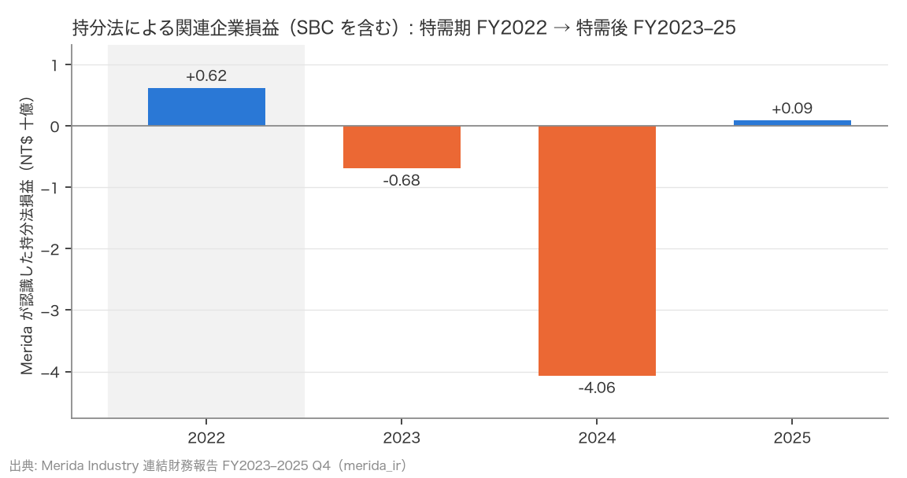
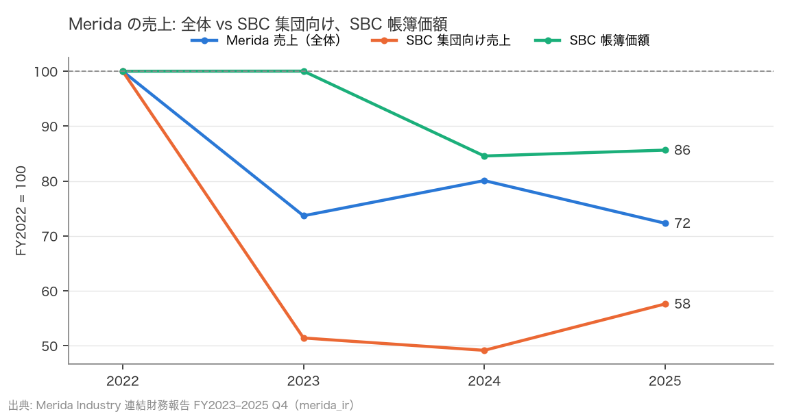
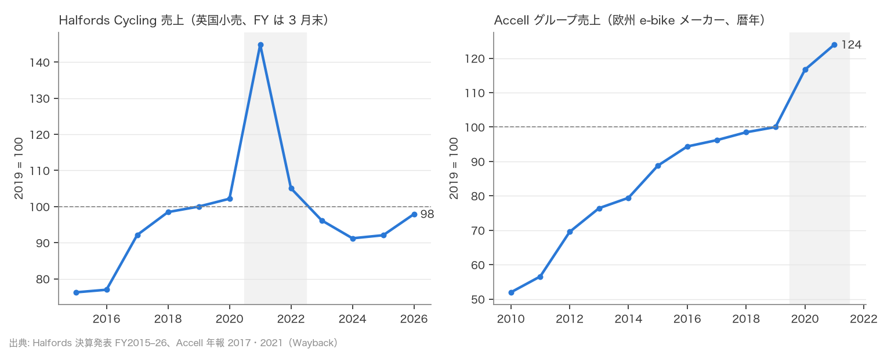

# R7: Specialized の特需後 — Merida の持分法開示で読む非上場トップブランド（2026-10-22, theme: bicycle-industry）

## 要約（記述のみ、因果の主張はない）
- **H14 (a)（Specialized の利益は特需後に赤字、または特需期の 3 割以下）は整合。ただし判定に使った行は SBC 単独ではなく関連企業全体で、事前登録からの逸脱として記録する（SBC は関連企業の帳簿価額の 98% を占め、逸脱で判定が覆る余地は小さい。後述）。** Merida が持分法で認識した関連企業損益（Specialized Bicycle Components Holding、SBC を含む）は、特需期 FY2022 の +6.2 億 NT$ から、FY2023 −6.8 億、FY2024 −40.6 億の損失になり、FY2025 は +0.9 億（FY2022 の 14.8%）にとどまる。3 年とも事前基準（損失または 30% 以下）を満たし、閾値を 20%・50% に変えても、特需後を FY2023–24 に限っても判定は変わらない。
- **H14 (b)（Specialized 向けの落ち幅は Merida 全体より大きい）も整合。** Merida の SBC 集団向け売上（Specialized への OEM 供給）は FY2022 → FY2025 で −42.4%、全体は −27.7%、SBC 以外の売上は +4.1%。SBC 向けの減少額（−107 億 NT$）が全体の減少額（−102 億 NT$）を上回る（会計上の分解であり、原因の識別ではない）。SBC 向けの比率は 68% → 42%（FY2024）→ 55%（FY2025）。
- **FY2024 の損失（−40.6 億 NT$）は FY2022 の利益の 6.5 倍で、同じ年に SBC の帳簿価額が −28.8 億 NT$ 減った。** 抽出した本文に SBC に関する減損の注記は見つからなかった（語の検索）が、持分法損益の行は SBC 以外の関連企業も含み、SBC 側の一時要因（在庫評価損・リストラ費用など）があるかは Merida の開示からは分からない。
- **FY2025 は SBC 向け売上が前年比 +17.2% と反転し、持分法損益も黒字に戻った。** ただし売上は FY2022 の 58%、帳簿価額は 86% の水準で、特需前（FY2019 以前）との比較はデータが無いためできない。
- **補足（記述のみ、仮説なし。英国 1 社・欧州 1 社）: 英国小売 Halfords の Cycling 売上（名目 £、用品・整備を含む）は FY2019 = 100 で特需ピーク FY2021（2020-04〜2021-03）に 145、3 局面の平均はコロナ前 101・特需 125・特需後 94、FY2026 は 98。** 欧州 e-bike メーカー Accell は 2019 = 100 で 2021 年に 124、2022 年の非上場化以降は観測できない。事前登録より期間を広げた（Halfords FY2015–、Accell 2010–）ことと、そこから出した 2 つの年率は事後追加（探索的）として結果の節に分けて書く。
- 読み方: 上場企業（Giant・Merida・シマノ、R5）が「2019 年末を下回る売上」で止まっているのに対し、Specialized は持分法を通じた間接観測ながら「2 年連続の損失」という、より深い調整を示す。売上水準（R5）と持分法損益（本稿）は尺度が違うので同じ軸での比較ではない。欧米ハイエンドのスポーツ車ブランドが台湾の完成車 OEM より深く特需の反動を受けた可能性を示すにとどまり、1 社 1 系列の観測で一般化はできない。

## 問いと仮説
`design/themes/bicycle-industry.md` の H14（2026-10-22 追加）と「R7 補足」（記述のみ、仮説なし。指標は計算前に固定: Halfords Cycling 売上の FY2019 = 100 指数の 3 局面平均、Accell 売上の 2019 = 100 指数）。補足の逸脱: 登録では Halfords FY2019–26・Accell 2017–2021 としたが、取れた PDF の範囲（Halfords FY2015–、Accell 2010–）をそのまま載せ、コロナ前の年率 2 つを事後追加（探索的）として出した。H14 は（2026-10-22 追加、スポーツ車ドリルダウン Phase 3。計算前に判定基準を固定。到達性確認で FY2023・2024 の持分法損益と関連当事者売上の値は目視した）。推定したい量: Merida が認識した持分法損益の FY2022（特需期）に対する FY2023–2025 の水準、SBC 集団向け売上と全体売上の変化率。因果効果は推定しない。

事前登録からの逸脱: **あり（1 件）。** 事前登録は「SBC の持分法損益」で判定するとしたが、Merida の開示には SBC 単独の損益の持分が無く（注記は関連企業ごとの帳簿価額のみ）、損益表の「採用權益法認列之關聯企業損益之份額」（関連企業全体）で判定した。SBC 以外の関連企業の比重と、判定が覆る条件を結果の節に示す。FY2021 以前の報告は Merida の自社サイトに無く、取得していない（事前登録どおり特需期は FY2022 のみ）。

## データ
| 変数 | 出典 | 定義・単位 | 期間 | 備考 |
|---|---|---|---|---|
| 營業收入淨額（売上、全体） | Merida 連結財務報告 第 4 四半期（通期） | NT$ 千、連結 | FY2022–2025 | 各報告の当期・前期から。FY2023 報告の FY2022 値を使う |
| 採用權益法認列之關聯企業損益之份額（持分法損益） | 同 損益表 7370/7770 行 | NT$ 千。SBC（持分 35%）を含む**関連企業全体**の持分 | FY2022–2025 | SBC 単独の損益は開示されない。減損・一時要因を含みうる |
| SBC 帳簿価額・関連企業合計 | 同 注記「採用權益法之投資」 | NT$ 千、期末 | FY2022–2025 | 持分法による投資の帳簿価額（為替換算差額を含む）。合計は SBC ＋ 欧州販社など 6 社 |
| SBC 集団向け売上 | 同 注記「關係人交易」銷貨 | NT$ 千 | FY2022–2025 | Merida → SBC 集団への販売（OEM 供給） |

| Halfords Retail 売上・Cycling 構成比・Cycling 売上 | Halfords Group plc 通期決算発表 PDF（自社サイト、robots 許可） | £m。FY は 3 月末／4 月初。FY2025 以降は Cycling £m を開示、FY2015–24 は Retail 売上 × 構成比（%、小数 1 桁）で導出 | FY2015–2026 | 53 週決算（FY2015・2020・2026）は 52 週列。Cycling は自転車以外（用品・整備）を含む。FY2024 の本文 38% と表 35.4% の不一致は表を採用 |
| Accell グループ売上 | Accell Group N.V. 年報 2017（8 年表）・2021（5 年表）、Wayback Machine 経由 | €m、暦年 | 2010–2021 | 2017 年は両年報に載り 1,068.5 と 1,069（丸め）。2022 年に非上場化 |

取得経路: Merida 投資家向けページ（`www.merida-bikes.com`、robots.txt 許可）からリンクされた PDF（`merida-cdn.m-c-g.net`、CDN の robots.txt は全面 Disallow。ADR 0006 の例外、条件 1〜4 を `design/data-sources.md` に記録）。
mart: `data/marts/merida_specialized.parquet`（20 行、FY2022–2025 × 5 指標）。取得 2026-10-22。当期・前期で同じ (fy, metric) に食い違いは無い（`restated_next_year` は全行 NULL）。補足: `marts/halfords_cycling.parquet`（34 行）、`marts/accell_turnover.parquet`（12 行）、取得 2026-10-22。

## 方法
(a) 持分法損益 s(FY) について、FY2023–2025 の各年で s ≤ 0 または s ≤ 0.3 × s(FY2022) なら整合。1 年でも超えれば不支持（事前基準）。
(b) SBC 集団向け売上と全体売上の FY2022 → FY2025 の変化率を並べ、SBC 向けの方が負に大きければ整合（事前基準、記述）。全体のうち SBC 以外（全体 − SBC 向け）の変化率を補助に示す。
局面: 特需期 = FY2022、特需後 = FY2023–2025。コロナ前は観測できない。

## 結果

### 表: Merida の開示値（NT$ 百万）
| FY | 売上（全体） | SBC 集団向け売上 | SBC 向け比率 | 持分法損益（関連企業） | SBC 帳簿価額 |
|---|---|---|---|---|---|
| 2022 | 37,003 | 25,310 | 68.4% | +624 | 18,650 |
| 2023 | 27,261 | 13,013 | 47.7% | −685 | 18,654 |
| 2024 | 29,633 | 12,443 | 42.0% | −4,065 | 15,771 |
| 2025 | 26,757 | 14,581 | 54.5% | +92 | 15,970 |

### H14 (a): 持分法損益は 2 年の損失ののち、FY2022 の 14.8% に戻った
- FY2022（特需期）+624 百万 → 30% 閾値 +187 百万。
- FY2023 −685 百万（損失）、FY2024 −4,065 百万（損失）、FY2025 +92 百万（利益、FY2022 比 14.8%）。FY2024 の損失は FY2022 の利益の 6.5 倍。
- 判定: **整合**。

#### 逸脱の影響: 判定に使った行は関連企業全体。SBC 以外の比重と、判定が覆る条件
| FY | 関連企業 帳簿価額 合計 | うち SBC | SBC 比率 | SBC 以外 | SBC 以外の前年差 | 判定が覆るのに要する SBC 以外の損失 | 同 ÷ SBC 以外の帳簿価額 |
|---|---|---|---|---|---|---|---|
| 2022 | 18,920 | 18,650 | 98.6% | 270 | – | – | – |
| 2023 | 18,955 | 18,654 | 98.4% | 302 | +32 | 872 百万 以上の損失 | 289% |
| 2024 | 16,024 | 15,771 | 98.4% | 253 | −48 | 4,252 百万 以上の損失 | 1678% |
| 2025 | 16,260 | 15,970 | 98.2% | 290 | +37 | 95 百万 以上の損失 | 33% |

SBC 以外の関連企業（欧州販社など 6 社）の帳簿価額は合計の 2% 未満。持分法で認識する損失は帳簿価額（長期持分を含む）が上限（IAS 28）なので、FY2023・2024（帳簿価額の数倍の損失が必要）は覆らない。FY2025 は SBC 以外が期末帳簿価額の 3 割超（期首の 253 百万比では約 4 割）の損失を出していれば覆りうるが、同年の SBC 以外の帳簿価額は増えている（配当・為替を含む粗い目安）。



### H14 (b): Merida の売上減少は SBC 向けに集中
- FY2025 の水準（FY2022 = 100）: SBC 向け売上 58、全体 72、SBC 帳簿価額 86。
- 減少額（FY2022 → FY2025）: SBC 向け −10,729 百万、全体 −10,246 百万。
- FY2022 → FY2025: SBC 集団向け −42.4%、全体 −27.7%、SBC 以外 +4.1%。判定: **整合**。
- 前年比: FY2023 SBC 向け −48.6%（全体 −26.3%）、FY2024 −4.4%（+8.7%）、FY2025 +17.2%（−9.7%）。FY2025 は SBC 向けが戻り、SBC 以外が落ちている。



### 補足: 英国小売 1 社・欧州メーカー 1 社の特需前後（記述のみ）
| FY | Retail 売上 £m | Cycling 構成比 % | Cycling 売上 £m | 導出 | 指数 |
|---|---|---|---|---|---|
| 2015 | 857.9 | 34.4 | 295.1 | 構成比×Retail | 76 |
| 2016 | 868.5 | 34.3 | 297.9 | 構成比×Retail | 77 |
| 2017 | 938.4 | 38.0 | 356.6 | 構成比×Retail | 92 |
| 2018 | 977.2 | 39.0 | 381.1 | 構成比×Retail | 98 |
| 2019 | 977.2 | 39.6 | 387.0 | 構成比×Retail | 100 |
| 2020 | 950.6 | 41.6 | 395.4 | 構成比×Retail | 102 |
| 2021 | 1,039.8 | 53.9 | 560.5 | 構成比×Retail | 145 |
| 2022 | 1,001.6 | 40.6 | 406.6 | 構成比×Retail | 105 |
| 2023 | 979.6 | 38.0 | 372.2 | 構成比×Retail | 96 |
| 2024 | 997.1 | 35.4 | 353.0 | 構成比×Retail | 91 |
| 2025 | 1,004.9 | 開示 £m | 356.3 | 開示値 | 92 |
| 2026 | 1,039.3 | 開示 £m | 378.9 | 開示値 | 98 |

- 登録済みの指標 — Halfords Cycling 売上（FY2019 = 100）の 3 局面平均: コロナ前 FY2019–20 101、特需 FY2021–22 125、特需後 FY2023–26 94。特需ピーク FY2021 は 145、特需後の最新 FY2026 は 98。Accell グループ売上（2019 = 100）: 2020 117、2021 124。特需後は観測できない。
- 事後追加（探索的、登録外）: 取れた PDF の範囲を広げて載せた（Halfords FY2015–2018、Accell 2010–2016）。そこから出したコロナ前の年率は Halfords FY2015 → FY2019 +7.0%、Accell 2010 → 2019 +7.5%。判定には使わない。



読み方（記述）: 英国の大手小売 1 社では、自転車関連の売上は特需の 1 年（FY2021）で 1.45 倍になり、2 年でコロナ前の水準を下回り（FY2023 96）、FY2026 に 98 まで戻った。コロナ前のトレンドとの比較や R4 の「先食い」との対応は、名目値・1 社・自転車以外を含むという限界のもとでは根拠が弱く、ここでは評価しない。

## 頑健性
| 仕様 | 結果 |
|---|---|
| (a) 閾値 20% | 整合 |
| (a) 閾値 50% | 整合 |
| (a) 特需後を FY2023–24 に限る | 整合 |
| (b) FY2022 → FY2024 | SBC 向け −50.8%、全体 −19.9% → 整合 |
| (b) FY2023 → FY2025（底からの回復） | SBC 向け +12.1%、全体 −1.8%（基準なし、記述） |

## 限界・言えないこと
- 持分法損益は Merida の持分（35%）を通じた**間接観測**で、SBC 単独の損益ではなく他の関連企業を含む（事前登録からの逸脱。比重と覆る条件は結果の節）。SBC の売上・台数・粗利率は分からない。
- NT$ 建てで為替（USD/NT$）の影響を含む。帳簿価額の変動には為替換算差額が含まれる。
- FY2024 の大きな損失に減損・在庫評価損などの一時要因が含まれるかは、Merida の開示本文（語の検索）からは確認できなかった。
- 特需前（FY2019 以前）の報告は自社サイトに無く、「コロナ前への回帰」は判定できない。特需期も FY2022 の 1 年だけで、FY2021 がピークだった場合は特需の高さを過小に見ている。
- 補足の Halfords は名目 £（英国のインフレを含む）、Cycling は用品・整備を含む。FY2015–24 の Cycling £m は構成比からの導出で丸め誤差（£0.5m 程度）を含む。Accell は 2021 年で途切れ、特需後の反動は見えない。英国 1 社・欧州 1 社で市場全体には広げられない。期間の拡張と年率 2 つは事後追加（探索的）。どちらも記述で、判定・因果の主張はしない。
- 1 社（Specialized）1 系列の観測で、欧米ハイエンドブランド一般への拡張はできない。(b) は会計上の分解で、Specialized の発注減が Merida の売上減の「原因」だと識別したわけではない。

## 再現手順
```bash
uv run socioscope run bicycle-industry fetch --only merida_ir && uv run socioscope run bicycle-industry fetch --only halfords_ir && uv run socioscope run bicycle-industry fetch --only accell_ar
uv run socioscope run bicycle-industry stage && uv run socioscope run bicycle-industry mart
uv run python themes/bicycle-industry/src/theme_bicycle_industry/analysis/a20261022_r7_specialized.py > themes/bicycle-industry/reports/2026-10-22-r7-specialized.stdout.txt
```

## チェックリスト回答
- A: H14 の判定基準（30% 閾値、FY2023–25 の各年、(b) の比較）は `design/themes/bicycle-industry.md` にデータを見る前に固定（到達性確認で目視した値を明記）。補足（Halfords・Accell）は仮説を置かず、指数と 3 局面の平均という指標を計算前に設計書に固定した。2 件目（補足）: 登録した期間（Halfords FY2019–、Accell 2017–）より広い期間を載せ、コロナ前の年率 2 つを事後追加（探索的）として分けて書いた（設計書にも記録）。逸脱 2 件。1 件目（H14）: SBC 単独ではなく関連企業全体の行で判定したことを要約・問いと仮説・結果・限界に明記し、設計書にも事後追加として記録。
- B: 出典・定義・単位・取得日・取得経路（ADR 0006 の例外、Wayback）は上表と manifest で一致。欠損（FY2021 以前、SBC 単独の損益、Accell 2022 以降、Halfords FY2015–24 の Cycling £m 開示なし → 構成比から導出と明記）は列挙し補完していない。
- C: 識別戦略なし（記述のみ）。因果は主張せず、(b) を会計上の分解と明記。
- D: 標準誤差なし（開示値）。試した仕様（閾値 20/30/50%、期間 FY2023–24、(b) の終点 2024・起点 2023）は全部書いた。逸脱で判定が覆る条件を帳簿価額で bound した。
- E: 「整合」「間接観測」「一般化はできない」「探索的」を使い分け、因果語・判定語は補足（記述）に入れていない。図は軸・基準・出典を明記。限界の節あり。再現手順と mart の行数を記載。LLM 構造化は使っていない。
