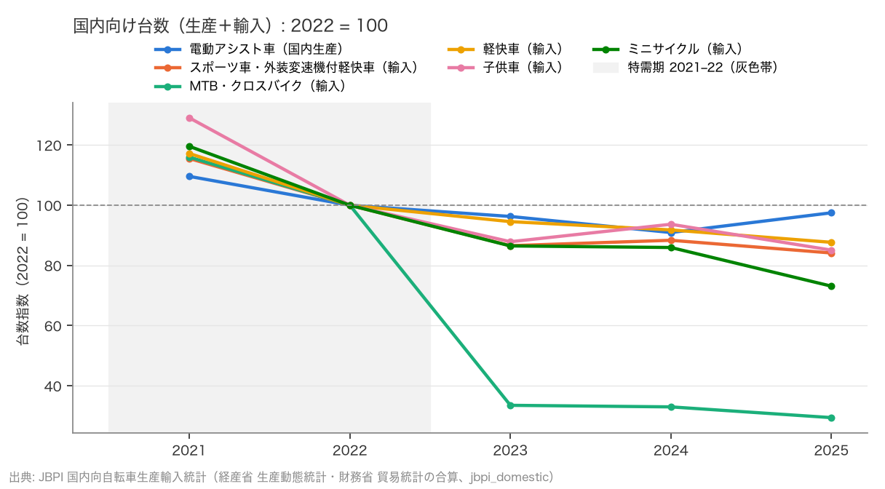
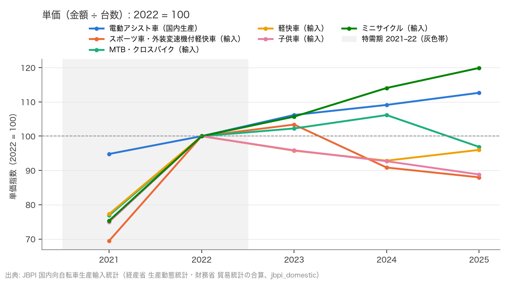

# R8: 日本のセグメント分離 — 電動アシスト車とスポーツ車の台数・単価（2026-10-22, theme: bicycle-industry）

## 要約（記述のみ、因果の主張はない）
- **H2（電動アシスト車は台数を保ち単価が上がる一方、スポーツ車は台数・単価とも下がる）は、事前登録の判定基準では不支持。** 2022 → 2025 の台数変化率は、電動アシスト車（国内生産）−2.5% で基準「≥ 0」を僅かに外れ、スポーツ車・外装変速機付軽快車（輸入、主判定）は −15.9% で基準「< −10%」を満たす。片方を欠くので不支持。副判定の MTB・クロスバイク（輸入）は −70.6%。
- **単価の向きは登録どおりだが、台数の「減らず」は満たさない。** 単価は電動アシスト車 96,203 → 108,380 円（+12.7%）、スポーツ車・外装変速機付軽快車 22,064 → 19,415 円（−12.0%）、MTB・クロス 21,566 → 20,891 円（−3.1%）。電動アシストの台数は −2.5% で、H2 の記述「コロナ後も減らず」には合わない。金額で見た変化（電動 +9.8%、スポーツ（主）−26.0%）は探索的で判定には使わない。
- **「スポーツ車」は 2025 年までの公的統計で単独に取れない。** JBPI の表では輸入の「その他（スポーツ車・外装変速機付軽快車）」と「マウンテンバイク（MTB・クロスバイク）」に分かれ、ロードバイク等は前者に外装変速機付軽快車と混ざる。2026 年の貿易統計から「スポーツ車」が単独行になる（2026 年 1–7 月のみ、本稿では使わない）。
- **MTB・クロスバイクの輸入は 2022 → 2023 に 3 分の 1 に落ち（174,483 → 58,501 台）、その後も戻っていない。** 単価は落ちていない（+2〜6%）ので、台数の調整が中心。スポーツ車・外装変速機付軽快車は台数 −16%、単価 −12% で、量と価格の両方が下がった。
- **POS（小売、2025 年暦年）では、スポーツ車は台数の 17.4%、金額の 17.5%、平均単価 51,032 円（税込）。電動アシスト自転車は台数 16.1% で金額 42.2%、平均単価 132,448 円。** 2025 年 10–12 月の前年同期比は電動アシスト 台数 +10.2%・金額 +15.9%、スポーツ車 台数 −4.6%・金額 −5.5%、軽快車 台数 −19.1%。POS は 2024 年 7 月開始でコロナ前・特需期との比較はできない。

## 問いと仮説
`design/themes/bicycle-industry.md` の H2（当初から事前登録。判定: 2022 → 2025 の台数変化率が 電動アシスト ≥ 0 かつ スポーツ < −10% で整合）。変数の具体化（電動アシスト = 生産動態統計の国内生産、スポーツ車 = 主「その他（スポーツ車・外装変速機付軽快車、輸入）」・副「MTB・クロスバイク（輸入）」、単価 = 金額 ÷ 台数）は、JBPI サイト復旧後に表組みを見てから決めたので**事後**として設計書に記録した。判定基準（閾値・期間）は変えていない。推定したい量: 車種別の台数・単価の変化率。因果効果は推定しない。

事前登録からの逸脱: (1) 変数の具体化が事後（上記）。主（その他＝スポーツ車・外装変速機付軽快車）と副（MTB・クロス）の割り当ても事後だが、どちらでも判定は不支持で結論は変わらない。(2) 登録は「国内向統計・POS で 2022 → 2025」としたが、POS は 2024 年 7 月開始で判定に使えず、補助の記述に回した。(3) 金額ベースの変化を頑健性に載せたのは探索的で、判定には使わない。

## データ
| 変数 | 出典 | 定義・単位 | 期間 | 備考 |
|---|---|---|---|---|
| 車種別 台数・金額（国内向け） | JBPI「国内向自転車生産輸入統計」12 月分（2021–2023・2022–2024・2023–2025 の 3 版） | 生産動態統計（国内生産、工場出荷）＋ 貿易統計（輸入、CIF）。台、千円。単価 = 金額 ÷ 台数 | 2021–2025（暦年） | 電動アシスト車は国内生産のみ（輸入の「電動アシスト自転車等」は原付・キックボードを含む参考値で除外）。スポーツ車は単独行なし（本文参照）。版の重なりで値の食い違いなし |
| POS 販売統計 車種別 台数・金額 | JBPI「POS 販売統計 2025 年年間総括」時系列表 | 11 社約 2,300 店、カバー率約 42%、税込円。6 分類（軽快車／スポーツ車／幼児車／子ども車／電動アシスト自転車／その他） | 2024-07–2025-12（月次） | 家電量販を含まない。スポーツ車 = クロス・MTB・ロード等（税込 5 万円未満のスポーティー車を含む） |

mart: `data/marts/jp_bicycle_by_type.parquet`（50 行、5 年 × 10 行）、`data/marts/jp_pos_sales.parquet`（126 行、18 か月 × 7 分類）。取得 2026-10-22。raw は manifest のみ（JBPI は利用規約の記載なし、出典明記で引用）。

## 方法
H2: 車種別台数の 2022 → 2025 変化率を事前基準に当てる（電動 ≥ 0 かつ スポーツ < −10% で整合、どちらかを欠けば不支持）。単価は記述。頑健性: 期間（2021 → 2025、2023 → 2025、2022 → 2024）、金額ベース、主＋副の合算。POS は 2025 年暦年の構成と、2025 年 7–9 月・10–12 月の前年同期比（台数・金額・平均単価）。
局面: 特需期 2021–2022、特需後 2023–2025。コロナ前は同じ表組みで取れない（R1 の生産動態統計で軽快車・電動アシストのみ 2017 年から）。

## 結果

### 表: 車種別 台数（台）と単価（円）
| 車種 | 2021 台数 | 2022 台数 | 2023 台数 | 2024 台数 | 2025 台数 | 2021 単価 | 2022 単価 | 2023 単価 | 2024 単価 | 2025 単価 |
|---|---|---|---|---|---|---|---|---|---|---|
| 電動アシスト車（国内生産） | 657,657 | 600,108 | 577,729 | 545,736 | 585,074 | 91,207 | 96,203 | 102,149 | 104,972 | 108,380 |
| スポーツ車・外装変速機付軽快車（輸入） | 2,378,169 | 2,058,654 | 1,782,044 | 1,819,071 | 1,732,111 | 15,326 | 22,064 | 22,811 | 20,045 | 19,415 |
| MTB・クロスバイク（輸入） | 202,387 | 174,483 | 58,501 | 57,591 | 51,365 | 16,581 | 21,566 | 22,051 | 22,894 | 20,891 |
| 軽快車（輸入） | 1,320,342 | 1,126,640 | 1,065,294 | 1,034,286 | 987,869 | 12,012 | 15,537 | 14,880 | 14,427 | 14,915 |
| 子供車（輸入） | 1,221,906 | 946,911 | 832,171 | 887,080 | 805,731 | 9,686 | 12,919 | 12,385 | 11,974 | 11,475 |
| ミニサイクル（輸入） | 482,142 | 403,235 | 348,732 | 346,637 | 294,835 | 12,635 | 16,773 | 17,728 | 19,131 | 20,111 |

### H2 主判定: 2022 → 2025 の台数変化率
- 電動アシスト車（国内生産）−2.5%（基準 ≥ 0）、スポーツ車・外装変速機付軽快車（主）−15.9%（基準 < −10%）、MTB・クロス（副）−70.6%。
- 判定: 主 **不支持**、副 **不支持**（いずれも電動アシストの条件を欠く）。
- 電動アシスト車は金額 +9.8%、単価 +12.7%。



### 単価（記述）: 2022 → 2025
- 電動アシスト車 +12.7%（台数 −2.5%）、スポーツ車・外装変速機付軽快車 −12.0%（台数 −15.9%）、MTB・クロス −3.1%（台数 −70.6%）、軽快車（輸入）−4.0%（台数 −12.3%）、子供車 −11.2%（台数 −14.9%）、ミニサイクル +19.9%（台数 −26.9%）。
- 台数と単価の向き: 電動アシスト（台数 僅減・単価 上昇）、スポーツ車・外装変速機付軽快車（台数 減・単価 減）、MTB・クロス（台数 大幅減・単価 僅減）。



### 補助: POS 販売統計（小売、税込）
| 車種（2025 年暦年） | 台数 | 金額 百万円 | 平均単価 円 | 台数構成比 | 金額構成比 |
|---|---|---|---|---|---|
| 軽快車 | 769,341 | 24,189 | 31,441 | 39.2% | 24.4% |
| スポーツ車 | 340,522 | 17,378 | 51,032 | 17.4% | 17.5% |
| 幼児車 | 171,023 | 4,302 | 25,155 | 8.7% | 4.3% |
| 子ども車 | 312,286 | 9,716 | 31,113 | 15.9% | 9.8% |
| 電動アシスト自転車 | 315,815 | 41,829 | 132,448 | 16.1% | 42.2% |
| その他自転車 | 51,139 | 1,739 | 34,013 | 2.6% | 1.8% |
| 合計 | 1,960,126 | 99,153 | 50,585 | 100.0% | 100.0% |

| 車種 | 7–9 月 台数 | 7–9 月 金額 | 7–9 月 単価 | 10–12 月 台数 | 10–12 月 金額 | 10–12 月 単価 |
|---|---|---|---|---|---|---|
| 軽快車 | −19.5% | −12.8% | +8.4% | −19.1% | −12.6% | +8.0% |
| スポーツ車 | −2.2% | +1.5% | +3.8% | −4.6% | −5.5% | −1.0% |
| 幼児車 | −8.7% | −5.5% | +3.4% | +0.7% | +8.1% | +7.3% |
| 子ども車 | +10.9% | +12.4% | +1.4% | +2.0% | +6.4% | +4.3% |
| 電動アシスト自転車 | +4.2% | +8.0% | +3.6% | +10.2% | +15.9% | +5.2% |
| その他自転車 | −24.8% | −21.5% | +4.4% | −31.8% | −23.7% | +11.8% |
| 合計 | −8.8% | +0.4% | +10.1% | −7.5% | +2.8% | +11.1% |

2025 年 7–12 月の前年同期比は、電動アシストが台数・金額とも増え、スポーツ車は台数 −2〜5%、軽快車は −19%。国内向け統計（2022 → 2025）とは基準期間が違い、電動アシストの台数は POS では増、国内向け統計では 2024 → 2025 のみ増なので、「同じ向き」とは言わない。2 四半期分の比較にすぎない。

## 頑健性
| 仕様 | 電動 | スポーツ（主） | MTB・クロス | 判定（主／副） |
|---|---|---|---|---|
| 2022 → 2025（主仕様、台数） | −2.5% | −15.9% | −70.6% | 不支持／不支持 |
| 2021 → 2025 | −11.0% | −27.2% | −74.6% | 不支持／不支持 |
| 2023 → 2025 | +1.3% | −2.8% | −12.2% | 不支持／整合 |
| 2022 → 2024 | −9.1% | −11.6% | −67.0% | 不支持／不支持 |
| 2022 → 2025、金額（探索的、判定外） | +9.8% | −26.0% | – | （整合） |
| スポーツ 主＋副 合算、台数 | – | −20.1% | – | – |

登録した台数ベースの判定は、期間をどう取っても主判定は不支持（電動アシストの台数条件は特需後の起点 2023 からだけ満たすが、そのときスポーツ（主）が −10% に届かない）。金額ベースの行は探索的で判定外。判定が電動アシストの台数条件の僅差（−2.5%）で決まっていることは明記する。

## 限界・言えないこと
- 「スポーツ車」の台数は 2025 年まで単独に取れず、主判定の系列は外装変速機付軽快車を含む。ロードバイク等だけの動きは分からない。POS のスポーツ車は小売分類で、国内向け統計の分類と一致しない。
- 国内向け統計は生産（工場出荷）と輸入（CIF）の合算で、小売の販売や在庫の増減を含まない。単価は CIF・出荷ベースで小売価格ではない。
- 電動アシスト車は国内生産のみ（輸入分は原付等と混ざる参考値）。
- コロナ前（2019 年以前）は同じ表組みで取れず、特需の起点との比較はできない。POS は 2024 年 7 月開始。
- 変数の具体化（主・副の割り当てを含む）が事後（表組みを見てから）であること。判定基準自体は事前のまま。POS は登録に含めたが判定には使えなかった。
- 記述であり因果の主張はない。分化の「理由」（価格転嫁・需要層）は本データから識別できない。

## 再現手順
```bash
uv run socioscope run bicycle-industry fetch --only jbpi_domestic && uv run socioscope run bicycle-industry fetch --only jbpi_pos
uv run socioscope run bicycle-industry stage && uv run socioscope run bicycle-industry mart
uv run python themes/bicycle-industry/src/theme_bicycle_industry/analysis/a20261022_r8_segments.py > themes/bicycle-industry/reports/2026-10-22-r8-segments.stdout.txt
```

## チェックリスト回答
- A: H2 の判定基準（2022 → 2025、電動 ≥ 0 かつ スポーツ < −10%）は当初から設計書に固定。変数の具体化（主・副）は事後と明記し、どちらでも結論が変わらないことを示した（設計書にも記録）。POS が判定に使えなかったことも逸脱として記録。推定量は車種別の台数・単価の変化率。
- B: 出典・定義・単位・取得日は上表と manifest で一致。欠損（スポーツ車の単独行なし、コロナ前なし、電動アシスト輸入は参考値）は列挙し補完していない。版の重なりで値の食い違いなし。
- C: 識別戦略なし（記述のみ）。因果は主張しない。
- D: 標準誤差なし（全数統計・開示値）。試した仕様（期間 3 通り、金額、合算）は全部書き、判定が台数条件の僅差で決まり仕様依存であることを要約・頑健性に明記。
- E: 「不支持」「探索的・判定外」を使い分け、因果語は使っていない。図は軸・基準・出典・凡例（灰色帯 = 特需期 2021–22）を明記。限界の節あり。再現手順と mart の行数を記載。LLM 構造化は使っていない。
