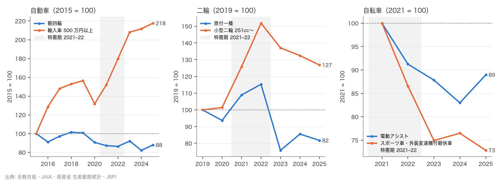

# R9: 三産業の対比 — 実用層と趣味層の分化は自転車・自動車・二輪で同形か（H6）（2026-10-22, theme: bicycle-industry）

## 要約（記述のみ、因果の主張はない）
- **H6 前段（「実用と趣味の分化」が三産業で同形）は不支持。** 2022 → 2025 の台数変化率は、自動車で 軽四輪 +1.8% に対し 輸入乗用車 500 万円以上 +21.0%、二輪で 原付一種 −29.1% に対し 小型二輪（251cc〜）−16.5%、自転車で 電動アシスト車 −2.5% に対し スポーツ車・外装変速機付軽快車 −15.9%。「実用層 ≥ 趣味層」は自転車だけで成り立ち、自動車・二輪では**趣味層の方が持ちこたえている**。期間を 2021 → 2025、2023 → 2025 に変えても、趣味層を 1,000 万円以上や MTB・クロスに、実用層を原付二種に変えても不支持。
- **H6 後段（コロナ後の反動の深さは自転車が最大）は主仕様で整合、仕様依存。** 2021 → 2024 の産業全体の変化率は 自動車 −0.6%、二輪 −14.5%、自転車 −26.2% で自転車が最小。ただし 2022 → 2025 では 二輪 −17.6%、自転車 −16.5% で逆転し不支持（2021 → 2025 は整合）。特需のピーク年を起点に取るかで結論が変わる。
- **分化の「向き」は産業ごとに違う。** 自動車は趣味層（高価格輸入車）が 2015 年比 2.18 倍に伸び、実用層（軽）は 0.88 倍。輸入乗用車に占める 500 万円以上の比率は 2015 年 24.8% → 2025 年 63.6%。二輪は小型二輪が 2015 年比 1.26 倍、原付一種は 2022 年比 0.71 倍（2025 年の新基準原付移行を含む）。自転車は両層とも減り、趣味層の減りが大きい。「実用層が残り趣味層が縮む」のは自転車に固有で、自動車・二輪とは逆。
- 軽比率（軽 ÷ (登録車＋軽)）は 2022 年 39.0% → 2025 年 36.5% で「高止まり」とは言えるが上昇していない。輸入乗用車の比率は 5%台。

## 問いと仮説
`design/themes/bicycle-industry.md` の H6（当初から事前登録。前段: 2022 → 2025 の台数変化率で三産業とも 実用層 ≥ 趣味層 なら同形。後段: 自転車の 2021 → 2024 の下落率が三産業で最大なら整合）。変数の具体化（自動車 = 軽四輪 vs 輸入乗用車 500 万円以上、二輪 = 原付一種 vs 小型二輪、自転車 = 電動アシスト vs スポーツ車・外装変速機付軽快車、後段の産業合計の定義）は各協会のファイル様式を見てから決めたので**事後**として設計書に記録した。判定基準（閾値・期間・不等号）は変えていない。推定したい量: 層別の台数変化率。因果効果は推定しない。

事前登録からの逸脱: (1) 変数の具体化が事後（上記）。(2) 原付は協会統計に公開系列が無く、R1 と同じ生産動態統計の国内製造事業所 販売台数（輸出を含みうる）で代理。(3) 登録の「500 万円超」は JAIA の帯（500〜599）の境界に合わせ「500 万円以上」とした。

## データ
| 変数 | 出典 | 定義・単位 | 期間 | 備考 |
|---|---|---|---|---|
| 軽四輪 新車販売 総台数 | 全国軽自動車協会連合会 `hanbai4-2025kaku.xls` | 台、暦年 | 1967–2025 | 乗用車群・バン・トラックの計 |
| 軽二輪（126–250cc）・小型二輪（251cc〜）新車販売 | 同 `hanbai2-2025.xls` | 台、暦年 | 1967–2025 | |
| 登録車 新車登録（車種別 年計） | 日本自動車販売協会連合会 車種別登録台数 xls | 台、暦年。普通・小型乗用車、貨物、バス、合計 | 2021–2025 | ナンバーベース。URL は不透明 ID（manifest で固定） |
| 登録車＋軽 販売台数 | 同 登録車＋軽自動車販売台数 xls | 台、暦年（1〜12 月） | 2022–2025 | 検算用 |
| 輸入乗用車 価格帯別 新規登録 | 日本自動車輸入組合 `PriceRange_year.xls` | 台、暦年、車両本体価格 13 帯 | 2003–2025 | 固定名・上書き更新（manifest でスナップショット）。robots.txt の Crawl-delay 10 を守り 1 ファイルのみ |
| 原付一種・二種 販売台数 | 経産省 生産動態統計（`meti_production`） | 台、暦年（2024– は月次年計） | 2017–2025 | 国内製造事業所の販売。輸入・輸出の扱いに注意（R1 と同じ代理） |
| 電動アシスト車・スポーツ車系・自転車合計 | JBPI 国内向自転車生産輸入統計（`jp_bicycle_by_type`、R8） | 台、暦年 | 2021–2025 | |

mart: `jp_kei_moto_sales`（236 行）、`jp_registered_car_sales`（44 行）、`jp_import_car_price_bands`（299 行）、`jp_bicycle_by_type`（50 行）、`meti_production`。取得 2026-10-22。協会統計は利用規約の記載がなく出典明記で引用、raw 非コミット。

## 方法
前段: 層別台数の 2022 → 2025 変化率を並べ、三産業すべてで 実用 ≥ 趣味 なら整合（事前基準）。後段: 産業合計の 2021 → 2024 変化率が自転車で最小なら整合。頑健性: 期間（2021 → 2025、2023 → 2025、2019 → 2025）、層の定義（1,000 万円以上、MTB・クロス、原付二種）、後段の期間（2022 → 2025、2021 → 2025）と二輪の定義（原付を除く）。記述: 軽比率、500 万円以上比率、2015 = 100 の長期推移。
局面: 特需期 2021–2022、特需後 2023–2025。自動車・二輪はコロナ前（2015–19）も並べる。

## 結果

### H6 前段: 2022 → 2025 の台数変化率
| 産業 | 実用層 | 変化率 | 趣味層 | 変化率 | 実用 ≥ 趣味 |
|---|---|---|---|---|---|
| 自動車 | 軽四輪 新車販売 | +1.8% | 輸入乗用車 500 万円以上 | +21.0% | いいえ |
| 二輪 | 原付一種（生産動態統計 販売） | −29.1% | 小型二輪 251cc〜 新車販売 | −16.5% | いいえ |
| 自転車 | 電動アシスト車（国内生産） | −2.5% | スポーツ車・外装変速機付軽快車（輸入） | −15.9% | はい |

判定: **不支持**。

### H6 後段: 2021 → 2024 の産業全体の変化率
自動車 −0.6%、二輪 −14.5%、自転車 −26.2%。判定: **整合**（ただし下の頑健性のとおり仕様依存）。

### 記述: 水準（台）
| 系列 | 2015 | 2019 | 2021 | 2022 | 2023 | 2024 | 2025 |
|---|---|---|---|---|---|---|---|
| 軽四輪 新車販売 | 1,896,200 | 1,910,346 | 1,652,522 | 1,638,136 | 1,744,919 | 1,557,868 | 1,667,360 |
| 登録車 新車登録 | – | – | 2,795,818 | 2,563,184 | 3,034,167 | 2,863,626 | 2,898,417 |
| 輸入乗用車 計 | 284,471 | 298,378 | 258,637 | 240,758 | 246,735 | 225,518 | 241,189 |
| 輸入乗用車 500 万円以上 | 70,520 | 110,288 | 107,130 | 126,871 | 146,702 | 149,305 | 153,494 |
| 原付一種（販売） | – | 181,198 | 197,353 | 208,878 | 137,377 | 154,988 | 148,122 |
| 原付二種（販売） | – | 129,741 | 160,786 | 139,893 | 177,819 | 144,840 | 134,732 |
| 軽二輪 126–250cc | 51,277 | 58,359 | 78,911 | 71,294 | 71,648 | 57,180 | 61,990 |
| 小型二輪 251cc〜 | 66,621 | 66,456 | 83,571 | 100,889 | 91,089 | 88,001 | 84,259 |
| 電動アシスト車 | – | – | 657,657 | 600,108 | 577,729 | 545,736 | 585,074 |
| スポーツ車・外装変速機付軽快車 | – | – | 2,378,169 | 2,058,654 | 1,782,044 | 1,819,071 | 1,732,111 |
| 自転車 国内向 合計 | – | – | 6,892,771 | 5,786,209 | 5,076,772 | 5,083,498 | 4,830,681 |

- 軽比率 2022 年 39.0% → 2025 年 36.5%。輸入乗用車の 500 万円以上比率 2015 年 24.8%、2019 年 37.0%、2022 年 52.7%、2025 年 63.6%。輸入乗用車 ÷（登録車＋軽）は 2022 年 5.7%、2025 年 5.3%。
- 2015 → 2025（2015 = 100）: 軽四輪 88、輸入乗用車 計 85、輸入乗用車 500 万円以上 218、軽二輪 121、小型二輪 126。



## 頑健性
| 仕様 | 結果 |
|---|---|
| 前段 2021 → 2025 | 自動車 +0.9% vs +43.3%、二輪 −24.9% vs +0.8%、自転車 −11.0% vs −27.2% → 不支持 |
| 前段 2023 → 2025 | 自動車 −4.4% vs +4.6%、二輪 +7.8% vs −7.5%、自転車 +1.3% vs −2.8% → 不支持 |
| 前段 2019 → 2025 | 自動車 −12.7% vs +39.2%、二輪 −18.3% vs +26.8%、自転車は 2019 年なし → 判定不能 |
| 前段 趣味層 = 輸入車 1,000 万円以上 | 自動車 +1.8% vs +30.6% → 不支持 |
| 前段 自転車の趣味層 = MTB・クロス | −2.5% vs −70.6% → 不支持（自動車・二輪が逆のまま） |
| 前段 二輪の実用層 = 原付二種 | −3.7% vs −16.5%（二輪は 実用 ≥ 趣味 になる）→ 自動車が逆のため不支持 |
| 後段 2022 → 2025 | 自動車 +8.7%、二輪 −17.6%、自転車 −16.5% → 不支持 |
| 後段 2021 → 2025 | 自動車 +2.6%、二輪 −17.6%、自転車 −29.9% → 整合 |
| 後段 2019 → 2024 | 判定不能（登録車の年計が 2021 年から） |
| 後段 二輪 = 軽二輪＋小型二輪のみ（2021 → 2024） | 二輪 −10.6% → 整合 |

前段の不支持は、どの仕様でも自動車（軽 vs 高価格輸入車）が逆向きであることで決まる。後段は、起点を 2021（自転車の特需ピーク）に置けば自転車が最深、2022（二輪の小型二輪ピーク）に置けば二輪が最深で、仕様依存。

## 限界・言えないこと
- 「実用層」「趣味層」の定義は産業ごとに別の統計・別の境界（価格帯、排気量、車種）で、同じ概念を測っていない。高価格輸入車の伸びには円安・価格上昇による帯の移動（同じ車が上の帯に入る）を含む。CPI で境界を実質化した仕様は試していない（1,000 万円以上に上げても逆向きは変わらないことだけ確認）。
- 原付は生産動態統計の国内製造事業所の販売で、登録・販売統計ではない。原付一種は 2022 → 2023 に −34%（208,878 → 137,377）の段差があり、実需の動きか、年報の暦年値から月次年計（2024 年〜）への切り替えなどの統計側の要因かは確認していない。前段の二輪の判定はこの段差で決まるが、実用層を原付二種に替えても自動車の逆向きで不支持は変わらない。2025 年の新基準原付（125cc 以下に出力制限）への移行で系列は断絶しうる。
- 登録車の年計は 2021 年からで、後段のコロナ前比較はできない。自転車の国内向け統計も 2021 年から。
- 自動車・二輪の協会統計と自転車の生産＋輸入統計は「販売」と「出荷・通関」で時点が違い、在庫の変動を含む。
- 変数の具体化が事後。判定基準は事前のまま。記述であり因果の主張はない。H6 の「在庫が軽く輸入依存のため」という理由付けは検証していない。

## 再現手順
```bash
uv run socioscope run bicycle-industry fetch --only zenkeijikyo && uv run socioscope run bicycle-industry fetch --only jada && uv run socioscope run bicycle-industry fetch --only jaia
uv run socioscope run bicycle-industry stage && uv run socioscope run bicycle-industry mart
uv run python themes/bicycle-industry/src/theme_bicycle_industry/analysis/a20261022_r9_auto_moto.py > themes/bicycle-industry/reports/2026-10-22-r9-auto-moto.stdout.txt
```

## チェックリスト回答
- A: H6 の判定基準（前段の不等号・期間、後段の期間）は当初から設計書に固定。変数の具体化は事後と明記（設計書にも記録）。推定量は層別・産業別の台数変化率。
- B: 出典・定義・単位・取得日・robots 方針（JAIA の Crawl-delay）は上表と manifest で一致。欠損（登録車 2021 年〜、自転車 2021 年〜、原付の協会統計なし）は列挙し補完していない。
- C: 識別戦略なし（記述のみ）。因果は主張せず、H6 の理由付けは未検証と明記。
- D: 標準誤差なし（全数統計）。試した仕様（期間 3 通り、層の定義 3 通り、後段の期間 2 通りと二輪の定義）は全部書き、後段が仕様依存であることを要約に明記。
- E: 「不支持」「整合（仕様依存）」を使い分け、因果語は使っていない。図は軸・基準年（パネルごと）・出典・凡例を明記。限界の節あり。再現手順と mart の行数を記載。LLM 構造化は使っていない。
