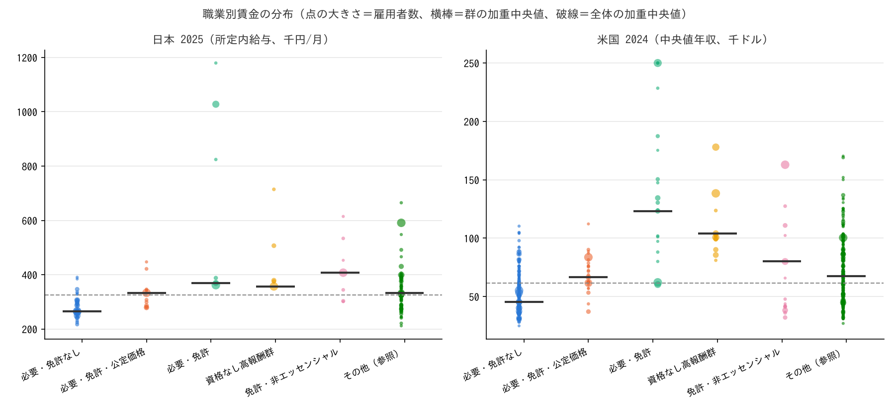
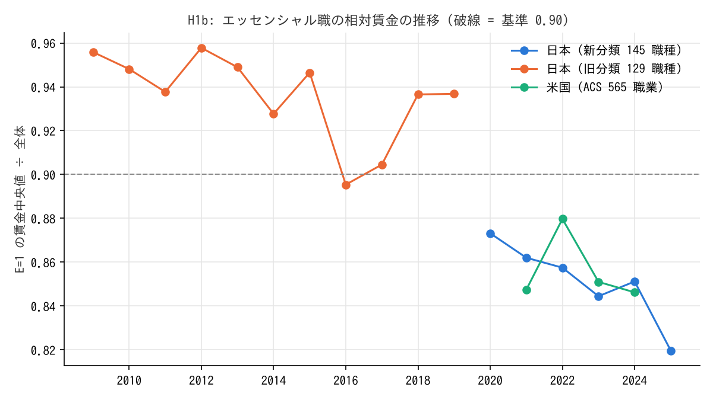

# R1: エッセンシャルワークの逆説は存在するか、何が賃金を分けるか（H1・H1b・H2・H5・H0）（2026-10-29, theme: essential-work-wages。方法論レビュー後に改訂 2026-10-30）

## 要約（職業平均の記述的な関連。因果の主張はない）
- **H1（逆説は存在する）は日本・米国とも整合。** 政府が「エッセンシャル」と定義し、かつ現場にいなければ成立しない職業（E=1）の賃金中央値は、全職業の中央値の 0.82 倍（日本 2025 年、所定内給与）・0.85 倍（米国 2024 年、フルタイム通年の年収）で、賃金の下位 4 分の 1 に E=1 の雇用者が 2.1 倍・1.5 倍に過大代表されている。境界職業を除くと差は広がる（0.80・0.62）。
- **H1b（可視化後に改善したか）は改善なし。** 日本の E=1 の相対賃金は 0.87（2020）→ 0.82（2025）と 5 pt 下がった。米国は 0.85 → 0.85 で横ばい。「エッセンシャル」と呼ばれた後も相対賃金は改善していない。
- **H2（必要性でなく免許が賃金を分ける）は仮説全体として整合基準を満たさない（事前規則は 2 か国とも ≥ 0.20。米国のみ整合、日本は不支持）。** E=1 の中で免許職と無免許職の粗い賃金差は両国とも大きい（log 差 0.23・0.64）が、必要学歴年数を揃えると日本は +0.09（95% CI −0.01〜+0.19）に縮み、米国は +0.22（+0.10〜+0.33）が残る。日本では免許職の賃金差の大半が学歴年数で説明される。
- **H5（ケア・ペナルティ）は両国で整合（米国は統制が不完全な暫定値）。** E=1 の中で女性比率 70% 以上の職業は、30% 以下の職業より職業平均で 28%（日本、学歴・時間・勤続を統制、log −0.33）・19%（米国、学歴のみ統制、log −0.21）低い。日本の女性比率を国勢調査の全就業者ベースに替えても −0.32 で変わらない。女性比率 +10 pt の係数は米国では E=1 と E=0 で同程度（−0.04 と −0.05）、日本では E=1 で強い（−0.03 と 0.00。国勢調査ベースでは −0.03 と −0.02 で同程度）。
- **H0（必要性の係数は統制後に消えるか）は両国とも判定不能。** 賃金比を E だけに回帰した係数は −0.21（日本）・−0.28（米国）で逆説を再現する。免許・公定価格・第三者被害・女性比率・学歴（日本は労働時間・勤続も）を入れると −0.04〜−0.07（日本）・−0.05〜−0.12（米国）まで縮む。点推定は事前基準の「整合域（|β| < 0.05）」と「不支持域（≤ −0.10）」の間の帯に落ちる仕様が多く、95% 区間は両域にかかる。事前登録にこの帯の扱いが無いため、判定不能とする。逆説のうち随伴する特性と結びつく部分は仕様により 5 割強〜8 割超（米国で境界を除くと 56%、重みなしでは 100% 超）で、残りがゼロかどうかは決められない。
- **含意（関連として）:** 必要な仕事の低賃金は、必要な仕事が「女性比率が高い・学歴年数が短い・（米国では）免許がない」という特性を併せ持つことと強く結びついている。統制変数の中では女性比率（0〜1 の連続変数。係数は女性比率が 0 → 1 に動いたときの log 差で、0/1 ダミーの L・P・T とは単位が違う）の係数が両国で最大。「必要性そのもの」の寄与は小さいが、本分析では否定も肯定もできない。

## 問いと仮説
`design/themes/essential-work-wages.md` の H1・H1b・H2・H5・H5b・H0（事前登録 2026-10-29）。判定基準は設計書どおり: H1 は賃金比 ≤ 0.90 かつ下位 4 分の 1 の過大代表 ≥ 1.5、H2 は学歴統制後の log 差 ≥ 0.20 で整合・< 0.10 で不支持、H5 は統制後の log 差 ≤ −0.15 で整合・> −0.05 で不支持、H0 は統制後 |β_E| < 0.05 で整合・≤ −0.10 で不支持。

事前登録からの逸脱・事後の具体化（設計書「事後記録」に結果を見る前に記載したもの、および本改訂で明示したもの）:
1. **米国は BLS OEWS でなく Census ACS 1 年推計**（bls.gov がこの環境から 403）。賃金はフルタイム通年の中央値年収、職業 565（Census 2018 コード）。
2. **日本の賃金は職種平均（所定内給与）**。賃金構造基本統計調査は職種別の中央値を公表しないため、「全職業の中央値」は職種平均の雇用者数加重中央値で代替した。
3. **E の (ii) 在宅勤務不可能性は米国のみ Dingel–Neiman で機械的に適用**（cisa_sector=1 かつ teleworkable < 0.5。欠損 8 職業は cisa のみ）。日本は定義表の作成時に職業ごとに判断。
4. **3 か国目（英国）は未着手。** 判定は日本・米国の 2 か国で行い、「3 か国中 2 か国」は「2 か国中 2 か国」と読み替えた。
5. **H1b の比較期間**は設計の「2019 年比」でなく、日本は 2020 年比（2019 年以前は別分類で接続しない）、米国は 2021 年比（2019・2020 年の ACS が未取得・未公表）。
6. **H5 の統制変数**は設計の「学歴・労働時間・勤続」のうち、米国は学歴のみ（ACS に職業別の労働時間・勤続が無い）。米国の H5 は暫定値。
7. **H0 の R（レント）は入れていない。** 職業別のレント指標（職業 × 産業）が両国とも無い。R を除いた回帰であり、設計の回帰式とは違う。
8. **F（女性比率）は賃金と同じ表から計算**（日本は一般労働者の女性 ÷ 男女計、米国はフルタイム通年の女性 ÷ 総数）。頑健性として日本は国勢調査 2020 の全就業者ベース（職種対応表 `jp_bsws2020_census_map.csv`、144 職種中 124 に値）でも計算した（改訂で追加、事後）。
9. **H0 の「中間帯」の扱い**は事前登録に無い。本改訂では、点推定が帯のどこに落ちるかを仕様ごとに示し、総合は「判定不能」とする。
10. 来歴の注意: 定義表は賃金を見る前にコミットした（`dba8f69`）が、設計書の事後記録・スクリプトの docstring・本 report は同じコミットに入っている。「結果を見る前に固定した」ことは git では確かめられない。

## データ
| 変数 | 出典 | 定義・単位 | 期間・国 | 備考（欠損・断絶） |
|---|---|---|---|---|
| 職種別 所定内給与・労働者数・年齢・勤続・所定内実労働時間 | 厚生労働省 賃金構造基本統計調査 職種別 第 1 表（e-Stat、企業規模計・男女計・男・女） | 所定内給与額 千円/月（6 月分、職種平均）、労働者数 人（十人単位 × 10） | 2009〜2025 年、一般労働者 | 2020 年に職種分類を改定（129 → 145）。接続せず `classification` で区別。2020 年以降の「不詳」は除外 |
| 職業別 中央値所得・就業者数（男女計・男・女） | Census ACS 1 年推計 B24121〜B24126（table-based summary file） | 中央値年収 ドル（名目、各年）、フルタイム通年の民間就業者 | 2021〜2024 年、全米 | 2020 年は未公表、2019 年以前は旧形式で未取得。女性中央値は小職業で欠損あり（本分析では使わない） |
| 在宅勤務可能性 | Dingel & Neiman (2020) `occupations_workathome.csv`（O*NET-SOC） | 0〜1（SOC 6 桁の平均 → Census 職業コードへ） | – | 565 職業中 543 に値（96%）。残余コード等 22 は欠損 |
| 職業（小分類）× 性 就業者数 | 令和 2 年国勢調査 抽出詳細集計 第 10 表（e-Stat） | 人（全就業者、15 歳以上） | 2020 年、全国 | 女性比率の頑健性のみ。秘匿セルは欠損 |
| 定義表 E/L/P/T/boundary/学歴年数/群 | 本テーマの手入力（`jp_occupation_flags.csv`、`jp_occupation_flags_2009.csv`、`us_occupation_flags.csv`） | 0/1、学歴年数は典型的な最低年数 | – | 2026-10-29 に賃金を見る前にコミット（`dba8f69`）。米国の重複行 1 件（0650）は後で除去 |

mart: `data/marts/bsws_occupation_wages.parquet`（27,468 行 = 17 年 × 性 3 × 規模 4 × 職種）、`acs_occupation_earnings.parquet`（2,264 行 = 4 年 × 566）、`us_occupation_teleworkable.parquet`（565 行）、`jp_census2020_occupation_sex.parquet`（301 行）。取得 2026-10-29、ライセンスは政府標準利用規約 2.0・パブリックドメイン・GPL-3.0（D–N は導出値のみ保持）。

## 方法
記述統計と職業レベルの加重最小二乗法（WLS、重み = 雇用者数、HC1 頑健標準誤差。感度として重みなしと HC3）。単位は職業（日本 144、米国 565）。推定量は「雇用者平均で見た職業特性と賃金の関連」であり、個人の賃金関数ではない。
- H1: E=1 の雇用者数加重中央値 ÷ 全体の加重中央値。全体の加重 P25 以下の職業に属する雇用者のうち E=1 の割合 ÷ E=1 の全体シェア。
- H2・H5: E=1 の職業に限り、log(賃金) を L（または女性 70% 以上ダミー）と統制変数（学歴年数。日本は所定内実労働時間・勤続年数も）に回帰。
- H0: log(賃金 ÷ 全体中央値) を E のみ、E＋L＋F＋統制、＋P、＋T、＋P＋T、＋P＋T（境界を除く）の 6 仕様で回帰。P と T は共線性が強いので片方ずつも報告し、1 つの仕様だけで結論を書かない。
- 頑健性: 境界職業（boundary=1）を除く、L の境界（障壁の低い免許）を L=0 にする、日本は年収（所定内 × 12 ＋ 賞与）、女性比率を国勢調査ベースに。

## 結果

### H1: 逆説の存在
| | 日本 2025 | 日本 2025（境界除く） | 米国 2024 | 米国 2024（境界除く） |
|---|---|---|---|---|
| E=1 の賃金中央値 ÷ 全体（基準 ≤ 0.90） | **0.820** | 0.801 | **0.846** | 0.623 |
| E=1 の中央値 / 全体の中央値 | 267 / 326 千円 | 263 / 328 | 52,074 / 61,536 ドル | 41,668 / 66,890 |
| E=1 の雇用者シェア（全体 → 下位 4 分の 1） | 0.37 → 0.76 | 0.25 → 0.62 | 0.34 → 0.53 | 0.23 → 0.49 |
| 過大代表（基準 ≥ 1.5） | **2.08** | 2.51 | **1.55** | 2.14 |
| 職業数 E=1 / 全体 | 52 / 144 | 20 / 95 | 171 / 565 | 69 / 392 |

日本を年収（所定内 × 12 ＋ 年間賞与）で見ると賃金比 0.77、過大代表 2.21。**判定: 両国で整合。**

米国で cisa_sector=1 だが在宅可能として E から外れた主な職業は 小中学校教員・高校教員・教育管理職・教員補助・医療管理職・警備員（Dingel–Neiman では警備員が在宅可能と採点されている）。機械的な適用の限界で、境界職業の頑健性で吸収している。

### 群別の加重中央値（賃金比）
| 群 | 日本 職種数 | 日本 | 米国 職業数 | 米国 |
|---|---|---|---|---|
| エッセンシャル・免許なし（主対象） | 34 | 0.81 | 155 | 0.74 |
| 必要・免許・公定価格（看護師・教員など） | 12 | 1.02 | 26 | 1.08 |
| 必要・免許（医師・パイロット・電気工事士など） | 6 | 1.13 | 20 | 2.00 |
| 資格なし高報酬群（IT・コンサル・金融） | 5 | 1.09 | 12 | 1.69 |
| 免許・非エッセンシャル（弁護士・理美容師など） | 7 | 1.25 | 14 | 1.30 |
| その他（参照） | 80 | 1.02 | 338 | 1.10 |


図 1: 職業別賃金の分布（点の大きさ = 雇用者数、横棒 = 群の加重中央値、破線 = 全体の加重中央値）。左: 日本 2025 年、所定内給与 千円/月（賃金構造基本統計調査、n=144）。右: 米国 2024 年、中央値年収 千ドル（ACS、n=565）。

### H1b: 相対賃金の推移

図 2: E=1 の賃金中央値 ÷ 全体。日本は 2020 年の分類改定で系列が切れる（旧 129 職種は抜粋職種のため水準は比較できない）。

| 系列 | 始点 | 終点 | 変化 |
|---|---|---|---|
| 日本 旧分類（2009→2019） | 0.956 | 0.937 | −1.9 pt |
| 日本 新分類（2020→2025） | 0.873 | 0.820 | **−5.3 pt** |
| 米国 ACS（2021→2024） | 0.847 | 0.846 | −0.1 pt |

判定（改善 ≥ 2 pt）: 日本・米国とも改善なし。日本の 2020 年は分類改定と流行が重なる年なので、2020 年比の変化は分類改定の影響を含まない（同じ分類の中の変化）が、「流行前との比較」ではない。

### H2: E=1 の中で免許の有無
| 国 | L の定義 | L=1 / L=0 職業数 | L=1 中央値÷全体 | L=0 中央値÷全体 | 粗差（log） | 学歴統制後の差（log、95% CI） | 学歴 1 年の係数 | 判定 |
|---|---|---|---|---|---|---|---|---|
| 日本 | 境界込み | 21 / 31 | 1.02 | 0.81 | 0.23 | +0.091（−0.005〜+0.187） | 0.070 | 不支持 |
| 日本 | 低障壁の免許を除く | 10 / 42 | 1.02 | 0.81 | 0.26 | +0.071（−0.080〜+0.222） | 0.075 | 不支持 |
| 米国 | 境界込み | 38 / 133 | 1.36 | 0.74 | 0.64 | **+0.216（+0.100〜+0.332）** | 0.130 | 整合 |
| 米国 | 低障壁の免許を除く | 29 / 142 | 1.36 | 0.74 | 0.65 | +0.199（+0.079〜+0.318） | 0.133 | 中間 |

**H2 総合判定（事前規則: 2 か国中 2 か国で ≥ 0.20）: 整合基準を満たさない。** 国別には米国 整合・日本 不支持。

日本では免許職（看護師・薬剤師・教員など）の方が学歴年数が長く、学歴を揃えると免許の係数は 0.07〜0.09 で区間がゼロをまたぐ。米国では学歴を揃えても 0.20〜0.22 が残る。日本の免許職は養成課程 = 学歴であり、「免許」と「学歴年数」は分離できない。これが制度の違い（米国の州免許は同じ学歴でも職業を閉じる）なのか、学歴変数が免許を代理しているだけなのかは、本分析では区別できない。H2b（看護師 vs 介護職の差と、看護師 vs 医師の差の比較）は計算していない。

### H5: E=1 の中で女性比率
| 国 | 女性比率の出所 | 女性 ≥70% / ≤30% の職業数 | 加重中央値の比（粗） | 統制後の差（log、95% CI） | 判定 |
|---|---|---|---|---|---|
| 日本 | 賃金表（一般労働者） | 13 / 23 | 1.03 | **−0.326（−0.548〜−0.104）**（学歴・所定内時間・勤続） | 整合 |
| 日本 | 国勢調査 2020（全就業者、124 職種） | 14 / 19 | 0.91 | **−0.324（−0.568〜−0.081）**（同） | 整合 |
| 米国 | ACS（フルタイム通年） | 36 / 77 | 0.97 | **−0.214（−0.342〜−0.086）**（学歴のみ） | 整合（暫定） |

2 つの女性比率の相関は 0.96。粗い比では差が無いのに統制後に大きな負の差が出るのは、女性比率の高いエッセンシャル職（看護師・保育士など）の学歴年数が男性比率の高いエッセンシャル職（運転手・清掃・建設）より長いため。職業平均で同じ学歴年数なら、女性の多い必要な仕事は男性の多い必要な仕事より 2〜3 割安い。

H5b（女性比率 +10 pt の係数、統制後）: 日本（賃金表）E=1 −0.031（−0.061〜−0.002）、E=0 −0.000（−0.017〜+0.016）、差 −0.031 → E=1 で強い。日本（国勢調査）E=1 −0.033、E=0 −0.015、差 −0.017 → 同程度。米国 E=1 −0.039、E=0 −0.051、差 +0.012 → 同程度。米国では England らの「ペナルティは全職業に効く」が再現される。日本は女性比率の出所で結論が変わり、「E=1 に集中」とは言い切れない。

### H0: 統合回帰（log 賃金比、雇用者数加重、HC1）
| 仕様 | 日本 β_E（95% CI） | 帯 | 米国 β_E（95% CI） | 帯 |
|---|---|---|---|---|
| E のみ | **−0.212（−0.331〜−0.094）** | 不支持域 | **−0.284（−0.423〜−0.144）** | 不支持域 |
| E + L + F + 学歴（＋時間＋勤続） | −0.040（−0.098〜+0.019） | 整合域 | −0.064（−0.158〜+0.030） | 中間帯 |
| + P | −0.053（−0.108〜+0.001） | 中間帯 | −0.054（−0.146〜+0.037） | 中間帯 |
| + T | −0.054（−0.108〜−0.000） | 中間帯 | −0.045（−0.151〜+0.061） | 整合域 |
| + P + T | −0.055（−0.109〜−0.000） | 中間帯 | −0.057（−0.157〜+0.043） | 中間帯 |
| + P + T（境界を除く） | −0.074（−0.152〜+0.004）※ | 中間帯 | −0.124（−0.275〜+0.027） | 不支持域 |
| 感度: + P + T、重みなし | −0.042（−0.103〜+0.019） | 整合域 | +0.039（−0.016〜+0.095） | 整合域 |
| 感度: + P + T、HC3 | −0.055（−0.128〜+0.019） | 中間帯 | −0.057（−0.165〜+0.051） | 中間帯 |

※ 日本で境界を除くと P と T が同じ職業集合になり（P=T）、両者の係数は識別できない（β_E には影響しない）。

他の係数（+ P + T 仕様）: 日本 β_L +0.073、β_P +0.008、β_T +0.034、β_F −0.161。米国 β_L +0.088、β_P −0.133、β_T +0.013、β_F −0.423。女性比率の係数（0 → 1 の差）が両国で最大で、公定価格は米国でのみ負（メディケイド価格に依存する介護補助職が低い）、第三者被害 T は単独では効かない。

**判定: 両国とも判定不能。** E 単独の係数は逆説を再現する。統制後の点推定は仕様により整合域（日本 1 仕様、米国 1 仕様）・中間帯（4・3）・不支持域（0・1）にまたがり、95% 区間はいずれも整合域と不支持域の両方にかかる。重みなしでは両国とも整合域に入る。事前登録は ±0.05 と −0.10 の間の帯の扱いを決めておらず、どの仕様を主とするかも決めていないため、「消えた」とも「残った」とも言えない。

## 頑健性
| 変更 | 結果 |
|---|---|
| 境界職業（boundary=1）を除く | H1 はより強く整合（0.80・0.62）。H0 の β_E は −0.074・−0.124 と大きくなる（境界に含まれる販売店員・調理・運転手などを外すと、残る E=1 は介護・清掃・看護助手などに絞られる） |
| L の境界（二種免許・大型免許・CDL 等）を L=0 に | H2 日本は不変（不支持）、米国は +0.20 で中間 |
| 日本を年収（所定内 × 12 ＋ 賞与）で | H1 0.77・2.21 でより強く整合 |
| 女性比率を国勢調査（全就業者）に | H5 日本 −0.324 で不変。H5b は「同程度」に変わる |
| P と T を片方ずつ | β_E は −0.045〜−0.055 の範囲 |
| 重みなし・HC3 | 重みなしでは β_E が縮む（日本 −0.042、米国 +0.039）。HC3 では区間が広がるが点推定は同じ |
| 年（日本 2020〜2025、米国 2021〜2024） | H1 の賃金比は 0.82〜0.88 の範囲、すべて基準内 |

## 限界・言えないこと
- **職業レベルの集計統計。** 個人の学歴・経験を統制した賃金関数ではなく、職業の平均特性を揃えた関連。職業内の構成（年齢・勤続）の違いは日本では平均値で、米国では統制していない。要約の「2〜3 割安い」も職業平均の話である。
- **E の定義は政治的で粗い。** 2020 年のリストは感染症対策の業種リストであり、「社会に必要」の操作的定義としては広すぎる（金融を含む）かつ狭すぎる（学校は含まない）。境界フラグで頑健性を見たが、恣意性は残る。
- **日本の賃金は平均、米国は中央値。** 国の間で賃金比の水準は直接比べられない。各国内の相対比較に限る。
- **米国はフルタイム通年のみ。** パートタイムの多い介護補助・給食・小売は過小代表で、E=1 の賃金比は上方に偏っている可能性がある。米国の H5 は労働時間・勤続を統制できていない。
- **L・P・T は手入力。** 定義表は賃金を見る前に固定したが、判断の誤りはあり得る。rationale 列に理由を残した。
- **H0 に R（レント）が無い。** 設計の回帰式を満たしていない。
- **因果は言えない。** 免許や女性比率が「賃金を下げる」のか、低賃金の職業に女性が集まるのかは、この横断面では分けられない。
- **英国は未分析。** 3 か国目の再現は今後。

## 再現手順
```bash
uv run socioscope run essential-work-wages fetch --only estat_bsws --only census_acs1 --only dingel_neiman --only estat_census2020
uv run socioscope run essential-work-wages stage && uv run socioscope run essential-work-wages mart
uv run python themes/essential-work-wages/src/theme_essential_work_wages/analysis/a20261029_r1_paradox.py  # 出力は reports/2026-10-29-r1-paradox.stdout.txt
```

## チェックリスト回答
- A. 問い・仮説・指標・判定基準は `design/themes/essential-work-wages.md` に分析前に固定（2026-10-29）。定義表は賃金を見る前にコミット（`dba8f69`）。ACS への代替・平均賃金の使用・2 か国判定は設計書の「事後記録」に、H1b の期間・H5 の統制・R の欠落・H0 の帯の扱いは本改訂の逸脱節に明記。事後記録と report が同じコミットであることも書いた。推定量は「職業レベルの記述的関連（加重中央値の比、WLS の係数）」。
- B. 出典・定義・取得日は manifest（`data/raw/manifest.jsonl`）と一致。欠損・断絶: 賃金構造基本統計調査の 2020 年分類改定（接続せず）、ACS 2020 年欠落、D–N の 22 職業欠損、国勢調査の秘匿 20 職種、米国フルタイム通年のみ。補完なし。
- C. 因果を主張しない。識別戦略なし（横断面の関連）。逆の因果（低賃金職に女性が集まる）と省略変数（職業内の経験・企業規模・レント）を限界に明記。エコロジカルな誤謬: 職業レベルの関連を個人の賃金関数と読み替えない旨を方法・限界・要約に明記。
- D. 標準誤差は HC1（職業が単位、クラスタなし）、感度で HC3 と重みなし。試した仕様と頑健性をすべて報告。H0 の判定は仕様で帯が変わることを表で示し、1 仕様で結論を書いていない。
- E. 「整合」「関連」で書き、因果語は使わない。図は軸・単位・出典・n を明記。限界の節あり。再現手順と mart の行数を記載。LLM 構造化は使っていない。
