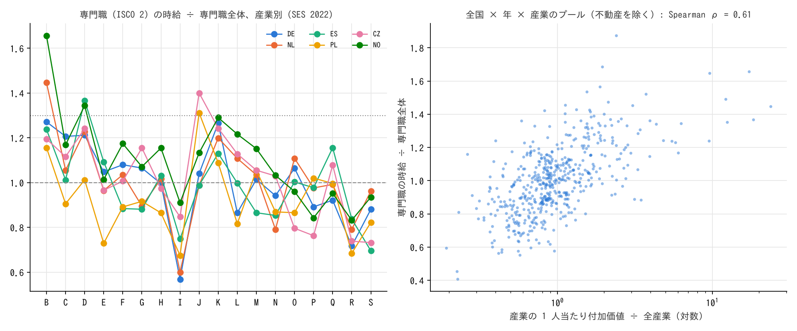

# R2: 資格なしの高報酬はレントへの近さで決まるか（H6、対照群 2）（2026-10-29, theme: essential-work-wages。方法論レビュー後に改訂 2026-10-30）

## 要約（記述的な関連。因果の主張はない）
- **H6 は判定不能。** 事前登録した対象（ISCO 2 桁の 25 ICT 専門職・24 経営金融専門職・33 金融ディーラー等）の賃金は、使えたデータ（Eurostat SES）には ISCO 1 桁しか無く、検定できなかった。代替として「専門職（ISCO 2）全体」で見た結果は、欧州 17 か国 × 2 時点のほぼ全てで事前基準の「整合」と「不支持」の間（代替指標では中間）にある。
- **代替指標で見えたこと。** 同じ専門職大分類でも、金融・保険（K）と情報通信（J）で働く人の時給は専門職全体の 1.24 倍・1.18 倍（国 × 年の中央値）、専門・科学・技術（M）は 1.02 倍。産業別プレミアムと産業の 1 人当たり付加価値の Spearman ρ は中央値 0.61（18 産業。ρ ≥ 0.5 は国 × 年の 66%。不動産を除いた 17 産業では中央値 0.69）。「K・J・M すべて ≥ 1.30」は 1 か国も満たさず、「1 つ以上 ≥ 1.30」は 41%。
- **日本の探索（職種 × 企業規模）。** 資格なし高報酬群（システムコンサルタント・ソフトウェア作成者・金融営業など）の 1,000 人以上企業 ÷ 10〜99 人企業の賃金比は 1.07 で、エッセンシャル低賃金群の 1.08 と変わらない。経営コンサルタントを含む「その他の経営・金融・保険専門職」とシステムコンサルタントには 1.5〜1.6 倍の規模プレミアムがある。H6 の事前登録変数ではないので判定しない。
- **含意:** 「どの産業にいるか」は同じ職業大分類の時給を 2 割前後動かし、その方向は産業のレント（1 人当たり付加価値）に沿う（関連）。ただし本来の対象（コンサルタント・投資銀行）は切り出せておらず、H6 の答えは出ていない。

## 問いと仮説
`design/themes/essential-work-wages.md` の H6・H6b（事前登録 2026-10-29）。判定基準: 対象職業で産業プレミアム（K・J・M ÷ 職業全体）≥ 1.30 かつ ρ ≥ 0.5 なら整合、プレミアム < 1.10 なら不支持。

事前登録からの逸脱・事後の具体化:
1. **米国 OES（職業 × 産業）が使えないため Eurostat SES 2018・2022 で判定する**（設計書「事後記録」、結果を見る前）。国ごとに判定し整合した割合で報告。
2. **SES の職業は ISCO-08 の 1 桁（大分類）のみ公表**されており、2 桁（25・24・33）は無い。OC2 専門職と OC3 準専門職で代替した（2026-10-30 未明に確定）。OC2 には教員・医師・看護師・法務も含まれ、事前登録した対象の検定ではない。**このため判定は「判定不能」とし、代替指標の結果は参考として報告する**（レビュー後に改訂。改訂前は「中間」と書いていた）。
3. **「プレミアム < 1.10 なら不支持」の読み方**: スクリプトは K・J・M の最大値 < 1.10 で不支持としていた（事後の解釈で、中間に寄せる向きに働く）。最小値 < 1.10 で読んだ場合も併記する。
4. **ρ の不動産（L）の扱い**: 主結果の図は L を除いた（帰属家賃で付加価値が極端）。L を含めた値も報告する（改訂で追加）。
5. **H6b（p90/p10）は代替不能**。同じ職業大分類の産業間ばらつき（最大 ÷ 最小）を探索的に報告するにとどめ、判定しない。
6. **日本は職種 × 企業規模（1,000 人以上 ÷ 10〜99 人）**で「同じ職業、違う雇用主」を探索的に見る。H6 の事前登録変数ではないため判定しない（改訂前は「不支持」と書いていた）。

## データ
| 変数 | 出典 | 定義・単位 | 期間・国 | 備考 |
|---|---|---|---|---|
| 職業 × 産業 × 性の平均時給 | Eurostat SES `earn_ses22_47`・`earn_ses18_47` | EUR/時、ISCO-08 大分類 × NACE 大分類（B〜S）、企業規模計 | 2018: 17 か国（BG CH CY CZ DE EE ES HU IE LT LV NL NO PL SI SK UK）、2022: 17 か国（AL BG CH CY CZ DE EE ES IE IS LT LV NL NO PL SI SK） | FR・IT・SE・AT・BE・DK・FI・PT・EU 集計は値なし。公務 O を含む |
| 産業別 付加価値・雇用 | Eurostat `nama_10_a64`（B1G、経常価格 百万ユーロ）・`nama_10_a64_e`（EMP_DC、千人） | 1 人当たり付加価値 千ユーロ = 付加価値 ÷ 就業者 | 2015〜2023 年、EU27＋IS NO CH ほか | 英国は無い（UK 2018 の ρ は計算不能） |
| 職種 × 企業規模の所定内給与 | 賃金構造基本統計調査 職種別 第 1 表 | 千円/月、男女計、企業規模 1,000 人以上・10〜99 人 | 2025 年 | R1 と同じ表 |

mart: `data/marts/ses_occupation_industry_earnings.parquet`（31,890 行）、`nama_industry_value_added_employment.parquet`（34,303 行）、`bsws_occupation_wages.parquet`（27,468 行）。取得 2026-10-29。ライセンスは Eurostat（出典表示で再利用可）・政府標準利用規約 2.0。

## 方法
国 × 年 × 職業大分類ごとに、産業 s のプレミアム = 時給(s) ÷ 時給(B〜S 全産業)。K・J・M の最小値 ≥ 1.30 かつ、B〜S の 18 産業でプレミアムと 1 人当たり付加価値の Spearman ρ ≥ 0.5 なら整合。K・J・M の最大値 < 1.10 なら不支持（最小値で読んだ場合も併記）。それ以外は中間。日本は職種ごとに規模プレミアムを出し、群ごとの労働者数加重中央値。

## 結果

### H6（代替指標、欧州）: 専門職（OC2）と準専門職（OC3）
| | OC2 専門職 | OC3 準専門職 |
|---|---|---|
| 国 × 年 | 32 | 33 |
| 判定の内訳（最大値 < 1.10 を不支持） | 中間 30、不支持 1（CY 2018）、判定不能 1（UK） | 中間 31、不支持 1（IS 2022）、判定不能 1（UK） |
| 最小値 < 1.10 を不支持と読んだ場合 | 不支持 31（M が 1.10 未満の国 × 年がほぼ全部）、判定不能 1 | 不支持 32、判定不能 1 |
| プレミアムの中央値 K 金融 / J 情報通信 / M 専門技術 | **1.24 / 1.18 / 1.02** | 1.20 / 1.15 / 1.00 |
| K・J・M すべて ≥ 1.30 の割合 | 0.00 | 0.00 |
| 少なくとも 1 つ ≥ 1.30 の割合 | 0.41 | 0.18 |
| ρ の中央値（18 産業） / 不動産 L を除く / L と公務 O を除く | **0.61** / 0.69 / 0.70 | 0.65 / 0.77 / 0.79 |
| ρ ≥ 0.5 の割合（L を含む） | 0.66 | 0.70 |

「不支持」の判定は、K・J・M の最大値で読むか最小値で読むかで 1 件から 31 件に変わる。M（専門・科学・技術）のプレミアムがほぼ 1.0 であることが原因で、事前基準は M を含めて ≥ 1.30 を要求しているため、厳密に読めば「不支持」が大半になる。ただしこれは事前登録した 2 桁職業ではなく 1 桁大分類の結果であり、判定の根拠にはしない。

国別の値は `reports/2026-10-29-r2-rents.stdout.txt`。金融のプレミアムが大きいのはハンガリー（1.57）・ラトビア（1.47）・リトアニア（1.41）、情報通信はブルガリア（1.87・1.69）・ラトビア・リトアニア（1.4〜1.5）で、中東欧で産業差が大きい。ドイツ・オランダ・ノルウェー・スイスは K 1.2〜1.3、J 1.0〜1.1 と小さい。


図 1: 左: 専門職の時給 ÷ 専門職全体、産業別（SES 2022、6 か国。破線 1.0、点線 1.30）。6 か国は 2022 年に値があり人口の大きい順に西欧 2（DE NL）・南欧 1（ES）・中東欧 2（PL CZ）・北欧 1（NO）を選んだ。右: 全国 × 年 × 産業のプール（不動産 L を除く 518 セル）。横軸は産業の 1 人当たり付加価値 ÷ 全産業（対数）、Spearman ρ = 0.61。L を含めた 546 セルでは ρ = 0.54。

全体像: 専門職の時給が高い産業は 鉱業（B）・電気ガス（D）・金融（K）、低い産業は 宿泊飲食（I）・芸術娯楽（R）・教育（P）・保健福祉（Q）。同じ「専門職」でも宿泊飲食では 0.6〜0.75、鉱業・金融では 1.3〜1.65 で、2 倍の開きがある。保健福祉（Q）の専門職（医師・看護師を含む）は多くの国で 0.9〜1.0 と全体並みで、公務（O）と教育（P）も 1.0 前後。

### H6b（探索）: 同じ職業大分類の産業間ばらつき（最大 ÷ 最小、公務を除く）
| 職業大分類 | 中央値 | 最小 | 最大 |
|---|---|---|---|
| OC1 管理職 | 2.59 | 1.80 | 4.87 |
| OC2 専門職 | 2.10 | 1.80 | 3.34 |
| OC3 準専門職 | 1.90 | 1.58 | 3.21 |
| OC5 サービス・販売 | 1.96 | 1.24 | 2.72 |
| OC8 設備・機械運転 | 1.98 | 1.41 | 3.51 |
| OC7 技能工 | 1.85 | 1.26 | 4.99 |
| OC4 事務 | 1.70 | 1.41 | 2.25 |
| OC9 単純労務 | 1.69 | 1.25 | 2.23 |

管理職 > 専門職 > サービス・販売 ≈ 設備運転 > 事務 ≈ 単純労務の順で、上の職業ほど「どの産業にいるか」で時給が動く。設計した「2 倍以上」の差には遠い（2.1 vs 1.7〜2.0）。判定はしない。

### 日本（探索）: 職種 × 企業規模のプレミアム（2025 年、所定内給与、1,000 人以上 ÷ 10〜99 人）
| 群 | 職種数 | 加重中央値 | 最小 | 最大 |
|---|---|---|---|---|
| 資格なし高報酬群 | 5 | 1.07 | 0.68（金融営業） | 1.61（その他の経営・金融・保険専門職） |
| エッセンシャル・免許なし | 34 | 1.08 | 0.86 | 1.41（車掌） |
| 必要・免許 | 6 | 1.22 | 0.57 | 2.09 |
| 必要・免許・公定価格 | 12 | 1.07 | 0.97 | 1.19 |
| 免許・非エッセンシャル | 7 | 1.30 | 0.68 | 1.30 |
| その他 | 80 | 1.23 | 0.79 | 1.90 |

内訳: その他の経営・金融・保険専門職 1.61、システムコンサルタント・設計者 1.53、ソフトウェア作成者 1.07、その他の情報処理・通信技術者 1.07、金融営業 0.68。資格なし高報酬群の加重中央値はソフトウェア作成者（労働者数が最大）に引かれる。「免許・非エッセンシャル」の中央値 = 最大値（1.30）は、加重中央値が労働者数の最も多い理容・美容師（1.30）に落ちるため。判定はしない。

## 頑健性
| 変更 | 結果 |
|---|---|
| OC2 → OC3 | プレミアム・ρ ともほぼ同じ |
| 2018 年 → 2022 年 | 国別の判定（最大値読み）は 1 件（CY: 不支持 → 中間）を除き同じ |
| 不動産（L）を含む / 除く / L と O を除く | ρ の中央値 0.61 / 0.69 / 0.70。プールの ρ 0.54 / 0.61 |
| 「< 1.10」を最大値 / 最小値で読む | 不支持 1 件 / 31 件 |

## 限界・言えないこと
- **ISCO 1 桁は粗すぎる。** 「金融で働く専門職」には IT エンジニア・アナリストのほか法務・人事も含まれ、「投資銀行の専門職」「戦略コンサルタント」は捕まえられない。設計時に想定した 2 桁は SES の公表粒度に無く、H6 は未検定である。
- **平均時給であり分布の上位を見ていない。** 極めて高報酬の層は平均に埋もれる。H6b の p90/p10 は代替できなかった。
- **ρ は横断面の関連。** 高賃金の人が集まるから産業の付加価値が高いのか、レントが賃金に分配されるのかは分けられない。レント・シェアリングの既存研究（Card・Cardoso・Heining・Kline 2018）が示す方向と整合的、という以上は言えない。
- **国のカバレッジが中東欧に偏る。** フランス・イタリア・北欧の多くは SES の職業 × 産業表を公表していない。
- **日本の企業規模は「レント」の弱い代理。** 大企業 = 高付加価値ではない。

## 再現手順
```bash
uv run socioscope run essential-work-wages fetch --only eurostat_ses --only eurostat_nama --only estat_bsws
uv run socioscope run essential-work-wages stage && uv run socioscope run essential-work-wages mart
uv run python themes/essential-work-wages/src/theme_essential_work_wages/analysis/a20261029_r2_rents.py  # 出力は reports/2026-10-29-r2-rents.stdout.txt
```

## チェックリスト回答
- A. H6・H6b は設計書に事前登録。SES への代替は結果を見る前に設計書に記載。1 桁 ISCO への代替は docstring に記載したが、事前登録した対象の検定ではないため「判定不能」とした。「< 1.10」の読み方と L の扱いは事後の解釈として両方を報告。推定量は「同じ職業大分類の産業（規模）間の平均時給（所定内給与）の比と、産業の 1 人当たり付加価値との順位相関」。
- B. 出典・定義・取得日は manifest と一致。欠損: SES は 17 か国のみ、英国は付加価値なし、2 桁 ISCO なし。補完なし。
- C. 因果を主張しない。逆の因果（高賃金者の集積 → 高付加価値）を限界に明記。
- D. 国 × 年ごとの判定を全部報告。ρ は 18 産業の Spearman で p 値は示さず効果量で判定。試した仕様（OC2/OC3、年、L・O の扱い、最大/最小の読み）を全部報告。
- E. 「関連」「整合的」「判定不能」で書く。図は軸・単位・出典・n・対数軸・国の選び方を明記。限界の節あり。再現手順と mart の行数を記載。
