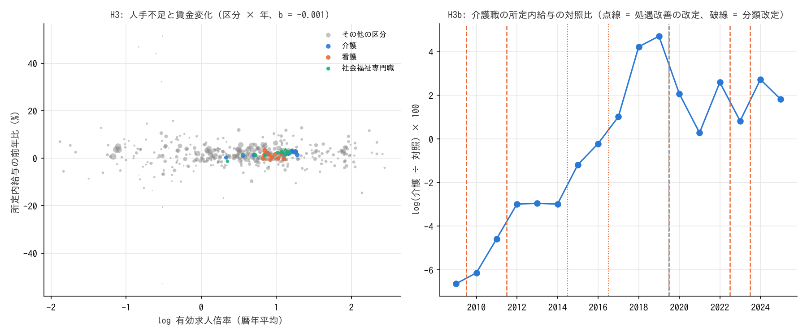

# R3: 公定価格は人手不足の価格シグナルを遮断しているか（H3・H3b、日本）（2026-10-30, theme: essential-work-wages。方法論レビュー後に改訂）

## 要約
- **H3（人手不足の割に公定価格の職業の賃金が上がらない）は介護で不支持、保育で中間、看護は仕様で割れる（年固定効果つきで中間、設計の文言どおり固定効果なしでは整合 9/11）。主判定は年固定効果つき。** 職業中分類 45 区分 × 11 年のパネルで、所定内給与の前年比を有効求人倍率に回帰した傾きは b = −0.001（SE 0.002。区分クラスタでも 0.001）で、**区分の間で、人手不足の大きい区分ほど賃金が上がるという関係は無い**。介護の残差は 11 年中 7 年が正（＋0.1〜＋2.5 pt）で、回帰線より上にある。公定価格の職業だけが遮断されているのではない。
- **介護は「人手不足の筆頭」ではない。** 介護サービスの有効求人倍率（パート除く常用）は 2013 年 1.4 から 2019 年 3.6 に上がり、2022〜2025 年は 3.2〜3.5 で 45 区分中 8〜9 位（2013〜2019 年は 10〜17 位）。上位は建設躯体（8.7〜9.7）・警備（5.9〜6.9）・土木・建築技術者（4〜7）で、介護は上位 10% に一度も入らない。
- **H3b（処遇改善の改定で介護職の相対賃金が段階的に上がる）は、事前登録の 5 回で判定すると不支持（改定年と非改定年で差が無い）。** 改定の翌調査年に対照（販売店員・警備員・ビル清掃員・調理）比で 2% 以上上がった回数は 0/4、改定年の相対変化の中央値 +1.0%、非改定年 +1.0%。2022 年 2 月の補助金を 2022 年調査に対応させる代替対応や、2015・2017 年の改定を加えた事後の 7 回では「中間（改定年 +1.7〜1.8% vs 非改定年 +0.0〜0.5%）」になるが、どれも「翌年 ≥ 2% が 4 回以上」には届かない。
- **水準は大きく変わった。** 介護職の対照比（log）は 2009 年 −6.6% から 2019 年 +4.7% へ 11 pt 改善し、2020 年以降も +0.3〜+2.7% で推移する。改善は特定の改定年に集中せず、2010〜2018 年にかけてほぼ毎年 0.5〜3.2 pt ずつ積み上がった。並行トレンドを確かめる改定前の期間が無く、最低賃金の上昇（介護は最低賃金近傍の比率が高い）とも分離できないため、**処遇改善が介護職の賃金を動かしたかどうかはこの設計では識別できない**。
- **含意（関連として）:** 「公定価格だから人手不足でも賃金が上がらない」は、日本の介護には当てはまらない。介護職の賃金は、同程度の学歴年数の低賃金職より速く上がり、対照 4 職業を追い抜いた。それでも全職業の中央値の 0.8 倍にとどまる。本分析で言えるのは「区分間で人手不足と賃金変化が並んでいない」ことまでで、なぜ低賃金の対人サービス職の水準が低いままかは答えていない。

## 問いと仮説
`design/themes/essential-work-wages.md` の H3・H3b（事前登録 2026-10-29）。判定基準: H3 は P=1 の職業の残差が 13 年中 9 年以上（69%）で負なら整合、5 年以下（38%）なら不支持。H3b は改定の翌年の相対上昇 ≥ 2% が 5 回中 4 回以上かつ非改定年の中央値が ±1% 以内なら整合、改定年と非改定年で差が無ければ不支持、改定年の上昇だけが見えて非改定年にも上がっていれば中間。

事前登録からの逸脱・事後の具体化:
1. **単位は職業安定業務統計の職業中分類（45 区分）**。賃金構造基本統計調査の職種を手入力の対応表（`jp_jobs_category_map.csv`）で区分に束ね、労働者数加重平均の所定内給与を区分の賃金とした（結果を見る前に docstring に記載）。
2. **求人統計は 2020-04〜2022-03 が未公開**（分類切替で遡及集計の外）。使える年は 2013〜2019・2022〜2025 の 11 年で、設計の期間（2012〜2024）とは 2025 年を含む点と 2012・2020・2021 年を欠く点で違う。判定の「9/13」「5/13」は比率（0.69・0.38）で読み替えた。介護の 4/11 = 0.36 は比例で読み替えても不支持域にある。2019→2020 の賃金変化は分類改定をまたぐため除外。
3. **回帰は年固定効果付きの WLS**（Δlog 賃金 = a_t + b・log 求人倍率、重み = 区分の労働者数）。年固定効果は設計に無い追加なので、固定効果なし（設計の文言どおり）の残差符号も判定に併記し、重みなし・区分クラスタの SE も報告する（改訂で追加）。主判定は年固定効果つき（年ごとの全体の賃上げを除いた区分間の比較）とし、これは事後の選択である。
4. **H3b の改定の数え方**（2024-06 を 2025 年調査に当てた感度も併記: 0/4、改定年の中央値 −0.2%、非改定年 +1.2% で中間。不支持は整合に変わらない）: 設計の 5 回は 2009-10 交付金・2012-04 加算・2019-10 特定加算・2022-10 ベースアップ加算・2024-06 一本化。これを「翌調査年」（6 月分賃金）に対応させると 2010・2012・2020・2023・2024 年。2024-06-01 施行は 2024 年 6 月調査と同月で効果が出るには早い（2025 年の値も表にある）。改訂前の report は 2015-04 拡充・2017-04 加算 I を加えた 7 回で判定し、「2024 年を追加した」と誤って書いていた。本改訂では **事前登録の 5 回を主判定**とし、2022-02 補助金を 2022 年調査に当てる代替対応と、7 回（事後追加）を併記する。
5. **「差が無い」の操作化**: 設計は数値を決めていない。改定年と非改定年の相対変化の中央値の差が 0.5 pt 未満なら「差が無い」とした（事後）。
6. **事前登録の頑健性「最低賃金比率の近い対照に絞る」**: 職業別の最低賃金近傍比率のデータが無いため、2009 年の所定内給与が介護に最も近い 2 職業（警備員・販売店員）を対照にする代替で実施した。**イベントスタディ図（改定 2 年前〜2 年後）**も実施した（いずれも改訂で追加）。
7. 来歴の注意: 設計書の事後記録・docstring・本 report は同じコミットに入っており、「結果を見る前に固定した」ことは git では確かめられない。

## データ
| 変数 | 出典 | 定義・単位 | 期間 | 備考 |
|---|---|---|---|---|
| 職業別 有効求人倍率 | 厚生労働省 一般職業紹介状況「職業別労働市場関係指標（実数）」（e-Stat、平成 23 年改定 厚労省分類 2012-03〜2020-03、平成 21 年改定 日本標準職業分類 2022-04〜） | パート除く常用、原数値、暦年平均（月数は `n_months`） | 2013〜2019、2022〜2025 | 2012 は 10 か月、2020 は 3 か月、2021 は欠落。2021-09 からオンライン登録求職者を含む段差 |
| 職種別 所定内給与・きまって支給する現金給与・労働者数 | 賃金構造基本統計調査 職種別 第 1 表（企業規模計・男女計） | 千円/月（6 月分）、人 | 2009〜2025 | 2020 年分類改定 |
| 区分の対応表 | `jp_jobs_category_map.csv`（本テーマの手入力、45 区分） | 区分 ↔ 賃金構造の職種（新・旧）、P・T | – | 教員は求人統計に区分が無く対象外 |
| 処遇改善の改定日 | `jp_care_policy_events.csv`（厚労省・内閣府の資料から手入力） | 施行日・種類 | 2009〜2024 | 介護 9 件（うち設計の 5 回＋事後 2 回を使用）、保育 4 件、看護 1 件 |

mart: `data/marts/jobs_occupation_annual.parquet`（2,898 行）、`bsws_occupation_wages.parquet`（27,468 行）。取得 2026-10-29。政府標準利用規約 2.0。

## 方法
- H3 前段: 各年の 45 区分の求人倍率の順位。介護サービスが上位 10%（5 位以内）に入った年数。
- H3: 区分 × 年のパネル（425 行）で Δlog(所定内給与) を年固定効果と log(求人倍率) に回帰し、P=1 の 3 区分（介護サービス・看護・社会福祉専門職）の残差の符号を年ごとに数える。SE は HC1（主）、区分クラスタ、固定効果なし、重みなしを併記。
- H3b: 介護職（2020 年以降「介護職員（医療・福祉施設等）」、以前「福祉施設介護員」）と対照 4 職業（労働者数加重）の log 差（gap）の年次変化を、改定の翌調査年と非改定年で比べる。きまって支給する現金給与（超過勤務手当を含む）でも併記。イベントスタディ（k=−2〜+2 の平均）と対照 2 職業の頑健性。
識別の仮定（H3b）: 改定の時期は介護職の賃金動向と独立に決まり、対照職業は同じマクロショック（最低賃金・景気）を受ける。並行トレンドの事前確認はできない（改定が 2009 年から連続し、改定前の期間が無い）。したがって差分の差分の形はしているが、ATT として解釈できる条件は満たしていない。

## 結果

### H3 前段: 介護の人手不足の位置
| 年 | 介護サービスの倍率 | 順位（45 区分中） | 看護 | 職業計 |
|---|---|---|---|---|
| 2013 | 1.40 | 17 | 3.01 | 0.75 |
| 2016 | 2.43 | 15 | 2.69 | 1.12 |
| 2019 | 3.59 | 10 | 2.47 | 1.43 |
| 2022 | 3.19 | 9 | 2.37 | 1.22 |
| 2025 | 3.51 | 8 | 2.33 | 1.21 |

上位 10%（5 位以内）に入った年は 0/11。介護の倍率は職業計の 2.5〜3 倍だが、建設躯体・警備・土木・建築技術者・保安には届かない。

### H3: 人手不足 × 賃金変化

図 1: 左: 区分 × 年（n=425）の log 有効求人倍率と所定内給与の前年比（%）。点の大きさは労働者数。青 = 介護、橙 = 看護、緑 = 社会福祉専門職。傾き b = −0.001。右: H3b の介護職の対照比（log × 100）。橙の破線 = 事前登録の 5 回の改定、橙の点線 = 事後追加の 2 回、灰の破線 = 2020 年の職種分類改定。

| 仕様 | b | SE |
|---|---|---|
| 年固定効果・HC1（主） | −0.0011 | 0.0019 |
| 年固定効果・区分クラスタ（45） | −0.0011 | 0.0012 |
| 固定効果なし・区分クラスタ | −0.0028 | 0.0021 |
| 年固定効果・重みなし・クラスタ | −0.0014 | 0.0027 |

| 区分 | 残差が負の年 / 11（年固定効果つき、主判定） | 判定 | 固定効果なし（設計の文言どおり） | 判定 |
|---|---|---|---|---|
| 介護サービス | 4（0.36） | **不支持** | 4（0.36） | 不支持 |
| 看護（保健師・助産師・看護師） | 6（0.55） | 中間 | 9（0.82） | 整合 |
| 社会福祉専門職（保育士・ケアマネ等） | 5（0.45） | 中間 | 5（0.45） | 中間 |

残差はゼロ近傍（±0.3 pt）の年が多く、符号の数は小さなノイズに左右される。看護は仕様で判定が変わる。

P=1 区分のプール残差の平均は +0.10 pt、P=0 区分は −0.07 pt。公定価格の区分の賃金変化は、人手不足から予測される水準よりむしろ高い。

累積で見ると（所定内給与、log 差）: 介護サービス 2013→2019 +11.0%、2022→2025 +8.2%。2013〜2019 年に介護より上がったのは 清掃（+11.5%）・社会福祉専門職（+12.0%）・運転（+11.0%）・保健医療サービス（+10.3%）・生活衛生（+10.1%）で、いずれも低賃金の対人サービス職。倍率が最も高い建設躯体（8.7）は +8.2%、建築・土木技術者（5.0）は −4.5%、IT 技術者（2.3）は −5.6% で、人手不足と賃金上昇は並んでいない。

### H3b: 介護職 vs 対照 4 職業（所定内給与、log 差分の差分）
| 年 | 介護（千円） | 対照（千円） | gap（log × 100） | 相対変化 所定内 | 相対変化 きまって支給 | 改定（事後追加の 7 回を含む） |
|---|---|---|---|---|---|---|
| 2009 | 202 | 215 | −6.6 | – | – | |
| 2010 | 202 | 214 | −6.1 | +0.5% | +1.4% | 2009-10 交付金 |
| 2011 | 203 | 212 | −4.6 | +1.6% | +1.7% | |
| 2012 | 206 | 213 | −3.0 | +1.6% | +0.0% | 2012-04 加算 |
| 2013 | 206 | 212 | −3.0 | +0.0% | +0.1% | |
| 2014 | 208 | 214 | −3.0 | −0.0% | −1.7% | |
| 2015 | 210 | 213 | −1.2 | +1.8% | +2.3% | 2015-04 拡充（事後） |
| 2016 | 215 | 216 | −0.2 | +1.0% | +0.5% | |
| 2017 | 220 | 218 | +1.0 | +1.2% | +2.4% | 2017-04 加算 I（事後） |
| 2018 | 226 | 217 | +4.2 | **+3.2%** | +2.1% | |
| 2019 | 230 | 219 | +4.7 | +0.5% | +0.8% | |
| 2020 | 240 | 235 | +2.1 | −2.6% | −0.0% | 2019-10 特定加算（分類改定をまたぐため計数から除外） |
| 2021 | 236 | 235 | +0.3 | −1.8% | −1.3% | |
| 2022 | 242 | 236 | +2.6 | **+2.3%** | +1.5% | 2022-02 補助金（代替対応のみ） |
| 2023 | 248 | 246 | +0.8 | −1.8% | −1.7% | 2022-10 ベースアップ加算（設計の対応） |
| 2024 | 255 | 249 | +2.7 | +1.9% | +1.6% | 2024-06 一本化（施行月 = 調査月） |
| 2025 | 263 | 258 | +1.8 | −0.9% | −1.5% | |

| 改定の数え方 | 翌年 ≥ +2% の回数 | 改定年の値（%） | 改定年の中央値 | 非改定年の中央値 | 判定 |
|---|---|---|---|---|---|
| **事前登録 5 回（2022-10 → 2023 年調査）** | **0/4** | +0.5 +1.6 −1.8 +1.9 | +1.04% | +0.97% | **不支持（改定年と非改定年で差が無い）** |
| 事前登録 5 回・代替対応（2022-02 補助金 → 2022 年調査） | 1/4 | +0.5 +1.6 +2.3 +1.9 | +1.75% | +0.49% | 中間（改定年の上昇は 2% 未満だが非改定年より大きい） |
| 事後追加 7 回（2015・2017 を加える） | 1/6 | +0.5 +1.6 +1.8 +1.2 +2.3 +1.9 | +1.70% | +0.03% | 中間（同上） |

非改定年の値（%）: +1.6 +0.0 −0.0 +1.8 +1.0 +1.2 +3.2 +0.5 −1.8 +2.3 −0.9。2020 年（−2.6%）は分類改定をまたぐため除外。きまって支給する現金給与では 0/4、改定年 +0.7%・非改定年 +0.8% で同じく不支持。

**H3b 判定（事前登録 5 回）: 不支持（改定年と非改定年で差が無い）。** 代替対応・事後追加では中間。どの数え方でも「翌年 ≥ 2% が 4 回以上」には届かない。

イベントスタディ（相対変化の平均、2020 年を除く）: 事前登録 5 回で k=−2 +1.1%、k=−1 +0.7%、k=0 +0.6%、k=+1 +0.2%、k=+2 +0.7%（n=4〜5）。改定年 k=0 に山は無い。事後追加 7 回では k=0 +1.6%、k=−1 −0.1%、k=+1 +0.2% で山があるが、事後に選んだ改定である。

頑健性（対照を 2009 年の賃金水準が介護に最も近い 2 職業 = 警備員・販売店員に）: 0〜1/4、改定年 +0.6%・非改定年 +0.9% で不支持。gap は 2009 −6.6% → 2019 +4.1% → 2025 +0.7% で、4 職業対照と同じ形。

水準の変化: 2009 年に対照より 6.6% 低かった介護職の所定内給与は 2019 年に 4.7% 高くなり、10 年で 11 pt 改善した。2020 年以降は +0.3〜+2.7% の間を往復し、2022・2024 年に上がって翌年に戻る（所定内で +2.3・+1.9、翌年 −1.8・−0.9）。「改定が一時金・手当として支払われ基本給に定着しにくい」は仮説の候補にとどまる（2 回の観察で、2022 年は代替対応でしか改定年にならない）。

## 頑健性
| 変更 | 結果 |
|---|---|
| きまって支給する現金給与（超過勤務手当込み） | H3b 事前登録 5 回で 0/4、差なし → 不支持。7 回では 3/6 |
| 改定の対応（2022-10 → 2023 / 2022-02 → 2022）、改定の数（5 / 7） | 不支持 / 中間 / 中間（上表） |
| 対照を賃金水準の近い 2 職業に | 不支持、gap の形は同じ |
| 回帰: 固定効果なし・重みなし・区分クラスタ | b は −0.001〜−0.003、どれもゼロ近傍 |
| 介護の順位を「パートを含む常用」で | 倍率は上がる（4 前後）が順位は 8〜12 位で上位 10% に入らない |

## 限界・言えないこと
- **求人倍率はハローワーク経由の求人・求職に限る。** 介護・看護は民間紹介・直接応募の比率が高く、倍率が人手不足を過小に表している可能性がある。逆に建設は公共職業安定所への依存が高い。
- **区分の賃金は職種平均の加重平均。** 区分内の構成変化が賃金変化に混ざる。
- **H3b は差分の差分の形だが ATT とは解釈できない。** 改定前の期間が無く並行トレンドは検証できない。最低賃金の上昇は介護職に強く効くため、相対上昇の一部は処遇改善でなく最低賃金による可能性がある。対照職業の差し替えでも gap の形は変わらないが、これは「介護が低賃金職の中で相対的に上がった」ことの確認であって、原因の特定ではない。
- **b ≈ 0 は「賃金が需給に反応しない」とまでは言えない。** 区分間の比較であり、全体の賃上げ（年効果）は吸収している。固定効果なしでも b はゼロ近傍だが、これも「区分の間で」の話である。
- **看護・保育の制度価格の改定は別途ある**（診療報酬・公定価格）が、本分析では介護のイベントのみを扱った。
- **「改定年」の対応は 1 年刻み**で、6 月調査と施行月のずれ（2024-06 は同月）を吸収できない。

## 再現手順
```bash
uv run socioscope run essential-work-wages fetch --only estat_bsws --only mhlw_jobs
uv run socioscope run essential-work-wages stage && uv run socioscope run essential-work-wages mart
uv run python themes/essential-work-wages/src/theme_essential_work_wages/analysis/a20261030_r3_admin_price.py  # 出力は reports/2026-10-30-r3-admin-price.stdout.txt
```

## チェックリスト回答
- A. H3・H3b は設計書に事前登録。単位・使える年・改定の対応は docstring に記載（report と同じコミット）。改定の数え方は事前登録の 5 回を主判定とし、代替・事後追加を明示。「差が無い」の操作化は事後と明記。推定量は「区分 × 年パネルの人手不足と賃金変化の関連（b）」と「介護職の対照比の変化（記述。ATT とは解釈しない）」。
- B. 出典・定義・取得日は manifest と一致。欠損: 求人統計の 2020-04〜2022-03、2021-09 の段差、賃金構造の 2020 年分類改定。補完なし。
- C. H3 は関連（年固定効果付きパネル、固定効果なしも併記）、H3b は差分の差分の形。仮定（改定時期の外生性、対照群の共通ショック）を明記し、並行トレンドは検証できないこと、ATT と解釈できないことを要約・方法・限界に書いた。省略変数（最低賃金）を明記。
- D. 標準誤差は HC1 と区分クラスタ（45）を併記。試した仕様（重みなし・固定効果なし・きまって支給・パート込み・改定の対応と数・対照の差し替え）を全部報告。
- E. 「関連」「整合的」で書き、「効果」「動かす」は使わない（区分間で関係が無い、と書く）。図は軸・単位・n を明記。限界の節あり。再現手順と mart の行数を記載。
