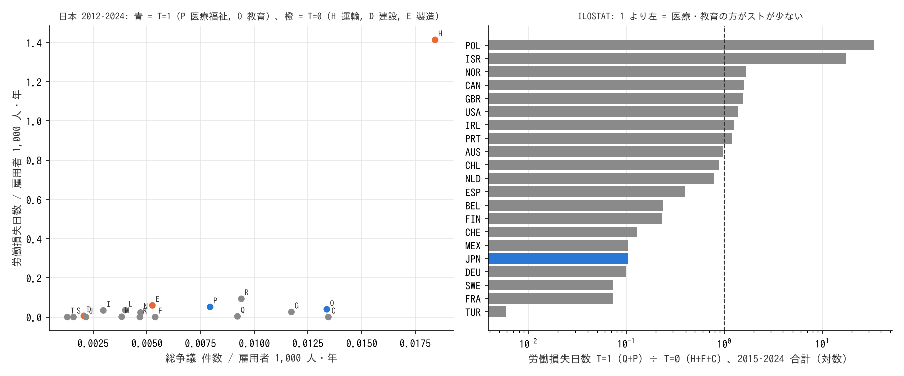

# R4: 倫理的人質。第三者被害がスト能力を奪っているか（H4・H4b）（2026-10-30, theme: essential-work-wages。方法論レビュー後に改訂）

## 要約（記述のみ、因果の主張はない）
- **H4 は部分判定で中間（件数は不支持側、損失日数は整合側。割れたときの合成は事後の規則で、設計の中核条件「同程度の人手不足」「組織率 × 賃金プレミアム」は未検証）。** 日本の 2012〜2024 年で、医療・福祉と教育（T=1）の雇用者 1,000 人・年当たりの総争議**件数**は、運輸・建設・製造（T=0）の 1.34 倍で少なくない。一方、半日以上の同盟罷業・作業所閉鎖による**労働損失日数**は T=0 の 0.16 倍で、事前基準の 0.5 を下回る。ただし T=0 の 3 産業は運輸（損失日数が突出）の寄与が大きく、T=0 を製造だけにすると日数比は 0.78、運輸だけにすると 0.03 と、合成する群の構成で動く。
- **国際（雇用で割った比、欧州 12 か国）も同じ形。** 医療・教育の争議件数が運輸・建設・製造より雇用当たりで少ない国は 9/10、損失日数が少ない国は 8/12（ドイツ 0.14、スイス 0.15、フランス 0.07、スウェーデン 0.06。多いのはポルトガル 2.0、アイルランド 1.3、ノルウェー 1.2、ポーランド 82）。事前基準（10 か国以上のうち 7 か国以上）は件数・日数とも満たす。雇用で割らない 21 か国の比（13/18・13/21）は参考値にとどめる。
- **医療・福祉の争議は、参加者 1 人当たりの損失日数が小さい。** 損失日数 ÷ 参加人員（争議行為を伴う争議）は医療・福祉 0.06 日/人、製造 0.41、運輸 1.42、建設 7.29、教育 3.02。医療・福祉は争議行為を伴う争議の割合（0.29）も参加人員（雇用者 1,000 人当たり 0.85 人、運輸 1.00）も少なくないが、1 人当たりの損失日数は運輸の 24 分の 1。半日未満の行為は損失日数に数えられないため、これは「半日以上止める争議がごく少ない」ことを意味する。教育は逆に、参加者は少ないが 1 人当たりの日数は長い。
- **H4b（ストが合法で頻度の高い国ほど看護師の相対賃金が高い）は記述として支持されない。** 病院看護師の報酬 ÷ 平均賃金は英国 0.86・フランス 0.96 で日本（1.04）より低く、韓国 1.19、OECD 中央値 1.17。医療のストが大きい英国で看護師の相対賃金は 38 か国中 37 位。
- **未検証:** 設計にあった「同程度の人手不足にある産業との比較」は、産業別の人手不足指標が無く行っていない（R3 の職業別求人倍率では介護 3.4、建設躯体 9.7、自動車運転 2.7、製造 1〜3 で、T=0 の方が人手不足は大きい）。「組織率が同程度でも T=1 の賃金プレミアムが小さい」の検証も行っていない。
- **含意（関連として）:** 日本の医療・福祉は、組織率が全産業で最低水準（6%）でも争議は起きるが、半日以上仕事を止める争議はほとんど無い。これは「利用者を人質に取れない」という制約と整合的だが、公立病院・公立学校のスト禁止（法規制）、使用者の早期妥結、争議の種類（調整申請など争議行為を伴わないもの）の違いとは分けられない。

## 問いと仮説
`design/themes/essential-work-wages.md` の H4・H4b（事前登録 2026-10-29）。判定基準: 日本の争議統計で T=1 ÷ T=0 の雇用者当たり比が件数・労働損失日数とも ≤ 0.5、かつ ILOSTAT で OECD 10 か国以上のうち 7 か国以上で同じ向きなら整合。比が 1.0 前後なら不支持。

事後の具体化: T=1 は日本標準産業分類 P 医療，福祉・O 教育，学習支援業、T=0 は H 運輸業，郵便業・D 建設業・E 製造業（docstring、結果を見る前）。雇用者数は労働組合基礎調査の産業別雇用者数（労働力調査由来）の 13 年平均。国際は ISIC Q＋P と H＋F＋C の 2015〜2024 年合計を、Eurostat 国民経済計算の産業別就業者（2015〜2023 年平均）で割った比を主とし（改訂で追加）、雇用で割らない比は参考。「長さ」の代理（損失日数 ÷ 参加人員、損失日数 ÷ 争議行為を伴う争議件数、争議行為を伴う割合）は改訂で追加した探索的指標。

## データ
| 変数 | 出典 | 定義・単位 | 期間 | 備考 |
|---|---|---|---|---|
| 産業別 争議件数・参加人員・労働損失日数 | 厚生労働省 労働争議統計調査 第 2 表（e-Stat） | 総争議件数、争議行為を伴う争議の件数・参加人員、半日以上の同盟罷業・作業所閉鎖の労働損失日数 | 2012〜2024 | 産業大分類 20。一部産業の参加人員・損失日数は秘匿 |
| 産業別 雇用者数・推定組織率 | 厚生労働省 労働組合基礎調査 概況 第 3 表（PDF） | 人、% | 2012〜2025 | 2024 年から調査側の産業分類が第 14 回改定 |
| 産業別 争議（国際） | ILOSTAT `STR_TSTR_ECO_NB_A`（件数）、`STR_DAYS_ECO_NB_A`（労働損失日数） | ISIC Rev.4 大分類 | 2015〜2024 | 66 か国。国により定義（最低規模・最低日数）が違う |
| 産業別 就業者（国際） | Eurostat `nama_10_a64_e`（EMP_DC） | 千人 | 2015〜2023 | EU27＋IS NO CH。日本・米国・英国などは無い |
| 看護師の報酬 ÷ 平均賃金 | OECD Health Statistics `DF_REMUN`（RINF 病院看護師、FCTR_WG_A_SAL_A、被用者、男女計） | 倍 | 最新年（2020〜2024） | 38 か国 |

mart: `data/marts/jp_labour_disputes_by_industry.parquet`（273 行）、`jp_union_density_by_industry.parquet`（280 行）、`ilo_strikes_by_industry.parquet`（15,339 行）、`nama_industry_value_added_employment.parquet`（34,303 行）、`oecd_health_remuneration.parquet`（11,703 行）。取得 2026-10-29。政府標準利用規約 2.0・CC BY 4.0・Eurostat・OECD Terms。

## 方法
産業別の 13 年合計（争議）を 13 年平均の雇用者数で割り、群（T=1 / T=0）ごとに雇用者加重の率を出して比を取る。国際は国ごとの T=1 合計 ÷ T=0 合計を、就業者の比で割る。記述統計のみ。

## 結果

### 日本: 産業別の争議（2012〜2024 年合計）と雇用者 1,000 人・年当たり
| 産業 | 群 | 総争議 件数 | 労働損失日数 | 雇用者（平均） | 件数 /1,000 人・年 | 損失日数 /1,000 人・年 | 参加人員 /1,000 人・年 | 組織率 |
|---|---|---|---|---|---|---|---|---|
| P 医療，福祉 | T=1 | 841 | 5,458 | 813 万人 | 0.0080 | 0.052 | **0.850** | **6.2%** |
| O 教育，学習支援 | T=1 | 520 | 1,538 | 299 万人 | 0.0134 | 0.040 | 0.013 | 15.8% |
| H 運輸，郵便 | T=0 | 790 | **60,615** | 330 万人 | **0.0184** | **1.414** | 0.998 | 25.6% |
| E 製造 | T=0 | 684 | 7,753 | 1,002 万人 | 0.0053 | 0.060 | 0.144 | 26.4% |
| D 建設 | T=0 | 109 | 328 | 405 万人 | 0.0021 | 0.006 | 0.001 | 20.5% |
| I 卸売，小売 | | 373 | 4,224 | 962 万人 | 0.0030 | 0.034 | 0.078 | 14.9% |
| G 情報通信 | | 342 | 756 | 224 万人 | 0.0117 | 0.026 | 0.219 | 16.5% |
| J 金融，保険 | | 45 | 0 | 160 万人 | 0.0022 | 0.000 | 0.000 | 45.6% |
| S 公務 | | 50 | 0 | 243 万人 | 0.0016 | 0.000 | 0.008 | 34.0% |

雇用者当たりの件数は運輸 > 教育 > 情報通信 > 医療・福祉 > 製造の順（医療・福祉の 841 件という絶対数は雇用規模による）。T=1（P＋O）÷ T=0（H＋D＋E）の雇用者当たり比: **件数 1.34、労働損失日数 0.16、参加人員 2.29**。医療・福祉のみ: 件数 1.13、損失日数 0.17。日本の判定: 件数は不支持（1.0 以上）、損失日数は満たす。

### 日本: 争議の「長さ」の代理（13 年合計）
| 産業 | 群 | 争議行為を伴う割合 | 損失日数 ÷ 争議行為を伴う争議（日/件） | 損失日数 ÷ 参加人員（日/人） |
|---|---|---|---|---|
| P 医療，福祉 | T=1 | 0.29 | 22.5 | **0.06** |
| O 教育，学習支援 | T=1 | 0.07 | 40.5 | 3.02 |
| H 運輸，郵便 | T=0 | 0.19 | 401.4 | 1.42 |
| E 製造 | T=0 | 0.27 | 42.6 | 0.41 |
| D 建設 | T=0 | 0.02 | 164.0 | 7.29 |
| I 卸売，小売 | | 0.11 | 105.6 | 0.43 |
| G 情報通信 | | 0.46 | 4.8 | 0.12 |

損失日数は半日以上の同盟罷業・作業所閉鎖のみ、参加人員は争議行為を伴う争議のもの。「損失日数 ÷ 参加人員」は参加者 1 人当たりの平均ストライキ日数の近似で、半日未満の行為は分子に入らない。医療・福祉は争議行為を伴う割合が製造並みに高く参加人員も多いが、1 人当たり 0.06 日で、半日以上の停止がごく少ない。教育は参加者が少なく 1 人当たりは長い。T=1 を一括りに「短い」とは言えず、医療・福祉に限った特徴である。


図 1: 左: 日本の産業別、雇用者 1,000 人・年当たりの総争議件数（横軸）と労働損失日数（縦軸）、2012〜2024 年。青 = T=1、橙 = T=0。右: ILOSTAT、医療・教育（Q＋P）÷ 運輸・建設・製造（H＋F＋C）の労働損失日数、2015〜2024 年合計、雇用で割らない比、対数軸。1 より左が「医療・教育の方が少ない」。

### 国際（ILOSTAT）
| 指標 | 雇用で割った比（欧州 12 か国）: T=1 の方が少ない国 | 雇用で割らない比（21 か国、参考）: 少ない国 | 日本 |
|---|---|---|---|
| 争議件数 | **9 / 10** | 13 / 18 | 国内統計で 1.34（雇用当たり） |
| 労働損失日数 | **8 / 12** | 13 / 21 | 国内統計で 0.16（雇用当たり） |

雇用で割った損失日数比: SWE 0.06、FRA 0.07、DEU 0.14、CHE 0.15、BEL 0.24、FIN 0.26、ESP 0.59、NLD 0.62、NOR 1.24、IRL 1.30、PRT 2.01、POL 82（2019 年の教員スト）。雇用で割らない比では日本の件数比が 0.74 と国内統計の 1.34 から反転しており、割らない比は向きの判定に使えない。事前基準（10 か国以上のうち 7 か国以上）は、雇用で割った比で件数・日数とも満たす。

**H4 総合判定: 中間（部分判定、事後の合成）。** 日本の件数比が基準を外れ（1.34）、日数比と国際（雇用当たり）は基準内。設計は件数と日数の両方を要求しており、片方だけ満たす場合の規則は無かった。

### H4b: 病院看護師の報酬 ÷ 平均賃金（OECD、被用者、最新年）
| 国 | 倍率 | 医療のスト |
|---|---|---|
| 韓国 | 1.19（2020） | 医師の大規模スト（2000・2020・2024 年）、看護師は限定的 |
| OECD 中央値（38 か国） | 1.17 | |
| 米国 | 1.22 | 看護師ストあり |
| ドイツ | 1.17 | |
| 日本 | 1.04 | 半日以上の停止はごく少ない（上表） |
| フランス | 0.96 | 公的部門のスト頻度高い |
| 英国 | 0.86 | 2022〜23 年に NHS 看護師が史上初の全国スト |

スト頻度の高い英国・フランスで看護師の相対賃金は OECD 下位（38 か国中 37 位・32 位）。「ストができる国ほど高い」という向きは見えない。逆の読み（低賃金だからストが起きる）も可能で、この表では決められない。

### 補助（探索）: 組織率と争議率（日本）
組織率が高い産業（電気ガス 57%、複合サービス 50%、金融 46%、公務 34%）の労働損失日数はほぼゼロで、争議は運輸（26%）と医療・福祉（6%）という組織率の両極で起きている。組織率と賃金プレミアムの関係は検証していない。

## 頑健性
| 変更 | 結果 |
|---|---|
| T=0 を運輸のみに | 件数比 0.44、日数比 0.03。製造のみにすると件数比 1.86、日数比 0.78。日数比は T=0 の選び方で 0.03〜0.78 と動く |
| 争議行為を伴う争議の件数のみ | 医療・福祉 35 件/年（2024）は製造 12・運輸 11 より多く、向きは変わらない |
| ILOSTAT の期間を 2010〜2024 に（雇用で割らない比） | 少ない国の数は 14/19（件数）・14/22（日数）でほぼ同じ |
| 国際比を雇用で割る / 割らない | 件数 9/10 vs 13/18、日数 8/12 vs 13/21。向きは同じだが国の集合が違う |

## 限界・言えないこと
- **「スト能力」の直接の測定ではない。** 争議件数・日数は結果であり、「ストができない」ことと「する必要がない」ことを区別できない。R3 で介護の賃金が対照より速く上がっていたことは「必要がない」側の説明とも整合する。
- **第三者被害の産業と公務員のスト禁止が重なる。** 公立病院・公立学校の職員は法律でストができない。T=1 の損失日数の少なさは倫理でなく法規制の反映かもしれない。民間の医療・福祉（多数）と公立を分けた争議統計は無い。
- **「同程度の人手不足」の統制はしていない。** T=0 に選んだ建設・運輸の方が人手不足は大きい（R3）。
- **国際比の雇用正規化は欧州 12 か国のみ。** 日本・米国・英国・カナダは Eurostat に無く、雇用で割らない比でしか並べられない。争議の定義（最低参加人数・最低時間）も国で違う。
- **「長さ」は半日以上の停止に限った代理。** 半日未満の行為（時限スト・リボン闘争など）は損失日数に入らず、医療・福祉の 0.06 日/人はそれらを除いた値である。持続時間の分布そのものは公表されていない。
- **H4b は 7 か国の記述。** 看護師の報酬比は制度（公務員給与表・診療報酬）と医療支出水準に左右され、ストの合法性だけで動かない。

## 再現手順
```bash
uv run socioscope run essential-work-wages fetch --only mhlw_disputes --only mhlw_unions --only ilo_strikes --only eurostat_nama --only oecd_health_remun
uv run socioscope run essential-work-wages stage && uv run socioscope run essential-work-wages mart
uv run python themes/essential-work-wages/src/theme_essential_work_wages/analysis/a20261030_r4_strikes.py  # 出力は reports/2026-10-30-r4-strikes.stdout.txt
```

## チェックリスト回答
- A. H4・H4b は設計書に事前登録。産業の対応・雇用者数の出典は docstring に記載（report と同じコミット）。雇用で割った国際比と「長さ」の代理は改訂で追加した事後の指標と明記。未検証の項目（人手不足の統制、組織率 × 賃金プレミアム）を要約に明記。推定量は「群間の争議率の比（記述）」。
- B. 出典・定義・取得日は manifest と一致。欠損: 争議統計の一部産業で参加人員・損失日数が秘匿、組合調査の 2024 年分類改定、ILOSTAT の国別定義差、Eurostat 就業者の国の範囲。補完なし。
- C. 因果を主張しない。「できない」と「必要がない」、倫理と法規制の区別がつかないことを要約と限界に明記。
- D. 母集団全体の記述で標準誤差なし。T=0 の選び方で日数比が 0.03〜0.78 と動くこと、雇用で割る/割らないで国の集合が変わることを頑健性で報告。
- E. 「整合的」「中間」で書き、「短い」は代理指標の定義（半日以上の停止、医療・福祉に限る）を付けて使う。図は軸・単位・出典・n・対数軸を明記。限界の節あり。再現手順と mart の行数を記載。
