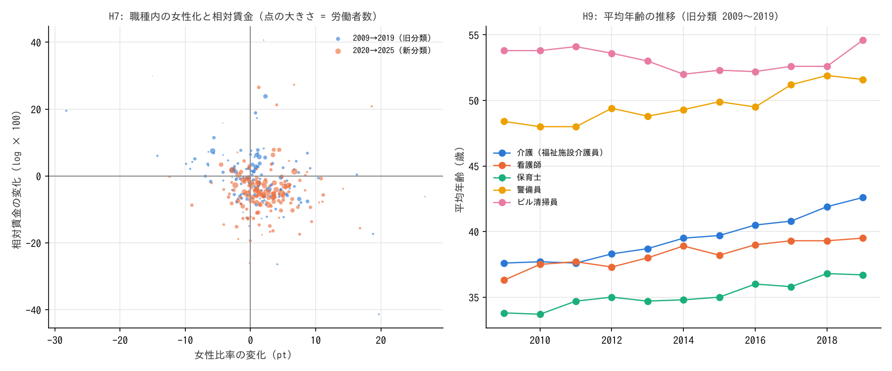

# R5: 経路を絞る。女性化の脱価値化・免許の中身・介護の相対上昇の源泉・人手不足の変化（H7〜H10、日本、事後追加）（2026-10-30, theme: essential-work-wages）

## 要約（職業平均の関連。因果の主張はない）
- **H7（女性化と相対賃金の低下）は整合。** 同じ職種の中で女性比率が 10 pt 上がった年は、相対賃金（log、全職種の加重中央値比）が 3.3% 下がる（職種固定効果・年固定効果、年齢・勤続の変化を統制、職種クラスタ SE、95% 区間 −4.1〜−2.5%）。1 年差分では旧分類 2010〜2019 と新分類 2021〜2025 で同じ大きさ、エッセンシャル職（−3.0%）と非エッセンシャル職（−3.4%）でも同じ（H7b: ケア特有でない）。ただし長期差分（始点→終点）では旧分類 2009→2019 が −0.53、新分類 2020→2025 が −0.09（区間 −0.43〜+0.25）で、新分類の 5 年では見えない。男性の賃金を結果にした事後の仕様では −1.25%（−2.0〜−0.5%）で、男女計の係数の 38%。この比は分解ではなく、男性賃金の低下は「女性の仕事になった職種の評価が下がる」向きとも、標本の入れ替わり（女性の多い低賃金事業所が標本に入る年は女性比率が上がり男性賃金も下がる）とも読める。米国 ACS の参考値（設計の H7b、4 年）は β = −0.26（区間 −0.37〜−0.14、n=1,695、年齢・勤続の統制なし）で同じ向き。
- **H8（免許の中身）は点推定で整合だが、定員制限のある職種が 6 つしかなく区間が広い。** 学歴・時間・勤続・女性比率を揃えた免許の賃金プレミアムは、国が養成定員を絞る免許（医師・歯科医師・薬剤師・獣医師・航空機操縦士・鉄道運転）で +0.49（95% 区間 −0.09〜+1.06）、養成を拡大できる免許（看護師・保育士・教員・理美容師など 23 職種）で +0.03（−0.03〜+0.08）。後者が全職種で 0 に近いことは確かで（E=1 に限ると +0.09、区間 +0.03〜+0.16 で小さい正）、前者は大きいが不確か。R1 で「免許は学歴と分離できない」と出たことと整合する（日本の免許職の大半が後者）。
- **H9（介護の相対上昇は構成変化か）は整合（構成では説明されない）。** 介護職の対照比の改善 11.2 pt（2009→2019）のうち、年齢・勤続の上昇で説明されるのは 1.0 pt で、構成調整後も 10.1 pt が残る。最低賃金の上昇率との年次の相関は +0.25（n=9）で、方向は整合するが判定できない。
- **H10（人手不足の変化と賃金の変化）は中間。** 区分内で求人倍率が 10% 上がった年は賃金が +0.2%（b = +0.021、区間 −0.003〜+0.044）。区間は 0 を含み、R3 の「水準では関係が無い」と区別できない。
- **含意（関連として）:** 日本の職種内では、女性比率の上昇と相対賃金の低下が結びつき、エッセンシャル職に限らない。免許のうち養成を拡大できる種類（看護師・保育士・教員など）は学歴を揃えると賃金を分けず、定員制限のある種類は点推定では大きいが 6 職種で区間は 0 を含む。介護の相対賃金の 10 年で 11 pt の改善は、高齢化・長期勤続の構成変化では説明されない。

## 問いと仮説
`design/themes/essential-work-wages.md`「事後追加の仮説（2026-10-30）」の H7・H7b・H8・H9・H10。結果を計算する前に基準を固定し、コミット `f8f7c5e` に記録した（本 report は後のコミット）。判定基準は設計書どおり。

事後の具体化（計算前に docstring に記載）: H7 のパネルは分類をまたがない差分（旧分類 2010〜2019、新分類 2021〜2025）。H7 の性別構成の確認（男性の賃金を結果にする）は、H7 の結果を見た後に追加した（事後。構成効果と脱価値化を分けるために必要と判断した）。H8 の `capacity_capped` は計算前に定義表に追加した。H9 の最低賃金は 6 月調査に対し前年度 10 月発効の値を当てる。H10 の差分は求人統計の使える年（2013〜2019、2022〜2025）に限り、2020 年の分類改定をまたがない。

## データ
| 変数 | 出典 | 定義・単位 | 期間 | 備考 |
|---|---|---|---|---|
| 職種別 所定内給与（男女計・男）、労働者数（男女計・女）、年齢、勤続、所定内実労働時間 | 賃金構造基本統計調査 職種別 第 1 表 | 千円/月、人、歳、年、時間 | 2009〜2025 | 2020 年分類改定（またがない） |
| 職業別 有効求人倍率 | 職業安定業務統計（R3 と同じ） | パート除く常用、暦年平均 | 2013〜2019、2022〜2025 | |
| 定義表（E・L・学歴・境界・定員制限） | `jp_occupation_flags.csv`、`jp_occupation_flags_2009.csv` | 0/1、年 | – | `capacity_capped` は 2026-10-30 に追加（`f8f7c5e`） |
| 最低賃金 全国加重平均 | `jp_minimum_wage.csv`（厚労省の公表値を手入力） | 円 | 2009〜2025 年度 | |

mart: `data/marts/bsws_occupation_wages.parquet`（27,468 行）、`jobs_occupation_annual.parquet`（2,898 行）。

## 方法
- H7: 職種 × 年の 1 年差分で Δ相対賃金 = β·Δ女性比率 + γ·Δ年齢 + δ·Δ勤続 + 年ダミー（差分に年ダミーなので職種固定効果も吸収）。WLS（労働者数）、職種クラスタ SE。結果を男性の相対賃金にした仕様で、職種内の性別構成の効果を除く。長期差分（始点→終点）も併記。
- H8: 2025 年の横断面で log 賃金 = L_capped + L_open + 学歴 + 時間 + 勤続 + 女性比率（WLS、HC1）。
- H9: 旧分類 2009〜2019 の職種 × 年で log 賃金 = 年齢 + 勤続 + 年 FE + 職種 FE（WLS）。年齢・勤続の係数で、介護と対照（販売店員・警備員・ビル清掃員・調理士）の構成差が予測する gap を出し、観測 gap から引く。
- H10: 区分 × 年の 1 年差分で Δlog 賃金 = b·Δlog 求人倍率 + 年ダミー（WLS、区分クラスタ SE）。

## 結果

### H7
| 仕様 | n | β（Δ女性比率 → Δlog 相対賃金） | 判定 |
|---|---|---|---|
| 全職種・女性比率のみ | 1,969 | −0.355（−0.434〜−0.275） | 整合 |
| **全職種・年齢・勤続を統制（主）** | 1,969 | **−0.333（−0.413〜−0.254）** | **整合** |
| E=1 | 663 | −0.302（−0.456〜−0.147） | 整合 |
| E=0 | 1,306 | −0.337（−0.440〜−0.234） | 整合 |
| 旧分類のみ 2010〜2019 | 1,255 | −0.335（−0.424〜−0.247） | 整合 |
| 新分類のみ 2021〜2025 | 714 | −0.334（−0.456〜−0.213） | 整合 |
| 重みなし | 1,969 | −0.435（−0.554〜−0.316） | 整合 |
| **男性の賃金を結果に** | 1,969 | **−0.125（−0.204〜−0.046）** | 整合 |

長期差分: 旧分類 2009→2019（n=126）β = −0.53（−0.83〜−0.24）、新分類 2020→2025（n=144）β = −0.09（−0.43〜+0.25）。新分類の 5 年では女性比率の変化が小さく推定が粗い。


図 1: 左: 職種ごとの女性比率の変化（pt）と相対賃金の変化（log × 100）、2009→2019（旧分類 126 職種）と 2020→2025（新分類 144 職種）。点の大きさ = 労働者数。右: 平均年齢の推移（旧分類、介護・看護師・保育士・警備員・ビル清掃員）。

**判定: 整合（主仕様）。** 男性の賃金を結果にした −0.125 は主仕様の −0.333 の 38%（係数の比であり、構成効果と脱価値化の分解ではない）。男女計との差は、職種内で女性の方が低賃金であることによる構成効果を含むが、標本の入れ替わりによる機械的な相関も含みうる。新分類の長期差分は 0 と区別できない。

米国 ACS（設計の H7b 参考値、2021〜2024 の 1 年差分、年ダミー、職業クラスタ、就業者数加重、年齢・勤続の統制なし）: β = −0.256（SE 0.059、95% 区間 −0.372〜−0.141、n=1,695）。日本と同じ向きで大きさも近い。判定はしない。

### H8
| 仕様 | n | L_capped / L_open 職種数 | L_capped（log） | L_open（log） | 学歴 1 年 |
|---|---|---|---|---|---|
| 全職種 | 144 | 6 / 23 | +0.486（−0.092〜+1.063） | +0.025（−0.025〜+0.076） | 0.074 |
| E=1 のみ | 52 | 5 / 16 | +0.543（−0.009〜+1.095） | +0.093（+0.029〜+0.156） | 0.063 |
| 境界を除く | 95 | 3 / 10 | +0.573（−0.111〜+1.256） | +0.026（−0.052〜+0.103） | 0.071 |

定員制限ありの 6 職種: 航空機操縦士 1,180 千円、医師 1,028、歯科医師 824、獣医師 453、鉄道運転従事者 388、薬剤師 370。**判定: 整合（点推定）だが、L_capped の区間は 0 をまたぐ。** 6 職種で、医師・パイロットの 2 つが係数を引っ張る。確かなのは L_open ≈ 0（養成を拡大できる免許は、学歴を揃えると賃金を分けない）の方である。E=1 に限ると L_open は +0.09 で小さい正。

### H9
| 年 | 介護 年齢 / 勤続 | 対照 年齢 / 勤続 | gap（log × 100） | 構成が予測する gap | 構成調整後 |
|---|---|---|---|---|---|
| 2009 | 37.6 / 5.4 | 40.7 / 7.7 | −6.3 | −4.4 | −1.8 |
| 2019 | 42.6 / 7.1 | 44.4 / 9.1 | +4.9 | −3.4 | +8.3 |

年齢 1 歳 +0.56%、勤続 1 年 +1.21%（職種 FE・年 FE、n=1,402）。gap の改善 11.2 pt のうち構成が予測するのは 1.0 pt、構成調整後 10.1 pt。**判定: 整合（構成では説明されない）。** 介護職は対照より若く勤続も短いままで、両群とも同じ速さで高齢化しているため、構成差はほとんど動いていない。

(b) 最低賃金: 年ごとの Δgap と Δlog 最低賃金（2011〜2019、n=9。最低賃金の系列が 2009 年度からなので差分は 2011 年から）の相関 +0.25、係数 +0.36（−0.78〜+1.49）。方向は判定できない。

| 年 | 2011 | 2012 | 2013 | 2014 | 2015 | 2016 | 2017 | 2018 | 2019 |
|---|---|---|---|---|---|---|---|---|---|
| Δgap（pt） | +1.4 | +1.6 | −0.0 | −0.1 | +1.7 | +1.0 | +1.2 | +3.2 | +0.4 |
| Δlog 最低賃金（%） | +2.4 | +1.0 | +1.6 | +2.0 | +2.1 | +2.3 | +3.1 | +3.0 | +3.0 |

### H10
| 仕様 | n | b（Δlog 求人倍率 → Δlog 賃金） |
|---|---|---|
| 主（加重） | 380 | +0.0208（−0.0029〜+0.0445） |
| 重みなし | 380 | +0.0179（−0.0352〜+0.0710） |
| 1 年ラグ | 300 | +0.0106（−0.0199〜+0.0411） |

**判定: 中間。** 点推定は基準の 0.02 に届くが区間は 0 を含み、R3 の「水準では無関係」と区別できない。

## 頑健性
| 変更 | 結果 |
|---|---|
| H7: 分類ごと・E の有無・重みなし | β は −0.30〜−0.44 で安定 |
| H7: 男性の賃金を結果に | −0.125（整合のまま。係数の 38%、比であり分解ではない） |
| H8: E=1 のみ・境界を除く | L_capped +0.54〜+0.57（区間は 0 をまたぐ）、L_open +0.03〜+0.09 |
| H10: ラグ・重みなし | 0.011〜0.021、いずれも区間は 0 を含む |

## 限界・言えないこと
- **H7 の「脱価値化」は職業平均の関連。** 女性比率が上がる職種で男性の賃金も下がるのは、職種の評価の低下とも、男性側の選択（賃金が下がる職種から男性が去る、残る男性の属性が変わる）とも、賃金構造基本統計調査の標本の入れ替わり（1 年差分は標本事業所の交代に左右される）とも読める。男性賃金の仕様が統制しているのは男女計の年齢・勤続の変化で、男性自身の属性ではない。個人データが無いため分けられない。クラスタは職種名で、旧・新分類の同名職種は 1 クラスタにまとまる（保守側）。
- **H8 は 6 職種の係数。** 医師・歯科医師・薬剤師・獣医師は学歴 18 年で学歴年数の上端にあり、学歴の線形性に依存する。航空機操縦士・鉄道運転は定員制限の性格が違う（事業者養成）。
- **H9 の構成調整は年齢・勤続の線形効果のみ。** 職種ごとに年齢の賃金勾配が違うことは考慮していない。介護の勾配が緩ければ構成効果はさらに小さく、対照の勾配が急なら対照側の高齢化が対照の賃金をより押し上げるので、どちらも gap の改善を構成で説明する向きには働かない。
- **H10 の変化どうしの回帰は測定誤差で係数が 0 に寄る**（求人倍率の年次変化はノイズが大きい）。弱い反応を見逃している可能性がある。
- 事後追加の仮説であり、R1〜R4 の結果を見てから立てた。判定基準は計算前に固定したが、仮説の選択自体が結果に導かれている。

## 再現手順
```bash
uv run socioscope run essential-work-wages fetch --only estat_bsws --only mhlw_jobs
uv run socioscope run essential-work-wages stage && uv run socioscope run essential-work-wages mart
uv run python themes/essential-work-wages/src/theme_essential_work_wages/analysis/a20261030_r5_mechanisms.py  # 出力は reports/2026-10-30-r5-mechanisms.stdout.txt
```

## チェックリスト回答
- A. H7〜H10 は事後追加（設計書に 2026-10-30、計算前にコミット `f8f7c5e`）。性別構成の確認仕様は結果を見た後に追加したと明記。推定量は「職種（区分）内の変化どうしの関連（固定効果パネル）」と「横断面の免許プレミアム」。
- B. 出典・定義は manifest と一致。欠損: 男性賃金の無い職種（13 行）は H7 から除外。最低賃金は手入力（2009 年度から、差分は 2011 年から）。米国 ACS は 2021〜2024 の 4 年。補完なし。
- C. 因果を主張しない。H7 の逆の読み（男性の選択）、H8 の線形性、H9 の勾配の違いを限界に明記。
- D. 職種（区分）クラスタ SE。試した仕様を全部報告し、H8 の区間が 0 をまたぐことを判定に併記。
- E. 「関連」「整合」で書く。図は軸・単位・n を明記。限界の節あり。再現手順と mart の行数を記載。
