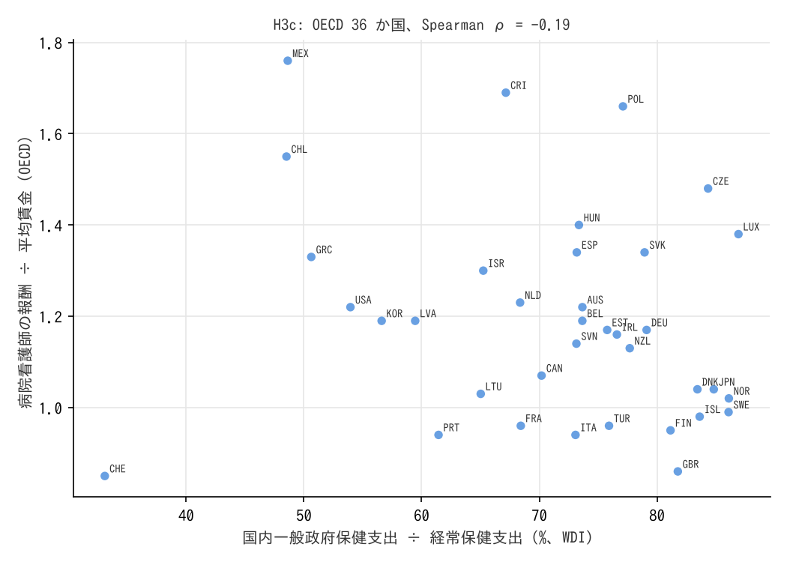

# R6: 保健支出の公的シェアが高い国ほど看護師の相対賃金が低いか（H3c）（2026-10-30, theme: essential-work-wages）

## 要約（記述、弱い証拠）
- **H3c は不支持。** OECD 36 か国で、国内一般政府保健支出が経常保健支出に占める割合（WDI）と、病院看護師の報酬 ÷ 平均賃金（OECD）の Spearman ρ は −0.19（基準: ≤ −0.3 で整合、|ρ| < 0.2 で不支持）。
- **補助で見えたこと。** 保健支出の水準（対 GDP 比 ρ = −0.45、1 人当たり USD ρ = −0.40）の方が看護師の相対賃金と負に結びつく。保健支出が大きい国（米国を除く西欧・北欧）ほど看護師の相対賃金が低く、支出が小さい国（メキシコ・チリ・ポーランド・チェコ）ほど高い。これは分母（平均賃金）が高所得国で高いこと、看護師の供給（人口当たり看護師数）が多い国で相対賃金が低いことの反映と読めるが、本分析では分けられない。
- 日本: 看護師比 1.04（OECD 中央値 1.17）、政府シェア 84.8%。

## 問いと仮説
`design/themes/essential-work-wages.md` の H3c（設計時に登録、未着手だったものを「事後追加の仮説（2026-10-30）」で再登録）。判定基準は設計書どおり。

事後の具体化: 公的シェアは OECD SHA ではなく World Bank WDI `SH.XPD.GHED.CH.ZS`（国内一般政府保健支出 ÷ 経常保健支出）。WDI の「政府」には社会保険（強制保険）を含む国が多いが、SHA の「政府・強制保険」と完全には一致しない。看護師の相対賃金は OECD `DF_REMUN`（RINF 病院看護師、被用者、男女計、FCTR_WG_A_SAL_A）の 2019 年以降の最新値。

## データ
| 変数 | 出典 | 定義・単位 | 期間 | 備考 |
|---|---|---|---|---|
| 看護師の報酬 ÷ 平均賃金 | OECD Health Statistics `DF_REMUN` | 倍、被用者、男女計 | 2019〜2024 の最新 | 38 か国 |
| 政府保健支出シェア、保健支出 %GDP、1 人当たり保健支出 | World Bank WDI `SH.XPD.GHED.CH.ZS`・`SH.XPD.CHEX.GD.ZS`・`SH.XPD.CHEX.PC.CD` | %、%、現在 US ドル | 2019〜2022 の最新 | CC BY 4.0 |

mart: `data/marts/oecd_health_remuneration.parquet`（11,703 行）、`wdi_health_expenditure.parquet`（3,318 行）。

## 方法
国ごとに最新年を対応させ、OECD 加盟国で Spearman 順位相関。記述のみ。

## 結果

図 1: OECD 36 か国。横軸 = 国内一般政府保健支出 ÷ 経常保健支出（%、WDI）、縦軸 = 病院看護師の報酬 ÷ 平均賃金（OECD）。

| 指標 × 看護師比 | ρ | n |
|---|---|---|
| **政府保健支出シェア（主）** | **−0.19** | 36 |
| 保健支出 %GDP | −0.45 | 36 |
| 1 人当たり保健支出 USD | −0.40 | 36 |
| 政府シェア、OECD 外を含む | −0.21 | 38 |

**判定: 不支持**（|ρ| < 0.2。ただし −0.19 は閾値の境界にある）。国別の値は `reports/2026-10-30-r6-public-share.stdout.txt`。

## 限界・言えないこと
- 36 か国の横断面。公的シェアの定義が国で違い（社会保険の扱い）、看護師の報酬比は制度（公務員給与表・診療報酬）と看護師の供給量に左右される。
- 「公的シェアが高い = 価格統制が強い」という操作化は粗い。米国（政府シェア 50% 台、看護師比 1.22）とドイツ（79%、1.17）の差は、価格統制より保険制度の違いで説明される部分が大きい。
- 因果は言えない。

## 再現手順
```bash
uv run socioscope run essential-work-wages fetch --only oecd_health_remun --only wdi_health
uv run socioscope run essential-work-wages stage && uv run socioscope run essential-work-wages mart
uv run python themes/essential-work-wages/src/theme_essential_work_wages/analysis/a20261030_r6_public_share.py
```

## チェックリスト回答
- A. H3c は設計時に登録、WDI への代替は計算前に docstring に記載。推定量は「国レベルの順位相関（記述）」。
- B. 出典・定義は manifest と一致。看護師比と WDI が対応したのは OECD 36 か国（stdout の表）、OECD 外を含めると 38 か国。補完なし。
- C. 因果を主張しない。分母（平均賃金）と供給量の交絡を明記。
- D. n=36 の Spearman、p 値は示さず効果量で判定。補助指標を全部報告。
- E. 「関連」「不支持」で書く。図は軸・単位・n を明記。限界の節あり。再現手順を記載。
