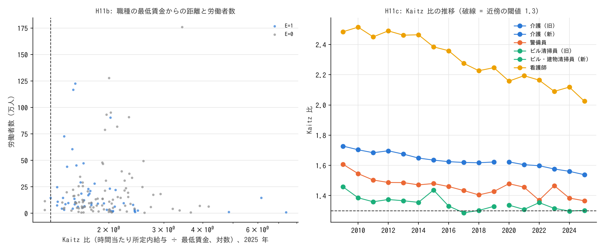

# R7: 女性化の切り分け（H7c）と最低賃金への連動（H11）（2026-10-30, theme: essential-work-wages。事後追加 第 2 弾）

## 要約（職業平均の関連。因果の主張はない）
- **H7c（職種内の女性化で男性賃金も下がるのは、職種の評価の低下か、標本の入れ替わりか）は事前規則では「評価の低下と整合」。ただし男性の選択や持続的な構成変化とは区別できない。** 差分の幅を 1 年から 3 年に広げると、男性の相対賃金への係数は −0.125 → −0.145 と縮まず（残存率 1.16）、女性の相対賃金への係数も −0.071（区間が 0 をまたぐ）→ −0.138（−0.257〜−0.018）と負になる。一時的な標本の入れ替わりなら幅を広げるほど縮むはずで、その読みとは整合しにくい。女性比率が上がった職種では、男性も女性も、相対賃金が下がる。ただし残存率 1.16 には区間が無く（3 年差分の男性 β の区間上限 −0.035 は 1 年の半分 −0.063 を上回る）、持続的な構成変化（低賃金事業所の定着）や男性側の選択とは区別できない。
- **H11（低賃金の対人サービス職の賃金は最低賃金に連動する）は事前規則上は不支持だが、実質は判定不能（操作化の失敗）。** 事前に決めた「最低賃金近傍」（時間当たり所定内給与 ÷ 最低賃金 < 1.3、分類の始点）に該当する職種は、旧分類で 2 職種（ミシン縫製工・洋裁工、労働者の 1%）、新分類で 0 職種しか無い。賃金構造基本統計調査の一般労働者（フルタイム）には、最低賃金の近くで働く職種がほとんど無い。近傍 × Δlog 最低賃金の係数 δ は −0.08（区間 −0.51〜+0.34）。閾値を 1.5 に広げても +0.19（−0.15〜+0.52）で区間は基準の 0.5 を含む。近傍群に対人サービス職が 1 つも入っておらず、仮説の対象は検定されていない。
- **記述（H11c）。** 介護職の時間当たり所定内給与 ÷ 最低賃金は 2009 年 1.73 → 2019 年 1.62 → 2025 年 1.54 と単調に下がっている（見立ての「一定」と逆）。2009→2019 の最低賃金 +21.8%（log）に対し、非近傍 124 職種の時間当たり賃金は +8.9%（近傍 2 職種 +11.7%）、2020→2025 は +15.8% に対し +12.8%。最低賃金の方が速く上がり、比は縮んでいる。これは最低賃金の波及が部分的（1 未満）であることとも整合し、波及が無いことを示すものではない。介護の相対上昇（R3・R5）が最低賃金で説明できるかは、二値の近傍定義では検出できず、本データでは決められない（最低賃金に近い職種ほど波及が大きい勾配があれば、介護が対照より上がることとも整合する）。
- **含意（関連として）:** フルタイムの対人サービス職の賃金について、人手不足・最低賃金との連動は本データでは検出できなかった（H10 は区間が 0 を含む、H11 は識別不能）。一貫して結びつくのは職種の女性比率とその変化（H5・H7・H7c）で、養成を拡大できる免許であること（H8）も結びつく。パートタイム（本データの外）では最低賃金が効いている可能性があり、短時間労働者の表で確かめる必要がある。

## 問いと仮説
`design/themes/essential-work-wages.md`「事後追加の仮説（第 2 弾、2026-10-30）」の H7c・H11・H11b・H11c。計算前に基準を固定（コミット `9511cdc`）。

事後の具体化: 最低賃金は全国加重平均を手入力（`jp_minimum_wage.csv`、2007〜2025 年度。2007・2008 年度は計算に必要と分かってから追加した）。調査年 y（6 月分賃金）には前年度 10 月発効の値を当てる。時間当たり賃金 = 所定内給与 ÷ 所定内実労働時間（月）。H7c の 3 年差分は同じ分類内（旧分類 2012〜2019、新分類 2023〜2025）。

## データ
| 変数 | 出典 | 定義・単位 | 期間 | 備考 |
|---|---|---|---|---|
| 職種別 所定内給与（男女計・男・女）、所定内実労働時間、労働者数、年齢、勤続 | 賃金構造基本統計調査 職種別 第 1 表（一般労働者） | 千円/月、時間/月、人 | 2009〜2025 | **短時間労働者は含まない** |
| 最低賃金 全国加重平均 | 厚労省（手入力） | 円/時 | 2007〜2025 年度 | |

mart: `data/marts/bsws_occupation_wages.parquet`（27,468 行）。

## 方法
- H7c: R5 の H7 と同じ固定効果パネル（差分 + 年ダミー、職種クラスタ、加重）で、結果を男女計・男性・女性の相対賃金、差分幅を 1 年・3 年に替えた 6 通り。
- H11: Δlog 時間当たり賃金 = 年ダミー + δ·(近傍 × Δlog 最低賃金)。年ダミーが最低賃金の共通効果を吸収し、δ は近傍職種の差分の反応。閾値 1.2・1.5、分類別、重みなしで感度。
- H11b: 始点年の E=1・E=0 の労働者のうち近傍職種の割合。H11c: 介護職の Kaitz 比の推移。

## 結果

### H7c
| 差分幅 | 結果（相対賃金） | n | β（Δ女性比率、95% 区間） |
|---|---|---|---|
| 1 年 | 男女計 | 1,969 | −0.333（−0.413〜−0.254） |
| 1 年 | 男性 | 1,969 | −0.125（−0.204〜−0.046） |
| 1 年 | 女性 | 1,969 | −0.071（−0.207〜+0.065） |
| 3 年 | 男女計 | 1,432 | −0.371（−0.462〜−0.280） |
| 3 年 | 男性 | 1,432 | −0.145（−0.255〜−0.035） |
| 3 年 | 女性 | 1,432 | −0.138（−0.257〜−0.018） |

**判定: 評価の低下と整合**（男性 β の残存率 1.16 ≥ 0.5、女性 3 年差分の区間上限 −0.018 < 0）。男女計の係数（−0.33〜−0.37）が男性・女性それぞれ（−0.13〜−0.15）より大きいのは、職種内で女性の方が低賃金なため女性比率の上昇が平均を機械的に下げる構成効果で、この部分は 3 年差分でも残る（R5 で述べた「分解ではない」は変わらない）。

### H11
| 分類・始点 | 近傍職種（Kaitz < 1.3） | 労働者に占める割合 |
|---|---|---|
| 旧分類 2009 年 | 2 / 127（ミシン縫製工 1.17、洋裁工 1.25） | 0.01 |
| 新分類 2020 年 | 0 / 144 | 0.00 |

| 仕様 | n | δ（近傍 × Δlog 最低賃金、95% 区間） |
|---|---|---|
| 主（加重） | 1,966 | −0.084（−0.508〜+0.340） |
| 重みなし | 1,966 | −0.133（−0.687〜+0.421） |
| 旧分類のみ | 1,246 | −0.084（−0.509〜+0.341） |
| 新分類のみ | 720 | 近傍 0 職種で識別不能 |
| 近傍 < 1.2 | 1,966 | +0.079（−0.023〜+0.180） |
| 近傍 < 1.5 | 1,966 | +0.186（−0.152〜+0.524） |

**判定: 規則上は不支持（区間が 0 をまたぐ）。ただし近傍群が仮説の対象（対人サービス職）を含まず、実質は判定不能。** 新分類は近傍 0 職種で識別不能。H11b: E=1 の労働者のうち近傍職種 0.00（2009 年 E=0 は 0.02、2020 年は両群 0 で比は定義できない）→ 判定不能。

累積の時間当たり賃金の変化（加重平均）: 2009→2019 非近傍 +8.9%（最低賃金 +21.8%）、2020→2025 +12.8%（最低賃金 +15.8%）。


図 1: 左: 2025 年の職種別 Kaitz 比（対数）と労働者数、青 = E=1。破線 = 1.3。右: 介護・警備員・ビル清掃員・看護師の Kaitz 比の推移（破線 = 1.3）。

H11c: 介護職の Kaitz 比は 2009 年 1.73、2014 年 1.65、2019 年 1.62、2022 年 1.60、2025 年 1.54 と単調に低下。図 1 右では警備員・ビル清掃員の比も下がって見える（数値は stdout に無く図のみ）。

## 頑健性
| 変更 | 結果 |
|---|---|
| H7c: 差分幅 1 年 → 3 年 | 男性・女性とも係数は縮まず、女性は負で有意に |
| H11: 近傍の閾値 1.2 / 1.3 / 1.5 | δ は +0.08 / −0.08 / +0.19、いずれも区間は 0 を含む |
| H11: 重みなし・分類別 | 同上 |

## 限界・言えないこと
- **一般労働者（フルタイム）のみ。** 最低賃金の近くで働く短時間労働者（介護・小売・飲食に多い）は本データに無く、「最低賃金に連動しない」はフルタイムに限った結論。短時間労働者の職種別表（賃金構造基本統計調査にある）で検証すべきで、次の課題。
- **Kaitz 比は所定内のみ**（超過勤務手当・賞与を除く）で、全国加重平均の最低賃金と比べている。地域差（東京の最低賃金は加重平均より高い）は無視している。
- **H7c は依然として職業平均の関連。** 3 年差分で縮まないことは一時的な標本の入れ替わりの読みとは整合しにくいが、持続的な構成変化（低賃金事業所が標本に定着する）はこの検定では縮まず、低賃金の女性の流入は女性の係数も負にするので、女性の係数が負であることは両者を分けない。男性側の選択（賃金が下がる職種から男性が去る）とも区別できない。残存率 1.16 には区間が無い。
- **H11 の操作化の失敗。** 閾値 1.3 を決める前に、該当する職種の数を確認していなかった。一般労働者ではほぼ該当せず、仮説は検定されていない。
- 事後追加であり、仮説の選択は R5 の結果に導かれている。判定基準は計算前に固定した。

## 再現手順
```bash
uv run python themes/essential-work-wages/src/theme_essential_work_wages/analysis/a20261030_r7_minwage.py  # 出力は reports/2026-10-30-r7-minwage.stdout.txt
```

## チェックリスト回答
- A. H7c・H11 は事後追加（計算前にコミット `9511cdc`）。最低賃金の 2007・2008 年度の追加は計算に必要と分かってからで、判定には影響しない。推定量は「職種内の変化どうしの関連（固定効果パネル）」。
- B. 出典・定義は manifest と手入力表。短時間労働者を含まないことを明記。補完なし。
- C. 因果を主張しない。標本の入れ替わりと男性の選択の読みを明記。
- D. 職種クラスタ SE。試した仕様（結果 × 幅、閾値、重み、分類）を全部報告。近傍が 0〜2 職種で識別が弱いことを明記。
- E. 「整合」「不支持」「関連」で書く。図は軸・単位・n・対数軸を明記。限界の節あり。再現手順を記載。
