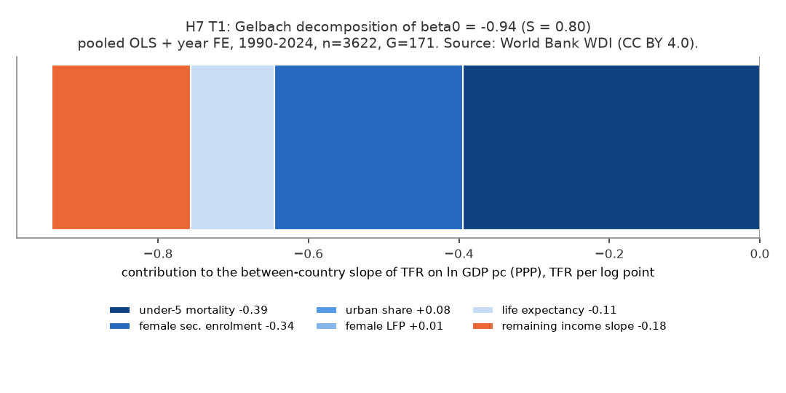
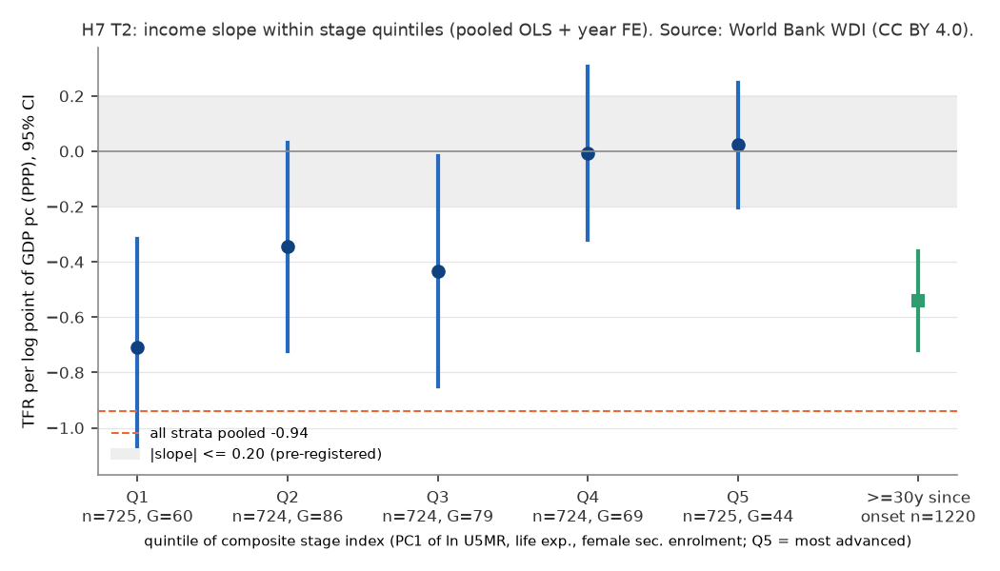
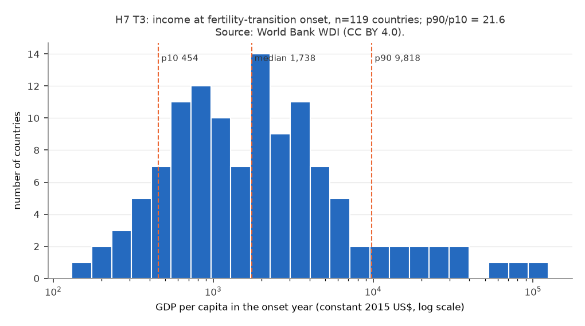
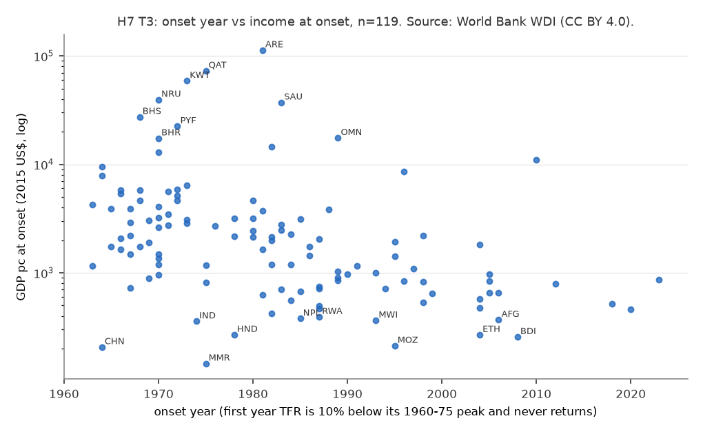
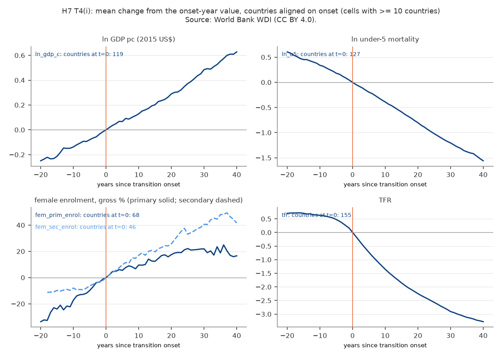
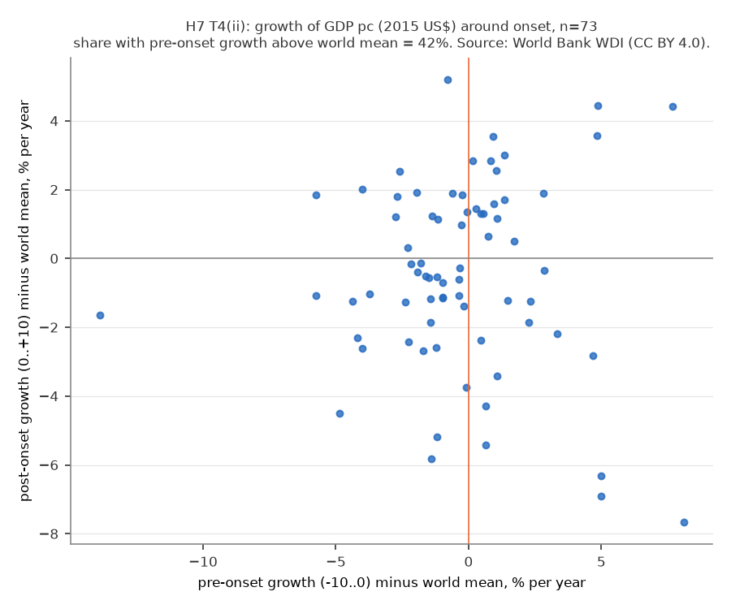
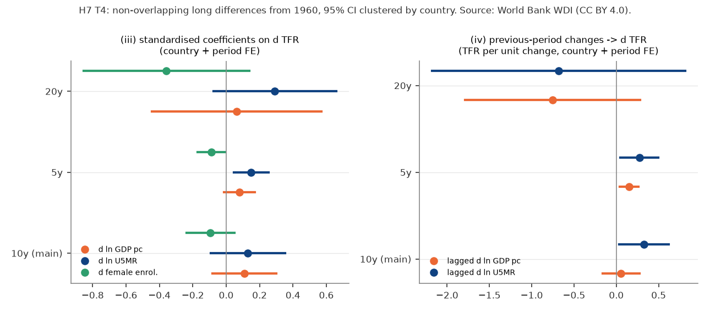
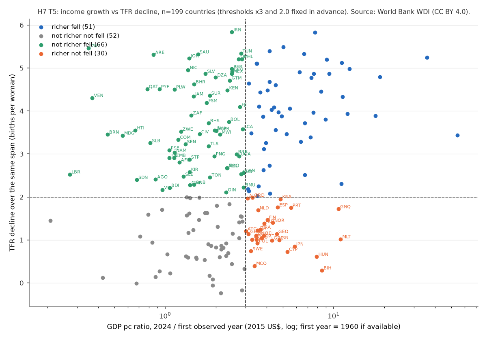

# H7: なぜ国の間では豊かな国ほど出生率が低いのか — 段階の差か、豊かさか（2026-10-13, theme: growth-fertility）

## 要約（5 行）
- **国の間で豊かな国ほど TFR が低いのは、主に人口転換の進み具合の差による（答え B。事前登録したスコアカードで B 4 点・C 2 点・A 0 点）。** 国間の所得勾配 −0.94 のうち 80%（S = 0.80）は、5 歳未満死亡率・女子中等就学率・平均余命の差と重なる。転換が最も進んだ 20% の国・年の間では、所得勾配は +0.02 [−0.20, +0.25] で消える。
- 転換は所得の閾値で始まっていない。転換開始年の一人当たり GDP（2015 年固定 US$）は p10 454 ドルから p90 9,818 ドルまで 21.6 倍ばらつく。開始時の 5 歳未満死亡率のばらつき（3.0 倍）よりはるかに大きい。
- 豊かにならずに TFR が 2 以上下がった国は 66 か国（バングラデシュ型。例: ケニア、ペルー、イラン、ハイチ）ある。その死亡率低下幅の中央値（90/千）は全体（69/千）より大きい。
- 豊かさが効いていないわけではない。1960 年に豊かだった国ほど転換開始が早く（ln GDP 1 単位あたり −6.0 年）、転換途中の層（複合段階の第 2〜4 五分位）には全体勾配の約 3 割（平均 −0.26）が残る。所得は「転換の時期と速さ」と相関するが、転換の始まりと、転換を終えた国の間の TFR の差は決めていない。同じ国の中の順序（T4）は主仕様で判定基準に届かなかった（点なし）。
- 識別は固定効果・長期差分・イベント時間整列・開始時点の分散に限られ、自然実験はない。上の結論は「3 つの候補のうち最も整合的な説明」であり、因果効果の推定ではない。

## 問いと仮説
`design/themes/growth-fertility.md` の「### H7」（2026-10-13 事前登録）と `docs/specs/growth-fertility-h7-between-gradient.md`。H4 の結果を見た**後**に立てた仮説だが、推定量・サンプル・判定基準・スコアカード・頑健性リストは追加データ（WDI 3 指標）を見る前に固定した。本レポートは「国の間」に限る（途上国の中・日本の中は扱わない）。

答えの候補（事前固定）:
- **A**: 豊かさの差そのものが TFR の差を作っている。
- **B**: 人口転換の進み具合の差が TFR の差を作っており、豊かさは並走しているだけ。
- **C**: 豊かさが転換を引き起こし、転換が TFR を下げる。

推定したい量: 国間（年 FE 付きプール OLS）の ln GDP 係数のうち段階指標と重なる割合（T1）、段階をそろえた層内の所得勾配（T2）、転換開始時所得の分散（T3）、同じ国の中の 10 年差分の標準化係数と先行関係（T4）、反例の件数（T5）。いずれも記述的な関連の量。

## データ
| 変数 | 出典 | 定義・単位 | 期間・国 | 備考（欠損・断絶） |
|---|---|---|---|---|
| `tfr` | WDI `SP.DYN.TFRT.IN` | 女性 1 人あたり | 1960–2024、216–217 経済 | 途上国の多くは UN WPP 推計（平滑） |
| `gdp_pcap_ppp` | WDI `NY.GDP.PCAP.PP.KD` | 一人当たり GDP、PPP（2021 年国際ドル）、ln | 1990– | T1/T2 の主所得系列（国間の水準比較） |
| `gdp_pcap_const` | WDI `NY.GDP.PCAP.KD` | 一人当たり GDP、2015 年固定 US$、ln | 1960–（1960 年 107 経済、1990 年 192） | T3〜T6 の時間方向の所得。T1/T2 の頑健性 |
| `u5_mortality` | WDI `SH.DYN.MORT` | 出生千対、ln | 1960–2024（1960 年 131 経済） | |
| `life_exp` | WDI `SP.DYN.LE00.IN` | 年 | 1960– | |
| `fem_sec_enrol` | WDI `SE.SEC.ENRR.FE` | 女子中等総就学率 % | 1970–（1970 年 32 経済） | 100% 超あり。欠損多 |
| `fem_prim_enrol` | WDI `SE.PRM.ENRR.FE` | 女子初等総就学率 % | 1970–（1970 年 38 経済、**1960 年代は値なし**） | T4 で中等が欠ける差分の代替 |
| `urban_share`, `fem_lfp` | WDI | %、ILO 推計（fem_lfp は 1990–） | | T1 の段階指標（H4 と同じ 5 本） |
| `population` | WDI `SP.POP.TOTL` | 人 | | サンプル除外のみ |
| `infant_mortality` | WDI `SP.DYN.IMRT.IN` | 出生千対 | 1960– | 取得したが、事前登録の頑健性リストに入っていないため本レポートでは使っていない |

mart: `data/marts/growth_fertility_panel.parquet`（217 経済 × 1960–2025 = 14,322 行 × 17 列）。生成: `uv run socioscope run growth-fertility fetch && … stage && … mart`。LLM 構造化は使っていない。`region` は取得時点の WB 分類（時間不変、T3 の地域割合に使用）。

サンプル:
- T1/T2: H4 と同一サンプル（1990–2024、tfr・PPP GDP・段階指標 5 本を listwise）= **n = 3,622、171 か国**。
- 転換開始年（`transition.onset_table`、事前固定の定義: 1960–75 の TFR 最大値 ≥ 4.5、最大値から 10% 下回り二度と戻らない最初の年）: 対象 157 か国、**開始年特定 155 か国**（中央値 1975、1990 年以前 125）。最大値 < 4.5 の 60 か国は「1960 年に転換済み」の層。
- T3: 155 か国のうち開始年の固定 US$ GDP が観測される **119 か国**（欠ける 36 か国は開始が 1962–1973 に集中する早期転換国。補完しない）。
- T4(ii): 開始前 10 年の成長率が観測できる 76 か国。T4(iii): 10 年差分（1970–2020 の 5 区間）で全変数が揃う 418 国・期間、170 か国。
- T5: 2024 年と最初の観測年の固定 US$ GDP・TFR がある **199 か国**（最初の年 = 1960 が 106 か国、それ以降が 93 か国、最遅 2013）。

## 方法
識別戦略: **固定効果・長期差分・イベント時間整列・開始時点の分散のみ。自然実験なし。** SE はすべて国クラスタ（同じ国の年・期間は独立でないため）。

- **T1 Gelbach 分解**: β₀ = `tfr ~ ln_gdp + C(year)` の ln_gdp 係数、β_full = 段階指標 5 本を加えた係数。δ_k = Γ_k × β_k（Γ_k は `k ~ ln_gdp + C(year)` の係数）。Σδ_k = β₀ − β_full は恒等的に成り立つ（stdout で数値確認）。S = Σδ_k / β₀。δ_k の SE は計算していない（判定は点推定 S で行う事前登録どおり）。
- **T2**: ln(U5MR)・平均余命・女子中等就学率を同一サンプルで標準化し、第 1 主成分（SVD、平均余命の負荷が正になる向き）を複合段階指標にする。負荷は ln U5MR −0.586、平均余命 +0.579、就学率 +0.566。五分位の切れ目は国・年の行で固定し、各層で `tfr ~ ln_gdp + C(year)`。補助: 開始から 30 年以上たった国・年。
- **T3**: 開始年の固定 US$ GDP の p90/p10（線形補間の分位点）。補助: 開始時 U5MR の p90/p10、開始年を 1960 年の ln GDP と「同一地域で先に転換した国の割合」に回帰（1 国 1 行、頑健 SE）。地域割合は同じ WB 地域の他国のうち、開始年が早い国と 1960 年に転換済みの国の割合（開始年が特定できない対象国は「先行していない」に数える）。
- **T4**: (i) 開始年を 0 とした −20..+40 の国平均軌跡（0 年値からの差）。各時点で観測のある国の平均で、構成は時点ごとに変わる（図は 10 か国以上の時点のみ）。(ii) 開始前 10 年と開始後 10 年の年平均 ln 成長率を、同じ暦年区間の世界平均（その区間の両端点が観測される全経済の非加重平均）と比べる。(iii) `Δ₁₀tfr ~ Δ₁₀ln_gdp_c + Δ₁₀ln_u5 + Δ₁₀enrol + C(iso3) + C(period)`、1960 から重ならない 10 年区間、変数を推定サンプルで標準化した係数も出す。(iv) 前期の Δ₁₀ln_gdp_c と Δ₁₀ln_u5 を同時に入れる。
- **T5**: 最初の観測年（1960 があれば 1960）→ 2024 の所得倍率 ≥ 3 を「豊かになった」、TFR 低下 ≥ 2.0 を「下がった」とする 4 象限。死亡率低下幅は同じ始点年→2024 の U5MR 差（千対。始点年に U5MR が無い国は中央値の計算から外す）。
- **T6**: 開始後 +10..+30 年と開始前 −10..0 年の年平均成長率の比較（記述のみ）。

判定とスコアカードは事前登録のまま（`select_answer`: 最多得点を見出しにし、同点・1 点差なら量つきの混合）。

## 結果
### T1: 右下がりの 8 割は段階指標と重なる

*図 1: 国間の ln GDP pc（PPP）係数 β₀ = −0.94 の Gelbach 分解。年 FE 付きプール OLS、1990–2024、n = 3,622、171 か国。*

| 段階指標 | δ_k | β₀ に占める割合 |
|---|---|---|
| 5 歳未満死亡率 | −0.395 | 41.9% |
| 女子中等就学率 | −0.342 | 36.4% |
| 平均余命 | −0.111 | 11.8% |
| 都市化率 | +0.084 | −8.9% |
| 女性労働参加率 | +0.007 | −0.8% |
| **合計 Σδ（= β₀ − β_full）** | **−0.757** | **S = 0.804** |
| 残る所得の係数 β_full | −0.185 [−0.401, +0.032] | 19.6% |

**判定 T1: S = 0.80 ≥ 0.6 → B と C に 1 点。** 死亡率と女子教育で 8 割近くを占める。都市化はむしろ勾配を薄める側に効く。

### T2: 転換が最も進んだ層では所得勾配がない

*図 2: 複合段階指標の五分位ごとの ln GDP 係数（95% CI）。橙の破線は全体 −0.94、灰色の帯は事前登録の |b| ≤ 0.20、緑は補助層（開始から 30 年以上）。*

| 層 | n | 国 | ln GDP 係数 [95% CI] |
|---|---|---|---|
| Q1（最も転換前） | 725 | 60 | −0.709 [−1.100, −0.317] |
| Q2 | 724 | 86 | −0.344 [−0.721, +0.032] |
| Q3 | 724 | 79 | −0.434 [−0.852, −0.017] |
| Q4 | 724 | 69 | −0.008 [−0.320, +0.305] |
| **Q5（最も進んだ）** | 725 | 44 | **+0.023 [−0.202, +0.248]** |
| 補助: 開始から 30 年以上 | 1,220 | 91 | −0.540 [−0.720, −0.360] |

**判定 T2: 最上位層の CI が 0 を含み |b| = 0.02 ≤ 0.20 → B と C に 1 点。** 途中の層（Q2–Q4）には平均 −0.26（全体の 28%）が残る。事前登録どおり、これを「転換の速さが所得と相関する分」として扱う。

補助層（開始から 30 年以上）では −0.54 と明確に負である。この層は 1960–70 年代に転換を始めた途上国の 1990 年以降の年からなる。「開始からの年数」では段階がそろわない（ラテンアメリカ・東アジアの転換完了国とサハラ以南の転換途中国が同じ層に入る）ことと整合的だが、本分析はこの解釈を検定していない。補助層は点数に入らないが、「転換の開始が古い国の間でも所得勾配は残る」ことを示しており、B の「転換が終わった国の間では無関係」は**複合段階指標で測った最上位層**についての主張に限られる。

### T3: 転換は所得の閾値で始まっていない

*図 3: 転換開始年の一人当たり GDP（2015 年固定 US$、対数軸）、119 か国。*


*図 4: 開始年 × 開始時所得。15,000 ドル超と 400 ドル未満に国コード。*

- 開始時所得の p10 / p25 / 中央値 / p75 / p90 = 454 / 767 / 1,738 / 3,776 / 9,818 ドル。**p90/p10 = 21.6**。
- 開始時 U5MR（127 か国）の p10 / 中央値 / p90 = 59 / 105 / 179 千対、**p90/p10 = 3.0**。所得より死亡率のほうがはるかに揃っている（B の傍証）。
- 開始年の横断回帰（76 か国、1960 年 GDP 観測あり）: `onset_year ~ ln_gdp1960` −5.96 年 [−8.94, −2.97]（R² 0.19）、`~ region_earlier_share` +23.5 年 [+12.4, +34.5]（R² 0.24）、両方入れると −5.05 [−7.60, −2.49] と +20.8 [+10.8, +30.8]（R² 0.37）。1960 年に豊かな国ほど早く転換している。同時に、同じ地域で先に転換した国が多い国ほど開始が遅い。これは「地域内の後発国ほど遅い」という機械的な関係を含み、拡散の効果とは読めない（記述）。

**判定 T3: p90/p10 = 21.6 ≥ 5 → B に 1 点。** 高所得の端は産油国・小島嶼（ARE, KWT, QAT, SAU, BHS 等）。産油国を除いても 12.7 で判定は変わらない。

### T4: 同じ国の中の順序（主検定）— 主仕様では判定基準に届かない

*図 5: 開始年でそろえた国平均の軌跡（0 年値からの差）。*


*図 6: 開始前・開始後 10 年の成長率と世界平均の差（両方観測される国）。*


*図 7: 長期差分の標準化係数（左）と前期変化の係数（右）。10 年が主仕様、5 年・20 年は頑健性。*

- (i) 開始前 20 年から開始までに、ln GDP は +0.25（年 1.2%）、ln U5MR は −0.61、女子初等就学率は +34 pt、TFR は −0.70 動く。所得は開始の前後で同じ傾きで伸び続け、開始前に加速していない。死亡率の低下と就学の拡大は開始前から進んでいる。TFR は開始後 10 年で −1.35、40 年で −3.28。
- (ii) 開始前 10 年の成長率が世界平均を上回った国は **76 か国中 42.1%**（平均 1.38% vs 世界 1.72%）。開始後 10 年でも 47.4%（116 か国）。
- (iii) 10 年差分（n = 418、170 か国、1970–2020 の 5 区間。就学率は中等 299・初等 119）の標準化係数: ΔlnGDP **+0.108** [−0.084, +0.300]、ΔlnU5MR **+0.130** [−0.092, +0.353]、Δ就学率 **−0.095** [−0.238, +0.048]。どれも CI が 0 を含む。所得の符号は正で、同じ国の中で所得が速く伸びた 10 年に TFR が速く下がったという関連は見えない（H1/H2 の within ≈ 0 と同じ）。教育なしの版（1960 年代を含む n = 922、192 か国）では ΔlnGDP +0.174 [+0.083, +0.265]、ΔlnU5MR +0.199 [+0.103, +0.295]。
- (iv) 前期の変化: 前期 ΔlnGDP +0.056 [−0.160, +0.271]、前期 ΔlnU5MR **+0.325 [+0.034, +0.616]**。前期の死亡率低下が今期の TFR 低下を予測し、前期の所得変化は予測しない。C の予測とは逆向き。

**判定 T4: 点なし。** (ii) の割合 42.1% ≤ 50% は B の条件を満たすが、(iii) で女子就学率の標準化係数（|−0.095|）が所得（|+0.108|）をわずかに下回り、「死亡率・教育とも所得より大きい」を満たさない。C の条件（割合 ≥ 70%、前期所得が予測）はどちらも満たさない。5 年差分・20 年差分では B の条件を満たす（頑健性参照）。

### T5: 豊かにならずに下がった国は 66 か国

*図 8: 所得倍率（対数軸）× TFR 低下幅。破線が事前固定の閾値（3 倍、2.0）。199 か国。*

| 象限 | 国数 | U5MR 低下の中央値（千対） | ln U5MR 低下の中央値 | 女子初等就学率の変化の中央値（pt） | 所得倍率の中央値 | TFR 低下の中央値 |
|---|---|---|---|---|---|---|
| 豊かになり下がった | 51 | 125.1 | 2.17 | +1.8 | 5.02 | 4.03 |
| **豊かにならずに下がった** | **66** | **90.3** | 1.56 | +19.1 | 1.53 | 3.49 |
| **豊かになったのに下がらなかった** | **30** | 26.8 | 2.02 | −0.7 | 3.85 | 1.12 |
| 豊かにならず下がらなかった | 52 | 23.6 | 1.50 | −2.0 | 1.79 | 0.89 |
| 全体 | 199 | 69.3 | 1.73 | | | |

- **豊かにならずに下がった国（66）**: AFG, AGO, ARE, BDI, BHR, BHS, BMU, BOL, BRB, BRN, CAN, CIV, COM, CUB, DZA, ECU, FJI, FSM, GHA, GIN, GMB, GNB, GTM, HTI, IRN, JAM, JOR, KEN, KIR, KWT, LBR, LBY, LCA, MDG, MEX, MHL, MWI, NAM, NIC, NZL, PER, PLW, PNG, PSE, PYF, QAT, SAU, SDN, SEN, SLB, SLE, SLV, STP, SUR, TGO, TJK, TLS, TON, TUN, UGA, VEN, VUT, WSM, ZAF, ZMB, ZWE（国名と始点・終点の値は stdout）。産油国（ARE, KWT, QAT, SAU, BHR, BRN, LBY, VEN, AGO, DZA）と、1960 年時点ですでに豊かだった国（CAN, NZL, BMU）も含む。
- **豊かになったのに下がらなかった国（30）**: ARM, ATG, AUS, AUT, BEL, BIH, CYP, DEU, DNK, ESP, FIN, FRA, GBR, GEO, GNQ, GRC, GRD, HUN, ISR, ITA, JPN, KNA, LUX, MCO, MLT, NLD, NOR, POL, PRT, SWE。

**判定 T5: 両象限とも ≥ 10、かつ「豊かにならずに下がった国」の U5MR 低下中央値 90.3 ≥ 全体 69.3 → B に 1 点。**

注意（探索的、点数に入れない）: 「豊かになったのに下がらなかった」30 か国の大半は、1960 年に TFR がすでに 2〜3 で、2.0 下がる余地がなかった転換済みの国（欧州・日本）である。spec が想定した「産油国が中心」とは違う。1960–75 の TFR 最大値 ≥ 4.5 の国に限ると、この象限は 5 か国（ARM, ATG, GNQ, GRD, KNA）しかなく、U5MR 条件も満たさない（117.3 vs 125.1）。この場合 T5 は点なしになり、スコアは B 3・C 2 となる。事前登録のルールでは 1 点差なので「主に B、C の要素あり」の混合に当たる。見出しは事前登録の主仕様（B 4・C 2）で決めるが、T5 の 1 点は「豊かにならずに下がった国が多い」ことに支えられており、「豊かになったのに下がらない国が多い」ことには支えられていない。

### T6: 転換後に成長は加速していない（記述）
開始前 10 年と開始後 +10..+30 年の両方が観測できる 56 か国で、年平均成長率は 1.73% → 1.72%。+10..+30 のほうが高い国は 50.0%、世界平均との差で比べると 44.4%（54 か国）。この粗い比較では人口ボーナスによる成長加速は見えない（逆向きの流れが無いことを示すものではない）。

## スコアカード（主仕様）
| 検定 | 値 | A | B | C |
|---|---|---|---|---|
| T1 Gelbach S | 0.804 | 0 | 1 | 1 |
| T2 最上位層の勾配 | +0.023 [−0.202, +0.248] | 0 | 1 | 1 |
| T3 開始時所得 p90/p10 | 21.6 | 0 | 1 | 0 |
| T4 割合 / 段階が所得より大 / 前期所得のみ予測 | 42.1% / いいえ / いいえ | 0 | 0 | 0 |
| T5 豊かにならず低下 / 豊かになったのに不低下 | 66 / 30（U5MR 条件 満たす） | 0 | 1 | 0 |
| **合計** | | **0** | **4** | **2** |

**選ばれた答え: B（4 点、2 点差）。** C の 2 点は T1 と T2 で B と共通の点で、C だけを支持する検定はなかった。量: 右下がりの 80% は段階と重なり、20%（β_full = −0.185）は段階指標をそろえても所得に残る。転換途中の層には全体の約 28% の勾配が残る。

## 頑健性（事前リスト、全部）
サンプルを変えた全スコアカード:

| 仕様 | T1 S | T2 最上位層 [CI] | T3 p90/p10 | T4 割合 / std(GDP, U5, 就学) / 点 | T5 両象限 | 得点 A/B/C | 答え |
|---|---|---|---|---|---|---|---|
| **主** | 0.804 | +0.023 [−0.202, +0.248] | 21.6 | 42.1% / +0.108, +0.130, −0.095 / なし | 66 / 30 | 0/4/2 | **B** |
| 産油国除外 | 0.647 | −0.008 [−0.248, +0.233] | 12.7 | 40.0% / +0.041, +0.097, −0.067 / B | 55 / 29 | 0/5/2 | B |
| 人口 100 万未満除外 | 0.850 | +0.056 [−0.215, +0.327] | 17.6 | 39.7% / +0.126, +0.125, −0.137 / なし | 48 / 24 | 0/4/2 | B |
| 人口 10 万未満除外 | 0.807 | +0.022 [−0.204, +0.248] | 19.0 | 42.7% / +0.097, +0.138, −0.099 / B | 63 / 27 | 0/5/2 | B |
| 2020–24 除外 | 0.832 | +0.076 [−0.161, +0.314] | 22.6 | 41.9% / +0.211, +0.172, −0.026 / なし | 63 / 31 | 0/4/2 | B |

サンプル除外は T1/T2 では H4 と同じ行単位（人口が観測されて閾値未満の行を落とす）、T3〜T5 では国単位（最新の人口が閾値未満の国を落とす）で行った。

転換開始の定義（T2 補助・T3・T4・T6 に効く。T1・T5 は開始年を使わない）:

| 定義 | 対象 / 開始特定 | T2 補助（≥30 年） | T3 p90/p10 | T4 割合 / 点 | T6 +10..+30 > 開始前 |
|---|---|---|---|---|---|
| 主（≥ 4.5、10%） | 157 / 155 | −0.540 [−0.720, −0.360] | 21.6 | 42.1% / なし | 50.0% |
| 最大値 ≥ 4.0 | 164 / 162 | −0.495 [−0.644, −0.347] | 29.9 | 42.9% / なし | 50.9% |
| 最大値 ≥ 5.0 | 146 / 144 | −0.532 [−0.709, −0.354] | 22.9 | 42.1% / なし | 50.0% |
| 低下率 15% | 157 / 154 | −0.474 [−0.648, −0.299] | 22.8 | 39.3% / なし | 55.0% |
| 5 年移動平均 | 157 / 152 | −0.529 [−0.705, −0.352] | 21.4 | 44.3% / なし | 50.0% |

その他:

| 仕様 | 結果 | 判定への影響 |
|---|---|---|
| T1/T2 を固定 US$ 所得で（同じ行） | S = 1.033（β₀ −0.711 → β_full +0.023）。T2 最上位層 +0.105 [+0.005, +0.206] | T1 は B/C。T2 は CI が 0 をわずかに外れ（正）、**点なし** |
| T2 複合指標 = 死亡率のみ（H4 再現） | 最上位層 +0.029 [−0.160, +0.217]、途中 −0.53/−0.57/+0.02 | B/C に 1 点（変わらず） |
| T2 複合指標 = 3 指標の標準化平均 | 最上位層 +0.024 [−0.201, +0.249] | 変わらず |
| T4 差分 5 年（n = 967） | std: GDP +0.079、U5 +0.150、就学 −0.088（就学 CI は 0 を含まない）。前期 GDP +0.152 [+0.041, +0.263]、前期 U5 +0.274 [+0.049, +0.498] | **B に 1 点** |
| T4 差分 20 年（n = 180、1980・2000 の 2 区間） | std: GDP +0.063、U5 +0.292、就学 −0.359（すべて CI が 0 を含む）。前期係数はいずれも 0 を含む | **B に 1 点** |
| T1 段階指標 4 本（就学率なし、n = 5,995、173 か国） | S = 0.670（β₀ −1.041 → β_full −0.343） | B/C（変わらず） |

どの仕様でも選ばれる答えは B で、A に点が入った仕様はない。揺れるのは T4（主仕様・人口 100 万未満除外・2020–24 除外で点なし、他で B）と、固定 US$ 版の T2（点なし）。いずれも B の得点が 1 点減るだけで、C の得点は増えない。

## 限界・言えないこと
（事前登録の 4 項目。結論を覆しうる条件に限る）
1. **順序は因果の証明ではない。** 死亡率の低下が出生率の低下に先行し、所得は先行しない（T4(i)(iv)）。それでも、家族計画プログラム・宗教・政策のような第三の要因が両方を動かしている可能性は排除できない。「B が最も整合的」は、この 3 択の中での判定である。
2. **開始時所得のばらつきが示すのは「所得の閾値がない」ことだけで、「所得が無関係」ではない。** 1960 年に豊かな国ほど早く転換し（T3 回帰 −6.0 年/log point）、転換途中の層には全体勾配の約 3 割が残る（T2 Q2–Q4 平均 −0.26）。開始から 30 年以上の国の間でも −0.54 が残る。所得は転換の時期と速さと関連している。
3. **1960 年に転換済みだった国（欧州・日本・北米など 60 か国）の転換開始は本データの外にある。** これらの国は T2 の最上位層としてのみ扱っている。T5 の「豊かになったのに下がらなかった」象限はこの層が大半を占め、下がる余地がなかったことによる（探索的に除くと T5 は点なし、B 3・C 2）。
4. **途上国の年単位のタイミングは信用しない。** WDI の TFR は推計で平滑なので、10 年単位で読む。女子就学率は 1970 年より前に値がなく、10 年差分の主仕様は 1970–2020 の 5 区間だけを使う。1960 年代は教育なしの版でしか見ていない。転換開始年の固定 US$ 所得も 36 か国（開始 1962–73 の早期転換国）で欠ける。

## 事前登録からの逸脱・補った定義
判定基準・閾値・サンプルは変えていない。事前登録が定めていなかった操作上の定義を次のように補った（いずれも結果を見る前の実装時に決め、stdout に出している）。
- T4(iii) の女子就学率: 両端点が観測されれば中等、なければ初等の差分を使う（同じ差分の中で系列を混ぜない）。教育なしの版を併記した。
- T4 の「死亡率・教育の標準化係数の絶対値が所得より大きい」は、死亡率と教育の**両方**が所得を上回ることと解釈した。「前期の所得変化が ΔTFR を予測」は前期 ΔlnGDP の 95% CI 上限 < 0（C が予測する向き）、「前期の死亡率変化は予測しない」は前期 ΔlnU5MR の CI が 0 を含むこととした。
- 10 年差分は 1960 年から重ならない区間をとり、最終区間は 2010→2020（2021–24 は使わない）。
- T4(ii) の世界平均は、同じ暦年区間で両端点が観測される全経済の非加重平均。
- T5 の死亡率低下幅は始点年→2024 の U5MR の差（千対）。ln 差も表に併記した。
- T2 の五分位は国・年の行で切った（国単位ではない）。
- サンプル除外は T1/T2 では行単位（H4 と同じ）、T3〜T5 では国単位。
- 探索的に T5 を転換前の国に限った版を追加した（点数に入れない）。

## 再現手順
```bash
make sync
uv run socioscope run growth-fertility fetch && uv run socioscope run growth-fertility stage && uv run socioscope run growth-fertility mart
uv run python themes/growth-fertility/src/theme_growth_fertility/analysis/a20261013_h7_between_gradient.py \
  > themes/growth-fertility/reports/2026-10-13-h7-between-gradient.stdout.txt
uv run pytest themes/growth-fertility/tests/test_analysis_h7.py themes/growth-fertility/tests/test_transition.py
```
2 回実行して、図 8 枚（`figures/h7_*.png`）の sha256 と標準出力が一致することを確認した（乱数・現在時刻は使っていない）。

## 出典
- World Bank, World Development Indicators（`SP.DYN.TFRT.IN`, `NY.GDP.PCAP.PP.KD`, `NY.GDP.PCAP.KD`, `SP.POP.TOTL`, `SH.DYN.MORT`, `SE.SEC.ENRR.FE`, `SE.PRM.ENRR.FE`, `SP.URB.TOTL.IN.ZS`, `SL.TLF.CACT.FE.ZS`, `SP.DYN.LE00.IN`, `SP.DYN.IMRT.IN`）: CC BY 4.0。
- Gelbach, J. B. (2016). When Do Covariates Matter? And Which Ones, and How Much? *Journal of Labor Economics* 34(2).
- Bongaarts, J. & Watkins, S. C. (1996). Social Interactions and Contemporary Fertility Transitions. *Population and Development Review* 22(4).

## チェックリスト回答
- **A 問いと事前登録**: H7 の問い・答え候補・T1〜T6・判定・頑健性は `design/themes/growth-fertility.md` に分析前（2026-10-13）に登録済み。H4 の結果を見た後の仮説であることは明記した。T5 の転換前国限定版は「探索的」と明記し、点数に入れていない。推定量は記述的関連（分解割合・層内勾配・分位比・差分係数）。
- **B データ**: 全変数の WDI コード・単位・期間を「データ」表に記載。欠損は補完せず listwise（開始年所得が欠ける 36 か国、1960 年代の就学率なし、T5 の始点年の違い）を列挙した。サンプル選択の理由（H4 同一サンプル、開始年定義）と影響（頑健性表）を記載。
- **C 識別戦略**: 固定効果・長期差分・イベント時間整列・開始時点の分散のみで、自然実験はない。逆の因果（T6 で記述、加速は見えず）、第三の要因（家族計画・宗教・政策）を限界 1 に挙げた。国レベルの関係であり、個人・世帯の出生行動に読み替えない。
- **D 推定と不確実性**: SE は国クラスタ（同一国の年・期間の相関のため）。T3 回帰は 1 国 1 行。事前リストの頑健性（サンプル 4 通り、開始定義 4 通り、所得系列、複合指標 2 通り、差分幅 2 通り、4 指標版）を全部報告した。T4 と固定 US$ 版 T2 で判定が揺れることを書いた。Gelbach の δ に SE は付けていない。
- **E 書き方**: 見出しは事前登録の執筆規律に従い答え（B）を断定形で書いた。注釈は要約の最後の 1 行にまとめ、「因果効果」とは書いていない。図は軸・単位・出典・n を記載し、対数軸は明示した。限界節と再現手順を設け、mart の行数・列を書いた。LLM 構造化は不使用。
