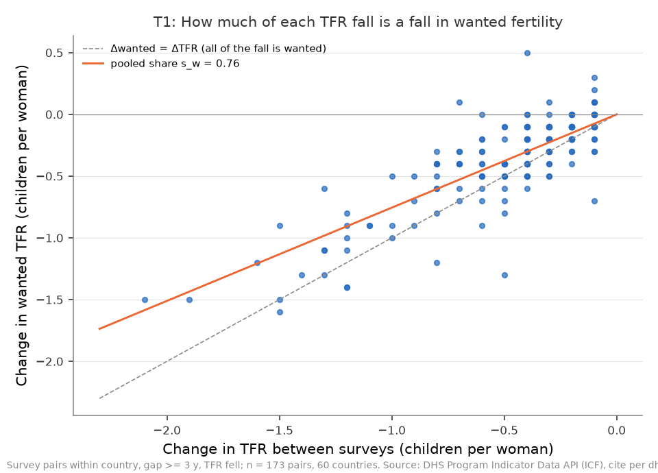
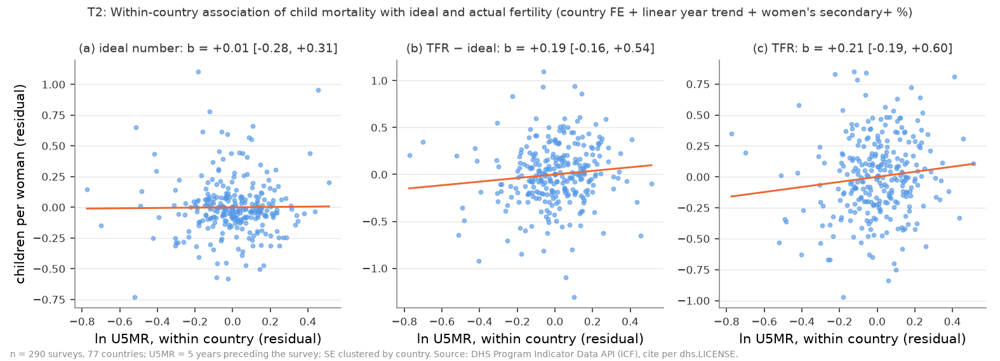
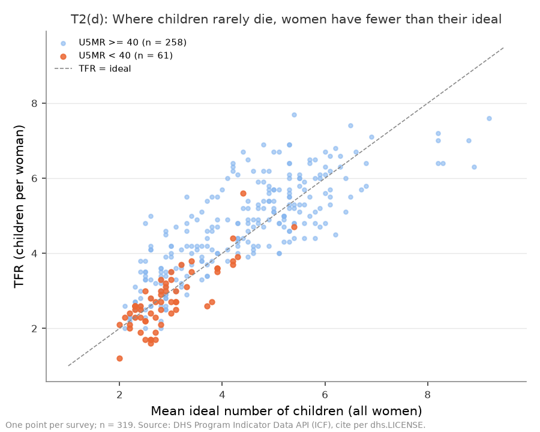
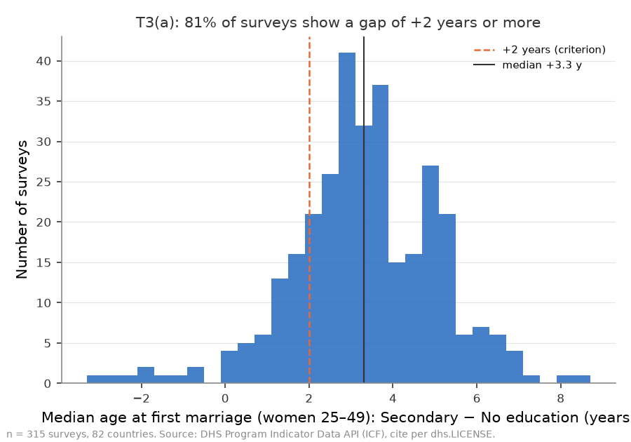
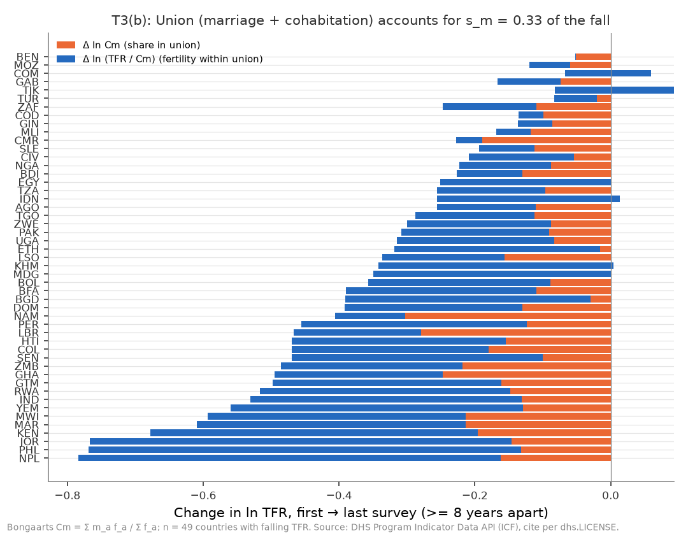
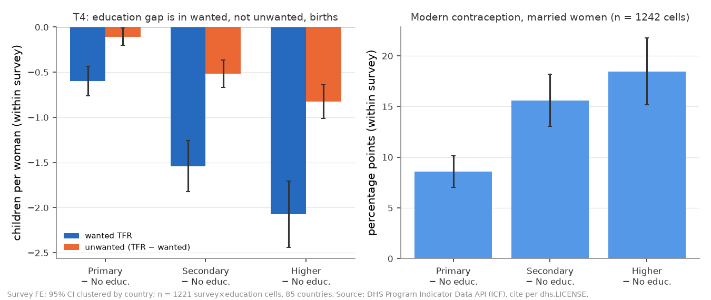
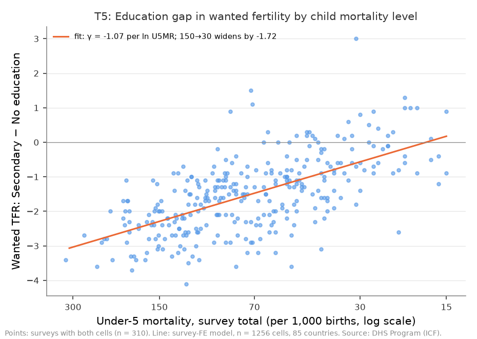
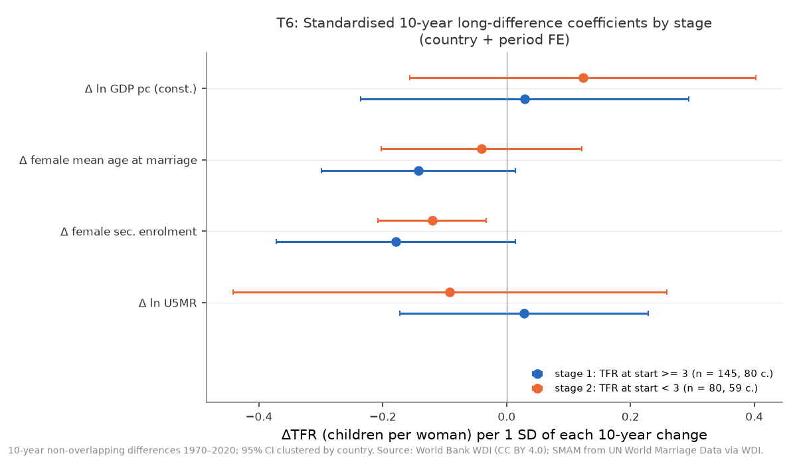
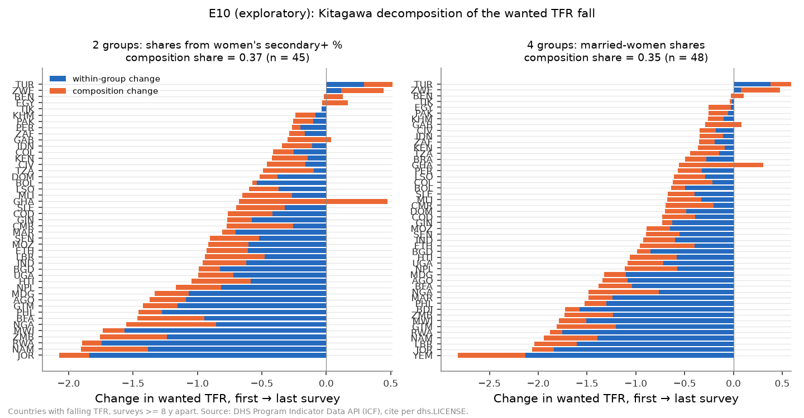

# H8: 死亡率の低下と女子教育は、どの仕組みで出生率を下げるのか（2026-10-17, theme: growth-fertility）

## 要約（5 行）
- **出生率が 6 人から 3 人前後へ下がる段階は、女子教育による『望む数』の低下（M3）が担い、子どもの死亡率の低下（M1、保険としての多産が要らなくなる）は同じ国の中の年トレンドを除くと TFR との関連が確かめられず、望まない出生の減少（M5）の上限（1 − s_w）は約 2 割（24%）にとどまる。3 人前後から 2 人未満へ下がる段階は、女子の就学の広がり（M3 の経路）が最も整合的な候補で、標準化係数の比で約 3 割（32%）（低下に占める割合ではない）を占め、死亡率の関連は確かめられない。結婚（同棲を含む）している割合の低下は、TFR 低下の約 3 割（33%）にあたる。** 段階 2 についての現時点のスタンスは「女子就学率」だが、その証拠は標本（初婚年齢が観測される国・期間）と段階の境界の取り方に依存して脆い。（事前登録のスコアカード: M1 不支持、M2 支持、M3 支持、M4 不支持、M5 不支持）
- 同じ国の隣り合う調査の間で TFR が下がった 173 組（60 か国）では、低下の 76%（s_w = 0.755）が「望む出生」の低下だった。調査内で比べると、中等教育を受けた女性は教育なしの女性より望む出生が 1.54 人少なく [−1.83, −1.26]、望まない出生の差（−0.52 人）の約 3 倍ある。段階 1 の M3 の量（−0.36 人）は、この調査内の横断勾配に国内の学歴割合の上昇幅を掛けた外挿である。学歴構成で分けると、望む出生の低下のうち学歴構成の変化で説明されるのは約 35%（Kitagawa 分解、45 か国、探索的）で、残りは各学歴群の中の低下（教育なしの女性で中央値 −0.75 人）による。
- 学歴が高い女性ほど遅く結婚する（初婚年齢の中央値の差 +3.3 年。81% の調査で +2 年以上）。first→last で TFR が下がった 49 か国では、ln TFR の低下の 33% が「結婚または同棲している割合」の低下（Bongaarts Cm）で説明される。
- 予測と逆の結果と、仕様に依存する結果がある。(1) 死亡率が低い調査ほど、学歴による望む数の差は**小さい**（M4 不支持。U5MR が 150 から 30 に下がると差は 1.7 人縮む）。(2) **M1 の不支持は、事前登録した「国 FE ＋ 線形トレンド」の仕様でだけ成り立つ**。トレンドを外すと ln U5MR の係数は +0.565 [+0.215, +0.915]、TFR ≥ 4 の調査に限ると +0.614 [+0.159, +1.070] で、どちらも 0 を含まない（探索的）。(3) 段階 2 の主役（就学率）は脆い。区切りを TFR 3.5 や 2.1 にしたとき、および初婚年齢を外して標本を広げたとき（80→219 区間）には、どの変数の CI も 0 を含む。区切りを 2.5 にすると、主役は所得（符号は正）に変わる。
- 識別は固定効果・分解・調査内の学歴比較だけで、自然実験はない。上の結論は「事前に挙げた仕組みのうち最も整合的なもの」であり、因果効果を推定したものではない。要約の (2)(3) の一部と Kitagawa 分解は、結果を見た後の探索的な検定である（判定には入れていない）。

## 問いと仮説
`design/themes/growth-fertility.md` の「### H8」（2026-10-17 事前登録）と `docs/specs/growth-fertility-h8-mechanisms.md`。H7 の結果を見た**後**に立てた仮説だが、推定量・判定基準・スコアカード・最終仮説の文型・頑健性リストは、追加データ（DHS 11 指標 × 内訳、WDI 4 指標）を見る前に固定した。

**問い**: 子どもの死亡率の低下と女子の就学の広がりが出生率低下の先行指標になるのは、どの仕組みを通じてか。その仕組みは、出生率が「2 人程度」までではなく「2 人未満」まで下がることを説明できるか。

| 記号 | 仕組み | 主検定 |
|---|---|---|
| M1 | 子どもが死ななくなり、保険としての多産が要らなくなる | T2(c) within の ln U5MR 係数 |
| M2 | 女子教育が結婚を遅らせ、減らす | T3 初婚年齢の学歴勾配 ＋ Cm 分解 s_m |
| M3 | 学歴が高いほど望む数が少ない（数より質） | T4 調査内の wanted / unwanted の学歴勾配 |
| M4 | M1 × M3（死亡率が低いほど学歴差が大きい） | T5 学歴 × ln U5MR の交互作用 |
| M5 | 対抗仮説: 家族計画の普及（望まない出生の減少） | T1 s_w ＋ T4 |

**推定したい量**（いずれも記述的な関連の量）: (1) TFR 低下のうち望む出生の低下が占める割合 s_w、(2) ln TFR の低下のうち結婚指数 Cm の低下が占める割合 s_m、(3) 同じ国の中で ln U5MR が 1 下がったときの TFR・理想数・（TFR − 理想数）の変化、(4) 調査内の学歴差（Secondary − No education）、(5) その学歴差が U5MR でどう変わるか、(6) 全世界の 10 年長期差分での標準化係数（段階別）。

## データ
| 変数 | 出典 | 定義・単位 | 期間・国 | 備考（欠損・断絶） |
|---|---|---|---|---|
| `tfr`（DHS） | DHS `FE_FRTR_W_TFR` | 調査前 3 年の TFR、女性 1 人あたり | 368 調査・87 か国、1985–2025 | Total / 学歴 4 群 |
| `asfr_15`…`asfr_45` | DHS `FE_FRTR_W_A15`… | 年齢別出生率、女性千人あたり | 368 調査（`asfr_45` は 359） | 5ΣASFR/1000 と TFR の差は最大 0.055、平均 0.025（丸め） |
| `wanted_tfr` | DHS `PR_WTFR_W_WFR` | 望む出生だけで数えた TFR（妊娠時点の生存子数 < 理想数なら「望む」） | 320 調査・86 か国（DHS 型のみ） | WDI `SP.DYN.WFRT` と同一 iso3・年の 256 件で完全一致 |
| `ideal_children` | DHS `PR_IDLC_W_MNA` | 全女性の理想子ども数の平均 | 320 調査・86 か国 | 数値でない回答は分母外（DHS の定義） |
| `u5mr` | DHS `CM_ECMR_C_U5M` | 5 歳未満死亡率、出生千対。Total は調査前 5 年（主、`is_preferred`）と 10 年（頑健性）、学歴内訳は 10 年版のみ | 329 調査・87 か国 | 対数をとる |
| `women_secondary_plus` | DHS `ED_EDUC_W_SEH` | 女性 15–49 のうち中等以上の割合、% | 345 調査・78 か国、**1990 年以降のみ** | within 回帰の説明変数 |
| `age_first_marriage` | DHS `MA_AAFM_W_M2B` | 女性 25–49 の初婚年齢の中央値、歳 | Total 326 調査。学歴セル: Secondary 319、Higher 140 | 半数が未婚のセルは中央値が出ない（打ち切り）ので欠損 |
| `in_union` | DHS `MA_MSTA_W_UNI` | 結婚または同棲中の割合、%、5 歳階級 | 332 調査（7 階級そろう 330） | 法律婚と同棲を区別しない |
| `modern_contraception_married` | DHS `FP_CUSM_W_MOD` | 既婚女性の近代的避妊実行率、% | 324 調査、学歴セル 1,242 | T4 の補助 |
| Cm（派生） | 上 2 つから計算 | Σ m_a f_a / Σ f_a | 318 調査・84 か国 | 7 階級すべてある調査のみ |
| `tfr`, `u5_mortality`, `fem_sec_enrol`, `gdp_pcap_const` | WDI | H7 と同じ | 1970–2020 | T6 |
| `smam_fe` | WDI `SP.DYN.SMAM.FE`（UN World Marriage Data） | 女性の平均初婚年齢（SMAM）、歳 | 2,073 国・年、212 か国 | 出典が混在。事前の整形規則で **194 件を除外**（後述） |
| `married_by18` | WDI `SP.M18.2024.FE.ZS` | 20–24 歳女性のうち 18 歳未満で結婚した割合、% | 428 国・年、146 か国 | T6 の頑健性 |
| `contraceptive_any` | WDI `SP.DYN.CONU.ZS` | 既婚女性の避妊実行率（全方法）、% | 1,256 国・年、184 か国 | T6 の頑健性 |
| 欧州・日本 | `eu_tfr_by_education`、`eu_census_marital_by_education`、`jp_income_age_marital` | H5・H3b と同じ | — | 再掲のみ。新しい推定はしない |

mart: `data/marts/dhs_mechanisms.parquet`（22,652 行、374 調査、87 か国、1985–2025、long。キー一意。2026-10-17 取得）、`data/marts/growth_fertility_panel.parquet`（217 経済 × 1960–2025 = 14,322 行、21 列）。生成は `uv run socioscope run growth-fertility fetch && … stage && … mart`。調査の種別は DHS 322、MIS 41、AIS 11。`wanted_tfr`・`ideal_children` は DHS 型の調査にしかなく、`women_secondary_plus` は 1990 年以降の調査にしかない。このため頑健性の「DHS のみ」は T1・T2・T4・T5 で主仕様と同じ標本になり、「1990 年以降」は T2 で主仕様と同じ標本になる（下の表に明記）。

## 方法
- **DHS の within 回帰**（T2・T3(c)）: `y ~ ln U5MR + women_secondary_plus + C(iso3) + survey_year`（国 FE ＋ 調査年の線形トレンド）。OLS、SE は国クラスタ（H1 の `fit`）。T2 の (a)(b)(c) は同じ標本（理想数・TFR・U5MR・学歴割合がすべてある 290 調査、77 か国）で推定するので、(a)+(b)=(c) が成り立つ。
- **T1 の組**: 国ごとに調査を年順に並べ、各調査から「3 年以上後の最初の調査」と組にして、次はその相手から始める（重ならない鎖）。対象は TFR と wanted TFR が両方ある調査。ΔTFR < 0 の組で s_w = ΣΔwanted / ΣΔTFR。
- **T3(b) の Cm 分解**: 国ごとの最初と最後の調査（8 年以上離れ、両方で Cm を計算でき、TFR が下がった国）で Δln TFR = Δln Cm + Δln(TFR/Cm)。s_m = ΣΔln Cm / ΣΔln TFR。
- **T4・T5 の学歴セル**: 調査 × 学歴 4 群のセル（wanted と TFR が両方ある 1,221 セル、317 調査、85 か国）。調査 FE ＋ 学歴ダミー（基準は教育なし）、国クラスタ SE。unwanted = TFR − wanted TFR（同じ調査・同じ学歴セル）。T5 は学歴ダミー × (ln U5MR_s − 平均) を加える。U5MR_s は調査 Total の 5 年版で、その主効果は調査 FE に吸収される。Secondary × ln U5MR の係数は γ_Sec − γ_None そのものである。U5MR が 150 から 30 に下がったときの勾配の広がりは γ × ln 5。
- **T6**: WDI の 10 年長期差分（1970→80、…、2010→20 の重ならない 5 区間）。`ΔTFR ~ Δln U5MR + Δ女子中等就学率 + ΔSMAM + Δln GDP(固定 US$) + C(iso3) + C(period)`、国クラスタ SE。各段階の標本の中で、説明変数の Δ を標準偏差で割る（係数 = 1 SD の変化あたりの ΔTFR、人）。段階は区間の開始時点の TFR で分ける（≥ 3 / < 3）。
- **段階 1 の M1 と M3 の量の比較**（スコアカードの規則）: DHS で、1990 年以降の最初の調査から最後の調査まで（8 年以上離れたもの、52 か国）の変化の中央値を使う。Δln U5MR の中央値は −0.801、中等以上の割合の上昇の中央値は +0.235。M1 の量 = T2(c) の係数 0.205 × (−0.801) = −0.16 人。M3 の量 = g_w −1.542 × 0.235 = −0.36 人。

**仮定**: 国 FE ＋ 線形トレンドの残差の変動は、同じ国の中の他の変化（家族計画プログラムや規範）と相関しない。調査内の学歴差は、学歴別の母集団の違いを含む（自己選択）。DHS の wanted TFR の定義（妊娠時点で生存子数が理想数未満なら「望む」）を受け入れる。

## 結果

### T1: TFR 低下の 4 分の 3 は「望む出生」の低下（M5 は従）


| 仕様 | 組（TFR 低下） | 国 | ΣΔTFR | ΣΔwanted | s_w | 組ごとの比の中央値 |
|---|---|---|---|---|---|---|
| 主: 隣接の鎖、間隔 ≥ 3 年 | 173 | 60 | −87.0 | −65.7 | **0.755** | 0.750 |
| first→last（≥ 8 年） | 50 | 50 | −75.0 | −55.2 | 0.736 | 0.727 |

s_w ≥ 0.6 なので、事前の基準では「望む数の低下が主（M1/M3 が主役、M5 は従）」になる。望まない出生（TFR − wanted）の減少は低下の 24% にあたる。

### T2: 同じ国の中では、死亡率は年トレンドを除くと TFR と関連しない（M1 不支持）


| 被説明変数（n = 290 調査、77 か国） | ln U5MR | women_secondary_plus（1 %pt） |
|---|---|---|
| (a) 理想子ども数 | +0.013 [−0.283, +0.310] | −0.003 [−0.013, +0.008] |
| (b) TFR − 理想数 | +0.192 [−0.161, +0.544] | −0.007 [−0.020, +0.006] |
| (c) TFR | **+0.205 [−0.194, +0.604]** | −0.009 [−0.025, +0.007] |
| (c) 最大標本（理想数を要求しない、300 調査・78 か国） | +0.203 [−0.192, +0.598] | −0.010 [−0.025, +0.005] |

(c) の係数の CI が 0 を含むので、M1 は事前の基準で「不支持」である。点推定の 94%（+0.192 / +0.205）は (b)（望む数を超える出生）に乗り、(a)（理想数そのもの）にはほぼ乗らない。補足記述の規則に従えば、向きは「補充行動（望む数は変わらず、余分な出生が減る）」に近い。ただし (a)(b) どちらの CI も 0 を含む。調査年トレンドの係数は −0.034 人/年 [−0.056, −0.012] で、同じ国の中の TFR の低下はトレンドがほぼ吸収している（探索的な E7 を参照）。

**T2(d)**（U5MR < 40 の 61 調査）: 理想数の中央値は 2.80、TFR の中央値は 2.60、TFR が理想数を下回る調査は 55.7%。50% 以上なので、事前の文言どおり「死亡率が低い社会では望む数より少なく産んでおり、M1 だけでは低出生率を説明できない」と書く。


### T3: 学歴が高い女性ほど遅く結婚し、結婚・同棲の減少は TFR 低下の 3 分の 1（M2 支持）



- (a) 初婚年齢の中央値（女性 25–49）の Secondary − No education は、315 調査（82 か国）の中央値で **+3.3 年**。+2 年以上の調査は **81.3%**。Higher − No education は 136 調査の中央値で +6.4 年。
- (b) first→last で TFR が下がった 49 か国: ΣΔln TFR = −17.14、ΣΔln Cm = −5.70、**s_m = 0.332**。
- (c) within 回帰（288 調査、75 か国）: Cm ~ women_secondary_plus は −0.0004 [−0.0015, +0.0008]（1 %pt あたり。同じ国の中では学歴割合と Cm は関連しない）、ln U5MR は −0.023 [−0.042, −0.004]（死亡率が下がった調査ほど Cm が**高い**）。

(a) が 70% 以上で s_m が 0.25 以上なので、M2 は事前の基準で「支持」である。ただし (c) から、同じ国の中で Cm の低下を伴っているのは女性の学歴割合の上昇ではない。M2 の証拠は「学歴による結婚年齢の差（調査内の横断）」と「Cm の低下の大きさ（国の時系列）」の組み合わせである。両者を同じ国の中の学歴の変化でつなぐ係数は 0 に近いが、この精度では関連の有無を判別できない。

### T4: 学歴による差は「望む出生」に出る（M3 支持、M5 は T4 では不支持）


| 学歴差（教育なしとの差、調査 FE、1,221 セル・317 調査・85 か国） | wanted TFR | unwanted（TFR − wanted） |
|---|---|---|
| Primary − No education | −0.599 [−0.760, −0.437] | — |
| **Secondary − No education（主）** | **g_w = −1.542 [−1.825, −1.259]** | **g_u = −0.517 [−0.670, −0.364]** |
| Higher − No education | −2.073 [−2.442, −1.704] | −0.825 [−1.009, −0.640] |

g_w ≤ −1.0（CI は 0 を含まない）、|g_w| = 1.54 ≥ 2|g_u| = 1.03 なので、M3 は「支持」である。|g_u| < |g_w| なので、T4 から M5 に点は入らない。補助として、既婚女性の近代的避妊実行率は学歴とともに上がる（Primary +8.6 %pt、Secondary +15.6 %pt [+13.0, +18.2]、Higher +18.5 %pt、1,242 セル、87 か国）。学歴の高い女性は避妊をよく使うが、望まない出生の差は望む出生の差の 3 分の 1 にとどまる。

### T5: 死亡率が低い社会ほど学歴差は**小さい**（M4 不支持）


γ_Sec − γ_None = **−1.072 [−1.293, −0.851]**（1,256 セル、85 か国）。U5MR が平均（71/千）のときの Secondary − None の差は −1.49 人。U5MR が 150 から 30 に下がると、差は 1.73 人**縮む**（広がり = −1.725）。符号が予測と逆なので M4 は「不支持」である。Higher × ln U5MR も −1.381 [−1.632, −1.130] で同じ向き。死亡率が低い調査では、教育なしの女性も含めて望む数が 2〜3 人に近づき、学歴差が消えていく。比率で見た差も縮むので（探索的 E6）、床効果（望む数がそれ以上下がらない）だけでは説明しきれない。

### T6: 2 人未満の段階 — 主仕様では女子就学率が主役、ただし脆い


SMAM の整形規則（同一国に 3 観測以上あるとき、その国の中央値から 4 年以上離れた値を落とす）で、2,073 観測のうち **194 件を除外**した。

| 標準化係数（ΔTFR、人 / 1 SD） | 段階 1: 開始 TFR ≥ 3（n = 145 区間、80 か国） | 段階 2: 開始 TFR < 3（n = 80 区間、59 か国） |
|---|---|---|
| Δln U5MR | +0.028 [−0.173, +0.229] | −0.092 [−0.442, +0.259] |
| Δ女子中等就学率 | −0.179 [−0.372, +0.014] | **−0.120 [−0.208, −0.033]** |
| ΔSMAM（初婚年齢） | −0.142 [−0.299, +0.014] | −0.041 [−0.203, +0.121] |
| Δln GDP（固定 US$） | +0.029 [−0.236, +0.295] | +0.123 [−0.156, +0.403] |

段階 2 で CI が 0 を含まないのは女子中等就学率だけなので、本スクリプトの規則（CI が 0 を含まない係数に絞ってから絶対値最大）で「段階 2 は M3（女子就学）が主役」になる。|b| が最大なのは所得（+0.123、CI は 0 を含む）で、就学率（−0.120）との差は 0.003 しかない。「最大を取ってから CI を確かめる」と読むと主役は決まらず、「本データの変数では説明できない」の分岐になる（逸脱節）。最終仮説の「□割」は、段階 2 の 4 つの標準化係数の絶対値の合計に占める就学率の割合（0.120 / 0.376 = **0.321**）である。低下に占める割合でも、分散の分解でもない。初婚年齢（SMAM）は段階 2 で −0.04 と小さく、「2 人未満の段階は結婚の遅れが主役」という part2 の予想（spec の見出し例）は支持されなかった。死亡率の関連は確かめられない（−0.092、CI [−0.442, +0.259] は広い）。

**再掲（新しい推定なし）**: 北欧で学歴別 TFR がそろう最新年の ED5-8 − ED0-2 は、デンマーク 2021 年 +0.61、フィンランド 2024 年 +0.83、ノルウェー 2022 年 −0.33、スウェーデン 2024 年 −0.72。高所得国では学歴勾配の符号が国ごとに異なり、DHS 諸国の一様な負の勾配とは違う。欧州 2021 年センサスの女性 25–39 の有配偶率（31 か国プール）は ED0-2 0.470、ED3-4 0.446、ED5-8 0.442 で、学歴差は小さい（同棲を含まない）。日本 2022 年の女性 30–34 の既婚経験率は、所得 50 万円未満で 0.770、300–400 万円で 0.506、1,000–1,250 万円で 0.676（H3b 再掲。学歴ではなく所得の内訳）。

## スコアカード（主仕様）
| 仕組み | 検定 | 根拠となる数値 | 判定 |
|---|---|---|---|
| M1 保険としての多産 | T2(c) | b = +0.205 [−0.194, +0.604]（CI が 0 を含む） | **不支持** |
| M2 結婚の遅れ・減少 | T3 | +2 年以上の調査 81.3%、s_m = 0.332（調査内の横断勾配 ＋ 国の時系列分解の組み合わせ） | **支持** |
| M3 望む数の低下 | T4 | g_w = −1.542 [−1.825, −1.259]、g_u = −0.517（\|g_w\| ≥ 2\|g_u\|） | **支持** |
| M4 相互作用 | T5 | γ = −1.072 [−1.293, −0.851]、広がり −1.73 人（逆向き） | **不支持** |
| M5 家族計画 | T1 + T4 | s_w = 0.755（≥ 0.6）、\|g_u\| < \|g_w\| | **不支持** |
| 段階 2 の主役 | T6 | 女子就学率 −0.120 [−0.208, −0.033]、Σ\|b\| に占める割合 0.321 | **M3（女子就学）** |

**最終仮説の文**（stdout の `FINAL HYPOTHESIS`。§3 末尾の規則で機械的に埋めた）: 「出生率が 6 人から 3 人前後へ下がる段階は、女子教育による『望む数』の低下（M3）が担い、子どもの死亡率の低下（M1、保険としての多産が要らなくなる）は同じ国の中の年トレンドを除くと TFR との関連が確かめられず、望まない出生の減少（M5）の上限（1 − s_w）は約 2 割（24%）にとどまる。3 人前後から 2 人未満へ下がる段階は、女子の就学の広がり（M3 の経路）が最も整合的な候補で、標準化係数の比で約 3 割（32%）（低下に占める割合ではない）を占め、死亡率の関連は確かめられない。結婚（同棲を含む）している割合の低下は、TFR 低下の約 3 割（33%）にあたる。」

s_w ≥ 0.5 なので、段階 1 の主役は M1/M3 側から選ぶ。「支持」を得たのは M3 だけなので M3 が主役である（量の比較でも M3 −0.36 人 > M1 −0.16 人）。M1 は「不支持」なので、「従」ではなく「関連が確かめられない」と書いた。段階 1 の主役を選ぶ境界 0.5 は、spec §3 末尾の最終仮説の規則による（T1 の判定境界 0.6 / 0.4 とは別の規則。0.5–0.6 なら M5 は「部分的支持」のまま、主役は M1/M3 側になる）。「M5 の約 2 割」は 1 − s_w で、望まない出生の減少が占めうる上限である。

**段階 1 の M3 の量はどこまで言えるか**: (a) M3 の量 −0.36 人は、調査内の横断勾配 g_w（−1.54）に、国内の中等以上学歴割合の上昇幅の中央値（+23.5 %pt）を掛けた外挿である。「学歴構成が変われば、学歴群ごとの望む数は変わらないまま平均が下がる」という構成効果の仮定に立つ。(b) 国内の時系列でこれを確かめる E5 の係数は 1 %pt あたり −0.003 [−0.016, +0.010] で、中央値の上昇幅を掛けると −0.07 [−0.38, +0.24] になる。−0.36 も 0 も棄却できず、国内の時系列はこの量を支持も否定もできない精度である。(c) 要約の第 1 文の M3 の部分は、この外挿の上に立っている。探索的な Kitagawa 分解（E10）は、この外挿を学歴構成で直接確かめる。望む出生の低下 −36.8 人（45 か国の合計）のうち構成効果は −13.5（36.6%）で、1 か国あたり −0.30 人。外挿の −0.36 人と同じ程度の大きさである。残りの約 3 分の 2 は各学歴群の中の低下で、特に教育なし・初等の群で大きい（中央値 −0.75 人。中等以上は −0.08 人）。構成効果が 3 割以上なので、事前に決めた扱いに従い第 1 文は変えず、この数値を本文に書く。


**s_w・s_m・|b|/Σ|b| は単位が違い、合算も大小比較もできない**: s_w は TFR の差（人）の比、s_m は ln TFR の差の比、|b|/Σ|b| は標準化係数の絶対値の比である。とくに s_w と s_m については、 wanted TFR は結婚していない女性も分母に含む率なので、結婚・同棲の減少は wanted TFR も下げる。同じ 49 か国の first→last では、ln wanted の低下が ln TFR の低下の 0.89 にあたり、Cm の 0.33 と重なる（探索的 E1）。したがって「望む出生の低下」と「結婚・同棲の減少」は、同じ低下を別の切り口で分けたものである。

## 頑健性（事前リスト、全部）
DHS（判定は各仕様で事前の基準を当てはめたもの）:

| 仕様 | T1 s_w | T2(c) ln U5MR | T3 +2 年割合 / s_m | T4 g_w / g_u | T5 γ（広がり） | 判定の変化 |
|---|---|---|---|---|---|---|
| 主仕様 | 0.755 | +0.205 [−0.194, +0.604] | 0.813 / 0.332 | −1.542 / −0.517 | −1.072（−1.73） | — |
| DHS 型のみ（MIS/AIS 除外） | 0.755（同標本） | 同標本 | 0.809 / 0.332 | 同標本 | 同標本 | なし |
| 1990 年以降 | 0.738 | 同標本（学歴割合が 1990 年以降のみ） | 0.800 / 0.342 | −1.511 / −0.486 | −1.085（−1.75） | なし |
| 隣接の鎖、間隔 ≥ 8 年（T1） | 0.743（97 組） | — | — | — | — | なし |
| first→last（T1） / 隣接の鎖 ≥ 3 年（T3） | 0.736 | — | — / 0.315（173 組） | — | — | なし |
| U5MR 10 年版 | — | +0.397 [−0.038, +0.832] | — | — | −1.106（−1.78） | なし（M1 は CI が 0 をわずかに含む） |
| 中南米・南部アフリカ（BWA, LSO, NAM, SWZ, ZAF）除外（Cm） | — | — | — / 0.304（40 か国） | — | — | なし |
| 国ごとの等加重 | 0.793 | +0.082 [−0.304, +0.468] | 0.776 / 0.332 | −1.508 / −0.537 | −0.950（−1.53） | なし |
| 学歴 2 群（近似） | — | — | — | −1.490 / −0.608 | — | なし |

WDI（T6 段階 2 の主役）:

| 仕様 | 段階 2 の n（国） | CI が 0 を含まない係数 | 主役 / 割合 |
|---|---|---|---|
| 主仕様（10 年、境界 3、SMAM 整形） | 80（59） | 就学率 −0.120 | 就学率 / 0.321 |
| 5 年差分 | 161（71） | 就学率 −0.039 [−0.057, −0.021] | 就学率 / 0.296 |
| 20 年差分 | 8 | — | 推定不能（n が不足） |
| SMAM 整形なし | 99（68） | 就学率 −0.104 | 就学率 / 0.262 |
| `married_by18` を SMAM の代わりに | 10（9） | — （SE 計算不能） | なし |
| `contraceptive_any` を追加 | 26（23） | — （SE 計算不能） | なし |
| 2020–24 年を除外 | 80（59） | 就学率 −0.122 | 就学率 / 0.314 |
| 産油国除外 | 76（55） | 就学率 −0.120 | 就学率 / 0.320 |
| 人口 100 万未満除外 | 68（51） | 就学率 −0.133 | 就学率 / 0.308 |
| 段階の境界 2.5 | 63（46） | 所得 +0.240 [+0.089, +0.391]、就学率 −0.139 | **所得（符号は正）/ 0.593** |
| 段階の境界 3.5 | 103（72） | なし | **なし（説明できない）** |
| T5 の WDI 版: ΔTFR ~ Δ就学率 × 1[開始時 U5MR < 50] | 553（180） | 交互作用 +0.004 [−0.009, +0.016] | M4 を支持しない（主仕様と同じ） |

`married_by18` と `contraceptive_any` を使う版は、10 年の区間の両端で観測がそろう段階 2 の区間が 10・26 しかなく、国 FE でほぼ飽和してクラスタ SE が計算できない（stdout の nan）。段階 1 では、`contraceptive_any` の標準化係数が −0.233 [−0.419, −0.047] で、5 変数のうち唯一 CI が 0 を含まない（88 区間、54 か国）。

**まとめ**: DHS 側の判定（M1 不支持、M2・M3 支持、M4・M5 不支持）は、事前リストのどの仕様でも変わらない。T6 の段階 2 の主役は、差分幅・SMAM の扱い・標本除外では「女子就学率」で安定する。しかし段階の境界で変わる（2.5 で所得、3.5 でなし）。

## 探索的（事後。判定には入れていない）
結果を見た後に立てた問いを、同じスクリプトの `exploratory()` で検証した。

| 記号 | 問い | 結果 |
|---|---|---|
| E1 | s_w と s_m は重なっているか | 同じ 49 か国の first→last で、ln wanted の低下は ln TFR の低下の 0.891、ln Cm は 0.332。重なっている（上の「足し合わせられない」） |
| E2 | 結婚の寄与は TFR が低いほど大きいか（DHS 内） | 開始 TFR ≥ 5: s_m = 0.379（30 か国）、3–5: 0.228（17）、< 3: 2 か国のみ。DHS の範囲では、TFR が低いほど結婚の寄与が大きいという傾向は見えない |
| E3 | 望む出生の割合は段階で変わるか | 開始 TFR ≥ 5: s_w = 0.869（78 組）、3–5: 0.592（74）、< 3: 0.667（21）。TFR 3–5 の組では、T1 の基準でいう「混合」（0.4–0.6）の範囲に入る |
| E4 | 死亡率は高出生の段階でだけ効いているか | T2(c) を TFR ≥ 4 の調査に限ると ln U5MR +0.614 [+0.159, +1.070]（172 調査、49 か国）、TFR < 4 では −0.131 [−0.532, +0.270]（128、44）。**高出生の段階では、同じ国の中でも死亡率と TFR が関連する** |
| E5 | 同じ国の中で学歴割合は wanted TFR と関連するか | women_secondary_plus 1 %pt あたり −0.003 [−0.016, +0.010]（290 調査）。上昇幅の中央値 23.5 %pt を掛けると −0.07 [−0.38, +0.24]。M3 の外挿量 −0.36 も 0 も棄却できず、検出力不足で判別できない |
| E6 | T5 の縮小は床効果か | ln wanted TFR で推定しても Secondary × ln U5MR = −0.236 [−0.338, −0.133]。比率で見ても学歴差は縮む |
| E7 | T2 の結果は線形トレンドに依存するか | トレンドなし（国 FE のみ）: TFR の ln U5MR +0.565 [+0.215, +0.915]、理想数 +0.191 [−0.043, +0.425]。トレンドあり・学歴割合なし: +0.198 [−0.213, +0.609]。トレンドも学歴割合もなし: +1.057 [+0.792, +1.322]、理想数 +0.391 [+0.246, +0.537]。**M1 の不支持は、事前登録した線形トレンドに依存する** |
| E8 | 置換水準未満（開始 TFR < 2.1）に限るとどうか | 49 区間（39 か国）。CI が 0 を含まない係数はない |
| E10 | TFR 低下は学歴構成の変化か、学歴群の中の低下か（Kitagawa、first→last ≥ 8 年、TFR 低下） | 望む出生: 2 群版（構成 = women_secondary_plus、群内の加重は既婚女性の分母で代用）では 45 か国で構成効果 **0.366**（国別の中央値 0.356）。4 群版（構成 = 既婚女性の学歴分布で代用）では 48 か国で 0.346（中央値 0.419）。群内の変化の中央値は、教育なし −0.75（平均 −0.88、48 か国中 41 か国で低下）、初等 −0.40、中等 −0.10、高等 −0.10。TFR では構成効果 0.344（2 群）/ 0.359（4 群）、教育なし群の TFR の変化は中央値 −1.00。合成値と観測値の差の中央値は 0.06–0.08 人 |
| E10b | 教育なし群の望む数は何と並走しているか（教育なしセルの within 回帰、国 FE ＋ トレンド、305 調査・79 か国） | 既婚女性の近代的避妊実行率（同じセル）1 %pt あたり **−0.037 [−0.055, −0.020]**、ln U5MR −0.178 [−0.621, +0.264]。同じセルの TFR でも避妊 −0.041 [−0.061, −0.021]、ln U5MR +0.078 [−0.483, +0.640] |
| E9 | 段階 2 の就学率の結果は、SMAM がそろう標本に限ったことによるか | SMAM を外すと段階 2 は 219 区間（111 か国）に増え、就学率は −0.044 [−0.105, +0.017] で CI が 0 を含む。段階 1 では就学率 −0.137 [−0.235, −0.038] |



**探索的な結果の読み方**: E10 から、望む出生の低下の約 3 分の 2 は学歴構成の変化ではなく、各学歴群の中、特に学歴の低い女性の間で起きている。教育なしの女性の望む数は、同じ国の中で避妊の普及と並走して下がり、死亡率とは並走していない（E10b。どちらが原因かは言えない）。構成効果（約 35%）は M3 の外挿量とほぼ同じ大きさで、M3 の量そのものとは矛盾しない。ただし残りの低下を「学歴」で説明できるわけではない。また、E4 と E7 から、M1 は「効いていない」のではなく、同じ国の中では死亡率の低下と出生率の低下が同じ時期に滑らかに進むため、線形トレンドと区別できない可能性がある。高出生の段階に限ると関連が出る。E9 から、段階 2 の就学率の結果は、SMAM が観測される国・区間（80/219）に限ったときにしか出ない。これらは判定を変えないが、最終仮説の M1 の部分（「関連が確かめられず」）と段階 2 の部分（「就学率が 3 割」）は、どちらも事前登録した仕様の上での結論として読む必要がある。

## 限界・言えないこと
結論を覆しうる条件を 3 つに絞る（spec §5 の事前リストはすべてここに含まれる）。
1. **学歴差は学歴の効果ではない。理想数は事後の合理化を含む**: 調査内の学歴比較（T4・T3(a)）は、望む数が少ない女性ほど学校に残るという自己選択を含む。wanted TFR は「妊娠時点の生存子数 < 理想数」という定義と、産んだ数に理想を合わせる報告に依存する。同じ国の中で学歴割合が上がった時期に wanted TFR や Cm が下がったかどうかは、国内の時系列（E5、T3(c)）の精度では判別できない。M3 の「支持」は調査内の学歴差の大きさに基づく判定で、段階 1 の量は横断勾配の外挿である。望む出生の低下の約 3 分の 2 は学歴群の中で起きている（E10）。T1 の s_w も段階で揺れ、TFR 3–5 から始まる組では 0.592（E3）で、M5 の基準でいう「混合」に入る。
2. **段階 2 の結論は、DHS の外の粗い国レベル系列に頼る**: DHS は低・中所得国だけで、2 人未満の段階は WDI の 10 年差分（初婚年齢は出典混在、194 件を除外）と、欧州・日本の再掲に頼る。主役は段階の境界（2.5 / 3.5）と標本（E9）で変わる。家族計画プログラム、規範、住宅・労働市場など、本シリーズの変数の外にある要因がこの段階を動かしている可能性を排除できない。
3. **識別は固定効果・分解・調査内比較だけ**: 家族計画プログラムや規範の変化は、死亡率・教育・出生率を同時に動かしうる。M1 の不支持は線形トレンドの仕様に依存する（E7）。Cm は「結婚または同棲」なので、婚外出生が多い地域では結婚の寄与を過小評価する（中南米・南部アフリカを除いても s_m = 0.30 で変わらない）。国レベルの関係を個人の出生行動に読み替えない。

## 事前登録からの逸脱・補った定義
判定基準・閾値は変えていない。事前登録が定めていなかった操作上の定義を次のように補った。いずれも結果を見る前の実装時、またはデータの被覆を確認した時点で決め、stdout に出している。
- **T1 の「隣接調査の組（間隔 ≥ 3 年）」**: 重ならない鎖（各調査から 3 年以上後の最初の調査へ、次はその相手から）とした。間隔 3 年未満の組を単に落とすと変化の一部が消えるため。
- **T2 の標本**: (a)(b)(c) を同じ標本（理想数が必要）で推定し、(c) は判定にこの標本を使った。理想数を要求しない最大標本の (c)（+0.203）も併記した。
- **段階 1 の量の比較**: 「1990→最新の典型的な変化」は、DHS で 1990 年以降の最初の調査から最後の調査（8 年以上）までの国別変化の中央値とした（ln U5MR と学歴割合を同じ国・同じ期間でそろえるため）。
- **段階 1 の文**: spec の規則「主役は『支持』を得た仕組みのうち」に従い、M1 が「不支持」のときは M1 を「従」と書かず、「関連が確かめられず」と書く分岐を実装した（`stage1_actors`）。
- **M5 の判定**: T1 が「混合」（0.4 < s_w < 0.6）で T4 に点がないときは、T1 の文言（「M5 は部分的支持」）に従い「部分的支持」とした（今回は該当しない）。
- **T6 の端点**: SMAM などは観測年が不規則で、10 年刻みの端点の年ちょうどに観測がある国・年は SMAM で 331 件しかない（データの被覆を確認した時点で判明）。各端点の年から ±2 年以内の最も近い観測を使い、同距離なら早い年をとる（年次系列では端点の年そのもの）。女子就学率は H7 と違って中等だけを使い、初等で補わない（spec の変数どおり）。
- **T6 の主役の規則**: 「CI が 0 を含まない係数のうち、標準化係数の絶対値が最大のもの」とした（結果を見る前に実装）。ただし (i) 事前登録の文（「絶対値が最大の変数を主役とする。初婚年齢が最大（CI は 0 を含まない）→ …」）は「最大を取ってから CI を確かめる」とも読める。(ii) 主仕様の段階 2 では、|b| 最大の所得（+0.123）と就学率（−0.120）の差は 0.003 しかない。(iii) その読み方では、最大の所得の CI が 0 を含むので主役は決まらず、「段階 2 は本データの変数では説明できない」の分岐になる。要約で段階 2 を「最も整合的な候補（現時点のスタンス）」と書き、脆さを添えたのはこのためである。「□割」は Σ|b| に占める割合で、低下に占める割合ではない。
- **最終仮説の文言**（レビュー後）: 「死亡率はもう効いていない」は「死亡率の関連は確かめられない」に、「M5 は約 2 割」は「M5 の上限（1 − s_w）は約 2 割」にした。判定と閾値は変えていない。
- **E10 の構成**: DHS mart の tfr / wanted_tfr の学歴行には `denominator_weighted` が入っていない。そこで 2 群版の群の構成は `women_secondary_plus`（女性 15–49）でとった。群の中の加重と 4 群版の構成は、`modern_contraception_married` の学歴セルの分母（**既婚女性**）で代用した。既婚女性は女性全体より学歴が低い側に偏るので、4 群版の構成は近似である。
- **学歴 2 群版**: mart に `Education (2 groups)` の内訳はないので、セルを「中等以上」と「教育なし・初等」の 2 群にまとめ、ダミーをかけて近似した（各セルを等しく扱い、人数で加重しない）。
- **南部アフリカ**: UN の地域区分 Southern Africa の 5 か国（BWA, LSO, NAM, SWZ, ZAF）とした。中南米は WB の地域区分 "Latin America & Caribbean"。
- **国ごとの等加重**: T1・T3(b) は和を 1/(その国の組の数) で加重した。回帰は 1/(その国の行数) の WLS、T3(a) は国ごとの割合の平均とした。
- **頑健性「調査間隔 ≥ 8 年」**: T1 の鎖を 8 年以上にした版とした（T3 の主仕様はもともと 8 年以上）。

## 再現手順
```bash
make sync
uv run socioscope run growth-fertility fetch && uv run socioscope run growth-fertility stage && uv run socioscope run growth-fertility mart
uv run python themes/growth-fertility/src/theme_growth_fertility/analysis/a20261017_h8_mechanisms.py \
  > themes/growth-fertility/reports/2026-10-17-h8-mechanisms.stdout.txt
uv run pytest themes/growth-fertility/tests/test_analysis_h8.py
```
2 回実行して、図 9 枚（`figures/h8_*.png`）の sha256 と標準出力が一致することを確認した（乱数・現在時刻は使っていない）。statsmodels の警告（小標本の頑健性で計画行列が退化する旨）は stderr に出て、stdout には入らない。

## 出典
- The DHS Program Indicator Data API, The Demographic and Health Surveys (DHS) Program. ICF. Originally funded by the United States Agency for International Development (USAID). Available from api.dhsprogram.com. [Accessed 10-17-2026]（https://api.dhsprogram.com/#/terms.cfm）
- World Bank, World Development Indicators（`SP.DYN.TFRT.IN`, `SH.DYN.MORT`, `SE.SEC.ENRR.FE`, `NY.GDP.PCAP.KD`, `SP.POP.TOTL`, `SP.DYN.SMAM.FE`, `SP.DYN.WFRT`, `SP.M18.2024.FE.ZS`, `SP.DYN.CONU.ZS`）: CC BY 4.0。SMAM の原典は UN DESA, World Marriage Data。
- Eurostat（`demo_faeduc`, `lfsa_pgaed`, 2021 年センサス）、e-Stat 就業構造基本調査 2022（総務省）を加工（H5・H3b の再掲）。
- Bongaarts, J. (1978). A Framework for Analyzing the Proximate Determinants of Fertility. *Population and Development Review* 4(1).

## チェックリスト回答
- **A 問いと事前登録**: H8 の問い・M1〜M5・T1〜T6・判定・スコアカード・最終仮説の文型・頑健性・言えないことは、`design/themes/growth-fertility.md` と spec に、追加データを見る前（2026-10-17）に登録済み。H7 の結果を見た後の仮説であることは明記した。事後の検定 E1〜E10 は「探索的」と明記し、判定には入れていない。推定量は記述的関連（分解割合・調査内差・within 係数・標準化係数）。
- **B データ**: 全変数の DHS IndicatorId・WDI コード・単位・期間・調査数を「データ」表に記載した。欠損は補完せず listwise（初婚年齢の打ち切りセル、ASFR 45–49 の欠落、学歴割合が 1990 年以降のみ、wanted が DHS 型のみ）。SMAM の整形で 194 件を除外したことを報告した。サンプル選択の理由と、標本が同じになる頑健性の行を明記した。
- **C 識別戦略**: 国 FE ＋ 線形トレンド、調査 FE（調査内の学歴比較）、恒等式の分解、国＋期間 FE の長期差分。自然実験はない。自己選択（学歴）、事後の合理化（理想数）、同時に動く第三の要因（家族計画・規範）を限界に挙げた。線形トレンドへの依存は E7 で検証して報告した。DHS の学歴差は個人レベルのセル（調査内の学歴群）であり、WDI の結果は国レベルである。両者を同じ「M3」の名前で呼ぶのはレベル間の比較であり、国の関係を個人に読み替えていない。
- **D 推定と不確実性**: SE はすべて国クラスタ（同じ国の調査・区間は相関するため）。事前リストの頑健性を DHS 9 行・WDI 11 行すべて報告し、SE が計算できなかった 2 版も残した。T6 の段階の境界で判定が変わることを要約に書いた。s_w・s_m（比率の和）には SE を付けていない。
- **E 書き方**: 要約の第 1 文は事前の文型を断定形で埋めた。「最も整合的な仕組み」と書き、因果効果とは書いていない。図は軸・単位・出典・n を記載し、対数軸（T5）は明示した。限界節は 3 項目、再現手順と mart の行数・列を記載した。LLM 構造化は使っていない。
