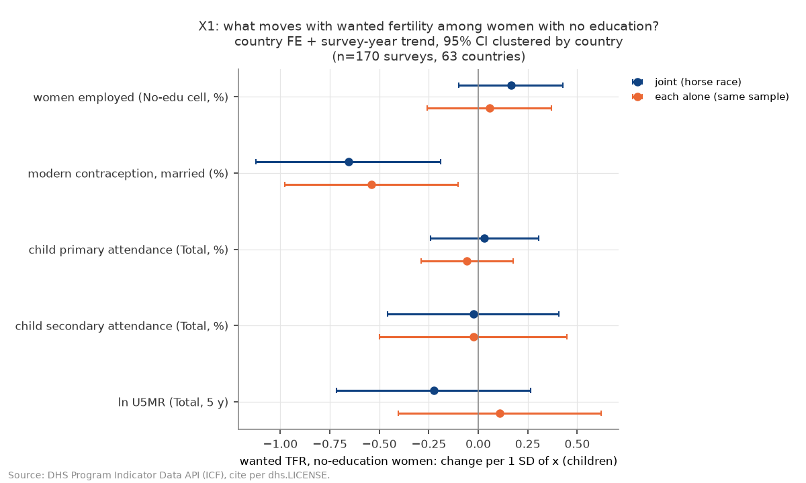
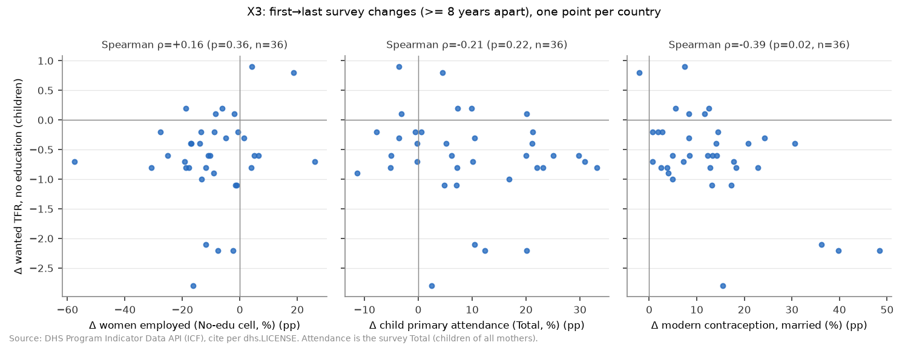
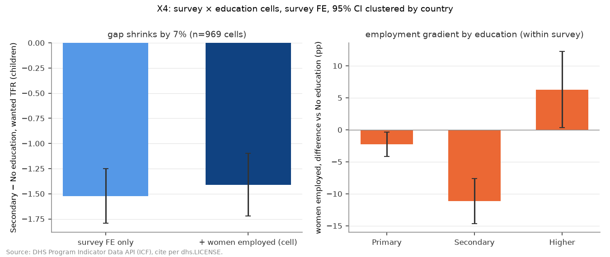
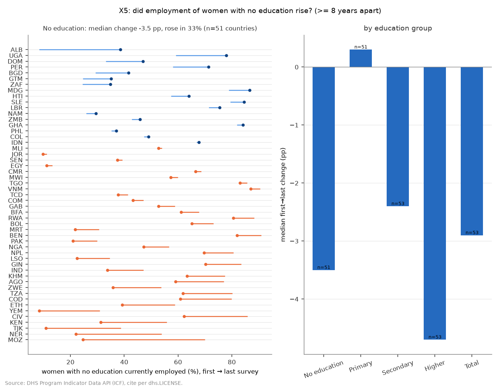

# H8b: 学歴群の中で「望む出生」が下がったのは何と並走していたか（2026-10-18, theme: growth-fertility）

## 要約（5 行）
- **事前に固定した判定規則に従うと、教育なし群の望む数と最も強く並走する候補は C（避妊・小家族規範の普及）である。** 主検定 X1（教育なしセルの wanted TFR、国 FE ＋ 年トレンド、170 調査・63 か国）で CI が 0 を含まない変数は、教育なし既婚女性の近代的避妊実行率だけだった。1 SD（17 ポイント）高いと、望む出生は 0.66 人少ない [−1.12, −0.19]。整合性の確認 X2（調査全体）と X3（first→last の変化）も同じ C を選び、食い違いはなかった。
- **W（女性の就業・現金収入）は成り立たない。** X1 の就業の係数は +0.17 [−0.10, +0.43] で、符号も予想と逆だった。さらに X5 では、教育なし女性の就業率は first→last で中央値 −3.5 ポイント下がり、上がった国は 51 か国中 17 か国（33%）にとどまる。調査内で比べても、就業を加えたときの学歴差 g_w の縮みは 7%（−1.52 → −1.41 人）で、就業の係数も 0 を含んだ（X4）。現金収入のある既婚女性の割合（X2 の頑健性）を使っても、関連は確かめられない。
- S（子どもの初等・中等就学率）と U（ln U5MR）の係数は、どの仕様でも CI が 0 を含んだ。
- 判定は、事前リストの頑健性（就学率を片方ずつ、1999 年以降、DHS 調査のみ、国ごと等加重、X2 を現金収入に差し替え）のすべてと、実装時に足した within-SD での標準化でも変わらない。
- これは**事後追加**の検証で、H8 の判定（M1〜M5 のスコアカード・最終仮説の文）は変えない。識別は固定効果による並走の比較だけである。近代的避妊は「家族計画の供給」と「少なく産みたいという需要の表れ」を区別できないので、C が選ばれたことは「避妊の普及が望む数を下げた」という因果を示さない。

## 問いと仮説
`design/themes/growth-fertility.md` の「### H8b（事後追加 2026-10-18）」。H8 の探索的 E10（Kitagawa 分解）で、望む出生の低下の約 3 分の 2 が学歴構成の変化ではなく各学歴群の中で起きていた（教育なし群の中央値 −0.75 人）。その群内の低下が何と並走したかを、次の 4 候補で比べる。

| 記号 | 候補 | 主に見る変数 |
|---|---|---|
| W | 女性の就業・現金収入（機会費用） | `women_employed`（教育なしセル）、`married_cash_employed` |
| S | 子どもの就学（数より質） | `child_primary_attendance`・`child_secondary_attendance`（調査 Total） |
| C | 避妊・小家族規範の普及 | `modern_contraception_married`（教育なしセル） |
| U | 子どもの死亡率 | ln U5MR（調査 Total、調査前 5 年） |

**推定したい量**（記述的な関連）: 同じ国の中で年トレンドを除いたとき、各候補の変数が 1 SD 動くと、教育なし女性の wanted TFR が何人動くか（標準化 within 係数）。

**事後追加であること**: H8 の結果を見た後に立てた検証で、ユーザーの仮説（W）を対抗候補と並べたものである。検定 X1〜X5・判定規則・頑健性リストは、追加データ（DHS の就業・収入形態・子どもの就学）を見る前に design に固定した。結果は H8 の M1〜M5 の判定を変えない。

**判定規則の運用の細則**（design には「X1 と食い違えば」とだけあるので、結果を見る前に `decide` の docstring とテストで固定した）:
- X2 は候補変数（就業 2 本・就学 2 本・避妊・ln U5MR）の中から X1 と同じ規則で選ぶ（`women_secondary_plus` は統制変数なので候補にしない）。X3 は |ρ| が最大で p < 0.05 の変数を選ぶ。どちらも、**別の**候補を選んだときだけ「食い違い」とする。何も選ばない場合は食い違いとしない。
- X4 は W についてだけ判定する。X1 が W を選んだのに X4 が W を支持しないとき（調査内で就業の係数が CI < 0 ではない、または g_w が縮まない）は「食い違い」とする。
- 選択規則は |係数| の大きさだけで決まり、符号の条件はない（design どおり）。選ばれた変数の符号は stdout に別に出す。

## データ
| 変数 | 出典 | 定義・単位 | 期間・国 | 備考（欠損・断絶） |
|---|---|---|---|---|
| `wanted_tfr`（教育なしセル／Total） | DHS `PR_WTFR_W_WFR` | 望む出生だけで数えた TFR、人 | H8 と同じ（DHS 型の調査のみ） | 被説明変数 |
| `women_employed` | DHS `EM_EMPL_W_EMC` | 過去 12 か月に働き、現在も働いている女性 15–49 の割合、% | 262 調査・76 か国、1994–2024。Total / Education（1,022 セル）/ Wealth quintile（1,310 セル） | 農業・家族従業・無償労働を含む。DHS の就業質問は版で変わりうる（限界を参照） |
| `married_employed` | DHS `EM_EMPM_W_EMP` | 既婚女性の過去 12 か月の就業率、% | 254 調査・77 か国、1994–2024 | Total のみ |
| `married_cash_only` / `married_cash_inkind` | DHS `EM_ERNM_W_CSH` / `EM_ERNM_W_CAK` | 就業した既婚女性のうち、現金のみ／現金＋現物で報酬を得た割合、% | 204 / 202 調査、1999–2024 | Total のみ |
| `married_cash_employed`（派生） | 上の 3 つ | `married_employed × (cash_only + cash_inkind) / 100`、現金収入のある既婚女性の割合 % | 202 調査（中央値 44.9%、5.3–85.7） | どれかが欠ければ欠損 |
| `married_noncash_employed`（派生、探索的） | 同上 | `married_employed − married_cash_employed`（無償・現物のみ）、% | 同上 | E1 のみ |
| `child_primary_attendance` / `child_secondary_attendance` | DHS `ED_NARP_B_BTH` / `ED_NARS_B_BTH` | 世帯調査による初等・中等の純就学率（男女計）、% | 182 調査・68 か国、**1999–2025** | 調査 Total のみ（親の学歴別はない） |
| `modern_contraception_married` | DHS `FP_CUSM_W_MOD` | 既婚女性の近代的避妊実行率、%（教育なしセル／Total） | H8 と同じ | 需要と供給の両方を反映 |
| ln U5MR | DHS `CM_ECMR_C_U5M` | 調査前 5 年の 5 歳未満死亡率（出生千対）の対数 | H8 と同じ | 調査 Total |
| `women_secondary_plus` | DHS `ED_EDUC_W_SEH` | 女性 15–49 のうち中等以上の割合、% | H8 と同じ | X2 の統制変数 |

mart: `data/marts/dhs_mechanisms.parquet`（26,270 行、374 調査、87 か国、23 metric、long、キー一意。2026-10-17 取得）と、地域ラベル用の `data/marts/growth_fertility_panel.parquet`。H8 の `survey_table` / `cell_table` は H8 スクリプトを変更せずに呼ぶ。新しい metric は、両関数の pivot（Total 系・Education）に自動で列として入る。派生列は本スクリプトの `add_derived` で計算する。

**推定標本**: X1 の全変数がそろう教育なしセルは **170 調査・63 か国、1999–2024 で、すべて DHS 型の調査**である（就学率が 1999 年以降にしかなく、wanted TFR が DHS 型にしかないため）。X2 は 173 調査・66 か国（同じく 1999–2024、DHS のみ）。このため頑健性の「1999 年以降」と「DHS 調査のみ」は、X1・X2 では主仕様と**同じ標本**になる（下の表に明記）。X1 標本の平均は、wanted TFR 4.33 人（SD 1.55）、就業 54.6%（SD 22.1）、近代的避妊 24.1%（SD 17.4）、初等就学 73.8%（SD 15.1）、中等就学 40.9%（SD 20.1）、ln U5MR 4.18（SD 0.62、U5MR 約 65）。

## 方法
- **X1（主）**: `wanted_tfr(教育なし) ~ emp + mcpr + att_pri + att_sec + ln_u5 + C(iso3) + survey_year`。OLS、SE は国クラスタ（H1 の `fit`）。説明変数は推定標本の中で平均を引いて SD で割る（係数 = 1 SD あたりの人数）。各変数を 1 本ずつ入れた版を、同じ標本と各変数の最大標本の両方で推定した。
- **X2**: `wanted_tfr(Total) ~ cash_emp + emp_tot + att_pri + att_sec + mcpr + ln_u5 + sec + 国 FE + 年トレンド`。design は `married_cash_employed` と `women_employed` の両方を挙げ、頑健性で「代わりに」と書いている。そこで主仕様は両方を入れ、頑健性で片方ずつにした。
- **X3**: 教育なし群について、国ごとに最初と最後の調査（8 年以上離れたもの）で Δwanted と Δemp・Δatt_pri・Δmcpr を作り、Spearman 相関をとる。主は 4 変数がそろう共通標本（36 か国）、頑健性は変数ごとの最大標本。
- **X4**: 調査 × 学歴 4 群のセル（wanted と就業がそろう 969 セル、248 調査、75 か国）で、`wanted ~ 学歴ダミー + C(survey_id)` の Secondary − None の差 g_w と、`women_employed` を加えたときの g_w を比べる（縮み = 1 − g_w1/g_w0）。就業の学歴勾配は `women_employed ~ 学歴ダミー + C(survey_id)`。
- **X5**: 教育なし群（参考に他の学歴群と Total も）の `women_employed` の first→last（8 年以上）の変化の中央値と、上昇した国の割合。
- **判定**: 上の「判定規則の運用の細則」のとおり。`decide` が stdout に「SELECTED」を出す。

**仮定**: 国 FE ＋ 線形トレンドを除いた残りの変動について、候補変数どうしの並走の強さを比べられる（どれも同じ第三の要因、たとえば家族計画プログラムや経済発展に引っ張られていれば、その強さは比べられない）。教育なしセルの wanted TFR は、同じ定義で調査をまたいで比べられる。

## 結果

### X1: 教育なし群の望む出生と並走するのは避妊だけ（主検定）


| 変数（1 SD） | 1 SD の大きさ | 同時（horse race） | 1 本ずつ（同じ標本） | 1 本ずつ（最大標本） |
|---|---|---|---|---|
| 就業（教育なしセル） | 22.1 pt | +0.165 [−0.097, +0.428] | +0.056 [−0.259, +0.371] | −0.158 [−0.412, +0.096]（238 調査・70 か国） |
| 近代的避妊（教育なしセル） | 17.4 pt | **−0.656 [−1.124, −0.189]** | **−0.541 [−0.979, −0.103]** | **−0.602 [−0.887, −0.317]**（306・80） |
| 子どもの初等就学率 | 15.1 pt | +0.031 [−0.242, +0.304] | −0.057 [−0.289, +0.175] | −0.028 [−0.267, +0.210]（175・66） |
| 子どもの中等就学率 | 20.1 pt | −0.025 [−0.457, +0.406] | −0.024 [−0.498, +0.449] | −0.073 [−0.550, +0.403]（175・66） |
| ln U5MR | 0.62 | −0.226 [−0.717, +0.265] | +0.108 [−0.406, +0.622] | +0.241 [−0.127, +0.608]（310・83） |

n = 170 調査、63 か国、within の外を含む R² = 0.954。年トレンドは −0.023 人/年 [−0.070, +0.024]。単位は人（wanted TFR）、95% CI は国クラスタ。

CI が 0 を含まないのは近代的避妊だけで、3 つの版すべてでそうだった。就業は同時推定で正（予想と逆）、最大標本では負だが CI は 0 を含む。

### X2: 調査全体でも避妊だけ
173 調査・66 か国。近代的避妊 −0.550 [−0.894, −0.206]。現金収入のある既婚女性 +0.103 [−0.112, +0.318]、就業（Total）+0.066 [−0.120, +0.252]、初等就学 −0.015 [−0.149, +0.118]、中等就学 +0.080 [−0.227, +0.387]、ln U5MR −0.065 [−0.326, +0.195]、統制の女性中等以上割合 −0.369 [−0.905, +0.167]。1 本ずつ入れても、CI が 0 を含まないのは避妊だけだった（−0.435 [−0.684, −0.185]）。→ C。

### X3: first→last の変化でも避妊の相関が最大


教育なし群、共通標本 36 か国（Δwanted の中央値 −0.60 人）。
| Δ | 中央値 | Spearman ρ（Δwanted との） | p |
|---|---|---|---|
| 就業（教育なし） | −9.7 pt | +0.157 | 0.359 |
| 子どもの初等就学率 | +7.3 pt | −0.209 | 0.220 |
| 近代的避妊（教育なし） | +12.4 pt | **−0.391** | **0.019** |

→ C。変数ごとの最大標本（頑健性）では、就業も ρ = −0.311（p = 0.028、50 か国）と、W の予想どおりの向きで有意になる。それでも避妊の相関（ρ = −0.506、p < 0.001、53 か国）のほうが大きく、選ばれる候補は C のまま。共通標本では就業の符号が逆になるので、就業の相関は標本の取り方に依存する。

### X4: 就業は学歴差を説明しない


969 セル・248 調査・75 か国。g_w（Secondary − None）は −1.522 [−1.794, −1.249] で、就業を加えると −1.410 [−1.721, −1.100] になる（縮み 7.3%）。調査内の就業の係数は、1 ポイントあたり +0.0100 [−0.0017, +0.0216] で、符号は正、CI は 0 を含む。就業の学歴勾配は単調ではない。教育なしと比べて、初等 −2.3 pt [−4.2, −0.4]、中等 −11.2 pt [−14.7, −7.6]、高等 +6.3 pt [+0.3, +12.2]。中等教育の女性は教育なしの女性より**働いていない**ので、「学歴が上がると働き、望む数が下がる」という経路はこの指標では見えない。→ W を支持しない（X1 が W を選んでいないので、判定には効かない）。

### X5: 教育なし女性の就業率は上がっていない


| 群 | 国数 | Δ の中央値（pt） | 上昇した国 | 最初の調査の水準（中央値） |
|---|---|---|---|---|
| 教育なし | 51 | **−3.5** | 17（33%） | 57.6% |
| 初等 | 51 | +0.3 | 26（51%） | 53.2% |
| 中等 | 53 | −2.4 | 19（36%） | 44.8% |
| 高等 | 53 | −4.7 | 15（28%） | 62.1% |
| Total | 53 | −2.9 | 20（38%） | 51.8% |

W が選ばれるための前提（教育なし群の就業率が中央値で上昇）が満たされない。

### 判定
| 検定 | 選んだ候補 |
|---|---|
| X1（主） | **C**（近代的避妊、−0.656 人/SD） |
| X2 | C |
| X3 | C |
| X4 | W を支持しない（W が選ばれていないので判定には使わない） |
| X5 | 教育なし群の就業率の中央値 −3.5 pt（W の前提を満たさない） |

**判定: 教育なし群の望む数と最も強く並走する候補は C（避妊・小家族規範の普及）である。**

## 頑健性
事前リストの全部（X1 規則で選ばれる候補）。

| 仕様 | n（調査・国） | 近代的避妊 | 就業 | 選ばれる候補 |
|---|---|---|---|---|
| X1 主 | 170・63 | −0.656 [−1.124, −0.189] | +0.165 [−0.097, +0.428] | C |
| X1 初等就学率だけ | 170・63 | −0.655 [−1.127, −0.182] | +0.165 | C |
| X1 中等就学率だけ | 170・63 | −0.649 [−1.097, −0.201] | +0.163 | C |
| X1 1999 年以降 | 170・63（**主と同じ標本**） | 同上 | 同上 | C |
| X1 DHS 調査のみ | 170・63（**主と同じ標本**） | 同上 | 同上 | C |
| X1 国ごと等加重（WLS） | 170・63 | −0.572 [−1.141, −0.004] | +0.159 [−0.129, +0.446] | C（CI の上端は 0 に近い） |
| X2 主 | 173・66 | −0.550 [−0.894, −0.206] | cash +0.103、emp +0.066 | C |
| X2 現金収入だけ（就業を外す） | 173・66 | −0.554 [−0.885, −0.222] | cash +0.132 [−0.062, +0.326] | C |
| X2 就業だけ（現金収入を外す） | 176・67 | −0.487 [−0.764, −0.210] | emp +0.110 [−0.071, +0.291] | C |
| X2 初等就学率だけ／中等就学率だけ | 173・66 | −0.546 / −0.551 | — | C / C |
| X2 1999 年以降・DHS のみ | 173・66（主と同じ標本） | 同上 | 同上 | C |
| X2 国ごと等加重 | 173・66 | −0.500 [−0.848, −0.152] | cash +0.074、emp +0.070 | C |
| X3 変数ごとの最大標本 | 50 / 37 / 53 か国 | ρ −0.506（p < 0.001） | ρ −0.311（p = 0.028） | C |
| X3 1999 年以降 | 36 か国（主と同じ） | ρ −0.391 | ρ +0.157 | C |
| X4 国ごと等加重 | 969 セル | — | +0.0152/pt [+0.0048, +0.0257]（**正で有意**）、縮み 10.5% | W を支持しない |
| X4 1999 年以降 | 838 セル・73 か国 | — | +0.0107 [−0.0012, +0.0226]、縮み 8.5% | W を支持しない |
| （実装時に追加）X1 within-SD で標準化 | 170・63 | −0.266 [−0.455, −0.077]（within SD 7.0 pt） | +0.055 [−0.032, +0.142] | C |

判定はどの仕様でも変わらない。注意点が 2 つある。(1) 国ごと等加重の X1 では、避妊の CI の上端が −0.004 で、0 にほぼ接する。(2) X1・X2 の「1999 年以降」「DHS のみ」は標本が主仕様と同じなので、検査になっていない。within-SD 版を足したのは、国 FE の回帰が実際に使う変動（国内の SD は全体の SD の 3 分の 1 程度）で比べても順位が変わらないかを見るためで、design のリストにはない。

## 探索的（事後、判定外）
結果を見た後に足した検定で、判定には入れていない。

- **E1 就業の種類（現金 vs 無償・現物のみ）**: Total の wanted TFR に、現金収入のある既婚女性 +0.131 [−0.039, +0.302] と、現金なしで働く既婚女性 +0.057 [−0.086, +0.200] を同時に入れた（198 調査・68 か国）。どちらも 0 を含み、符号も正である。近代的避妊は −0.565 [−0.842, −0.288]。「現金収入を得る就業」に絞っても、W の向きの関連は見えない。
- **E2 富裕五分位**: 最も貧しい五分位のセル（239 調査・74 か国）では、同じ五分位の就業が −0.204 [−0.448, +0.040] で、W の向きだが CI は 0 を含む。最も豊かな五分位では +0.098 [−0.098, +0.294]。避妊（Total）はどちらでも有意だった（−0.328、−0.500）。調査 FE ＋ 五分位ダミーで調査内を比べると、就業の係数は +0.0100/pt [−0.0016, +0.0216] だった（1,200 セル）。最も貧しい層でだけ、W の向きの弱い関連が残る可能性がある。この点は検出力の範囲で未確定である。
- **E3 実際の TFR**: X1 と同じ式を教育なし群の TFR で推定すると、避妊 −0.661 [−1.127, −0.194]、就業 +0.078 [−0.249, +0.405] で、wanted と同じ形になった。
- **E4 就業の富裕勾配**: 女性の就業率の中央値は、最も貧しい五分位 50.4%、最も豊かな五分位 52.5% で、ほぼ平らだった。DHS の「就業」は、豊かさによる現金就業と、貧困による農業・家族従業が混ざった指標だと読める。
- **E5 就業率の低下は最近の調査に偏るか**: 教育なし群の就業率の first→last の変化は、最後の調査が 2014 年より前の国（9 か国）で中央値 −3.4 pt、2014 年以降の国（42 か国）で −4.8 pt だった。どちらも低下しているが、前者は 9 か国しかなく、質問票の変更による低下かどうかは判別できない。

## 限界・言えないこと
1. **並走は因果ではない。** 近代的避妊・就業・就学はどれも、家族計画プログラムや経済発展と同時に動く。とくに近代的避妊は「少なく産みたい女性が避妊する」（需要の表れ）と「避妊が手に入るので少なく望むようになる」（供給・規範）を区別できない。wanted TFR は実際の出生から数えるので、避妊で出生間隔が延びると、望む出生の数え上げ自体も機械的に下がる。したがって「C が選ばれた」は、「教育なし群の望む数の低下は家族計画・小家族規範の普及と最もよく並走した」という記述であり、「避妊の普及が望む数を下げた」という主張ではない。
2. **W を退けた根拠は DHS の就業指標の定義に依存する。** 指標は「過去 12 か月に働き、現在も働いている」で、農業・家族従業・季節労働を含む。X4 の就業の学歴勾配が U 字であること（中等で最も低い）と、E4 の富裕勾配が平らであることから、この指標は「機会費用の高い就業」をよく測っていない可能性がある。現金収入（`married_cash_employed`）でも関連は見えなかったが、これは既婚女性の Total だけで、教育なし群の値はない。就業の質問は DHS の版で変わりうるので、X5 の低下の一部が測定の変化である可能性も排除できない（E5）。
3. **期間と標本**: 就学率は 1999 年以降にしかなく、X1 は 1999–2024 の DHS 型の調査 170 本に限られる。教育なし群の望む数が大きく下がった 1980〜90 年代は見えない。就業指標は 1994 年以降。63 か国の多くはサハラ以南アフリカと南アジアなので、他地域への一般化はできない。
4. **レベルの混在**: X1 の就業・避妊は教育なしセルの値、就学率・U5MR は調査 Total の値である。子どもの就学率は親の学歴別ではないので、S は「教育なしの親の子どもの就学」を直接測っていない。どの結果も調査（国 × 年）× 学歴セルのレベルの関連で、個人の行動に読み替えない。
5. **判定規則の細則**（「食い違い」の運用、X4 の扱い）は design に書かれておらず、実装時に結果を見る前に固定した。X2・X3・X4 はどれも C と食い違わなかったので、細則の選び方は今回の結論に影響しない。

## 再現手順
```bash
uv run socioscope run growth-fertility fetch && uv run socioscope run growth-fertility stage && uv run socioscope run growth-fertility mart
uv run python themes/growth-fertility/src/theme_growth_fertility/analysis/a20261018_h8b_within_group.py \
  > themes/growth-fertility/reports/2026-10-18-h8b-within-group.stdout.txt
uv run pytest themes/growth-fertility/tests/test_analysis_h8b.py
```
乱数は使っていない。2 回実行して、stdout と 4 枚の PNG の sha256 が一致することを確認した（PNG は `metadata={"Software": None}`）。数値の出所はすべて `2026-10-18-h8b-within-group.stdout.txt`。出典表記: DHS Program Indicator Data API（ICF）、`dhs.LICENSE` の文言に従う。

## チェックリスト回答
- **A 問いと事前登録**: H8b は H8 の結果（E10）を見た後の**事後追加**で、そのことを冒頭と要約に明記した。候補・X1〜X5・判定規則・頑健性・言えないことは、追加データを見る前に design（2026-10-18）に固定した。「食い違い」の細則は design に無いので、実装時に結果を見る前にコードとテストで固定し、本文に書いた。E1〜E5 と within-SD 版は探索的・判定外と明記した。推定量は記述的な関連（標準化 within 係数・Spearman 相関・調査内の差の縮み）。H8 の M1〜M5 の判定は変えていない。
- **B データ**: 新しい 6 metric の DHS IndicatorId・定義・単位・期間・調査数と、派生列の式を「データ」表に書いた。欠損は補完せず listwise。就学率が 1999 年以降のみ、wanted が DHS 型のみなので、「1999 年以降」「DHS のみ」の頑健性が主仕様と同じ標本になることを明記した。
- **C 識別戦略**: 国 FE ＋ 線形トレンド（X1・X2）、調査 FE（X4）、first→last の変化の相関（X3）だけで、自然実験はない。同時に動く第三の要因（家族計画プログラム・経済発展）、避妊と望む数の逆の因果（需要の表れ）、wanted TFR の機械的な減少、就業指標の定義を限界に挙げた。結果はすべて調査 × 学歴セルのレベルで、個人に読み替えていない（セルの値と調査 Total の値が混在する点も明記）。
- **D 推定と不確実性**: SE は国クラスタ（同じ国の調査は相関するため）。X1 は同時・1 本ずつ（同じ標本・最大標本）を全部載せ、事前リストの頑健性を X1・X2・X3・X4 についてすべて報告した。国ごと等加重で避妊の CI が 0 に近づくことと、X3 の就業の相関が標本で符号を変えることを書いた。Spearman の p 値は 3 本の比較で多重性を補正していない。
- **E 書き方**: 要約の第 1 文は判定規則の結果を断定形で書き、「並走する候補」と表現した。因果効果とは書いていない。図は軸・単位・出典・n を記載した（対数軸はない。ln U5MR は変数として対数）。限界節は 5 項目。再現手順と mart の行数・調査数を書いた。LLM 構造化は使っていない。
