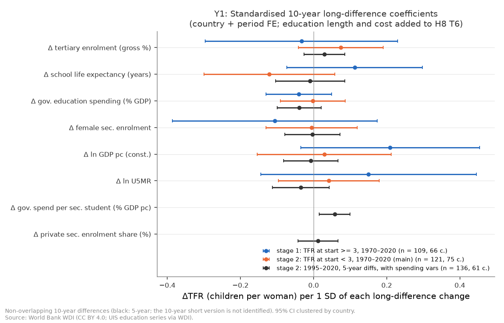
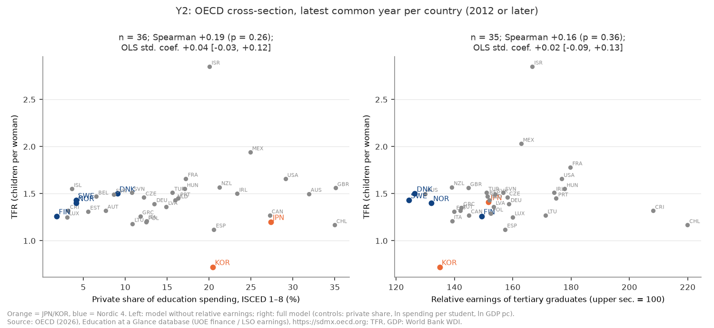
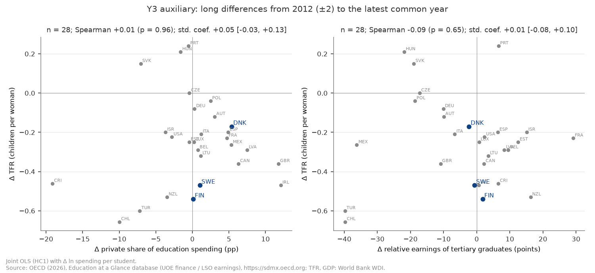
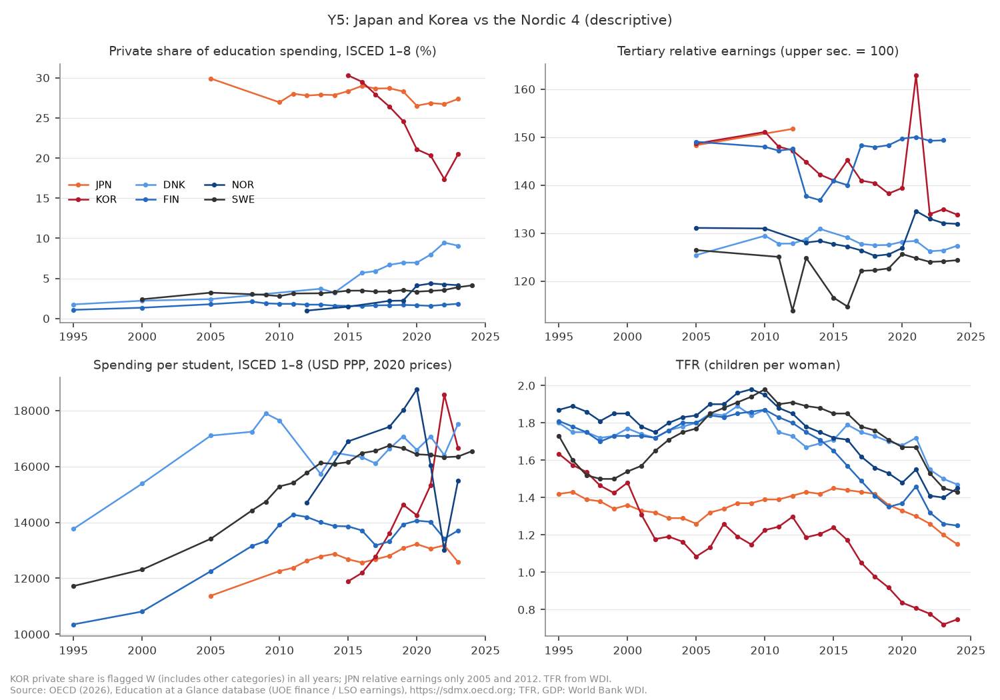

# H8c: 子ども一人当たりの教育投資と学歴社会の圧力は、2 人未満への低下を説明するか（2026-10-18, theme: growth-fertility）

## 要約（5 行）
- **事前に固定した判定規則に従うと、仮説 Q は「不支持」である。2 人未満への低下は、学歴社会の圧力でも説明できない（教育の長さ・家計の教育費負担・学歴による賃金差のどれも、事前に決めた条件を満たさない）。要因は本シリーズの変数の外にある。**
- 全世界（Y1、WDI の 10 年長期差分、開始 TFR < 3、121 区間・75 か国）で、期待就学年数の標準化係数は −0.121 [−0.300, +0.058]、高等教育進学率は +0.074 [−0.042, +0.191] だった。どちらも CI が 0 を含む。政府の教育支出（−0.002）、女子の中等就学率（−0.005）、所得、死亡率も同じく CI が 0 を含む。
- OECD（Y2 横断 35 か国、Y3 within 2005–2023、319 国・年・35 か国）で、私的負担割合の係数は Y2 で +0.055 [−0.021, +0.131]、Y3 で +0.069 [−0.034, +0.172] だった。相対賃金は Y2 で +0.017 [−0.094, +0.129]、Y3 で −0.022 [−0.092, +0.049]。どれも CI が 0 を含む。私的負担割合の点推定はむしろ正で、日本・韓国は「家計負担が大きく出生率が低い」側にいる。しかし英語圏・チリも家計負担が大きく、北欧は負担が小さいまま 2010 年代に TFR が大きく下がった（図 Y5、探索的 E5）。
- 判定は事前リストの頑健性 15 仕様（Y1 8、OECD 7）のすべてで「不支持」のまま変わらない。ただし 2 つの仕様では判定対象の変数が**逆向き**（正で CI が 0 を含まない）になった。段階の境界 3.5 の高等教育進学率 +0.114 [+0.013, +0.215] と、ISCED 1–4 の Y3 の私的負担割合 +0.072 [+0.003, +0.142] である。主仕様に逆向きはない。
- これは**事後追加**の検証で、H8 の判定（M1〜M5 のスコアカード・最終仮説の文）は変えない。識別は固定効果と長期差分による並走の比較だけで、因果は主張しない。「不支持」は「関連が確かめられない」という意味で、「教育費は出生率に影響しない」ことを示すものではない（検出力・指標の限界は後述）。

## 問いと仮説
`design/themes/growth-fertility.md` の「### H8c（事後追加 2026-10-18）」。H8 で、3 人前後から 2 人未満へ下がる段階は死亡率・所得・初婚年齢では説明できなかった。女子就学率が脆い候補として残っただけである。そこでユーザーの仮説「子ども一人当たりの教育費の増加（学歴社会・能力主義社会の副作用）」を検証する。

**仮説 Q（数より質の圧力）**: 子どもに長く・多く教育を与えることが当たり前になり（期待就学年数・高等教育進学率の上昇）、その費用の多くを家計が負担し（私的教育支出の割合・% GDP）、学歴による賃金差が大きい（高等教育修了者の相対賃金）社会ほど、子ども 1 人の費用が高く、望む数・出生率が低い。

**推定したい量**（記述的な関連）: (Y1) 開始時 TFR < 3 の 10 年区間で、教育の長さの変化が 1 SD 大きいと ΔTFR が何人違うか（国＋期間 FE の標準化係数）。(Y2) OECD の最新年の横断で、私的負担割合・相対賃金が 1 SD 高い国の TFR の差。(Y3) 同じ国の中でそれらが 1 SD 動いたときの TFR の差（国＋年 FE）。

**事後追加であること**: H8・H8b の結果を見た後に立てた検証である。検定 Y1〜Y5・判定規則・最終スタンスの文型・頑健性リスト・言えないことは、追加データ（WDI の教育 6 指標、OECD Education at a Glance）を見る前に design に固定した。H8 の M1〜M5 の判定は変えない。

**判定規則の運用の細則**（design の文言を結果を見る前に実装で固定した。`global_side`・`oecd_side` の docstring とテスト）:
- 「全世界」: Y1 主仕様の段階 2 で、Δ高等教育進学率または Δ期待就学年数が負で CI が 0 を含まないこと。さらにその |b| が、同じ式の**他の全変数**の |b| 以上であること。他の変数の CI が 0 を含むかどうかは問わない。
- 「OECD」: Y2 主仕様（相対賃金ありの 4 変数）または Y3 主仕様で、私的負担割合または相対賃金が負で CI が 0 を含まないこと。「Y2 と Y3 で符号が食い違えば不成立」は、**もう一方の検定の点推定が正**ならその変数を数えない、と運用した。Spearman と相対賃金なし版・長期差分（Y3 補助）は判定に使わない。
- 「最新年」: 各国について、式の変数（TFR を含む）が**すべて**そろう 2012 年以降の最も新しい年を使う。国ごとに年が違ってよい。選んだ年は stdout に全部出した（主仕様は 2012–2024、中央値 2023。日本は相対賃金のため 2012）。
- 「逆向き」: 判定対象の 4 変数のどれかが正で CI が 0 を含まない場合に明記する。一人当たり支出は機械的な逆因果（子どもが少ないほど 1 人当たりが増える）を含むので、判定に使わない。

## データ
| 変数 | 出典 | 定義・単位 | 期間・国 | 備考（欠損・断絶） |
|---|---|---|---|---|
| `tert_enrol` | WDI `SE.TER.ENRR`（UIS） | 高等教育の総就学率、% | 5,353 国・年、203 か国、1970–2025 | Y1・Y4 |
| `school_life_exp` | WDI/EdStats `SE.SCH.LIFE`（UIS） | 期待就学年数（初等〜高等）、年 | 4,861 国・年、200 か国、1970–2019 | 2019 で終わるので、2010→2020 区間の端点は 2018–2019 の最近傍 |
| `educ_exp_gdp` | WDI `SE.XPD.TOTL.GD.ZS` | 政府教育支出、% GDP | 5,125 国・年、203 か国、1970–2025 | 政府支出のみ（家計は含まない） |
| `spend_per_student_sec` | WDI `SE.XPD.SECO.PC.ZS` | 中等の生徒 1 人当たり政府支出、一人当たり GDP 比 % | 1,442 国・年、167 か国、1995–2018 | Y1 短標本・Y4。判定外 |
| `private_sec_share` | WDI `SE.SEC.PRIV.ZS` | 中等教育の私立在籍割合、% | 3,060 国・年、196 か国、1998–2025 | Y1 短標本。判定外 |
| `tfr`, `fem_sec_enrol`, `gdp_pcap_const`, `u5_mortality`, `smam_fe` | WDI | H8 T6 と同じ | — | SMAM は H8 の整形規則（194 件除外）。主仕様には入れず頑健性で加える |
| `gdp_pcap_ppp` | WDI `NY.GDP.PCAP.PP.KD` | 一人当たり GDP（PPP） | 1990– | Y2 の統制 |
| 私的負担割合 `priv` | OECD EAG `DF_UOE_FIN_SOURCE_GV_PR_NDOM` | `PT_EXP`・`S1D_NON_EDU`・ISCED 1T8: 教育機関支出のうち民間（家計＋その他民間）の割合、% | 479 国・年、36 か国、1995–2024（2012 年以降が中心） | `obs_status=W`（他区分を含む）が 59 件、14 か国（JPN・KOR・FIN 等）。**KOR は全年 W で 2015 30.3 → 2022 17.4 と単調に下がる（定義改訂の疑い）**。頑健性で 1T4・5T8、% GDP（`PT_B1GQ`）版 |
| 相対賃金 `rel` | OECD EAG `DF_LSO_EARN_REL_UPPER` | 25–64 歳就業者、高等教育修了（ISCED 5–8）の賃金、後期中等 = 100、性 `_T`・労働時間 `_T` | 454 国・年、37 か国、2000–2025 | **JPN は 2005・2012 のみ**、ISL なし。KOR は 2021 に 163 へ跳ねる（図 Y5）。頑健性でフルタイム（`FT`）・女性（`F`） |
| 一人当たり支出 `spend` | OECD EAG `DF_UOE_INDIC_FIN_PERSTUD` | FTE 学生 1 人当たり支出、ISCED 1T8、2020 年不変価格 USD PPP（`Q`） | 521 国・年、38 か国、1995–2024 | 統制のみ（判定外）。対数で使う |
| DHS（Y4） | `dhs_mechanisms`（H8b の `total_frame`） | Total の wanted TFR ほか H8b X2 の 7 変数 | 76 調査・43 か国（Y4 の listwise 標本） | 調査年の ±2 年で最も近い WDI 値を付けた（同距離は早い年） |

mart: `data/marts/growth_fertility_panel.parquet`（217 経済 × 1960–2025 = 14,322 行、27 列）、`data/marts/oecd_education_finance.parquet`（28,329 行、38 か国、1995–2025、long。3 dataset を結合しキー一意。2026-10-17 取得）、`data/marts/dhs_mechanisms.parquet`（26,270 行）。生成は `uv run socioscope run growth-fertility fetch && … stage && … mart`。OECD の標本は加盟 38 か国に限る（mart で限定済み）。LLM 構造化は使っていない。

## 方法
- **Y1（主、全世界）**: H8 T6 と同じ枠である。1970→1980→…→2020 の重ならない 10 年差分をとり、端点は ±2 年の最近傍の観測とする（`h8.long_diff_nearest`）。区間開始の TFR で段階 1（≥ 3）と段階 2（< 3）に分ける。式は `ΔTFR ~ Δtert + Δschool_life_exp + Δeduc_exp_gdp + Δfem_sec_enrol + Δln GDP(const) + Δln U5MR + C(iso3) + C(period)` で、国クラスタ SE を使う。説明変数は段階の推定標本の SD で割る（H8 `t6_stage` をそのまま使用）。短標本版は `Δspend_per_student_sec`・`Δprivate_sec_share` を加え、1995→2005→2015 の区間で推定する。
- **Y2（OECD 横断）**: 各国の最新の共通年で `tfr ~ priv + rel + ln spend + ln GDP(PPP)` を推定する。OLS・HC1 で、説明変数は標本の SD で標準化した。Spearman も出す。日本は相対賃金が 2012 年までしかないので、相対賃金を外した版（36 か国、ほぼ 2023 年）も出す。
- **Y3（OECD within）**: 2005–2023 の年次データで `tfr ~ priv + rel + ln spend + C(iso3) + C(year)` を推定する。国クラスタ SE で、説明変数はプールした SD で標準化した。補助として、2012（±2 年）から最新の共通年までの長期差分の横断（間隔 5 年以上、HC1）をとる。
- **Y4（段階 1 の補足、判定外）**: H8b の X2（Total の wanted TFR、国 FE ＋ 調査年トレンド、標準化）に、調査年の `spend_per_student_sec` と `tert_enrol` を加える。
- **Y5（記述）**: 日本・韓国と北欧 4 か国の私的負担割合・相対賃金・一人当たり支出・TFR の推移を図にする。

**仮定**: 国 FE と期間（年）FE を除いた残りの変動は、同時に動く他の要因（住宅費、労働市場、結婚の規範など）と相関しない。これは検証できない強い仮定で、満たされなくても本稿の結論は「関連が見えない」以上のことを言わない。教育の長さ（進学率・就学年数）は家計の教育費の**代理**であって、費用そのものではない。

## 結果

### Y1: 全世界・段階 2 — 教育の長さ・教育費の伸びは TFR の低下と並んでいない


| 変数（10 年差分、1 SD あたり） | 段階 2 主仕様（121 区間・75 か国） | 段階 1（109 区間・66 か国） | 短標本 5 年差分（136 区間・61 か国） |
|---|---|---|---|
| Δ高等教育進学率 | +0.074 [−0.042, +0.191] | −0.033 [−0.296, +0.230] | +0.029 [−0.026, +0.085] |
| Δ期待就学年数 | **−0.121** [−0.300, +0.058] | +0.112 [−0.073, +0.297] | −0.009 [−0.104, +0.085] |
| Δ政府教育支出 % GDP | −0.002 [−0.090, +0.087] | −0.040 [−0.130, +0.050] | −0.040 [−0.100, +0.020] |
| Δ女子中等就学率 | −0.005 [−0.131, +0.120] | −0.106 [−0.386, +0.173] | −0.004 [−0.079, +0.072] |
| Δln GDP（固定 US$） | +0.029 [−0.154, +0.212] | +0.209 [−0.035, +0.454] | −0.008 [−0.082, +0.067] |
| Δln U5MR | +0.042 [−0.096, +0.180] | +0.150 [−0.145, +0.445] | −0.035 [−0.112, +0.043] |
| Δ中等の生徒 1 人当たり政府支出 | — | — | +0.058 [+0.015, +0.100]（判定外） |
| Δ中等の私立在籍割合 | — | — | +0.012 [−0.043, +0.066] |

単位は ΔTFR（人）。段階 2 で |b| が最大なのは期待就学年数（−0.121）で、向きは仮説どおりだが、CI が 0 を含む。高等教育進学率の点推定は正（伸びた国ほど TFR の低下が小さい側）である。「全世界」の条件は成り立たない。

**短標本版について**: 事前登録どおりの 10 年差分の短標本版（1995→2005→2015）は、listwise 標本の 45 区間がすべて別々の国になった（各国 1 区間）。国 FE を入れると区間内の変動が残らず、SE が計算できない（stdout に `nan`）。これは**推定不能**として報告する。代わりに、同じ変数で 5 年差分（1995–2020、61 か国、うち 43 か国が 2 区間以上）を運用上の代替として推定した。この代替は 10 年版が推定不能と分かった後に選んだもので、判定には使っていない。そこでは中等の生徒 1 人当たり政府支出が**正**で CI が 0 を含まない。ただしこの変数は判定外である。「子どもが減ると 1 人当たりが増える」という逆向きの機械的関係とも、この向きは合わない。

### Y2: OECD 横断 — 家計負担・賃金差が大きい国ほど TFR が低い、という関係はない


| 変数（1 SD あたり、TFR 人） | Y2 主仕様（35 か国、HC1） | Spearman ρ（同標本） | 相対賃金なし版（36 か国） |
|---|---|---|---|
| 私的負担割合（SD 9.3 ポイント） | +0.055 [−0.021, +0.131] | +0.295（p = 0.085） | +0.042 [−0.035, +0.120]、ρ +0.192（p = 0.263） |
| 相対賃金（SD 20.7） | +0.017 [−0.094, +0.129] | +0.160（p = 0.359） | — |
| ln 一人当たり支出 | −0.125 [−0.272, +0.022] | +0.004 | −0.115 [−0.264, +0.035] |
| ln GDP（PPP） | +0.088 [−0.027, +0.204] | +0.031 | +0.084 [−0.027, +0.196] |

R² = 0.083。どの係数も CI が 0 を含む。私的負担割合の点推定・順位相関は**正**である。日本（27.4%、TFR 1.20）と韓国（20.5%、0.72）は家計負担が大きく出生率が低い。しかし米・英・豪・チリ・カナダも負担が 27–35% と大きく、TFR は 1.17–1.66 に散らばる。北欧は 1.8–9.1% と負担が小さく、TFR は 1.26–1.50 である。

### Y3: OECD within — 同じ国の中でも並走しない
| 変数（1 SD あたり） | Y3 主仕様（2005–2023、319 国・年・35 か国、国＋年 FE） | Y3 補助: 2012→最新の長期差分（28 か国、HC1） |
|---|---|---|
| 私的負担割合 | +0.069 [−0.034, +0.172] | +0.051 [−0.026, +0.127]、ρ +0.010（p = 0.96） |
| 相対賃金 | −0.022 [−0.092, +0.049] | +0.011 [−0.082, +0.104]、ρ −0.091（p = 0.65） |
| ln 一人当たり支出 | +0.155 [+0.018, +0.292]（判定外） | +0.084 [−0.024, +0.193] |



相対賃金の within 係数は負だが、小さく（−0.022）CI が 0 を含む。Y2 の点推定は正（+0.017）なので、仮に CI が 0 を含まなかったとしても、符号の食い違いで数えない。「OECD」の条件は成り立たない。一人当たり支出は within で正（支出が伸びた年に TFR が高い）だが、判定外である。

### Y4: DHS 段階 1 の補足 — 新しい 2 変数は何も足さない
H8b X2 の標本に `spend_per_student_sec`・`tert_enrol` を付けると、listwise で 76 調査・43 か国になる（中等の 1 人当たり支出が 1995–2018 にしかないため、H8b の X2 より小さい）。加えた 2 変数は、中等の 1 人当たり支出 −0.024 [−0.389, +0.342]、高等教育就学率 +0.021 [−0.530, +0.571] だった。CI が 0 を含まない変数は 1 つもない（同標本の X2 も同じ。避妊は −0.693 [−1.513, +0.128]）。この小標本では、H8b の判定（C）を確かめも覆しもできない。

### Y5: 日本・韓国と北欧（記述）


- 私的負担割合は、日本が 2005–2023 に 27–30% でほぼ横ばいだった。韓国は 2015 の 30.3% から 2022 の 17.4% へ下がったが、全年 `W` で定義改訂の疑いがある。北欧は 1–9% で、デンマークとノルウェーはむしろ上がった（2012→2023: DNK 3.7→9.1、NOR 1.0→4.2）。
- 相対賃金は日本 148→152（2005→2012）、韓国 149→134（2005→2023、2021 の 163 は単年の跳ね）、フィンランド 149 前後、デンマーク・スウェーデン・ノルウェーは 124–134 だった。
- TFR は 2012→2023 に、日本 1.41→1.20、韓国 1.30→0.72、フィンランド 1.80→1.26、ノルウェー 1.85→1.40、スウェーデン 1.91→1.45、デンマーク 1.73→1.50 となった。北欧の低下幅（−0.23〜−0.54）は日本（−0.21）以上で、その間に北欧の家計負担は増えないか、少し増えただけである。

### 判定
| 条件 | 根拠 | 成否 |
|---|---|---|
| 全世界（Y1 段階 2） | 期待就学年数 −0.121 [−0.300, +0.058]、高等教育進学率 +0.074 [−0.042, +0.191]。どちらも CI が 0 を含む | 不成立 |
| OECD（Y2・Y3） | 私的負担割合 +0.055 / +0.069、相対賃金 +0.017 / −0.022。すべて CI が 0 を含む | 不成立 |
| 逆向き | 主仕様ではなし | — |
| **Q** | | **不支持** |

**最終スタンスの文**（stdout の `FINAL STANCE`、事前の文型で機械的に埋めた）: 「2 人未満への低下は、学歴社会の圧力でも説明できない（教育の長さ・家計の教育費負担・学歴による賃金差のどれも事前に決めた条件を満たさない）。要因は本シリーズの変数の外にある。」

## 頑健性
事前リストの全部である。どの行でも他方の条件は主仕様のまま（不成立）なので、総合判定は「片方の条件だけが変わっても」不支持から動くかを見ている。

| 仕様 | 側 | 段階 2 / Y2 の n | 判定対象の主な係数 | 条件 | 総合 |
|---|---|---|---|---|---|
| ＋SMAM | 全世界 | 55 区間・43 か国 | 就学年数 −0.041、進学率 +0.185（ともに CI∋0） | 不成立 | 不支持 |
| 5 年差分 | 全世界 | 282・95 | −0.021 / +0.023 | 不成立 | 不支持 |
| 20 年差分 | 全世界 | 6 区間（推定不能、10 未満） | — | 不成立 | 不支持 |
| 境界 2.5 | 全世界 | 103・64 | −0.124 / +0.071 | 不成立 | 不支持 |
| 境界 3.5 | 全世界 | 139・79 | −0.160 [−0.332, +0.012] / **+0.114 [+0.013, +0.215]** | 不成立（**進学率が逆向き**） | 不支持 |
| 2020–24 除外 | 全世界 | 121・75 | −0.120 / +0.074 | 不成立 | 不支持 |
| 産油国除外 | 全世界 | 114・69 | −0.123 / +0.077 | 不成立 | 不支持 |
| 人口 100 万未満除外 | 全世界 | 105・64 | −0.093 / +0.045 | 不成立 | 不支持 |
| ISCED 1T4（初等〜中等） | OECD | 35 | Y2 私的 +0.027・Y3 私的 **+0.072 [+0.003, +0.142]** | 不成立（**私的負担が逆向き**） | 不支持 |
| ISCED 5T8（高等） | OECD | 35 | Y2 +0.077・Y3 −0.002 | 不成立 | 不支持 |
| 相対賃金 フルタイム | OECD | 34 | 賃金 Y2 +0.010・Y3 −0.046 | 不成立 | 不支持 |
| 相対賃金 女性 | OECD | 35 | 賃金 Y2 +0.004・Y3 −0.004 | 不成立 | 不支持 |
| 韓国除外 | OECD | 34 | 私的 Y2 +0.069 [−0.001, +0.140]・Y3 +0.037 | 不成立 | 不支持 |
| 日本除外 | OECD | 34 | 私的 Y2 +0.057・Y3 +0.070 | 不成立 | 不支持 |
| 私的負担を % GDP に | OECD | 35 | Y2 +0.082・Y3 +0.068 | 不成立 | 不支持 |

**まとめ**: 判定は 15 仕様すべてで「不支持」のままである。Y1 の期待就学年数は、どの仕様でも点推定が負で（−0.02〜−0.16）、CI は常に 0 を含む。最も近いのは境界 3.5（上端 +0.012）である。逆向きは 2 仕様に出たが、主仕様にはない。韓国を除くと、私的負担割合の Y2 係数の CI 下端は −0.001 で、正の側でほぼ 0 にかかる。20 年差分は段階 2 の区間が 6 しかなく推定できなかった（H8 T6 と同じ）。

## 探索的（事後。判定には入れていない）
結果を見た後に立てた問いを、同じスクリプトの `exploratory()` で検証した。

- **E1 教育変数を 1 本ずつ（H8 の統制のみ）**: Y1 段階 2 で、高等教育進学率 +0.013 [−0.045, +0.070]（177 区間・98 か国）、期待就学年数 −0.009 [−0.105, +0.086]（155・86）、政府教育支出 +0.018 [−0.049, +0.086]（176・98）だった。1 本ずつ入れて標本を広げても、関連は見えない。
- **E2 Y2 の 2 変数モデル（統制なし）**: 私的負担割合 +0.042 [−0.037, +0.121]（36 か国）、相対賃金 +0.057 [−0.014, +0.127]（37 か国）。統制の有無で結論は変わらない。
- **E3 置換水準未満（開始 TFR < 2.1）**: 84 区間・50 か国で、期待就学年数 −0.137 [−0.331, +0.057]。主仕様と同じ形で、CI は 0 を含む。
- **E4 H8 の「女子就学」は教育の長さと分けられない**（新しい論点）: H8 T6 の段階 2 では、女子中等就学率が −0.120 [−0.208, −0.033] で主役だった（SMAM あり）。Y1 では −0.005 まで縮んだ。そこで Y1 と同じ標本（121 区間）に H8 の変数（SMAM なし）だけを入れると、女子就学率は −0.073 [−0.128, −0.017] で CI が 0 を含まない。ここに期待就学年数を加えると、女子就学率 −0.054 [−0.131, +0.024]、就学年数 −0.034 [−0.113, +0.046] となり、どちらも CI が 0 を含む。高等教育進学率を加えても女子就学率は −0.073 のまま変わらない。つまり H8 の「女子の就学の広がり」の関連は、「教育の長さ（初等〜高等の就学年数）の伸び」と共線的で、このデータでは区別できない。H8 の判定は変えないが、H8 の段階 2 の「女子就学が最も整合的な候補」は、「就学全般の伸び」と読み替えても同じ程度に整合的である。
- **E5 2012→2023 の TFR と私的負担割合**: OECD 35 か国中 31 か国で TFR が下がった（中央値 −0.26）。北欧 4 か国の低下（−0.23〜−0.54）は、家計負担がほぼ変わらない（FIN +0.1、SWE +0.8 ポイント）か上がった（DNK +5.4、NOR +3.2）国で起きた。家計負担が低い国でも、高い国と同じ時期に同じくらい下がっている。私的負担の値は 2012 ±3 年と 2023 ±1 年の最近傍で、KOR の始点は 2015 である。

## 限界・言えないこと
- **代理指標の限界**（design の「言えないこと」）: 進学率・期待就学年数は「教育の長さ」であって、家計の費用そのものではない。私的負担割合は「誰が払うか」であって、費用の総額ではない。塾・予備校など**学校外の教育費**（日本・韓国で大きい）は、EAG の教育機関支出に入らない。そのため、仮説 Q の中心にある「学校外の受験競争の費用」は直接測れていない。家計の教育支出（家計調査）や学校外教育費の国際比較データは本シリーズにない。
- **標本と検出力**: OECD の標本は 34–36 か国で、私的負担・相対賃金は 2012 年以降が中心である。Y2 の 95% CI の幅は 1 SD あたり ±0.08〜0.11 人あるので、それより小さい関連は検出できない。日本の相対賃金は 2005・2012 の 2 年しかなく、Y2 主仕様の日本は 2012 年の値である。韓国の私的負担割合は定義改訂の疑いがある（全年 `W`）。除いても結論は変わらない。
- **相対賃金は内生的**: 高学歴者の供給が増えると、相対賃金は下がる。学歴社会の「圧力」は相対賃金の水準ではなく、競争の激しさ（大学の序列、入試）にある可能性があるが、それは測っていない。
- **全世界の Y1 の識別**: 国＋期間 FE の長期差分は、同じ国の中の 10 年ごとの変化を比べるだけである。教育拡大と同時に動く要因（都市化・住宅・結婚の規範）を分けられない。短標本の 10 年版は推定不能で、5 年版は事後の代替である。
- **レベル**: 結果はすべて国レベルの関連である。「教育費を多く負担する家計ほど子どもが少ない」という家計レベルの主張には読み替えない（エコロジカルな誤謬）。国の間で関連が見えないことも、家計の中で関連がないことを意味しない。
- **因果ではない**: 「不支持」は、事前に決めた条件のもとで関連が確かめられないことを言う。教育費の負担軽減策が出生率を上げない、とは言えない（政策効果は推定していない）。

## 再現手順
```bash
uv run socioscope run growth-fertility fetch && uv run socioscope run growth-fertility stage && uv run socioscope run growth-fertility mart
uv run python themes/growth-fertility/src/theme_growth_fertility/analysis/a20261018_h8c_education_cost.py \
  > themes/growth-fertility/reports/2026-10-18-h8c-education-cost.stdout.txt
uv run pytest themes/growth-fertility/tests/test_analysis_h8c.py
uv run python -m theme_growth_fertility.analysis.s20261017_h8_summary   # 記事用 h8s08・h8s09
```
乱数は使っていない。2 回実行して、stdout と 4 枚の PNG の sha256 が一致することを確認した（PNG は `metadata={"Software": None}`）。statsmodels の rank-deficient 警告（10 年短標本版）は stderr に出るので stdout.txt には含まれない。数値の出所はすべて `2026-10-18-h8c-education-cost.stdout.txt`。出典表記: OECD (2026), Education at a Glance database (UOE finance / LSO earnings), https://sdmx.oecd.org (accessed on 2026-10-18)、World Bank WDI（CC BY 4.0）、DHS Program Indicator Data API（ICF、`dhs.LICENSE` の文言に従う）。

## チェックリスト回答
- **A 問いと事前登録**: 問い・仮説 Q・Y1〜Y5・判定規則・最終スタンスの文型・頑健性・言えないことは、追加データを見る前（2026-10-18）に `design/themes/growth-fertility.md` の H8c 節に固定した。H8/H8b の後の**事後追加**であること、H8 の M1〜M5 は変えないことを明記した。design に細則のない 3 点（「最新年」、符号の食い違い、「他変数以上」の範囲）は結果を見る前に実装とテストで固定し、本文に書いた。10 年短標本版の推定不能を受けた 5 年版の代替、E1〜E5 は「探索的・判定外」と明記した。推定量は記述的関連（標準化 within 係数・横断係数）である。
- **B データ**: 全変数の WDI コード・OECD dataflow とフィルタ・単位・期間・国数を「データ」表に記載した。欠損は補完せず listwise とした。既知の問題（KOR の私的負担 `W`・定義改訂の疑い、JPN の相対賃金 2 年のみ、ISL なし、KOR の 2021 の跳ね、`W` 14 か国、期待就学年数が 2019 で終わる）を列挙した。OECD 38 か国に限る理由は design どおり。
- **C 識別戦略**: 国＋期間 FE の長期差分（Y1）、横断（Y2）、国＋年 FE（Y3）、国 FE＋トレンド（Y4）である。自然実験はなく、因果は主張しない。逆因果（一人当たり支出）は判定から外した。省略変数（住宅・労働市場・規範）と、相対賃金の内生性を限界に挙げた。国レベルの結果を家計に読み替えていない。
- **D 推定と不確実性**: パネルは国クラスタ SE（同じ国の区間・年は相関するため）、横断は HC1。事前リストの頑健性 15 仕様をすべて表にし、推定不能の 2 版（20 年差分、10 年短標本）も残した。逆向きが出た 2 仕様を要約に書いた。
- **E 書き方**: 要約の第 1 文は事前の文型を断定形で埋めた。「並走しない」「関連が確かめられない」と書き、因果効果とは書いていない。図は軸・単位・出典・n を記載した（対数軸はない。ln は変数側で明示）。限界節は 6 項目、再現手順と mart の行数・列を記載した。LLM 構造化は使っていない。
