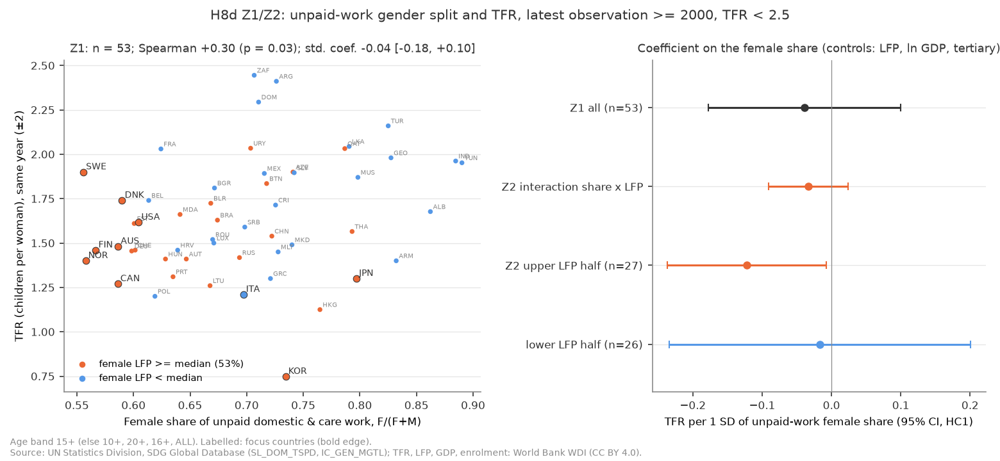
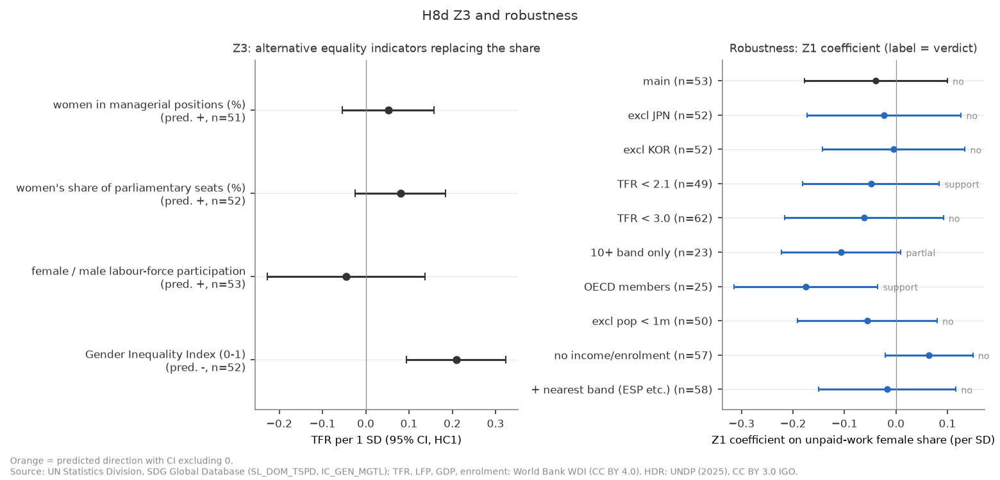
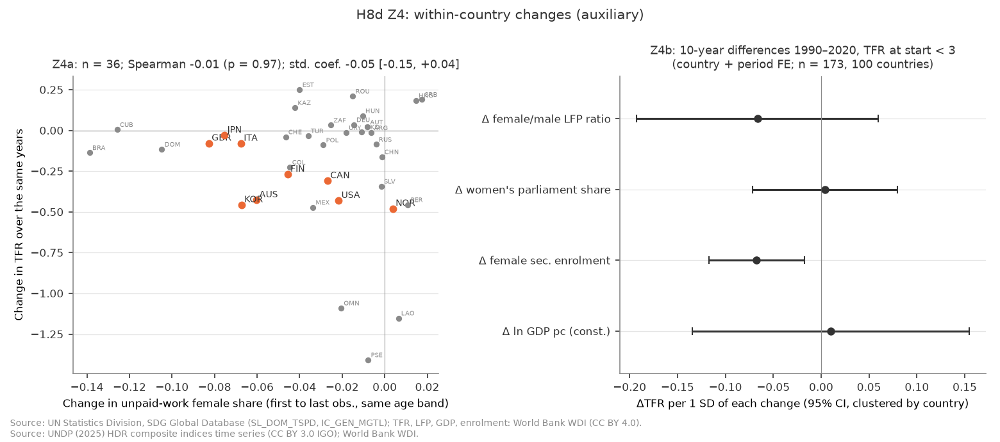
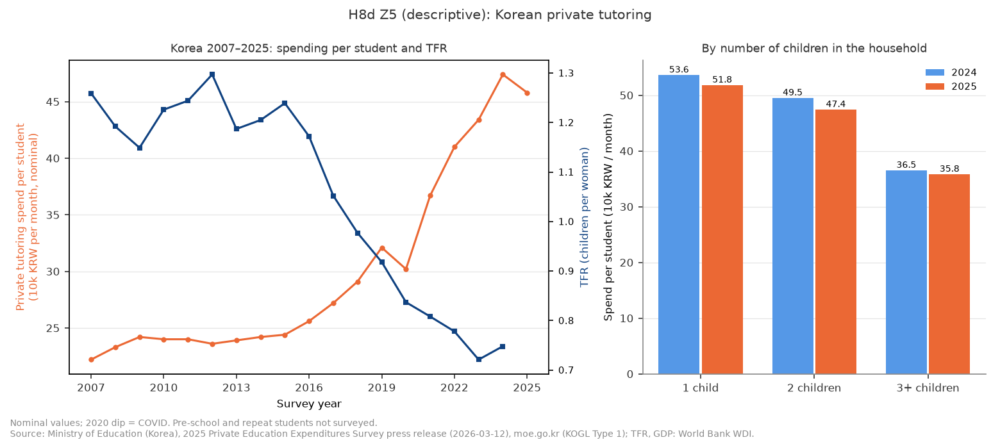
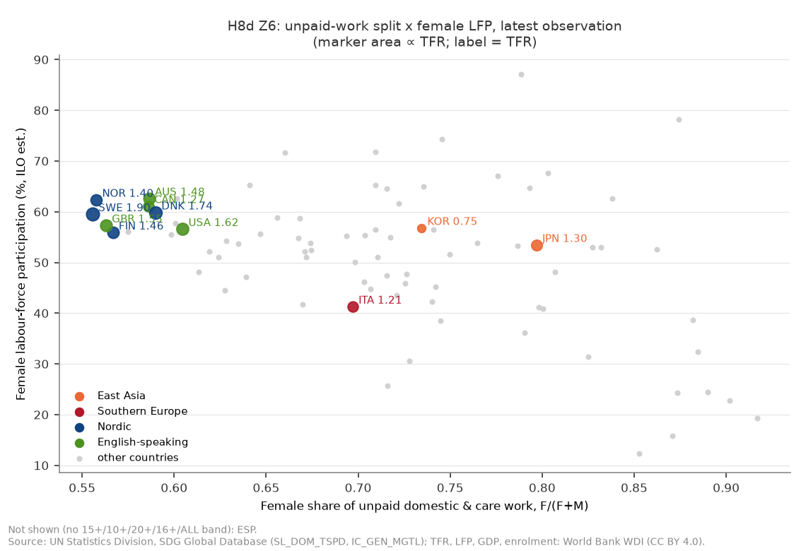

# H8d: 2 人未満への低下の「深さ」は家庭内の男女分業で決まるか（2026-10-18, theme: growth-fertility）

## 要約（5 行）
- **事前に固定した判定規則に従うと、仮説 G は「不支持」である。家庭内の男女分業でも深さは説明できない。2 人未満への低下について本シリーズで残る説明は、規範の拡散仮説だけである。** 主仕様（TFR < 2.5 の 53 か国）で、無償の家事・ケア労働のうち女性が担う割合（female_share）の標準化係数は −0.039 [−0.178, +0.100] で、CI が 0 を含む。交互作用（female_share × 女性労働参加率）も −0.033 [−0.091, +0.024] で CI が 0 を含む。女性労働参加率が高い半分（27 か国）では −0.122 [−0.237, −0.008] だが、判定には交互作用と両方そろう必要があり、満たさない。
- 代替指標（Z3）は、女性管理職割合 +0.052、女性議席割合 +0.080、労働参加率の男女比 −0.045 で、どれも CI が 0 を含む。ジェンダー不平等指数（GII）は +0.209 [+0.094, +0.324] で、予測と**逆**（不平等な国ほど TFR が高い）である。ただし GII は 10 代の出生率と妊産婦死亡率を構成要素に含み、TFR と機械的に結びつく。判定規則の「逆向き」は Z1・Z2 だけが対象なので、判定上の逆向きはない。
- **判定は事前リストの頑健性で変わる**。9 仕様のうち、TFR < 2.1（49 か国）と OECD 加盟国のみ（25 か国）で「支持」、10+ の年齢層に統一できる国のみ（23 か国）で「部分的支持」になる。残る 6 仕様は「不支持」のままである。探索的に調べると、OECD での「支持」は**韓国 1 か国に依存する**。韓国を除くと Z1 は −0.103 [−0.238, +0.032] になり、判定は「不支持」に戻る（E4）。一方、交互作用は韓国・日本・イタリアを除いても −0.11〜−0.13 で CI が 0 を含まない。豊かな国の中では「女性が働く国ほど家事の偏りと低出生が結びつく」形と**整合的**だが、事前の判定条件は満たさない。
- 国の中の変化（Z4）でも関連は確かめられない。無償労働の観測が 2 時点ある 36 か国で、Δfemale_share の係数は −0.053 [−0.149, +0.044]、Spearman は −0.01 である。HDR の 10 年差分（173 区間・100 か国）で、労働参加率の男女比は −0.066、女性議席割合は +0.004 で、どちらも CI が 0 を含む。主判定（不支持）と食い違いはない。韓国の私教育費（Z5、記述のみ）は、生徒 1 人当たり月平均（名目）が 2015 年 24.4 万ウォンから 2024 年 47.4 万ウォンへほぼ倍増した。同じ期間に TFR は 1.24 から 0.75 へ下がった。2025 年の 1 人当たり費用は、子 1 人の世帯 51.8 万ウォン、子 3 人以上の世帯 35.8 万ウォンである。
- これは H8c の後に立てた**事後追加**の検証で、H8〜H8c の判定は変えない。結果は国レベルの横断の関連で、因果は主張しない。「不支持」は「事前に決めた条件で関連が確かめられない」という意味で、「家事分担は出生率と無関係」とは言えない（標本・測り方の限界は後述）。

## 問いと仮説
`design/themes/growth-fertility.md` の「### H8d（事後追加 2026-10-18）」。H8c で、2 人未満への低下は所得・教育の長さ・教育費の家計負担・学歴の賃金差では確かめられなかった。そこで記事の最終仮説を「規範の拡散と先送り。深さは家庭内の男女分業が決める」とした。本レポートはこのうち「深さ」の部分（仮説 G）と、東アジアの加算要因としての学校外教育費（仮説 K）を扱う。

**仮説 G（McDonald のジェンダー公平論）**: 女性の教育・就業が進んだ社会ほど、家事・育児が女性に偏ったままだと、結婚・出産は女性にとって割に合わない取引になり、出生率は最も低くなる。予測は (a)〜(c) の 3 つ。(a) 転換を終えた国の間で、female_share が大きい国ほど TFR が低い（女性の労働参加・所得・教育をそろえても）。(b) その関連は女性労働参加率が高い国で強い（交互作用が負）。(c) 同じ国の中で female_share が縮んだ時期に TFR の低下が緩む。
**仮説 K（韓国）**: 1 人当たり私教育費が上がった時期に TFR が下がり、子どもが少ない世帯ほど 1 人当たり私教育費が高い。記述のみで、判定しない。

**推定したい量**（記述的な関連）: (Z1) TFR < 2.5 の国の最新観測年で、female_share が 1 SD 高い国の TFR の差（女性労働参加率・ln 一人当たり GDP・高等教育就学率をそろえる）。

**事後追加であること**: H8c の結果を見た後に立てた検証である。検定 Z1〜Z6・判定規則・最終スタンスの文型・頑健性リスト・言えないことは、追加データ（UN SDG・UNDP HDR・韓国教育部）を見る前に design に固定した。

**運用の細則**（design に無い点。最初の実行より前に実装とテストで固定した）:
- 年齢層: 国・年ごとに 15+ → 10+ → 20+ → 16+ → ALLAGE の順で、女性と男性の両方が ALLAREA で観測される最初の層を採る（`select_band`）。どれも無い国・年は主仕様から外す（スペイン・BEL 2000/2005 等 50 国・年。国として丸ごと落ちるのは DZA・ESP・IRL・KGZ・KHM・LVA・MYS・NLD・NZL・SVN）。頑健性の「最も近い層」版は、下限が 15 に近い層 → 幅が広い層（上限なしを最広とする）の順で選ぶ（`nearest_band`）。
- 最新観測年: 採用した層がある 2000 年以降の最も新しい年。TFR・女性労働参加率・GDP・就学率・Z3 の各指標は、その年の値、無ければ ±2 年で最も近い年（同距離は前の年）を付ける。TFR < 2.5 はこの TFR で判定する。
- Z2 の「上位半分での勾配」: Z1 標本の女性労働参加率の中央値（53.3%）以上の国だけで Z1 式を推定した female_share の係数。標準化は Z1 全標本の SD を使う。
- Z4a: 国ごとに、最初と最後の観測が 5 年以上離れる**同じ年齢層**を優先順で 1 つ選び、その最初と最後の年の差をとる。TFR は各端点の ±2 年の最近傍。

## データ
| 変数 | 出典 | 定義・単位 | 期間・国 | 備考（欠損・断絶） |
|---|---|---|---|---|
| female_share | UN SDG `SL_DOM_TSPD` | 無償家事・ケア労働時間（24 時間比 %）の女性 ÷（女性＋男性）、ALLAREA | 優先層あり 178 国・年、83 か国、2000–2026。2 時点（5 年以上）38 か国 | 年齢層は 15+ 145、10+ 29、16+ 2、20+ 1、ALLAGE 1。調査設計・年齢下限・ICATUS 調整（Nature=CA 402 行）が国で違う。日本・韓国の男性値は極端に低い（日本 2021 年 3.75%）。GBR に 2026 年の行（上流の表記のまま） |
| 女性管理職割合 `mgr` | UN SDG `IC_GEN_MGTL`（ILO） | 管理職に占める女性 %、15+ | 2,458 行、195 か国、2000–2025 | Z3 |
| `pr_f`, `lfpr_f/lfpr_m`, `gii` | UNDP HDR 2025 複合指数 | 女性議席割合 %、15+ 労働参加率の女性 ÷ 男性、ジェンダー不平等指数（0–1） | gii 4,600 国・年・172 か国、pr_f 6,135・193 か国、比 5,260・185 か国、1990–2023 | GII は 10 代出生率・妊産婦死亡率を含む |
| `tfr`, `fem_lfp`, `gdp_pcap_ppp`, `tert_enrol`, `fem_sec_enrol`, `gdp_pcap_const`, `population` | WDI | H8c と同じ | — | 女性労働参加率は ILO 推計 |
| 韓国 私教育費 | 교육부「2025년 초중고 사교육비 조사」報道資料（KOGL 제1유형） | 生徒 1 人当たり月平均（万ウォン、名目）、参加率 %、参加学生 1 人当たり（2017–）、子ども数別（2024–2025） | 2007–2025 | 名目のみ（CPI 未取込）。2020 年は COVID で落ち込み。就学前・浪人生は対象外 |

mart: `data/marts/gender_equity.parquet`（6,404 行、long）、`data/marts/hdr_gender.parquet`（51,522 行）、`data/marts/kr_private_tutoring.parquet`（131 行）、`data/marts/growth_fertility_panel.parquet`（14,322 行、27 列）。生成は `uv run socioscope run growth-fertility fetch && … stage && … mart`。LLM 構造化は使っていない。**家事のみ（`SL_DOM_TSPDDC`）・ケアのみ（`SL_DOM_TSPDCW`）の系列は mart に無く、design の頑健性のうちこの 2 本は実行できなかった。**

## 方法
- **Z1（主）**: 上の細則で作った横断（各国 1 行）で `tfr ~ female_share + fem_lfp + ln gdp_pcap_ppp + tert_enrol` を推定する。OLS・HC1 で、説明変数は標本の SD で標準化した（係数 = 1 SD あたりの TFR の差、人）。Spearman も出す。
- **Z2**: Z1 に標準化済み（中心化済み）の female_share × fem_lfp を加える。女性労働参加率の上位半分・下位半分で Z1 式を別に推定する。
- **Z3**: female_share を 4 指標に 1 本ずつ差し替える。標本は Z1 と同じ国・年で、その指標が ±2 年にある国。予測の向きは管理職・議席・労働参加率の比が正、GII が負。
- **Z4a**: Δtfr ~ Δfemale_share（HC1、標準化）と Spearman。開始 TFR < 2.5 に限った版も出す。
- **Z4b**: H8 T6 の枠（`h8.long_diff_nearest`・`h8.t6_stage`）で、1990→2000→2010→2020 の 10 年差分を使う。式は `Δtfr ~ Δ(lfpr_f/lfpr_m) + Δpr_f + Δfem_sec_enrol + Δln gdp_pcap_const + C(iso3) + C(period)` で、国クラスタ SE、開始 TFR < 3。
- **Z5・Z6**: 記述（表と図）。

**判定（事前固定）**: 支持 = Z1 の female_share が負で CI∌0、または Z2 の交互作用が負で CI∌0 かつ上位半分の勾配が負で CI∌0。部分的支持 = Z1 の点推定が負（CI∋0）で、Z3 の 4 指標のうち 2 つ以上が予測の向きで CI∌0。不支持 = それ以外。

**仮定**: 横断の関連であり、識別戦略はない。統制した 3 変数以外に、female_share と TFR の両方に関わる要因（宗教・家族規範・住宅・福祉制度）を分けられない。

## 結果

### Z1・Z2: 家事・ケアの女性偏りと TFR — 全体では確かめられない


| 推定（TFR < 2.5、1 SD あたり） | n | female_share | 他の係数 |
|---|---|---|---|
| Z1 主 | 53 | −0.039 [−0.178, +0.100] | 女性労働参加率 −0.064 [−0.166, +0.039]、ln GDP −0.080 [−0.195, +0.035]、高等教育 −0.109 [−0.221, +0.004]、R² 0.257 |
| Z1 の Spearman（TFR × share） | 53 | ρ = +0.298（p = 0.030） | 統制なしでは**正**（偏りが大きい国ほど TFR が高い） |
| Z2 交互作用 share × LFP | 53 | 交互作用 −0.033 [−0.091, +0.024]、share −0.033 [−0.172, +0.106] | 高等教育 −0.113 [−0.223, −0.003] |
| Z2 上位半分（LFP ≥ 53.3%） | 27 | **−0.122 [−0.237, −0.008]** | 高等教育 −0.233 [−0.366, −0.101] |
| Z2 下位半分 | 26 | −0.017 [−0.234, +0.200] | — |

標本の観測年は 2001–2025（中央値 2017）、年齢層は 15+ 41・10+ 11・16+ 1。統制なしの正の順位相関は、TFR が 2 前後の中所得国（トルコ・インド・チュニジア等）で偏りが大きいことによる。統制すると点推定は負になるが小さい。上位半分の勾配は負で CI が 0 を含まないが、交互作用の CI が 0 を含むので、Z2 の条件（両方）は満たさない。

### Z3: 代替指標 — 予測の向きで確かめられるものはない


| 指標（予測の向き） | n | 係数 [95% CI] | Spearman |
|---|---|---|---|
| 女性管理職割合（＋） | 51 | +0.052 [−0.054, +0.158] | −0.068（p = 0.63） |
| 女性議席割合（＋） | 52 | +0.080 [−0.024, +0.184] | −0.101（p = 0.48） |
| 労働参加率の男女比（＋） | 53 | −0.045 [−0.228, +0.137] | −0.332（p = 0.015） |
| GII（−） | 52 | **+0.209 [+0.094, +0.324]**（予測と逆） | +0.636（p < 0.001） |

予測の向きで CI が 0 を含まない指標は 0 本で、部分的支持の条件（2 本以上）を満たさない。GII の正の関連は、GII が 10 代の出生率を含み TFR と機械的に結びつくことで大部分を説明できる（design は Z4 で abr・mmr・GII 総合を除いたが、Z3 には GII を入れていた）。

### Z4: 国の中の変化 — 関連は確かめられない


- Z4a（36 か国、同じ年齢層の最初と最後、間隔の中央値 12 年、15+ 31・10+ 5）: Δfemale_share の中央値は −0.024（偏りは縮んだ）、ΔTFR の中央値は −0.083。Δshare の係数は −0.053 [−0.149, +0.044]、Spearman は −0.006（p = 0.97）。開始 TFR < 2.5 の 32 か国では +0.014 [−0.051, +0.079]、Spearman は +0.141。
- Z4b（173 区間・100 か国）: 労働参加率の男女比 −0.066 [−0.193, +0.060]、女性議席割合 +0.004 [−0.072, +0.080]、女子中等就学率 −0.067 [−0.117, −0.017]、ln GDP +0.010 [−0.135, +0.154]。

予測 (c) の向きの関連は、どちらでも確かめられない。主判定が「不支持」なので、design の「食い違い」の注記は付かない。

### Z5: 韓国の私教育費（記述のみ）


| 年 | 1 人当たり月平均（万ウォン、名目） | 参加率 % | 参加学生 1 人当たり | TFR（WDI） | 一人当たり実質 GDP 指数（2007 = 100） |
|---|---|---|---|---|---|
| 2007 | 22.2 | 77.0 | — | 1.259 | 100.0 |
| 2012 | 23.6 | 69.4 | — | 1.297 | 114.6 |
| 2015 | 24.4 | 68.8 | — | 1.239 | 123.7 |
| 2019 | 32.1 | 74.8 | 42.9 | 0.918 | 137.3 |
| 2020 | 30.2 | 67.1 | 45.0 | 0.837 | 136.2 |
| 2024 | 47.4 | 80.0 | 59.2 | 0.748 | 151.9 |
| 2025 | 45.8 | 75.7 | 60.4 | — | 153.6 |

子ども数別（1 人当たり月平均・参加率）: 2024 年は子 1 人 53.6（83.6%）、2 人 49.5（82.0%）、3 人以上 36.5（71.6%）。2025 年は 51.8（79.6%）、47.4（77.4%）、35.8（67.7%）。

2007–2015 の私教育費は横ばい（+10%）で、この間の TFR も 1.2 前後で横ばいだった。2016 年以降は私教育費が急に上がり（2015→2024 で +94%）、TFR は 1.24 から 0.75 へ下がった。名目値の伸びと実質 GDP 指数の比（stdout の最右列）は物価上昇を含むので過大である。CPI・名目 GDP は mart に無く、実質化していない。子どもが多い世帯ほど 1 人当たりの費用が低いのは「数より質」と整合的だが、世帯所得・子の学年構成の違いも含む。1 国の時系列で、識別はない。

### Z6: 東アジア・南欧・北欧・英語圏


| 群 | 国（観測年・年齢層） | female_share | 女性労働参加率 % | TFR |
|---|---|---|---|---|
| 東アジア | JPN（2021、15+） | 0.797 | 53.5 | 1.30 |
| | KOR（2024、15+） | 0.734 | 56.8 | 0.75 |
| 南欧 | ITA（2023、15+） | 0.697 | 41.3 | 1.21 |
| | ESP | 優先層なし（20-74 のみ） | — | — |
| 北欧 | DNK（2001、16+） | 0.590 | 59.9 | 1.74 |
| | FIN（2021） / NOR（2023） / SWE（2011） | 0.567 / 0.558 / 0.556 | 55.9 / 62.4 / 59.5 | 1.46 / 1.40 / 1.90 |
| 英語圏 | USA（2023） / GBR（2026） / CAN（2023） / AUS（2024） | 0.605 / 0.563 / 0.586 / 0.586 | 56.6 / 57.3 / 61.1 / 62.6 | 1.62 / 1.55 / 1.27 / 1.48 |

日本と韓国は「女性の就業がそれなりに進み、家事の偏りが大きく、TFR が低い」位置にあり、仮説 G の描く形に合う。しかし北欧・英語圏の中では、偏りが同程度（0.56–0.61）でも TFR は 1.27（カナダ）から 1.90（スウェーデン 2011）まで広く散らばる。北欧の最近年（FIN 1.46・NOR 1.40）は偏りが最も小さいのに TFR が低い。日本と韓国の偏りは 2001→2021、2004→2024 でそれぞれ 0.87→0.80、0.84→0.73 と縮んだが、この間に TFR は下がった。

### 判定
- Z1 female_share: −0.039 [−0.178, +0.100]（n = 53）→ 負だが CI が 0 を含む。
- Z2: 交互作用 −0.033 [−0.091, +0.024]、上位半分の勾配 −0.122 [−0.237, −0.008] → 両方そろわない。
- Z3: 予測の向きで CI∌0 は 0 本。
- 逆向き（Z1・Z2）: なし。
- **VERDICT G: 不支持**。**最終スタンス: 家庭内の男女分業でも深さは説明できない。2 人未満への低下について本シリーズで残る説明は、規範の拡散仮説だけである。**
- Z4 の整合性: 国の中の変化でも負の関連はない（主判定と食い違わない）。

## 頑健性
事前リストの全仕様（家事のみ・ケアのみの 2 本は系列が無く実行不能）。

| 仕様 | n | Z1 female_share | Z2 交互作用 | Z2 上位半分 | Z3 の該当 | 判定 |
|---|---|---|---|---|---|---|
| 主 | 53 | −0.039 [−0.178, +0.100] | −0.033 [−0.091, +0.024] | −0.122 [−0.237, −0.008]* | なし | 不支持 |
| 日本除外 | 52 | −0.023 [−0.172, +0.126] | −0.032 [−0.090, +0.026] | −0.114 [−0.254, +0.026] | なし | 不支持 |
| 韓国除外 | 52 | −0.004 [−0.142, +0.134] | −0.029 [−0.085, +0.027] | −0.074 [−0.205, +0.057] | なし | 不支持 |
| TFR < 2.1 | 49 | −0.048 [−0.181, +0.084] | **−0.044 [−0.082, −0.007]*** | **−0.169 [−0.304, −0.034]*** | なし | **支持** |
| TFR < 3.0 | 62 | −0.062 [−0.216, +0.092] | −0.026 [−0.113, +0.061] | −0.071 [−0.274, +0.131] | 管理職 | 不支持 |
| 10+ の層のみ | 23 | −0.107 [−0.222, +0.009] | −0.023 [−0.166, +0.120] | −0.105 [−0.273, +0.062] | 管理職・議席・参加率比 | **部分的支持** |
| OECD 加盟国のみ | 25 | **−0.175 [−0.315, −0.035]*** | **−0.131 [−0.192, −0.071]*** | **−0.304 [−0.425, −0.183]*** | 議席 | **支持** |
| 人口 100 万未満除外 | 50 | −0.056 [−0.192, +0.080] | −0.022 [−0.082, +0.039] | −0.165 [−0.280, −0.049]* | なし | 不支持 |
| 所得・就学率を外す | 57 | +0.064 [−0.020, +0.149] | −0.028 [−0.078, +0.023] | +0.027 [−0.101, +0.155] | なし | 不支持 |
| ＋最も近い層（ESP 等） | 58 | −0.017 [−0.150, +0.116] | −0.045 [−0.099, +0.009] | −0.149 [−0.275, −0.023]* | 議席 | 不支持 |

\* = CI が 0 を含まない。どの仕様でも逆向き（Z1・Z2 が正で CI∌0）はない。GII はすべての仕様で正（予測と逆）で、10+ の層のみ（+0.114 [−0.101, +0.330]）を除き CI が 0 を含まない。

**判定は 9 仕様中 3 仕様で変わる**。共通点は「低出生・高所得の国に絞ると負の関連が出る」ことだが、次の探索的分析で見るとおり、OECD の結果は韓国 1 か国に強く依存する。

## 探索的分析（事後、判定外）
- **E1（統制の影響）**: Z1 標本で統制なしの female_share は +0.094 [+0.027, +0.161]、女性労働参加率だけを統制すると +0.052 [−0.041, +0.145]。負の点推定は所得と高等教育就学率をそろえたときだけ出る。
- **E2（水準）**: female_share の代わりに男性の無償労働時間（% of day）を入れると +0.024 [−0.091, +0.139]、女性の時間では −0.007 [−0.106, +0.091]。どちらも関連は確かめられない。
- **E3（高所得国のみ、WB 取得時分類）**: 31 か国で female_share −0.095 [−0.215, +0.024]、Spearman −0.185（p = 0.32）。
- **E4（OECD の「支持」は誰に依存するか）**: OECD 25 か国から日本を除くと Z1 −0.193 [−0.377, −0.010]（支持のまま）。**韓国を除くと −0.103 [−0.238, +0.032]**、上位半分 −0.258 [−0.551, +0.036] で「不支持」に戻る。日韓を除くと −0.062、日韓伊を除くと −0.109 で、どちらも CI が 0 を含む。交互作用はどの除外でも −0.11〜−0.13 で CI が 0 を含まない。
- **読み**: 豊かな国の中では、女性の労働参加率が高い国ほど家事の偏りと低い TFR が結びつく、という**交互作用の形**が残る。これは McDonald の議論と整合的である。ただし主効果（Z1）は韓国 1 か国の極端な TFR（0.75）を除くと確かめられない。標本は 22–25 か国で、事前の判定条件ではない。新しい仮説として扱うなら、OECD 内の無償労働の時系列（HETUS・ATUS 等）で事前登録し直す必要がある。

## 限界・言えないこと
- **横断の関連で因果ではない**（design の「言えないこと」）。n は 53（頑健性で 23〜62）で、各国の観測年は 2001–2026 と 25 年にわたる（デンマークは 2001 年、スウェーデンは 2011 年）。TFR はその年の値なので、年の違いは国の違いと区別できない。
- **無償労働の測り方が国で違う**: 時間利用調査の設計、年齢下限（15+ と 10+ の混在）、ICATUS 調整の有無（Nature=CA）が国で異なる。日本・韓国の男性値は定義差で極端に低い。そのため主指標を比にしたが、比も測り方の差を含む。10+ に統一できる国（23 か国）だけでは点推定が −0.107 に大きくなり、Z3 が 3 本該当する。測り方の雑音が関連を弱めている可能性は否定できない。
- **家事とケアを分けられない**: 家事のみ・ケアのみの系列は mart に無く、design の頑健性 2 本を実行していない。「育児の偏り」と「家事の偏り」のどちらが効くかは言えない。
- **GII の機械的な関係**: GII は 10 代の出生率・妊産婦死亡率を含むので、Z3 の GII の正の関連は TFR との機械的な結びつきを含む。Z3 の判定材料としての GII は、事前にもっと慎重に選ぶべきだった（design は変えない）。
- **「規範の拡散」は本検証でも測っていない**: 意図・理想の国際時系列が無い。最終スタンスの「規範の拡散仮説だけが残る」は、本シリーズで検証した候補（所得・死亡率・女子教育・教育費・学歴の賃金差・男女分業）が事前の条件を満たさなかったという消去法の言明である。規範の拡散を支持する証拠を示したわけではない。
- **韓国の私教育費は 1 国の時系列**で、識別はない。名目値で、実質化していない。2016 年以降の私教育費の上昇と TFR の低下が同時に起きたことは記述できるが、どちらが原因かも、第三の要因（住宅価格・若年雇用・結婚の減少）かも分からない。子ども数別の差は、世帯所得や子の学年の違いを含む。
- **レベル**: 結果はすべて国レベルの関連である。「家事を妻に任せる夫婦ほど子どもが少ない」という世帯レベルの主張には読み替えない（エコロジカルな誤謬）。国の間で関連が見えないことも、世帯の中で関連がないことを意味しない。

## 再現手順
```bash
uv run socioscope run growth-fertility fetch && uv run socioscope run growth-fertility stage && uv run socioscope run growth-fertility mart
uv run python themes/growth-fertility/src/theme_growth_fertility/analysis/a20261018_h8d_gender_equity.py \
  > themes/growth-fertility/reports/2026-10-18-h8d-gender-equity.stdout.txt
uv run pytest themes/growth-fertility/tests/test_analysis_h8d.py
uv run python -m theme_growth_fertility.analysis.s20261017_h8_summary   # 記事用 h8s10・h8s11
```
乱数は使っていない。2 回実行して、stdout と 5 枚の PNG の sha256 が一致することを確認した（PNG は `metadata={"Software": None}`）。数値の出所はすべて `2026-10-18-h8d-gender-equity.stdout.txt`。出典表記: United Nations Statistics Division, SDG Global Database (Series SL_DOM_TSPD, IC_GEN_MGTL), https://unstats.un.org/sdgs/dataportal (accessed 2026-10-18)。UNDP (2025), Human Development Report 2025, composite indices time series, https://hdr.undp.org (accessed 2026-10-18), CC BY 3.0 IGO。교육부, 2025년 초중고 사교육비 조사 결과 보도자료（2026-03-12）, moe.go.kr（KOGL 제1유형）。World Bank WDI（CC BY 4.0）。

## チェックリスト回答
- **A 問いと事前登録**: 問い・仮説 G/K・Z1〜Z6・判定規則・最終スタンスの文型・頑健性・言えないことは、追加データを見る前（2026-10-18）に design の H8d 節に固定した。H8c の後の**事後追加**であることと、H8〜H8c の判定を変えないことを明記した。design に細則のない 4 点（年齢層のフォールバック、最新年と ±2 年、上位半分の勾配の推定法、Z4a の端点）は最初の実行より前に実装とテストで固定し、本文に書いた。E1〜E4 は「探索的・判定外」と明記した。推定量は記述的関連（標準化横断係数）である。
- **B データ**: 全系列の出典・定義・単位・期間・国数を表に記載した。欠損は補完せず listwise とした。年齢層の混在、Nature=CA、日本・韓国の男性値、GBR 2026、優先層が無く落ちた 10 か国、家事・ケア別系列の欠如、韓国私教育費の名目・2020 年の落ち込み・対象外を列挙した。サンプル選択（TFR < 2.5、2000 年以降の最新年）は design どおりで、閾値を変えた結果を頑健性に載せた。
- **C 識別戦略**: なし（横断の記述）。Z4 は国 FE・期間 FE の長期差分と first–last 差分の補助だけである。省略変数（家族規範・宗教・住宅・福祉）と、GII の機械的な関係を限界に挙げた。国レベルの結果を世帯に読み替えていない。韓国の時系列は記述のみ。
- **D 推定と不確実性**: 横断は HC1（各国 1 行）、Z4b は国クラスタ SE（同じ国の区間は相関するため）。事前リストの頑健性を全部表にし、実行できなかった 2 本も書いた。判定が変わる 3 仕様を要約に書き、OECD の結果が韓国に依存することを探索的に示した。
- **E 書き方**: 要約の第 1 文は事前の文型を断定形で埋めた。「関連が確かめられない」「整合的」と書き、因果効果とは書いていない。図は軸・単位・出典・n を記載した。限界節は 7 項目、再現手順と mart の行数を記載した。LLM 構造化は使っていない。
