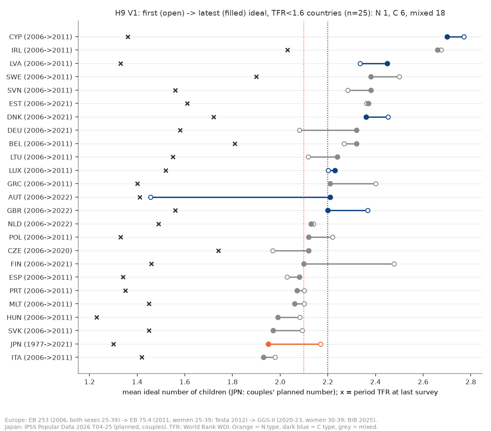
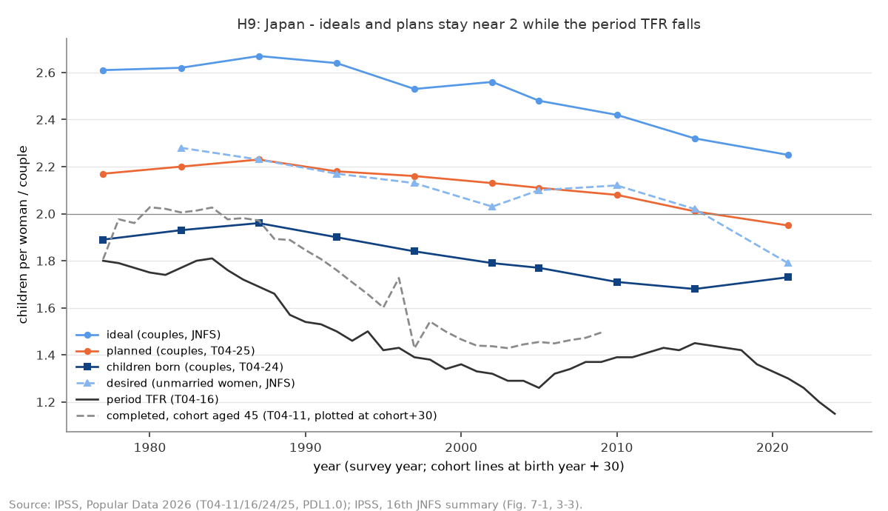
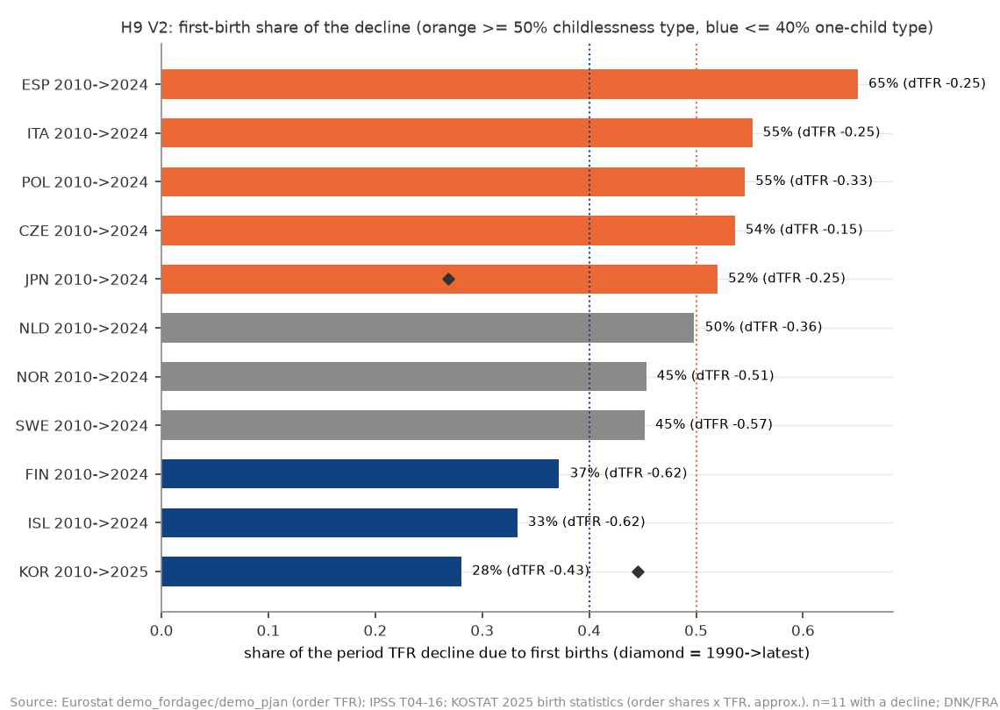
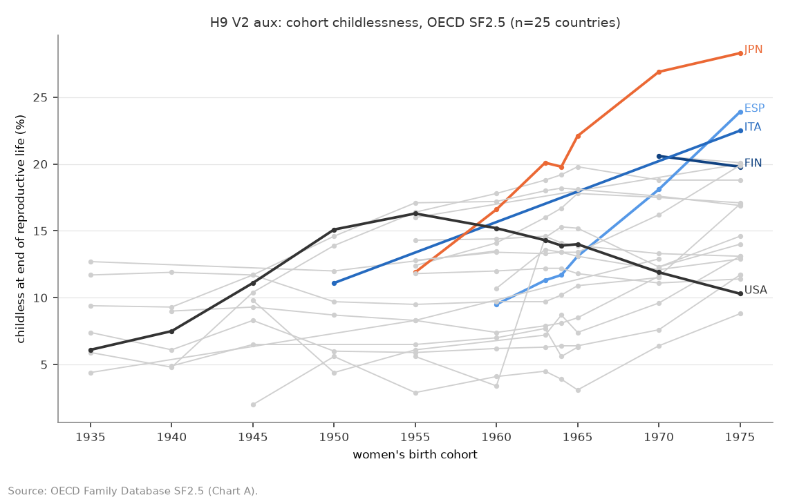
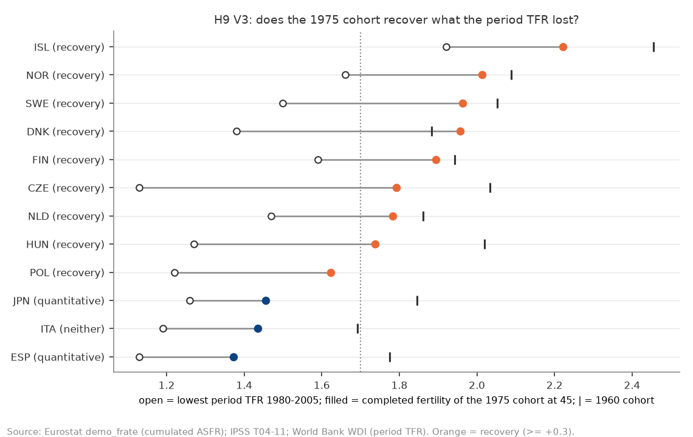

# H9: 2 人未満への低下は「規範の崩れ」か「実現の阻害」か（2026-10-18, theme: growth-fertility）

## 要約（5 行）
- **2 人未満への低下は国で異なり、日本は規範型・オーストリア・キプロス・デンマーク・英国・ルクセンブルク・ラトビアは阻害型であり、低下の主役は第 2 子以降の減少である。コーホートで見ると回復している。** これは事前に固定した文型に、事前の規則の結果を入れた文である。ただし 3 か所とも僅差か、仕様で変わる。(1) V1 の対象 25 か国のうち **18 か国はどちらの型でもない**。日本の「規範型」は xlsx の予定の子ども数（2.17 → 1.95）でだけ成り立ち、PDF の予定（2.17 → 2.01）や妻 35 歳未満では「どちらでもない」に、夫婦の理想（2.61 → 2.25）では「阻害型」になる。(2)「第 2 子以降が主役」は、第 1 子寄与率の中央値 **49.8%**（11 か国）が 50% をわずかに下回った結果である。(3)「回復している」は 45 歳打ち切りで 12 か国中 9 か国だが、40 歳打ち切りでは 6 か国で過半に届かない。日本・スペイン・イタリアは回復していない。
- **part4 の最終仮説（規範の崩れ＋先送り）への判定は「国で異なる」で、支持も不支持もできない。** V1 は N 型 1・C 型 6・どちらでもない 18 で、どちらも過半でない。事前の頑健性（閾値 9 通り、一般的な理想への差し替え、日本の 35 歳未満、2006 年を女性全年齢に差し替え）でも、過半はどれも出ない。V2 も無子化型 5・1 人止まり型 3・混合 3 で過半なし（起点 2005・2015 年でも同じ）。
- 型の組み合わせで見ると次のようになる（V4、記述）。**日本 = 予定は規範型、低下は 2010 年以降なら無子化型・1990 年以降なら 1 人止まり型、コーホートは量的減少型**。**南欧・中東欧（スペイン・イタリア・ポーランド・チェコ）= 理想はどちらでもない、低下は無子化型**。**北欧（フィンランド・アイスランド・スウェーデン・ノルウェー）= 理想は 2.1〜2.4 で横ばい（デンマークは阻害型）、低下は 1 人止まり型か混合、コーホートは回復型**。**韓国 = 理想の時系列なし、低下は 1 人止まり型（2010 年以降、第 1 子 28%）**。
- 探索的に見ると（判定外）、日本の低下は層で姿が違う。未婚女性の希望子ども数は 2.28（1982）→ 1.79（2021）で、V1 の規則に当てはめると規範型になる。夫婦の完結出生児数は 1960 年生まれ 2.01 → 1971 年生まれ 1.81 で、0.20 しか下がっていない。女性全体の 45 歳時点の累積は、同じ期間に 1.85 → 1.44 と 0.41 下がった。日本の 1975 年生まれの無子率は 28.3%（OECD SF2.5、値のある国で最高）である。コーホートで見ると、低下の半分は結婚の外側（未婚・無子）にあると整合的である。
- これは part4 の後に立てた**事後追加**の検証で、H8〜H8d の判定は変えない。すべて国レベルの記述で、因果は主張しない。理想・予定は事後の合理化（産んだ数に合わせて下げる）を含むので、「規範型」の一部は阻害の後の諦めでありうる。

## 問いと仮説
`design/themes/growth-fertility.md` の「### H9（事後追加 2026-10-18）」。part4 の最終仮説は「2 人未満への低下は『子どもは 2 人』という規範そのものの崩れが、結婚と第 1 子の先送りとして現れたもの」だった。ただしこれは消去法で残った説明で、規範そのものは測っていない。対立仮説は「望む数は 2 人以上のまま、実現が阻まれている」で、政策の含意が正反対になる。

- **N（規範の崩れ）**: 理想・予定の子ども数そのものが 2 を割って下がり、実際との差は広がっていない。
- **C（実現の阻害）**: 理想は 2.2 前後のまま横ばいで、理想と実際の差が広がっている。
- 付随する問い: (i) 低下は第 1 子（無子化）が主か、第 2 子以降が主か。(ii) コーホートの完結出生数で見ると、先送りの回復があるか。

**推定したい量**（記述）: 各国の理想（日本は予定）の水準と変化、理想 − 期間 TFR の差の変化による分類（V1）。期間 TFR の低下に占める第 1 子の寄与率（V2）。1975 年生まれの完結出生数と、期間 TFR の最小値との差（V3）。

**事後追加であること**: part4 の後に立てた検証である。検定 V1〜V4・分類規則・最終スタンスの文型・頑健性・言えないことは、追加データを見る前に design に固定した。

**運用の細則**（design に無い点。分類規則を実行する前にスクリプト冒頭で固定し、stdout の冒頭に出した）:
- 日本の V1 の主系列は、xlsx 表 4-25 の予定子ども数の総数（2021 年 1.95）とした。PDF 図表 7-1 の値（2.01）は頑健性に回し、夫婦の理想は併記した（判定外）。この選択は依頼元の推奨に従ったもので、両方の値を知った上で決めた。
- 欧州の理想は「個人の理想」の平均で、2006 年 = EB 253 の男女 25–39 歳（性 × 年齢の交差が無く、女性 25–39 歳が取れない）、2011 年 = EB 75.4 の女性 25–39 歳、2020 年代 = GGS-II の女性 30–39 歳とした。各国の最初と最新の観測を比べる。
- 「理想 − TFR」の TFR は各調査年の WDI 期間 TFR（GGS は国ごとの調査年）。「最新の TFR < 1.6」は WDI の最新年（2024）。
- V2 の国別の型（V4 の過半判定に使う）は、3 地域に共通する 2010 → 最新の窓で決めた。日本・韓国の 1990 → 最新は併記した。**データ確認の段階で日本の順位別 TFR（1990・2005・2010・2015・2024）を見ており、この窓の選択は盲検ではない**。文型の「主役」は、低下があった国の第 1 子寄与率の中央値が 50% 以上なら第 1 子、未満なら第 2 子以降とした。欧州の終点は 4 順位がそろう最新年（H5 と同じ）。
- V3 の「同時期の期間 TFR の最小値」は、1950–1975 年生まれが 30 歳だった年（1980–2005 年）の期間 TFR の最小値とした。完結出生数は 45 歳時点の累積（日本は表 4-11、欧州は `cohort_cum` の 45 歳）。「回復している」は、V3 の対象国の過半が回復型（回復型＋両方）であること。
- V4: V1 が N 型過半で V2 が無子化型過半なら「支持」、V1 が C 型過半なら「不支持（阻害に置き換え）」とした。V1 が N 型過半でも V2 が無子化型過半でなければ「部分的」、V1 に過半が無ければ「国で異なる」。

## データ
| 変数 | 出典 | 定義・単位 | 期間・国 | 備考（欠損・断絶） |
|---|---|---|---|---|
| 日本 理想・予定・出生子ども数 | IPSS『人口統計資料集 2026』表 4-24/4-25（xlsx）、『第 16 回出生動向基本調査 結果の概要』図表 7-1・3-3（PDF） | 妻 50 歳未満の初婚どうし夫婦の平均（人）。未婚者は 18–34 歳の希望子ども数 | 1977–2021 の 10 回（未婚は 1982– の 9 回） | 予定は xlsx（2021 年 1.95）と PDF（2.01）で値が違い、別 metric。妻 35 歳未満は PDF のみ |
| 日本 完結出生児数・無子割合（夫婦） | IPSS 表 4-23 | 結婚持続 15–19 年の夫婦の平均出生児数、出生児数別割合 % | 妻の生まれ年 1890–1976 | 1970 年以前は国勢調査（既婚女性）で母集団が違う。本分析は 1950 年以降の生まれだけ使う |
| 日本 順位別 TFR | IPSS 表 4-16 | 期間 TFR（第 1 子 … 第 5 子以上） | 1950–2024 | Σ順位と総数の差 ≤ 0.05 |
| 日本 コーホート累積出生率 | IPSS 表 4-11 | 15 歳から各歳までの累積（女性 1 人当たり） | 1935–2005 年生まれ | コーホート = 年 − 年齢で ±1 年の幅。1947 年・1966 年（丙午）前後に段差 |
| 欧州 理想子ども数 | EB 253（2006）、Testa 2012（EB 75.4, 2011）、BiB 2025（GGS-II, 2020–23） | 個人の理想の平均（人）。2006 年は「6 超」= 7、理想なし・DK 除外 | 2006: 25 か国、2011: 27 か国、GGS: 11 か国 | 質問文・母集団が調査で違う。2006 年は性 × 年齢の交差なし。GGS に一般的な理想は無い |
| 欧州 順位別 TFR | Eurostat（`demo_fordagec` ＋ `demo_pjan`）、H5 の mart | 期間 TFR（1/2/3/4+、UNK は除外） | 2005–2024、13 か国 | DNK・FRA は 2010 年が欠損、DEU は 2017 年が最終の完全年 |
| 欧州 コーホート累積出生率 | Eurostat `demo_frate` | 15 歳から 40・45 歳までの各歳率の累積 | 1945（国で違う）– 1979 年生まれ、13 か国 | DEU は 2000 年開始で完結値なし、FRA は 1998 年開始で 1975 年生まれが 15 歳から観測できない。PL は 1975 年生まれから |
| 韓国 順位別出生数・TFR | 국가데이터처「2025년 출생 통계」統計表 3・2（KOGL） | 順位別出生数（명）、TFR | 1981–2025 | 계 は順位不詳を含む（2010 年 3,035 人）。順位別 TFR は TFR × 順位割合で近似（女性人口の年齢構成の変化は補正しない） |
| 無子率 | OECD Family Database SF2.5 | 生殖年齢の終わりに子どもがいない女性の割合 %（Chart A: コーホート別、Chart B: 1975 年生まれ） | 25 か国、1935–1975 年生まれ | 国で観測コーホートが違う。KOR・SVK の 1975 は別コーホートの代替値 |
| 期間 TFR | World Bank WDI | 女性 1 人当たり | 1960–2024 | V1 の差、V3 の最小値、対象選択に使う |

mart: `data/marts/jp_fertility_survey.parquet`（288 行）、`jp_births_order_cohort.parquet`（5,917 行）、`kr_births_order_asfr.parquet`（765 行）、`eu_fertility_ideals.parquet`（5,984 行）、`eu_tfr_by_birth_order.parquet`（1,433 行）、`eu_cohort_fertility.parquet`（42,567 行）、`oecd_childlessness.parquet`（199 行）、`growth_fertility_panel.parquet`（14,322 行、27 列）。生成は `uv run socioscope run growth-fertility fetch && … stage && … mart`。LLM 構造化は使っていない。**韓国の理想子ども数の時系列は無く、V1 から韓国は外れる。** ノルウェー・クロアチア・モルドバ（GGS のみ）とブルガリア・ルーマニア（EB 2011 のみ）は理想が 1 時点で、V1 の対象外である。フランスは最新 TFR 1.61 で対象外。

## 方法
- **V1（主）**: 対象は、最新の TFR < 1.6 で理想が 2 時点以上ある国である（欧州 24 か国＋日本）。各国の最初と最新の観測で、理想 I と差 G = I − TFR（その調査年）を比べる。**N 型** = 最新 I < 2.1 かつ I が 0.2 以上低下。**C 型** = 最新 I ≥ 2.2、最新 G ≥ 0.6、かつ G が最初より拡大。他は「どちらでもない」（design の「混合」）。過半で判定する。
- **V2**: 期間 TFR の低下を順位別 TFR の変化に分け、第 1 子の寄与率 = Δ第 1 子 / Σ Δ（両年にある順位の和）を出す。無子化型 ≥ 50%、1 人止まり型 = 第 2 子以降 ≥ 60%（第 1 子 ≤ 40%）、間は混合。Σ Δ ≥ 0 の国は「低下なし」で分母から外す。補助として、OECD SF2.5 の無子率の 1955 → 1975 年生まれの変化を見る。
- **V3**: 1975 年生まれの 45 歳時点の累積出生数（CF1975）と、1980–2005 年の期間 TFR の最小値を比べる。回復型 = CF1975 − 最小値 ≥ 0.3。量的減少型 = CF1960 − CF1975 ≥ 0.3 かつ CF1975 < 1.7。両方を満たせば「両方」とする。
- **V4**: 上の細則で総合し、V1 × V2 の国別の型を並べて名指しする。V3 は添えるだけで、判定には入れない。

**仮定と性格**: すべて国レベルの記述で、識別戦略はない。分類は閾値に依存するので、design の頑健性リストを全部実行した。

## 結果

### V1: 理想（日本は予定）の変化 — 25 か国中 18 か国はどちらの型でもない


*図 1: 各国の最初（白丸）と最新（塗り）の理想、× は最新調査年の期間 TFR。橙 = N 型、紺 = C 型、灰 = どちらでもない。n = 25。*

| 国 | 最初（年 理想 TFR 差） | 最新（年 理想 TFR 差） | Δ理想 | Δ差 | 最新 TFR（2024） | 型 |
|---|---|---|---|---|---|---|
| 日本（予定、xlsx） | 1977 2.17 1.80 +0.37 | 2021 1.95 1.30 +0.65 | −0.22 | +0.28 | 1.15 | **N** |
| オーストリア | 2006 1.46 1.41 +0.05 | 2022 2.21 1.41 +0.80 | +0.75 | +0.75 | 1.31 | **C** |
| キプロス | 2006 2.77 1.51 +1.26 | 2011 2.70 1.36 +1.34 | −0.07 | +0.08 | 1.38 | **C** |
| デンマーク | 2006 2.45 1.85 +0.60 | 2021 2.36 1.72 +0.64 | −0.09 | +0.04 | 1.47 | **C** |
| 英国 | 2006 2.37 1.82 +0.55 | 2022 2.20 1.56 +0.64 | −0.17 | +0.09 | 1.55 | **C** |
| ルクセンブルク | 2006 2.20 1.65 +0.55 | 2011 2.23 1.52 +0.71 | +0.03 | +0.16 | 1.25 | **C** |
| ラトビア | 2006 2.34 1.46 +0.88 | 2011 2.45 1.33 +1.12 | +0.11 | +0.24 | 1.24 | **C** |
| ベルギー | 2006 2.27 1.80 +0.47 | 2011 2.32 1.81 +0.51 | +0.05 | +0.04 | 1.44 | どちらでもない（差 < 0.6） |
| チェコ | 2006 1.97 1.34 +0.63 | 2020 2.12 1.74 +0.38 | +0.15 | −0.25 | 1.36 | どちらでもない |
| ドイツ | 2006 2.08 1.33 +0.75 | 2021 2.32 1.58 +0.74 | +0.24 | −0.01 | 1.36 | どちらでもない（差が縮小） |
| スペイン | 2006 2.03 1.36 +0.67 | 2011 2.08 1.34 +0.74 | +0.05 | +0.07 | 1.10 | どちらでもない |
| エストニア | 2006 2.36 1.58 +0.78 | 2021 2.37 1.61 +0.76 | +0.01 | −0.02 | 1.18 | どちらでもない（差が縮小） |
| フィンランド | 2006 2.48 1.84 +0.64 | 2021 2.10 1.46 +0.64 | −0.38 | +0.00 | 1.25 | どちらでもない（2.10 は「2.1 未満」でない） |
| ギリシャ | 2006 2.40 1.40 +1.00 | 2011 2.21 1.40 +0.81 | −0.19 | −0.19 | 1.24 | どちらでもない |
| ハンガリー | 2006 2.08 1.34 +0.74 | 2011 1.99 1.23 +0.76 | −0.09 | +0.02 | 1.41 | どちらでもない |
| アイルランド | 2006 2.68 1.91 +0.77 | 2011 2.66 2.03 +0.63 | −0.02 | −0.14 | 1.47 | どちらでもない |
| イタリア | 2006 1.98 1.37 +0.61 | 2011 1.93 1.42 +0.51 | −0.05 | −0.10 | 1.18 | どちらでもない |
| リトアニア | 2006 2.12 1.33 +0.79 | 2011 2.24 1.55 +0.69 | +0.12 | −0.10 | 1.11 | どちらでもない |
| マルタ | 2006 2.10 1.36 +0.74 | 2011 2.06 1.45 +0.61 | −0.04 | −0.13 | 1.01 | どちらでもない |
| オランダ | 2006 2.14 1.72 +0.42 | 2022 2.13 1.49 +0.64 | −0.01 | +0.22 | 1.43 | どちらでもない |
| ポーランド | 2006 2.22 1.27 +0.95 | 2011 2.12 1.33 +0.79 | −0.10 | −0.16 | 1.14 | どちらでもない |
| ポルトガル | 2006 2.10 1.37 +0.73 | 2011 2.07 1.35 +0.72 | −0.03 | −0.01 | 1.41 | どちらでもない |
| スロバキア | 2006 2.09 1.25 +0.84 | 2011 1.97 1.45 +0.52 | −0.12 | −0.32 | 1.46 | どちらでもない |
| スロベニア | 2006 2.28 1.31 +0.97 | 2011 2.38 1.56 +0.82 | +0.10 | −0.15 | 1.52 | どちらでもない |
| スウェーデン | 2006 2.50 1.85 +0.65 | 2011 2.38 1.90 +0.48 | −0.12 | −0.17 | 1.43 | どちらでもない |
| *日本（夫婦の理想、併記）* | *1977 2.61 1.80 +0.81* | *2021 2.25 1.30 +0.95* | *−0.36* | *+0.14* | *1.15* | *C* |

**判定 V1: どちらも過半でない（N 1・C 6・どちらでもない 18）→「国で異なる」。** 最新の理想が 2 人を下回るのは 4 か国（日本の予定 1.95、イタリア 1.93、スロバキア 1.97、ハンガリー 1.99）にとどまる。一方で 2.2 以上を保つのは欧州 14 か国で、日本の夫婦の理想（2.25）もこの水準にある。理想の水準は多くの国で 2 人前後にとどまるが、「C 型」の第 2・第 3 条件（差 0.6 以上で拡大）を満たす国は少ない。

**注意すべき点**: 欧州 24 か国のうち 16 か国は、最新の理想が 2011 年である。この 5 年間は欧州の TFR がまだ下がっていない時期（多くの国で 2010–2015 年に下がり始めた）にあたる。そのため「差が広がった」かどうかを判定する材料が乏しい。2020 年代まで追える国だけ（GGS 8 か国＋日本）を見ても、N 1・C 3・どちらでもない 5 で、過半は出ない（探索的 E1）。また、オーストリアの C 型は 2006 年の値 1.46（男女 25–39 歳）が他国より極端に低いことによる。2006 年を女性全年齢（1.82）に替えても C 型のままだが、2011 年の EB でも 1.79 で、上昇の大部分は 2011 → 2022 年の調査の違い（EB → GGS）と重なる。



*図 2: 日本の夫婦の理想・予定・出生子ども数、未婚女性の希望、期間 TFR、女性全体の 45 歳累積（生まれ年 + 30 年の位置）。出典 IPSS。*

### V2: 低下は第 1 子か第 2 子以降か — 国で割れ、中央値 49.8%


*図 3: 2010 → 最新の期間 TFR の低下に占める第 1 子の寄与率（◆ = 1990 → 最新）。n = 11（低下した国）。*

| 国 | 窓 | Σ順位 TFR | 第 1 子 TFR | ΔΣ | 第 1 子の寄与 | 型 |
|---|---|---|---|---|---|---|
| スペイン | 2010→2024 | 1.356→1.106 | 0.733→0.570 | −0.251 | 65.1% | 無子化型 |
| イタリア | 2010→2024 | 1.428→1.176 | 0.721→0.582 | −0.252 | 55.2% | 無子化型 |
| ポーランド | 2010→2024 | 1.412→1.086 | 0.703→0.526 | −0.326 | 54.6% | 無子化型 |
| チェコ | 2010→2024 | 1.500→1.350 | 0.724→0.643 | −0.150 | 53.6% | 無子化型 |
| 日本 | 2010→2024 | 1.390→1.140 | 0.680→0.550 | −0.250 | 52.0% | 無子化型 |
| オランダ | 2010→2024 | 1.791→1.433 | 0.841→0.663 | −0.358 | 49.8% | 混合 |
| ノルウェー | 2010→2024 | 1.958→1.447 | 0.868→0.636 | −0.511 | 45.3% | 混合 |
| スウェーデン | 2010→2024 | 1.993→1.426 | 0.891→0.635 | −0.566 | 45.2% | 混合 |
| フィンランド | 2010→2024 | 1.876→1.256 | 0.784→0.553 | −0.619 | 37.2% | 1 人止まり型 |
| アイスランド | 2010→2024 | 2.193→1.572 | 0.839→0.632 | −0.621 | 33.3% | 1 人止まり型 |
| 韓国（近似） | 2010→2025 | 1.230→0.800 | 0.620→0.499 | −0.430 | 28.1% | 1 人止まり型 |
| ドイツ | 2010→2017 | 1.389→1.572 | — | +0.184 | — | 低下なし |
| ハンガリー | 2010→2024 | 1.240→1.363 | — | +0.123 | — | 低下なし |
| *日本（長期）* | *1990→2024* | *1.550→1.140* | *0.660→0.550* | *−0.410* | *26.8%* | *1 人止まり型* |
| *韓国（長期）* | *1990→2025* | *1.570→0.800* | *0.843→0.499* | *−0.770* | *44.6%* | *混合* |

デンマーク・フランスは 2010 年の順位別が欠けて評価できない。

**判定 V2: 過半なし（無子化型 5・1 人止まり型 3・混合 3）。** 第 1 子寄与率の中央値は 49.8%（オランダ）で、細則により文型の「主役」は第 2 子以降になる。ただし 50% との差は 0.2 ポイントしかなく、「主役」は実質的に半々と読むのが正確である。地域差ははっきりしている。南欧・中東欧と日本（2010 年以降）は第 1 子が過半で、北欧と韓国は第 2 子以降が過半である。北欧の数値は H5 (c1) と一致する。日本は窓で型が反転する。1990 → 2024 年では第 1 子の TFR が 0.66 → 0.55 と 0.11 しか下がらず、第 2 子以降が 0.89 → 0.59 と大きく下がった（1 人止まり型）。2010 → 2024 年では第 1 子の低下が過半になった（無子化型）。

**補助（OECD SF2.5 の無子率、1955 → 1975 年生まれ）**: 14 か国の上昇幅の中央値は +4.4 ポイントで、日本は **+16.4 ポイント（11.9% → 28.3%）** と最大である。ハンガリー +8.7、リトアニア +8.4、エストニア +7.0 が続き、北欧はほぼ横ばい（デンマーク −1.2、ノルウェー −0.4、スウェーデン +0.1）、米国は −6.0。期間の順位分解では日本は「1 人止まり型」か「無子化型」かが窓で揺れるが、コーホートの無子率では日本の無子化が際立つ。期間の第 1 子 TFR は先送り（テンポ効果）で一時的に下がっても、後で取り戻せば無子率は上がらない。逆に、日本の 1990–2015 年の第 1 子 TFR が 0.62–0.71 で保たれたのは、遅い第 1 子の出生が積み上がったためでもある。両指標の食い違いはこのテンポの違いと整合的である。



*図 5: OECD SF2.5 のコーホート別無子率。強調 = 日本・スペイン・イタリア・フィンランド・米国。n = 25 か国（観測コーホートは国で違う）。*

### V3: コーホートの回復 — 北欧・中東欧は回復、日本・南欧は量の減少


*図 4: 白丸 = 1980–2005 年の期間 TFR の最小値、塗り = 1975 年生まれの 45 歳時点の累積、| = 1960 年生まれ。n = 12。*

| 国 | CF1950 | CF1960 | CF1975 | 期間 TFR 2005 | 期間の最小値（年） | CF1975 − 最小値 | CF1960 − CF1975 | 型 |
|---|---|---|---|---|---|---|---|---|
| チェコ | 2.090 | 2.034 | 1.793 | 1.290 | 1.130（1999） | +0.663 | +0.242 | 回復型 |
| デンマーク | 1.912 | 1.883 | 1.957 | 1.800 | 1.380（1983） | +0.577 | −0.074 | 回復型 |
| ハンガリー | 1.972 | 2.019 | 1.737 | 1.310 | 1.270（2003） | +0.467 | +0.282 | 回復型 |
| スウェーデン | — | 2.053 | 1.963 | 1.770 | 1.500（1998） | +0.463 | +0.090 | 回復型 |
| ポーランド | — | — | 1.623 | 1.240 | 1.220（2003） | +0.403 | — | 回復型 |
| ノルウェー | 2.104 | 2.088 | 2.013 | 1.840 | 1.660（1983） | +0.353 | +0.075 | 回復型 |
| オランダ | 1.897 | 1.861 | 1.782 | 1.710 | 1.470（1983） | +0.312 | +0.079 | 回復型 |
| フィンランド | 1.856 | 1.942 | 1.895 | 1.800 | 1.590（1987） | +0.305 | +0.047 | 回復型 |
| アイスランド | 2.671 | 2.455 | 2.221 | 2.050 | 1.920（1986） | +0.301 | +0.235 | 回復型 |
| イタリア | 1.858 | 1.691 | 1.434 | 1.330 | 1.190（1995） | +0.244 | +0.257 | どちらでもない |
| スペイン | — | 1.775 | 1.373 | 1.330 | 1.130（1998） | +0.243 | +0.402 | 量的減少型 |
| 日本 | 2.027 | 1.845 | 1.455 | 1.260 | 1.260（2005） | +0.195 | +0.391 | 量的減少型 |

**V3（判定外）: 12 か国中 9 か国が回復型 →「回復している」。** ただし 3 点の限定が付く。(1) フィンランド・アイスランド・オランダは +0.30〜+0.31 で閾値ぎりぎりである。40 歳打ち切りではこの 3 か国が「どちらでもない」になり、回復型は 6 か国（過半に届かない）に減る。(2) 北欧の「回復」は 1980 年代の期間 TFR の底（1.4〜1.7）からの回復で、2010 年以降の低下が回復するかは、1975 年生まれでは分からない（1985 年以降生まれが 45 歳になるのは 2030 年以降）。(3) 日本・スペイン・イタリアは回復しておらず、1975 年生まれの完結出生数は 1.37〜1.45 である。日本では期間の最小値の年（2005 年）が 1975 年生まれの 30 歳の年と重なり、そこから 0.20 しか戻っていない。日本とスペインは 1960 → 1975 年生まれで 0.39〜0.40 下がった（量的減少型）。

### V4: 総合
**判定: 「国で異なる」**（V1 に過半なし。V2 も過半なし）。part4 の最終仮説（規範の崩れ＋先送り）は、本データでは**支持も不支持もできない**。

**最終スタンス（事前の文型）**: 「2 人未満への低下は国で異なり、日本は規範型・オーストリア・キプロス・デンマーク・英国・ルクセンブルク・ラトビアは阻害型であり、低下の主役は第 2 子以降の減少である。コーホートで見ると回復している。」

この文を読むときの限定は次の 3 点である。
1. 25 か国中 18 か国は**どちらの型でもない**。理想が 2 人前後で横ばいのまま、理想と TFR の差が 0.6 未満か、広がっていない国が多数派である。
2. 「主役は第 2 子以降」は中央値 49.8% による。地域で逆になる（南欧・中東欧は第 1 子、北欧・韓国は第 2 子以降）。
3. 「回復している」は 45 歳打ち切りで 9/12、40 歳打ち切りで 6/12 であり、日本・南欧は回復していない。

**型の名指し（V1 × V2 × V3、記述）**:
| 型 | 国 | V1 | V2（2010→） | V3 |
|---|---|---|---|---|
| 日本型（予定の低下・無子化・量的減少） | 日本 | 規範型（予定。理想では阻害型） | 無子化型（1990→ では 1 人止まり型） | 量的減少型 |
| 南欧・中東欧型（理想 2 前後・無子化） | スペイン・イタリア・ポーランド・チェコ | どちらでもない | 無子化型 | スペインは量的減少、イタリアはどちらでもない、ポーランド・チェコは回復 |
| 北欧型（理想 2.1〜2.5・1 人止まり／混合・回復） | フィンランド・スウェーデン・アイスランド・ノルウェー（デンマーク） | どちらでもない（デンマークは阻害型、ノルウェー・アイスランドは理想 1 時点か無し） | 1 人止まり型・混合 | 回復型 |
| 韓国型（理想不明・1 人止まり） | 韓国 | 判定不能（理想の時系列なし） | 1 人止まり型（1990→ では混合） | 判定不能（コーホート系列なし） |

## 頑健性（事前リストを全部）
| 仕様 | V1（N/C/どちらでもない） | V1 過半 | V4 | 日本の型 |
|---|---|---|---|---|
| 主（N < 2.1、差 ≥ 0.6） | 1 / 6 / 18 | なし | 国で異なる | N |
| N < 2.0、差 ≥ 0.5 / 0.6 / 0.8 | 1/7/17、1/6/18、1/3/21 | なし | 国で異なる | N |
| N < 2.1、差 ≥ 0.5 / 0.8 | 1/7/17、1/3/21 | なし | 国で異なる | N |
| N < 2.2、差 ≥ 0.5 / 0.6 / 0.8 | 2/7/16、2/6/17、2/3/20 | なし | 国で異なる | N（フィンランドが N に） |
| 欧州を「一般的な理想」に（EB 2006 → 2011 のみ。GGS に一般理想が無い） | 1 / 4 / 20 | なし | 国で異なる | N（オーストリア・キプロス・英国が外れ、エストニアが C に） |
| 日本を妻 35 歳未満の理想に | 0 / 7 / 18 | なし | 国で異なる | C（2.52 → 2.29） |
| 日本を妻 35 歳未満の予定（PDF）に（追加） | 0 / 6 / 19 | なし | 国で異なる | どちらでもない（2.18 → 2.17） |
| 日本の予定を PDF 値に（細則の頑健性） | 0 / 6 / 19 | なし | 国で異なる | どちらでもない（2.17 → 2.01、低下 0.16） |
| 日本を夫婦の理想に（併記） | 0 / 7 / 18 | なし | 国で異なる | C |
| 2006 年を女性・全年齢に（細則の頑健性） | 3 / 3 / 19 | なし | 国で異なる | N（スペイン・スロバキアが N、キプロス・デンマーク・英国が外れる） |

| 仕様 | V2（無子化/1 人止まり/混合） | V2 過半 | 中央値 → 主役 |
|---|---|---|---|
| 主（2010 起点） | 5 / 3 / 3（n = 11） | なし | 49.8% → 第 2 子以降 |
| 2005 起点 | 6 / 3 / 3（n = 12、FRA 126%） | なし | 49.8% → 第 2 子以降 |
| 2015 起点 | 6 / 6 / 2（n = 14） | なし | 41.2% → 第 2 子以降 |
| 最新 TFR < 1.6 の国のみ | n = 11（同じ国） | なし | — |

| 仕様 | V3 回復型（両方を含む）/ 対象 | 回復している | 日本 |
|---|---|---|---|
| 主（45 歳） | 9 / 12 | はい | 量的減少型（CF1975 1.455） |
| 40 歳打ち切り | 6 / 12 | **いいえ**（フィンランド・アイスランド・オランダが外れる） | 量的減少型（1.420） |
| 日本 49 歳（参考） | — | — | 量的減少型（1.456） |
| 期間 TFR を 2005 年（30 歳の年）の値だけにする（事前リスト外、透明性のため） | 3 / 12（チェコ +0.50、ハンガリー +0.43、ポーランド +0.38） | いいえ | +0.195 |

**判定が変わるか**: V1・V2 の過半なしと V4 の「国で異なる」は、事前の全仕様で変わらない。変わるのは文型の中身である。(a) 日本の型は予定の取り方で N / どちらでもない / C に分かれる。(b) V3 の「回復している」は 40 歳打ち切りで「回復していない」に変わる。(c) 名指しされる阻害型の国も、一般的な理想や 2006 年の母集団で入れ替わる（例: 一般的な理想ではデンマーク・エストニア・ルクセンブルク・ラトビアが C 型）。

## 探索的（事前登録なし・判定外）
- **E1（V1 を 2020 年代まで追える国に限る）**: GGS 8 か国＋日本で N 1・C 3（オーストリア・デンマーク・英国）・どちらでもない 5。フィンランドは 2.48 → 2.10 と 0.38 下がり、N 型の境界（2.1 未満）にちょうど届かない。H6 (b) と同じく、理想が下がった北欧の国はあるが、型の過半は出ない。
- **E2（日本の未婚女性の希望子ども数）**: 2.28（1982）→ 1.79（2021）。V1 の規則に当てはめると N 型（1.79 < 2.1、低下 0.49、差は +0.51 → +0.49 で拡大していない）。未婚男性も 2.33 → 1.82。夫婦の予定（−0.22）より大きく下がった。日本で「規範の崩れ」に最も近い動きが見えるのは、まだ結婚していない層である。ただし未婚者の希望は「結婚したら」の仮定の答えで、結婚の見通しの低下を含む。
- **E3（日本の夫婦と女性全体のコーホート）**: 夫婦の完結出生児数（結婚持続 15–19 年）は 1952 年生まれ 2.20、1960 年生まれ 2.01、1971 年生まれ 1.81。女性全体の 45 歳累積は 2.01、1.85、1.44。1960 → 1971 年生まれの低下は、夫婦で −0.20、女性全体で −0.41 である。夫婦の出生児数別割合（2002 → 2021 年調査）は、無子 4.2% → 9.9%、1 人 9.3% → 19.4%、3 人以上 32.9% → 17.9% で、2 人は 52–54% で一定。夫婦の中では「3 人以上が減り、0〜1 人が増えた」が、女性全体の低下の約半分は結婚の外側（未婚・無子）にあると整合的である。V2 の期間分解（日本 1990 → 2024 年は 1 人止まり型）と OECD の無子率（28%）の食い違いは、この層の違いとテンポで説明できる可能性がある。
- **E4（OECD SF2.5 Chart B、1975 年生まれ 20 か国）**: 無子率と完結出生率の相関は Spearman −0.61、Pearson −0.67。無子率の高い国（日本 28.3%、スペイン 23.9%、イタリア 22.5%）ほど完結出生率が低い（1.40〜1.45）。フィンランド（19.8%、1.90）は無子率が高くても完結出生率が高く、子を持つ女性の出生数で補っている。
- **E5（日韓の第 1 子と第 2 子以降の TFR）**: 日本は第 1 子 0.66（1990）→ 0.71（2015）→ 0.55（2024）、第 2 子以降 0.89 → 0.75 → 0.59。韓国（近似）は第 1 子 0.84 → 0.65 → 0.46、第 2 子以降 0.73 → 0.59 → 0.29。韓国の 2015 年以降の低下は第 2 子以降に偏る（2015 → 2025 年の第 1 子寄与 34%）。

## 限界・言えないこと
- **理想・予定は事後の合理化を含む**（design の「言えないこと」）。産んだ数・産めそうな数に合わせて答えを下げると、阻害の結果が「規範の低下」に見える。日本の予定（N 型）はまさにこの性格を持つ。予定は「制約を織り込んだ数」なので、design はこれを主判定に置いた。そのため、日本の N 型は「規範が崩れた」とも「阻害を織り込んで諦めた」とも読め、本データでは区別できない。
- **欧州の理想は 2006・2011・2020 年代で質問文と母集団が違う**。2006 年は男女 25–39 歳、2011 年は女性 25–39 歳、GGS は女性 30–39 歳である。Δ理想と型は、この差を含む。2006 年の母集団を替えると型が 5 か国で入れ替わった。欧州 16 か国は 2006 → 2011 年の 5 年しか追えず、その期間は 2010 年代の TFR 低下より前にあたる。
- **韓国の理想は時系列が無い**。韓国は V1 で判定できない。順位別 TFR は出生数の比で近似した（女性人口の年齢構成の変化は補正していない）。
- **期間の順位分解はテンポを含む**。第 1 子の期間 TFR の低下は、先送り（後で取り戻す）と無子化（取り戻さない）を区別しない。「無子化型」は「第 1 子の期間出生が減った」の意味で、生涯の無子率の上昇を直接は示さない。コーホートの無子率（OECD）は 1975 年生まれまでで、2010 年代の低下を担う 1985 年以降生まれは分からない。
- **V3 の回復は 1975 年生まれまで**。2010 年以降の期間 TFR の低下が取り戻されるかは、本データでは言えない。コーホート = 年 − 年齢は ±1 年の幅を持ち、日本の 1947 年・1966 年前後とフィンランドの 1945–46 年生まれに段差が出る（1975 年生まれの値には影響しない）。日本の夫婦の完結出生児数（表 4-23）は結婚持続 15–19 年の夫婦に限られ、女性全体の値ではない。
- **閾値への依存**: V1 は 2.1・2.2・0.6・0.2 の閾値で分類する。フィンランド（2.10）・オーストリア（2006 年 1.46）・日本（予定の取り方）のように、境界上の国や外れ値の国で型が変わる。V2 の「主役」は中央値 49.8% と 50% の差 0.2 ポイントで決まった。
- **運用細則の一部は盲検でない**。日本の予定の主系列（xlsx）と V2 の窓（2010 年）は、データ確認の段階で値を見た後に決めた。どちらの選択も、もう一方の結果を併記している。
- **すべて国レベルの記述で、因果ではない**。「理想が 2 人以上の国で TFR が低い」は、個人が望む数を産めていることも、産めていないことも直接は示さない（エコロジカルな誤謬）。夫婦・未婚者の平均は日本の調査の層別の記述で、国間の比較とは別のレベルの記述である。

## 再現手順
```bash
uv run socioscope run growth-fertility fetch && uv run socioscope run growth-fertility stage && uv run socioscope run growth-fertility mart
uv run python themes/growth-fertility/src/theme_growth_fertility/analysis/a20261018_h9_norms_vs_constraints.py \
  > themes/growth-fertility/reports/2026-10-18-h9-norms-vs-constraints.stdout.txt
uv run pytest themes/growth-fertility/tests/test_analysis_h9.py themes/growth-fertility/tests/test_summary_h9.py
uv run python -m theme_growth_fertility.analysis.s20261018_h9_summary   # 記事用 h9s01〜h9s05
```
乱数は使っていない。3 回実行して、stdout・5 枚の PNG（`figures/h9_*.png`）・記事用 5 枚と `captions.md` の sha1 が一致することを確認した（PNG は `metadata={"Software": None}`。記事用の図はフォント環境に依存する）。数値の出所はすべて `2026-10-18-h9-norms-vs-constraints.stdout.txt`。出典表記: 国立社会保障・人口問題研究所『人口統計資料集 2026』『第 16 回出生動向基本調査 結果の概要』（PDL1.0）。European Commission, Special Eurobarometer 253 (EB65.1/65.3, 2006), Volume A/C (data.europa.eu)。Testa (2012) VID EDRP 2, data: Eurobarometer 75.4 (European Commission)。BiB (2025) BiB Working Paper, data: GGS-II (CC BY-SA 4.0)。Source: Eurostat, demo_frate / demo_fordagec / demo_pjan（accessed 2026-10-06, 2026-10-18）。국가데이터처, 2025년 출생 통계 보도자료, mods.go.kr（KOGL 제1유형）。OECD Family Database, SF2.5 Childlessness (accessed 2026-10-18)。World Bank WDI（CC BY 4.0）。

## チェックリスト回答
- **A 問いと事前登録**: 問い・N/C の定義・V1〜V4・分類規則・最終スタンスの文型・頑健性・言えないことは、追加データを見る前（2026-10-18）に design の H9 節に固定した。part4 の後の**事後追加**であることと、H8〜H8d の判定を変えないことを明記した。design に無い細則（日本の予定の主系列、欧州の各波の母集団、V2 の窓と「主役」の決め方、V3 の最小値の窓、V4 の「部分的」）はスクリプト冒頭に固定して stdout に出し、本文に書いた。このうち 2 点は値を見た後の選択で、そのことを本文と限界に書いた。E1〜E5 は「探索的・判定外」と明記した。推定量は記述（分類と寄与率）である。
- **B データ**: 全系列の出典・定義・単位・期間・国数を表に記載した。欠損は補完していない。予定の xlsx/PDF の差、2006 年の性 × 年齢の非交差、DNK・FRA の 2010 年欠損、DEU の終点 2017 年、韓国の順位不詳と近似、コーホートの ±1 年と段差、OECD の代替コーホートを列挙した。サンプル（TFR < 1.6、理想 2 時点以上）は design どおりで、外れた国を列挙した。
- **C 識別戦略**: なし（記述のみ）。理想の事後の合理化（逆向きの関係）を限界の第 1 項に挙げた。国レベルの記述を個人・夫婦に読み替えていない。日本の夫婦・未婚者・女性全体の比較は、同じ国の中の層の比較として明示した。
- **D 推定と不確実性**: 標本誤差を伴う推定ではなく、公表値の分類と分解である（SE なし）。調査の標本誤差は公表元が示しておらず、閾値近くの分類（フィンランド 2.10、中央値 49.8%、V3 の +0.30）は誤差の範囲で変わりうると書いた。事前リストの頑健性を全部表にし、判定・文型の中身が変わる仕様を要約に書いた。
- **E 書き方**: 要約の第 1 文は事前の文型で書き、直後に 3 つの限定（18/25 がどちらでもない、中央値 49.8%、40 歳では回復しない）を付けた。「整合的」「記述」と書き、因果効果とは書いていない。図は軸・単位・出典・n を記載した。限界節は 8 項目、再現手順と mart の行数を記載した。LLM 構造化は使っていない。
