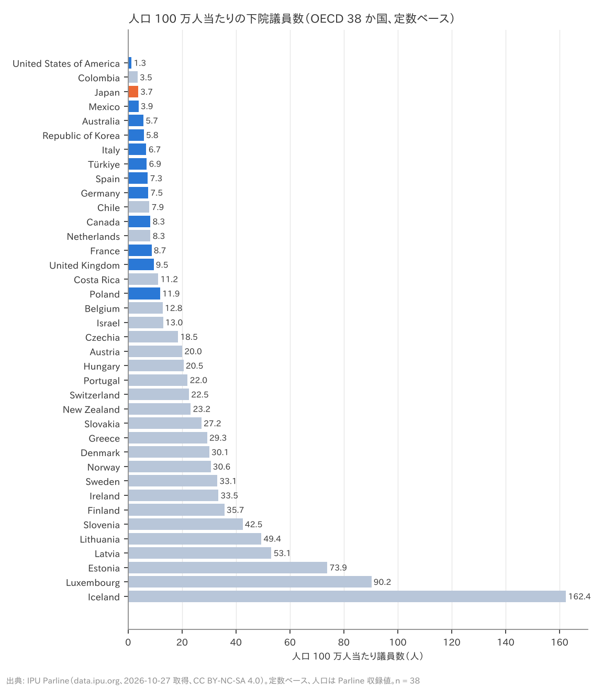
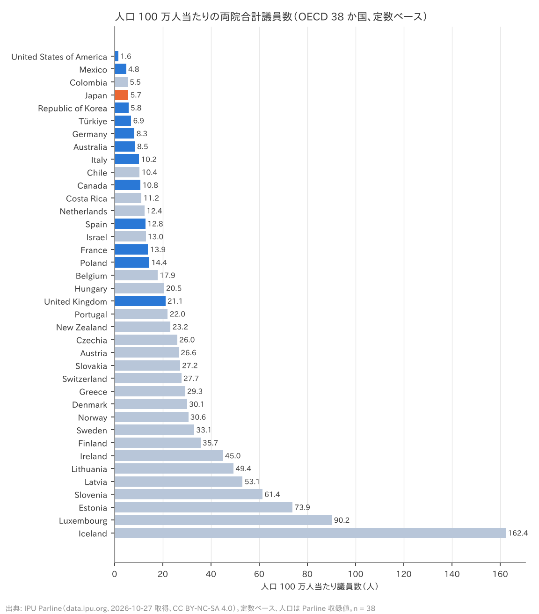
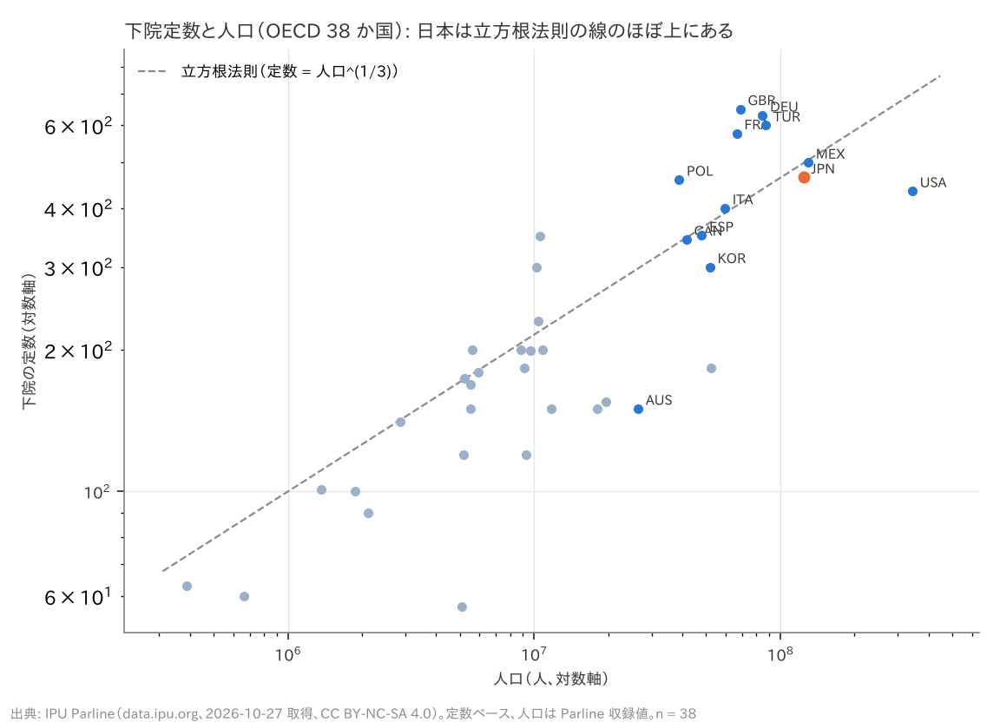

# R1: 人口当たり国会議員数の国際比較 — 「先進国で最低水準」は本当か（H1・H1b・H1c）（2026-10-27, theme: parliament-size）

## 要約（記述のみ、因果の主張はない）
- **H1（人口当たり議員数は先進国で最低水準）は整合。** 日本の人口 100 万人当たりの下院（衆院）議員数は 3.74 人で、OECD 38 か国の少ない方から 3 位（米 1.27、コロンビア 3.50 に次ぐ）。両院合計でも 5.73 人で 4 位。反対論 3 の前提は数字として正しい。
- **H1b（人口規模を補正すると中位）も整合。** 議会定数は人口の立方根に比例するという経験則（立方根法則）で見ると、日本の衆院 465 は人口の立方根 499 の 0.93 倍で、38 か国中 19 位。つまり**「人口当たりで最低水準」は、日本が人口の大きい国であることの機械的な帰結が大きい**。人口 4,000 万人以上の 12 か国の中では米・コロンビアに次いで低いが、独（1.44）・英（1.59）・仏（1.42）・トルコ（1.35）は法則より多く、伊（1.02）・西（0.96）・加（0.99）・メキシコ（0.99）は法則どおり、韓（0.81）・豪（0.50）・米（0.62）は日本より少ない。
- **H1c（削減後も判定は変わらない）は整合。** 1 割減（420）・比例 45 減（420）・比例 31 減（434）のどれでも、下院は 2 位、立方根比は 0.84〜0.87（14〜16 位）で、H1・H1b の判定は動かない。削減は日本を「人口当たりで最少クラス、立方根法則では中位」の位置から動かさない。
- **この結果は「減らす必要がない」の根拠にも「減らしてよい」の根拠にもならない。** 人口当たり比率の低さは事実だが、人口規模で補正すれば日本は平均的であり、どちらの規範（人口比例か立方根か）を採るかで評価が逆転する。議員 1 人の役割の範囲（H2）を見ずに比率だけで結論を出せない。

## 問いと仮説
`design/themes/parliament-size.md` の H1・H1b・H1c（事前登録 2026-10-27。H1: 下院・両院ともに少ない方から 5 位以内なら整合、どちらかが 10 位以下なら不支持。H1b: 下院定数 ÷ 人口の立方根 の順位が 13〜26 位なら整合。H1c: 削減後も H1・H1b の判定が不変なら整合）。推定したい量: 国間の記述的な順位。因果効果は推定しない。

事前登録からの逸脱・事後の具体化: (1) 議員数は IPU Parline の `statutory_members_number`（定数）の最新値。現員（`current_members_number`）でも順位は同じ（頑健性）。(2) 人口は Parline 収録の `population_in_thousands`（2023 年）。設計書は World Bank WDI を併記したが、Parline の人口も UN 系列で同じ値域のため WDI は使わなかった。(3) 両院合計は上院の選出方法を問わず定数を足した。英の貴族院（約 800、任命制）や独の連邦参議院（69、州政府任命）を含む。公選議席だけに限った頑健性を併記。

## データ
| 変数 | 出典 | 定義・単位 | 期間・国 | 備考 |
|---|---|---|---|---|
| 下院・上院の定数 | IPU Parline API `chambers`（`statutory_members_number`） | 法定の議員定数（人）、最新の記録 | OECD 38 か国 58 議院（二院制 20、一院制 18） | 日本 465（2005-09 から）・248。ドイツ 630 は 2023 年改革後 |
| 現員 | 同（`current_members_number`） | 現在の議員数（人） | 同 | 日本 465（2025-12-31 時点）。頑健性のみ |
| 上院の選出方法 | 同（`designation_mode`） | directly_elected / indirectly_elected / appointed | 二院制 20 か国 | 英・加・独は非公選 |
| 人口 | IPU Parline API `countries`（`population_in_thousands`） | 千人、年次 | 2023 年（276 議院）、2024–25 年（5 議院） | UN 系列。日本 124,371 千人 |
| OECD 加盟 | 同（`other_groupings` に `oecd_members`） | 真偽 | 38 か国 | |

mart: `data/marts/ipu_parliaments.parquet`（281 行 = 全議院、35 列。`uv run socioscope run parliament-size fetch && ... stage && ... mart`、取得 2026-10-27）。ライセンスは **CC BY-NC-SA 4.0**（非商用）。

## 方法
記述統計。(a) 人口 100 万人当たり議員数 = 定数 ÷（人口 ÷ 10^6）を下院・両院合計で計算し、少ない順の順位を取る。(b) 立方根比 = 下院定数 ÷ 人口^(1/3)。(c) 日本の衆院定数だけを 420・434 に置き換え（参院 248 は不変）、同じ順位を計算する。他国は動かさない。標準誤差は無い（母集団全体の記述）。

## 結果

### H1: 人口 100 万人当たり議員数（OECD 38 か国、少ない順）
日本は下院 3.74 人で 3 位、両院 5.73 人で 4 位。**判定: 整合。**

| 順位 | 国 | 下院定数 | 両院定数 | 人口（千人） | 下院 /100 万人 | 両院 /100 万人 | 立方根比 | 上院の選出 |
|---|---|---|---|---|---|---|---|---|
| 1 | United States of America | 435 | 535 | 343,477 | 1.27 | 1.56 | 0.62 | directly_elected |
| 2 | Colombia | 183 | 286 | 52,321 | 3.50 | 5.47 | 0.49 | directly_elected |
| 3 | **Japan** | 465 | 713 | 124,371 | 3.74 | 5.73 | 0.93 | directly_elected |
| 4 | Mexico | 500 | 628 | 129,740 | 3.85 | 4.84 | 0.99 | directly_elected |
| 5 | Australia | 150 | 226 | 26,451 | 5.67 | 8.54 | 0.50 | directly_elected |
| 6 | Republic of Korea | 300 | 300 | 51,749 | 5.80 | 5.80 | 0.81 | 一院制 |
| 7 | Italy | 400 | 605 | 59,499 | 6.72 | 10.17 | 1.02 | directly_elected |
| 8 | Türkiye | 600 | 600 | 87,270 | 6.88 | 6.88 | 1.35 | 一院制 |
| 9 | Spain | 350 | 615 | 47,911 | 7.31 | 12.84 | 0.96 | directly_elected |
| 10 | Germany | 630 | 699 | 84,548 | 7.45 | 8.27 | 1.44 | appointed |
| 11 | Chile | 155 | 205 | 19,659 | 7.88 | 10.43 | 0.57 | directly_elected |
| 12 | Canada | 343 | 448 | 41,529 | 8.26 | 10.79 | 0.99 | appointed |
| 13 | Netherlands | 150 | 225 | 18,093 | 8.29 | 12.44 | 0.57 | indirectly_elected |
| 14 | France | 577 | 925 | 66,439 | 8.68 | 13.92 | 1.42 | indirectly_elected |
| 15 | United Kingdom | 650 | 1450 | 68,682 | 9.46 | 21.11 | 1.59 | appointed |
| 16 | Costa Rica | 57 | 57 | 5,106 | 11.16 | 11.16 | 0.33 | 一院制 |
| 17 | Poland | 460 | 560 | 38,763 | 11.87 | 14.45 | 1.36 | directly_elected |
| 18 | Belgium | 150 | 210 | 11,713 | 12.81 | 17.93 | 0.66 | indirectly_elected |
| 19 | Israel | 120 | 120 | 9,256 | 12.96 | 12.96 | 0.57 | 一院制 |
| 20 | Czechia | 200 | 281 | 10,810 | 18.50 | 25.99 | 0.90 | directly_elected |
| 21 | Austria | 183 | 243 | 9,130 | 20.04 | 26.62 | 0.88 | indirectly_elected |
| 22 | Hungary | 199 | 199 | 9,686 | 20.55 | 20.55 | 0.93 | 一院制 |
| 23 | Portugal | 230 | 230 | 10,431 | 22.05 | 22.05 | 1.05 | 一院制 |
| 24 | Switzerland | 200 | 246 | 8,870 | 22.55 | 27.73 | 0.97 | directly_elected |
| 25 | New Zealand | 120 | 120 | 5,173 | 23.20 | 23.20 | 0.69 | 一院制 |
| 26 | Slovakia | 150 | 150 | 5,518 | 27.18 | 27.18 | 0.85 | 一院制 |
| 27 | Greece | 300 | 300 | 10,243 | 29.29 | 29.29 | 1.38 | 一院制 |
| 28 | Denmark | 179 | 179 | 5,948 | 30.09 | 30.09 | 0.99 | 一院制 |
| 29 | Norway | 169 | 169 | 5,519 | 30.62 | 30.62 | 0.96 | 一院制 |
| 30 | Sweden | 349 | 349 | 10,551 | 33.08 | 33.08 | 1.59 | 一院制 |
| 31 | Ireland | 174 | 234 | 5,197 | 33.48 | 45.03 | 1.00 | indirectly_elected |
| 32 | Finland | 200 | 200 | 5,601 | 35.71 | 35.71 | 1.13 | 一院制 |
| 33 | Slovenia | 90 | 130 | 2,118 | 42.49 | 61.38 | 0.70 | indirectly_elected |
| 34 | Lithuania | 141 | 141 | 2,854 | 49.40 | 49.40 | 0.99 | 一院制 |
| 35 | Latvia | 100 | 100 | 1,882 | 53.13 | 53.13 | 0.81 | 一院制 |
| 36 | Estonia | 101 | 101 | 1,367 | 73.88 | 73.88 | 0.91 | 一院制 |
| 37 | Luxembourg | 60 | 60 | 665 | 90.23 | 90.23 | 0.69 | 一院制 |
| 38 | Iceland | 63 | 63 | 388 | 162.37 | 162.37 | 0.86 | 一院制 |




表の下半分は人口 1,000 万人未満の小国が並ぶ。人口当たり比率は小国ほど高くなる（アイスランド 162 人、ルクセンブルク 90 人）。**人口当たり比率の順位は、ほぼ人口の大きさの順位の裏返し**である。

### H1b: 立方根法則で見た位置
日本の立方根比は 0.93 で 19 位（13〜26 位の中央 3 分の 1 に入る）。**判定: 整合。**



人口 4,000 万人以上の 12 か国:

| 国 | 人口（千人） | 下院定数 | 下院 /100 万人 | 立方根比 |
|---|---|---|---|---|
| United States of America | 343,477 | 435 | 1.27 | 0.62 |
| Mexico | 129,740 | 500 | 3.85 | 0.99 |
| Japan | 124,371 | 465 | 3.74 | 0.93 |
| Türkiye | 87,270 | 600 | 6.88 | 1.35 |
| Germany | 84,548 | 630 | 7.45 | 1.44 |
| United Kingdom | 68,682 | 650 | 9.46 | 1.59 |
| France | 66,439 | 577 | 8.68 | 1.42 |
| Italy | 59,499 | 400 | 6.72 | 1.02 |
| Colombia | 52,321 | 183 | 3.50 | 0.49 |
| Republic of Korea | 51,749 | 300 | 5.80 | 0.81 |
| Spain | 47,911 | 350 | 7.31 | 0.96 |
| Canada | 41,529 | 343 | 8.26 | 0.99 |

人口の近いメキシコ（500）とはほぼ同じ。欧州の大国（独・英・仏・土）は人口の割に議員が多い（法則の 1.35〜1.59 倍）側にいる。「日本は独・英・仏より人口当たりで少ない」は正しいが、「法則より少ない」わけではない。

### H1c: 削減シナリオ後
| シナリオ | 衆院定数 | 下院 /100 万人（順位） | 両院 /100 万人（順位） | 立方根比（順位） | H1 | H1b |
|---|---|---|---|---|---|---|
| 現行（465） | 465 | 3.74（3 位） | 5.73（4 位） | 0.932（19 位） | 整合 | 整合 |
| 1 割減（420） | 420 | 3.38（2 位） | 5.37（3 位） | 0.841（14 位） | 整合 | 整合 |
| 比例 45 減（420） | 420 | 3.38（2 位） | 5.37（3 位） | 0.841（14 位） | 整合 | 整合 |
| 比例 31 減（434） | 434 | 3.49（2 位） | 5.48（4 位） | 0.869（16 位） | 整合 | 整合 |

**判定: 整合。** 45 減で日本はコロンビアを抜いて米国に次ぐ 2 位になるが、立方根比は 0.84 で依然として中位（韓 0.81 と豪 0.50 の方が少ない）。

## 頑健性
| 仕様 | 下院の順位 | 両院の順位 | 立方根比の順位 | 判定 |
|---|---|---|---|---|
| 主仕様（定数、OECD 38） | 3 | 4 | 19 / 38 | H1 整合、H1b 整合 |
| 現員ベース（`current_members_number`） | 3 | – | – | 同じ |
| G7 のみ（n = 7） | 2 | 2 | 2 / 7 | 米の次に少ない。立方根比でも G7 では米に次いで低い（独・英・仏が法則より多いため） |
| 人口 1,000 万人以上（n = 21） | 3 | 4 | 9 / 21（区間 8〜16） | H1 整合、H1b 整合 |
| 両院合計を直接公選の議席のみに限定 | – | 4 | – | 英・加・独・仏・蘭などの上院を除いても日本は 4 位 |

どの仕様でも「人口当たりでは最少クラス、立方根法則では中位〜やや少なめ」で変わらない。G7 に限ると立方根比でも米に次いで低いのは、G7 の欧州 3 か国が法則より多い側に偏っているためで、「G7 で最低水準」と「OECD では中位」は両立する。

## 限界・言えないこと
- 記述的な順位であり、「適切な定数」を導かない。立方根法則は経験則（多くの国がその近くに分布する）であって規範ではない。人口比例を規範とすれば日本は少なく、立方根を規範とすれば平均的で、**どちらを規範とするかは数字では決まらない**。
- 議員の役割の範囲（議員立法の比重、職員数、予算、会期）は本レポートでは見ていない（H2 で扱う）。比率の低さが「少なすぎる」ことを意味するかはそこで判断する。
- 上院の性格が国で違う（任命制・間接選挙・州代表）。両院合計の比較は参考値で、主判定は下院。
- 人口は Parline 収録の 2023 年値で、国によって 2024–25 年値が混じる（OECD では該当なし）。
- 定数は最新の記録。ドイツは 2023 年の選挙法改正後の 630（改正前は 736 で立方根比 1.68）、イタリアは 2020 年国民投票後の 400（旧 630）。定数の時系列（H6）は別レポート。
- IPU Parline の定数は各国議会の申告に基づく。日本の 465・248 は公職選挙法と一致することを確認した。他国の値の検証はしていない。

## 再現手順
```bash
uv run socioscope run parliament-size fetch && uv run socioscope run parliament-size stage && uv run socioscope run parliament-size mart
uv run python themes/parliament-size/src/theme_parliament_size/analysis/a20261027_r1_ratio.py
```
mart: `data/marts/ipu_parliaments.parquet`（281 行、35 列: iso3, country, region, subregion, oecd_member, chamber_id, chamber_type, chamber_name, electoral_system, electoral_subsystem, designation_mode, statutory_seats, statutory_seats_since, current_members, directly_elected, majoritarian_tier_seats, proportional_tier_seats, permanent_staff, staff_year, staff_combined_parl, chamber_budget, budget_currency, chamber_budget_ppp, budget_year, budget_combined_parl, basic_salary_ppp, salary_year, plenary_days, plenary_year, committees, members_per_country, population_thousands, population_year, parliament_budget_pct_gov, source）。図 3 枚は `reports/figures/r1_*.png`。LLM 構造化は使っていない。

## チェックリスト回答
- A. 問い・仮説・指標・判定基準は `design/themes/parliament-size.md` に分析前に固定（2026-10-27）。変数の具体化（定数・Parline 人口・上院の扱い）は事後として設計書に記録。推定量は「国間の記述的な順位」。
- B. 出典・定義・取得日は manifest（`data/raw/manifest.jsonl`、sha256 付き）と一致。欠損: OECD 38 か国の定数・人口に欠損なし。補完なし。サンプルは OECD 加盟国（Parline の `oecd_members`）に事前に限定。
- C. 因果を主張しない（記述のみ）。識別戦略なし。
- D. 母集団全体の記述のため標準誤差なし。試した仕様（現員・G7・人口 1,000 万人以上・公選議席のみ）を全部報告。
- E. 「整合」「順位」で書き、因果語は使わない。図は軸・単位・出典・n を明記、対数軸は明示。限界の節あり。再現手順と mart のスキーマ・行数を記載。
