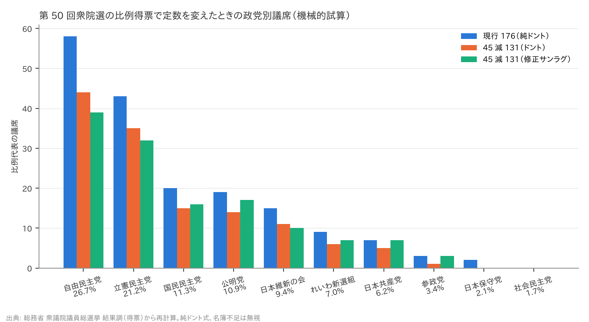
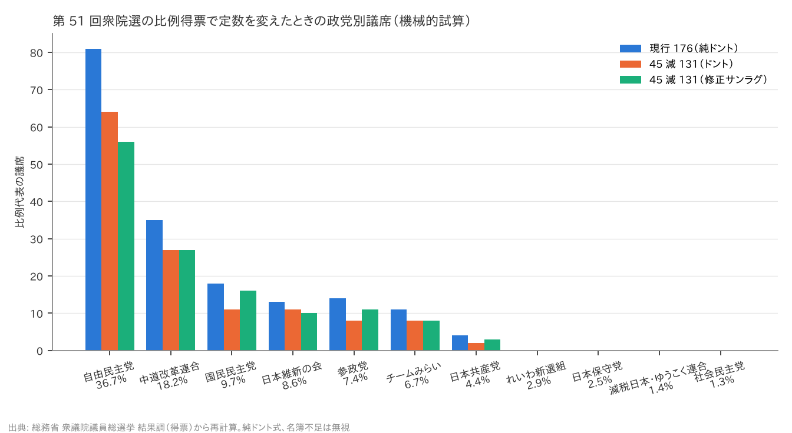
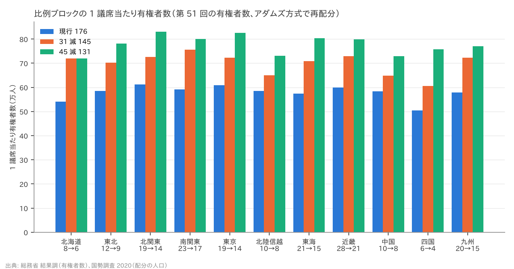

# R2: 比例代表の削減は少数政党と地方ブロックに何をするか（H3・H3b・H3c・H4・H4b）（2026-10-27, theme: parliament-size）

## 要約（機械的試算、因果の主張はない）
- **H3（比例削減は小政党の議席を大政党より大きく減らす）は整合。** 第 50 回（2024-10）・第 51 回（2026-02）の比例得票をそのまま 176 → 131 議席にドント式で配分し直すと、比例得票率 10% 未満の政党群の議席は 36.1%・33.3% 減り、10% 以上の政党群は 22.9%・21.6% 減る。差は +13.3 pt・+11.8 pt（事前基準 ≥ 5 pt）。31 減（145）でも差は +16.3・+11.2 pt。反対論 1 の「比例を減らすと少数政党の議席が削られる」は、票が同じなら数字どおり起きる。
- **H3b（修正サンラグ式はそれを打ち消す）も整合。** 第 1 除数 1.4 の修正サンラグ式に変えると、131 議席でも小政党群の減少率は大政党群と同じか小さくなる（差 −0.7 pt・−8.4 pt）。つまり自民党が示したとされる折衷案（31 減 ＋ 修正サンラグ）は、議席を減らしつつ少数政党への不利を配分方式でほぼ相殺する組み合わせである。145 議席の修正サンラグでは差 −4.7 pt・−11.6 pt で、小政党群はむしろ現行ドント 176 と比べて減り方が小さい。
- **H3c（不比例性は上がる）は整合。** 小選挙区の実績議席と比例の試算議席を合わせた Gallagher 指数は、176 → 131 で 14.7 → 16.2（+1.5 pt、第 50 回）、25.8 → 28.6（+2.8 pt、第 51 回）。
- **H4（比例のみの削減で地方ブロックの格差が広がる）は不支持。** 比例ブロックの定数を現行法どおりアダムズ方式（2020 年国勢調査の日本人人口）で 131 に配分し直すと、ブロック間の「1 議席当たり有権者数」の最大 ÷ 最小は 1.212 → 1.152 で広がらない（145 では 1.248 で 1.03 倍）。定数 10 以下の 4 ブロックで 1 議席を取るのに必要な得票率の上昇は +0.9〜+2.8 pt で、四国だけが基準（+2 pt）を超える。「一票の格差が深刻になる」は、**比例のみの削減については数字で支えられない**。小選挙区の格差は比例を減らしても定義上変わらない。
- **H4b（小選挙区も減らすと格差が 2 倍を超える）は不支持（都道府県単位）。** 小選挙区 289 → 260 をアダムズ方式で配分し直すと、定数 2 の県は 8 → 11 に増え、都道府県単位の最大格差は 1.675 → 1.894 倍で、2.0 倍には届かない。ただし選挙区単位の格差は区割りで決まり、これより大きくなる。
- **副産物: 2026 年 2 月の第 51 回は、自民党が小選挙区で 289 のうち 248 を取ったため比例名簿の登載者が足りず、純ドント式なら 81 議席のところ公式には 67 議席で、14 議席が他党へ移った**（2024 年は国民民主党の東海・北関東で 3 議席）。定数を減らすと名簿不足は起きにくくなる。

## 問いと仮説
`design/themes/parliament-size.md` の H3・H3b・H3c・H4・H4b（事前登録 2026-10-27）。推定したい量: 得票を固定したときの配分の機械的な差。有権者・政党の行動変化（戦略投票、候補者擁立、選挙協力）は織り込まない。因果効果は推定しない。

事前登録からの逸脱・事後の具体化: (1) 削減後のブロック定数は「現行法の方式」＝アダムズ方式 × 国勢調査の日本人人口で配分した（設計書は「アダムズまたは最大剰余」と書いていた。アダムズで現行 176 の配分と小選挙区 289 の都道府県配分が完全に再現できることを先に検算した）。(2) 公式の議席には名簿不足による他党への移転が含まれるため、H3 の基準線は「純ドント式で 176 を配分した値」とし、公式値は併記した。(3) H3c の議席率は小選挙区の実績（公式）＋比例の試算の合計で計算した。(4) H4 (b) の有権者数は第 51 回の比例代表の有権者数を使った。(5) 小政党の定義「比例得票率 10% 未満」は全国得票率で判定した（2024 年は 公明 10.93%・国民 11.31% が大政党側、維新 9.36% が小政党側。2026 年は 国民 9.73%・維新 8.63%・参政 7.44% が小政党側）。

## データ
| 変数 | 出典 | 定義・単位 | 期間 | 備考 |
|---|---|---|---|---|
| 比例代表 ブロック別 党派別 得票数 | 総務省 衆議院議員総選挙 結果調 3(10)（第 50 回 `000979131.xls`、第 51 回 `001061484.xlsx`） | 票（按分票は小数） | 2024-10-27、2026-02-08 | 11 ブロック × 12 党派。ブロック得票総数で検算 |
| 党派別 議席配分表（比例） | 同 3(12) | 当選順位 → 党派別議席 | 同 | 順位 1..S が埋まることで検算。名簿不足の移転を含む |
| 届出政党等別 当選人数（小選挙区・比例） | 同 3(1) | 人 | 同 | 小選挙区 289・比例 176 で検算。無所属・本人届出を含む |
| 都道府県別 有権者数（比例代表） | 同 2(2) | 選挙当日の有権者数（人）、ブロック付き | 同 | ブロック計・全国計で検算 |
| 都道府県別 日本人人口 | e-Stat 令和 2 年国勢調査 人口等基本集計 表 2-1（`statInfId=000032142404`） | 人（2020-10-01、国籍「日本人」） | 2020 | 全国行で検算。画定審が用いる「日本国民の人口」 |

mart: `jp_hr_pr_results`（224 行 = 2 選挙 × 11 ブロック × 党派）、`jp_hr_seats_by_party`（28 行）、`jp_hr_electorate`（94 行）、`jp_census2020_prefecture`（47 行）。取得 2026-10-27。ライセンスは政府標準利用規約 2.0（CC BY 4.0 互換）。

## 方法
1. 検算: アダムズ方式（人口 ÷ 除数 の切り上げ、各単位 1 以上）を 2020 年国勢調査の日本人人口に当て、比例ブロック 176 と小選挙区 289 の現行配分を再現する（両方一致）。
2. H3: 各選挙のブロック別得票を固定し、ブロック定数 176（法定）／145／131（アダムズ再配分）でドント式と修正サンラグ式（除数 1.4, 3, 5, …）により配分。政党群（全国比例得票率 10% 未満／以上）の議席減少率を比べる。
3. H3c: 得票率 = 比例の全国得票率、議席率 = 小選挙区の実績 ＋ 比例の試算。Gallagher 指数 = √(Σ(v−s)²/2)。
4. H4: ブロックの 1 議席当たり有権者数の最大 ÷ 最小。参入閾値 = 他党の票を固定し新党が 1 議席を取るのに必要な得票率（ドントの最後の商から）。
5. H4b: 都道府県人口をアダムズ方式で 260 に配分し、1 議席当たり人口の最大 ÷ 最小。

## 結果

### 検算
- アダムズ方式 × 2020 国勢調査 日本人人口 → 比例ブロック 176 の法定配分と**一致**。
- 同方式で小選挙区 289 → 東京 30、神奈川 20、大阪 19、鳥取 2、定数 2 の県 8（2022 年改正の配分と一致）。

### 表 1: ブロック定数（削減後はアダムズ方式で再配分）
| ブロック | 日本人人口（千人） | 現行 176 | 31 減 145 | 45 減 131 |
|---|---|---|---|---|
| 北海道 | 5,151 | 8 | 6 | 6 |
| 東北 | 8,466 | 12 | 10 | 9 |
| 北関東 | 13,549 | 19 | 16 | 14 |
| 南関東 | 15,704 | 23 | 18 | 17 |
| 東京 | 13,233 | 19 | 16 | 14 |
| 北陸信越 | 7,024 | 10 | 9 | 8 |
| 東海 | 14,288 | 21 | 17 | 15 |
| 近畿 | 19,662 | 28 | 23 | 21 |
| 中国 | 7,038 | 10 | 9 | 8 |
| 四国 | 3,589 | 6 | 5 | 4 |
| 九州 | 13,838 | 20 | 16 | 15 |

### H3: 政党別の比例議席（第 50 回、2024-10-27）
| 政党 | 得票率 % | 公式 176 | ドント 176 | ドント 145 | ドント 131 | 修正サンラグ 145 | 修正サンラグ 131 |
|---|---|---|---|---|---|---|---|
| 自由民主党 | 26.73 | 59 | 58 | 48 | 44 | 44 | 39 |
| 立憲民主党 | 21.20 | 44 | 43 | 37 | 35 | 35 | 32 |
| 国民民主党 | 11.31 | 17 | 20 | 17 | 15 | 17 | 16 |
| 公明党 | 10.93 | 20 | 19 | 18 | 14 | 18 | 17 |
| 日本維新の会 | 9.36 | 15 | 15 | 11 | 11 | 12 | 10 |
| れいわ新選組 | 6.98 | 9 | 9 | 7 | 6 | 7 | 7 |
| 日本共産党 | 6.16 | 7 | 7 | 6 | 5 | 7 | 7 |
| 参政党 | 3.43 | 3 | 3 | 1 | 1 | 3 | 3 |
| 日本保守党 | 2.10 | 2 | 2 | 0 | 0 | 2 | 0 |
| 社会民主党 | 1.71 | 0 | 0 | 0 | 0 | 0 | 0 |
| 計 | 100 | 176 | 176 | 145 | 131 | 145 | 131 |

公式と純ドントの差（名簿不足による移転）: 3 議席（国民民主党 20 → 17。東海・北関東）。

| 比較（第 50 回） | 小政党（<10%）の議席減少率 | 大政党の減少率 | 差（pt） |
|---|---|---|---|
| ドント 145 | 30.6% | 14.3% | +16.3 |
| ドント 131 | 36.1% | 22.9% | +13.3 |
| 修正サンラグ 145 | 13.9% | 18.6% | −4.7 |
| 修正サンラグ 131 | 25.0% | 25.7% | −0.7 |

Gallagher 指数（小選挙区の実績 ＋ 比例）: 公式 14.93、純ドント 176 14.69、145 15.48、131 16.15（+1.47）、修正サンラグ 131 15.01。



### H3: 政党別の比例議席（第 51 回、2026-02-08）
| 政党 | 得票率 % | 公式 176 | ドント 176 | ドント 145 | ドント 131 | 修正サンラグ 145 | 修正サンラグ 131 |
|---|---|---|---|---|---|---|---|
| 自由民主党 | 36.72 | 67 | 81 | 67 | 64 | 61 | 56 |
| 中道改革連合 | 18.23 | 42 | 35 | 33 | 27 | 30 | 27 |
| 国民民主党 | 9.73 | 20 | 18 | 15 | 11 | 16 | 16 |
| 日本維新の会 | 8.63 | 16 | 13 | 11 | 11 | 13 | 10 |
| 参政党 | 7.44 | 15 | 14 | 9 | 8 | 12 | 11 |
| チームみらい | 6.66 | 11 | 11 | 8 | 8 | 9 | 8 |
| 日本共産党 | 4.40 | 4 | 4 | 2 | 2 | 4 | 3 |
| れいわ新選組 | 2.92 | 1 | 0 | 0 | 0 | 0 | 0 |
| 日本保守党 | 2.54 | 0 | 0 | 0 | 0 | 0 | 0 |
| 減税日本・ゆうこく連合 | 1.42 | 0 | 0 | 0 | 0 | 0 | 0 |
| 社会民主党 | 1.27 | 0 | 0 | 0 | 0 | 0 | 0 |
| 計 | 100 | 176 | 176 | 145 | 131 | 145 | 131 |

公式と純ドントの差（名簿不足による移転）: 14 議席（自民党 81 → 67。南関東・東京・北陸信越・近畿・中国など）。

| 比較（第 51 回） | 小政党（<10%）の議席減少率 | 大政党の減少率 | 差（pt） |
|---|---|---|---|
| ドント 145 | 25.0% | 13.8% | +11.2 |
| ドント 131 | 33.3% | 21.6% | +11.8 |
| 修正サンラグ 145 | 10.0% | 21.6% | −11.6 |
| 修正サンラグ 131 | 20.0% | 28.4% | −8.4 |

Gallagher 指数: 公式 23.48、純ドント 176 25.81、145 27.17、131 28.55（+2.75）、修正サンラグ 131 27.13。第 51 回の値が大きいのは小選挙区で自民党が 86% の議席を取ったためで、比例の定数では動かない部分が大半を占める。



**判定: H3 整合（差 +13.3、+11.8 pt）、H3b 整合（修正サンラグでの差はすべて 5 pt 未満）、H3c 整合（+1.47、+2.75 pt）。**

### H4: ブロック間の格差と参入閾値（第 51 回の有権者数）
| シナリオ | 1 議席当たり有権者数 最大（ブロック） | 最小（ブロック） | 最大 ÷ 最小 |
|---|---|---|---|
| 現行 176 | 611,636（北関東） | 504,699（四国） | 1.212 |
| 31 減 145 | 755,854（南関東） | 605,639（四国） | 1.248 |
| 45 減 131 | 830,077（北関東） | 720,244（北海道） | 1.152 |

| ブロック | 定数（176 → 145 → 131） | 1 議席の最小得票率 %（176 / 145 / 131） | 上昇 pt（176 → 131） |
|---|---|---|---|
| 北海道 | 8 → 6 → 6 | 7.6 / 8.5 / 8.5 | +0.9 |
| 北陸信越 | 10 → 9 → 8 | 6.6 / 7.8 / 8.0 | +1.4 |
| 中国 | 10 → 9 → 8 | 6.7 / 7.7 / 7.9 | +1.2 |
| 四国 | 6 → 5 → 4 | 9.5 / 11.5 / 12.3 | +2.8 |



(a) 小選挙区の格差は比例のみの削減では不変（定義上）。(b) ブロック間格差は 176 → 131 で 1.212 → 1.152（0.95 倍）、145 で 1.248（1.03 倍）。いずれも事前基準の 1.1 倍に届かない。アダムズ方式が人口の少ないブロックに有利な切り上げ配分であるため、定数が減っても小ブロックの 1 議席当たり有権者数は大ブロックより少ないままである。(c) 参入閾値は定数が減るほど上がるが、四国以外は 2 pt 未満。**判定: 不支持。**

### H4b: 小選挙区 289 → 260（アダムズ方式、2020 国勢調査 日本人人口、都道府県単位）
| 定数 | 定数 2 の県 | 1 議席当たり人口 最大（県） | 最小（県） | 最大 ÷ 最小 |
|---|---|---|---|---|
| 289 | 8 | 455,704（和歌山県） | 271,990（鳥取県） | 1.675 |
| 260 | 11 | 515,137（北海道） | 271,990（鳥取県） | 1.894 |

減る県（20）: 秋田 3→2、富山 3→2、香川 3→2、茨城 7→6、栃木 5→4、群馬 5→4、長野 5→4、岐阜 5→4、静岡 8→7、京都 6→5、兵庫 12→11、福岡 11→10、沖縄 4→3、北海道 12→10、埼玉 16→14、千葉 14→12、神奈川 20→18、愛知 16→14、大阪 19→17、東京 30→26。**判定: 不支持**（都道府県単位の最大格差 1.894 < 2.0）。鳥取の 2 議席は人口 27 万人で固定されるため、他県の定数を減らすほど格差は広がる方向に動くが、260 では 2 倍に届かない。

## 頑健性
| 仕様 | 結果 |
|---|---|
| H3 を 145（31 減）で判定 | 差 +16.3・+11.2 pt、整合 |
| H3 の基準線を公式議席（名簿不足込み）にした場合 | 第 51 回の自民は公式 67 → ドント 131 で 64 と減り幅が小さくなり、大政党群の減少率が下がる。小政党群の減少率は不変のため差はさらに広がる（整合の向き） |
| H3b を 145 で判定 | 差 −4.7・−11.6 pt、整合 |
| H4 (b) を 145 で判定 | 1.248（1.03 倍）、不支持 |
| H4 (b) を第 50 回の有権者数で判定 | ブロック構成・定数は同じ。有権者数の違いは 1% 未満で結論は不変（計算は同スクリプトで election を変えれば再現可） |
| H4b を人口総数（外国人を含む）で判定 | 法は日本人人口を用いる。総数では東京・愛知の比重が増え、配分が 1〜2 議席動く可能性がある（未計算） |

## 限界・言えないこと
- **票が同じなら**の機械的試算。定数が減れば小政党は擁立・選挙協力を変え、有権者は戦略投票を強める。試算は制度の機械的効果の目安で、実際の議席変化の予測ではない。
- 名簿登載者不足による移転を無視している。2026 年は自民党が 14 議席を失う規模で起きた。定数が減ると不足は起きにくくなり、公式値では大政党の減り幅がさらに小さく見える。
- ブロック再配分は「現行法どおりアダムズ方式」を仮定した。法案が別の配分（比例配分や各ブロック一律減）を採れば結果は変わる。報道ベースの 45 減・31 減・修正サンラグは本書作成時点で成立していない。
- H4b は都道府県単位の格差。実際の一票の格差は選挙区単位で、区割りの仕方で最大 2 倍前後まで広がりうる。区割りは試算していない。
- Gallagher 指数は得票率を比例の全国得票率で代表させた。小選挙区の得票率を使えば値は変わる（無所属・本人届出の議席は得票率 0 として扱った）。
- 「少数政党の議席を守る」ことの価値や「人口の少ないブロックに有利な配分」の是非は規範の問題で、本レポートは数字だけを示す。

## 再現手順
```bash
uv run socioscope run parliament-size fetch && uv run socioscope run parliament-size stage && uv run socioscope run parliament-size mart
uv run python themes/parliament-size/src/theme_parliament_size/analysis/a20261027_r2_pr_blocks.py
```
mart: `data/marts/jp_hr_pr_results.parquet`（224 行: iso3, election, election_date, block, party, rank, votes, share_pct, seats, block_seats, block_votes, source）、`jp_hr_seats_by_party.parquet`（28 行: iso3, election, election_date, party, smd_seats, pr_seats, total_seats, source）、`jp_hr_electorate.parquet`（94 行: iso3, election, election_date, pref, block, electorate_smd, voters_smd, electorate_pr, voters_pr, source）、`jp_census2020_prefecture.parquet`（47 行: iso3, year, pref_code, pref, population_total, population_japanese, source）。図 3 枚は `reports/figures/r2_*.png`。LLM 構造化は使っていない。

## チェックリスト回答
- A. H3・H3b・H3c・H4・H4b と判定基準は `design/themes/parliament-size.md` に分析前に固定（2026-10-27）。配分方式（アダムズ）・基準線（純ドント）・有権者数の年の具体化は事後として本書と設計書に記録。推定量は「得票固定下の配分の機械的差」。
- B. 出典・取得日は manifest（sha256 付き）と一致。公式議席と純ドントの差（名簿不足）を補完せず併記。サンプルは直近 2 回の衆院選（事前に指定）。
- C. 因果を主張しない。識別戦略なし。行動変化を織り込まないことを明記。
- D. 母集団全体の確定値のため標準誤差なし。145／131、ドント／修正サンラグ、公式／純ドントの全仕様を報告。
- E. 「整合」「不支持」「機械的試算」で書き、因果語は使わない。図は軸・単位・出典を明記。限界の節あり。再現手順と mart のスキーマ・行数を記載。
