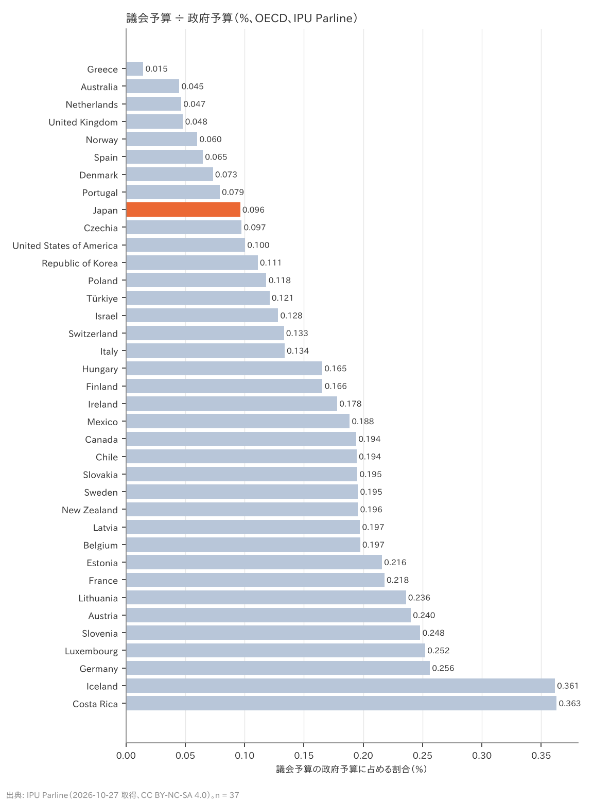
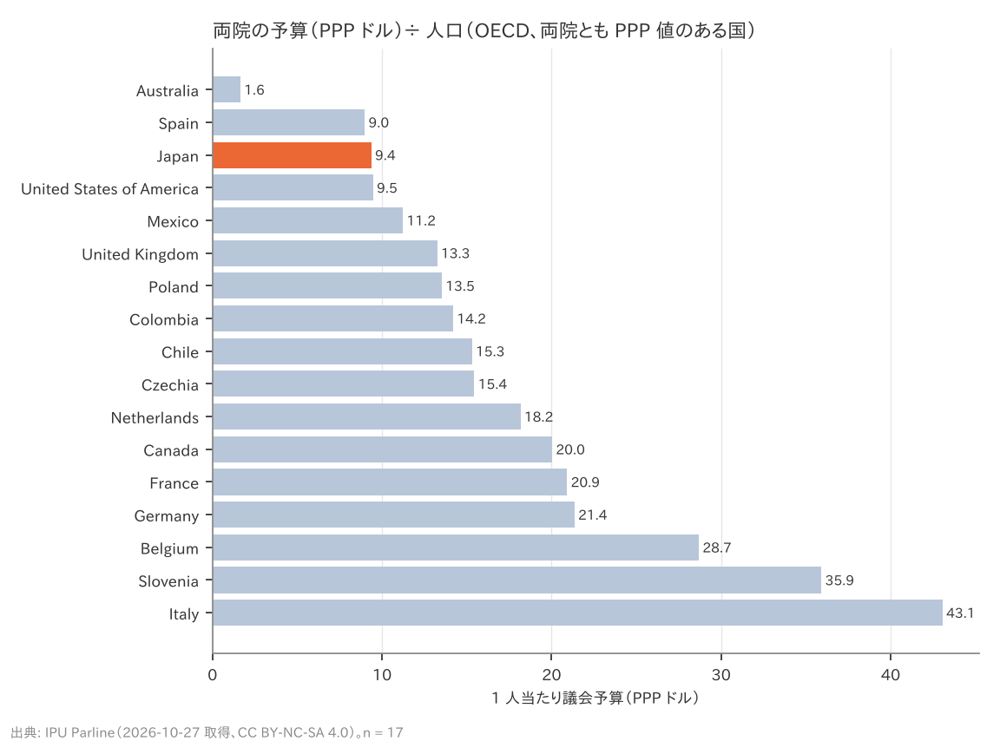

# R3: 定数削減で浮く国費はどれだけか（H5・H5b）（2026-10-27, theme: parliament-size）

## 要約（記述のみ、因果の主張はない）
- **H5（国費の削減効果は量的に小さい）は整合。** 議員 1 人当たりの年間直接経費を法定額から積み上げると 5,525 万〜6,860 万円（歳費＋期末手当 2,106 万、調査研究広報滞在費 1,200 万、立法事務費 780 万、公設秘書 3 人の給与 1,438 万〜2,773 万）。比例 45 減で浮くのは年 24.9〜30.9 億円で、国会所管歳出 1,315 億円の 1.9〜2.4%、一般会計歳出 115.2 兆円の 0.0022〜0.0027%（事前基準: 5% 未満かつ 0.01% 未満）。国民 1 人当たり 25 円/年。31 減なら 17.1〜21.3 億円。
- **H5b（日本の議会費は国際的に中位以下）も整合。** IPU Parline の「議会予算 ÷ 政府予算」で日本は 0.096% で、OECD 37 か国中 少ない方から 9 位（中央値 0.166%、独 0.256%、仏 0.218%、米 0.100%、英 0.048%）。両院の予算（PPP ドル）÷ 人口は 9.37 ドルで、両院とも PPP 値のある 17 か国中 3 位（中央値 15.31）。
- **含意**: 「国費の削減」は象徴的な意味はあっても量的な根拠にはならない。議員会館・事務局職員・委員会運営などの固定費は議員数に比例して減らないため、実際の削減額は上の直接経費よりさらに小さい可能性が高い。逆に、議会費が国際的に低いことは「議員が少なすぎる」ことの証明でもない（H1b と同じく、人口規模や制度の違いを含む）。

## 問いと仮説
`design/themes/parliament-size.md` の H5・H5b（事前登録 2026-10-27）。推定したい量: 削減による直接経費の節約額と、その分母に対する比率（記述）。因果効果は推定しない。

事前登録からの逸脱・事後の具体化: (1) 直接経費は法定額の積み上げ。歳費と期末手当は IPU Parline の `basic_salary`（2025 年、年額 21,063,085 円。歳費 1,294,000 円 × 12 = 15,528,000 円との差 5,535,085 円を期末手当とみなす）。公設秘書の給与は秘書給与法 別表第二 一級一号給（288,800 円/月）〜別表第一 三級四号給（556,900 円/月）× (12 ＋ 4.6) か月（期末・勤勉手当は一般職の例、2024 年度 4.60 月と仮定）× 3 人で下限〜上限を置いた。立法事務費（議員 1 人月額 65 万円、会派に交付）は e-Gov API で法令 ID を特定できず本文未確認（衆議院の説明で確認）。(2) H5b は設計書の COFOG（対 GDP 比）ではなく IPU の「議会予算 ÷ 政府予算 %」と「議院予算 PPP ÷ 人口」で判定した（COFOG 01.1 は執行機関と合算で立法のみを分離できない）。対 GDP 比は未計算。(3) 判定は「少ない方から数えて中央値以下（rank ≤ ceil(n/2)）」。

## データ
| 変数 | 出典 | 定義・単位 | 期間 | 備考 |
|---|---|---|---|---|
| 国会所管歳出、一般会計歳出合計 | 財務省「令和 7 年度一般会計歳入歳出予算（衆議院修正＋参議院修正後）」PDF 2 ページ目 所管別内訳 | 億円、FY2025 修正後（FY2024 当初も） | 2025 | 国会 1,315 億円、合計 1,151,978 億円。22 所管の合計で検算 |
| 歳費月額・調査研究広報滞在費 | 国会議員の歳費、旅費及び手当等に関する法律 第 1 条・第 9 条（e-Gov 法令 API v1 XML） | 円/月 | 現行 | 1,294,000 円、1,000,000 円 |
| 歳費＋期末手当 年額 | IPU Parline JP-LC01 `basic_salary`（2025） | 円/年 | 2025 | 21,063,085 円 |
| 立法事務費 | 立法事務費交付法 第 3 条 | 円/月/議員 | 現行 | 650,000 円（会派交付）。本文は未確認 |
| 公設秘書 給料月額 | 国会議員の秘書の給与等に関する法律 第 3 条・別表第一／第二（e-Gov API） | 円/月 | 現行 | 288,800〜556,900 円 |
| 議院予算（円、PPP）、議会予算 ÷ 政府予算 | IPU Parline `chamber_budget`, `chamber_budget_ppp`, `parliament_devoted_budget_perc` | 円・PPP ドル・% | 2025（国により 2013–2025） | 衆 681 億円、参 427 億円。OECD で `pct_gov` 37 か国、両院 PPP 17 か国 |

mart: `jp_budget_by_organ`（46 行）、`ipu_parliaments`（281 行）。法定額: `src/theme_parliament_size/jp_member_costs.csv`（8 行、出典列あり）。取得 2026-10-27。

## 方法
1. 議員 1 人当たり年間直接経費 = 歳費＋期末手当 ＋ 調査研究広報滞在費 × 12 ＋ 立法事務費 × 12 ＋ 秘書給与（下限〜上限）。
2. 節約額 = 1 人当たり経費 × 削減人数（45・31）。比率 = 節約額 ÷（国会所管歳出、一般会計歳出、衆参の議院予算）。
3. H5b: IPU の `parliament_devoted_budget_perc` と、両院の `chamber_budget_ppp` 合計 ÷ 人口 を OECD で順位付け。

## 結果

### 表 1: 議員 1 人当たりの年間直接経費（円）
| 項目 | 下限 | 上限 | 根拠 |
|---|---|---|---|
| 歳費＋期末手当 | 21,063,085 | 21,063,085 | 歳費法 1 条 月額 1,294,000 円 × 12 ＋ 期末手当（IPU basic_salary 2025） |
| 調査研究広報滞在費 | 12,000,000 | 12,000,000 | 歳費法 9 条 月額 1,000,000 円 × 12 |
| 立法事務費 | 7,800,000 | 7,800,000 | 立法事務費交付法 3 条 議員 1 人月額 650,000 円 × 12（会派に交付） |
| 公設秘書 3 人の給与 | 14,382,240 | 27,733,620 | 秘書給与法 別表第二 288,800 円〜別表第一 556,900 円 × 16.6 か月 × 3 人 |
| **計** | **55,245,325** | **68,596,705** | |

### 表 2: 削減で浮く直接経費と分母に対する比率
| 削減 | 年間節約額（億円） | 国会所管歳出比 | 一般会計歳出比 | 衆参の議院予算比 |
|---|---|---|---|---|
| 比例 45 減 | 24.9〜30.9 | 1.89〜2.35% | 0.0022〜0.0027% | 2.24〜2.78% |
| 比例 31 減 | 17.1〜21.3 | 1.30〜1.62% | 0.0015〜0.0018% | 1.54〜1.92% |

**判定: H5 整合**（45 減・上限で 国会所管比 2.35%、一般会計比 0.0027%）。

### 表 3: 議会予算 ÷ 政府予算（%、OECD 37 か国、IPU Parline）
| 順位 | 国 | % | | 順位 | 国 | % |
|---|---|---|---|---|---|---|
| 1 | Greece | 0.015 | | 20 | Ireland | 0.178 |
| 2 | Australia | 0.045 | | 21 | Mexico | 0.188 |
| 3 | Netherlands | 0.047 | | 22 | Canada | 0.194 |
| 4 | United Kingdom | 0.048 | | 23 | Chile | 0.194 |
| 5 | Norway | 0.060 | | 24 | Slovakia | 0.195 |
| 6 | Spain | 0.065 | | 25 | Sweden | 0.195 |
| 7 | Denmark | 0.073 | | 26 | New Zealand | 0.196 |
| 8 | Portugal | 0.079 | | 27 | Latvia | 0.197 |
| 9 | **Japan** | **0.096** | | 28 | Belgium | 0.197 |
| 10 | Czechia | 0.097 | | 29 | Estonia | 0.216 |
| 11 | United States of America | 0.100 | | 30 | France | 0.218 |
| 12 | Republic of Korea | 0.111 | | 31 | Lithuania | 0.236 |
| 13 | Poland | 0.118 | | 32 | Austria | 0.240 |
| 14 | Türkiye | 0.121 | | 33 | Slovenia | 0.248 |
| 15 | Israel | 0.128 | | 34 | Luxembourg | 0.252 |
| 16 | Switzerland | 0.133 | | 35 | Germany | 0.256 |
| 17 | Italy | 0.134 | | 36 | Iceland | 0.361 |
| 18 | Hungary | 0.165 | | 37 | Costa Rica | 0.363 |
| 19 | Finland | 0.166 | | | | |




両院の予算（PPP ドル）÷ 人口: 日本 9.37 ドル/人（17 か国中 3 位、中央値 15.31）。**判定: H5b 整合**（順位 9/37、PPP 人口当たりでも 3/17）。

## 頑健性
| 仕様 | 結果 |
|---|---|
| 秘書給与を下限／上限で置く | 節約額 24.9〜30.9 億円。判定は上限でも整合 |
| 秘書の手当を 4.6 か月ではなく 0 か月とする | 1 人当たり 4,830 万〜5,800 万円。比率はさらに小さく、判定不変 |
| 分母を衆参の議院予算（IPU、1,108 億円）にする | 2.2〜2.8%。国会所管（国立国会図書館・弾劾裁判所等を含む 1,315 億円）より分母が小さいが 5% 未満 |
| H5b を PPP 人口当たりで判定 | 17 か国中 3 位、整合。ただし PPP 値のある国が半分以下 |
| H5b の「政府予算」の定義 | IPU の `parliament_devoted_budget_perc` は国ごとに分母の定義（中央政府予算の範囲）が揃っていない可能性がある。日本の 0.096% を一般会計 115.2 兆円で逆算すると議会予算 1,108 億円 = 衆参の議院予算合計と一致する |

## 限界・言えないこと
- 直接経費の積み上げで、削減で実際に減る歳出額ではない。議員会館の維持費、事務局職員（衆 1,814 人・参 1,360 人、IPU）、委員会の運営費は固定費で、議員数に比例して減らない。削減で浮く金額は本レポートの数字を上回らないと見るのが自然だが、逆に政党交付金（議員数に連動する部分がある）は含めていない。
- 立法事務費は会派への交付で議員個人の収入ではない。「議員 1 人当たり」に含めたのは削減で浮く額の上限を見るため。
- 期末手当は IPU の `basic_salary` からの逆算で、歳費法 11 条の 2 の乗率（両院議長が協議して定める割合 ≤ 45% と特別職の例による割合）を直接当てていない。
- H5b の分母（政府予算）は国ごとに定義が揃わない可能性がある。順位は目安。対 GDP 比は未計算。
- 「国費の削減」の価値判断（象徴的な意味、政治的効果）は数字では決まらない。本レポートは量の目安を示すだけである。

## 再現手順
```bash
uv run socioscope run parliament-size fetch && uv run socioscope run parliament-size stage && uv run socioscope run parliament-size mart
uv run python themes/parliament-size/src/theme_parliament_size/analysis/a20261027_r3_cost.py
```
mart: `data/marts/jp_budget_by_organ.parquet`（46 行: iso3, fy, stage, organ, in_total, amount_100m_jpy, source）、`ipu_parliaments.parquet`（281 行）。法定額: `src/theme_parliament_size/jp_member_costs.csv`。図 2 枚は `reports/figures/r3_*.png`。LLM 構造化は使っていない。

## チェックリスト回答
- A. H5・H5b と判定基準は設計書に分析前に固定。法定額の積み上げ方・H5b の指標の置き換え（COFOG → IPU）は事後として本書と設計書に記録。推定量は「節約額とその比率（記述）」。
- B. 出典・取得日は manifest と一致（PDF・API・CSV）。法定額は CSV に出典列。立法事務費の本文未確認を明記。欠損: IPU の PPP 予算は OECD 17 か国のみ。
- C. 因果を主張しない。
- D. 確定値のため標準誤差なし。下限〜上限、分母 3 種、手当 0 か月の全仕様を報告。
- E. 「整合」「目安」で書き、因果語は使わない。図は軸・単位・出典・n を明記。限界の節あり。再現手順と mart のスキーマ・行数を記載。
