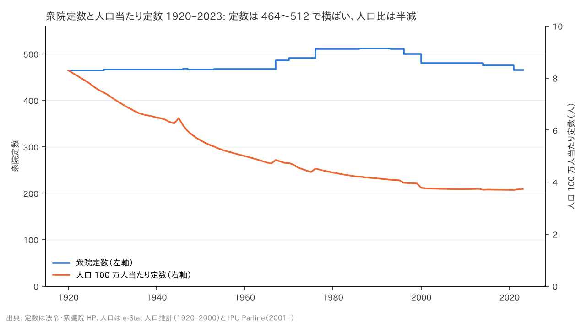
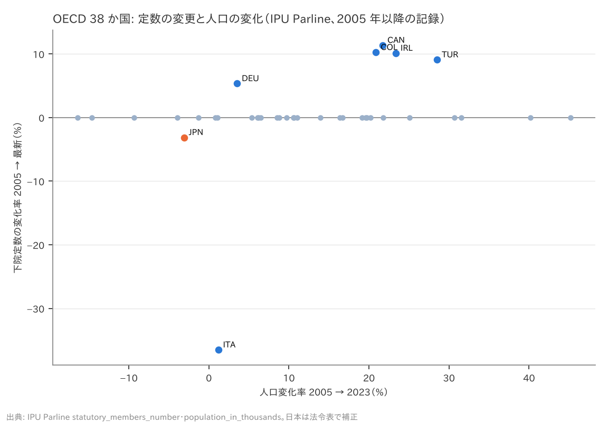

# R4: 定数は人口に連動して変えられてきたか（H6）（2026-10-27, theme: parliament-size）

## 要約（記述のみ、因果の主張はない）
- **H6（日本）は僅差で不支持、内容は「連動していない」で整合。** 衆院定数は 1946 年 468 → 2023 年 465 でほぼ不変、人口は 7,575 万 → 1 億 2,437 万（1.64 倍）。人口 100 万人当たり定数は 6.18 → 3.71（2015 年、0.601 倍）→ 3.74（2023 年、0.605 倍）で、事前基準の「0.6 倍以下」を 0.001〜0.005 上回った。定数は人口増の時代に 468 から 512 まで +9% しか増えず、人口減が始まった 2010 年以降に 480 → 465 と減っている。「人口に合わせて定数を決めてきた」慣行は日本には無い。
- **H6（各国）は整合（弱い証拠）。** OECD 37 か国の 2005 年以降の定数変更率と人口変化率（2005 → 2023）の相関は r = 0.24。定数を変えた 7 か国だけを見ると r = 0.65 だが、イタリアは人口 +1.2% で定数 −36.5%（2020 年国民投票）、ドイツは +3.5% で +5.4%（2023 年選挙法改正で超過議席を廃し 630 に固定。実員は 736 から減）、日本は −3.1% で −3.1%。人口が減った 6 か国（ギリシャ・ハンガリー・日本・リトアニア・ラトビア・ポルトガル）で定数を減らしたのは日本だけ。
- **含意**: 「人口減少に合わせて減らす」は、日本のこれまでの慣行（人口増でも定数はほぼ固定）とも他国の実例（人口減少国は定数を据え置き）とも連続しない新しい規範である。採るかどうかは規範の選択であり、数字は「過去にそうしてきた」ことを支持しない。

## 問いと仮説
`design/themes/parliament-size.md` の H6（事前登録 2026-10-27）。推定したい量: 人口当たり定数の時系列の比（記述）と、各国の定数変更率と人口変化率の相関（記述）。因果効果は推定しない。

事前登録からの逸脱・事後の具体化: (1) IPU Parline の人口系列は 2016–2020 年を欠くため、判定年は 2020 年以前で最も近い 2015 年とし、2023 年を併記した。(2) 戦前〜2000 年の人口は e-Stat 人口推計 長期時系列（総人口、1945・1946 年は注記付き推計）、2001 年以降は IPU Parline（UN 系列）。接続点の 2000 年は 126,926 千人（e-Stat）と 127,534 千人（IPU）で 0.5% の差がある。(3) 定数は法令と衆議院 HP から手入力した表（`jp_seats_history.csv`、1890–2022、出典列あり）。(4) 各国の定数履歴は IPU の `statutory_members_number` の記録で、2005 年の記録しか無い国（31 か国）を「変更なし」と扱った。IPU は日本を 2005 年から 465 としており誤りのため、日本は手入力表（480 → 465）で置き換えた。IPU の記録の深さが国で違うため、各国の判定は弱い証拠として扱う。

## データ
| 変数 | 出典 | 定義・単位 | 期間 | 備考 |
|---|---|---|---|---|
| 衆院・参院の定数 | 衆議院 HP「衆議院議員定数の変遷」「参議院議員定数の変遷」（1946–2004）、公職選挙法・衆議院議員選挙法 | 人、施行年 | 1890–2022 | 手入力表 22 行（`jp_seats_history.csv`）。戦前は選挙法の定数 |
| 総人口 1920–2000 | e-Stat 人口推計 長期時系列 表 1（`statInfId=000000090261`） | 千人、各年 10 月 1 日 | 1920–2000 | 1920–1945 は内地人口 |
| 人口 2001–2023 | IPU Parline `population_in_thousands`（国） | 千人 | 2001–2015、2021–2023 | 2016–2020 を欠く |
| 各国の下院定数の記録 | IPU Parline `statutory_members_number`（議院） | 人、記録の開始日 | 2005– | 1 件のみの国が 31 |

mart: `jp_population_longterm`（81 行）、`staged/ipu/country_attributes`・`chamber_attributes`、`ipu_parliaments`。取得 2026-10-27。

## 方法
1. 各年の衆院定数（その年に有効な法定定数）÷ 人口 → 100 万人当たり定数。1946 年を 1.0 とした比。
2. OECD 下院: IPU の定数記録の最初と最新の値から変更率、IPU の人口から 2005 → 2023 の変化率。Pearson 相関（全 37 か国、変更があった 7 か国）。

## 結果

### 表 1: 衆院定数と人口当たり定数
| 年 | 衆院定数 | 人口（千人） | 100 万人当たり定数 | 1946 年比 |
|---|---|---|---|---|
| 1920 | 464 | 55,963 | 8.29 | 1.342 |
| 1928 | 466 | 62,595 | 7.44 | 1.205 |
| 1946 | 468 | 75,750 | 6.18 | 1.000 |
| 1947 | 466 | 78,101 | 5.97 | 0.966 |
| 1953 | 467 | 86,981 | 5.37 | 0.869 |
| 1967 | 486 | 100,196 | 4.85 | 0.785 |
| 1970 | 491 | 103,720 | 4.73 | 0.766 |
| 1976 | 511 | 113,094 | 4.52 | 0.731 |
| 1986 | 512 | 121,660 | 4.21 | 0.681 |
| 1990 | 512 | 123,611 | 4.14 | 0.670 |
| 1993 | 511 | 124,938 | 4.09 | 0.662 |
| 1996 | 500 | 125,859 | 3.97 | 0.643 |
| 2000 | 480 | 126,926 | 3.78 | 0.612 |
| 2010 | 480 | 128,552 | 3.73 | 0.604 |
| 2014 | 475 | 128,163 | 3.71 | 0.600 |
| 2015 | 475 | 127,975 | 3.71 | 0.601 |
| 2023 | 465 | 124,371 | 3.74 | 0.605 |



1946 年 6.18 人 → 2015 年 3.71 人（0.601 倍）、2023 年 0.605 倍。**判定: 不支持（基準 0.6 倍以下に対し 0.601）。** 数値の内容は「人口が 1.6 倍になる間に定数は 1% も増えず、人口当たりでは 4 割減った」であり、「定数は人口に連動してこなかった」という H6 の趣旨そのものは数字どおりである。判定が不支持になったのは閾値を 0.6 に置いたためで、閾値を 0.61 にすれば整合になる。事前基準を変えないので不支持と記録する。

参考: 参院定数 250（1947）→ 252（1970）→ 247（2001）→ 242（2004）→ 245（2019）→ 248（2022）。

### 表 2: OECD 下院の定数変更と人口変化（2005 → 2023）
| 国 | 定数（最初の記録 → 最新） | 変更率 % | 人口変化率 % | 人口減少中か |
|---|---|---|---|---|
| ITA | 630（2005）→ 400（2022） | −36.5 | +1.2 | いいえ |
| JPN | 480（2005）→ 465（2017） | −3.1 | −3.1 | はい |
| DEU | 598（2005）→ 630（2025） | +5.4 | +3.5 | いいえ |
| TUR | 550（2005）→ 600（2018） | +9.1 | +28.5 | いいえ |
| IRL | 158（2005）→ 174（2024） | +10.1 | +23.4 | いいえ |
| COL | 166（2005）→ 183（2026） | +10.2 | +20.9 | いいえ |
| CAN | 308（2004）→ 343（2025） | +11.4 | +21.7 | いいえ |



人口が減った OECD 国 6（GRC, HUN, JPN, LTU, LVA, PRT）のうち定数を変えたのは日本のみ。相関: 全 37 か国 r = 0.24、変更があった 7 か国 r = 0.65。**判定: 整合（|r| < 0.3）。** 人口が増えた国で定数を増やした例（加・愛・土・コロンビア）はあるが、人口が減った国で定数を減らした例は日本以外に無く、イタリアの大幅削減は人口とは無関係（財政・効率の議論）である。

## 頑健性
| 仕様 | 結果 |
|---|---|
| 基準年を 1947 年（466、沖縄除く）にする | 1947 年 5.97 → 2015 年 3.71 = 0.622 倍。不支持 |
| 基準年を 1920 年（464）にする | 8.29 → 3.71 = 0.448 倍。整合 |
| 判定年を 2023 年にする | 0.605 倍。不支持 |
| 人口を日本人人口（1950–2000 は e-Stat、2020 は国勢調査 1.215 億）にする | 2020 年: 465 ÷ 121.5 = 3.83 → 1950 年（466 ÷ 83.2 = 5.60）比 0.683。基準年が変わるため直接比較はできないが、総人口より比は高くなる方向 |
| 各国の相関を変更があった国だけで取る | r = 0.65（n = 7、ほぼ人口増の国が定数を増やした効果）。全体では 0.24 |

## 限界・言えないこと
- IPU の定数履歴は 2005 年以降で、1 件しか記録の無い国を「変更なし」と扱った。2005 年以前の変更（例: 1990 年代の各国改革）は見えない。各国の判定は弱い証拠。
- 定数の「あるべき水準」を導かない。人口比例・立方根法則・固定のどれを規範とするかで評価は変わる（R1）。
- 定数変更の理由（財政、選挙制度改革、超過議席の是正）は各国で違い、人口との相関は因果を示さない。
- 戦前の定数は選挙法の数字で、植民地・外地の議席は含まない。人口も内地人口。

## 再現手順
```bash
uv run socioscope run parliament-size fetch && uv run socioscope run parliament-size stage && uv run socioscope run parliament-size mart
uv run python themes/parliament-size/src/theme_parliament_size/analysis/a20261027_r4_history.py
```
mart: `data/marts/jp_population_longterm.parquet`（81 行: iso3, year, population_total_thousands, population_japanese_thousands, source）、`data/staged/ipu/{country,chamber}_attributes.parquet`、`ipu_parliaments.parquet`。定数: `src/theme_parliament_size/jp_seats_history.csv`（22 行）。図 2 枚は `reports/figures/r4_*.png`。LLM 構造化は使っていない。

## チェックリスト回答
- A. H6 と判定基準は設計書に分析前に固定。判定年（2015）・人口系列の接続・各国の扱いは事後として記録。推定量は「比と相関（記述）」。
- B. 出典・取得日は manifest と一致。定数の手入力表は出典列あり。欠損（IPU の 2016–2020 年、各国の定数履歴の浅さ）を明記し、補完していない。
- C. 因果を主張しない。
- D. 確定値のため標準誤差なし。基準年・判定年・人口定義・相関の対象を変えた全仕様を報告。
- E. 「整合」「不支持」「連動していない」で書き、因果語は使わない。図は軸・単位・出典を明記。限界の節あり。再現手順と mart のスキーマ・行数を記載。
