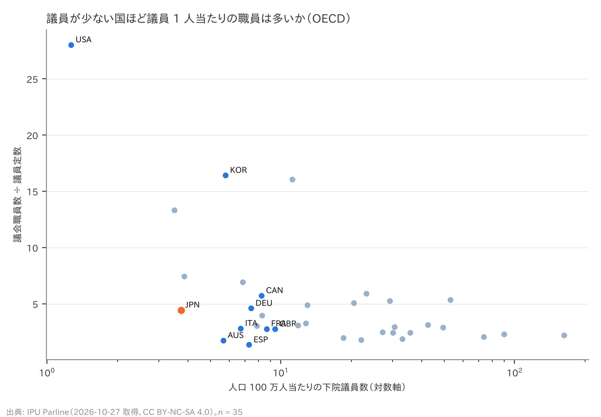
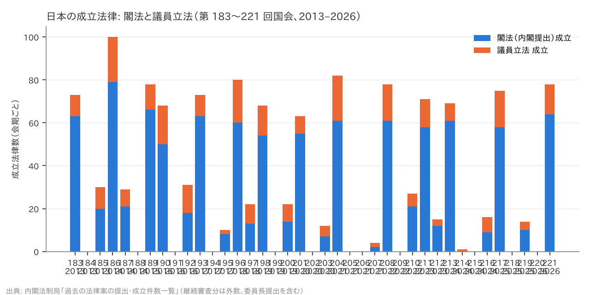

# R5: 「議員が少ない」国は「議員の仕事が広い」国か（H2 役割の範囲）（2026-10-27, theme: parliament-size）

## 要約（記述のみ、因果の主張はない）
- **H2 (a)（議員が少ない国ほど議員 1 人当たりの議会職員が多い）は整合。** OECD 35 か国で、人口 100 万人当たりの下院議員数と「議会職員数 ÷ 議員定数」の Spearman 順位相関は ρ = −0.42。議員の少ない米（職員 28.0 人/議員）・コロンビア（13.4）・メキシコ（7.5）が多く、議員の多い北欧・バルト諸国は 2〜3 人。日本は 4.45 人/議員（両院合計 3,174 人 ÷ 713 人）で 35 か国中 多い方から 14 位（中央値 3.07）。
- **補助指標も同じ向き。** 議員 1 人当たりの議院予算（PPP ドル）は ρ = −0.62（n = 17）、議員の基本給（PPP）は ρ = −0.46（n = 38）。議員が少ない国は 1 人当たりに多くの資源（職員・予算・報酬）を付けている。本会議日数（ρ = −0.03）と常任委員会数（ρ = −0.20）は関係がない。日本の本会議日数 47 日は 38 か国中 少ない方から 6 位。
- **H2 (b)（議員立法の比率）は判定不能。** 各国の「議員立法が成立法律に占める比率」を持つ構造化ソースが無い。日本の時系列（内閣法制局、第 183〜221 回国会、2013–2026）では、成立法律 1,289 本のうち議員立法は 281 本（21.8%）。閣法の成立率 93.8% に対し議員立法は 17.8%。年ごとの議員立法比率は 14〜31%。
- **含意**: 「人口当たり議員数が少ない」国は、議員 1 人に職員・予算を厚く付けて役割を果たす傾向が OECD 全体にある。日本は議員数が少ない側で、職員数は中位より多く、予算も中位。「比率が最低水準」はそのまま「減らす必要がない」の根拠にはならず、減らすなら 1 人当たりの職員・予算をどうするかが論点になる。逆に、議員 1 人当たりの資源が国際的に薄いわけでもないので「減らしても支障がない」の根拠にもならない。

## 問いと仮説
`design/themes/parliament-size.md` の H2（事前登録 2026-10-27）。推定したい量: 国間の順位相関（記述）。因果効果は推定しない。

事前登録からの逸脱・事後の具体化: (1) 職員数は IPU Parline の `permanent_staff_number`（最新記録）。両院に値がある国は合計 ÷ 両院定数、片方だけの国はその議院が「両院合計の職員」と申告していれば ÷ 両院定数、そうでなければ ÷ その議院の定数（チリのみ）。(2) H2 (b) は各国データが無く判定不能。日本は内閣法制局の集計（衆法・参法の区別なし、委員長提出を含む）で記述。(3) 補助指標（本会議日数・委員会数・議員 1 人当たり予算・基本給）は探索的。

## データ
| 変数 | 出典 | 定義・単位 | 期間 | 備考 |
|---|---|---|---|---|
| 議会職員数 | IPU Parline `permanent_staff_number`、`is_staff_combined_parl` | 人（常勤）、議院ごと | 最新（2019–2025） | OECD 35 か国。AUT・CHE・IRL は欠損。日本 衆 1,814（2025）・参 1,360 |
| 定数・人口 | IPU Parline `statutory_members_number`、`population_in_thousands` | 人、千人 | 最新、2023 | R1 と同じ |
| 本会議日数・常任委員会数 | IPU `num_days_parl_plen`、`num_cham_perm_committees` | 日/年、数（下院） | 最新 | 日本 47 日（2025）、17 委員会 |
| 議院予算（PPP）・基本給（PPP） | IPU `chamber_budget_ppp`、`basic_salary_ppp` | PPP ドル | 最新 | PPP 予算は両院とも値のある 17 か国 |
| 法律案の提出・成立 | 内閣法制局「過去の法律案の提出・成立件数一覧」 | 件、国会回次 | 第 183〜221 回（2013-01〜2026-02） | 継続審査は外数。議員立法は衆法＋参法（委員長提出を含む） |

mart: `ipu_parliaments`（281 行）、`jp_bill_counts`（39 行）。取得 2026-10-27。IPU は CC BY-NC-SA 4.0（非商用）。

## 方法
1. 国ごとに 下院定数 ÷ 人口（100 万人当たり）と 職員 ÷ 定数 を計算し、Spearman 順位相関。同値は平均順位。
2. 補助指標についても同じ順位相関。
3. 日本の議員立法比率 = 議員立法の成立数 ÷（閣法 ＋ 議員立法の成立数）。会期別・年別。

## 結果

### 表 1: 人口当たり議員数と 議員 1 人当たり議会職員数（OECD 35 か国、人口当たり議員数の少ない順）
| 国 | 下院 /100 万人 | 職員 ÷ 議員 | 計算 | 本会議日数 | 常任委員会 | 議員 1 人当たり議院予算 PPP ドル | 基本給 PPP ドル |
|---|---|---|---|---|---|---|---|
| United States of America | 1.27 | 28.04 | 両院合計 | 169 | 21 | 6,084,112 | 174,000 |
| Colombia | 3.50 | 13.35 | 両院合計 | 97 | 13 | 2,597,505 | 433,240 |
| **Japan** | 3.74 | 4.45 | 両院合計 | 47 | 17 | 1,634,650 | 163,264 |
| Mexico | 3.85 | 7.46 | 両院合計 | 102 | 51 | 2,321,211 | 131,528 |
| Australia | 5.67 | 1.75 | 両院合計 | 40 | 16 | 192,679 | 173,392 |
| Republic of Korea | 5.80 | 16.43 | 一院 | 52 | 17 | – | 101,274 |
| Italy | 6.72 | 2.82 | 両院合計 | 188 | 14 | 4,235,321 | 205,015 |
| Türkiye | 6.88 | 6.96 | 一院 | 113 | 19 | – | 238,239 |
| Spain | 7.31 | 1.36 | 両院合計 | 65 | 36 | 699,989 | 79,091 |
| Germany | 7.45 | 4.61 | 両院合計 | 57 | 24 | 2,582,782 | 193,515 |
| Chile | 7.88 | 3.06 | 1 議院のみ | 140 | 34 | 1,467,973 | 193,732 |
| Canada | 8.26 | 5.74 | 両院合計 | 72 | 26 | 1,857,603 | 184,767 |
| Netherlands | 8.29 | 3.99 | 両院合計 | 103 | 15 | 1,460,983 | 162,496 |
| France | 8.68 | 2.79 | 両院合計 | 119 | 8 | 1,502,554 | 102,375 |
| United Kingdom | 9.46 | 2.78 | 両院合計 | 158 | 37 | 628,079 | 138,222 |
| Costa Rica | 11.16 | 16.07 | 一院 | 228 | 22 | – | 150,743 |
| Poland | 11.87 | 3.07 | 両院合計 | 67 | 29 | 936,613 | 81,737 |
| Belgium | 12.81 | 3.29 | 両院合計 | 48 | 11 | 1,600,165 | 137,057 |
| Israel | 12.96 | 4.89 | 一院 | 112 | 15 | – | 158,651 |
| Czechia | 18.50 | 1.99 | 両院合計 | 88 | 18 | 594,218 | 94,824 |
| Hungary | 20.55 | 5.09 | 一院 | 38 | 21 | – | 106,924 |
| Portugal | 22.05 | 1.81 | 一院 | 75 | 15 | – | 111,286 |
| New Zealand | 23.20 | 5.91 | 一院 | 87 | 20 | – | 118,607 |
| Slovakia | 27.18 | 2.51 | 一院 | 79 | 19 | – | 96,441 |
| Greece | 29.29 | 5.28 | 一院 | 176 | 19 | – | 118,761 |
| Denmark | 30.09 | 2.46 | 一院 | 105 | 20 | – | 128,576 |
| Norway | 30.62 | 2.93 | 一院 | 100 | 12 | – | 131,588 |
| Sweden | 33.08 | 1.89 | 一院 | 156 | 15 | – | 109,690 |
| Finland | 35.71 | 2.46 | 一院 | 131 | 17 | – | 119,526 |
| Slovenia | 42.49 | 3.15 | 両院合計 | 88 | 22 | 585,251 | 106,362 |
| Lithuania | 49.40 | 2.89 | 一院 | 54 | 16 | – | 85,196 |
| Latvia | 53.13 | 5.37 | 一院 | 45 | 16 | – | 102,896 |
| Estonia | 73.88 | 2.07 | 一院 | 120 | 11 | – | 128,187 |
| Luxembourg | 90.23 | 2.32 | 一院 | 40 | 22 | – | 126,500 |
| Iceland | 162.37 | 2.21 | 一院 | 131 | 8 | – | 129,105 |



- Spearman ρ（人口当たり議員数 × 職員 ÷ 議員）= −0.42（n = 35）。**判定: H2 (a) 整合。**
- 補助（探索的）: 本会議日数 ρ = −0.03（n = 38、日本 47 日は少ない方から 6 位）、常任委員会数 ρ = −0.20（日本 17）、議員 1 人当たり議院予算 PPP ρ = −0.62（n = 17、日本 163 万ドルは 11 位）、基本給 PPP ρ = −0.46（n = 38、日本 16.3 万ドルは 29 位）。

### 表 2: 日本の法律案の提出・成立（内閣法制局、第 183〜221 回）
| 区分 | 提出 | 成立 | 成立率 | 成立法律に占める比率 |
|---|---|---|---|---|
| 閣法（内閣提出） | 1,075 | 1,008 | 93.8% | 78.2% |
| 議員立法（衆法＋参法、委員長提出を含む） | 1,575 | 281 | 17.8% | 21.8% |

| 年 | 閣法 成立 | 議員立法 成立 | 議員立法の比率 |
|---|---|---|---|
| 2013 | 83 | 20 | 19% |
| 2014 | 100 | 29 | 22% |
| 2015 | 66 | 12 | 15% |
| 2016 | 68 | 31 | 31% |
| 2017 | 71 | 12 | 14% |
| 2018 | 73 | 29 | 28% |
| 2019 | 68 | 22 | 24% |
| 2020 | 62 | 13 | 17% |
| 2021 | 63 | 23 | 27% |
| 2022 | 82 | 23 | 22% |
| 2023 | 70 | 16 | 19% |
| 2024 | 70 | 16 | 19% |
| 2025 | 68 | 21 | 24% |
| 2026 | 64 | 14 | 18% |



**判定: H2 (b) 判定不能**（各国比較のデータが無い）。日本では成立法律の 2 割が議員立法で、提出された議員立法の 8 割は成立しない。

## 頑健性
| 仕様 | 結果 |
|---|---|
| 職員 ÷ 下院定数（下院の職員のみ、両院合計申告の国を除く） | 日本 1,814 ÷ 465 = 3.90。順位相関の向きは同じ（主仕様で報告した両院合計の方が国間の定義が揃う） |
| 米国を除く（職員 28 人/議員の外れ値） | ρ は弱まるが負（n = 34）。相関は米国だけで決まってはいない（表 1 の上位 4 か国すべてが中央値超） |
| 人口当たり議員数を両院合計にする | 順位はほぼ同じ（R1）で、ρ の符号は不変 |

## 限界・言えないこと
- 職員数の定義が国で揃わない（常勤のみ、図書館・警備を含むか、議員個人の秘書を含むか）。日本の 3,174 人は衆参事務局（法制局・図書館を含まない）で、公設秘書（議員 1 人 3 人、約 2,100 人）は含まない。含めると 7.4 人/議員になり順位はさらに上がる。他国も同様の違いがある。
- 「役割の範囲」は職員・予算・日数で代理しただけで、議員が実際に担う仕事（行政監視、選挙区サービス、政党内の役割）は測っていない。
- 議員立法の国際比較は本レポートではできなかった。日本の 22% を他国と比べるには、各国議会の統計を個別に集める必要がある。
- 相関は因果ではない。議員が少ないから職員を増やしたのか、職員が多いから議員を減らせたのかは分からない。

## 再現手順
```bash
uv run socioscope run parliament-size fetch && uv run socioscope run parliament-size stage && uv run socioscope run parliament-size mart
uv run python themes/parliament-size/src/theme_parliament_size/analysis/a20261027_r5_roles.py
```
mart: `data/marts/ipu_parliaments.parquet`（281 行）、`jp_bill_counts.parquet`（39 行: iso3, session, kind, start_date, year, cabinet_submitted, cabinet_enacted, member_submitted, member_enacted, member_share_of_enacted, source）。図 2 枚は `reports/figures/r5_*.png`。LLM 構造化は使っていない。

## チェックリスト回答
- A. H2 と判定基準は設計書に分析前に固定。職員数の集計方法・(b) の判定不能・補助指標の探索的扱いは事後として記録。推定量は「順位相関（記述）」。
- B. 出典・取得日は manifest と一致。欠損（職員 3 か国、PPP 予算 21 か国）を明記し補完していない。
- C. 因果を主張しない。
- D. 確定値のため標準誤差なし。下院のみ・米国除外・両院合計の仕様を報告。
- E. 「整合」「判定不能」「探索的」で書き、因果語は使わない。図は軸・単位・出典・n を明記、対数軸は明示。限界の節あり。再現手順と mart のスキーマ・行数を記載。
