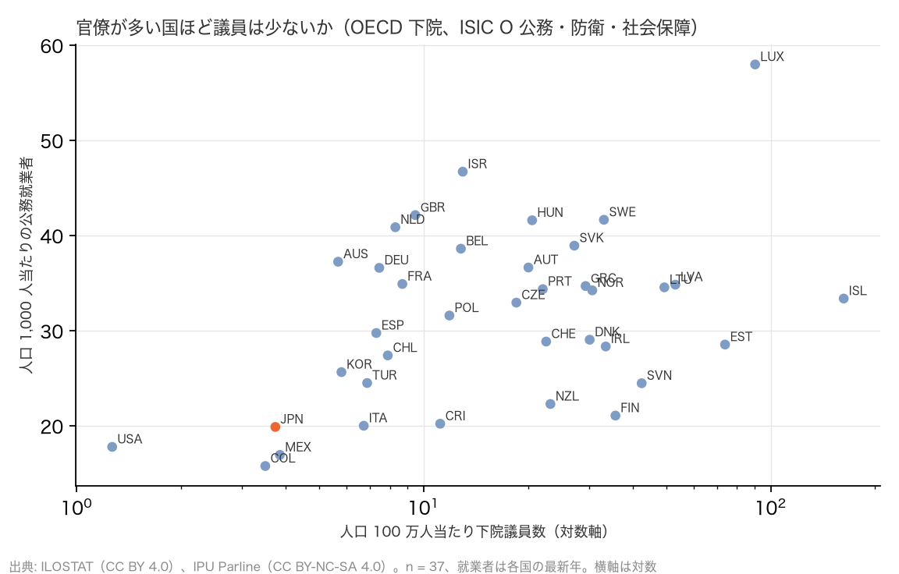

# R10: 官僚が多い国ほど議員は少ないか（H2e）（2026-10-28, theme: parliament-size）

## 要約（順位相関の記述、因果の主張はない）
- **H2e（官僚が多い国ほど議員は少ない）は、事前基準では「中間」、向きは逆。** OECD 37 か国で、人口 1,000 人当たりの公務就業者（ILOSTAT、ISIC Rev.4 大分類 O「公務・防衛・社会保障」）と人口 100 万人当たりの下院議員数の Spearman ρ = +0.33。仮説の向き（ρ ≤ −0.3）とは反対で、議員が少ない国は公務就業者も少ない。「行政府が大きいから議員が少なくて済む」という代替関係は数字に見えない。
- **日本は議員も公務就業者も少ない。** 公務就業者は人口 1,000 人当たり 19.9 人（2023 年）で 37 か国中 少ない方から 4 位（中央値 33.0。米国 17.8、コロンビア 15.8、メキシコ 17.0 の次）。議員 1 人当たりでは 5,327 人で多い方から 3 位だが、これは分母の議員が少ないためで、米国 14,072 人、豪州 6,574 人に次ぐ。
- **相関の多くは規模効果。** 人口当たり議員数は人口の大きい国ほど低く（人口との ρ = −0.90、R1 と同じ）、人口当たり公務就業者もやや同じ向き（ρ = −0.21）。米国・日本・メキシコ・コロンビアのような大国が左下に、ルクセンブルク・アイスランドのような小国が右上に集まり、正の相関はこの配置で説明できる。米国を除くと ρ = 0.28、公的部門（教育・医療を含む）では ρ = 0.48 で、向きは変わらない。
- **含意**: 議員の少なさを行政府の大きさが補っているとは言えない。日本は議会（議員）も行政（公務就業者）も人口比では小さい国で、R5 で見た「議員 1 人当たりの議会職員・予算が厚い」は、行政府との分担ではなく議会内部の資源配分の話である。

## 問いと仮説
`design/themes/parliament-size.md` の「事後追加（2026-10-28 夜）」H2e。ユーザー提起「官僚が多数いる国では議員数は少なくて良い可能性があるのではないか」を、H2 の枠（役割の範囲）の一部として立てた。推定したい量: 国間の順位相関（記述）。因果効果（官僚が多いから議員を減らせる）は推定しない。

事後の具体化: (1) 公務就業者は ILOSTAT `EMP_TEMP_SEX_ECO_NB`（男女計、ISIC Rev.4 大分類 O）の 2025 年以前で最新の年（多くは 2025 年、日本 2023 年、NZ 2015 年）。カナダは ILOSTAT が NAICS 分類のため ISIC O が無く対象外。(2) 人口は IPU の 2023 年値（R1 と同じ）。(3) 規模効果の確認（人口との相関）は結果を見た後に加えた探索で、判定には使わない。

## データ
| 変数 | 出典 | 定義・単位 | 期間 | 備考 |
|---|---|---|---|---|
| 公務就業者 | ILOSTAT `EMP_TEMP_SEX_ECO_NB_A`、classif1 = ECO_ISIC4_O（公務・防衛・社会保障）と ECO_ISIC4_TOTAL（総就業者） | 千人、年 | 2015–2025 | CC BY 4.0。警察・軍人・自治体職員を含み、公立の教育・医療は含まない。OECD 37 か国（CAN 欠損） |
| 公的部門就業者 | ILOSTAT `EMP_TEMP_SEX_INS_NB_A`、classif1 = INS_SECTOR_PUB | 千人、年 | 2015–2025 | 公立の教育・医療・公営企業を含む広い定義。OECD 32 か国（CZE・DEU・ISL・ITA・NZL・PRT 欠損） |
| 定数・人口 | IPU Parline `statutory_members_number`、`population_in_thousands` | 人、千人 | 最新、2023 | R1 と同じ |

mart: `ilo_emp_public_admin`（long: iso3, year, metric, value_thousands）、`ilo_emp_public_sector`、`ipu_parliaments`。2026-10-28 取得。

## 方法
1. 国ごとに 下院定数 ÷ 人口（100 万人当たり）と 公務就業者 ÷ 人口（1,000 人当たり）を計算し、Spearman 順位相関（同値は平均順位）。
2. 補助: 就業者に占める公務の比率、公的部門就業者、米国除外、議員 1 人当たりの公務就業者。
3. 規模効果の確認: 人口と各指標の順位相関。

## 結果

### 表 1: 人口当たりの公務就業者と人口当たり議員数（OECD、議員数の少ない順）
| 国 | 下院 /100 万人 | 公務就業者（千人） | 年 | 人口 1,000 人当たり | 就業者に占める % | 議員 1 人当たり公務就業者 | 公的部門 /1,000 人 |
|---|---|---|---|---|---|---|---|
| United States of America | 1.27 | 6,121 | 2025 | 17.8 | 3.7 | 14,072 | 63.9 |
| Colombia | 3.50 | 827 | 2025 | 15.8 | 3.5 | 4,520 | 16.7 |
| **Japan** | 3.74 | 2,477 | 2023 | 19.9 | 3.7 | 5,327 | 42.3 |
| Mexico | 3.85 | 2,203 | 2025 | 17.0 | 3.6 | 4,406 | 44.9 |
| Australia | 5.67 | 986 | 2025 | 37.3 | 6.8 | 6,574 | 139.0 |
| Republic of Korea | 5.80 | 1,329 | 2025 | 25.7 | 4.6 | 4,430 | 54.6 |
| Italy | 6.72 | 1,192 | 2025 | 20.0 | 4.9 | 2,981 | – |
| Türkiye | 6.88 | 2,141 | 2025 | 24.5 | 6.6 | 3,568 | 59.1 |
| Spain | 7.31 | 1,427 | 2025 | 29.8 | 6.4 | 4,078 | 74.1 |
| Germany | 7.45 | 3,098 | 2025 | 36.6 | 7.3 | 4,917 | – |
| Chile | 7.88 | 539 | 2025 | 27.4 | 5.7 | 3,479 | 46.0 |
| Canada | 8.26 | – | – | – | – | – | 109.5 |
| Netherlands | 8.29 | 740 | 2025 | 40.9 | 7.5 | 4,934 | 68.9 |
| France | 8.68 | 2,321 | 2025 | 34.9 | 7.9 | 4,023 | 88.1 |
| United Kingdom | 9.46 | 2,897 | 2025 | 42.2 | 8.5 | 4,457 | 118.9 |
| Costa Rica | 11.16 | 103 | 2025 | 20.3 | 4.6 | 1,814 | 64.6 |
| Poland | 11.87 | 1,226 | 2025 | 31.6 | 7.1 | 2,665 | 108.3 |
| Belgium | 12.81 | 453 | 2025 | 38.6 | 8.8 | 3,018 | 86.5 |
| Israel | 12.96 | 433 | 2024 | 46.7 | 9.9 | 3,606 | 141.6 |
| Czechia | 18.50 | 357 | 2025 | 33.0 | 6.8 | 1,783 | – |
| Austria | 20.04 | 335 | 2025 | 36.7 | 7.4 | 1,830 | 41.4 |
| Hungary | 20.55 | 403 | 2025 | 41.6 | 8.6 | 2,027 | 140.7 |
| Portugal | 22.05 | 359 | 2025 | 34.4 | 6.8 | 1,560 | – |
| Switzerland | 22.55 | 256 | 2025 | 28.9 | 5.2 | 1,281 | 90.5 |
| New Zealand | 23.20 | 116 | 2015 | 22.3 | 4.9 | 962 | – |
| Slovakia | 27.18 | 215 | 2025 | 39.0 | 8.2 | 1,434 | 136.9 |
| Greece | 29.29 | 356 | 2025 | 34.7 | 8.2 | 1,186 | 77.7 |
| Denmark | 30.09 | 173 | 2025 | 29.1 | 5.6 | 966 | 144.9 |
| Norway | 30.62 | 189 | 2025 | 34.3 | 6.5 | 1,119 | 158.2 |
| Sweden | 33.08 | 440 | 2025 | 41.7 | 8.3 | 1,260 | 140.6 |
| Ireland | 33.48 | 147 | 2025 | 28.4 | 5.2 | 848 | 77.1 |
| Finland | 35.71 | 118 | 2025 | 21.1 | 4.5 | 591 | 111.1 |
| Slovenia | 42.49 | 52 | 2025 | 24.5 | 5.2 | 577 | 113.9 |
| Lithuania | 49.40 | 99 | 2025 | 34.6 | 6.7 | 700 | 132.2 |
| Latvia | 53.13 | 66 | 2025 | 34.9 | 7.4 | 656 | 137.4 |
| Estonia | 73.88 | 39 | 2025 | 28.6 | 5.6 | 387 | 118.4 |
| Luxembourg | 90.23 | 39 | 2025 | 58.0 | 11.8 | 643 | 41.1 |
| Iceland | 162.37 | 13 | 2025 | 33.4 | 5.7 | 206 | – |



- Spearman ρ（人口当たり議員数 × 人口 1,000 人当たり公務就業者）= +0.33（n = 37）。**判定: H2e 中間**（事前基準: ρ ≤ −0.3 で整合、|ρ| < 0.2 で不支持）。基準は負の相関を想定して置いたため、正の 0.33 は形式上「中間」に落ちるが、仮説の向きとは逆であり、内容としては支持されない。
- 日本の公務就業者 19.9 人/1,000 人は 37 か国中 少ない方から 4 位（中央値 33.0）。議員 1 人当たりでは 5,327 人で多い方から 3 位（中央値 1,830）。
- 探索的: 米国を除く ρ = 0.28、就業者に占める公務の比率で ρ = 0.29、公的部門就業者で ρ = 0.48（n = 32）。
- 規模効果（事後）: 人口 × 人口当たり議員数 ρ = −0.90、人口 × 人口当たり公務就業者 ρ = −0.21。

## 頑健性
| 仕様 | 結果 |
|---|---|
| 米国を除く | ρ = 0.28（n = 36）。向きは不変 |
| 公務就業者を就業者に占める比率にする | ρ = 0.29（n = 37）。向きは不変 |
| 公的部門就業者（教育・医療を含む）にする | ρ = 0.48（n = 32）。向きは不変で、むしろ強い |
| 議員 1 人当たりの公務就業者で見る | 日本 5,327 人は多い方から 3 位。分母（議員数）が人口の大きい国ほど少ないことの裏返しで、「官僚が議員を代替している」とは読めない |

## 限界・言えないこと
- ISIC O は警察・軍人・自治体職員を含み、中央省庁の「官僚」だけではない。連邦制の国（米・独・豪・加）は自治体職員の比重が大きい。中央政府の職員だけに絞れる国際統計は限られる。
- 「議員の仕事を行政府が代替する」という機構は、就業者数では測れない（起草・審査の分担は R8 の議員立法シェアの方が近い）。
- 人口規模が両方の指標を動かしており、規模を補正した相関（例: 立方根法則で補正した議員数）は未計算。規模効果を除いても代替関係が出るとは考えにくいが、確かめていない。
- 相関は因果ではない。

## 再現手順
```bash
uv run socioscope run parliament-size fetch --only ilostat && uv run socioscope run parliament-size stage --only ilostat && uv run socioscope run parliament-size mart --only ilostat
uv run python themes/parliament-size/src/theme_parliament_size/analysis/a20261028_r10_bureaucracy.py
```
mart: `data/marts/ilo_emp_public_admin.parquet`（iso3, year, metric（emp_public_admin／emp_total）, value_thousands, source_note, source）、`ilo_emp_public_sector.parquet`（metric = emp_public_sector）、`ipu_parliaments.parquet`。図 1 枚は `reports/figures/r10_bureaucracy.png`。LLM 構造化は使っていない。2 回実行して stdout が一致することを確認した。

## チェックリスト回答
- A. H2e と判定基準は事後追加として設計書に結果の計算前に固定し、「事後追加」と明記。規模効果の確認は結果を見た後の探索と明記。推定量は「順位相関（記述）」。
- B. 出典・取得日は manifest と一致。欠損（CAN、公的部門 6 か国）を明記し補完していない。
- C. 因果を主張しない。
- D. 確定値のため標準誤差なし。米国除外・比率・公的部門の全仕様を報告。
- E. 「中間（向きは逆）」「探索的」で書き、因果語は使わない。図は軸・単位・出典・n を明記、対数軸は明示。限界の節あり。再現手順と mart のスキーマを記載。
