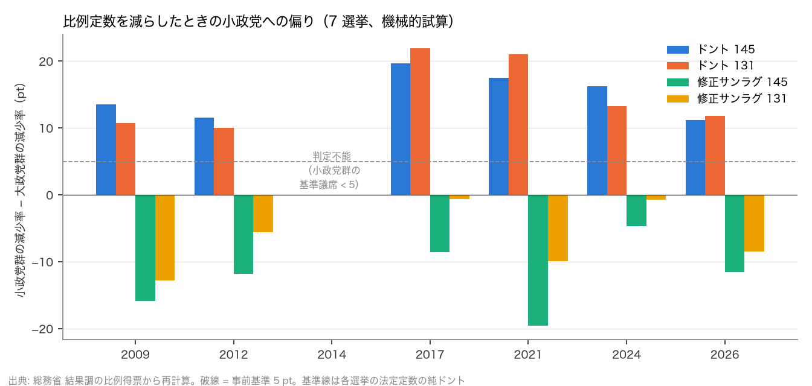
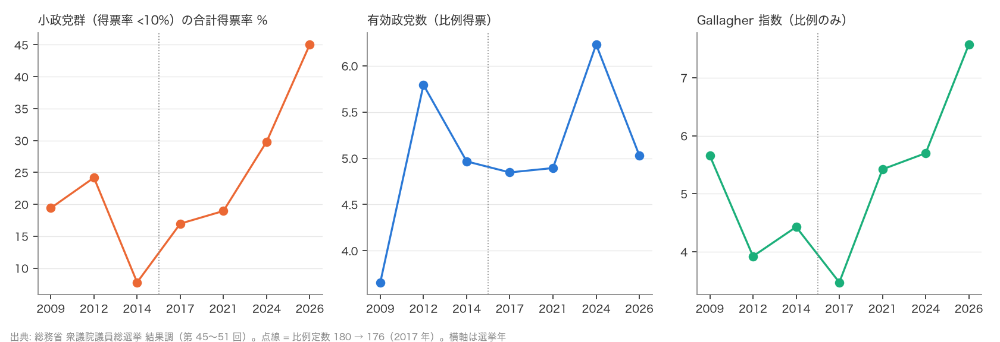
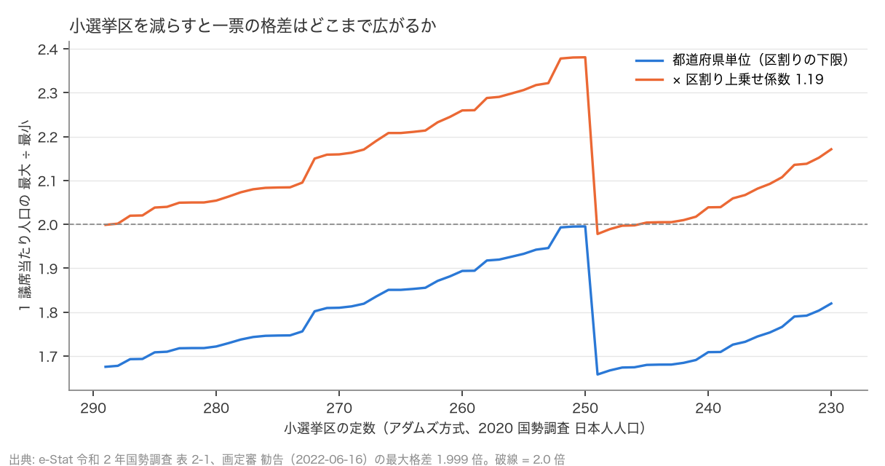

# R6: 比例削減の試算は選挙によって変わるか／小選挙区を減らすと選挙区単位の格差はどうなるか（H3d・H3e・H4c・H4d）（2026-10-28, theme: parliament-size）

## 要約（機械的試算と記述、因果の主張はない）
- **H3d（R2 の H3・H3b は 7 選挙で頑健）は頑健。** 第 45〜51 回（2009–2026）の比例得票に 131 議席（45 減相当）をドント式で当てはめると、比例得票率 10% 未満の小政党群の議席減少率は大政党群より +10.0〜+21.9 pt 大きい。判定できる 6 選挙すべてで事前基準（≥ 5 pt）を満たす。修正サンラグ式（第 1 除数 1.4）に変えると差は −12.8〜−0.6 pt で、6 選挙すべてで 5 pt 未満（小政党群の方が減り方が小さい）。R2 の結論「比例削減は票が同じなら小政党を大きく削るが、修正サンラグ式はそれを相殺する」は直近 2 回に特有ではない。2014 年は小政党群の基準議席が 1（社民 1 議席）で減少率が意味を持たず判定不能とした（事後の具体化）。
- **H3e（定数変更前後の行動、記述）**: 2014 年（180）→ 2017 年（176）の 4 減の前後で、小政党群の合計得票率は 7.8% → 17.0%、有効政党数（得票）は 4.97 → 4.85、議席を得た政党は 6 → 7 党。2017 年は希望の党・立憲民主党の結成で政党構成が入れ替わっており、4 議席の削減の効果は分離できない。小政党群の得票率はその後 2021 年 19.0%、2024 年 29.8%、2026 年 45.0% と増え、比例の Gallagher 指数も 3.5（2017）→ 7.6（2026）に上がった。定数は 176 で不変なので、不比例性の上昇は定数ではなく政党の分散（得票 10% 未満の党が増えたこと）による。
- **H4c（小選挙区も減らすと選挙区単位の格差は 2 倍を超えるか）は整合（係数一定の仮定のもと）。** アダムズ方式で小選挙区を 289 から 230 まで 1 ずつ減らしても、都道府県単位の最大格差（2020 日本人人口）は 2.0 倍を超えない（最大は 250〜251 の 1.995 倍。249 以下では鳥取が 1 議席になり格差の構造が変わる）。しかし 2022 年区割りの選挙区単位の最大格差 1.999 倍は都道府県単位 1.675 倍の 1.19 倍であり、同じ上乗せ係数なら 260 の選挙区単位は 1.894 × 1.19 = 2.26 倍、280 でも 2.05 倍と見込まれる。つまり**小選挙区を減らすなら、2 倍未満に収めるには現行より精密な区割り（都道府県内の人口均等化）が要る**。
- **H4d（ブロック間格差・参入閾値の推移、記述）**: ブロック間の 1 議席当たり有権者数の最大 ÷ 最小は 2009 年 1.127 → 2021 年 1.277 → 2026 年 1.212。2017 年の 180 → 176（東北・北関東・近畿・九州 −1）と 2022 年の 10 増 10 減（東京 +2・南関東 +1、東北・北陸信越・中国 −1）で動いた。四国（定数 6）の参入閾値は 9.3〜11.5% で 7 回とも最も高く、ブロック定数が小さい地方ほど新党が議席を取りにくい構造は一貫している。

## 問いと仮説
`design/themes/parliament-size.md` の「事後追加の仮説（2026-10-28）」H3d・H3e・H4c・H4d。R2（H3・H3b・H4b）の追加分析で、`docs/specs/parliament-size-followup.md` の論点 2・3 に当たる。推定したい量: 得票を固定したときの配分の機械的な差（7 選挙）と、都道府県単位の格差の下限（記述）。因果効果は推定しない。事後追加であることをすべての判定に付す。

事後の具体化: (1) H3d で小政党群の基準議席（純ドント）が 5 未満の選挙は減少率が 1〜2 議席で振れるため判定不能として除外し、判定可能な n 回のうち n − 1 回以上で基準を満たせば頑健とした（2014 年が該当、6 回中 5 回以上）。(2) 2009〜2014 年のブロック定数（180）は結果調の議席配分表から読んだ法定配分、131／145 への再配分は R2 と同じアダムズ方式 × 2020 国勢調査 日本人人口（当時の人口ではない）。(3) H4c (b) の 1.999 倍は衆議院議員選挙区画定審議会 勧告（2022-06-16）の値を手入力した（スクリプト内の定数、出典付き）。

## データ
| 変数 | 出典 | 定義・単位 | 期間 | 備考 |
|---|---|---|---|---|
| 比例代表 ブロック別 党派別 得票数・議席 | 総務省 衆議院議員総選挙 結果調 3(10)・3(12)（第 45〜51 回） | 票（按分票は小数）、議席 | 2009-08-30〜2026-02-08 | 7 選挙 × 11 ブロック × 11〜13 党派 = 710 行。第 42〜44 回（2000・2003・2005 年）は Excel の配布がなく対象外 |
| 党派別 当選人数 | 同 3(1) | 人 | 同 | 小選挙区 300／295／289、比例 180／176 で検算 |
| 都道府県別 有権者数（比例代表） | 同 2(2) | 選挙当日の有権者数、ブロック付き | 同 | 329 行 |
| 都道府県別 日本人人口 | e-Stat 令和 2 年国勢調査 表 2-1 | 人（2020-10-01） | 2020 | アダムズ方式の基礎 |
| 選挙区単位の最大格差（2022 年区割り） | 衆議院議員選挙区画定審議会 勧告（2022-06-16） | 倍（2020 年国勢調査 日本国民人口） | 2022 | 手入力の定数 1.999 |

mart: `jp_hr_pr_results`（710 行）、`jp_hr_seats_by_party`（77 行）、`jp_hr_electorate`（329 行）、`jp_census2020_prefecture`（47 行）。第 45〜49 回は 2026-10-28 取得（manifest に sha256 付き）。ライセンスは政府標準利用規約 2.0。

## 方法
1. H3d: 各選挙のブロック別得票を固定し、法定定数（180 または 176）の純ドント配分を基準線に、131／145（アダムズ再配分）をドント式・修正サンラグ式で配分。政党群（全国比例得票率 10% 未満／以上）の議席減少率の差。
2. H3e: 小政党群の合計得票率、有効政党数 1/Σ(得票率²)、議席を得た政党数、比例の Gallagher 指数 √(Σ(v−s)²/2) の 7 選挙の推移。
3. H4c: (a) アダムズ方式で定数 289 → 230 を 1 ずつ配分し、1 議席当たり人口の最大 ÷ 最小 を求める。(b) 上乗せ係数 = 1.999 ÷ 1.675、260 の都道府県単位格差に掛ける。
4. H4d: 各選挙のブロック定数と有権者数から 最大 ÷ 最小、定数 10 以下のブロックの参入閾値（他党の票を固定し新党が 1 議席を取る得票率）。

## 結果

### 表 1: 7 選挙の比例（基準線 = 各選挙の法定定数の純ドント）と 131／145 の試算
| 回（年） | 法定 | 政党数（得票） | 議席あり | 小政党群 得票率 % | 小政党群 議席（基準） | 有効政党数（得票） | Gallagher 比例 | ドント 145 差 pt | ドント 131 差 pt | 修正サンラグ 145 差 pt | 修正サンラグ 131 差 pt |
|---|---|---|---|---|---|---|---|---|---|---|---|
| 45（2009） | 180 | 12 | 7 | 19.4 | 19 | 3.66 | 5.66 | +13.6 | +10.8 | −15.9 | −12.8 |
| 46（2012） | 180 | 12 | 9 | 24.2 | 31 | 5.79 | 3.92 | +11.6 | +10.0 | −11.8 | −5.6 |
| 47（2014） | 180 | 11 | 6 | 7.8 | 1 | 4.97 | 4.43 | （判定不能） | （判定不能） | （判定不能） | （判定不能） |
| 48（2017） | 176 | 11 | 7 | 17.0 | 20 | 4.85 | 3.47 | +19.6 | +21.9 | −8.6 | −0.6 |
| 49（2021） | 176 | 13 | 7 | 19.0 | 18 | 4.89 | 5.42 | +17.5 | +21.0 | −19.6 | −9.9 |
| 50（2024） | 176 | 12 | 9 | 29.8 | 36 | 6.23 | 5.70 | +16.3 | +13.3 | −4.7 | −0.7 |
| 51（2026） | 176 | 12 | 7 | 45.0 | 60 | 5.03 | 7.57 | +11.2 | +11.8 | −11.6 | −8.4 |

差 = 小政党群の議席減少率 − 大政党群の減少率（pt）。2014 年の数値（ドント 131 で −19.6、修正サンラグ 131 で −120.1 など）は小政党群 1 議席の増減で決まるため表から除いた（スクリプトの stdout には出る）。

- ドント 131 で差 ≥ 5 pt: 6/6 回（+10.0〜+21.9 pt）。145 でも 6/6 回（+11.2〜+19.6 pt）。
- 修正サンラグ 131 で差 < 5 pt: 6/6 回（−12.8〜−0.6 pt）。145 でも 6/6 回（−19.6〜−4.7 pt）。
- **判定: H3d 頑健（H3・H3b とも、判定可能 6 回中 6 回）。**





### 表 2: ブロック間の 1 議席当たり有権者数（最大 ÷ 最小）と小ブロックの参入閾値（% 、括弧はブロック定数）
| 回（年） | ブロック定数 計 | 最大（ブロック） | 最小（ブロック） | 最大 ÷ 最小 | 北海道 | 北陸信越 | 中国 | 四国 |
|---|---|---|---|---|---|---|---|---|
| 45（2009） | 180 | 623,611（東京） | 553,102（東北） | 1.127 | 9.2（8） | 6.9（11） | 6.2（11） | 11.5（6） |
| 46（2012） | 180 | 630,640（東京） | 543,896（東北） | 1.159 | 8.1（8） | 6.0（11） | 6.5（11） | 9.6（6） |
| 47（2014） | 180 | 638,271（東京） | 539,883（東北） | 1.182 | 9.0（8） | 6.7（11） | 7.1（11） | 10.4（6） |
| 48（2017） | 176 | 663,299（東京） | 545,364（四国） | 1.216 | 8.1（8） | 6.9（11） | 7.0（11） | 10.7（6） |
| 49（2021） | 176 | 675,696（東京） | 529,043（四国） | 1.277 | 7.7（8） | 6.5（11） | 6.5（11） | 9.3（6） |
| 50（2024） | 176 | 615,237（北関東） | 512,265（四国） | 1.201 | 7.4（8） | 6.6（10） | 6.1（10） | 9.4（6） |
| 51（2026） | 176 | 611,636（北関東） | 504,699（四国） | 1.212 | 7.6（8） | 6.6（10） | 6.7（10） | 9.5（6） |

2017 年の 180 → 176 は東北・北関東・近畿・九州から 1 ずつ減らしたもので、北陸信越・中国の 11 → 10 と東京 17 → 19 は 2022 年の再配分（10 増 10 減）による。ブロック間格差は東京の有権者増で 2009 → 2021 年に広がり、2022 年の再配分で縮んだ。H4d は記述のみで判定しない。

### 表 3: 小選挙区の定数と都道府県単位の最大格差（アダムズ方式、2020 国勢調査 日本人人口）
| 定数 | 定数 2 の県 | 都道府県単位 最大 ÷ 最小 | × 区割り上乗せ係数 1.193 |
|---|---|---|---|
| 289 | 8 | 1.675 | 1.999 |
| 280 | 9 | 1.722 | 2.054 |
| 270 | 10 | 1.810 | 2.160 |
| 260 | 11 | 1.894 | 2.260 |
| 250 | 13 | 1.995 | 2.381 |
| 240 | 15 | 1.709 | 2.039 |
| 230 | 15 | 1.820 | 2.171 |



- (a) 都道府県単位の最大格差は 230 まで 2.0 倍を超えない。250〜251 で 1.995 倍に達した後、249 以下では鳥取が 2 → 1 議席になって最大側（鳥取 54.4 万人/議席）と最小側（島根 32.8 万人）が入れ替わり、1.658 倍に戻る。
- (b) 区割りの上乗せ係数 = 1.999 ÷ 1.675 = 1.193。260 では 1.894 × 1.193 = 2.26 倍。**判定: H4c 整合**（係数一定の仮定のもとで、選挙区単位の最大格差は 2 倍を超える見込み）。
- 含意: R2 の H4b「都道府県単位では 2 倍に届かない」は変わらないが、実際の格差は区割りで決まり、現行の区割りの精度（都道府県単位の 1.19 倍）を保つと 280 でも 2 倍を超える。小選挙区を減らすなら区割りの精密化（県内の人口均等化）が前提になる。

## 頑健性
| 仕様 | 結果 |
|---|---|
| H3d の除外基準を 5 → 3 議席にする | 2014 年は 1 議席のままで除外、結果は不変 |
| H3d の除外をしない（7 回で判定） | ドント 131 で 2014 年が −19.6 pt となり 6/7 回。n − 1 = 6 回以上で頑健の判定は不変。修正サンラグ 131 は 7/7 回 |
| H3d を 145（31 減）で判定 | ドント 6/6、修正サンラグ 6/6。整合の向きは同じ |
| H4c (b) の係数に 2024 年の選挙時有権者数ベースの格差を使う | 未計算（選挙区別有権者数の mart が無い）。有権者数ベースの格差は国勢調査ベースより大きいと報道されており、係数は 1.19 より大きくなる方向 |
| H4c (a) を人口総数（外国人を含む）で計算 | 未計算。R2 と同じ限界 |

## 限界・言えないこと
- H3d は「票が同じなら」の機械的試算を 7 回に広げたもので、定数が減ったときの擁立・選挙協力・戦略投票の変化は依然として織り込まない。7 回とも同じ向きであることは「制度の機械的効果が安定している」ことを示すだけで、実際の議席変化の予測ではない。
- H3e は記述で、2017 年の 4 減の効果を識別できない。2000 年の 200 → 180 は結果調の Excel が無く扱えなかった（PDF の結果調から読めば可能だが未着手）。
- 131／145 へのブロック再配分は 2020 年人口で固定し、2009〜2014 年当時の人口では再配分していない。ブロック定数の 1〜2 議席の差で政党別議席が動く可能性はあるが、政党群の減少率の差（10 pt 以上）を覆す規模ではない。
- H4c (b) の上乗せ係数 1.193 は 2022 年区割りの 1 点から取った。区割りの精度は改定ごとに違い（2017 年区割りは 1.956 倍）、係数一定は仮定にすぎない。選挙区単位の格差を直接試算するには区割り案が要る。
- 画定審の 1.999 倍は手入力の定数で、manifest 付きの raw ではない。
- 「2 倍未満」が規範として妥当かどうかは最高裁判例と政治の問題で、本レポートは数字だけを示す。

## 再現手順
```bash
uv run socioscope run parliament-size fetch --only soumu_senkyo && uv run socioscope run parliament-size stage --only soumu_senkyo && uv run socioscope run parliament-size mart --only soumu_senkyo
uv run python themes/parliament-size/src/theme_parliament_size/analysis/a20261028_r6_pr_history.py
```
mart: `data/marts/jp_hr_pr_results.parquet`（710 行: iso3, election, election_date, block, party, rank, votes, share_pct, seats, block_seats, block_votes, source）、`jp_hr_seats_by_party.parquet`（77 行）、`jp_hr_electorate.parquet`（329 行）、`jp_census2020_prefecture.parquet`（47 行）。図 3 枚は `reports/figures/r6_*.png`。LLM 構造化は使っていない。2 回実行して stdout が一致することを確認した。

## チェックリスト回答
- A. H3d・H3e・H4c・H4d と判定基準は事後追加として `design/themes/parliament-size.md` に結果の計算前に固定し、「事後追加」と明記。判定不能の除外規則は事後の具体化として本書に記録。推定量は「得票固定下の配分の機械的差（7 選挙）」と「格差の下限（記述）」。
- B. 出典・取得日は manifest と一致（第 45〜49 回は 2026-10-28 取得）。画定審の 1.999 倍だけ手入力で出典を明記。欠損（第 42〜44 回）は補完せず対象外とした。
- C. 因果を主張しない。識別戦略なし。H3e で定数変更の効果を識別できないことを明記。
- D. 母集団全体の確定値のため標準誤差なし。除外あり／なし、131／145、ドント／修正サンラグの全仕様を報告。
- E. 「頑健」「整合」「記述」「判定不能」で書き、因果語は使わない。図は軸・単位・出典を明記。限界の節あり。再現手順と mart のスキーマ・行数を記載。
