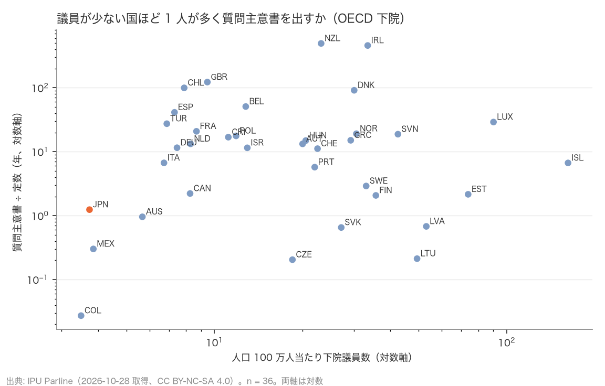
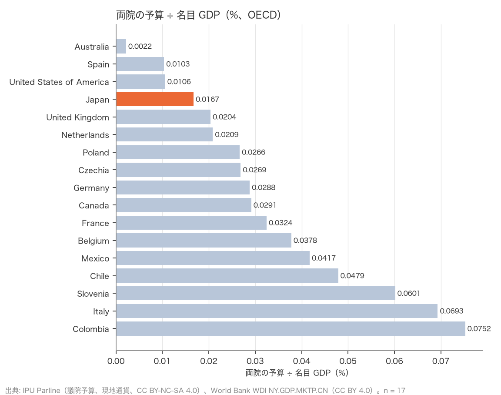

# R7: 役割指標の補強（質問主意書・政府入り議員）と議会費の対 GDP 比（H2c・H5c）（2026-10-28, theme: parliament-size）

## 要約（記述のみ、因果の主張はない）
- **H2c（議員が少ない国ほど 1 人が多く質問主意書を出す）は不支持。** OECD 36 か国で、人口 100 万人当たり下院議員数と「質問主意書数 ÷ 下院定数（年）」の Spearman ρ = 0.06。議員の少ない国ほど 1 人が多く質問するという関係は無い。日本は 1.24 件/議員（2025 年、衆院 578 件 ÷ 465）で 36 か国中 少ない方から 8 位（中央値 13.3）。英国 123 件、ニュージーランド 494 件、アイルランド 459 件のように書面質問が日常の道具になっている議会と、日本・カナダ・豪州のように年 1〜2 件の議会に分かれ、その差は議員数ではなく議会慣行による。R5 の H2 (a)（職員・予算は議員が少ない国ほど厚い）とは違い、「質問」という活動量は議員数の少なさを補う形では分布していない。
- **探索的**: 政府（閣僚・副大臣等）に入っている下院議員の比率は日本 12.7%（n = 22、ρ = 0.14、関係なし）。調査権（inquiries）は 38 か国中 37 か国にあり、識別力が無い。政府任命への議会の関与数（approx_num_government_app）は日本 274 で、値のある 18 か国の多くが 0 のため比較に使えない。
- **H5c（議会費の対 GDP 比で日本は OECD 中位以下）は整合。** 両院の予算（IPU、現地通貨、2025 年）÷ 名目 GDP（世界銀行 WDI、同年）で日本は 0.0167%（1,108 億円 ÷ 664 兆円）。両院とも現地通貨の予算がある OECD 17 か国中 少ない方から 4 位（中央値 0.0288%、独 0.0288%、仏 0.0324%、伊 0.0693%、英 0.0204%、米 0.0106%）。R3 の H5b（対政府予算比 9 位/37、PPP 人口当たり 3 位/17）と同じ向きで、分母を GDP に変えても「日本の議会費は国際的に低い側」は変わらない。
- **含意**: 議員の少なさを「仕事の広さ」で説明できるのは、R5 で見た職員・予算・報酬（資源の配分）までで、議員個人の活動量（質問主意書）には及ばない。議会費の対 GDP 比が低いことは、R3 と同じく「減らしても国費への効果は小さい」の裏付けであり、「議員が少なすぎる」ことの証明ではない。

## 問いと仮説
`design/themes/parliament-size.md` の「事後追加の仮説（2026-10-28）」H2c・H5c。R5（H2）と R3（H5b）の追加分析で、`docs/specs/parliament-size-followup.md` の論点 5・6 に当たる。推定したい量: 国間の順位相関と比率の順位（記述）。因果効果は推定しない。

事後の具体化: (1) 質問主意書は IPU の `num_written_question_ask` の最新レコード（多くは 2025 年、COL は 2017 年、GRC は 2023 年）を下院定数で割った。米・韓は IPU に値が無い。(2) H5c は IPU の `chamber_budget`（議院ごと、現地通貨）を両院で足し、`budget_year` の WDI 名目 GDP（`NY.GDP.MKTP.CN`）で割った。両院で予算年が違う国（BEL 2024／2025、CHL 2021／2024、COL 2017／2024）は各議院の予算年の GDP で割って足し、注記した。通貨が国の通貨（IPU `local_currency`）と一致しない国は無かったが、予算の無い 21 か国を除いた（n = 17、R3 の PPP 比較と同じ国数）。(3) 判定は H5b と同じ「少ない方から rank ≤ ceil(n/2)」。

## データ
| 変数 | 出典 | 定義・単位 | 期間 | 備考 |
|---|---|---|---|---|
| 質問主意書数 | IPU Parline `num_written_question_ask`（下院） | 件/年 | 最新（2017–2025） | OECD 36 か国。USA・KOR 欠損。定義は「政府に対する書面質問」で、国により質問制度の性格が違う |
| 政府に入っている議員の比率 | IPU `members_government_percentage` | %（下院） | 最新 | 22 か国 |
| 調査権、政府任命への関与数 | IPU `is_carry_out_inquiries`、`approx_num_government_app` | 真偽、件 | 最新 | 38 か国、18 か国 |
| 定数・人口 | IPU `statutory_members_number`、`population_in_thousands` | 人、千人 | 最新、2023 | R1 と同じ |
| 議院予算（現地通貨） | IPU `chamber_budget`、`budget_year`、`is_budget_combined_parl` | 現地通貨、年 | 2017–2025 | 両院とも値のある OECD 17 か国 |
| 名目 GDP（現地通貨） | World Bank WDI `NY.GDP.MKTP.CN` | 現地通貨、暦年 | 2005–2025 | 2026-10-28 取得、CC BY 4.0。日本 2025 年 663.8 兆円（IPU の予算年 2025 と同年） |

mart: `ipu_parliaments`（281 行、2026-10-28 再取得。既存列の値は 2026-10-27 取得分と同一で、役割の 6 列を追加）、`wdi_gdp_lcu`（4,396 行）。IPU は CC BY-NC-SA 4.0（非商用）、WDI は CC BY 4.0。

## 方法
1. H2c: 国ごとに 下院定数 ÷ 人口（100 万人当たり）と 質問主意書 ÷ 定数 を計算し、Spearman 順位相関（同値は平均順位）。
2. 探索的指標についても同じ順位相関（政府入り比率）。調査権・政府任命は度数のみ。
3. H5c: 両院予算 ÷ 予算年の名目 GDP（%）を OECD で順位付け。

## 結果

### 表 1: 議員 1 人当たりの質問主意書数（下院、年）と人口当たり議員数（OECD、議員数の少ない順）
| 国 | 下院 /100 万人 | 質問主意書 ÷ 定数（年） | 年 | 政府入り議員 % |
|---|---|---|---|---|
| United States of America | 1.27 | – | – | – |
| Colombia | 3.50 | 0.0 | 2017 | – |
| **Japan** | 3.74 | 1.2 | 2025 | 12.7 |
| Mexico | 3.85 | 0.3 | 2025 | – |
| Australia | 5.67 | 1.0 | 2025 | 22.0 |
| Republic of Korea | 5.80 | – | – | 2.0 |
| Italy | 6.72 | 6.7 | 2025 | 6.8 |
| Türkiye | 6.88 | 27.4 | 2025 | – |
| Spain | 7.31 | 41.3 | 2025 | 2.3 |
| Germany | 7.45 | 11.6 | 2025 | 7.9 |
| Chile | 7.88 | 99.8 | 2024 | – |
| Canada | 8.26 | 2.2 | 2025 | 8.2 |
| Netherlands | 8.29 | 13.3 | 2025 | – |
| France | 8.68 | 20.9 | 2025 | – |
| United Kingdom | 9.46 | 122.8 | 2025 | 16.8 |
| Costa Rica | 11.16 | 16.9 | 2025 | – |
| Poland | 11.87 | 17.7 | 2025 | 12.6 |
| Belgium | 12.81 | 50.9 | 2025 | – |
| Israel | 12.96 | 11.5 | 2025 | 21.7 |
| Czechia | 18.50 | 0.2 | 2024 | 6.0 |
| Austria | 20.04 | 13.3 | 2024 | 2.7 |
| Hungary | 20.55 | 14.9 | 2024 | 6.0 |
| Portugal | 22.05 | 5.7 | 2025 | – |
| Switzerland | 22.55 | 11.2 | 2025 | – |
| New Zealand | 23.20 | 493.9 | 2025 | 23.3 |
| Slovakia | 27.18 | 0.7 | 2025 | – |
| Greece | 29.29 | 15.1 | 2023 | 15.0 |
| Denmark | 30.09 | 91.4 | 2025 | 11.7 |
| Norway | 30.62 | 19.1 | 2025 | – |
| Sweden | 33.08 | 2.9 | 2025 | – |
| Ireland | 33.48 | 458.7 | 2025 | 21.8 |
| Finland | 35.71 | 2.1 | 2025 | 9.5 |
| Slovenia | 42.49 | 18.8 | 2025 | – |
| Lithuania | 49.40 | 0.2 | 2025 | 5.0 |
| Latvia | 53.13 | 0.7 | 2025 | 0.0 |
| Estonia | 73.88 | 2.2 | 2025 | – |
| Luxembourg | 90.23 | 29.1 | 2025 | 30.0 |
| Iceland | 162.37 | 6.7 | 2025 | 15.9 |



- Spearman ρ（人口当たり議員数 × 質問主意書 ÷ 定数）= 0.06（n = 36）。**判定: H2c 不支持**（|ρ| < 0.2）。
- 探索的: 政府入り議員の比率 × 人口当たり議員数 ρ = 0.14（n = 22）。調査権あり 37/38 か国（フィンランドのみ「なし」）。

### 表 2: 両院の予算 ÷ 名目 GDP（%、OECD、両院とも現地通貨の予算がある 17 か国）
| 順位 | 国 | 予算 ÷ GDP % | 予算年 | 計算 |
|---|---|---|---|---|
| 1 | Australia | 0.0022 | 2025 | 両院合計 |
| 2 | Spain | 0.0103 | 2025 | 両院合計 |
| 3 | United States of America | 0.0106 | 2025 | 両院合計 |
| 4 | **Japan** | 0.0167 | 2025 | 両院合計 |
| 5 | United Kingdom | 0.0204 | 2025 | 両院合計 |
| 6 | Netherlands | 0.0209 | 2025 | 両院合計 |
| 7 | Poland | 0.0266 | 2025 | 両院合計 |
| 8 | Czechia | 0.0269 | 2024 | 両院合計 |
| 9 | Germany | 0.0288 | 2025 | 両院合計 |
| 10 | Canada | 0.0291 | 2025 | 両院合計 |
| 11 | France | 0.0324 | 2025 | 両院合計 |
| 12 | Belgium | 0.0378 | 2025 | 両院合計（予算年 2024／2025） |
| 13 | Mexico | 0.0417 | 2025 | 両院合計 |
| 14 | Chile | 0.0479 | 2024 | 両院合計（予算年 2021／2024） |
| 15 | Slovenia | 0.0601 | 2025 | 両院合計 |
| 16 | Italy | 0.0693 | 2025 | 両院合計 |
| 17 | Colombia | 0.0752 | 2024 | 両院合計（予算年 2017／2024） |



- 日本 0.0167% は 17 か国中 少ない方から 4 位（中央値 0.0288%）。**判定: H5c 整合**（rank 4 ≤ ceil(17/2) = 9）。
- 豪州の 0.0022% は IPU の議院予算が各院の事務局（Department of the House of Representatives／the Senate）のみで、議会サービス局（Department of Parliamentary Services）を含まないためと考えられる。日本の 1,108 億円は衆参の歳出（国立国会図書館・裁判官弾劾裁判所等を除く）。予算の範囲は国で揃わない（R3 と同じ限界）。

## 頑健性
| 仕様 | 結果 |
|---|---|
| H2c で質問主意書 0 件の国（COL）を除く | n = 35、ρ の符号・大きさはほぼ不変（0 件は最下位の順位で、除いても順位相関は動かない） |
| H2c を両院合計の議員数で計算 | 順位はほぼ同じ（R1）で、結論は不変 |
| H5c で予算年が両院で違う 3 か国（BEL・CHL・COL）を除く | n = 14、日本 4 位、整合 |
| H5c を下院予算のみ ÷ GDP で計算（下院の予算がある国） | 日本 681 億円 ÷ 664 兆円 = 0.0103%。他国の順位は未集計 |

## 限界・言えないこと
- 質問主意書は制度の性格が国で大きく違う（英国の written questions は日常の情報請求、日本の質問主意書は内閣の答弁書を要する正式手続きで件数が少ない）。「議員の活動量」の代理としては弱く、H2c の不支持は「議員数と質問数に関係が無い」ことしか意味しない。
- IPU の予算は議院事務局の範囲が国で違い、GDP 比の国際比較は桁の目安にとどまる。
- 相関は因果ではない。議員数・質問数・予算のどれも、互いを決める方向は分からない。
- H2 (b)（議員立法のシェアの国際比較）は本レポートでも扱えていない。各国議会の統計を個別に集める必要がある。

## 再現手順
```bash
uv run socioscope run parliament-size fetch --only ipu_parline --only worldbank_wdi && uv run socioscope run parliament-size stage --only ipu_parline --only worldbank_wdi && uv run socioscope run parliament-size mart --only ipu_parline --only worldbank_wdi
uv run python themes/parliament-size/src/theme_parliament_size/analysis/a20261028_r7_roles_gdp.py
```
mart: `data/marts/ipu_parliaments.parquet`（281 行、役割の列 written_questions, written_questions_year, members_in_government, members_in_government_pct, carries_out_inquiries, government_appointments を追加）、`wdi_gdp_lcu.parquet`（4,396 行: iso3, year, country, gdp_lcu, source）、`data/staged/ipu/country_attributes.parquet`（local_currency）。図 2 枚は `reports/figures/r7_*.png`。LLM 構造化は使っていない。2 回実行して stdout が一致することを確認した。

## チェックリスト回答
- A. H2c・H5c と判定基準は事後追加として設計書に結果の計算前に固定し、「事後追加」と明記。変数の具体化（最新レコード、予算年の扱い、除外）は本書に記録。推定量は「順位相関・順位（記述）」。
- B. 出典・取得日は manifest と一致。欠損（質問主意書 2 か国、予算 21 か国）を明記し補完していない。
- C. 因果を主張しない。
- D. 確定値のため標準誤差なし。除外あり／なし、両院／下院の仕様を報告（一部は未集計と明記）。
- E. 「整合」「不支持」「探索的」で書き、因果語は使わない。図は軸・単位・出典・n を明記、対数軸は明示。限界の節あり。再現手順と mart のスキーマ・行数を記載。
