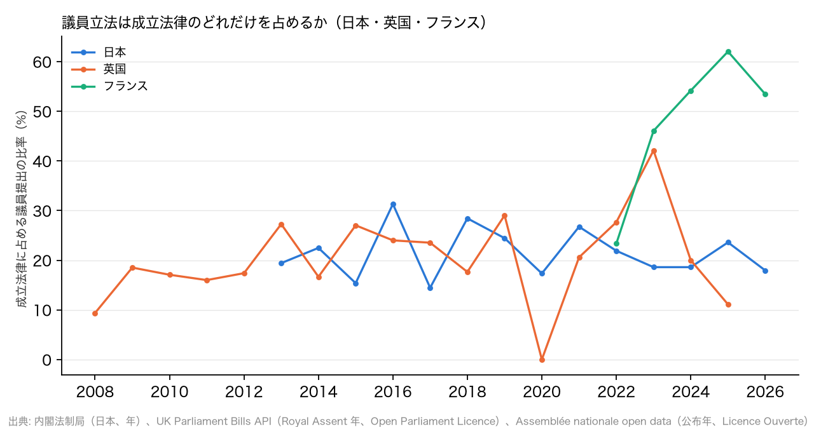

# R8: 成立した法律のうち議員提出はどれだけか — 日本・英国・フランス（H2d）（2026-10-28, theme: parliament-size）

## 要約（記述のみ、因果の主張はない）
- **H2d（議員が少ない国ほど議員立法の比率が低い）は不支持。** 成立法律に占める議員提出法案の比率は、英国 21.5%（2008–2025 年、Royal Assent 599 件のうち Private Members' Bill 129 件）、日本 21.8%（2013–2026 年、1,289 本のうち 281 本）、フランス 50.9%（2022–2026 年、公布 291 件のうち proposition de loi 148 件）。人口当たり下院議員数は日本 3.74 < 仏 8.68 < 英 9.46 人/100 万人なので、H2 (b) の向きなら比率も日本 < 仏 < 英になるはずだが、実際は英国 ≈ 日本 < 仏で、日本は最下位ではない（期間を 2013 年以降に揃えると英国 23.5% で日本が最下位になるが、順位は仏 > 英 > 日で人口当たり議員数の順位とは一致しない）。
- **日本と英国はほぼ同じ水準。** 英国の Private Members' Bill は 1 会期に成立するのが 4〜13 本（2023 年は 24 本）で、政府法案 20〜34 本に対し 10〜30% を占める。日本の 14〜31% と同じ幅にある。「日本は議員立法が少ない」は、英国と比べる限り成り立たない。
- **フランスの 50.9% は 2022 年以降の特殊な状況を反映している。** 2022 年 6 月の総選挙で与党が過半数を失い、政府提出法案（projet）が通りにくくなった一方で、与野党の議員提出法案（proposition）が公布法律の半分を占めるようになった。2022 年は 23%、2023 年 46%、2025 年 62% と上がっている。条約批准法（71 件、すべて政府提出）を含めた値で、除けば議員提出は 67% になる。
- **含意**: 議員立法の比率は議員数ではなく、議会と政府の力関係と立法手続きの設計（英国のバロット制、フランスの議員提出の週、日本の委員長提出）で決まる。R5・R7 と合わせて、「議員が少ない国は議員 1 人の仕事が広い」は職員・予算（R5）では支持され、活動量（質問主意書、R7）と立法の比重（本レポート）では支持されない。

## 問いと仮説
`design/themes/parliament-size.md` の「事後追加（2026-10-28 夕）」H2d。R5 で判定不能だった H2 (b)（議員立法シェアの国際比較）の部分的な代替で、`docs/specs/parliament-size-followup.md` の論点 1 に当たる。推定したい量: 3 か国の比率と順位（記述）。因果効果は推定しない。3 か国では相関は取れないので順位の一致で判定し、弱い証拠と明記する。

事後の具体化: (1) 英国は Bills API の `billTypeId` で Government Bill（1）と Supply and Appropriation Bill（10）を政府提出、Private Members' Bill の 4 類型（2・5・7・8）を議員提出とし、Private Bill・Hybrid Bill・Consolidation Bill（35 件）は分母に入れない。成立は `isAct` と Royal Assent の年。API の収録が揃う 2008〜2025 年の完全年を対象にした。(2) フランスは `procedureParlementaire.libelle` に「loi」または「ratification」を含むドシエを法律案とし、提出の種別は文書 uid の接頭辞（PRJL = projet、PION = proposition）で決めた。公布は acte `PROM-PUB` の日付。第 16・17 立法期（2022-06〜）の zip のみ公開されている。(3) 日本は内閣法制局の集計（衆法・参法の区別なし、委員長提出を含む）で R5 と同じ。

## データ
| 変数 | 出典 | 定義・単位 | 期間 | 備考 |
|---|---|---|---|---|
| 英国の法案 | UK Parliament Bills API `/api/v1/Bills`（4,065 件、41 ページ） | 法案 1 件: 種別、成立（Royal Assent）日 | 2005–2026 | Open Parliament Licence v3.0。`IsAct` クエリは効かず parse 側で絞る |
| フランスの法律ドシエ | Assemblée nationale open data「Dossiers législatifs」第 16・17 立法期 zip | ドシエ 1 件: 手続種別、提出種別、公布日 | 2022-06〜2026-10 | Licence Ouverte 2.0。立法期をまたぐドシエは新しい方を残す |
| 日本の法律案 | 内閣法制局「過去の法律案の提出・成立件数一覧」 | 国会回次別の閣法・議員立法の成立数 | 第 183〜221 回（2013–2026） | 政府標準利用規約 2.0 |
| 人口当たり議員数 | IPU Parline | 下院定数 ÷ 人口（2023） | 最新 | R1 と同じ |

mart: `uk_acts`（695 行）、`fr_laws`（297 行）、`jp_bill_counts`（39 行）。2026-10-28 取得。

## 方法
1. 国ごとに 成立法律の 議員提出 ÷（議員提出 ＋ 政府提出）を期間合計と年別で計算。
2. 3 か国の比率の順位を人口当たり下院議員数の順位と比べる。

## 結果

### 表 1: 成立法律に占める議員提出の比率（期間合計）
| 国 | 期間 | 政府提出 成立 | 議員提出 成立 | その他 | 議員提出の比率 % | 下院 /100 万人 |
|---|---|---|---|---|---|---|
| 日本 | 2013–2026 | 1,008 | 281 | 0 | 21.8 | 3.74 |
| フランス | 2022–2026 | 143 | 148 | 0 | 50.9 | 8.68 |
| 英国 | 2008–2025 | 470 | 129 | 35 | 21.5 | 9.46 |

比率の順位は 英国 21.5% < 日本 21.8% < フランス 50.9%。人口当たり議員数の順位（日本 < フランス < 英国）とは一致せず、日本は最下位ではない。**判定: H2d 不支持。**



### 表 2: 年別（英国は Royal Assent 年、フランスは公布年、日本は国会の開会年）
| 年 | 日本 政府 | 日本 議員 | 日本 % | 英国 政府 | 英国 議員 | 英国 % | 仏 政府 | 仏 議員 | 仏 % |
|---|---|---|---|---|---|---|---|---|---|
| 2008 | – | – | – | 29 | 3 | 9 | – | – | – |
| 2009 | – | – | – | 22 | 5 | 19 | – | – | – |
| 2010 | – | – | – | 34 | 7 | 17 | – | – | – |
| 2011 | – | – | – | 21 | 4 | 16 | – | – | – |
| 2012 | – | – | – | 19 | 4 | 17 | – | – | – |
| 2013 | 83 | 20 | 19 | 24 | 9 | 27 | – | – | – |
| 2014 | 100 | 29 | 22 | 25 | 5 | 17 | – | – | – |
| 2015 | 66 | 12 | 15 | 27 | 10 | 27 | – | – | – |
| 2016 | 68 | 31 | 31 | 19 | 6 | 24 | – | – | – |
| 2017 | 71 | 12 | 14 | 26 | 8 | 24 | – | – | – |
| 2018 | 73 | 29 | 28 | 28 | 6 | 18 | – | – | – |
| 2019 | 68 | 22 | 24 | 22 | 9 | 29 | – | – | – |
| 2020 | 62 | 13 | 17 | 28 | 0 | 0 | – | – | – |
| 2021 | 63 | 23 | 27 | 27 | 7 | 21 | – | – | – |
| 2022 | 82 | 23 | 22 | 34 | 13 | 28 | 23 | 7 | 23 |
| 2023 | 70 | 16 | 19 | 33 | 24 | 42 | 41 | 35 | 46 |
| 2024 | 70 | 16 | 19 | 20 | 5 | 20 | 22 | 26 | 54 |
| 2025 | 68 | 21 | 24 | 32 | 4 | 11 | 30 | 49 | 62 |
| 2026 | 64 | 14 | 18 | – | – | – | 27 | 31 | 53 |

英国の 2020 年（議員提出 0）は COVID-19 で Private Members' Bill の金曜審議が止まった年。2023 年の 24 本は 2022–23 会期にバロット法案が多く成立した年。

### 表 3: 英国の成立法案の種別（2008–2025）
| 種別 | 件数 |
|---|---|
| Government Bill | 469 |
| Private Members' Bill (Ballot Bill) | 96 |
| Private Bill | 31 |
| Private Members' Bill (Presentation Bill) | 20 |
| Private Members' Bill (Starting in the House of Lords) | 8 |
| Private Members' Bill (under the Ten Minute Rule) | 5 |
| Hybrid Bill | 3 |
| Consolidation Bill | 1 |
| Supply and Appropriation Bill | 1 |

### 表 4: フランスの公布法律の手続種別（第 16・17 立法期）
| 手続 | 提出 | 件数 |
|---|---|---|
| Proposition de loi ordinaire | 議員 | 145 |
| Projet de ratification des traités et conventions | 政府 | 71 |
| Projet de loi ordinaire | 政府 | 54 |
| Projet ou proposition de loi organique | 議員 | 7 |
| Projet de loi de finances rectificative | 政府 | 5 |
| Projet ou proposition de loi organique | 政府 | 5 |
| Projet de loi de financement de la sécurité sociale | 政府 | 5 |
| Projet de loi de finances de l'année | 政府 | 4 |
| Projet ou proposition de loi constitutionnelle | 政府 | 1 |

## 頑健性
| 仕様 | 結果 |
|---|---|
| フランスから条約批准法（71 件）を除く | 議員提出 148 ÷ (148 + 72) = 67.3%。順位は不変、不支持 |
| 英国を 2013–2025 年に揃える（日本と同じ期間） | 政府 345・議員 106 → 23.5%。日本 21.8% より高く、順位は 日本 < 英国 < 仏。日本が最下位になるが、人口当たり議員数の順位（日本 < 仏 < 英）とは一致せず判定は「中間」。期間の取り方で判定が動く程度の差（2 pt）で、「英国 ≈ 日本」が実態 |
| 英国の分母に Private Bill・Hybrid Bill を含める | 129 ÷ 634 = 20.3%。不変 |
| 日本を委員長提出を除いて数える | 内閣法制局の集計では分けられない（未計算）。委員長提出を除けば日本の比率は下がり、英国より低くなる可能性がある |

## 限界・言えないこと
- 「議員提出」の制度が 3 か国で違う。英国の Private Members' Bill は政府が黙認したものだけがほぼ成立し、日本の議員立法は委員長提出（実質的に与野党合意）が多くを占め、フランスの proposition は与党議員が政府の意向で出すものを含む。比率の差は制度の差で、議員の自律性の差ではない。
- フランスは 2022 年以降の少数与党期のみで、通常期（2017–2022 年は第 15 立法期で zip が無い）と比べられない。
- 日本の委員長提出を分けられないため、「純粋な」議員立法の比率は 21.8% より低い。
- 3 か国の記述で、OECD 全体の相関（H2 (b) の本来の判定）はできていない。ドイツ・米国・韓国は API 鍵が要り未着手。
- 相関は因果ではない。

## 再現手順
```bash
uv run socioscope run parliament-size fetch --only uk_bills --only fr_an_dossiers && uv run socioscope run parliament-size stage --only uk_bills --only fr_an_dossiers && uv run socioscope run parliament-size mart --only uk_bills --only fr_an_dossiers
uv run python themes/parliament-size/src/theme_parliament_size/analysis/a20261028_r8_member_bills.py
```
mart: `data/marts/uk_acts.parquet`（695 行: iso3, year, royal_assent_date, bill_id, title, bill_type_id, bill_type, origin, source）、`fr_laws.parquet`（297 行: iso3, year, promulgation_date, uid, legislature, procedure, origin, source）、`jp_bill_counts.parquet`（39 行）。図 1 枚は `reports/figures/r8_member_bill_share.png`。LLM 構造化は使っていない。2 回実行して stdout が一致することを確認した。

## チェックリスト回答
- A. H2d と判定基準は事後追加として設計書に結果の計算前に固定し、「事後追加」と明記。種別の割り当て・期間は本書に記録。推定量は「比率と順位（記述）」。
- B. 出典・取得日は manifest と一致。欠損（仏 第 15 立法期以前、英 2006–07 年の部分収録）は補完せず対象外。
- C. 因果を主張しない。
- D. 確定値のため標準誤差なし。条約批准法の有無、期間の揃え、分母の範囲の仕様を報告。
- E. 「不支持」「記述」で書き、因果語は使わない。図は軸・単位・出典を明記。限界の節あり。再現手順と mart のスキーマ・行数を記載。
