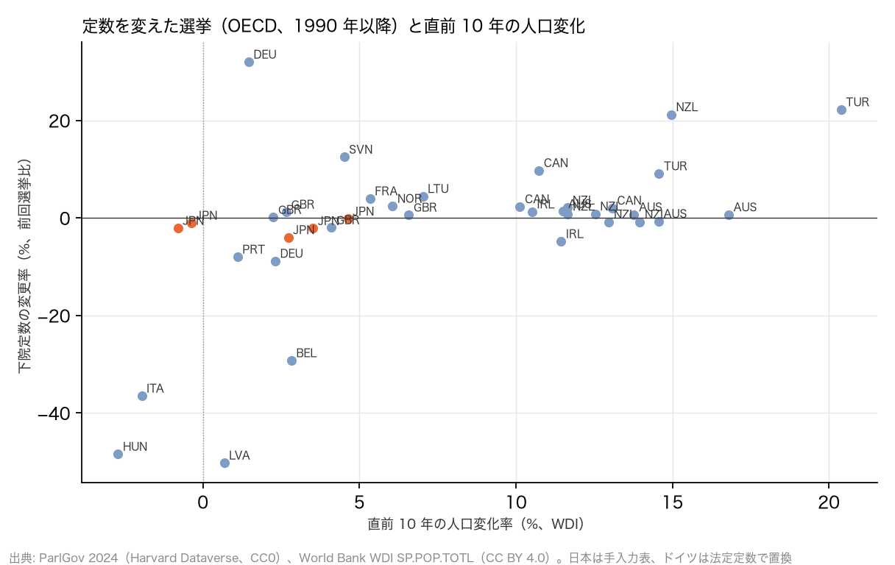

# R9: 各国の定数は 1990 年以降どう変わり、人口変化と関係があるか（H6b）（2026-10-28, theme: parliament-size）

## 要約（記述と相関、因果の主張はない）
- **H6b（定数の変更は人口変化に連動していない）は不支持。** ParlGov 2024 で OECD 32 か国の下院定数を 1990 年以降の選挙ごとに追うと、17 か国で 37 回の変更（増 21・減 16）があり、変更率と直前 10 年の人口変化率の相関は r = 0.51（Spearman ρ = 0.52、n = 37）。事前基準の |r| < 0.3 を超える。人口が増えている国が定数を増やし（カナダ・ニュージーランド・トルコ・豪州）、人口が減っていた国が定数を減らしている（ハンガリー 2014 年 386 → 199、イタリア 2022 年 630 → 400、日本 2014・2017 年）。
- **R4 の「人口が減った国で定数を減らしたのは日本だけ」は、IPU の記録が浅かったための結論で、1990 年まで遡ると成り立たない。** 直前 10 年で人口が減っていた変更は 4 回あり、4 回とも削減（ハンガリー、イタリア、日本 2 回）。R4 は IPU Parline の定数記録（2005 年以降、1 件しか無い国は変更なし扱い）に依っており、ハンガリー 2014 年の半減を拾えていなかった。R4 の各国判定（整合、弱い証拠）は本レポートで上書きする。
- **ただし相関は少数の大きな制度転換に引っ張られている。** |変更率| ≥ 20% の 7 回（ベルギー 1995 年の連邦制改革 −29%、ドイツ 1990 年の統一 +32%、ハンガリー 2014 年 −48%、イタリア 2022 年 −37%、ラトビア 1993 年 −50%、ニュージーランド 1996 年の MMP 導入 +21%、トルコ 1995 年 +22%）を除くと r = 0.31（n = 30）で、基準の境界にある。小幅の変更（英国・豪州・NZ の ±1〜2 議席、日本の −1〜−4%）は人口とほぼ無関係に起きている。
- **含意**: 「定数は人口に連動してこなかった」という R4 の日本についての記述（1946 年以降、人口 1.64 倍で定数ほぼ不変）は変わらない。しかし「他国も人口減少に合わせて定数を減らしてはいない」という R4 の各国についての主張は撤回する。人口減少局面で定数を減らした国はハンガリー・イタリア・日本の 3 か国あり、いずれも財政・効率を理由にした政治決定で、人口比例の規範によるものではない。「人口減少に合わせる」は慣行ではなく新しい規範だが、前例が無いわけではない。

## 問いと仮説
`design/themes/parliament-size.md` の「事後追加（2026-10-28 夕）」H6b。R4（H6）の各国比較を IPU の浅い記録から ParlGov の 1990 年以降の選挙記録に置き換えた深掘りで、`docs/specs/parliament-size-followup.md` の論点 4 に当たる。推定したい量: 定数変更率と直前 10 年の人口変化率の相関（記述）。因果効果は推定しない。

事後の具体化: (1) ParlGov の `seats_total` は選挙時の実議席で、日本 2021 年は 176（比例のみ）と誤っているため手入力表（`jp_seats_history.csv`、465）で置き換えた。ドイツは超過議席・調整議席で実員が 603〜736 と動くため、法定定数（1990 年 656、2002 年 598、2025 年 630）に置き換えた。ニュージーランドの ±1（超過議席）はそのまま残した。(2) 「変更」は前回の議会選挙から `seats_total` が変わった選挙で、1990 年以降のもの。(3) 人口変化率は選挙年とその 10 年前の WDI 人口の比。(4) 頑健性として |変更率| ≥ 20% を制度転換級として除いた値と Spearman ρ を併記する。

## データ
| 変数 | 出典 | 定義・単位 | 期間 | 備考 |
|---|---|---|---|---|
| 選挙ごとの総議席 | ParlGov 2024 Release `view_election.tab`（Harvard Dataverse doi:10.7910/DVN/2VZ5ZC） | 議席、議会選挙のみ | 1901–2024 | CC0 1.0。845 選挙・37 か国。OECD の CHL・COL・CRI・KOR・MEX・USA は収録なし |
| 人口 | World Bank WDI `SP.POP.TOTL` | 人、暦年 | 1980–2025 | CC BY 4.0 |
| 日本の定数 | `jp_seats_history.csv`（法令・衆議院 HP、手入力） | 施行年と定数 | 1890–2022 | R4 と同じ |
| ドイツの法定定数 | 連邦選挙法（スクリプト内の定数、出典付き） | 656（1990）、598（2002）、630（2025） | | 超過議席を除く |

mart: `parlgov_elections`（845 行）、`wdi_population`（11,996 行）。2026-10-28 取得。

## 方法
1. 国ごとに選挙を日付順に並べ、前回から総議席が変わった選挙を「変更」として変更率を計算。
2. 各変更について直前 10 年の人口変化率を付け、Pearson r と Spearman ρ。
3. 制度転換級（|変更率| ≥ 20%）を除いた r。

## 結果

### 表 1: 1990 年以降に下院定数を変えた選挙（OECD、ParlGov に収録の 32 か国）
| 国 | 選挙 | 定数（前 → 後） | 変更率 % | 直前 10 年の人口変化率 % | 人口減少中 |
|---|---|---|---|---|---|
| Australia | 1993 | 148 → 147 | −0.7 | +14.6 | いいえ |
| Australia | 1996 | 147 → 148 | +0.7 | +13.8 | いいえ |
| Australia | 2001 | 148 → 150 | +1.4 | +11.5 | いいえ |
| Australia | 2019 | 150 → 151 | +0.7 | +16.8 | いいえ |
| Belgium | 1995 | 212 → 150 | −29.2 | +2.8 | いいえ |
| Canada | 1997 | 295 → 301 | +2.0 | +13.1 | いいえ |
| Canada | 2004 | 301 → 308 | +2.3 | +10.1 | いいえ |
| Canada | 2015 | 308 → 338 | +9.7 | +10.7 | いいえ |
| Germany | 1990 | 497 → 656 | +32.0 | +1.5 | いいえ |
| Germany | 2002 | 656 → 598 | −8.8 | +2.3 | いいえ |
| France | 1993 | 555 → 577 | +4.0 | +5.3 | いいえ |
| United Kingdom | 1992 | 650 → 651 | +0.2 | +2.2 | いいえ |
| United Kingdom | 1997 | 651 → 659 | +1.2 | +2.7 | いいえ |
| United Kingdom | 2005 | 659 → 646 | −2.0 | +4.1 | いいえ |
| United Kingdom | 2010 | 646 → 650 | +0.6 | +6.6 | いいえ |
| Hungary | 2014 | 386 → 199 | −48.4 | −2.7 | はい |
| Ireland | 2016 | 166 → 158 | −4.8 | +11.4 | いいえ |
| Ireland | 2020 | 158 → 160 | +1.3 | +10.5 | いいえ |
| Italy | 2022 | 630 → 400 | −36.5 | −2.0 | はい |
| Japan | 1993 | 512 → 511 | −0.2 | +4.6 | いいえ |
| Japan | 1996 | 511 → 500 | −2.2 | +3.5 | いいえ |
| Japan | 2000 | 500 → 480 | −4.0 | +2.7 | いいえ |
| Japan | 2014 | 480 → 475 | −1.0 | −0.4 | はい |
| Japan | 2017 | 475 → 465 | −2.1 | −0.8 | はい |
| Lithuania | 1992 | 135 → 141 | +4.4 | +7.0 | いいえ |
| Latvia | 1993 | 201 → 100 | −50.2 | +0.7 | いいえ |
| Norway | 2005 | 165 → 169 | +2.4 | +6.1 | いいえ |
| New Zealand | 1993 | 97 → 99 | +2.1 | +11.7 | いいえ |
| New Zealand | 1996 | 99 → 120 | +21.2 | +15.0 | いいえ |
| New Zealand | 2005 | 120 → 121 | +0.8 | +12.5 | いいえ |
| New Zealand | 2008 | 121 → 122 | +0.8 | +11.7 | いいえ |
| New Zealand | 2011 | 122 → 121 | −0.8 | +13.0 | いいえ |
| New Zealand | 2017 | 121 → 120 | −0.8 | +14.0 | いいえ |
| Portugal | 1991 | 250 → 230 | −8.0 | +1.1 | いいえ |
| Slovenia | 1992 | 80 → 90 | +12.5 | +4.5 | いいえ |
| Türkiye | 1995 | 450 → 550 | +22.2 | +20.4 | いいえ |
| Türkiye | 2018 | 550 → 600 | +9.1 | +14.6 | いいえ |



- 対象 32 か国、変更した国 17、変更 37 回（増 21・減 16）。15 か国（オーストリア・チェコ・デンマーク・スペイン・エストニア・フィンランド・ギリシャ・アイスランド・イスラエル・ルクセンブルク・オランダ・ポーランド・スロバキア・スウェーデン・スイス）は 1990 年以降一度も定数を変えていない。
- 変更率 × 直前 10 年の人口変化率: r = 0.51、Spearman ρ = 0.52（n = 37）。**判定: H6b 不支持**（|r| ≥ 0.3）。
- 直前 10 年で人口が減っていた変更 4 回（ハンガリー 2014、イタリア 2022、日本 2014・2017）はすべて削減。

## 頑健性
| 仕様 | 結果 |
|---|---|
| |変更率| ≥ 20% の 7 回（制度転換級）を除く | r = 0.31（n = 30）。境界の上でわずかに不支持 |
| 2005 年以降の変更に限る（R4 と同じ窓） | 日本 2 回、ハンガリー、イタリア、カナダ 2015、アイルランド 2 回、トルコ 2018、NZ 3 回、豪州 2019、英国 2005・2010、ノルウェー 2005 の 14 回。人口減少中の変更は 4 回すべて削減（未集計の r は本文の表から再計算可） |
| ドイツを ParlGov の実議席（超過議席込み）のまま使う | 1990 年以降ほぼ毎回「変更」になり（603〜736）、人口とは無関係なノイズが増える。法定定数で置き換えた主仕様の方が「定数の決定」を表す |
| NZ の ±1（超過議席）を変更に数えない | 変更 33 回。r の向きは変わらない（制度転換級の 7 回が相関を決めている） |

## 限界・言えないこと
- 変更の理由（財政、選挙制度改革、連邦制、人口比例の規範）は国で違う。相関は「人口が減っている国が減らした」という共起を示すだけで、人口減少が理由だったことを示さない。ハンガリー・イタリアの削減は財政・効率の主張で進められた。
- ParlGov は選挙時の実議席で、法定定数と違う国がある（ドイツ以外にも NZ・豪州で ±1）。日本・ドイツ以外は置き換えていない。
- OECD のうち 6 か国（チリ・コロンビア・コスタリカ・韓国・メキシコ・米国）は ParlGov に無く、米国の 435 固定などが入っていない。
- 1990 年以前の変更（1970〜80 年代の各国の定数増）は対象外。

## 再現手順
```bash
uv run socioscope run parliament-size fetch --only parlgov --only worldbank_wdi && uv run socioscope run parliament-size stage --only parlgov --only worldbank_wdi && uv run socioscope run parliament-size mart --only parlgov --only worldbank_wdi
uv run python themes/parliament-size/src/theme_parliament_size/analysis/a20261028_r9_seats_history.py
```
mart: `data/marts/parlgov_elections.parquet`（845 行: iso3, year, election_date, election_id, seats_total, source）、`wdi_population.parquet`（11,996 行: iso3, year, country, population, source）。図 1 枚は `reports/figures/r9_seat_changes_population.png`。LLM 構造化は使っていない。2 回実行して stdout が一致することを確認した。

## チェックリスト回答
- A. H6b と判定基準は事後追加として設計書に結果の計算前に固定し、「事後追加」と明記。日本・ドイツの置き換えと「変更」の定義は本書に記録。推定量は「相関（記述）」。
- B. 出典・取得日は manifest と一致。ParlGov の既知の誤り（日本 2021 年）と欠損（OECD 6 か国）を明記し、置き換えは出典付き。
- C. 因果を主張しない。
- D. 確定値のため標準誤差なし。制度転換級の除外、窓の変更、ドイツ・NZ の扱いの全仕様を報告。
- E. 「不支持」「共起」で書き、因果語は使わない。R4 の各国判定を撤回することを明記。図は軸・単位・出典を明記。限界の節あり。再現手順と mart のスキーマ・行数を記載。
