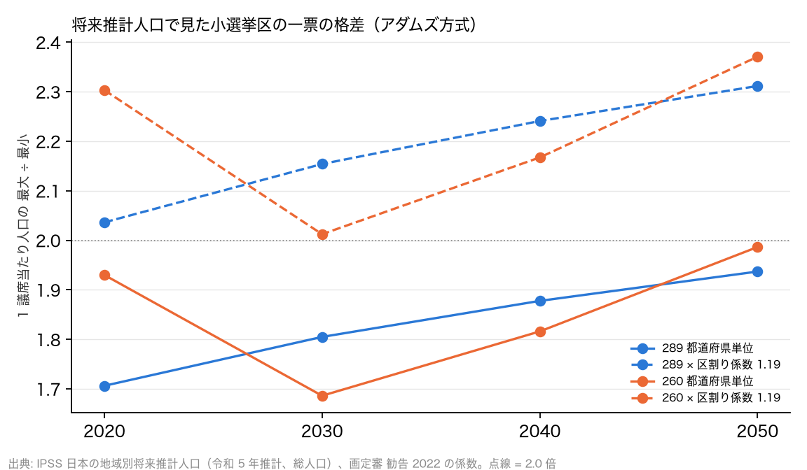

# R12: 将来人口で一票の格差はどうなるか — 定数を減らさなくても 2 倍を超えるのか（H11）（2026-10-29, theme: parliament-size）

## 要約（機械的試算、因果の主張はない）
- **H11（問題は定数ではなく区割り）は整合。** 国立社会保障・人口問題研究所の地域別将来推計人口（2023 年推計、総人口）を都道府県ごとにアダムズ方式で配分すると、小選挙区 289 のままでも都道府県単位の最大格差は 2020 年 1.706 → 2030 年 1.805 → 2040 年 1.878 → 2050 年 1.937 と広がる。2022 年区割りの上乗せ係数 1.193 を掛けた選挙区単位の見込みは、2030 年 2.15 倍、2040 年 2.24 倍、2050 年 2.31 倍で、**定数を減らさなくても 2 倍を超える**。
- **260 に減らしても格差の推移は変わらない。** 260 では 2030 年 2.01 倍、2040 年 2.17 倍、2050 年 2.37 倍。289 と 260 の差は年によって入れ替わり（配分の丸めによる）、定数より人口の偏りの進行が格差を決めている。定数 2 以下の県は 289 で 8 県（2020）→ 14 県（2050）、260 で 12 → 17 県に増える。
- **含意**: 一票の格差は、定数を減らしても据え置いても、鳥取・高知など人口の少ない県の 1 議席の重さが都市部の人口との比で決まり、今の区割りの精度（都道府県単位の 1.19 倍）では 2030 年代に 2 倍を超える。対処は定数ではなく、県内の区割りの精密化か、都道府県の枠を超えた区割り（合区）である。「定数削減で格差が深刻化する」（反対論 2）も「定数削減で格差を解決する」も、どちらも数字には合わない。

## 問いと仮説
`design/themes/parliament-size.md` の「事後追加（2026-10-29、R11〜R13）」H11。R2（H4b）・R6（H4c）の延長で、格差の時間方向を見る。推定したい量: 将来人口での都道府県単位の格差と、係数込みの選挙区単位の見込み（機械的試算）。因果効果は推定しない。

事後の具体化: (1) 推計は総人口（外国人を含む）で、画定審が使う日本人人口とは違う。2020 年で両者を比べると 289 の都道府県単位格差は 1.706（総人口）対 1.675（日本人、R2）で、総人口は都市部を重く見るため格差が 0.03 大きく出る。将来の日本人人口の都道府県別推計は公表されていないので総人口で代替した。(2) 上乗せ係数 1.193 は R6 と同じ（2022 年区割りの 1.999 ÷ 1.675）。将来の区割りの精度が今と同じという仮定。(3) 2025・2035・2045 年は表から省いた（同じ傾向）。

## データ
| 変数 | 出典 | 定義・単位 | 期間 | 備考 |
|---|---|---|---|---|
| 都道府県別 将来推計人口 | 国立社会保障・人口問題研究所『日本の地域別将来推計人口（令和 5 年推計）』結果表 1 | 総人口（人）、5 年刻み | 2020–2050 | 47 県の 2020 年合計が国勢調査 126,146,099 人と一致することを検算 |
| 都道府県別 日本人人口 2020 | e-Stat 国勢調査 表 2-1 | 人 | 2020 | 検算と係数の分母 |
| 区割りの上乗せ係数 | 画定審 勧告 2022（1.999）÷ 都道府県単位 1.675 | 1.193 | 2022 | R6 |

mart: `jp_prefecture_projection`（329 行 = 47 県 × 7 年）、`jp_census2020_prefecture`（47 行）。2026-10-29 取得。

## 方法
1. 各年の都道府県人口にアダムズ方式（切り上げ、各県 1 以上）で 289・260 を配分し、1 議席当たり人口の 最大 ÷ 最小 を求める。
2. 係数 1.193 を掛けて選挙区単位の見込みとする。

## 結果

### 表 1: 都道府県単位の最大格差（アダムズ方式、IPSS 推計の総人口）と区割り係数を掛けた見込み
| 年 | 定数 | 最大（県） | 最小（県） | 都道府県単位 最大 ÷ 最小 | × 係数（選挙区単位の見込み） | 定数 2 以下の県 |
|---|---|---|---|---|---|---|
| 2020 | 289 | 472,108（岡山県） | 276,704（鳥取県） | 1.706 | 2.036 | 8 |
| 2020 | 260 | 534,014（山形県） | 276,704（鳥取県） | 1.930 | 2.303 | 12 |
| 2030 | 289 | 453,557（福岡県） | 251,296（鳥取県） | 1.805 | 2.154 | 10 |
| 2030 | 260 | 512,450（東京都） | 303,928（高知県） | 1.686 | 2.012 | 13 |
| 2040 | 289 | 426,689（東京都） | 227,248（鳥取県） | 1.878 | 2.241 | 12 |
| 2040 | 260 | 479,390（沖縄県） | 263,984（高知県） | 1.816 | 2.167 | 16 |
| 2050 | 289 | 392,725（愛知県） | 202,764（鳥取県） | 1.937 | 2.312 | 14 |
| 2050 | 260 | 447,902（福岡県） | 225,490（高知県） | 1.986 | 2.371 | 17 |



- 289 のまま 2040 年: 都道府県単位 1.878、係数込み 2.24 倍。**判定: H11 整合。**
- 2030 年の 260 で格差が一時的に縮む（1.686）のは、鳥取が 1 議席になって最小側が高知に替わるためで（R6 と同じ構造）、以後は再び広がる。

## 頑健性
| 仕様 | 結果 |
|---|---|
| 総人口ではなく日本人人口（2020 年のみ可能） | 289 で 1.675（R2）。総人口より 0.03 小さい。将来も同程度の差なら 2040 年の係数込みは約 2.20 倍で、整合は不変 |
| 係数を 1.10（区割りを今より精密にする） | 289 の 2040 年は 2.07 倍。2050 年 2.13 倍。それでも超える |
| 係数を 1.05 | 2040 年 1.97 倍、2050 年 2.03 倍。2 倍を切るには都道府県単位の 5% 以内の区割りが要る |
| 合区（鳥取＋島根、高知＋徳島）を仮定 | 未計算。参院で採られた方式で、都道府県単位の格差を直接下げる |

## 限界・言えないこと
- 推計人口は 2020 年の出生・死亡・移動の仮定に基づく中位推計で、実現値ではない。外国人の増加が都市部に偏ると総人口ベースの格差はさらに大きく出る。
- 係数一定は仮定で、区割り改定のたびに画定審が 2 倍未満に収めるよう引き直すので、実際の最大格差は改定直後は 2 倍を下回り、その後に広がる周期を繰り返す。本レポートの見込みは「改定しなければ」の値に近い。
- 「2 倍」は最高裁判例の目安で、規範として妥当かは本レポートの外。

## 再現手順
```bash
uv run socioscope run parliament-size fetch --only ipss_regional && uv run socioscope run parliament-size stage --only ipss_regional && uv run socioscope run parliament-size mart --only ipss_regional
uv run python themes/parliament-size/src/theme_parliament_size/analysis/a20261029_r12_future_disparity.py
```
mart: `data/marts/jp_prefecture_projection.parquet`（329 行: iso3, year, pref_code, pref, population, source）。図 1 枚は `reports/figures/r12_future_disparity.png`。LLM 構造化は使っていない。2 回実行して stdout が一致することを確認した。

## チェックリスト回答
- A. H11 と判定基準は事後追加として設計書に結果の計算前に固定。総人口での代替と係数一定の仮定は本書に記録。推定量は「機械的試算」。
- B. 出典・取得日は manifest と一致。2020 年合計の検算あり。
- C. 因果を主張しない。
- D. 確定値（推計の中位値）のため標準誤差なし。係数の感度を報告。
- E. 「整合」「見込み」で書き、因果語は使わない。図は軸・単位・出典を明記。限界の節あり。再現手順と mart のスキーマ・行数を記載。
