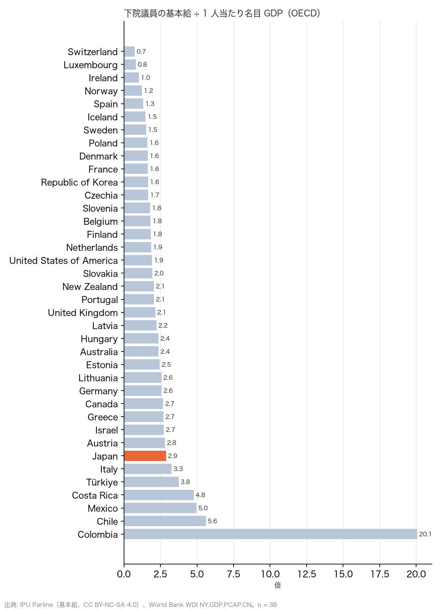
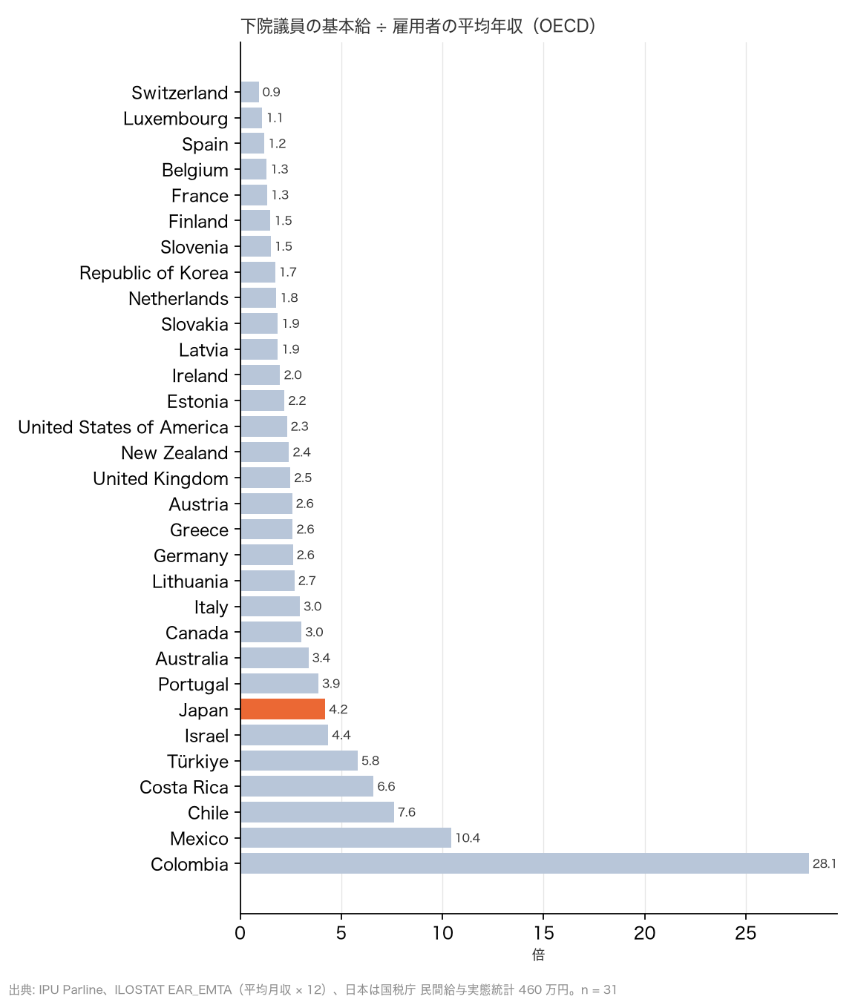

# R14: 議員 1 人の報酬は相対的に高いか、稼働日数は本会議だけでは過小評価か（H12・H13）（2026-10-29, theme: parliament-size）

## 要約（比率と順位の記述、因果の主張はない）
- **H12（議員 1 人の報酬は相対的に高い）は整合。世論の前半は数字と合う。** 衆院議員の歳費（基本給、年 1,552.8 万円）は 1 人当たり名目 GDP の 2.9 倍で、OECD 38 か国中 高い方から 7 位（中央値 2.1。独 2.6、英 2.1、米 1.9、仏 1.6、韓 1.6）。雇用者の平均年収（ILOSTAT 平均月収 × 12、日本 2021 年 30.7 万円/月）に対しては 4.2 倍で、31 か国中 高い方から 7 位（中央値 2.5）。どちらでも上位 3 分の 1 に入る。分母を国税庁の平均給与（460 万円、賞与込み）にしても 3.4 倍で上位側。
- **手当を含めると差はさらに大きい。** 歳費＋期末手当＋調査研究広報滞在費＋立法事務費の 4,086 万円は 1 人当たり GDP の 7.6 倍、平均給与の 8.9 倍。他国の手当は IPU に項目が無く比べられないため、これは参考値。
- **H13（稼働日数は本会議だけでは過小評価）は整合。** 国会会議録で数えると、衆議院は 2013〜2025 年に年平均で本会議 51 日、委員会等 534 回、いずれかの会議があった日は 124 日。稼働日数は本会議日数の 2.43 倍で、IPU が各国で比べる本会議日数（OECD 中央値 94 日）の「日本 47 日で少ない方から 6 位」（R5）は、委員会中心の日本の議会運営を半分しか捉えていない。稼働 124 日は各国の本会議日数の中央値を上回る。
- **含意**: 世論の「議員 1 人の収入は多い」は、1 人当たり GDP 比でも平均賃金比でも OECD 上位 3 分の 1 で事実に合う。「働いていない」は本会議日数だけで見れば OECD 下位だが、委員会を含めた稼働日数で見れば他国の本会議日数を上回り、国際比較で「少ない」とは言えない。この 2 つを合わせると、世論の不満に応える政策は報酬水準そのものと手当の透明性であって、人数ではない（R3: 45 減で浮くのは 1 人 25 円）。

## 問いと仮説
`design/themes/parliament-size.md` の「事後追加（2026-10-29 夕、R14）」H12・H13。ユーザーの指摘「日本では『議員は収入・予算が多く、働きに対して税金をかけすぎ』という世論が削減論につながっている」を受け、1 人当たりの報酬の相対水準と稼働日数を国際比較する。推定したい量: 倍率の順位（記述）と日数（記述）。因果効果は推定しない。

事後の具体化: (1) 基本給は IPU `basic_salary` の最新記録（日本 2025 年 15,528,000 円 = 歳費月額 129.4 万円 × 12。期末手当は含まない。R3 の 2,106 万円は期末手当込み）。(2) 1 人当たり GDP は WDI `NY.GDP.PCAP.CN`（現地通貨、基本給と同じ年、無ければ前年）。(3) 平均賃金は ILOSTAT `EAR_EMTA_SEX_CUR_NB`（classif1 = CUR_TYPE_LCU）の平均月収 × 12。「現地通貨」のはずが米ドル相当の値が入っている国があり（ハンガリー 947、チェコ 2,378、デンマーク 5,853、アイスランド、スウェーデン、ノルウェー、ポーランド）、年収 ÷ 1 人当たり GDP が 0.3 未満の国は単位不整合として除いた（7 か国）。日本は 2021 年 307,400 円が最新。(4) リトアニア・ラトビアは IPU の `local_currency` が空だが基本給は EUR なので含めた。(5) 稼働日数は国会会議録検索システム API の衆議院の会議（本会議・委員会・調査会等）を暦年で数え、同じ日の複数会議は 1 日とした。

## データ
| 変数 | 出典 | 定義・単位 | 期間 | 備考 |
|---|---|---|---|---|
| 議員基本給（現地通貨） | IPU Parline `basic_salary`（履歴） | 年額 | 最新（2023–2025） | OECD 38 か国。CC BY-NC-SA 4.0 |
| 1 人当たり名目 GDP | World Bank WDI `NY.GDP.PCAP.CN` | 現地通貨 | 2005–2025 | CC BY 4.0 |
| 雇用者の平均月収 | ILOSTAT `EAR_EMTA_SEX_CUR_NB`（CUR_TYPE_LCU） | 現地通貨、月 | 2015–2025 | CC BY 4.0。7 か国を単位不整合で除外 |
| 日本の平均給与（頑健性） | 国税庁「令和 5 年分 民間給与実態統計調査」 | 460 万円（年、賞与込み） | 2023 | 手入力 |
| 衆議院の会議一覧 | 国立国会図書館 国会会議録検索システム API `meeting_list` | 会議 1 件（日付・会議名） | 2013–2025 | 84 ページ、6,900 件 |

mart: `wdi_gdp_pcap_lcu`、`ilo_earnings_monthly`、`jp_hr_sitting_days`（13 年 × 4 指標）、`staged/ipu/chamber_attributes`。2026-10-29 取得。

## 方法
1. 国ごとに 基本給 ÷ 1 人当たり GDP、基本給 ÷（平均月収 × 12）を計算し、高い方からの順位で上位・中位・下位 3 分の 1 に分ける。
2. 衆議院の会議を年別に集計: 本会議の開会日数、本会議以外の会議の回数と開会日数、いずれかの会議があった日数。

## 結果

### 表 1: 下院議員の基本給と 1 人当たり GDP・平均賃金に対する倍率（OECD、÷ GDP の高い順）
| 国 | 基本給 | 年 | ÷ 1 人当たり GDP | ÷ 平均年収 |
|---|---|---|---|---|
| Colombia | 649,923,399 COP | 2024 | 20.1 | 28.1 |
| Chile | 88,187,796 CLP | 2024 | 5.6 | 7.6 |
| Mexico | 1,326,944 MXN | 2025 | 5.0 | 10.4 |
| Costa Rica | 48,008,568 CRC | 2025 | 4.8 | 6.6 |
| Türkiye | 2,752,739 TRY | 2025 | 3.8 | 5.8 |
| Italy | 125,220 EUR | 2025 | 3.3 | 3.0 |
| **Japan** | **15,528,000 JPY** | 2025 | **2.9** | **4.2** |
| Austria | 151,622 EUR | 2024 | 2.8 | 2.6 |
| Canada | 209,800 CAD | 2025 | 2.7 | 3.0 |
| Greece | 61,620 EUR | 2024 | 2.7 | 2.6 |
| Israel | 571,008 ILS | 2025 | 2.7 | 4.4 |
| Germany | 137,985 EUR | 2025 | 2.6 | 2.6 |
| Lithuania | 74,987 EUR | 2025 | 2.6 | 2.7 |
| Estonia | 74,827 EUR | 2025 | 2.5 | 2.2 |
| Australia | 239,270 AUD | 2025 | 2.4 | 3.4 |
| Hungary | 18,567,576 HUF | 2023 | 2.4 | –（単位不整合） |
| Latvia | 51,957 EUR | 2025 | 2.2 | 1.9 |
| United Kingdom | 93,904 GBP | 2025 | 2.1 | 2.5 |
| New Zealand | 173,400 NZD | 2025 | 2.1 | 2.4 |
| Portugal | 58,591 EUR | 2025 | 2.1 | 3.9 |
| Slovakia | 49,380 EUR | 2025 | 2.0 | 1.9 |
| Netherlands | 121,607 EUR | 2025 | 1.9 | 1.8 |
| United States of America | 174,000 USD | 2025 | 1.9 | 2.3 |
| Belgium | 98,235 EUR | 2025 | 1.8 | 1.3 |
| Finland | 91,644 EUR | 2025 | 1.8 | 1.5 |
| Slovenia | 59,257 EUR | 2025 | 1.8 | 1.5 |
| Czechia | 1,228,800 CZK | 2024 | 1.7 | –（単位不整合） |
| Denmark | 801,037 DKK | 2024 | 1.6 | –（単位不整合） |
| France | 71,183 EUR | 2025 | 1.6 | 1.3 |
| Republic of Korea | 84,958,800 KRW | 2025 | 1.6 | 1.7 |
| Poland | 161,615 PLN | 2024 | 1.6 | –（単位不整合） |
| Iceland | 18,822,774 ISK | 2025 | 1.5 | –（単位不整合） |
| Sweden | 942,000 SEK | 2025 | 1.5 | –（単位不整合） |
| Spain | 45,308 EUR | 2025 | 1.3 | 1.2 |
| Norway | 1,214,977 NOK | 2025 | 1.2 | –（単位不整合） |
| Ireland | 119,497 EUR | 2025 | 1.0 | 2.0 |
| Luxembourg | 106,597 EUR | 2025 | 0.8 | 1.1 |
| Switzerland | 71,066 CHF | 2025 | 0.7 | 0.9 |





- (a) 基本給 ÷ 1 人当たり GDP: 日本 2.9 倍、38 か国中 高い方から 7 位（中央値 2.1）→ 高い。
- (b) 基本給 ÷ 平均年収: 日本 4.2 倍、31 か国中 高い方から 7 位（中央値 2.5）→ 高い。
- **判定: H12 整合。** 上位は中南米・トルコ・イタリアで、西欧・北欧・米国は 1〜2 倍台。日本は G7 で最も高い。

### 表 2: 衆議院の本会議日数・委員会等の回数・稼働日数（国会会議録 API、暦年）
| 年 | 本会議日数 | 委員会等の回数 | 委員会等の開会日数 | 稼働日数 | 稼働 ÷ 本会議 |
|---|---|---|---|---|---|
| 2013 | 55 | 610 | 127 | 127 | 2.31 |
| 2014 | 53 | 584 | 121 | 121 | 2.28 |
| 2015 | 48 | 465 | 127 | 127 | 2.65 |
| 2016 | 58 | 567 | 123 | 124 | 2.14 |
| 2017 | 44 | 490 | 120 | 121 | 2.75 |
| 2018 | 59 | 548 | 130 | 130 | 2.20 |
| 2019 | 50 | 529 | 117 | 118 | 2.36 |
| 2020 | 46 | 488 | 128 | 128 | 2.78 |
| 2021 | 48 | 498 | 122 | 122 | 2.54 |
| 2022 | 50 | 568 | 129 | 129 | 2.58 |
| 2023 | 48 | 497 | 123 | 123 | 2.56 |
| 2024 | 54 | 538 | 118 | 118 | 2.19 |
| 2025 | 47 | 559 | 119 | 119 | 2.53 |

年平均で本会議 51 日、稼働 124 日（2.43 倍）。IPU の OECD 下院の本会議日数の中央値は 94 日。**判定: H13 整合。**

## 頑健性
| 仕様 | 結果 |
|---|---|
| 基本給を期末手当込み（2,106 万円、R3）にする | ÷ GDP 3.9 倍、÷ 平均年収 5.7 倍。順位はさらに上がる（他国の賞与相当は IPU に無く非対称） |
| 日本の分母を国税庁の平均給与 460 万円にする | 3.4 倍。31 か国の分布では 8〜9 位で上位 3 分の 1 のまま |
| 単位不整合の閾値を 0.2 にする | ポーランド（0.20）が入り 8.0 倍と極端な値になる。閾値 0.3 で除外した方が妥当 |
| 稼働日数に参議院を含める（両院のいずれかの会議） | 未計算。衆院のみで 2 倍超なので判定は不変 |

## 限界・言えないこと
- 基本給の定義は国で違う（課税前か、手当の一部を含むか）。IPU の `basic_salary` は各議会の申告で、米国 174,000 ドルは法定の年俸、ドイツは Abgeordnetenentschädigung で、日本は歳費のみ。
- ILOSTAT の「現地通貨」の月収に米ドル相当の値が混じる国があり、機械的に除外した。賃金の定義（賞与の有無、フルタイム換算）も国で揃わない。
- 稼働日数は「会議があった日」で、議員個人の出席や選挙区活動は測らない。委員会の回数は分科会・小委員会・調査会を含む。
- 「高い」が「高すぎる」かは、議員の職務に何を求めるかの価値判断で、本レポートは順位を示すだけである。

## 再現手順
```bash
uv run socioscope run parliament-size fetch --only kokkai_ndl --only ilostat --only worldbank_wdi && uv run socioscope run parliament-size stage --only kokkai_ndl --only ilostat --only worldbank_wdi && uv run socioscope run parliament-size mart --only kokkai_ndl --only ilostat --only worldbank_wdi
uv run python themes/parliament-size/src/theme_parliament_size/analysis/a20261029_r14_pay_and_workload.py
```
mart: `data/marts/wdi_gdp_pcap_lcu.parquet`、`ilo_earnings_monthly.parquet`（metric = earnings_monthly_lcu）、`jp_hr_sitting_days.parquet`（52 行: iso3, year, metric, value, source）、`data/staged/ipu/chamber_attributes.parquet`。図 2 枚は `reports/figures/r14_*.png`。LLM 構造化は使っていない。2 回実行して stdout が一致することを確認した。

## チェックリスト回答
- A. H12・H13 と判定基準は事後追加として設計書に結果の計算前に固定。基本給の定義・賃金の除外規則・国税庁の手入力は本書に記録。推定量は「倍率の順位・日数（記述）」。
- B. 出典・取得日は manifest と一致。欠損（賃金 7 か国の単位不整合）を明記し補完していない。
- C. 因果を主張しない。
- D. 確定値のため標準誤差なし。基本給の範囲・分母・閾値の仕様を報告。
- E. 「整合」「記述」で書き、「高すぎる」とは書かない。図は軸・単位・出典・n を明記。限界の節あり。再現手順と mart のスキーマ・行数を記載。
