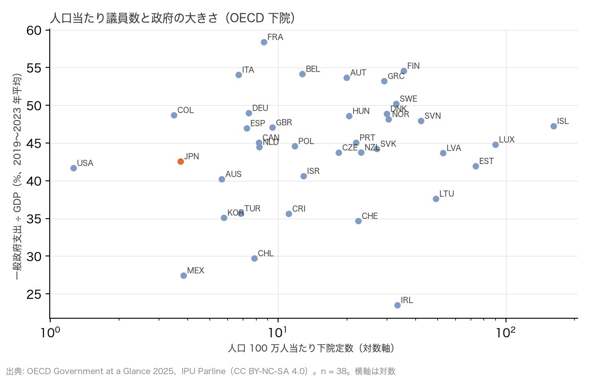
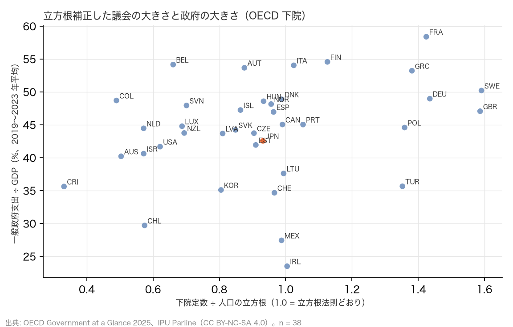

# R16（番外編）: 議会の大きさは「小さな政府／大きな政府」と関係するか（H15a〜d）（2026-10-29, theme: parliament-size）

## 要約（記述のみ。事前の見立てと逆の結果をそのまま報告する）
- **H15a（素の人口当たり議員数 × 政府支出比）は不支持。** OECD 38 か国の下院で、人口 100 万人当たり定数と一般政府支出の対 GDP 比（2019〜2023 年平均）の Spearman ρ = +0.16（p = 0.34）。素の比率では「大きな政府ほど議員が多い」は見えない。
- **H15b（立方根法則で人口規模を補正すると相関は消える）は不支持。** 補正比 `定数 ÷ 人口^(1/3)` との ρ = +0.34（p = 0.04）で、補正するとむしろ関係が**現れる**。事前の見立て（「規模の効果で、補正すれば消える」）は外れた。log 回帰残差でも ρ = +0.35、米国を除いても +0.32、2019 年単独では +0.24（中間）。
- **H15c: 向きは正。** 人口規模のわりに議会が大きい国（スウェーデン 1.59、英国 1.59、ドイツ 1.44、フランス 1.42）は政府支出比も高く（47〜58%）、小さい国（コスタリカ 0.33、コロンビア 0.49、豪州 0.50、米国 0.62）は低い（36〜42%）。「行政が大きいと議会は小さくてよい」という代替関係ではなく、議会と行政は同じ方向に大きい。
- **H15d（議員 1 人当たり議会職員 × 政府支出比）は整合**（ρ = −0.29、n = 35、p = 0.09。境界ぎりぎり）。議会の執行力を 1 人に集中させる配分は、政府観とはほぼ別。
- **日本**: 支出比 42.5% は 38 か国中 高い方から 26 位（中央値 44.8%）、立方根補正比 0.93 は 19 位。どちらも中位で、「小さな政府で議会も小さい」側にはいない。
- **含意**: 素の比率が低い（R1）のは人口規模の効果だが、人口規模を除いた「議会の大きさの選択」は政府の大きさと弱く正に関係している（ρ ≈ 0.3、n = 38 で 5% 有意の境界 0.32 の付近）。小さな政府の国が議員を少なくしているという読みは、規模を補正した指標でのみ、弱く支持される。因果は主張しない（歴史・政治文化・連邦制の共通原因がある）。

## 問いと仮説
`design/themes/parliament-size.md` の「事後追加（2026-10-29 深夜、番外編 R16）」H15a〜d。ユーザー提起「人口当たり議員数は、小さな政府／大きな政府という国ごとの方針と関係するか」を受け、本編の記事とは別の番外編として扱う。プラン: `docs/specs/parliament-size-government-size.md`。

事後の具体化: (1) 税収対 GDP 比（OECD Revenue Statistics）は SDMX API が観測なしの応答を返したため、補助指標を政府収入比（同じ Government at a Glance の `GR`）に替えた。(2) 連邦制のフラグは Forum of Federations の連邦国リスト（手入力 CSV、8 か国）。(3) 人口と定数は IPU Parline の最新値。

## データ
| 変数 | 出典 | 定義・単位 | 期間 | 備考 |
|---|---|---|---|---|
| 一般政府支出・収入 ÷ GDP | OECD Government at a Glance 2025（`marts/oecd_gov_finance`） | S13、% of GDP | 2019–2023 平均、2019 単独 | 43 か国、OECD 38 か国すべて |
| 下院定数・人口・職員数 | IPU Parline（`marts/ipu_parliaments`） | 定数、千人、常勤職員 | 最新 | CC BY-NC-SA 4.0 |
| 公務就業者 | ILOSTAT（`marts/ilo_emp_public_admin`） | ISIC O、人口 1,000 人当たり | 最新年 | R10 と同じ |
| 連邦制 | `federal_states.csv` | 1 = 連邦 | 2026-10-29 | AUS AUT BEL CAN CHE DEU MEX USA |

## 方法
1. 議会の大きさ: (i) 人口 100 万人当たり下院定数、(ii) 立方根補正比（R1 の `cube_ratio`）、(iii) log(定数) を log(人口) に回帰した残差（係数を仮定しない補正。傾きは 0.38）。
2. 政府の大きさ: 一般政府支出比の 2019〜2023 年平均（主）、2019 年単独と収入比（補助）。
3. Spearman 順位相関と t 近似の p 値。判定は事前の効果量基準。
4. 層別: 米国除外、連邦制／単一制、人口 1,000 万人以上／未満。従属変数を人口当たり公務就業者（R10）に替えた版も併記。

## 結果

### 表 1: 政府の大きさと議会の大きさ（政府支出比の高い順）
| 国 | 支出 ÷ GDP %（19–23 平均） | 収入 ÷ GDP % | 下院 /100 万人 | 立方根補正比 | log 残差 | 職員 ÷ 議員 | 公務 /1,000 人 | 連邦 |
|---|---|---|---|---|---|---|---|---|
| France | 58.4 | 52.8 | 8.68 | 1.42 | +0.41 | 2.8 | 34.9 |  |
| Finland | 54.5 | 52.1 | 35.71 | 1.13 | +0.28 | 2.5 | 21.1 |  |
| Belgium | 54.1 | 49.3 | 12.81 | 0.66 | -0.28 | 3.3 | 38.6 | 連邦 |
| Italy | 54.0 | 47.0 | 6.72 | 1.02 | +0.09 | 2.8 | 20.0 |  |
| Austria | 53.7 | 49.8 | 20.04 | 0.88 | +0.01 | – | 36.7 | 連邦 |
| Greece | 53.2 | 49.3 | 29.29 | 1.38 | +0.46 | 5.3 | 34.7 |  |
| Sweden | 50.2 | 49.6 | 33.08 | 1.59 | +0.60 | 1.9 | 41.7 |  |
| Germany | 49.0 | 46.8 | 7.45 | 1.44 | +0.41 | 4.6 | 36.6 | 連邦 |
| Denmark | 48.9 | 52.0 | 30.09 | 0.99 | +0.15 | 2.5 | 29.1 |  |
| Colombia | 48.7 | 42.9 | 3.50 | 0.49 | -0.65 | 13.3 | 15.8 |  |
| Hungary | 48.6 | 42.7 | 20.55 | 0.93 | +0.07 | 5.1 | 41.6 |  |
| Norway | 48.1 | 59.4 | 30.62 | 0.96 | +0.12 | 2.9 | 34.3 |  |
| Slovenia | 47.9 | 44.5 | 42.49 | 0.70 | -0.15 | 3.1 | 24.5 |  |
| Iceland | 47.2 | 42.2 | 162.37 | 0.86 | +0.13 | 2.2 | 33.4 |  |
| United Kingdom | 47.0 | 40.2 | 9.46 | 1.59 | +0.52 | 2.8 | 42.2 |  |
| Spain | 46.9 | 41.4 | 7.31 | 0.96 | +0.03 | 1.4 | 29.8 |  |
| Canada | 45.0 | 42.4 | 8.26 | 0.99 | +0.07 | 5.7 | – | 連邦 |
| Portugal | 45.0 | 43.5 | 22.05 | 1.05 | +0.19 | 1.8 | 34.4 |  |
| Luxembourg | 44.8 | 44.8 | 90.23 | 0.69 | -0.12 | 2.3 | 58.0 |  |
| Poland | 44.6 | 41.0 | 11.87 | 1.36 | +0.39 | 3.1 | 31.6 |  |
| Netherlands | 44.4 | 43.6 | 8.29 | 0.57 | -0.45 | 4.0 | 40.9 |  |
| Slovakia | 44.2 | 40.5 | 27.18 | 0.85 | -0.00 | 2.5 | 39.0 |  |
| New Zealand | 43.7 | 40.0 | 23.20 | 0.69 | -0.20 | 5.9 | 22.3 |  |
| Czechia | 43.7 | 40.3 | 18.50 | 0.90 | +0.03 | 2.0 | 33.0 |  |
| Latvia | 43.7 | 39.9 | 53.13 | 0.81 | -0.00 | 5.4 | 34.9 |  |
| **Japan** | 42.5 | 37.6 | 3.74 | 0.93 | -0.04 | 4.5 | 19.9 |  |
| Estonia | 41.9 | 39.5 | 73.88 | 0.91 | +0.13 | 2.1 | 28.6 |  |
| United States of America | 41.7 | 32.7 | 1.27 | 0.62 | -0.49 | 28.0 | 17.8 | 連邦 |
| Israel | 40.6 | 36.1 | 12.96 | 0.57 | -0.42 | 4.9 | 46.7 |  |
| Australia | 40.2 | 35.7 | 5.67 | 0.50 | -0.59 | 1.8 | 37.3 | 連邦 |
| Lithuania | 37.6 | 35.9 | 49.40 | 0.99 | +0.19 | 2.9 | 34.6 |  |
| Türkiye | 35.6 | 31.1 | 6.88 | 1.35 | +0.35 | 7.0 | 24.5 |  |
| Costa Rica | 35.6 | 33.4 | 11.16 | 0.33 | -0.94 | 16.1 | 20.3 |  |
| Republic of Korea | 35.1 | 34.5 | 5.80 | 0.81 | -0.15 | 16.4 | 25.7 |  |
| Switzerland | 34.6 | 34.5 | 22.55 | 0.97 | +0.11 | – | 28.9 | 連邦 |
| Chile | 29.7 | 25.9 | 7.88 | 0.57 | -0.45 | 3.1 | 27.4 |  |
| Mexico | 27.4 | 22.2 | 3.85 | 0.99 | +0.02 | 7.5 | 17.0 | 連邦 |
| Ireland | 23.5 | 23.0 | 33.48 | 1.00 | +0.17 | – | 28.4 |  |

### 判定
| 仮説 | ρ | n | p | 判定 |
|---|---|---|---|---|
| H15a 素の比率 × 支出比 | +0.16 | 38 | 0.34 | **不支持** |
| H15b 立方根補正比 × 支出比 | +0.34 | 38 | 0.04 | **不支持**（相関が残る） |
| H15c 向き | 正 | – | – | 大きな政府ほど議会も大きい |
| H15d 職員 ÷ 議員 × 支出比 | −0.29 | 35 | 0.09 | **整合** |

n = 38 で両側 5% 有意になる |ρ| の境界は 0.32。

### 図



## 頑健性
| 仕様 | n | 素の比率 ρ | 立方根補正 ρ | log 残差 ρ |
|---|---|---|---|---|
| 本体（支出比 2019〜2023 平均） | 38 | +0.16 | +0.34 | +0.35 |
| 2019 年単独 | 38 | +0.20 | +0.24 | +0.28 |
| 政府収入比（2019〜2023 平均） | 38 | +0.29 | +0.29 | +0.33 |
| 米国を除く | 37 | +0.12 | +0.32 | +0.34 |
| 連邦制のみ | 8 | +0.36 | +0.00 | -0.05 |
| 単一制のみ | 30 | +0.09 | +0.43 | +0.40 |
| 人口 1,000 万人以上 | 21 | +0.47 | +0.45 | +0.48 |
| 人口 1,000 万人未満 | 17 | +0.06 | +0.16 | +0.18 |
| 人口当たり公務就業者（R10、従属変数を置換） | 37 | +0.33 | +0.10 | +0.22 |

- 連邦制のみ（n = 8）では補正後の相関が消える（ρ = 0.00）が、n が小さく判定に使えない。単一制のみでは +0.43 と強まる。
- 人口 1,000 万人以上の 21 か国では素の比率でも +0.47 と出る。小国（17 か国）では +0.06〜+0.18 と弱い。素の比率の相関が全体で弱いのは、人口の小さい国（アイスランド、ルクセンブルク、エストニア）が人口当たり議員数は極端に多い一方、政府の大きさは中位にあるためである。
- 人口 × 支出比の ρ = +0.03 で、小国ほど政府が大きいという関係はない。したがって素の比率の相関が弱いのは「規模の交絡」ではなく、人口の効果が議員数の側だけに強く効いているからである。
- 従属変数を人口当たり公務就業者（R10）に替えると、素の比率で +0.33、補正比で +0.10。R10 の ρ = +0.33 は規模の効果で、補正すると消える（これは R10 の解釈どおり）。政府支出比とは挙動が違う。

## 限界・言えないこと
- 38 か国の横断面の順位相関で、因果ではない。政府の大きさと議会の大きさは、どちらも建国期の制度選択・政治文化・連邦制の共通原因を持ちうる。
- 連邦制の国では州議会議員と州政府支出が国の数字に入らない（議会の大きさを過小評価）。一般政府支出は州・地方を含むので、分子と分母の範囲が揃っていない。
- 支出比は 2020〜2021 年の COVID 対応で跳ねる。2019 年単独では補正後の ρ = +0.24（中間）に下がる。
- 「小さな政府」は支出比・収入比・公務就業者の 3 指標で測り、規制の強さは含まない。
- IPU の人口・定数は最新値で、支出比の期間（2019〜2023）とは少しずれる。

## 再現手順
```bash
uv run socioscope run parliament-size fetch --only oecd_gov_glance && uv run socioscope run parliament-size stage --only oecd_gov_glance && uv run socioscope run parliament-size mart --only oecd_gov_glance
uv run python themes/parliament-size/src/theme_parliament_size/analysis/a20261029_r16_government_size.py
```
mart: `data/marts/oecd_gov_finance.parquet`（1,500 行、43 か国 × 2007–2024 × 2 指標）、`ipu_parliaments.parquet`、`ilo_emp_public_admin.parquet`。手入力: `src/theme_parliament_size/federal_states.csv`。図 2 枚。LLM 構造化は使っていない。2 回実行して stdout が一致することを確認した。

## チェックリスト回答
- A. H15a〜d と判定基準は設計書に結果の計算前に固定。見立て（補正で消える）と逆の結果をそのまま報告した。推定量は Spearman ρ（記述）。
- B. 出典は OECD（manifest）・IPU・ILOSTAT・手入力 CSV（出典列）。税収を収入で代替した経緯を記録。
- C. 因果を主張しない。共通原因の候補を限界に書いた。
- D. 2019 年単独・収入比・残差補正・層別・従属変数の置換を報告。
- E. 「整合」「不支持」「中間」で書き、限界の節あり。再現手順と mart のスキーマを記載。
