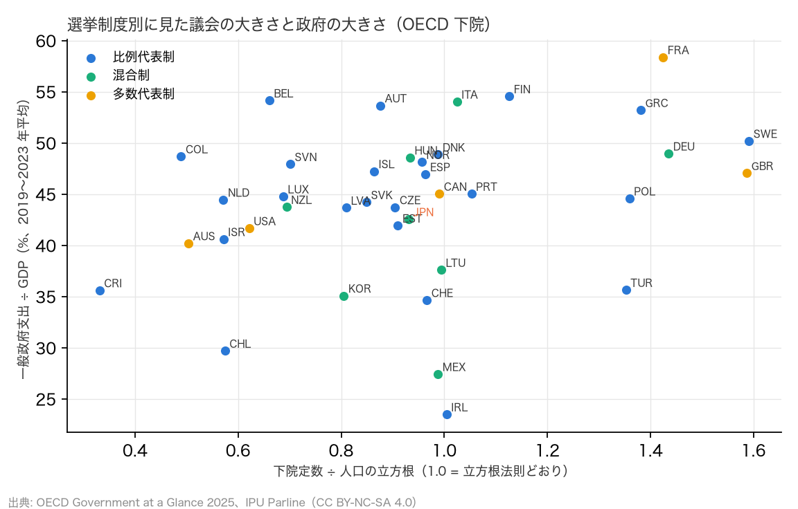
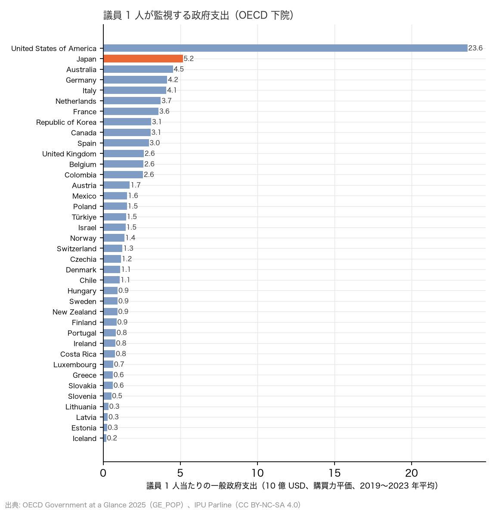
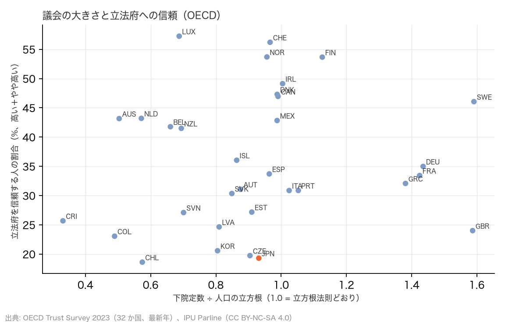

# R17（番外編）: 選挙制度・監視対象・信頼。R16 を深める 3 つの問い（H16a〜c）（2026-10-30, theme: parliament-size）

## 要約（記述のみ。事前の見立てと違う結果もそのまま報告する）
- **H16a（選挙制度が R16 の相関を説明するか）**: (i) 比例代表制 25 か国の一般政府支出比の中央値は 44.8%、多数代表・混合制 13 か国は 43.7% で差は +1.0 pt。Persson–Tabellini（2003）の「比例代表制ほど政府が大きい」は、この 38 か国・2019〜2023 年の粗い比較では**再現しなかった**。(ii) 比例代表制の層内での 立方根補正比 × 支出比 の ρ は +0.21（n = 25、p = 0.31）で**中間**。全体の +0.34 より弱まるが消えない。多数代表・混合制の層内では +0.58（n = 13）と強い。選挙制度は R16 の相関の一部を説明するが、全部ではない。
- **H16b（議員 1 人当たりの監視対象）は整合。** 議員 1 人当たりの一般政府支出（購買力平価）は日本が 51.7 億 USD で 38 か国中 **2 位**（1 位は米国 236 億 USD、3 位 豪州 45 億、4 位 ドイツ 42 億、5 位 イタリア 41 億）。中央値 13 億 USD の 3.9 倍。議会予算 ÷ 政府予算は、議員 1 人当たり支出が大きい国ほど小さい（ρ = −0.42、n = 37）。監視対象が大きい国ほど、監視に充てる予算の比率は薄い。日本の 0.096% は少ない方から 9 位。
- **H16c（議会の大きさと信頼）は中間。** 立方根補正比 × 立法府への信頼（OECD Trust Survey、最新年）の ρ = +0.23（n = 32、p = 0.20）。「小さい議会ほど信頼される」（ρ ≤ −0.3）という削減推進側の暗黙の仮定は**支持されず**、向きはむしろ逆。素の人口当たり議員数では +0.35。議員 1 人当たり支出とは無関係（−0.02）。日本の立法府への信頼は 19.3%（2021 年）で 32 か国中 低い方から 2 位。
- **含意**: (1) 議会の大きさは選挙制度の副産物として全部は説明できず、政府の大きさとの弱い正の関係は比例代表制の中でも残る。(2) 日本の議員は、米国を除けば世界で最も大きい政府支出を 1 人で監視している。定数を 45 減らすと 1 人当たり 57 億 USD となり、豪州・ドイツを引き離して 2 位のまま差が広がる。(3) 議会を小さくすると信頼が上がるという横断面の証拠はない。因果は主張しない。

## 問いと仮説
`design/themes/parliament-size.md` の「事後追加（2026-10-30、番外編 R17）」H16a〜c。R16 の結果を受けたユーザー提起「深める手段と so what」から、同じ OECD 38 か国で確かめられる 3 つを選んだ。

事後の具体化: (1) 「議会が政府に責任を問う」（`TRUST_PVGA`）は OECD の単位宣言が PT_RESP だが値は 0〜1 の割合だったので 100 倍した。(2) 信頼は 2023 年を優先し、無い国（日本、オーストリア）は 2021 年。(3) 議員 1 人当たり支出は `GE_POP`（1 人当たり支出、USD PPP）× IPU 人口 ÷ 下院定数で、2019〜2023 年平均。

## データ
| 変数 | 出典 | 定義・単位 | 期間 | 備考 |
|---|---|---|---|---|
| 一般政府支出 ÷ GDP、1 人当たり支出 | OECD Government at a Glance 2025（`marts/oecd_gov_finance`） | %、USD PPP/人 | 2019–2023 平均 | R16 と同じ flow に `GE_POP` を追加 |
| 立法府への信頼、政府への信頼、議会が政府に責任を問う | OECD Trust Survey 2023（`marts/oecd_gov_trust`） | 回答者 %（高い＋やや高い／そう思う） | 2021・2023 | 日本は 2021 年のみ。30〜32 か国 |
| 選挙制度、議会予算 ÷ 政府予算、定数、人口 | IPU Parline（`marts/ipu_parliaments`） | 分類、%、人、千人 | 最新 | CC BY-NC-SA 4.0 |

## 方法
1. H16a: IPU の `electoral_system` で比例代表制（25）と多数代表・混合制（13）に分け、支出比の中央値差と、層内の Spearman ρ。
2. H16b: 議員 1 人当たり支出の順位。補助として議会予算 ÷ 政府予算との ρ。
3. H16c: 立方根補正比 × 信頼の ρ。補助として素の比率、1 人当たり支出、責任追及の認識、支出比との ρ。

## 結果

### H16a: 選挙制度別
| 選挙制度 | n | 支出比 中央値 % | 立方根補正比 中央値 | 補正比 × 支出比 ρ | p |
|---|---|---|---|---|---|
| 比例代表制 | 25 | 44.8 | 0.90 | +0.21 | 0.305 |
| 多数代表・混合制 | 13 | 43.7 | 0.99 | +0.58 | 0.037 |
| 全体 | 38 | 44.7 | 0.93 | +0.34 | 0.038 |
- 比例代表制（25）: Finland、Belgium、Austria、Greece、Sweden、Denmark、Colombia、Norway、Slovenia、Iceland、Spain、Portugal、Luxembourg、Poland、Netherlands、Slovakia、Czechia、Latvia、Estonia、Israel、Türkiye、Costa Rica、Switzerland、Chile、Ireland
- 混合制（8）: Italy、Germany、Hungary、New Zealand、Japan、Lithuania、Republic of Korea、Mexico
- 多数代表制（5）: France、United Kingdom、Canada、United States of America、Australia

- **H16a (i)**: 差 +1.0 pt → **再現せず**（≥ 3 pt で再現）。
- **H16a (ii)**: 比例代表制の層内 ρ = +0.21 → **中間**（|ρ| < 0.2 で整合、≥ 0.3 で不支持）。多数代表・混合制の層内 ρ = +0.58（n = 13、参考）。



### H16b: 議員 1 人が監視する政府支出
| 国 | 議員 1 人当たり支出（10 億 USD PPP） | 1 人当たり支出（USD PPP） | 下院定数 | 議会予算 ÷ 政府予算 % |
|---|---|---|---|---|
| United States of America | 23.63 | 29,921 | 435 | 0.100 |
| **Japan** | 5.17 | 19,321 | 465 | 0.096 |
| Australia | 4.53 | 25,670 | 150 | 0.045 |
| Germany | 4.16 | 30,967 | 630 | 0.256 |
| Italy | 4.10 | 27,578 | 400 | 0.134 |
| Netherlands | 3.74 | 30,967 | 150 | 0.047 |
| France | 3.59 | 31,207 | 577 | 0.218 |
| Republic of Korea | 3.12 | 18,086 | 300 | 0.111 |
| Canada | 3.08 | 25,419 | 343 | 0.194 |
| Spain | 2.96 | 21,650 | 350 | 0.065 |
| United Kingdom | 2.64 | 24,983 | 650 | 0.048 |
| Belgium | 2.62 | 33,586 | 150 | 0.197 |
| Colombia | 2.59 | 9,050 | 183 | – |
| Austria | 1.73 | 34,631 | 183 | 0.240 |
| Mexico | 1.56 | 6,002 | 500 | 0.188 |
| Poland | 1.54 | 18,284 | 460 | 0.118 |
| Türkiye | 1.48 | 10,181 | 600 | 0.121 |
| Israel | 1.45 | 18,856 | 120 | 0.128 |
| Norway | 1.38 | 42,146 | 169 | 0.060 |
| Switzerland | 1.25 | 28,245 | 200 | 0.133 |
| Czechia | 1.15 | 21,336 | 200 | 0.097 |
| Denmark | 1.11 | 33,468 | 179 | 0.073 |
| Chile | 1.07 | 8,448 | 155 | 0.194 |
| Hungary | 0.94 | 19,386 | 199 | 0.165 |
| Sweden | 0.94 | 31,101 | 349 | 0.195 |
| New Zealand | 0.93 | 21,560 | 120 | 0.196 |
| Finland | 0.87 | 31,133 | 200 | 0.166 |
| Portugal | 0.83 | 18,254 | 230 | 0.079 |
| Ireland | 0.79 | 26,460 | 174 | 0.178 |
| Costa Rica | 0.78 | 8,665 | 57 | 0.363 |
| Luxembourg | 0.66 | 59,510 | 60 | 0.252 |
| Greece | 0.63 | 18,408 | 300 | 0.015 |
| Slovakia | 0.63 | 17,067 | 150 | 0.195 |
| Slovenia | 0.53 | 22,510 | 90 | 0.248 |
| Lithuania | 0.35 | 17,197 | 141 | 0.236 |
| Latvia | 0.30 | 16,051 | 100 | 0.197 |
| Estonia | 0.25 | 18,520 | 101 | 0.216 |
| Iceland | 0.20 | 31,831 | 63 | 0.361 |

- 日本は 51.7 億 USD で 38 か国中 2 位（中央値 13.1 億、3.9 倍） → **H16b 整合**。
- 補助: 議会予算 ÷ 政府予算 × 支出比 ρ = +0.07、× 議員 1 人当たり支出 ρ = −0.42（n = 37）。



### H16c: 議会の大きさと立法府への信頼
| 国 | 立法府への信頼 % | 年 | 議会が政府に責任を問う % | 立方根補正比 | 下院 /100 万人 |
|---|---|---|---|---|---|
| Luxembourg | 57.2 | 2023 | 43.0 | 0.69 | 90.23 |
| Switzerland | 56.2 | 2023 | 52.0 | 0.97 | 22.55 |
| Norway | 53.7 | 2023 | 40.0 | 0.96 | 30.62 |
| Finland | 53.7 | 2023 | 36.0 | 1.13 | 35.71 |
| Ireland | 49.1 | 2023 | 44.0 | 1.00 | 33.48 |
| Denmark | 47.3 | 2023 | 57.0 | 0.99 | 30.09 |
| Canada | 47.0 | 2023 | 47.0 | 0.99 | 8.26 |
| Sweden | 46.1 | 2023 | 45.0 | 1.59 | 33.08 |
| Netherlands | 43.2 | 2023 | 49.0 | 0.57 | 8.29 |
| Australia | 43.2 | 2023 | 46.0 | 0.50 | 5.67 |
| Mexico | 42.8 | 2023 | 40.0 | 0.99 | 3.85 |
| Belgium | 41.8 | 2023 | 43.0 | 0.66 | 12.81 |
| New Zealand | 41.5 | 2023 | 49.0 | 0.69 | 23.20 |
| Iceland | 36.0 | 2023 | 20.0 | 0.86 | 162.37 |
| Germany | 35.0 | 2023 | 33.0 | 1.44 | 7.45 |
| Spain | 33.7 | 2023 | 34.0 | 0.96 | 7.31 |
| France | 33.4 | 2023 | 42.0 | 1.42 | 8.68 |
| Greece | 32.1 | 2023 | 25.0 | 1.38 | 29.29 |
| Austria | 31.1 | 2021 | – | 0.88 | 20.04 |
| Portugal | 30.9 | 2023 | 36.0 | 1.05 | 22.05 |
| Italy | 30.9 | 2023 | 37.0 | 1.02 | 6.72 |
| Slovakia | 30.4 | 2023 | 36.0 | 0.85 | 27.18 |
| Estonia | 27.2 | 2023 | 24.0 | 0.91 | 73.88 |
| Slovenia | 27.1 | 2023 | 26.0 | 0.70 | 42.49 |
| Costa Rica | 25.7 | 2023 | 39.0 | 0.33 | 11.16 |
| Latvia | 24.6 | 2023 | 24.0 | 0.81 | 53.13 |
| United Kingdom | 24.0 | 2023 | 36.0 | 1.59 | 9.46 |
| Colombia | 23.1 | 2023 | 40.0 | 0.49 | 3.50 |
| Republic of Korea | 20.6 | 2023 | 41.0 | 0.81 | 5.80 |
| Czechia | 19.7 | 2023 | 24.0 | 0.90 | 18.50 |
| **Japan** | 19.3 | 2021 | – | 0.93 | 3.74 |
| Chile | 18.6 | 2023 | 44.0 | 0.57 | 7.88 |

- **H16c**: ρ = +0.23（n = 32、p = 0.20） → **中間**。「小さい議会ほど信頼される」は支持されない。
- 補助: 素の人口当たり議員数 × 信頼 +0.35、議員 1 人当たり支出 × 信頼 −0.02、補正比 × 責任追及の認識 −0.16（n = 30）、支出比 × 信頼 +0.17。



## 頑健性
| 仕様 | 結果 |
|---|---|
| H16a (i) を平均値で見る | 比例代表制 44.2%、多数代表・混合制 43.9%（差 +0.4 pt）。再現せず |
| H16a (ii) を混合制のみ（n = 8）で見る | 日本を含む 8 か国では n が小さく判定に使わない。層内 ρ は表のとおり多数代表と合算で +0.58 |
| H16b で定数 420（比例 45 減）の日本 | 57.2 億 USD。順位は 2 位のまま、3 位 豪州との差が 6 億から 12 億に広がる |
| H16c で 2023 年のみ（日本・オーストリアを除く、n = 30） | ρ = +0.22。中間のまま |

## 限界・言えないこと
- 横断面の順位相関で、因果ではない。信頼は 1 時点の世論調査で、文化差（回答の傾向）を含む。
- 選挙制度の 3 分類は粗い。比例代表制の中でも選挙区定数・阻止条項で政府支出への効果は違うとされ、Persson–Tabellini の推定は 80 か国・1990 年代のパネルで統制変数つきである。本書の「再現せず」はその精密さを持たない。
- 議員 1 人当たり支出は下院のみで、上院と州議会を数えていない。連邦制の米・独・豪は州議会の分だけ過大に出る。
- 議会予算 ÷ 政府予算は IPU の申告値で、両院合算の扱いが国で揃わない（R7 と同じ）。

## 再現手順
```bash
uv run socioscope run parliament-size fetch --only oecd_gov_glance && uv run socioscope run parliament-size stage --only oecd_gov_glance && uv run socioscope run parliament-size mart --only oecd_gov_glance
uv run python themes/parliament-size/src/theme_parliament_size/analysis/a20261030_r17_system_oversight_trust.py
```
mart: `data/marts/oecd_gov_finance.parquet`（2,250 行、3 指標）、`oecd_gov_trust.parquet`（131 行、3 指標）、`ipu_parliaments.parquet`。図 3 枚。LLM 構造化は使っていない。2 回実行して stdout が一致することを確認した。

## チェックリスト回答
- A. H16a〜c と判定基準は設計書に結果の計算前に固定。見立て（H16a は中間か整合、H16b 整合、H16c 無関係）と結果を対比して報告。
- B. 出典は OECD（manifest 2 件）と IPU。`TRUST_PVGA` の単位の食い違いを記録。
- C. 因果を主張しない。
- D. 平均値、年の限定、定数 420 の試算を報告。
- E. 「再現せず」「中間」「整合」で書き、限界の節あり。再現手順と mart のスキーマを記載。
