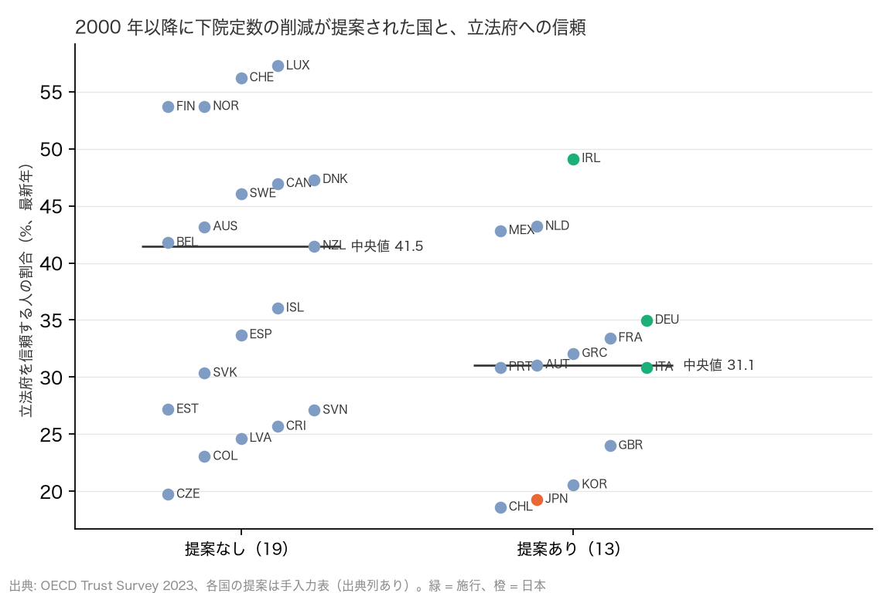

# R18（番外編）: 議員への不信は海外でも定数削減の推進力か（H17a〜c）（2026-10-30, theme: parliament-size）

## 要約（手入力表の記述と中央値の比較のみ。事前の見立てと逆の結果をそのまま報告する）
- **H17a（不信が高い国ほど削減が提案されるか）は整合。ただし頑健ではない。** 2000 年以降に下院定数の削減が提案または実現した OECD 15 か国のうち信頼データのある 13 か国の立法府への信頼の中央値は 31.1%、提案の無い 19 か国は 41.5% で、差は −10.4 pt（判定基準 −5 pt）。事前の見立て「不信の水準は必要条件ではない」は、**必要条件ではないが傾向はある**という形で外れた。提案あり群の下位にチリ 19%、日本 19%、韓国 21%、英国 24% が並び、上位にはアイルランド 49%、オランダ 43%、メキシコ 43% もいる。**しかし「提案」を法案提出・国民投票・成立法律に限る（党の公約や検討項目を除く）と、9 か国 vs 23 か国で 33.4% vs 33.7%、差 −0.3 pt となり不支持に変わる。** 差を作っているのは、公約や検討にとどまった信頼の低い国（韓国、ポーランド、ギリシャ、オーストリア、ポルトガル）である。不信は「減らすと言う」ことには結びつくが、法案にすることとは結びつかない。
- **H17b（不信・費用を理由にした提案は実現したか）**: 17 件の提案のうち「不信」または「費用」を表向きの理由に含むものは 13 件で、施行されたのは 3 件（イタリア、アイルランド、日本 2012 年）、成立後に撤回 1 件（英国）、未成立 9 件。施行率 23%。「効率・制度改革」のみの 4 件は 2 件が施行（ドイツ、ハンガリー）で 50%。不信や費用を掲げた提案は数は多いが、憲法改正の壁や政権交代で大半が実現していない。
- **H17c（削減の後に信頼は回復したか）は判定不能。** 2022 年に施行したイタリアは OECD 調査に 2023 年の値（30.9%）しか無く、2021 年との変化を計算できない。参考として、2 時点がある 19 か国の変化の中央値は 0.0 pt で、削減を提案した国の中では韓国 −16.7、英国 −10.2、ポルトガル −8.9、フランス +7.0、オランダ 0.0、アイルランド −1.5。
- **含意**: 議員への不信を燃料にした定数削減の「掛け声」は日本だけではなく、信頼の低い国に偏っている（韓国、ポーランド、ギリシャ、チリ、英国）。しかし法案や国民投票まで進んだ国の信頼は提案の無い国と変わらず、実現したのはイタリアとアイルランドと日本で、英国は成立後に撤回した。不信が「減らすと言う」ことを生む傾向は数字で支えられるが、「法案」「実現」「信頼の回復」まで支える証拠は無い。因果は主張しない（信頼の低さと提案の両方が、スキャンダルや財政危機という共通の原因から生じている可能性が高い）。

## 問いと仮説
`design/themes/parliament-size.md` の「事後追加（2026-10-30 夜、番外編 R18）」H17a〜c。ユーザー提起「日本では議員への不信が定数削減の推進力になっているが、海外ではどうか」。

事後の具体化: (1) 「提案」は政府・与党の公約や連立合意、国民投票、法案提出、憲法改正の検討項目のいずれかで、報道と公的文書で確認できたもの（手入力表 `seat_reduction_proposals.csv`、各行に出典列）。(2) 「施行」は削減後の定数で選挙が行われたもの。英国は法律が成立したが区割りが止まり 2020 年に撤回したので「成立後に撤回」として施行に数えない。(3) 表向きの理由は提案主体の説明を「不信」「費用」「効率」「肥大化是正」「制度改革」に分類した。複数ある場合は併記。(4) 日本は 2012 年の「身を切る改革」合意（施行）と 2025 年の 1 割減（未成立）の 2 件。

## データ
| 変数 | 出典 | 定義・単位 | 期間 | 備考 |
|---|---|---|---|---|
| 定数削減の提案・実現 | `seat_reduction_proposals.csv`（手入力、17 行・15 か国、出典列あり） | 年、状態、前後の定数、提案主体、理由 | 2000–2026 | 2026-10-30 に各出典を Web で確認 |
| 立法府への信頼 | OECD Trust Survey（`marts/oecd_gov_trust`） | 回答者 %（高い＋やや高い）、最新年 | 2021・2023 | 32 か国。日本・オーストリアは 2021 年のみ |
| 国名・OECD 加盟 | IPU Parline（`marts/ipu_parliaments`） | | | |

## 方法
1. 手入力表を 2000 年以降に絞り、提案のあった国の集合と施行した国の集合を作る。
2. H17a: 提案あり／なしの 2 群で信頼の中央値を比べる。
3. H17b: 理由の分類ごとに施行率。
4. H17c: 2021・2023 の両方がある国で変化を計算し、施行国（イタリア）と他国の中央値を比べる。

## 結果

### 表 1: OECD 38 か国の下院定数削減の提案・実現（2000 年以降）
| 国 | 年 | 状態 | 定数 | 提案主体 | 表向きの理由 | 備考 |
|---|---|---|---|---|---|---|
| Portugal | 2006 | 未成立 | 230 → 180 | 社会民主党（PSD） | 費用・効率 | 憲法の下限 180 への削減。社会党の支持を得られず。2023 年の憲法改正でも上限 215 を提案し否決 |
| United Kingdom | 2010 | 成立後に撤回 | 650 → 600 | 保守党・自民党連立政権（Parliamentary Voting System and Constituencies Act 2011） | 費用 | 「政治のコスト削減」。区割り審査が 2 度止まり 2020 年の Parliamentary Constituencies Act で 650 に戻す |
| Mexico | 2010 | 未成立 | 500 → 400 | カルデロン大統領（政治改革案） | 効率 | 成立せず |
| Netherlands | 2010 | 未成立 | 150 → 100 | ルッテ第 1 次内閣（VVD・CDA 連立合意、2011 年に憲法改正案を閣議決定） | 費用 | 「小さな政府」の一環。第 2 読会の 3 分の 2 に届かず不成立 |
| Poland | 2010 | 未成立 | 460 → 230 | 市民プラットフォーム（下院半減・上院廃止の党綱領） | 不信・費用 | 賭博スキャンダル後。憲法改正に 307 票が要り成立せず。PiS は 360・50 を対案 |
| Hungary | 2011 | 施行 | 386 → 199 | フィデス政権（2011 年選挙法 Act CCIII） | 効率・制度改革 | 選挙制度の全面改正の一部。2014 年選挙から施行。区割りの党派性を OSCE が批判 |
| Ireland | 2011 | 施行 | 166 → 158 | 統一アイルランド党・労働党政権（Electoral (Amendment) Act 2011・2013） | 不信・費用 | 金融危機後。「政治への冷笑に応え、率先して身を切る」。2016 年選挙から 158。2017 年に 160、2024 年に 174 へ戻す |
| Austria | 2012 | 未成立 | 183 → 165 | 社民党・国民党連立（緊縮パッケージ） | 費用 | 270 億ユーロの緊縮策の一部。成立せず（2013 年選挙は 183 で実施） |
| **Japan** | 2012 | 施行 | 480 → 475 | 民主・自民・公明（「身を切る改革」の合意、2013 年 0 増 5 減、2016 年 10 減） | 不信・費用 | 2014 年選挙から 475、2017 年選挙から 465（アダムズ方式への移行の一部） |
| Greece | 2014 | 未成立 | 300 → 200 | 新民主主義党（サマラス首相、憲法改正の検討項目） | 効率・費用 | 200〜250 への削減を検討。成立せず |
| France | 2018 | 未成立 | 577 → 404 | マクロン大統領・フィリップ内閣（憲法改正案、30% 減） | 効率 | 上院との合意が得られず見送り |
| Chile | 2019 | 未成立 | 155 → 120 | ピニェラ政権（憲法改正案。上院 50 → 40） | 費用・効率 | 2015 年の増員（120 → 155）の巻き戻し。5 分の 3 の定足数に届かず。2024 年にも同趣旨の法案 |
| Italy | 2019 | 施行 | 630 → 400 | 五つ星運動と連立与党（憲法改正、2020 年 9 月国民投票 賛成 70%） | 不信・費用 | 「政治のコスト」「カスタ」批判。2022 年総選挙から施行 |
| Germany | 2023 | 施行 | 736 → 630 | SPD・緑の党・FDP 連立（選挙法改正、2023 年 3 月） | 効率・肥大化是正 | 超過議席で 598 → 736 に膨らんだ議会の上限設定。費用も理由。2025 年選挙から施行 |
| Republic of Korea | 2024 | 未成立 | 300 → 250 | 国民の力（韓東勲 非常対策委員長、総選挙公約） | 不信 | 「300 人が税金に見合う働きをしていないと国民は感じている」。総選挙で敗北し提出されず |
| **Japan** | 2025 | 未成立 | 465 → 420 | 自民党・日本維新の会（連立合意「1 割減」、2026 年 6 月の比例 45 減法案、10 月の 31 減＋修正サンラグ案） | 費用・不信 | 人口減少と「身を切る改革」。2026 年 10 月時点で未成立 |
| Mexico | 2025 | 未成立 | 500 → 500 | シェインバウム政権（選挙改革案。上院 128 → 96、比例下院議員の直接選出化） | 費用・不信 | 下院定数は維持し上院を 25% 減。2026 年 3 月に下院で 3 分の 2 に届かず否決 |

提案または実現があった国は 15（施行 5: ドイツ、ハンガリー、アイルランド、イタリア、日本）。提案が確認できなかった国は 23（豪州、ベルギー、カナダ、スイス、コロンビア、コスタリカ、チェコ、デンマーク、スペイン、エストニア、フィンランド、アイスランド、イスラエル、リトアニア、ルクセンブルク、ラトビア、ノルウェー、ニュージーランド、スロバキア、スロベニア、スウェーデン、トルコ、米国）。ニュージーランドは 1999 年の国民発議の国民投票で 120 → 99 に 81% が賛成したが、拘束力が無く実現しなかった（2000 年以前のため表の対象外）。トルコは 2017 年に 550 → 600 に増やしている。

### H17a: 不信が高い国ほど削減が提案されるか
| 群 | n（信頼あり） | 信頼の中央値 % | 国（信頼の低い順） |
|---|---|---|---|
| 提案あり | 13 | 31.1 | Chile 19、Japan 19、Republic of Korea 21、United Kingdom 24、Italy 31、Portugal 31、Austria 31、Greece 32、France 33、Germany 35、Mexico 43、Netherlands 43、Ireland 49 |
| 提案なし | 19 | 41.5 | Czechia 20、Colombia 23、Latvia 25、Costa Rica 26、Slovenia 27、Estonia 27、Slovakia 30、Spain 34、Iceland 36、New Zealand 41、Belgium 42、Australia 43、Sweden 46、Canada 47、Denmark 47、Finland 54、Norway 54、Switzerland 56、Luxembourg 57 |

- 中央値の差（提案あり − なし）= −10.4 pt → **整合**（−5 pt 以下で整合）。施行した 4 か国（信頼データのある）の中央値は 32.9%。



### H17b: 不信・費用を理由にした提案は実現したか
| 理由 | 提案数 | 施行 | 成立後に撤回 | 未成立 | 施行率 |
|---|---|---|---|---|---|
| 不信・費用を含む | 13 | 3 | 1 | 9 | 23% |
| 効率・制度改革のみ | 4 | 2 | 0 | 2 | 50% |
| 全体 | 17 | 5 | 1 | 11 | 29% |

- 施行された削減の理由: イタリア（不信・費用）、アイルランド（不信・費用）、ドイツ（効率・肥大化是正）、ハンガリー（効率・制度改革）、日本 2012 年（不信・費用）。

### H17c: 削減の後に信頼は回復したか（2021 → 2023）
| 国 | 2021 | 2023 | 変化 pt |
|---|---|---|---|
| Colombia | 11.0 | 23.1 | +12.1 |
| Belgium | 32.6 | 41.8 | +9.2 |
| France | 26.4 | 33.4 | +7.0 |
| Luxembourg | 50.6 | 57.2 | +6.6 |
| Australia | 37.4 | 43.2 | +5.8 |
| Latvia | 20.7 | 24.6 | +3.9 |
| Canada | 43.7 | 47.0 | +3.2 |
| Sweden | 44.0 | 46.1 | +2.0 |
| Finland | 52.9 | 53.7 | +0.8 |
| Netherlands | 43.2 | 43.2 | -0.0 |
| Ireland | 50.6 | 49.1 | -1.5 |
| Denmark | 50.9 | 47.3 | -3.6 |
| New Zealand | 47.2 | 41.5 | -5.7 |
| Portugal | 39.8 | 30.9 | -8.9 |
| United Kingdom | 34.2 | 24.0 | -10.2 |
| Iceland | 47.0 | 36.0 | -11.0 |
| Norway | 66.3 | 53.7 | -12.6 |
| Estonia | 40.0 | 27.2 | -12.9 |
| Republic of Korea | 37.3 | 20.6 | -16.7 |

- イタリアは 2021 年の値が無く **判定不能**。他 19 か国の変化の中央値は 0.0 pt。

## 頑健性
| 仕様 | 結果 |
|---|---|
| H17a を施行国 4 か国 vs それ以外 28 か国で見る | 32.9% vs 33.6%。差 −0.6 pt で不支持。「施行」は信頼の低さと結びつかない |
| H17a から日本を除く | 提案あり群の中央値 31.6%（差 −9.9 pt）。整合のまま |
| 提案の定義を「法案提出・国民投票・成立法律」に狭める（公約・検討項目を除く。CSV の `formal` 列） | ポルトガル、韓国、ギリシャ、ポーランド、オーストリアが外れ、提案あり群は 9 か国・中央値 33.4%、なし群 33.7%。差 −0.3 pt で**不支持**。本体の判定はこの仕様で覆る |

## 限界・言えないこと
- 手入力表の網羅性。提案の有無は英語・日本語・一部現地語の報道と公的文書で確認できたものに限り、見落としがありうる（特に東欧・北欧の党レベルの提案）。「提案なし」は「確認できず」の意味。
- 横断面の中央値比較で、因果ではない。信頼の低さと削減提案は、スキャンダル（英国 2009 年、ポーランド 2009 年）や財政危機（アイルランド、ギリシャ、オーストリア）という共通の原因から出ている可能性が高い。
- 信頼は 2021〜2023 年の値で、提案の年（2006〜2025 年）とずれる。提案当時の信頼ではない。
- 理由の分類は提案主体の表向きの説明によるもので、実際の動機（党派的な区割り、連立の取引）は含まない。ハンガリーがその例。
- H17c はイタリアの 2021 年値が無く判定できなかった。Eurobarometer の国会への信頼（半年ごと）で補えるが、未着手。

## 再現手順
```bash
uv run python themes/parliament-size/src/theme_parliament_size/analysis/a20261030_r18_distrust_and_cuts.py
```
手入力: `src/theme_parliament_size/seat_reduction_proposals.csv`（17 行、出典列あり）。mart: `data/marts/oecd_gov_trust.parquet`、`ipu_parliaments.parquet`。図 1 枚。LLM 構造化は使っていない。2 回実行して stdout が一致することを確認した。

## チェックリスト回答
- A. H17a〜c と判定基準は設計書に結果の計算前に固定。見立て（H17a 不支持）と逆の本体結果と、定義を狭めると見立てどおりになる頑健性の結果の両方を報告した。
- B. 手入力表は各行に出典列。「提案」「施行」の定義を本書に記録。
- C. 因果を主張しない。共通原因の候補を限界に書いた。
- D. 施行国のみ・日本除外・提案の定義を狭めた仕様を報告。
- E. 「整合」「判定不能」で書き、限界の節あり。再現手順と入力を記載。
