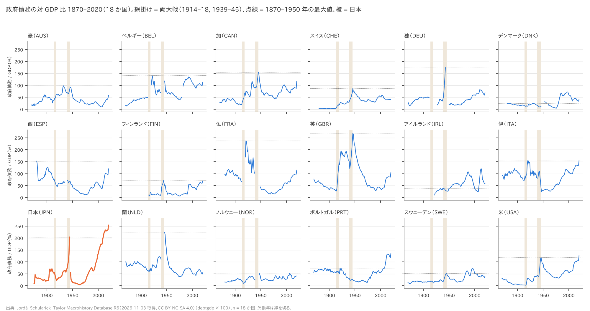
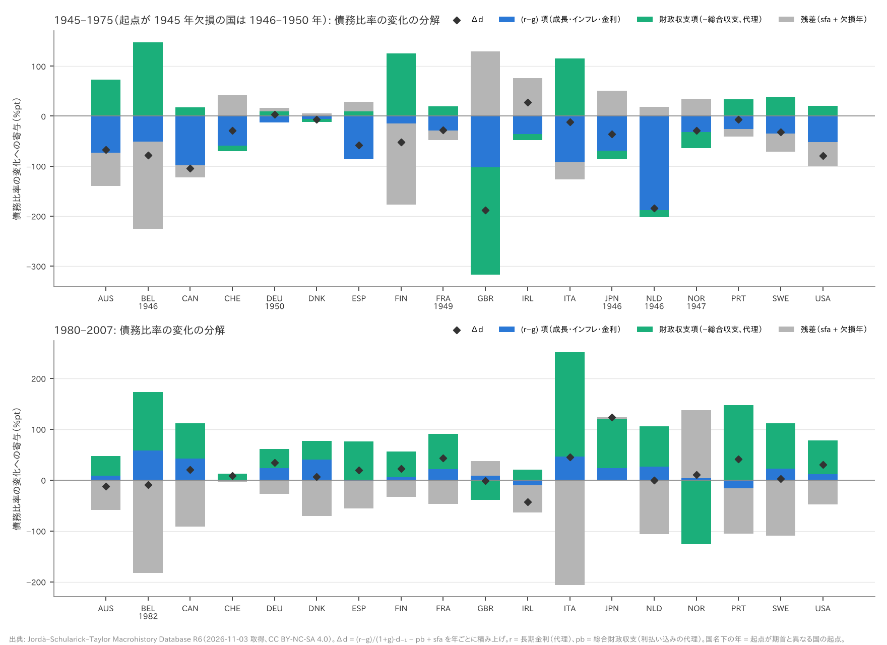
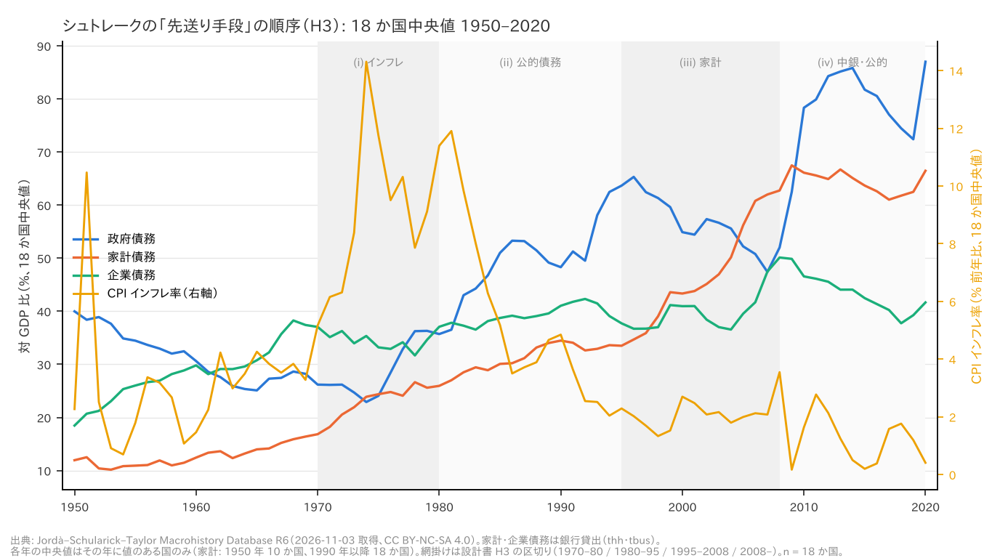
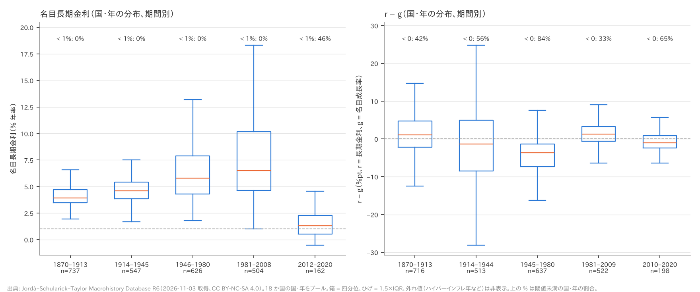

# R1: 先進 18 か国の負債の歴史 1870–2020 — 「負債は増え続けてきた」「いまが前例のない水準」はどの指標で支えられるか（H1・H2・H2b・H3・H3b・H4・H6(a)）（2026-11-03, theme: public-debt）

## 要約（記述のみ、因果の主張はない）
- **H2（単調性）は中間。** 1945 年（欠損国は 1946〜1950 年）から 1975 年に政府債務の対 GDP 比が 30 pt 以上下がった国は 10 / 18 で、整合の閾値 12 に届かない。1945 年を観測できる 12 か国だけで数えると 7 / 12（これも中間）。事後に加えた別の見方では、13 / 18 か国が 1975 年に起点の半分以下になっていた（探索的）。
- **H1（水準）は中間。** 2020 年の債務比率が 1870〜1950 年の最大値以上だった国は 6 / 18（日・伊・米・葡・デンマーク・アイルランド）で、整合の閾値 5 を 1 か国上回った。この 6 は**上限**である。日本・デンマーク・アイルランドは比較期間に欠損年があり、欠けた年の方が高ければ ○ が外れる。1 か国外れれば整合になる。2019 年で数える副判定は 4 / 18 で整合。伊・米が最大値を超えたのは 2020 年で、分子（債務）の増加と分母（GDP）の縮小の両方による。
- **H2b（減り方）は整合。** 設計書の文言「低下のうち (r−g) 項が基礎的財政収支項より大きい」を、低下への寄与を符号付きで比べる（(r−g) 項 < pb 項）と読んだ。これで 15 / 18。財政収支に利払いを足し戻した仕様でも 12 / 18 で整合。前版で主にしていた絶対値の比較（|(r−g)| > |pb|）では 9 / 18（中間）〜11 / 18 になる。判定は**代理変数よりも、基準の読み方で動く**。
- **H3（先送り手段の順序）は整合。** 設計書が指定した区切りで読んだ。インフレの 10 年平均は 1970 年代が最大（18 か国すべて）。18 か国中央値の上昇速度は、政府債務が 1980–95 年（+1.86 pt/年）、家計債務が 1995–2008 年（+2.25 pt/年）で最大。国ごとに一致したのは 11 / 18。2008–20 年の政府債務の上昇（+2.92 pt/年）はさらに速いが、設計書では (iv)（中央銀行と政府債務）の領分なので (ii) とは比べない。前版の 10 年グリッドでは不支持になり、こちらは逸脱として補助に回した。
- **H3b（総負債）は不支持。** 設計書の主年 2019 年で数えると、1870〜2019 年の最大を 2019 年に記録した国は 2 / 18。「最新年」を 2020 年と読めば 9 / 18（中間）、2008 年以降の最大まで広げれば 15 / 18（整合、逸脱した読み方）。2020 年は 15 か国で名目 GDP が縮み、分母が小さくなっている。
- **H4 は (a) 不支持、(b) 整合。** (a) 名目長期金利が 1% を割った国・年は、1870〜2008 年に 0 / 2,414。2012〜2020 年は 45.7% で過半に届かない。(b) r − g < 0 の割合は 1945〜80 年が 84%、2010〜20 年が 65%（比 1.29）。事後の読み方では、(a) は前半の条件（2008 年以前に前例がない）だけを満たす。**H6(a)（日本）は整合**: 2020 年の 254% は 18 か国の最高で、1944 年の 204% を上回る。

## 問いと仮説
`design/themes/public-debt.md`（事前登録 2026-11-03）の問い 1〜4・6 のうち、JST だけで答えられる部分に限る。判定基準は設計書の文言を正とする。

| 仮説 | 推定したい量 | 判定基準（設計書の文言とその操作化） |
|---|---|---|
| H1 水準 | 国ごとに「2020 年の値 ≥ 1870〜1950 年の最大値」かどうかを見て、その国数を数える | 3 分の 1 未満（5 以下）なら整合、過半（10 以上）なら不支持、6〜9 は中間。2019 年で副判定 |
| H2 単調性 | 1945→1975 年に 30 pt 以上下がった国の数 | 3 分の 2 以上（12 以上）なら整合、半数未満（8 以下）なら不支持、9〜11 は中間 |
| H2b 減り方 | 起点〜1975 年の Δd を (r−g) 項・pb 項・残差に分け、「低下のうち (r−g) 項が pb 項より大きい」国の数。低下への寄与を符号付きで比べる: (r−g) 項 < pb 項 | 過半（10 以上）なら整合、半数未満（8 以下）なら不支持、9 は中間 |
| H3 順序 | 18 か国中央値で (i) インフレのピークの 10 年、(ii) 政府債務の上昇が集中する期間、(iii) 家計債務の上昇が集中する期間 | (i) 1970 年代、(ii) 1980〜1995 年、(iii) 1995〜2008 年がそれぞれ最大なら整合。(iv)（2008 年以降の中銀資産）はデータなし |
| H3b 総負債 | 総負債（公的 + 民間非金融）が 1870 年以降の最大を 2019 年（または最新年）に記録した国の数 | 3 分の 2 以上（12 以上）なら整合、半数未満（8 以下）なら不支持 |
| H4 利子率 | (a) 長期金利 < 1% の国・年の割合、(b) r − g < 0 の国・年の割合 | (a) 1870–2008 年が 1% 未満、かつ 2012–2021 年が過半なら整合。(b) 1945–1980 年の割合 ≥ 2010–2020 年の割合 × 0.8 なら整合 |
| H6(a) 日本 | 日本の最新年の値が 18 か国で最高か、1944 年を超えるか | 両方を満たせば整合 |

推定したい量はすべて**記述的な国数と割合**で、因果効果は推定しない。

**本レポートで扱わないもの**:
- H5（利払いの重さ）: JST に利払いの系列がない。
- H6(b)（純債務・市中保有の順位）: JST に純債務・中銀保有の系列がない。
- H3 (iv)（2008 年以降の中央銀行資産）: JST に中央銀行の資産がない。

H5・H6(b) は次の R2 で IMF WEO / Fiscal Monitor を使って扱う。IMF の行は本レポートの作業中に mart に追加されたが、R1 では使っていない。

**事前登録からの逸脱と、設計書の文言の解釈**（methodology-reviewer の指摘 2026-11-03 を受けて改訂）:
1. **H2 の起点**: 設計書は 1945 年と書いているが、1945 年が欠損している国（ベルギー・独・仏・日・蘭・ノルウェー）は、1946〜1950 年の最初の観測年を起点にした。これは逸脱にあたる。設計書どおり 1945 年を観測できる 12 か国だけの数え方（7 / 12）を併記する。
2. **H2b の基準**: 前版は |(r−g) 項| > |pb 項| の絶対値で比べていたが、これは設計書にない操作化だった。設計書の「低下のうち…大きい」は**低下への寄与**の比較なので、符号付き（(r−g) 項 < pb 項。より負の方が低下に大きく寄与）を主にした。絶対値の比較は併記する。
3. **H3 の区切り**: 前版は 10 年グリッド（1950s…2010s）で判定し、これを「設計書のまま」と書いたが、誤りだった。設計書は (ii) 1980〜1995 年、(iii) 1995〜2008 年と期間を指定している。本版はこの区切りを主にし、10 年グリッドを逸脱として補助に回した。「集中」は、期間の長さが違うため、1970–80 / 1980–95 / 1995–2008 の 3 期間のうち**年当たりの上昇（pt/年）が最大**であることと定義した。インフレ (i) は 1950s〜2010s の 10 年平均の最大で見た。2008 年以降は (iv) の領分として (ii) の比較から外した。
4. **H3b の「2019 年（または最新年）」**: 設計書が明示する 2019 年を主年とし、2019 年が観測されない国（日本、民間系列が 2017 年まで）は最終観測年で判定した。「最新年 = 2020 年」と読む数え方と、「最大年が 2008 年以降」という広い読み方（設計書にない、逸脱）を併記する。
5. **H4(a) の後半期間**: 設計書は 2012〜2021 年だが、JST R6 は 2020 年で終わるため 2012〜2020 年とした。
6. **H2b の pb**: 設計書は「歳入・歳出から pb を近似」とする。主仕様では総合収支（歳入 − 歳出、利払い込み）をそのまま使い、利払いを足し戻した近似を頑健性として並べた。

## データ
| 変数（mart の unit.metric） | 出典 | 定義・単位 | 期間・国 | 備考（欠損・断絶） |
|---|---|---|---|---|
| 政府債務 `general_gov_gross.debt_gdp` | JST R6 `debtgdp` | 政府総債務 ÷ 名目 GDP × 100（%） | 2,489 国・年、18 か国、1870–2020 | 概ね一般政府だが、国・時代によって中央政府。切り替え年は未確認（限界を参照）。欠損年は下の一覧 |
| 財政収支 `general_gov_gross.fiscal_balance_gdp` | JST R6 `revenue − expenditure` ÷ `gdp` | **利払いを含む総合収支**（% GDP）。基礎的財政収支ではない | 2,516 国・年、18 か国（2020 年は 16 か国） | 歳入・歳出の範囲（中央政府か一般政府か）が債務の範囲と一致する保証はない |
| 家計債務 `households.debt_gdp` | JST `thh` ÷ `gdp` | 家計向け銀行貸出（% GDP） | 1,374 国・年。始まりは国により異なる: スイス 1870、英 1880、米 1945、…、ノルウェー 1978、ポルトガル 1979、蘭 1990 | 銀行貸出が中心で、社債・ノンバンクを含まない国・時代がある |
| 企業債務 `nfc.debt_gdp` | JST `tbus` ÷ `gdp` | 非金融企業向け銀行貸出（% GDP） | 1,299 国・年 | 同上。H3 の参考系列 |
| 民間非金融 `private_nonfin.debt_gdp` | JST `tloans` ÷ `gdp` | 民間非金融向け貸出（% GDP） | 2,445 国・年（2020 年は 17 か国。日本は 2017 年まで） | 日本は 83〜85%（2010 年代）で、BIS の総信用より大幅に小さい（銀行貸出のみのため） |
| 総負債 `total_nonfin.debt_gdp` | 上の 2 系列の和 | 公的 + 民間非金融（% GDP） | 2,332 国・年 | 両方がそろう年のみ |
| 長期金利 `macro.ltrate` | JST `ltrate` | 名目長期国債利回り（% 年率） | 2,630 国・年 | H2b の r（実効金利の代理）と H4 で使う |
| 短期金利 `macro.stir` | JST `stir` | % 年率 | 2,520 国・年 | 探索的な頑健性にのみ使う |
| 名目成長率 `macro.ngdp_growth` | JST `gdp` の前年比 | % | 2,618 国・年（1871–） | 戦後のインフレ期は大きい（日本 1947 年 +176%、仏 1946 年 +132%） |
| インフレ率 `macro.cpi_inflation` | JST `cpi` の前年比 | % | 2,648 国・年 | 100% を超える国・年が 8 つある（最大は独 1923 年の 1.06×10^11 %）。国間の中央値と割合で扱い、国・年をプールした平均はとらない |

**政府債務比率の欠損年**（1870–2020。欠損のない国は豪・加・英・伊・ポルトガル・スウェーデン・米）:
- 独: 1870、1914–1926、1944–1949（1914 年以降で 19 年）
- 仏: 1870–1879、1914–1919、1939–1948
- ベルギー: 1914–1919、1940–1945、1980–1981
- 蘭: 1940–1945
- ノルウェー: 1870–1879、1940–1946
- 西: 1870–1879、1936–1939
- アイルランド: 1870–1921
- フィンランド: 1870–1913
- 日本: 1870–1874、1945
- デンマーク: 1870–1879、1947–1952、1957–1959、1997
- スイス: 1870–1879

**mart と取得情報**:
- mart: `data/marts/public_debt_panel.parquet`（long 形式。列は iso3, year, unit, metric, value, source）。
  - 作業中に IMF の行（source = imf_fm / imf_gdd / imf_weo）が加わり、全体で 88,182 行になった。
  - 本レポートは **source = jst の 28,206 行だけ**を使う。`load_panel(mart, source="jst")` で絞り込み、同じキーが重複すると ValueError で止まる。
- 取得: 2026-11-03。`data/raw/manifest.jsonl`（`JSTdatasetR6.xlsx`、sha256 `c1bb91fe…981d`）。
- ライセンス: **CC BY-NC-SA 4.0**（非商用・継承）。引用は Jordà, Schularick & Taylor (2017), NBER Macroeconomics Annual 2016。
- 欠損は補完していない。

## 方法
記述統計（国数・割合・中央値）と、債務動態の会計恒等式による分解。回帰もしないし、標準誤差も出さない（18 か国という母集団全体の記述）。

- **H1・H2**: 国ごとに、1870〜1950 年の最大値（同じ値なら早い年）と、1945（または起点）・1975・2007・2019・2020 年の値を並べる。
  - 戦時区間（1914–18、1939–45）は図で網掛けにし、最大値の年がどの区間に入るか（戦時・戦後直後 1946–50・平時）を表に示す。
  - 比較期間の欠損年は `window_gaps` で列挙する。
- **H2b**: 年ごとに次の恒等式で Δd を分け、起点の翌年〜1975 年について足し上げる（`decompose_debt_change`）。
  - 式: Δd_t = (r_t − g_t)/(1 + g_t)·d_{t−1} − pb_t + sfa_t。
  - r = 長期金利（実効金利の代理）、g = 名目成長率、pb = 総合収支（代理）。
  - 入力が欠ける年は分解しない。その年の Δd は「欠損年」に計上するので、Δd = (r−g) 項 + pb 項 + sfa + 欠損年 が必ず閉じる（テストとスクリプト内の assert で確認）。
  - sfa = 0 で作った合成データから Δd を再現できることを、テストで固定した。
  - 判定（`rg_dominates`）: 主は符号付き（(r−g) 項 < pb 項）、併記は絶対値（|(r−g) 項| > |pb 項|）。
  - 1980〜2007 年も同じ方法で分解した（設計書の分析段階 2。判定には使わない）。
- **代理変数の偏りの向き**:
  - **pb**: 総合収支 = 基礎的収支 − 利払い なので、総合収支は pb を利払いの分だけ**過小評価**する。
    - (r−g) 項は r・g・d₋₁ だけから計算するので、pb の代理を変えても**変わらない**。
    - 変わるのは pb 項と残差。pb 項（−pb）は利払いの分だけ債務を増やす方向にずれ、恒等式を閉じる sfa が同じ分だけ負にずれる。利払いは (r−g) 項の r·d₋₁ にも入っているので、この偏りは二重計上の形をとり、すべて残差 sfa に吸収される。
    - 偏りを確かめるため、総合収支に r/(1+g)·d₋₁ を足し戻して基礎的収支を近似する仕様（`impute_primary`）も並べた。
  - **r**: 金融抑圧期（1945〜1970 年代）の実効金利は長期金利より低かったと考えられる。その場合、(r−g) 項（負）の絶対値は**過小**に出る（設計書の落とし穴）。この偏りは H2b にとって不利な方向に働く。
- **H3**:
  - 年ごとに 18 か国の中央値を取り、その年に値のある国だけを使う（家計は 1950 年に 10 か国、1980 年に 17 か国、1990 年以降 18 か国）。
  - (i) インフレ率は 10 年平均（d0〜d0+9 年）が最大の 10 年。
  - (ii)(iii) 政府債務と家計債務は、設計書の 3 期間（1970–80 / 1980–95 / 1995–2008）それぞれで年当たりの変化（端点の差 ÷ 年数）を出し、最大の期間を選ぶ（`period_rate`、`judge_h3_design`）。
  - 国ごとにも同じ計算をする。補助として 10 年グリッド（d0 年 → d0+10 年の差。2010s は 2010→2020）も示す。
- **H3b**: 国ごとに、2019 年まで（2019 年が欠損なら最終観測年まで）の総負債の最大年を出す（`max_year_through`）。2020 年まで・全期間でも出す。
- **H4**:
  - 18 か国の国・年をプールし、閾値未満の割合を出す。
  - r − g は同じ年の長期金利 − 名目成長率。ハイパーインフレの年は極端な負になるので、値の大きさではなく符号の割合だけで判定する。
- **出力**: 図はすべて `themes/public-debt/reports/figures/` に置き、スクリプトから生成した。表の数値はスクリプトの標準出力（`reports/r1_output.md` に保存）と一致する。乱数は使わず、再実行で同じ出力になることを確認済み。

## 結果

### H1: 2020 年の債務比率は 1870〜1950 年の最大値を超えたか — 中間（6 / 18、欠損のため上限）、2019 年の副判定は整合（4 / 18）



| 国 | 1870–1950 最大（年） | 区間 | 1945 | 1975 | 2007 | 2019 | 2020 | 2020 ≥ 最大 | 2019 ≥ 最大 |
|---|---|---|---|---|---|---|---|---|---|
| 豪（AUS） | 98.2（1932） | 平時 | 89.7 | 22.9 | 9.7 | 46.6 | 57.3 |  |  |
| ベルギー（BEL） | 141.2（1922） | 平時 | – | 39.8 | 87.3 | 97.7 | 112.8 |  |  |
| 加（CAN） | 155.5（1945） | 戦時 | 155.5 | 50.8 | 66.5 | 86.8 | 117.5 |  |  |
| スイス（CHE） | 86.9（1946） | 戦後直後 | 68.8 | 39.4 | 44.5 | 39.8 | 42.4 |  |  |
| 独（DEU） | 174.0（1943） | 戦時 | – | 24.0 | 64.0 | 58.9 | 68.7 |  |  |
| デンマーク（DNK） | 24.5（1932） | 平時 | 10.6 | 4.3 | 34.1 | 33.6 | 42.1 | ○ | ○ |
| 西（ESP） | 152.5（1880） | 平時 | 69.6 | 11.7 | 35.8 | 95.5 | 120.0 |  |  |
| フィンランド（FIN） | 71.1（1944） | 戦時 | 58.6 | 6.5 | 33.9 | 59.5 | 69.5 |  |  |
| 仏（FRA） | 237.0（1921） | 平時 | – | 16.1 | 64.5 | 97.5 | 115.0 |  |  |
| 英（GBR） | 269.8（1946） | 戦後直後 | 234.7 | 46.7 | 41.5 | 85.2 | 104.5 |  |  |
| アイルランド（IRL） | 39.3（1938） | 平時 | 27.2 | 54.8 | 23.9 | 57.2 | 58.4 | ○ | ○ |
| 伊（ITA） | 154.1（1920） | 平時 | 66.0 | 54.5 | 99.3 | 134.6 | 155.8 | ○ |  |
| **日本（JPN）** | 204.0（1944） | 戦時 | – | 20.3 | 172.8 | 234.9 | 253.9 | ○ | ○ |
| 蘭（NLD） | 223.0（1946） | 戦後直後 | – | 38.7 | 43.0 | 48.5 | 54.3 |  |  |
| ノルウェー（NOR） | 53.0（1947） | 戦後直後 | – | 24.1 | 50.3 | 40.9 | 41.4 |  |  |
| ポルトガル（PRT） | 74.9（1923） | 平時 | 27.2 | 20.1 | 72.7 | 116.6 | 135.2 | ○ | ○ |
| スウェーデン（SWE） | 52.6（1945） | 戦時 | 52.6 | 20.3 | 38.9 | 34.9 | 39.7 |  |  |
| 米（USA） | 118.9（1946） | 戦後直後 | 113.4 | 33.6 | 62.6 | 106.8 | 128.1 | ○ |  |

- 2020 年に最大値以上だったのは 6 / 18 か国（デンマーク・アイルランド・伊・日・葡・米）。**判定: 中間**（整合の閾値 5 を 1 か国上回る）。
- **6 / 18 は欠損のため上限**: ○ の国のうち次の 3 か国は比較期間に欠損年がある。欠けている年の値が観測された最大値より高ければ、○ が外れうる。1 か国でも外れれば 5 / 18 で整合になる。
  - 日本: 1870–1874、1945（1945 年は 1944 年の 204% より高かった可能性がある）
  - デンマーク: 1870–1879、1947–1950
  - アイルランド: 1870–1921（建国前。比べる期間は実質 1922〜1950 年）
  - 西にも 1936–1939 年（内戦）の欠損があるが、○ ではないので数には影響しない。
- 2019 年（副判定）では 4 / 18 か国（デンマーク・アイルランド・日・葡）で**整合**。伊（2020 年 155.8 対 1920 年 154.1、差 +1.7 pt）と米（128.1 対 1946 年 118.9）は、2020 年に最大値を超えた。分子（債務）の増加と分母（GDP）の縮小の両方による。
- 1870〜1950 年の最大値の年は、戦時区間が 5 か国、戦後直後（1946–50）が 5 か国、平時が 8 か国。平時が最大の 8 か国のうち半数（仏・伊・ベルギー・葡）は、第一次大戦直後の 1920〜23 年が最大値に当たる。最大値が戦時の年でなくても、多くは戦争の負債がまだ残っている時期である。
- **○ でない国の欠損**: 仏・ベルギー・独・蘭・ノルウェーは戦時の債務比率が欠けているので、表の最大値は本当の戦時ピークの下限にすぎない。この 5 か国はもともと ○ ではないので、欠損を埋めても判定の国数は変わらない。デンマークは 1870〜1950 年の最大が 24.5% と低く、「最大値以上」になりやすい。
- 探索的: 両大戦の年を除いた 1870〜1950 年の最大値と比べると、2020 年に超えていた国は 8 / 18 か国。

### H2: 1945→1975 年に 30 pt 以上下がったか — 中間（10 / 18）

| 国 | 起点年 | 起点の値 | 1975 | 変化（pt） | 30 pt 以上低下 |
|---|---|---|---|---|---|
| 豪 | 1945 | 89.7 | 22.9 | −66.9 | ○ |
| ベルギー | 1946（1945 欠損） | 118.3 | 39.8 | −78.4 | ○ |
| 加 | 1945 | 155.5 | 50.8 | −104.6 | ○ |
| スイス | 1945 | 68.8 | 39.4 | −29.3 |  |
| 独 | 1950（1944–49 欠損） | 21.0 | 24.0 | +3.0 |  |
| デンマーク | 1945 | 10.6 | 4.3 | −6.3 |  |
| 西 | 1945 | 69.6 | 11.7 | −57.9 | ○ |
| フィンランド | 1945 | 58.6 | 6.5 | −52.1 | ○ |
| 仏 | 1949（1939–48 欠損） | 44.3 | 16.1 | −28.3 |  |
| 英 | 1945 | 234.7 | 46.7 | −188.0 | ○ |
| アイルランド | 1945 | 27.2 | 54.8 | +27.6 |  |
| 伊 | 1945 | 66.0 | 54.5 | −11.5 |  |
| **日本** | 1946（1945 欠損） | 56.0 | 20.3 | −35.7 | ○ |
| 蘭 | 1946（1940–45 欠損） | 223.0 | 38.7 | −184.2 | ○ |
| ノルウェー | 1947（1940–46 欠損） | 53.0 | 24.1 | −28.9 |  |
| ポルトガル | 1945 | 27.2 | 20.1 | −7.1 |  |
| スウェーデン | 1945 | 52.6 | 20.3 | −32.4 | ○ |
| 米 | 1945 | 113.4 | 33.6 | −79.8 | ○ |

- 30 pt 以上下がった国は 10 / 18。**判定: 中間**（整合には 12 が必要）。
- 設計書どおり 1945 年を観測できる 12 か国だけで数えると 7 / 12（2/3 未満、半数以上なので中間）。起点を 1946〜50 年に代えた 6 か国のうち、ベルギー・日・蘭の 3 か国が ○ になっている。
- 届かなかった 8 か国のうち、スイス（−29.3）・仏（−28.3）・ノルウェー（−28.9）は閾値のすぐ下。独・デンマーク・アイルランド・ポルトガルは、起点の値が 30% 未満で、30 pt 下がる余地がなかった。逆に上がったのはアイルランド（+27.6）と独（+3.0）。
- **起点のずれ**: 日本と独は、起点より前に最大の下落が起きている。
  - 日本は 1944 年 204% → 1946 年 56% と、2 年で 148 pt 下がった（1945 年は欠損）。この期間は戦後の高インフレ期にあたる。
  - 独は 1948 年の通貨改革を経て、1950 年に 21% から始まる。
  - どちらの下落も H2 の窓の外にある。
- 探索的（事後。判定には使わない）:
  - 30% 未満で始まった 4 か国を除くと 10 / 14。
  - 1975 年に起点の半分以下になった国は 13 / 18。
  - 起点を 1940〜1950 年の最大値にすると、30 pt 以上下がった国は 13 / 18。

### H2b: 戦後の減少は「成長・インフレ・低金利」と「財政収支」のどちらの寄与が大きかったか — 整合（符号付き 15 / 18）。絶対値で比べると中間（9 / 18）



主仕様（r = 長期金利、pb = 総合収支）、起点〜1975 年。単位は pt:

| 国 | 起点 | Δd | (r−g) 項 | pb 項 | sfa | 欠損年 | 分解できた年 | (r−g) < pb（符号付き、主） | \|r−g\| > \|pb\|（絶対値） |
|---|---|---|---|---|---|---|---|---|---|
| 豪 | 1945 | −66.9 | −73.0 | +73.4 | −67.3 | 0.0 | 30/30 | ○ |  |
| ベルギー | 1946 | −78.4 | −51.3 | +147.5 | −174.7 | 0.0 | 29/29 | ○ |  |
| 加 | 1945 | −104.6 | −98.3 | +17.5 | −23.8 | 0.0 | 30/30 | ○ | ○ |
| スイス | 1945 | −29.3 | −58.7 | −12.0 | +41.4 | 0.0 | 30/30 | ○ | ○ |
| 独 | 1950 | +3.0 | −13.0 | +9.1 | +6.9 | 0.0 | 25/25 | ○ | ○ |
| デンマーク | 1945 | −6.3 | −5.6 | −6.0 | −6.4 | +11.6 | 18/30 |  |  |
| 西 | 1945 | −57.9 | −86.6 | +9.0 | +19.8 | 0.0 | 30/30 | ○ | ○ |
| フィンランド | 1945 | −52.1 | −15.0 | +125.0 | −156.0 | −6.1 | 28/30 | ○ |  |
| 仏 | 1949 | −28.3 | −29.0 | +19.6 | −18.8 | 0.0 | 26/26 | ○ | ○ |
| 英 | 1945 | −188.0 | −102.8 | −214.9 | +129.7 | 0.0 | 30/30 |  |  |
| アイルランド | 1945 | +27.6 | −35.5 | −12.6 | +75.7 | 0.0 | 30/30 | ○ | ○ |
| 伊 | 1945 | −11.5 | −92.5 | +114.9 | −33.9 | 0.0 | 30/30 | ○ |  |
| **日本** | 1946 | −35.7 | −69.4 | −17.5 | +51.2 | 0.0 | 29/29 | ○ | ○ |
| 蘭 | 1946 | −184.2 | −187.9 | −14.6 | +18.2 | 0.0 | 29/29 | ○ | ○ |
| ノルウェー | 1947 | −28.9 | −31.6 | −32.2 | +42.4 | −7.5 | 27/28 |  |  |
| ポルトガル | 1945 | −7.1 | −25.6 | +34.1 | −15.5 | 0.0 | 30/30 | ○ |  |
| スウェーデン | 1945 | −32.4 | −35.2 | +38.6 | −35.8 | 0.0 | 30/30 | ○ |  |
| 米 | 1945 | −79.8 | −52.3 | +20.7 | −48.1 | 0.0 | 30/30 | ○ | ○ |

- **基準の選び方**: 設計書は「1945〜1975 年の低下のうち、(r − g) 項が基礎的財政収支項より大きい」と書いている。比べているのは**低下への寄与**の大きさなので、符号付き（(r−g) 項 < pb 項。より負の方が債務を減らした寄与が大きい）を主とした。この読み方では、pb 項が正の国（財政赤字で債務を増やした国）は、(r−g) 項が負である限り自動的に ○ になる。前版の絶対値比較は、赤字による債務の増加と低下への寄与を同じ大きさとして比べるので、文言から離れる。
- 符号付きで 15 / 18。**判定: 整合**。○ でないのはデンマーク（−5.6 対 −6.0）、英（−102.8 対 −214.9）、ノルウェー（−31.6 対 −32.2）で、どれも財政黒字の寄与が成長・インフレ・金利の寄与をわずかに、英は大きく上回った。
- 絶対値で比べると 9 / 18（中間）。両者の差 6 か国（豪・ベルギー・フィンランド・伊・ポルトガル・スウェーデン）は、どれも pb 項が大きな正（総合収支の赤字が累積）の国である。
- 中央値は Δd −34.0、(r−g) 項 −51.8、pb 項 +13.3。(r−g) 項は 18 か国すべてで負（債務を減らす向き）だった。pb 項は主仕様では 11 か国で正。
- **残差が (r−g) 項と pb 項のどちらよりも大きい国**（主仕様）: ベルギー（sfa −175）、フィンランド（−156）、アイルランド（+76）、ノルウェー（+42、ほかに欠損年 −8）。英も sfa が +130 と大きい。これらの国では恒等式がよく閉じておらず、分解結果は信頼しにくい。原因はこのデータでは特定できない。候補は次のとおり。
  - 歳入・歳出の範囲と債務の範囲の不一致（中央政府と一般政府）
  - GDP 系列の断絶
  - 通貨改革・債務再編・資産売却
  - 総合収支による利払いの二重計上（sfa に入る）
- **頑健性（pb に利払いを足し戻した近似）**:
  - 符号付き 12 / 18（整合）、絶対値 11 / 18（整合）。pb 項の中央値は +13.3 → −25.3 になる。(r−g) 項は変わらない。
  - ただし残差が両項を上回る国は **4 → 7 か国**に増える（ベルギー・スイス・独・フィンランド・アイルランド・日本・ノルウェー）。英は pb 項 −410、sfa +325 と、どちらも大きくなる。足し戻しに使う r が長期金利（代理）で、実際の利払いより大きく見積もられている可能性がある。
- 探索的: r を短期金利にすると、符号付き 17 / 18、絶対値 13 / 18。
- **判定の動き方**: 符号付きの基準なら、どの仕様でも整合（15・12・17 / 18）。絶対値の基準なら中間〜整合（9・11・13 / 18）。判定は**主に基準の読み方で動き**、代理変数の選び方による動きはそれより小さい。それでも、残差の大きい国が 4〜7 か国ある分解なので、整合は「(r−g) 項が全 18 か国で債務を減らす向きだった」という記述の範囲で読む。
- 参考（判定外）として 1980〜2007 年も分解した。この期間は債務が増えた国が多いので、「低下への寄与」の比較は意味が弱い。
  - 主仕様では符号付き 15 / 18、絶対値 1 / 18。利払い足し戻しでは 1 / 18、6 / 18。
  - (r−g) 項の中央値は +16.8（債務を増やす向き）で、1980 年代以降は r > g の年が多かった。
  - 残差が大きい国（伊 −206、ベルギー −183、ノルウェー +134 など）が多く、分解の精度は戦後よりさらに低い。ノルウェーの残差には、財政黒字を政府年金基金（資産）として積み上げても総債務は減らないことが表れているとみられる。

### H3: 先送り手段の順序（インフレ → 公的債務 → 家計債務） — 整合（設計書の区切り）



18 か国中央値の系列（網掛けは設計書の区切り）:

| 時期 | インフレ率 平均（%） | 政府債務 変化（pt/年） | 家計債務 変化（pt/年） |
|---|---|---|---|
| 1970–1980（(i)） | **8.9** | +0.95 | +0.91 |
| 1980–1995（(ii)） | 5.6 | **+1.86** | +0.50 |
| 1995–2008（(iii)） | 2.0 | −0.90 | **+2.25** |
| 2008–2020（(iv) の領分。(ii)(iii) の比較対象外） | 1.4 | +2.92 | +0.31 |

- (i) インフレの 10 年平均は 1970s（8.9%）が最大。(ii) 政府債務の年当たり上昇は、3 期間のうち 1980–95 年が最大。(iii) 家計債務は 1995–2008 年が最大。**判定: 整合。**
- 2008–2020 年の政府債務の上昇（+2.92 pt/年）は (ii) の 1980–95 年より速い。設計書はこの時期を (iv)「中央銀行の資産と政府債務が同時に増える」に割り当てているので、(ii) の比較には入れない。(iv) の中央銀行側はデータがなく判定できない。政府債務側については、2008 年以降に上昇が最も速いことが (iv) の記述と食い違わない、とだけ言える。
- 頑健性: 国ごとの年当たり変化の中央値で見ても、政府債務 1980–、家計 1995– で整合。
- **国ごと（設計書の区切り）**: 11 / 18 で一致した。インフレ最大が 1970s の国は 18 / 18。

| 国 | インフレ最大 | 政府債務の上昇最大 | 家計の上昇最大（家計の値がある期間数） | 判定 |
|---|---|---|---|---|
| 豪 | 1970s | 1980– | 1995–（3） | 整合 |
| ベルギー | 1970s | 1995– | 1995–（3） | 不支持 |
| 加 | 1970s | 1980– | 1970–（3） | 不支持 |
| スイス | 1970s | 1980– | 1980–（3） | 不支持 |
| 独 | 1970s | 1980– | 1995–（3） | 整合 |
| デンマーク | 1970s | 1980– | 1995–（3） | 整合 |
| 西 | 1970s | 1980– | 1995–（3） | 整合 |
| フィンランド | 1970s | 1980– | 1995–（3） | 整合 |
| 仏 | 1970s | 1980– | 1995–（3） | 整合 |
| 英 | 1970s | 1995– | 1980–（3） | 不支持 |
| アイルランド | 1970s | 1970– | 1995–（3） | 不支持 |
| 伊 | 1970s | 1980– | 1995–（3） | 整合 |
| **日本** | 1970s | 1995– | 1970–（3） | 不支持 |
| 蘭 | 1970s | 1980– | 1995–（**1**） | 整合 |
| ノルウェー | 1970s | 1970– | 1980–（2） | 不支持 |
| ポルトガル | 1970s | 1980– | 1995–（2） | 整合 |
| スウェーデン | 1970s | 1980– | 1995–（2） | 整合 |
| 米 | 1970s | 1980– | 1995–（3） | 整合 |

- 蘭は家計の系列が 1990 年に始まるため、家計の比較は 1995–2008 年の 1 期間だけで、自動的に「1995–」になる。ポルトガル・スウェーデン・ノルウェーも 2 期間しかない。これらの国は一致しやすいので、11 / 18 は割り引いて読む。蘭を除くと 10 / 17。
- 日本は政府債務の上昇が 1995–2008 年に、家計が 1970–80 年に最大で、順序が逆になっている（家計債務 → 公的債務）。

**補助（逸脱した読み方）: 10 年グリッド**。前版の主判定で、設計書の区切りから外れている。

| 10 年 | インフレ率 10 年平均（%） | 政府債務 上昇幅（pt） | 家計債務 上昇幅（pt） | 企業債務 上昇幅（参考） |
|---|---|---|---|---|
| 1950s（1950→1960） | 2.9 | −9.4 | 0.5 | 11.3 |
| 1960s | 3.3 | −4.4 | 4.4 | 7.2 |
| 1970s | 8.9 | 9.5 | 9.1 | 0.0 |
| 1980s | 6.8 | 12.6 | 8.5 | 4.0 |
| 1990s | 2.4 | 6.6 | 8.9 | −0.1 |
| 2000s（2000→2010） | 2.1 | 23.4 | 22.8 | 5.6 |
| 2010s（2010→2020） | 1.3 | 8.7 | 0.4 | −4.9 |

- 10 年グリッドでは、政府債務・家計とも 2000s が最大で不支持になる。2010s を 2010→2019 年にしても、国ごとの変化幅の中央値で見ても不支持（政府債務 2010s、家計 2000s）。国ごとの一致は 4 / 18。
- 政府債務の 2000s の上昇は、ほとんどが 2008〜2010 年の金融危機の時期に起きた（中央値は 2000 年 54.9% → 2007 年 47.4% → 2010 年 78.3%）。設計書の区切りではこの時期が (iv) に入るため、結論が分かれる。家計の 2000s の上昇は、大部分が危機前に起きた（2000 年 43.3% → 2007 年 62.0% → 2010 年 66.1%）。
- 窓のずれ: インフレの 10 年平均は d0〜d0+9 年（2010s は 2010–2019）、債務の上昇幅は d0 → d0+10 年（2010s は 2010→2020）で、2010s では 1 年ずれる。
- **順序が見えるかどうかは区切り方に依存する**。設計書の区切りは事前に指定されていたものなので主とするが、10 年グリッドでは見えないことも併せて報告する。

### H3b: 総負債（公的 + 民間非金融）は 2019 年（最新年）に過去最大か — 不支持（2019 年で 2 / 18）

| 国 | データ期間 | 全期間の最大年 | 最大値 | 2019 | 2020 | 〜2019 の最大が 2019（主） | 最大が 2020 | 最大が 2008 以降 |
|---|---|---|---|---|---|---|---|---|
| 豪 | 1870–2020 | 2020 | 210.1 | 199.4 | 210.1 |  | ○ | ○ |
| ベルギー | 1885–2020 | 2020 | 218.3 | 195.1 | 218.3 |  | ○ | ○ |
| 加 | 1870–2020 | 2020 | 229.9 | 189.5 | 229.9 |  | ○ | ○ |
| スイス | 1880–2020 | 2020 | 201.7 | 191.6 | 201.7 |  | ○ | ○ |
| 独 | 1871–2020 | 2010 | 174.1 | 141.4 | 157.6 |  |  | ○ |
| デンマーク | 1880–2020 | 2009 | 245.4 | 200.1 | 210.9 |  |  | ○ |
| 西 | 1900–2020 | 2012 | 242.0 | 191.5 | 229.1 |  |  | ○ |
| フィンランド | 1914–2020 | 2020 | 168.4 | 153.5 | 168.4 |  | ○ | ○ |
| 仏 | 1900–2020 | 1921 | 254.6 | 209.3 | 242.8 |  |  |  |
| 英 | 1880–2020 | 1946 | 288.1 | 169.1 | 195.8 |  |  |  |
| アイルランド | 1932–2020 | 2012 | 230.8 | 97.2 | 96.2 |  |  | ○ |
| 伊 | 1870–2020 | 2020 | 240.0 | 209.8 | 240.0 |  | ○ | ○ |
| **日本** | 1875–2017 | 2014 | 317.2 | – | – | （2017 で判定） |  | ○ |
| 蘭 | 1900–2020 | 1946 | 239.3 | 164.6 | 172.9 |  |  |  |
| ノルウェー | 1880–2020 | 2020 | 191.3 | 177.6 | 191.3 | ○ | ○ | ○ |
| ポルトガル | 1870–2020 | 2012 | 271.3 | 203.3 | 232.5 |  |  | ○ |
| スウェーデン | 1871–2020 | 2020 | 169.8 | 158.0 | 169.8 |  | ○ | ○ |
| 米 | 1880–2020 | 2020 | 197.6 | 169.8 | 197.6 | ○ | ○ | ○ |

3 通りの数え方:

| 読み方 | 国数 | 判定 |
|---|---|---|
| **主: 設計書の主年 2019 年**（1870〜2019 年の最大が 2019 年。日本は最終観測年 2017 年で判定） | **2 / 18**（ノルウェー・米） | **不支持** |
| 「最新年」= 2020 年と読む | 9 / 18 | 中間 |
| 最大年が 2008 年以降（設計書にない広い読み方、逸脱） | 15 / 18 | 整合 |

- 1870〜2019 年の最大年は、ノルウェー・米が 2019 年。11 か国が 2009〜2016 年（独 2010、デンマーク 2009、西・アイルランド・葡 2012、伊・日・スウェーデン 2014、フィンランド 2015、豪・加 2016）。残りはベルギー 1993 年、スイス 1935 年、仏 1921 年、英・蘭 1946 年。2019 年の総負債は、多くの国で金融危機後の 2009〜2016 年の水準を下回っていた。
- 2020 年に最大になった 9 か国は、どれも 2020 年の 1 年でそれ以前の最大を超えた。2020 年は 18 か国中 15 か国で名目 GDP が縮んでおり（独・西・仏・英・伊・日・米など）、比率の上昇には分子（債務）の増加と分母（GDP）の縮小の両方が入っている。
- 2008 年以降が最大だが 2019/2020 年ではない国: 独 2010、デンマーク 2009、西 2012、アイルランド 2012、日本 2014、葡 2012。
- 2008 年以降に最大でない 3 か国（仏 1921 年・英 1946 年・蘭 1946 年）は、戦争直後の公的債務が最大値を決めている。
- 参考: 公的債務だけで見て最大が 2019/2020 年の国は 4 / 18、民間非金融だけで見ると 7 / 18。
- 日本の 2014 年 317.2% と 2017 年 316.5% はほぼ同じ水準で、2019〜2020 年の民間系列があれば最大年が変わる可能性がある。JST の日本の民間系列は銀行貸出だけで 83〜85% と小さく、BIS の総信用で見れば水準は大きく上がる（R2 以降で確認する）。

### H4: 利子率（水野） — (a) 不支持、(b) 整合



| 期間（長期金利） | 国・年 | 中央値（%） | < 1% の割合 |
|---|---|---|---|
| 1870–1913 | 737 | 3.91 | 0.0% |
| 1914–1945 | 547 | 4.58 | 0.0% |
| 1946–1980 | 626 | 5.81 | 0.0% |
| 1981–2008 | 504 | 6.51 | 0.0% |
| 2012–2020 | 162 | 1.30 | 45.7% |

| 期間（r − g） | 国・年 | 中央値（pt） | < 0 の割合 |
|---|---|---|---|
| 1870–1913 | 716 | +1.08 | 42.2% |
| 1914–1944 | 513 | −1.38 | 55.9% |
| **1945–1980** | 637 | **−3.62** | **83.8%** |
| 1981–2009 | 522 | +1.24 | 32.8% |
| **2010–2020** | 198 | −1.00 | **65.2%** |

- **(a)**: 1870〜2008 年に長期金利が 1% を割った国・年は 0 / 2,414（0.00%）。2012〜2020 年は 74 / 162（45.7%）で、過半に届かない。**判定: 不支持。**
  - 事後の読み方: 2 つの条件のうち前半（1870〜2008 年に 1% 未満）だけを満たし、後半（2012 年以降に過半）で落ちた。
  - 探索的: 2015〜2020 年では 63.0%、2019〜2020 年では 77.8%。
  - 初めて 1% を割った年は、スイスと日本が 2012 年、多くの欧州諸国が 2015 年、米・英・豪が 2020 年。加・伊は 2020 年まで一度も 1% を割っていない。
  - JST の日本の長期金利は 1997 年 1.69%、1998 年 1.10%。水野が挙げる「1997 年に 2% 割れ」と食い違わない。
- **(b)**: r − g < 0 の割合は、1945〜1980 年が 83.8%、2010〜2020 年が 65.2%（比 1.29、閾値 0.8）。**判定: 整合**。
  - 中央値でも 1945〜1980 年（−3.6 pt）の方が 2010〜2020 年（−1.0 pt）より深い。
  - 頑健性: コロナの年を除いた 2010〜2019 年は 70.0%、終戦年を除いた 1946〜1980 年は 84.5%。探索的に r = 短期金利とすると 89.7% 対 82.3%。いずれも判定は変わらない。
  - r < g が珍しかったのは 1981〜2009 年（32.8%）の方。
- 設計書の指示どおり (a) と (b) を分けて書く。水野の「利子率ゼロ」に関わるのは (a) の名目金利だけで、(a) の事前登録判定は不支持である。(b) は「債務比率が自然に下がる環境は 2010 年代に特有ではない」と整合する。

### H6(a): 日本 — 整合

- 2020 年の日本の政府債務比率は 253.9%。18 か国の最高で、2 位の伊（155.8%）、3 位の葡（135.2%）、4 位の米（128.1%）を大きく上回る。1944 年の 204.0% も超えている。**判定: 整合。**
- 日本の推移: 1875 年 10%、1905 年 69%（日露戦争）、1920 年 26%、1935 年 63%、1944 年 204%、1946 年 56%、1950 年 14%、1965 年 5%、1975 年 20%、1990 年 63%、2000 年 136%、2007 年 173%、2019 年 235%、2020 年 254%。
  - 1944→1950 年に 190 pt 下がった。その大部分は 1945 年の欠損をはさんだ高インフレ期に起きた。
  - 1965 年の 5% から、平時のまま 55 年かけて 254% まで積み上がった。1950〜2000 年の最小値から 2020 年までの上昇幅（+249 pt）は 18 か国で最も大きい（2 位の伊は +129 pt）。
- H6(b)（純債務・日銀保有分を除いた市中保有の順位）は**本レポートでは対象外**。JST に該当する系列がないので、次の R2 で IMF WEO（純債務）と日本銀行の時系列（保有者別）を使う。

### 「終焉」論はどの指標で支えられるか

「事前登録の判定」列は設計書の閾値による判定そのもの。それ以外の見方は「補足（事後・探索・別の読み方）」列に分けて書く。

| 論の主張 | 対応する指標 | 事前登録の判定 | 補足（事後・探索・別の読み方） |
|---|---|---|---|
| 「負債は増え続けてきた」（公的債務） | H2: 1945→1975 年の低下 | **中間**（30 pt 以上の低下 10 / 18、閾値 12） | 探索的: 13 / 18 か国が 1975 年に起点の半分以下。1945 年を観測できる国だけでは 7 / 12 |
| 「いまの公的債務は歴史的に前例がない」 | H1: 2020 年と 1870–1950 年の最大値 | **中間**（6 / 18、欠損のため上限）。2019 年の副判定は**整合**（4 / 18） | 2020 年に超えた国は日・伊・米・葡・デンマーク・アイルランド |
| 「総負債（公的 + 民間）は前例のない水準」 | H3b: 総負債の最大年 | **不支持**（2019 年で 2 / 18） | 「最新年 = 2020」なら 9 / 18（中間、GDP 縮小の年）。2008 年以降の最大なら 15 / 18（逸脱した読み方） |
| シュトレーク: 先送り手段がインフレ → 公的債務 → 家計債務と入れ替わった | H3: 設計書の区切りでの中央値 | **整合**（1970s → 1980–95 → 1995–2008。国別 11 / 18） | 10 年グリッド（逸脱）では不支持。2008 年以降の公的債務の上昇は (iv) の領分で、中銀側はデータなし |
| 戦後の負債は「返済」より「成長・インフレ・低金利」で薄められた | H2b: 低下への寄与（符号付き） | **整合**（15 / 18。利払い足し戻しでも 12 / 18） | 絶対値で比べると 9 / 18（中間）〜11 / 18。判定は基準の読み方で動く。残差が両項より大きい国が 4〜7 か国 |
| 水野: 名目利子率ゼロは前例がない | H4(a): 長期金利 < 1% | **不支持**（2012–20 年は 45.7% で過半に届かない） | 事後の読み方: 前半の条件（1870–2008 年に 0%）のみ満たす。探索的: 2015–20 年は 63% |
| 「r < g の低金利環境は 2010 年代に特有」 | H4(b): r − g < 0 の割合 | **整合**（1945–80 年 84% ≥ 2010–20 年 65% × 0.8）。つまり「特有」とは言えない | – |
| 日本は先進国で最も終焉に近い | H6(a): 総債務の順位と 1944 年比 | **整合**（254%、18 か国中 1 位、1944 年を超える） | 純債務・市中保有（H6(b)）は R2 |
| 利払いの重さ、中央銀行、政治的な債権者優位 | H5・H3(iv)・（数値化しない） | 対象外 | このレポートでは判断できない |

事前登録の判定だけを並べると、次のようになる。
- 公的債務の「単調な増加」（H2）と「いまが最高」（H1）は、どちらも中間。
- 総負債の「2019 年に最大」（H3b）は不支持。
- 名目金利の「2012 年以降に集中」（H4(a)）は不支持。
- シュトレークの順序（H3）、戦後の成長・インフレによる削減（H2b）、r < g が 2010 年代に特有でないこと（H4(b)）、日本の総債務（H6(a)）は整合。

どれも記述であり、負債や金利が「終焉」を引き起こすという因果を示すものではない。

## 頑健性
試した仕様をすべて挙げる。

| 仮説 | 仕様 | 結果 | 判定 |
|---|---|---|---|
| H1 | 主: 2020 年 ≥ 1870–1950 年の最大値 | 6 / 18（欠損のため上限） | 中間 |
| H1 | 副（事前登録）: 2019 年 | 4 / 18 | 整合 |
| H1 | 探索: 両大戦の年を除いた最大値 | 8 / 18 | 中間 |
| H2 | 主: 起点（1945 年、欠損なら 1946–50 年、逸脱）→ 1975 年で 30 pt 以上低下 | 10 / 18 | 中間 |
| H2 | 設計書どおり 1945 年を観測できる国だけ | 7 / 12 | 中間 |
| H2 | 探索: 起点 < 30% の 4 か国を除く | 10 / 14 | – |
| H2 | 探索: 1975 年に起点の半分以下 | 13 / 18 | – |
| H2 | 探索: 起点を 1940–50 年の最大値に | 13 / 18 | – |
| H2b | 主: 符号付き、r = 長期金利、pb = 総合収支 | 15 / 18 | 整合 |
| H2b | 符号付き、pb = 利払い足し戻し | 12 / 18 | 整合 |
| H2b | 符号付き、探索: r = 短期金利 | 17 / 18 | 整合 |
| H2b | 絶対値、主仕様（前版の主） | 9 / 18 | 中間 |
| H2b | 絶対値、pb = 利払い足し戻し | 11 / 18 | 整合 |
| H2b | 絶対値、探索: r = 短期金利 | 13 / 18 | 整合 |
| H2b | 参考: 1980–2007 年（符号付き 主 / 足し戻し、絶対値 主 / 足し戻し） | 15、1、1、6 / 18 | 判定外 |
| H3 | 主: 設計書の区切り、中央値系列 | 1970s / 1980–95 / 1995–2008 | 整合 |
| H3 | 設計書の区切り、国ごとの年当たり変化の中央値 | 1980–95 / 1995–2008 | 整合 |
| H3 | 設計書の区切り、国ごとの一致率 | 11 / 18（蘭を除くと 10 / 17） | – |
| H3 | 補助（逸脱）: 10 年グリッド、2010s = 2010→2020 | 1970s / 2000s / 2000s | 不支持 |
| H3 | 補助（逸脱）: 10 年グリッド、2010s = 2010→2019 | 1970s / 2000s / 2000s | 不支持 |
| H3 | 補助（逸脱）: 10 年グリッド、国ごとの変化幅の中央値 | 1970s / 2010s / 2000s | 不支持 |
| H3 | 補助（逸脱）: 10 年グリッド、国ごとの一致率 | 4 / 18 | – |
| H3b | 主: 2019 年（日本は 2017 年） | 2 / 18 | 不支持 |
| H3b | 「最新年」= 2020 年 | 9 / 18 | 中間 |
| H3b | 最大が 2008 年以降（逸脱） | 15 / 18 | 整合 |
| H4(a) | 主: 1870–2008 年 vs 2012–2020 年 | 0.00% / 45.7% | 不支持 |
| H4(a) | 探索: 2012–2019 / 2015–2020 / 2019–2020 年 | 40.3% / 63.0% / 77.8% | – |
| H4(b) | 主: 1945–1980 年 vs 2010–2020 年 | 83.8% / 65.2% | 整合 |
| H4(b) | 2010–2019 年、1946–1980 年 | 70.0%、84.5% | 整合 |
| H4(b) | 探索: r = 短期金利 | 89.7% / 82.3% | 整合 |
| H6(a) | 主 | 253.9% > 155.8%（伊）、> 204.0%（1944 年） | 整合 |

判定が動くのは次の 4 つ。H4(a)・H4(b)・H6(a) は、試した範囲では動かなかった。
- **H1**: 2020 年なら中間、2019 年なら整合。欠損の扱いでも整合に動きうる。
- **H2b**: 基準の読み方（符号付きか絶対値か）で、整合と中間の間を動く。代理変数による動きはそれより小さい。
- **H3**: 期間の区切り方で、設計書の区切りなら整合、10 年グリッドなら不支持。
- **H3b**: 年の読み方で、2019 年なら不支持、2020 年なら中間、2008 年以降なら整合。

## 限界・言えないこと
- **因果は何も言えない。** 本レポートは国数・割合・会計恒等式による分解だけを扱う。H2b の分解は会計上の寄与の配分で、「成長が債務を減らした」という因果効果の推定ではない。g・r・pb は互いに同時に決まる（インフレは g を押し上げると同時に r にも効く）。
- **「資本主義の終焉」そのものは観測できない。** 事前登録した指標の判定に限る。シュトレークが置く限界（政治的な債権者優位）や「何をもって終焉とするか」は、数字では決まらない。
- **操作化の選択が判定を動かす**: H2b（符号付きか絶対値か）、H3（区切り）、H3b（2019・2020・2008 年以降）は、設計書の文言をどう読むかで判定が変わる。本版は設計書の文言に最も近い読み方を主にし、前版の読み方も残した。前版の主判定とは H2b・H3・H3b で結論が違う。
- **政府債務の定義**: JST `debtgdp` は概ね一般政府総債務だが、国・時代によって中央政府になる。一般政府と中央政府の**切り替え年は未確認**である。JST の文書を本レポートでは照合しておらず、mart にも `definition_break` 列はない（未実装）。
- **欠損**: 政府債務の欠損年はデータ節の一覧のとおり。H1 の ○ の 6 か国のうち 3 か国（日・デンマーク・アイルランド）は比較期間に欠損があり、6 / 18 は上限。H2 の起点は 6 か国で 1946〜50 年に代えた。
- **代理変数**: H2b の r は長期金利で、実効金利ではない。金融抑圧期には (r−g) 項の絶対値が過小になる。pb は総合収支で、利払いの二重計上が残差に入る。残差が両項を上回る国は主仕様で 4 か国、利払い足し戻し仕様で 7 か国あり、分解の精度は低い。
- **民間債務は銀行貸出だけ**: JST の `thh`・`tbus`・`tloans` は社債・ノンバンクを含まない国・時代がある。日本の民間非金融は 83〜85% と BIS の総信用より大幅に小さく、系列は 2017 年で終わる。H3b の総負債は過小になっている可能性があり、BIS での検算は R2 以降に回す。
- **中央値の母集団が年によって変わる**: 家計債務は 1950 年に 10 か国、1980 年に 17 か国、1990 年以降 18 か国。H3 の家計中央値の 1970–80 年は、データのある国だけの中央値である。国ごとの判定では、蘭（1 期間）・ポルトガル・スウェーデン・ノルウェー（2 期間）が一致しやすい。
- **母集団**: 主判定の母集団は JST の 18 先進国だけ。中国・新興国・ギリシャは含まない（設計書が H1 で名前を挙げたギリシャは JST にない）。「資本主義国家」一般には広げられない。
- **国レベルの記述**: 家計債務の対 GDP 比は国全体の集計値で、個々の家計の負債の重さには読み替えられない。
- **データの終点**: JST R6 は 2020 年で終わるため、2021 年以降の金利上昇と債務の動きは見ていない。H4(a) の後半期間は事前登録の 2012–2021 年ではなく 2012–2020 年になった。2020 年は GDP 縮小の年で、比率が一時的に押し上げられている。

## 再現手順
```bash
uv run socioscope run public-debt fetch && uv run socioscope run public-debt stage && uv run socioscope run public-debt mart
uv run python themes/public-debt/src/theme_public_debt/analysis/a20261103_r1_debt_history.py
# ワークスペースを同期せずに実行し、標準出力（表・判定）を保存する場合
uv run --no-sync python themes/public-debt/src/theme_public_debt/analysis/a20261103_r1_debt_history.py > themes/public-debt/reports/r1_output.md
```
- 入力: `data/marts/public_debt_panel.parquet`（long 形式。列は iso3 str, year int64, unit str, metric str, value float64, source str）。R1 は source = jst の 28,206 行だけを使う（mart 全体は IMF の行を含めて 88,182 行）。
- 標準出力: `reports/r1_output.md`（本レポートの表と判定の出所）。
- 図: `reports/figures/` の 4 枚。
  - `r1_debt_small_multiples.png`
  - `r1_h3_medians.png`
  - `r1_h4_rates_boxplot.png`
  - `r1_h2b_decomposition.png`
- テスト: `uv run pytest themes/public-debt/tests/test_analysis_r1.py`。次を確認する。
  - 恒等式が閉じること
  - sfa = 0 の合成データで Δd を再現すること
  - 閾値の判定
  - 符号付き / 絶対値の比較
  - 設計書の区切りでの H3 判定
  - 2019 年までの最大年
  - 比較期間の欠損年
  - ローダーの出典フィルタ
- LLM 構造化は使っていない。

## チェックリスト回答
- **A**:
  - 問い・仮説・閾値は `design/themes/public-debt.md` に分析前（2026-11-03）に固定した。
  - 判定は設計書の文言を正として操作化した。逸脱と解釈は「問いと仮説」の節に列挙した。H2 の起点の代替、H3 の 10 年グリッド、H3b の 2008 年以降、H4(a) の終点は逸脱として明記した。前版の操作化（H2b の絶対値比較、H3 の 10 年グリッド）は撤回して補助に回した。
  - 追加の見方には「探索的」「事後」と書いた。
  - 推定量は記述的な国数・割合と、会計恒等式による分解。
- **B**:
  - 出典・定義・単位・取得日は manifest（`JSTdatasetR6.xlsx`、sha256 付き、2026-11-03）と一致する。
  - 欠損年は国ごとに列挙した。定義の揺れ（一般政府 / 中央政府。切り替え年は未確認）、総合収支 / 基礎的収支、銀行貸出のみ、も列挙した。補完はしていない。
  - 母集団は JST の 18 か国で、その選び方の限界も書いた。
- **C**:
  - 因果は主張しない（識別戦略なし、記述のみ）。分解は会計恒等式で、因果効果ではない。
  - 同時決定（インフレが g と r の両方に効く）を限界に挙げた。
  - エコロジカルな誤謬: 国の集計値を家計の個人レベルに読み替えていない。
- **D**:
  - 母集団全体の記述なので標準誤差は出していない。
  - 試した仕様を全部「頑健性」の表に載せた。判定が動く仮説（H1・H2b・H3・H3b）は、何で動くのかを明記した。
- **E**:
  - 要約と「終焉」表では事前登録の判定語（整合・中間・不支持）だけを使い、事後・探索の見方は別の列・文に分けた。因果語は使っていない。
  - 図には軸・単位・出典・n を明記した（対数軸はない）。
  - 「限界・言えないこと」の節がある。
  - 再現手順と mart のスキーマ・行数を書いた。LLM は使っていない。
