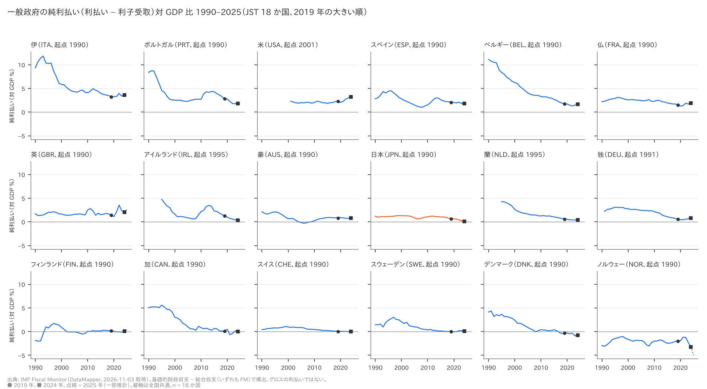
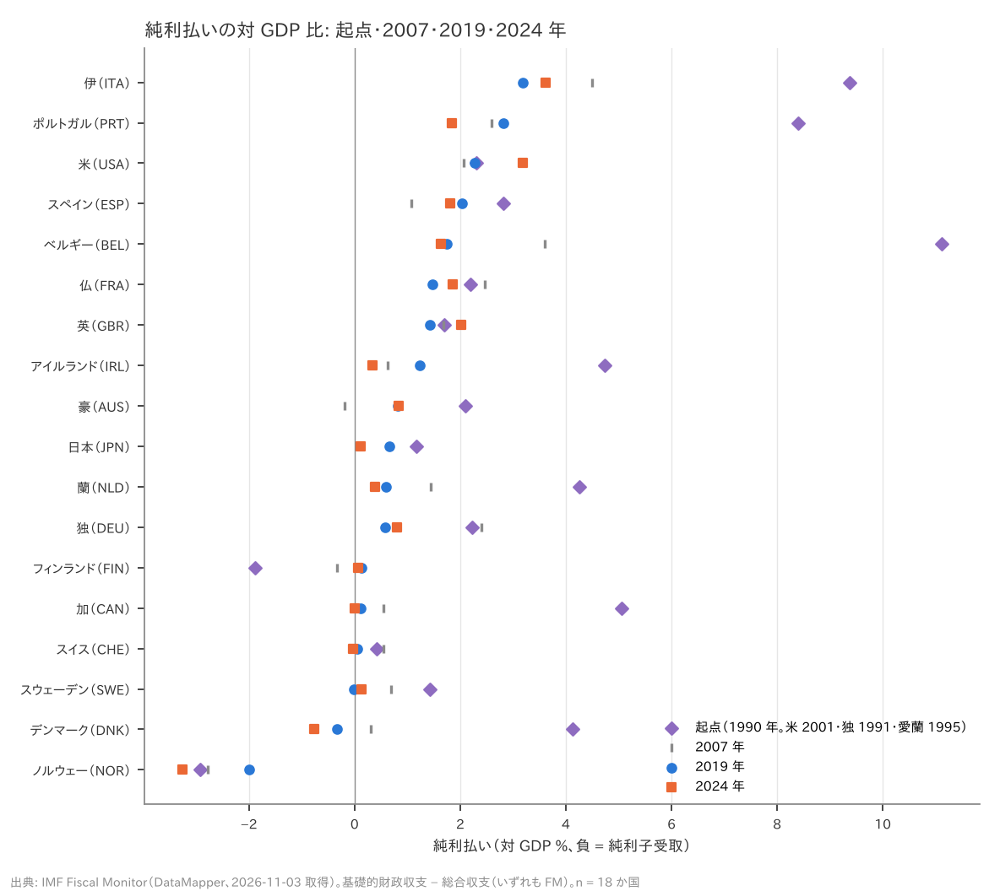
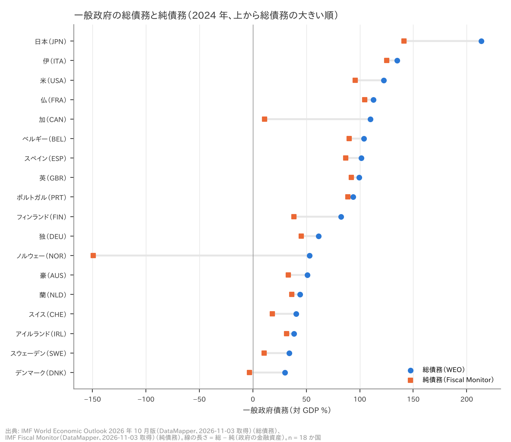
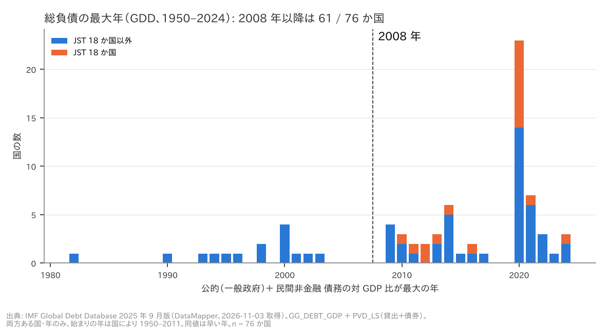

# R2: 利払いの重さ・純債務で見た日本・総負債の世界拡張（H5・H6(a)(b)、補助: H3b の GDD 拡張）（2026-11-03, theme: public-debt）

## 要約（記述のみ。因果の主張はしない）
- **H5（利払いは 2010 年代に軽く、2022 年以降に反転）は中間（純利払いで代理）。** 一般政府の**純**利払い（利払い − 利子受取）対 GDP 比が、2019 年に起点年（原則 1990 年）の半分以下になった国は 18 か国中 11 か国で、前半は満たした。一方、2024 年に 2019 年より上がった国は 7 か国（豪・独・仏・英・伊・スウェーデン・米。豪の上昇は 0.01 pt）だけで、後半は満たさなかった。2025 年（一部推計）でも 9 か国で、閾値の 10 に届かない。18 か国中央値は 2019 年 0.74% → 2024 年 0.59% で、**純利払いで見る限り、金利上昇後の「反転」は過半の国では起きていない**。ただし純利払いは、利子受取も金利とともに増えるので、グロスの利払いより上昇を小さく見せうる。**後半の不支持はこの定義に依存しており、グロスの利払いで見れば上昇した国が増える可能性がある（未検証）。**
- **H6(a)（日本の総債務は 18 か国の最高で、1944 年を上回る）は整合。** JST の 2020 年は 253.9%（2 位の伊は 155.8%）、IMF WEO の 2024 年は 213.6%（伊 134.7%）で、どちらも首位である。どちらも JST の日本 1944 年の 204.0% を上回る。JST の系列で 1944 年を初めて上回ったのは 2010 年（205.7%）。
- **H6(b)（純債務と市中保有の両方で日本の順位が下がる）は不支持。** (b) は「純債務で下がる」かつ「市中保有で下がる」の連言と読んだので、純債務で下がらない時点で不支持になる。2024 年の純債務（IMF Fiscal Monitor）は 141.1% で、総債務と同じく首位（2 位は伊 125.3%）。総債務 − 純債務（政府の金融資産）は 72.5 pt と大きいが、順位は変わらない。設計書の解釈文の後半「（定義を変えても首位なら）像はどの定義でも支えられる」は、中央銀行保有分を除いた**市中保有を検証していない**（データ未採用）ので**保留**する。言えるのは「総債務と純債務の 2 定義では日本が首位」までである。
- **補助（H3b の母集団拡張、判定なし）**: IMF Global Debt Database で一般政府総債務と民間非金融債務の両方がある 76 か国では、合計の対 GDP 比が最大の年が 2008 年以降の国は 61 か国（80%）。系列の始まりを揃えても、2020・2021 年を除いても 78〜85% で、ほぼ変わらない。ただし最大年が各国の最新年（多くは 2024 年）なのは 5 か国だけで、H3b の基準（2019 年または最新年が最大）とは別の量である。

## 問いと仮説
`design/themes/public-debt.md` の問い 5・6 と、事前登録した仮説（2026-11-03）のうち次の部分に答える。

- **H5**: 「OECD 加盟の JST 国について、一般政府の利払い対 GDP 比は 2019 年に 1990 年の半分以下である国が過半であり、2024 年には 2019 年より上がった国が過半である。判定: 両方満たせば整合。前半のみなら中間。」 JST 18 か国はすべて OECD 加盟国なので、母集団は 18 か国。
- **H6**: 「(a) 日本の一般政府債務対 GDP 比（最新年）は JST 18 か国の最高であり、同国の 1944 年ピークを上回る。(b) 純債務と、中央銀行保有分を除いた市中保有の政府債務対 GDP 比では、日本の順位は総債務の順位より下がる。」 (b) が整合なら「日本が最も終焉に近い」という像は総債務の定義に依存する。(b) が不支持なら、像はその定義でも支えられる。
- **補助**: H3b（総負債は 2019 年または最新年に 18 か国の 3 分の 2 以上で 1870 年以降の最大）は、JST 18 か国に対する判定を R1（`reports/2026-11-03-r1-debt-history.md`）が出す。本 report は設計書の落とし穴「総負債の世界像（GDD）は補助として示し、主判定の母集団は 18 か国」に従い、GDD で母集団を広げた参考値だけを示す。**仮説は変えず、判定もしない。**

推定したい量: 国を単位とした記述的な割合と順位。因果効果は推定しない。

事前登録からの具体化と逸脱（いずれも本 report で初めて決めたもの）:
1. **利払いは純利払い**（後述）。グロスの利払いは採用データに無い。設計書の「利払い」を純利払いで代理している。WEO の総合収支は小数第 1 位で丸められているため使わず、純利払いは FM の基礎的財政収支と FM の総合収支（いずれも丸めなし）から FM 内で導出した。
2. **起点年**: 純利払いが 1990 年から無い国は、最初の年を起点にした。米 2001（FM の基礎的財政収支と総合収支がどちらも 2001 年から）、独 1991（同じく 1991 年から。統一後）、愛 1995（同じく 1995 年から）、蘭 1995（FM の総合収支は 1990 年からあるが、基礎的財政収支が 1995 年から）。起点年はデータの始まりで機械的に決まり、値を見て選んだものではない。
3. **起点が 0 以下の国**（フィンランド 1990 年 −1.89%、ノルウェー −2.92%。純利子受取の国）は「半分以下」が定義できないので、**前半を満たさない側に数え、母数 18 には残した**。この扱いは設計書に無く、データを見た後で決めた。母数から除いた n = 16 では過半は 9 になるが、後半は 7 / 16 で過半 9 にも閾値 10 にも届かず、判定は同じ中間である（頑健性表）。
4. **H6(a)** は JST 2020 年と WEO 2024 年の両方で首位、かつ両方が JST の 1944 年値を上回ることを条件にした（JST の最新年 2020 年はコロナ期の値なので、IMF の最新年も併記するため）。
5. **H6(b)** の総債務は WEO、純債務は Fiscal Monitor（いずれも 2024 年）。市中保有は対象外。設計書の (b) は「純債務と市中保有では、日本の順位は総債務の順位より下がる」で、これを両方で下がることの連言と読んだ。純債務で下がらない時点で (b) は不支持とし、設計書の解釈文の後半（不支持なら「像はどの定義でも支えられる」）は、市中保有が未検証なので保留する。
6. **利払いの対歳入比**（設計書の指標欄にある）は、歳入データを採用していないので対象外。
7. **H5 の「前半を満たさなければ不支持」**: 設計書は「両方満たせば整合、前半のみなら中間」とだけ定めており、前半を満たさない場合の判定は書いていない。本 report はこれを不支持とする補完ルールを置いた（主仕様では前半を満たすので、主判定には効かない。頑健性表の 2001 年起点の行にだけ効く）。
8. 事前登録に無い頑健性の仕様（起点が負の国の除外、後半 2019 vs 2023／2025、起点の 2001 年統一、中間年 2021、H6(b) の年を変える表、GDD の系列の始まり年 3 通りと 2020・2021 年除外）は、すべて**探索的（事後）**として表に印を付けた。

## データ
| 変数 | 出典 | 定義・単位 | 期間・国 | 備考（欠損・断絶） |
|---|---|---|---|---|
| 純利払い `interest_gdp` | IMF Fiscal Monitor（基礎的財政収支 `GGXONLB_G01_GDP_PT` − 総合収支 `GGXCNL_G01_GDP_PT`、いずれも FM の値）、source `imf_fm` | **基礎的財政収支 − 総合収支 ＝ 純利払い（利払い − 利子受取）**、一般政府、対 GDP %。グロスの利払いではない | 1990–2025、18 か国 626 国・年 | 米 2001–、独 1991–、愛・蘭 1995–（逸脱 2）。2025 年は一部推計。日本は 1990 年 1.18%、2019 年 0.66%、2024 年 0.12%。負値 = 純利子受取（ノルウェー、デンマーク 2019 年以降など） |
| 一般政府総債務 | IMF WEO 2026 年 10 月版（`GGXWDG_NGDP`）、source `imf_weo` | 対 GDP % | 1980–2025、18 か国 719 国・年 | 2026 年以降の見通しは mart で切ってある。2025 年は一部推計 |
| 一般政府純債務 | IMF Fiscal Monitor（`GGXWDN_G01_GDP_PT`）、source `imf_fm` | 総債務 − 金融資産、対 GDP % | 1990–2025、18 か国 598 国・年 | 負値あり（ノルウェー 2024 年 −149.3%）。どの金融資産を差し引くかは国の統計慣行で違う |
| 政府債務（長期） | Jordà–Schularick–Taylor Macrohistory Database R6（`debtgdp`）、source `jst` | 対 GDP %。概ね一般政府総債務だが、国・時代により中央政府 | 1870–2020、18 か国 2,489 国・年 | 日本 1945 年は欠損。日本 1944 年 204.0% |
| GDD 一般政府総債務 | IMF Global Debt Database 2025 年 9 月版（`GG_DEBT_GDP`）、source `imf_gdd` | 対 GDP % | 1950–2024、88 か国 3,478 国・年 | 一般政府系列の無い国（中央政府のみの国）は対象外 |
| GDD 民間非金融債務 | 同（`PVD_LS`） | 家計 ＋ 非金融企業の貸出 ＋ 債券、対 GDP % | 1950–2024、160 か国 8,385 国・年 | JST の銀行貸出より範囲が広い |
| 市中保有（中銀保有控除） | — | — | — | **未採用。H6(b) のこの部分は対象外** |

mart: `data/marts/public_debt_panel.parquet`（88,182 行、6 列: iso3, year, unit, metric, value, source。long 形式。生成は `uv run socioscope run public-debt fetch && ... stage && ... mart`、raw の取得は 2026-11-03、manifest は `data/raw/manifest.jsonl`）。出典表記: Source: International Monetary Fund, World Economic Outlook (October 2026) / Fiscal Monitor / Global Debt Database (September 2025), https://www.imf.org/external/datamapper 。Jordà, Schularick & Taylor (2017), "Macrofinancial History and the New Business Cycle Facts", NBER Macroeconomics Annual 2016（CC BY-NC-SA 4.0、非商用）。IMF データの商用再利用には IMF の事前許可が要る。

## 方法
記述統計のみ。
- **H5**: 各国の純利払いについて、(i) 2019 年 ≤ 起点年の値 ÷ 2 か（起点 ≤ 0 は「定義不能」で満たさない扱い）と、(ii) 2024 年 > 2019 年か（等しい場合は上昇に数えない）を判定し、国数を数える。閾値はどちらも ≥ 10（18 の過半）。
- **H6(a)**: JST 2020 年と WEO 2024 年それぞれで大きい方からの順位を取り、日本の値を JST の日本 1944 年値と比べる。
- **H6(b)**: 2024 年の WEO 総債務と FM 純債務それぞれで大きい方からの順位を取る（同値は同順位）。純債務の順位の数字が総債務より大きくなれば整合とする。
- **補助**: GDD で一般政府総債務と民間非金融債務が両方ある国・年について合計を取り、1950 年以降の最大の年を国ごとに出す（同値は早い年を採る）。最大年が 2008 年以降の国の割合を出す。
- 標準誤差は無い（母集団全体の記述で、標本から推定していない）。乱数は使わない。

## 結果

### H5: 純利払いの対 GDP 比（判定: **中間（純利払いで代理）**）
- 2019 年 ≤ 起点 ÷ 2: **11 / 18**（豪・ベルギー・加・スイス・独・デンマーク・愛・伊・蘭・ポルトガル・スウェーデン）。満たさないのは米（2019/起点 = 0.99）・英（0.84）・スペイン（0.72）・仏（0.67）・**日本（0.56）**と、起点が負で定義できないフィンランド・ノルウェー。
- 2024 年 > 2019 年: **7 / 18**（豪・独・仏・英・伊・スウェーデン・米）。豪は 0.82 → 0.83% で、上昇幅は 0.05 pt 未満。残る 11 か国は低下した。
- 18 か国中央値: 2007 年 0.88%、2019 年 0.74%、2022 年 0.58%、2023 年 0.54%、2024 年 0.59%、2025 年 0.60%。2024 − 2019 の変化の中央値は −0.10 pt（最小 −1.26 pt、最大 +0.91 pt）。

| 国 | 起点年 | 起点 | 2007 | 2019 | 2024 | 2025（推計） | 2019 / 起点 | 2019 ≤ 起点/2 | 2024 > 2019 | 2025 > 2019 |
|---|---|---|---|---|---|---|---|---|---|---|
| 伊（ITA） | 1990 | 9.37 | 4.49 | 3.19 | 3.61 | 3.61 | 0.34 | ○ | ○ | ○ |
| ポルトガル（PRT） | 1990 | 8.39 | 2.59 | 2.82 | 1.84 | 1.73 | 0.34 | ○ | × | × |
| 米（USA） | 2001 | 2.31 | 2.07 | 2.28 | 3.19 | 3.18 | 0.99 | × | ○ | ○ |
| スペイン（ESP） | 1990 | 2.82 | 1.07 | 2.04 | 1.81 | 1.86 | 0.72 | × | × | × |
| ベルギー（BEL） | 1990 | 11.12 | 3.60 | 1.75 | 1.63 | 1.78 | 0.16 | ○ | × | ○ |
| 仏（FRA） | 1990 | 2.19 | 2.47 | 1.47 | 1.86 | 2.08 | 0.67 | × | ○ | ○ |
| 英（GBR） | 1990 | 1.70 | 1.69 | 1.42 | 2.02 | 2.60 | 0.84 | × | ○ | ○ |
| アイルランド（IRL） | 1995 | 4.74 | 0.62 | 1.24 | 0.34 | 0.29 | 0.26 | ○ | × | × |
| 豪（AUS） | 1990 | 2.10 | −0.19 | 0.82 | 0.83 | 0.95 | 0.39 | ○ | ○ | ○ |
| 日本（JPN） | 1990 | 1.18 | 0.70 | 0.66 | 0.12 | 0.20 | 0.56 | × | × | × |
| 蘭（NLD） | 1995 | 4.26 | 1.44 | 0.59 | 0.38 | 0.35 | 0.14 | ○ | × | × |
| 独（DEU） | 1991 | 2.22 | 2.40 | 0.59 | 0.80 | 0.86 | 0.26 | ○ | ○ | ○ |
| フィンランド（FIN） | 1990 | −1.89 | −0.34 | 0.14 | 0.07 | 0.32 | – | 定義不能 | × | ○ |
| 加（CAN） | 1990 | 5.05 | 0.55 | 0.12 | 0.01 | −0.23 | 0.02 | ○ | × | × |
| スイス（CHE） | 1990 | 0.42 | 0.55 | 0.05 | −0.03 | −0.03 | 0.12 | ○ | × | × |
| スウェーデン（SWE） | 1990 | 1.42 | 0.69 | −0.01 | 0.13 | 0.06 | −0.01 | ○ | ○ | ○ |
| デンマーク（DNK） | 1990 | 4.14 | 0.31 | −0.33 | −0.77 | −0.60 | −0.08 | ○ | × | × |
| ノルウェー（NOR） | 1990 | −2.92 | −2.78 | −1.99 | −3.26 | −4.94 | – | 定義不能 | × | × |

単位は対 GDP %。負値は純利子受取。出典: IMF Fiscal Monitor（基礎的財政収支 − 総合収支、いずれも FM の値）。





読み方: 1990 年代前半に純利払いが重かった国（ベルギー 11%、伊 9%、ポルトガル 8%、加 5%）は 2019 年までに大きく下がった。その一方で、2019 年時点ですでに軽かった国が多い。2022 年以降の金利上昇の後に純利払いがはっきり上がったのは、米（2.28 → 3.19%）・英（1.42 → 2.02%）・仏（1.47 → 1.86%）など一部にとどまる。日本は 2019 年 0.66% → 2024 年 0.12% と下がり、純利子受取の国を含めた 18 か国で下から 6 番目になった。

純利払いが上がらなかった理由の候補はいくつか考えられる。(1) 政府が持つ金融資産の利子受取も金利とともに増えた（ノルウェー・デンマーク・加は純利払いが負か 0 近辺）。(2) 長期債の比率が高いと、市場金利の上昇が債務全体の平均金利に移るまで年数がかかる。(3) インフレで名目 GDP（分母）が伸びた。**本 report はこれらを検証していない**（分解に要るグロスの利払い・利子受取・平均満期のデータが無い）。

### H6(a): 日本の総債務の水準（判定: **整合**）
- JST 2020 年: 日本 253.9%（1 位 / 18）。2 位は伊 155.8%。
- IMF WEO 2024 年: 日本 213.6%（1 位 / 18）。2 位は伊 134.7%。
- JST の日本 1944 年: 204.0%（1945 年は欠損）。JST の系列で 1944 年を初めて上回ったのは 2010 年の 205.7%。

### H6(b): 総債務と純債務での順位（判定: **不支持**。純債務と市中保有の連言として読み、純債務で下がらないため。設計書の解釈文の後半は市中保有が未検証のため保留、逸脱 5）
2024 年の総債務（WEO）では 1 位、純債務（FM）でも 1 位で、順位は下がらない。

| 総債務順位 | 国 | 総債務 WEO 2024 | 純債務 FM 2024 | 純債務順位 | 総 − 純 | JST 2020 総債務（順位） |
|---|---|---|---|---|---|---|
| 1 | **日本（JPN）** | 213.6 | 141.1 | 1 | 72.5 | 253.9（1） |
| 2 | 伊（ITA） | 134.7 | 125.3 | 2 | 9.4 | 155.8（2） |
| 3 | 米（USA） | 122.3 | 95.7 | 4 | 26.6 | 128.1（4） |
| 4 | 仏（FRA） | 112.6 | 104.5 | 3 | 8.1 | 115.0（7） |
| 5 | 加（CAN） | 110.0 | 10.8 | 15 | 99.2 | 117.5（6） |
| 6 | ベルギー（BEL） | 103.9 | 90.2 | 6 | 13.7 | 112.8（8） |
| 7 | スペイン（ESP） | 101.4 | 87.0 | 8 | 14.4 | 120.0（5） |
| 8 | 英（GBR） | 99.4 | 92.0 | 5 | 7.4 | 104.5（9） |
| 9 | ポルトガル（PRT） | 93.5 | 88.9 | 7 | 4.6 | 135.2（3） |
| 10 | フィンランド（FIN） | 82.5 | 38.4 | 10 | 44.1 | 69.5（10） |
| 11 | 独（DEU） | 61.4 | 45.4 | 9 | 16.0 | 68.7（11） |
| 12 | ノルウェー（NOR） | 52.8 | −149.3 | 18 | 202.1 | 41.4（17） |
| 13 | 豪（AUS） | 50.9 | 33.1 | 12 | 17.8 | 57.3（13） |
| 14 | 蘭（NLD） | 44.0 | 36.3 | 11 | 7.7 | 54.3（14） |
| 15 | スイス（CHE） | 40.4 | 18.3 | 14 | 22.1 | 42.4（15） |
| 16 | アイルランド（IRL） | 38.4 | 31.3 | 13 | 7.1 | 58.4（12） |
| 17 | スウェーデン（SWE） | 33.9 | 10.7 | 16 | 23.2 | 39.7（18） |
| 18 | デンマーク（DNK） | 29.9 | −3.0 | 17 | 32.9 | 42.1（16） |

単位は対 GDP %。「総 − 純」は、純債務の計算で差し引かれた政府の金融資産の対 GDP 比にあたる（WEO と FM の 2 つのデータセットの差なので近似）。



日本の総 − 純（72.5 pt）は、ノルウェー（202.1 pt）・加（99.2 pt）に次いで 3 番目に大きい。純債務で見ると日本と伊の差は 79 pt から 16 pt に縮むが、順位は入れ替わらない。加は純債務で 5 位から 15 位に下がる（総債務と純債務の差が最も効く国）。

### 補助: GDD で見た総負債の最大年（H3b の母集団拡張、判定なし）
- GDD で一般政府総債務と民間非金融債務の両方がある国: 76 か国（一般政府 88、民間 160 のうち重なり）。
- 公的 ＋ 民間の対 GDP 比が 1950 年以降で最大の年が 2008 年以降の国: **61 / 76（80%）**。
- 2008 年より前が最大の 15 か国: COD 2001、EGY 1982、ETH 1994、FSM 1995、HND 1990、IDN 2000、ISR 2002、KGZ 2000、MDA 1998、NIC 2003、RUS 1998、SRB 2000、TJK 2000、TZA 1993、YEM 1996。1990 年代の移行経済・債務危機・債務削減（HIPC など）を経験した国が多いという見立ては文献上のもので、本 report では検証していない。GDD には先進国・新興国の区別が無いので分類もしない。
- 2008 年以降が最大の 61 か国: ALB, ARE, AUS, AUT, BEL, BGR, BRA, CAN, CHE, CHL, CHN, COL, CRI, CYP, CZE, DEU, DNK, ESP, EST, FIN, FRA, GBR, GEO, GRC, HRV, HUN, IND, IRL, ISL, ITA, JPN, KAZ, KHM, KOR, LTU, LUX, LVA, MKD, MLT, MNG, MUS, MYS, NGA, NLD, NOR, PER, PHL, POL, PRT, ROU, SLV, SVK, SVN, SWE, THA, TUR, UKR, USA, VCT, VEN, VNM（最大年は再現スクリプトの出力に国ごとに出る）。最大年の山は 2020 年（23 か国）にある。
- JST 18 か国はすべて GDD に両方の系列があり、18 か国とも最大年が 2008 年以降（2010〜2024 年）。そのうち最大年が 2019・2020 年なのは 9 か国（豪・加・フィンランド・仏・英・伊・日本・ノルウェー・米）。GDD の系列の始まりは 1950〜1989 年で、JST の 1870 年からの系列より短い。



この 80% は「2008 年以降のどこかで最大」という緩い基準による値で、H3b の「2019 年（または最新年）が最大」とは違う。GDD の最新年（多くは 2024 年）が最大なのは 76 か国中 5 か国だけである。多くの国で総負債は 2020 年前後に最大となり、その後は下がっている。

## 頑健性
**H5**（判定の閾値 ≥ 10 は固定）

| 仕様 | 前半（半分以下） | 後半（上昇） | 判定 |
|---|---|---|---|
| 主仕様（起点 1990 等、2019 vs 2024） | 11 / 18 | 7 / 18 | 中間 |
| 起点が負の国を母数から除外（n = 16、探索的・事後） | 11 / 16 | 7 / 16 | 中間（閾値 10 でも、n = 16 の過半 9 でも同じ） |
| 後半を 2019 vs 2023（探索的・事後） | 11 / 18 | 7 / 18 | 中間 |
| 後半を 2019 vs 2025（一部推計、探索的・事後） | 11 / 18 | 9 / 18 | 中間 |
| 起点を全国 2001 年に統一（探索的・事後） | 8 / 18 | 7 / 18 | 不支持（逸脱 7 の補完ルールによる） |
| 中間年を 2021 年（探索的・事後） | 12 / 18 | 8 / 18 | 中間 |

後半（反転）は、どの仕様でも 10 か国に届かない。前半は、起点を 2001 年に揃えると 8 か国になり閾値を割る。前半が満たされるのは、1990 年代前半の高い利払い（ベルギー・伊・ポルトガル・加など）が下がったことによる部分が大きい。

**H6(b)**（年を変える、探索的・事後）

| 年 | 日本 総債務 WEO（順位） | 日本 純債務 FM（順位） | 日本以外の純債務最大 | 判定 |
|---|---|---|---|---|
| 2007 | 150.4（1 / 18） | 93.5（2 / 18） | 伊 96.3 | 整合 |
| 2019 | 206.3（1 / 18） | 148.2（1 / 18） | 伊 123.0 | 不支持 |
| 2024（主） | 213.6（1 / 18） | 141.1（1 / 18） | 伊 125.3 | 不支持 |
| 2025（一部推計） | 204.8（1 / 18） | 132.4（1 / 18） | 伊 127.7 | 不支持 |

2007 年には純債務で伊が日本をわずかに上回っており、(b) は整合になる。2019 年以降は不支持で一貫している。

**補助（GDD）**

| 仕様 | 最大年 ≥ 2008 |
|---|---|
| 主（両方ある 76 か国、1950–2024） | 61 / 76（80%） |
| 系列が 1995 年以前から始まる国（探索的・事後） | 45 / 55（82%） |
| 系列が 1980 年以前から始まる国（探索的・事後） | 22 / 26（85%） |
| 系列が 1970 年以前から始まる国（探索的・事後） | 18 / 22（82%） |
| 2020・2021 年（コロナで分母の GDP が落ちた年）を除く（探索的・事後） | 59 / 76（78%） |
| 参考: 最大年がその国の最新年 | 5 / 76 |

## 限界・言えないこと
- **利払いは純利払いである。** FM の 基礎的財政収支 − 総合収支（いずれも FM の値）は「利払い − 利子受取」で、グロスの利払いではない。WEO の総合収支は丸められているため使わず、FM 内で導出した。金融資産を多く持つ国（ノルウェー・デンマーク・加・日本）では、グロスの利払いと純利払いの差が大きいと考えられる。金利が上がると利子受取も増えるので、純利払いはグロスの利払いより上昇を小さく見せうる。**H5 後半の不支持はこの定義に依存しており、グロスの利払いで見れば上昇した国が増える可能性がある（未検証）。** 本 report の H5 は「純利払いで見た重さ」に限る。
- 利払いの**対歳入比**（設計書の指標）は、歳入データを採用していないので対象外。
- 純利払いが上がらなかった理由（利子受取の増加、平均満期による遅れ、インフレによる分母の伸び）は候補を挙げただけで、検証していない。金利上昇の影響が「まだ出ていない」のか「出ない」のかは、この記述からは言えない。
- 起点が負の 2 か国の扱い（逸脱 3）と、前半を満たさない場合を不支持とする補完ルール（逸脱 7）は事後に決めた。前者はどちらの扱いでも判定が変わらないことを示した。後者は主判定には効かない。
- 頑健性の仕様（逸脱 8 に列挙）はすべて探索的（事後）で、判定の根拠にはしていない。判定が変わったもの（H5 の 2001 年起点で不支持、H6(b) の 2007 年で整合）も含めて全部載せた。
- **H6(a)** の 1944 年値は戦時のピークで、1945 年は欠損している。終戦の年の比率は 204% より高かった可能性があるが、データが無い。JST の日本の戦前系列は中央政府の可能性があり、WEO の一般政府 2024 年値と 1944 年値の比較は定義をまたぐ。JST の 2020 年値（253.9%）と WEO の 2024 年値（213.6%）も、ソースと年が違う。
- **H6(b)** の「純債務」で差し引く金融資産の範囲（公的年金の積立金、外貨準備、出資金などを含むか、時価か簿価か）は国の統計慣行で違う。純債務の国際順位はこの違いに左右される。総債務（WEO）と純債務（FM）は別のデータセットで、総 − 純 は近似である。
- **市中保有（中央銀行保有分を除く）は検証していない。** 日本銀行は国債の大きな割合を保有しているので、市中保有で見れば日本の順位が下がる可能性は残る。したがって H6(b) の不支持は「総債務と純債務の 2 定義では首位」であって、「どの定義でも首位」ではない。設計書の解釈文の後半は保留する（逸脱 5）。なお統合政府で見ても、中銀保有分は付利される当座預金に置き換わっているので、債務が消えたことを意味しない（設計書の落とし穴）。
- 「日本が最も終焉に近い」という像そのものは観測できない。本 report が言えるのは、事前に決めた 2 つの債務定義で日本が 18 か国中首位だということだけである。純利払い（H5）で見ると、日本は 2024 年に 18 か国で下から 6 番目（0.12%）と低い。どちらの指標で「近さ」を測るかは数字では決まらない。
- **補助（GDD）**: 一般政府系列のある 88 か国に限るので、中央政府系列しか無い国（多くの低所得国）は入らない。系列の始まりが国によって 1950〜2011 年と違い、始まりの遅い国ほど最大年が近年になりやすい。始まりで絞っても 82〜85% で大きく変わらないことは確かめた。GDD の民間債務は貸出 ＋ 債券で、JST の銀行貸出より広い。この割合は H3b の判定ではなく、H3b とは基準も違う（「2008 年以降」と「2019 年または最新年」）。
- すべて国レベルの記述である。国の債務比率から家計・個人の負担を読み取ることはしない。

## 再現手順
```bash
export PATH=/usr/local/sbin:/usr/local/bin:/usr/sbin:/usr/bin:/sbin:/bin:/root/.local/bin  # この環境のみ
uv run socioscope run public-debt fetch && uv run socioscope run public-debt stage && uv run socioscope run public-debt mart
uv run --no-sync python themes/public-debt/src/theme_public_debt/analysis/a20261103_r2_interest_net_debt.py
uv run --no-sync pytest themes/public-debt/tests/test_analysis_r2.py -q
```
mart: `data/marts/public_debt_panel.parquet`（88,182 行、6 列: iso3 str, year int64, unit str, metric str, value float64, source str）。使用した (source, unit, metric): `imf_fm`/general_gov_gross/interest_gdp、`imf_fm`/general_gov_net/debt_gdp、`imf_weo`/general_gov_gross/debt_gdp、`jst`/general_gov_gross/debt_gdp、`imf_gdd`/general_gov_gross/debt_gdp、`imf_gdd`/private_nonfin/debt_gdp。スクリプトは決定的（乱数なし）で、2 回実行して標準出力が一致することを確かめた。図 4 枚: `reports/figures/r2_net_interest_small_multiples.png`、`r2_net_interest_dots.png`、`r2_gross_vs_net_2024.png`、`r2_gdd_total_debt_peak_year.png`。LLM 構造化は使っていない。

## チェックリスト回答
- A. 問い・仮説・閾値は `design/themes/public-debt.md` に分析前に固定した（2026-11-03）。事後に決めたこと（純利払いでの代理、起点が負の国の扱い、H6(a) を 2 ソースで見ること、H6(b) の連言の読みと解釈文後半の保留、H5 の「前半を満たさなければ不支持」の補完ルール）は「事前登録からの具体化と逸脱」1〜7 に、頑健性の仕様は逸脱 8 と表の「探索的・事後」で明記した。GDD の補助は H3b の母集団拡張の参考値で、判定はしない。推定量は国単位の記述的な割合と順位。
- B. 出典・定義・取得日（2026-11-03）は manifest と一致する。欠損（純利払いの米 2001–、独 1991–、愛・蘭 1995–、JST 日本 1945 年、市中保有の未採用、GDD の一般政府系列 88 か国のみ）を列挙した。補完はしていない。サンプルは JST 18 か国（主判定）と、GDD で両方の系列がある 76 か国（補助）で、選択の影響は限界に書いた。
- C. 因果は主張しない（記述のみ、識別戦略なし）。純利払いが上がらなかった理由は候補として挙げただけで、検証していないと明記した。国レベルの比率を個人・家計に読み替えていない。
- D. 母集団全体の記述なので標準誤差は無い。試した仕様（H5 6 通り、H6(b) 4 年、GDD 5 通り）は判定が変わったもの（H5 の 2001 年起点で不支持、H6(b) の 2007 年で整合）も含めて全部報告した。
- E. 「整合」「不支持」「中間」「関連」で書き、因果語は使っていない。図には軸・単位・出典・n を明記した（対数軸は使っていない）。「限界・言えないこと」の節を設けた。再現手順と mart のスキーマ・行数を書いた。
