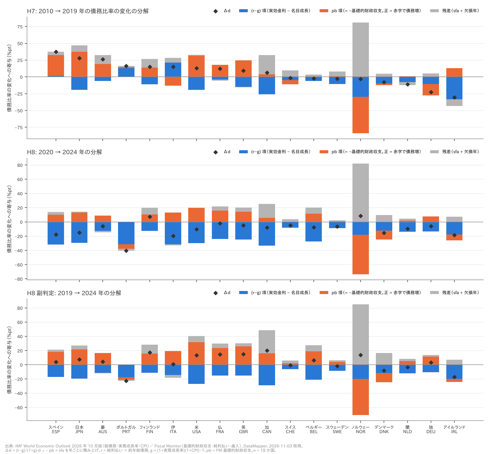
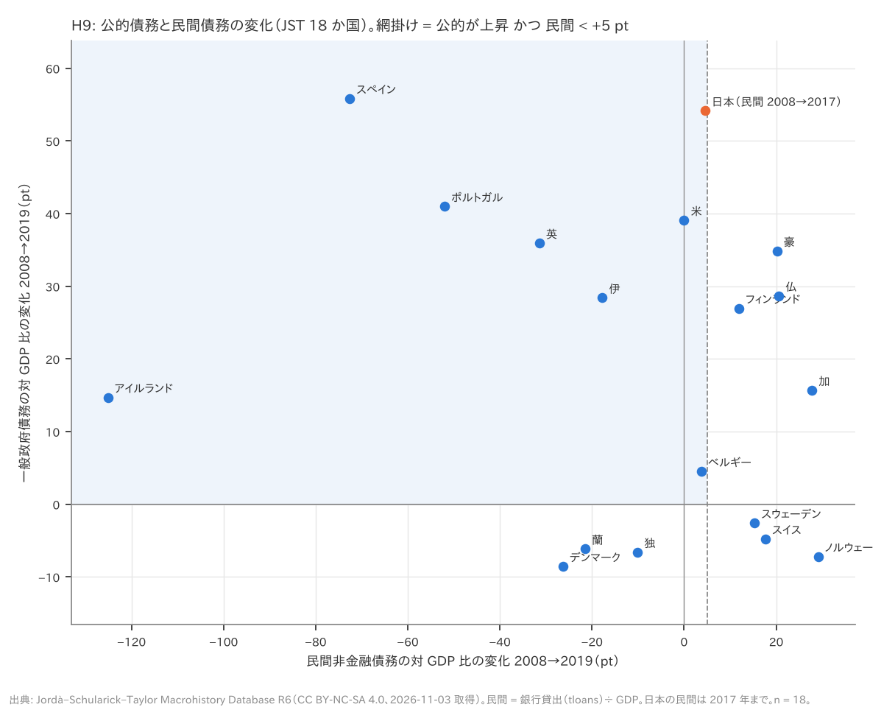
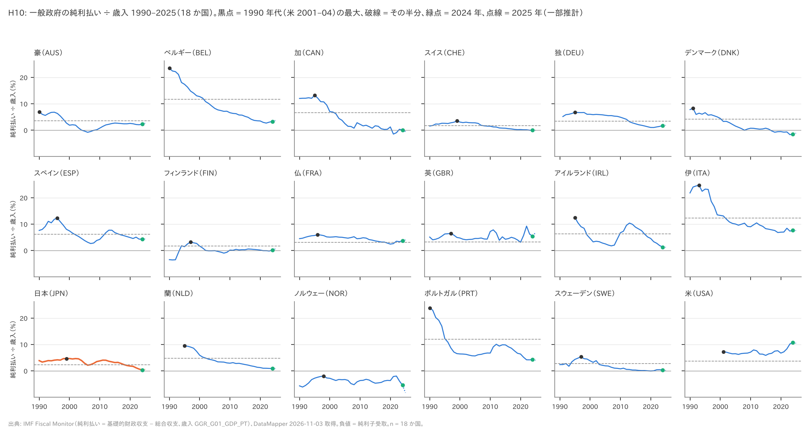

# R3: 2010 年代とインフレ期の債務動態、民間から国家へ、利払いの対歳入比（H7〜H10、事後追加）（2026-11-03, theme: public-debt）

## 要約（記述のみ。因果の主張はしない）
H7〜H10 は R1・R2 の後に立てた**事後追加**の仮説で、事前登録の H1〜H6 と同じ重みでは読まない。判定は設計書の閾値どおり。

- **H7 は中間。** 2010 → 2019 年に (r−g) 項が債務を減らす向きだった国は 15 / 18。基礎的赤字がそれ以上に押し上げた国は 6 / 18（閾値 10）。r を純利払いから出しているため、この判定はそのずれに対して頑健とは言えない。
- **H8 は 2020 → 2024 年で整合（16 / 18・1.86・13 / 18）、副判定の 2019 → 2024 年で不支持（6 / 18）。** 2021–24 年には全 18 か国で金利と成長の差（主にインフレ）が債務比率を押し下げる向きに働いた。2020 年のピークからは 16 か国で比率が下がったが、基礎的赤字が続いたため、コロナ前の 2019 年より低いのは 6 か国にとどまる（12 か国は 2019 年より高い）。
- **H9 は不支持。** 2008 → 2019 年に公的債務比率が上がり、民間非金融債務比率が +5 pt 未満だった国は 8 / 18（閾値 12）。
- **H10 は (a) 整合。** 純利払い ÷ 歳入が 2024 年に 1990 年代の最大の半分以下だった国は 14 / 18。(c) 2025 年（一部推計）も 14 / 18。(b) 日本は 0.33% で 12 位 / 18。

## 問いと仮説
`design/themes/public-debt.md` の節「事後追加（2026-11-03 夕、R3。R1・R2 の結果を見た後に立てた仮説。検証手順・判定基準は追加データを見る前にここで固定）」から引用する。

- **H7**: 「2010 → 2019 年の Δd を (r − g) 項・pb 項・残差に分解する。(a) (r − g) 項が負（債務を減らす向き）の国が 12 か国以上、かつ (b) そのうち pb 項が正（基礎的赤字）で |pb 項| ≥ |(r − g) 項| の国が 18 か国の過半（≥ 10）なら整合。(a) を満たし (b) が 9 以下なら中間、(a) が 11 以下なら不支持。」
- **H8**: 「2020 → 2024 年の Δd を同じ式で分解する。(a) 債務比率が下がった国が 12 か国以上、(b) 下がった国の中央値で (r − g) 項の寄与が低下幅の半分以上、(c) 同じ期間に pb 項が正（基礎的赤字のまま）の国が 12 か国以上、の 3 つを満たせば整合。(a) のみなら中間、(a) が 11 以下なら不支持。2019 → 2024 年でも副判定を出す。」
- **H9**: 「JST で 2008 → 2019 年（日本の民間は 2017 年まで）に、一般政府債務比率が上昇し、かつ民間非金融債務比率が低下または上昇 5 pt 未満の国が 12 か国以上なら整合。9 か国以下なら不支持。」
- **H10**: 「FM の純利払いと歳入から 純利払い ÷ 歳入（%）を出す。(a) 2024 年の値が、その国の 1990 年代（1990–1999、米国は 2001–2004）の最大値の半分以下の国が 12 か国以上なら整合。(b) 日本の 2024 年の順位と値を記述（判定なし）。(c) 2025 年（推計）での再計算を副判定。」
- 共通: 因果は主張しない。「選択で相殺した」は会計上の分解の言い換えにすぎず、なぜ赤字を選んだかは論じない。pb の定義は R1 と違う（R1 は総合収支による代理、R3 は FM の基礎的財政収支）。そのため R1 の H2b との比較は向きだけにとどめる。

推定したい量: 国を単位とした記述的な国数・中央値と、会計恒等式による寄与の配分。因果効果は推定しない。

**事後追加であることの具体的な意味**: H7〜H10 の判定基準は、WEO の実質成長率・CPI と FM の歳入を mart に入れる前に固定した。ただし、FM の基礎的財政収支と純利払いは R2 で既に見ている（R2 の H5 は純利払いを使った）。H10 の分子（純利払い）と、H7・H8 の pb・r の素材は、基準を決める時点で一部見えていた。この点で、H7〜H10 は事前登録と同等ではない。

**事前登録（設計書の事後追加節）に無い決定**（いずれも本 report で初めて決めた）:
1. **d は IMF WEO の一般政府総債務**とした。R1 は JST だったが、R3 は 2021–24 年を扱うため WEO にした。r の分母も同じ WEO の総債務。r の分子（FM の純利払い）と pb（FM）とはデータセットが異なる。
2. **期間の積み上げ**: 「2010 → 2019 年」は t = 2011〜2019 の 9 年分の Δd_t を足したもの、「2020 → 2024 年」は t = 2021〜2024 の 4 年分を足したもの。入力が欠けて分解できない年はどの国にも無かった（欠損年の寄与はすべて 0.0）。
3. **表の r・g・pb の平均は、分解と同じ年でとった。** H7 は 2011〜2019 年（設計書の「2010–19 年平均」を、分解が使う 9 年に揃えた）、H8 は 2021〜2024 年、副判定は 2020〜2024 年。
4. **pb 項が「正」**は、期間の累積（−Σpb > 0）で判定した。毎年赤字だったことは条件にしていない。
5. **H8 (b) の操作化**: 下がった国ごとに (r−g) 項 ÷ Δd（低下幅のうち (r−g) 項に当たる割合）を出し、その中央値が 0.5 以上かを見た。(r−g) 項が低下幅を上回る国では 1 を超え、(r−g) 項が正の国では負になる。別読みとして「(r−g) 項の中央値 ÷ Δd の中央値」も併記した。どちらでも判定は変わらない。
6. **H8 の判定の補完**: 設計書は「3 つ全部で整合、(a) のみなら中間」と書いている。(a) と、(b)・(c) の片方だけを満たす場合の扱いは書いていない。本 report はこれも中間とした（主判定・副判定とも、この場合に当たる仕様は無かった）。
7. **H9 の補完**: 設計書は 12 以上で整合、9 以下で不支持とし、10〜11 を定めていない。本 report は 10〜11 を中間とした。主判定は 8 なので、この補完は効かない。日本は公的を 2008 → 2019 年、民間を 2008 → 2017 年（JST の最終年）で測った。両方を 2017 年で揃えた仕様も頑健性に置いた。
8. **H10 の補完**: 設計書は整合の条件（≥ 12）しか書いていない。本 report は 11 以下を不支持とした（主判定は 14 なので効かない。頑健性の 2001–04 年基準の行にだけ効く）。
9. **H10 の基準期間**: FM の系列が後から始まる国は「始点〜1999 年」とした。独 1991–1999、アイルランド 1995–1999（純利払い・歳入とも 1995 年から）、蘭 1995–1999（純利払いが 1995 年から）。米は設計書どおり 2001–2004。
10. **H10 の負値（純利子受取）の扱い**: R2 と同じ規則を使った。基準（1990 年代の最大）が 0 以下の国は「半分以下」を定義できないので、満たさない側に数え、分母は 18 のまま残した。
    - 作業時の想定では、該当国はフィンランド・ノルウェーの 2 か国（n = 16）だった。しかしフィンランドの比率が負なのは 1990〜92 年だけで、1990 年代の最大は 1997 年の 3.2% と正だった。このため基準を定義できないのは**ノルウェー 1 か国だけ**で、定義できる国の数は n = 17 になる。
    - この n = 16（フィンランド・ノルウェーを除く）は誤った想定の参考値として頑健性表に残した。判定には使わない。
    - 基準が正で 2024 年の値が負の国（スイス・デンマーク）は、R2 と同じく「半分以下を満たす」に数えた。満たさない側に数える読み方も頑健性に置いた。
11. **r の上乗せ感度（探索的・事後）**: 純利払いから出す r はグロスより低い。そこで、(r−g) 項の符号が反転する r の一律上乗せ（損益分岐、年平均 pp）を国ごとに出し、全国一律に上乗せしたときの H7 も計算した（`rate_exposure`・`rg_breakeven`・`shift_rate`）。
12. **頑健性の追加仕様はすべて探索的・事後**である（表に印を付けた）。H7 の期間 3 通り、g を JST の名目 GDP 成長率に替える仕様、(b) から大きさの条件を外す仕様。H8 の 2021・2022 年起点と 2025 年終点。H9 の期間 3 通りと日本の終点。H10 の n = 17 / 16、負値の扱い、2023・2019 年、平均基準、2001–04 年基準。(r−g) 項の内訳（利子・実質成長・インフレ）も探索的・事後である。

## データ
| 変数 | 出典 | 定義・単位 | 期間・国 | 備考（欠損・断絶） |
|---|---|---|---|---|
| 一般政府総債務 d | IMF WEO 2026 年 10 月版 `GGXWDG_NGDP`、source `imf_weo` | 対 GDP % | 1980–2025、18 か国 719 国・年 | 始まりが遅い国: 伊 1988、豪 1989、スイス・ポルトガル 1990、独 1991、デンマーク 1992、スウェーデン 1993、アイルランド 1995、米 2001。R3 が使う 2009 年以降は全国そろう。2025 年は一部推計 |
| 実質成長率 | WEO `NGDP_RPCH`、`imf_weo`/macro/rgdp_growth | % 前年比 | 1980–2025、827 国・年 | 蘭は 1981 年から |
| CPI インフレ率 | WEO `PCPIPCH`、`imf_weo`/macro/cpi_inflation | % 前年比（年平均） | 1980–2025、827 国・年 | 名目成長率の近似に使う（GDP デフレータではない） |
| 基礎的財政収支 pb | IMF Fiscal Monitor `GGXONLB_G01_GDP_PT`、`imf_fm` | 一般政府、対 GDP %、黒字が正 | 1990–2025、626 国・年 | 独 1991、アイルランド・蘭 1995、米 2001 から |
| 純利払い | FM（基礎的財政収支 − 総合収支）、`imf_fm`/interest_gdp | 利払い − 利子受取、対 GDP % | 1990–2025、626 国・年 | グロスの利払いではない。負値は純利子受取 |
| 歳入 | FM `GGR_G01_GDP_PT`、`imf_fm`/revenue_gdp | 一般政府、対 GDP % | 1990–2025、631 国・年 | 独 1991、アイルランド 1995、米 2001 から |
| 公的債務（H9） | JST R6 `debtgdp`、source `jst` | 対 GDP %。概ね一般政府、国・時代により中央政府 | 2008・2019 年は 18 か国そろう | WEO とは定義・ソースが違うので、H7・H8 と数字を混ぜない |
| 民間非金融債務（H9） | JST `tloans` ÷ `gdp`、`jst`/private_nonfin | 民間非金融向け銀行貸出、対 GDP % | 2008 年は 18 か国。日本は 2017 年まで | 社債・ノンバンクを含まない |
| 名目 GDP 成長率（頑健性のみ） | JST `gdp` の前年比、`jst`/macro/ngdp_growth | % | 2020 年まで | H7 の g の代替にだけ使った（探索的・事後） |

派生変数:
- 実効金利 r_t = 純利払い_t ÷ 総債務_{t−1} × 100（%）。純利払いなので、グロスの利払いから出す実効金利より低い。
- 名目成長率 g_t = (1 + 実質成長率/100)(1 + CPI/100) − 1（%）。CPI による近似で、GDP デフレータとのずれの向きは国・年で違う。

mart: `data/marts/public_debt_panel.parquet`（112,720 行、6 列: iso3 str, year int64, unit str, metric str, value float64, source str。long 形式）。R3 は JST 18 か国の上表の系列だけを使う。
- 生成: `uv run socioscope run public-debt fetch && ... stage && ... mart`。raw の取得は 2026-11-03、manifest は `data/raw/manifest.jsonl`。
- 出典表記: Source: International Monetary Fund, World Economic Outlook (October 2026) / Fiscal Monitor, https://www.imf.org/external/datamapper 。IMF データの商用再利用には事前許可が要る。
- JST: Jordà, Schularick & Taylor (2017), "Macrofinancial History and the New Business Cycle Facts", NBER Macroeconomics Annual 2016（CC BY-NC-SA 4.0、非商用）。
- 欠損は補完していない。

## 方法
記述統計と、債務動態の会計恒等式による分解だけを使う。回帰はせず、標準誤差も出さない（18 か国という母集団全体の記述）。乱数は使わない。

- **分解（H7・H8）**: 年ごとに次の恒等式（値は % 単位）を計算し、期間で足し上げる。
  - Δd_t = (r_t − g_t)/(100 + g_t)·d_{t−1} − pb_t + sfa_t
  - **(r−g) 項** = Σ(r − g)/(100 + g)·d₋₁。負なら債務を減らす向き。
  - **pb 項** = −Σpb。正なら基礎的赤字で債務を増やす向き。
  - **残差 sfa** は恒等式を閉じる値で、ストック・フロー調整にあたる。金融資産の積み増し・取り崩し、銀行支援、為替・評価替え、WEO と FM の統計の差などが入る。
  - 計算は R1 の `decompose_debt_change`（`a20261103_r1_debt_history.py`）に、R3 で作った r・g・pb の年系列を渡す（`decompose`）。
  - 入力が欠ける年は分解せず、その年の Δd を「欠損年」として残す。Δd = (r−g) 項 + pb 項 + sfa + 欠損年 は必ず閉じる。テストに加え、スクリプト内の assert で全国・全仕様について確かめた（誤差 < 1e-9）。sfa = 0 で作った合成系列から Δd を再現できることもテストで固定した。
  - **探索的・事後**: (r−g) 項を「利子」r/(100 + g)·d₋₁ と「成長」−g/(100 + g)·d₋₁ に分けた。成長の部分は、ln(1 + 実質成長率) : ln(1 + CPI) の比で実質成長とインフレに配分した（`split_rg`。3 つの和が (r−g) 項に一致することをテストで固定）。
- **H7**: 国ごとに (a) (r−g) 項 < 0、(b) (a) かつ pb 項 > 0 かつ |pb 項| ≥ |(r−g) 項|、を判定し（`h7_flags`）、国数を `judge_h7` で判定する。
- **H8**: (a) Δd < 0 の国数、(b) その国々の (r−g) 項 ÷ Δd の中央値、(c) pb 項 > 0 の国数を数え、`judge_h8` で判定する。2019 → 2024 年も同じ手順で計算する。
- **H9**: JST の公的・民間それぞれについて、2008 年から終点までの変化（pt）を出す。終点は 2019 年で、無ければそれ以前の最終観測年を使う（実際に使ったのは日本の民間の 2017 年だけ）。該当は「公的 > 0 かつ 民間 < +5」。
- **H10**: 年ごとに 純利払い ÷ 歳入 × 100 を出す。基準期間の最大（同値なら早い年）の半分以下かを、R2 の `halved` で判定する。基準 ≤ 0 は「定義不能」とし、満たさない側に数える。日本の順位は、2024 年の値を大きい方から並べたもの（同値は同順位）。
- **出力**: 表と判定はスクリプトの標準出力（`reports/r3_output.md`）からそのまま写した。2 回実行して出力が一致することを確かめた。

## 結果

### H7: 2010 → 2019 年（判定: **中間**。(a) 15 / 18、(b) 6 / 18）



表は Δd の大きい順。単位: d・Δd・各項は対 GDP 比 %（pt）、r・g は % 年率、pb は対 GDP %（黒字が正）。残差 = sfa（欠損年はすべて 0.0）。分解できた年はどの国も 9/9。

| 国 | d 2010 | d 2019 | Δd | (r−g) 項 | pb 項 | 残差 | r 平均 2011–19 | g 平均 2011–19 | pb 平均 2011–19 | (a) rg < 0 | (b) 赤字が相殺 |
|---|---|---|---|---|---|---|---|---|---|---|---|
| スペイン（ESP） | 60.3 | 97.6 | +37.3 | +1.3 | +31.1 | +4.8 | 2.71 | 2.36 | −3.46 | × | × |
| **日本（JPN）** | 178.6 | 206.3 | +27.7 | −19.3 | +37.2 | +9.8 | 0.51 | 1.60 | −4.13 | ○ | ○ |
| 豪（AUS） | 20.3 | 46.5 | +26.2 | −6.3 | +19.2 | +13.3 | 2.39 | 4.73 | −2.14 | ○ | ○ |
| ポルトガル（PRT） | 99.9 | 116.1 | +16.2 | +13.1 | +1.5 | +1.5 | 3.12 | 1.90 | −0.17 | × | × |
| フィンランド（FIN） | 50.1 | 65.3 | +15.2 | −11.2 | +13.8 | +12.7 | 0.26 | 2.40 | −1.53 | ○ | ○ |
| 伊（ITA） | 118.8 | 133.9 | +15.1 | +21.2 | −13.1 | +7.0 | 3.14 | 1.29 | +1.46 | × | × |
| 米（USA） | 95.7 | 108.8 | +13.1 | −19.5 | +31.4 | +1.2 | 2.01 | 4.19 | −3.49 | ○ | ○ |
| 仏（FRA） | 86.3 | 98.2 | +11.9 | −4.0 | +17.8 | −1.9 | 2.13 | 2.62 | −1.97 | ○ | ○ |
| 英（GBR） | 75.5 | 84.5 | +9.0 | −14.8 | +24.7 | −0.8 | 2.18 | 4.23 | −2.74 | ○ | ○ |
| 加（CAN） | 84.0 | 90.1 | +6.1 | −26.2 | +3.7 | +28.6 | 0.48 | 3.91 | −0.41 | ○ | × |
| スイス（CHE） | 42.6 | 41.0 | −1.6 | −4.7 | −6.3 | +9.4 | 0.50 | 1.77 | +0.70 | ○ | × |
| ベルギー（BEL） | 100.2 | 97.7 | −2.5 | −6.0 | +0.6 | +2.9 | 2.50 | 3.19 | −0.07 | ○ | × |
| スウェーデン（SWE） | 38.7 | 36.0 | −2.7 | −10.6 | +0.7 | +7.2 | 0.38 | 3.28 | −0.08 | ○ | × |
| ノルウェー（NOR） | 42.1 | 39.0 | −3.1 | −29.8 | −54.3 | +80.9 | −6.36 | 3.91 | +6.03 | ○ | × |
| デンマーク（DNK） | 46.1 | 38.3 | −7.8 | −9.9 | −2.4 | +4.6 | 0.12 | 2.72 | +0.27 | ○ | × |
| 蘭（NLD） | 58.9 | 47.7 | −11.2 | −7.8 | +1.1 | −4.6 | 1.63 | 3.17 | −0.12 | ○ | × |
| 独（DEU） | 81.0 | 58.3 | −22.7 | −10.6 | −17.2 | +5.1 | 1.58 | 3.29 | +1.91 | ○ | × |
| アイルランド（IRL） | 86.3 | 55.8 | −30.5 | −33.6 | +12.8 | −9.7 | 2.62 | 7.46 | −1.42 | ○ | × |

- (a) (r−g) 項 < 0 は 15 / 18 で、閾値 12 を満たす。満たさない 3 か国（スペイン・ポルトガル・伊）は、ユーロ危機期の実効金利が名目成長率を上回った国である（2011–19 年平均で r 2.7〜3.1%、g 1.3〜2.4%）。
- (b) 赤字が (r−g) 項以上に債務を押し上げた国は 6 / 18（豪・フィンランド・仏・英・日本・米）。閾値 10 に届かない。**判定: 中間。**
- (a) を満たして (b) を満たさない 9 か国は 2 つに分かれる。
  - 基礎的黒字だった（pb 項が負）: 独 −17.2・スイス −6.3・デンマーク −2.4・ノルウェー −54.3。
  - 赤字だったが (r−g) 項より小さかった: 加（pb +3.7 対 rg −26.2）・アイルランド（+12.8 対 −33.6）・ベルギー（+0.6 対 −6.0）・蘭（+1.1 対 −7.8）・スウェーデン（+0.7 対 −10.6）。
- 18 か国中央値は Δd +7.5、(r−g) 項 −10.3、pb 項 +2.6、残差 +5.0。pb 項が正（基礎的赤字の累積）の国は 13 / 18 ある。大きさの条件 |pb| ≥ |rg| を外せば、(b) は 11 / 18 になる（探索的・事後、頑健性表）。
- **日本**: Δd +27.7 を分けると、(r−g) 項 −19.3、pb 項 +37.2、残差 +9.8。実効金利 0.51% が名目成長率 1.60% を下回り（2011–19 年平均）、(r−g) 項は債務を 19 pt 減らす向きだった。基礎的赤字（平均 −4.1% / 年）の累積は、その約 2 倍だった。
- **残差が (r−g) 項・pb 項のどちらより大きい国**: 加（+28.6）・スイス（+9.4）・ノルウェー（+80.9）。この 3 か国では分解の解釈に注意が要る。
  - ノルウェーは大きな基礎的黒字（平均 +6.0%）が政府年金基金の資産として積み上がり、総債務は減らない。純利払いが負（r 平均 −6.4%）なので、(r−g) 項も大きな負になる。R1 の 1980–2007 年の分解でも同じ形が出ていた。
  - 加は、純利払いが小さい（r 0.48%）一方で総債務は大きい。金融資産の大きい国では、グロスの債務と純利払いの組み合わせが合わないことが表れているとみられる（未検証）。
- **探索的・事後: (r−g) 項の内訳**（18 か国中央値、pt）: 利子 +9.6、実質成長 −10.0、インフレ −8.7。2010 年代の (r−g) 項の負は、実質成長とインフレがほぼ同じ大きさで寄与した結果だった。日本は利子 +8.9、実質成長 −17.4、インフレ −10.7。
- **探索的・事後: r の過小評価への感度。** 純利払いから出す r はグロスより低い。(r−g) 項が 0 になる r の一律上乗せ（損益分岐、2010〜2019 年の年平均 pp）は次のとおり（小さい順）。

  | 国 | (r−g) 項 | 損益分岐 pp | (a) | (b) |
  |---|---|---|---|---|
  | 伊 | +21.2 | −1.84 | × | × |
  | ポルトガル | +13.1 | −1.20 | × | × |
  | スペイン | +1.3 | −0.16 | × | × |
  | 仏 | −4.0 | +0.48 | ○ | ○ |
  | ベルギー | −6.0 | +0.66 | ○ | × |
  | 日本 | −19.3 | +1.10 | ○ | ○ |
  | スイス | −4.7 | +1.25 | ○ | × |
  | 蘭 | −7.8 | +1.45 | ○ | × |
  | 独 | −10.6 | +1.68 | ○ | × |
  | 英 | −14.8 | +2.04 | ○ | ○ |
  | フィンランド | −11.2 | +2.07 | ○ | ○ |
  | 米 | −19.5 | +2.17 | ○ | ○ |
  | 豪 | −6.3 | +2.22 | ○ | ○ |
  | デンマーク | −9.9 | +2.51 | ○ | × |
  | スウェーデン | −10.6 | +2.95 | ○ | × |
  | 加 | −26.2 | +3.42 | ○ | × |
  | アイルランド | −33.6 | +4.45 | ○ | × |
  | ノルウェー | −29.8 | +10.12 | ○ | × |

  損益分岐 = −(r−g) 項 ÷ Σ d₋₁/(100 + g)。負の値は、r を下げないと (r−g) 項が負にならないことを表す。全国・全年で r を一律に上乗せすると、H7 は +0.25 pp で中間（15 / 6）、+0.5 pp で中間（14 / 5）、+1.0 pp で中間（13 / 5）、+1.5 pp で不支持（10 / 4）になる（(a) / (b) の国数）。仏・ベルギー・日本・スイスは、グロスと純の利払いの差が 0.5〜1.3 pp あれば (a) から外れる。
- **R1 の H2b との比較（向きだけ）**: 1945〜1975 年（R1、r = 長期金利、pb = 総合収支の代理）では、(r−g) 項は 18 か国すべてで負（中央値 −51.8 pt / 約 30 年）だった。2010〜2019 年（R3）でも 15 か国で負で、向きは同じである。r・pb の定義と期間の長さが違うので、大きさは比べない。

### H8: 2020 → 2024 年（判定: **整合**。(a) 16 / 18、(b) 1.86、(c) 13 / 18）。副判定 2019 → 2024 年は**不支持**（(a) 6 / 18）

主判定 2020 → 2024 年（分解の年 2021–2024、4/4 年）。表は Δd の大きい順。

| 国 | d 2020 | d 2024 | Δd | (r−g) 項 | pb 項 | 残差 | r 平均 2021–24 | g 平均 2021–24 | pb 平均 2021–24 | Δd < 0 | rg ÷ Δd |
|---|---|---|---|---|---|---|---|---|---|---|---|
| ノルウェー（NOR） | 44.3 | 52.8 | +8.5 | −18.2 | −55.3 | +82.1 | −5.03 | 7.11 | +13.84 | × | – |
| フィンランド（FIN） | 75.3 | 82.5 | +7.2 | −12.7 | +10.2 | +9.6 | −0.05 | 4.44 | −2.56 | × | – |
| 仏（FRA） | 114.9 | 112.6 | −2.3 | −24.2 | +15.7 | +6.2 | 1.52 | 7.31 | −3.93 | ○ | 10.51 |
| スイス（CHE） | 45.3 | 40.4 | −4.9 | −7.8 | −0.7 | +3.6 | 0.01 | 4.79 | +0.18 | ○ | 1.58 |
| 英（GBR） | 104.4 | 99.4 | −5.0 | −25.0 | +14.1 | +5.9 | 2.48 | 9.31 | −3.52 | ○ | 5.00 |
| 豪（AUS） | 56.9 | 50.9 | −6.0 | −12.6 | +8.8 | −2.2 | 1.49 | 7.87 | −2.20 | ○ | 2.10 |
| 独（DEU） | 67.5 | 61.4 | −6.1 | −13.4 | +7.5 | −0.2 | 0.95 | 6.38 | −1.88 | ○ | 2.19 |
| スウェーデン（SWE） | 40.5 | 33.9 | −6.6 | −8.9 | +0.8 | +1.5 | 0.37 | 6.82 | −0.20 | ○ | 1.34 |
| ベルギー（BEL） | 111.4 | 103.9 | −7.5 | −27.6 | +11.6 | +8.5 | 1.38 | 8.45 | −2.89 | ○ | 3.68 |
| 加（CAN） | 118.1 | 110.0 | −8.1 | −33.4 | +5.6 | +19.6 | −0.20 | 7.96 | −1.41 | ○ | 4.12 |
| 蘭（NLD） | 53.4 | 44.0 | −9.4 | −14.0 | +1.7 | +2.9 | 0.81 | 8.57 | −0.43 | ○ | 1.49 |
| 米（USA） | 132.6 | 122.3 | −10.3 | −29.9 | +19.7 | −0.1 | 2.27 | 8.77 | −4.93 | ○ | 2.90 |
| **日本（JPN）** | 228.8 | 213.6 | −15.2 | −29.5 | +13.2 | +1.0 | 0.15 | 3.54 | −3.31 | ○ | 1.94 |
| デンマーク（DNK） | 45.2 | 29.9 | −15.3 | −12.2 | −12.7 | +9.6 | −1.69 | 6.84 | +3.17 | ○ | 0.80 |
| スペイン（ESP） | 119.2 | 101.4 | −17.8 | −31.7 | +10.2 | +3.8 | 1.70 | 9.43 | −2.54 | ○ | 1.78 |
| アイルランド（IRL） | 57.1 | 38.4 | −18.7 | −17.7 | −8.2 | +7.2 | 1.06 | 10.76 | +2.05 | ○ | 0.95 |
| 伊（ITA） | 154.4 | 134.7 | −19.7 | −31.5 | +13.2 | −1.5 | 2.49 | 8.44 | −3.31 | ○ | 1.60 |
| ポルトガル（PRT） | 134.1 | 93.5 | −40.6 | −31.3 | −6.3 | −3.0 | 1.67 | 8.94 | +1.59 | ○ | 0.77 |

- (a) 債務比率が下がった国は 16 / 18。上がったのはノルウェー・フィンランドだけ。
- (b) 下がった 16 か国の (r−g) 項 ÷ Δd の中央値は 1.86（閾値 0.50）。別読み（(r−g) 項の中央値 ÷ Δd の中央値）では 2.81。比が 1 を超える国が多い。これは (r−g) 項が低下幅より大きく、その差を基礎的赤字（pb 項が正）と残差が埋めた形である。
- (c) pb 項が正（基礎的赤字の累積）の国は 13 / 18。pb 項が負（基礎的黒字の累積）なのは、ノルウェー・デンマーク・スイス・アイルランド・ポルトガルの 5 か国。
- 3 条件すべてを満たした。**判定: 整合**（「赤字のまま、インフレと成長で薄めた」という会計上の配分と整合する）。
- **言い方の上限**: 2021–24 年には全 18 か国で金利と成長の差（主にインフレ）が債務比率を押し下げる向きに働いた。2020 年のピークからは 16 か国で比率が下がったが、基礎的赤字が続いたため、コロナ前の 2019 年より低いのは 6 か国にとどまる。
  - 登録済みの (b) は (r−g) 項全体を見ている。「主にインフレ」は、下の内訳（CPI 近似の g を ln 比で配分した事後・探索的な計算）による。
  - 2019 年比で上がった国が 12 / 18 あるので、「戦後のように債務比率が下がり続けた」とは言えない。
- **(b) の余裕（探索的・事後）**: 中央値 1.86 は閾値 0.5 から離れている。残差をすべて (r−g) 項に足しても 1.68、r を一律 +0.5 pp 上乗せしても 1.66、+1.0 pp でも 1.46 で、どれも 0.5 を上回る。
- (r−g) 項は 18 か国すべてで負（中央値 −21.2）。pb 項の中央値は +8.2、残差は +3.7。残差が両項より大きいのはノルウェーだけ。
- **探索的・事後: (r−g) 項の内訳**（中央値、pt）: 利子 +2.1、実質成長 −12.3、インフレ −14.7。2010 年代（実質成長とインフレがほぼ同じ）と比べると、インフレの寄与が大きい。ただし実質成長の寄与には、2020 年の落ち込みから 2021 年に戻った分が入っている。日本は利子 +1.3、実質成長 −12.8、インフレ −18.0。
- **日本**: Δd −15.2 を分けると、(r−g) 項 −29.5、pb 項 +13.2。実効金利 0.15%、名目成長率 3.54%（2021–24 年平均）。

**副判定（事前登録）: 2019 → 2024 年**（分解の年 2020–2024）

| 国 | d 2019 | d 2024 | Δd | (r−g) 項 | pb 項 | 残差 | Δd < 0 |
|---|---|---|---|---|---|---|---|
| 加（CAN） | 90.1 | 110.0 | +19.9 | −28.8 | +16.1 | +32.6 | × |
| フィンランド（FIN） | 65.3 | 82.5 | +17.2 | −11.2 | +15.7 | +12.7 | × |
| 英（GBR） | 84.5 | 99.4 | +14.9 | −15.2 | +25.8 | +4.3 | × |
| 仏（FRA） | 98.2 | 112.6 | +14.4 | −15.3 | +23.4 | +6.3 | × |
| ノルウェー（NOR） | 39.0 | 52.8 | +13.8 | −20.1 | −50.9 | +84.9 | × |
| 米（USA） | 108.8 | 122.3 | +13.5 | −26.9 | +31.8 | +8.6 | × |
| **日本（JPN）** | 206.3 | 213.6 | +7.3 | −19.6 | +21.7 | +5.2 | × |
| ベルギー（BEL） | 97.7 | 103.9 | +6.2 | −21.3 | +18.9 | +8.6 | × |
| 豪（AUS） | 46.5 | 50.9 | +4.4 | −11.2 | +16.6 | −1.0 | × |
| スペイン（ESP） | 97.6 | 101.4 | +3.8 | −17.2 | +18.2 | +2.8 | × |
| 独（DEU） | 58.3 | 61.4 | +3.1 | −10.7 | +11.4 | +2.4 | × |
| 伊（ITA） | 133.9 | 134.7 | +0.8 | −14.5 | +19.3 | −4.1 | × |
| スイス（CHE） | 41.0 | 40.4 | −0.6 | −6.4 | +1.8 | +4.0 | ○ |
| スウェーデン（SWE） | 36.0 | 33.9 | −2.1 | −8.5 | +4.0 | +2.4 | ○ |
| 蘭（NLD） | 47.7 | 44.0 | −3.7 | −12.0 | +4.9 | +3.4 | ○ |
| デンマーク（DNK） | 38.3 | 29.9 | −8.4 | −11.9 | −12.7 | +16.3 | ○ |
| アイルランド（IRL） | 55.8 | 38.4 | −17.4 | −20.2 | −4.3 | +7.0 | ○ |
| ポルトガル（PRT） | 116.1 | 93.5 | −22.6 | −17.8 | −3.3 | −1.5 | ○ |

- (a) 6 / 18 で閾値 12 に届かない。**副判定: 不支持。** (b) は 2.34、(c) は 14 / 18 で、(a) 以外は満たしている。
- コロナ前を起点にすると、12 か国で 2024 年の債務比率は 2019 年より高い。(r−g) 項は 18 か国すべてで負（中央値 −15.2）だが、2020 年の大きな基礎的赤字を含む pb 項（中央値 +15.9）がそれを上回った。日本は 206.3% → 213.6%（+7.3 pt）。
- 主判定（2020 年起点）が整合になったのは、2020 年に比率が跳ね上がったところから測ったためである。どちらの起点も設計書に事前に書かれていたので、両方を判定として並べる。

### H9: JST 2008 → 2019 年（判定: **不支持**。8 / 18）



| 国 | 公的 2008 | 公的 2019 | 公的 変化 | 民間 2008 | 民間 終点（年） | 民間 変化 | 該当 |
|---|---|---|---|---|---|---|---|
| 豪（AUS） | 11.8 | 46.6 | +34.9 | 132.7 | 152.8（2019） | +20.2 | × |
| ベルギー（BEL） | 93.2 | 97.7 | +4.5 | 93.6 | 97.4（2019） | +3.8 | ○ |
| 加（CAN） | 71.1 | 86.8 | +15.7 | 75.0 | 102.7（2019） | +27.8 | × |
| スイス（CHE） | 44.6 | 39.8 | −4.8 | 134.2 | 151.8（2019） | +17.7 | × |
| 独（DEU） | 65.5 | 58.9 | −6.6 | 92.6 | 82.5（2019） | −10.1 | × |
| デンマーク（DNK） | 42.2 | 33.6 | −8.6 | 192.8 | 166.5（2019） | −26.3 | × |
| スペイン（ESP） | 39.7 | 95.5 | +55.8 | 168.5 | 95.9（2019） | −72.6 | ○ |
| フィンランド（FIN） | 32.6 | 59.5 | +27.0 | 82.0 | 94.0（2019） | +11.9 | × |
| 仏（FRA） | 68.8 | 97.5 | +28.7 | 91.2 | 111.8（2019） | +20.6 | × |
| 英（GBR） | 49.3 | 85.2 | +35.9 | 115.3 | 83.9（2019） | −31.4 | ○ |
| アイルランド（IRL） | 42.5 | 57.2 | +14.7 | 165.1 | 40.0（2019） | −125.1 | ○ |
| 伊（ITA） | 106.2 | 134.6 | +28.4 | 93.0 | 75.3（2019） | −17.7 | ○ |
| **日本（JPN）** | 180.7 | 234.9 | +54.1 | 80.6 | 85.1（**2017**） | +4.5 | ○ |
| 蘭（NLD） | 54.7 | 48.5 | −6.2 | 137.5 | 116.0（2019） | −21.5 | × |
| ノルウェー（NOR） | 48.1 | 40.9 | −7.2 | 107.6 | 136.8（2019） | +29.1 | × |
| ポルトガル（PRT） | 75.6 | 116.6 | +41.0 | 138.7 | 86.7（2019） | −52.0 | ○ |
| スウェーデン（SWE） | 37.5 | 34.9 | −2.6 | 107.8 | 123.1（2019） | +15.3 | × |
| 米（USA） | 67.7 | 106.8 | +39.1 | 62.9 | 63.0（2019） | +0.0 | ○ |

単位: 対 GDP %（pt）。公的は JST `debtgdp`、民間は JST の銀行貸出（`tloans`）。

- 該当は 8 / 18（ベルギー・スペイン・英・アイルランド・伊・日本・ポルトガル・米）。閾値 12 に届かず、9 以下なので**判定: 不支持**。
- 公的債務が上がった国は 12 / 18、民間が下がった国は 8 / 18。中央値は公的 +21.3 pt、民間 +1.9 pt。
- 該当しない 10 か国は 3 つに分かれる。
  - 公的・民間とも上がった: 豪・加・仏・フィンランド。民間 +12〜+28 pt。
  - 公的が下がり、民間が上がった: スイス・ノルウェー・スウェーデン。
  - 公的・民間とも下がった: 独・デンマーク・蘭。
- 「民間債務の次は国家」という入れ替わりが 2008〜2019 年の数字に表れたのは、主にユーロ危機の南欧・アイルランド・英・米・日本である。18 か国の 3 分の 2 には届かない。
- 日本は民間が 2017 年までで +4.5 pt。閾値 5 pt のすぐ下にある。2019 年の民間の値があれば、該当が外れる可能性がある。

### H10: 純利払い ÷ 歳入（判定: (a) **整合**、14 / 18。(c) 2025 年も 14 / 18 で整合）



表は 2024 年の値の大きい順。単位は %（純利払い ÷ 歳入 × 100）。負値は純利子受取。

| 国 | 基準期間 | 基準最大（年） | 基準 ÷ 2 | 2019 | 2024 | 2025（推計） | 2024 ÷ 基準 | 2024 ≤ 基準/2 | 2025 ≤ 基準/2 |
|---|---|---|---|---|---|---|---|---|---|
| 米（USA） | 2001–2004 | 7.2（2001） | 3.6 | 7.6 | 10.7 | 10.4 | 1.49 | × | × |
| 伊（ITA） | 1990–1999 | 24.6（1993） | 12.3 | 6.8 | 7.7 | 7.5 | 0.31 | ○ | ○ |
| 英（GBR） | 1990–1999 | 6.5（1997） | 3.2 | 4.0 | 5.4 | 6.8 | 0.83 | × | × |
| スペイン（ESP） | 1990–1999 | 12.2（1996） | 6.1 | 5.2 | 4.3 | 4.3 | 0.35 | ○ | ○ |
| ポルトガル（PRT） | 1990–1999 | 23.7（1990） | 11.9 | 6.6 | 4.3 | 4.0 | 0.18 | ○ | ○ |
| 仏（FRA） | 1990–1999 | 6.0（1996） | 3.0 | 2.8 | 3.6 | 4.0 | 0.61 | × | × |
| ベルギー（BEL） | 1990–1999 | 23.5（1990） | 11.7 | 3.5 | 3.3 | 3.6 | 0.14 | ○ | ○ |
| 豪（AUS） | 1990–1999 | 7.0（1990） | 3.5 | 2.4 | 2.3 | 2.6 | 0.33 | ○ | ○ |
| 独（DEU） | 1991–1999 | 6.7（1995） | 3.4 | 1.3 | 1.7 | 1.8 | 0.26 | ○ | ○ |
| アイルランド（IRL） | 1995–1999 | 12.4（1995） | 6.2 | 5.1 | 1.3 | 1.2 | 0.10 | ○ | ○ |
| 蘭（NLD） | 1995–1999 | 9.4（1995） | 4.7 | 1.3 | 0.9 | 0.8 | 0.09 | ○ | ○ |
| **日本（JPN）** | 1990–1999 | 4.6（1999） | 2.3 | 2.0 | 0.3 | 0.5 | 0.07 | ○ | ○ |
| スウェーデン（SWE） | 1990–1999 | 5.3（1997） | 2.7 | −0.0 | 0.3 | 0.1 | 0.05 | ○ | ○ |
| フィンランド（FIN） | 1990–1999 | 3.2（1997） | 1.6 | 0.3 | 0.1 | 0.6 | 0.04 | ○ | ○ |
| 加（CAN） | 1990–1999 | 13.2（1995） | 6.6 | 0.3 | 0.0 | −0.5 | 0.00 | ○ | ○ |
| スイス（CHE） | 1990–1999 | 3.5（1999） | 1.7 | 0.2 | −0.1 | −0.1 | −0.02 | ○ | ○ |
| デンマーク（DNK） | 1990–1999 | 8.3（1991） | 4.1 | −0.6 | −1.5 | −1.2 | −0.18 | ○ | ○ |
| ノルウェー（NOR） | 1990–1999 | −2.0（1998） | −1.0 | −3.6 | −5.4 | −8.3 | – | 定義不能 | 定義不能 |

- (a) 2024 年 ≤ 基準最大 ÷ 2 は 14 / 18。閾値 12 を満たし、**判定: 整合**。定義できる国だけなら 14 / 17、作業時の誤った想定（n = 16、フィンランド・ノルウェーを除く）の参考値は 13 / 16。
- 満たさない国:
  - 米: 2024 年 10.7% が基準（2001 年 7.2%）の 1.49 倍。18 か国で最も重い。
  - 英: 0.83 倍。
  - 仏: 0.61 倍。
  - ノルウェー: 基準が負で定義不能。
- 18 か国中央値は、基準最大 7.06%、2019 年 2.19%、2024 年 1.51%。
- **(b) 日本**: 2024 年 0.33%、大きい方から 12 位 / 18。基準最大は 1999 年の 4.61%、2019 年は 1.99%。純利払いの対 GDP 比（R2 の H5）と同じく、対歳入比でも 2019 年から下がっている。
- **(c) 2025 年（一部推計）**: 14 / 18 で整合。満たさない国は 2024 年と同じ。英は 2025 年に 6.8% と、基準（6.5%）を超える。
- 1990 年代前半に重かった国（伊 24.6%、ポルトガル 23.7%、ベルギー 23.5%、加 13.2%）は、2024 年に基準の 0.31 倍以下まで下がった。上昇が見えるのは米・英・仏で、R2 の H5 で純利払いの対 GDP 比が上がった国と重なる。

### 「終焉」論はどの指標で支えられるか（R1 の表に H5・H6(b)〈R2〉と H7〜H10〈R3、事後追加〉を加えたもの）

「判定」列は設計書の閾値による判定そのもの（H1〜H6 は事前登録、H7〜H10 は事後追加）。それ以外の見方は「補足」列に書く。

| 論の主張 | 対応する指標 | 判定 | 補足（事後・探索・別の読み方） |
|---|---|---|---|
| 「負債は増え続けてきた」（公的債務） | H2: 1945→1975 年の低下 | **中間**（10 / 18） | R1 参照 |
| 「いまの公的債務は歴史的に前例がない」 | H1 | **中間**（6 / 18）。2019 年の副判定は**整合** | R1 参照 |
| 「総負債（公的 + 民間）は前例のない水準」 | H3b | **不支持**（2019 年で 2 / 18） | R1・R2 参照 |
| シュトレーク: インフレ → 公的債務 → 家計債務 | H3 | **整合** | R1 参照 |
| 戦後の負債は「返済」より「成長・インフレ・低金利」で薄められた | H2b | **整合**（15 / 18） | R1 参照 |
| 水野: 名目利子率ゼロは前例がない | H4(a) | **不支持** | R1 参照 |
| 「r < g は 2010 年代に特有」 | H4(b) | **整合**（つまり「特有」とは言えない） | R1 参照 |
| 日本は先進国で最も終焉に近い | H6(a)・H6(b) | (a) **整合**、(b) **不支持**（純債務でも首位） | 市中保有は未検証（R2） |
| 利払いは 2010 年代に軽く、2022 年以降に反転 | H5（純利払い / GDP） | **中間**（前半 11 / 18、後半 7 / 18） | R2 参照 |
| **2010 年代: 薄める仕組みはあったが、基礎的赤字が打ち消した**（事後追加） | H7: 2010→2019 年の分解 | **中間**（(a) 15 / 18、(b) 6 / 18） | 大きさの条件を外せば (b) 11 / 18、r を一律 +1.5 pp 上乗せすれば 10 / 4（いずれも探索的・事後）。純利払いによる r の過小評価に対して頑健とは言えない |
| **2021–24 年: 赤字のまま、インフレと成長で薄めた**（事後追加） | H8: 2020→2024 年の分解 | **整合**（16 / 18、1.86、13 / 18）。副判定 2019→2024 年は**不支持**（(a) 6 / 18） | 2022→2024 年起点では (a) 9 / 18（探索的・事後）。コロナの年を起点にするかで分かれる |
| **シュトレーク (iv) の前半: 民間から国家へのバトン 2008–19**（事後追加） | H9: 公的↑ かつ 民間 < +5 pt | **不支持**（8 / 18） | 該当は南欧・アイルランド・英・米・日本。中銀資産は未採用 |
| **金利が上がっても、歳入に対する利払いは 1990 年代より軽い**（事後追加） | H10: 純利払い ÷ 歳入 | (a) **整合**（14 / 18）、(c) 2025 年も**整合** | 基準を全国 2001–04 年にすると 10 / 18（探索的・事後）。米は基準の 1.49 倍 |
| 政治的な債権者優位、中央銀行 | H3(iv)・（数値化しない） | 対象外 | このレポートでは判断できない |

H7〜H10 の判定を並べると、次のようになる。
- 2010 年代に「薄める仕組みを基礎的赤字が打ち消した」国は過半に届かない（H7 中間）。
- 2020 年を起点にすれば「赤字のまま薄めた」と整合し、2019 年起点では不支持（H8）。
- 「民間から国家へ」は 2008〜2019 年の 3 分の 2 の国では見えない（H9 不支持）。
- 歳入に対する利払いは、2024 年でも多くの国で 1990 年代の半分以下（H10 整合）。

どれも会計上の分解と記述であり、赤字の選択や金利が債務の推移を引き起こしたという因果を示すものではない。

## 頑健性
試した仕様をすべて挙げる。主判定と事前登録の副判定以外は、すべて**探索的・事後**である。判定の閾値は動かしていない。

**H7・H8**

| 仮説 | 仕様 | (a) | (b) | (c) | 判定 |
|---|---|---|---|---|---|
| H7 | 主: 2010→2019 | 15 / 18 | 6 / 18 | – | 中間 |
| H7 | 2009→2019（探索的・事後） | 15 / 18 | 7 / 18 | – | 中間 |
| H7 | 2011→2019（探索的・事後） | 15 / 18 | 6 / 18 | – | 中間 |
| H7 | 2012→2019（ユーロ危機後、探索的・事後） | 16 / 18 | 7 / 18 | – | 中間 |
| H7 | g = JST の名目 GDP 成長率（CPI 近似の代わり。全 18 か国で全年分解できた。探索的・事後） | 15 / 18 | 6 / 18 | – | 中間 |
| H7 | (b) を「pb 項 > 0」だけにする（大きさの条件を外す。探索的・事後） | 15 / 18 | 11 / 18 | – | 整合 |
| H7 | r を全国一律 +0.5 pp（純利払いの過小評価への感度、探索的・事後） | 14 / 18 | 5 / 18 | – | 中間 |
| H7 | r を全国一律 +1.0 pp（同） | 13 / 18 | 5 / 18 | – | 中間 |
| H7 | r を全国一律 +1.5 pp（同） | 10 / 18 | 4 / 18 | – | 不支持 |
| H8 | 主: 2020→2024 | 16 / 18 | 1.86（別読み 2.81） | 13 / 18 | 整合 |
| H8 | 副判定（事前登録）: 2019→2024 | 6 / 18 | 2.34（別読み 1.98） | 14 / 18 | 不支持 |
| H8 | 2021→2024（探索的・事後） | 16 / 18 | 1.74（別読み 2.98） | 12 / 18 | 整合 |
| H8 | 2022→2024（金利上昇期、探索的・事後） | 9 / 18 | 1.16（別読み 1.06） | 13 / 18 | 不支持 |
| H8 | 2020→2025（2025 年は一部推計、探索的・事後） | 15 / 18 | 1.79（別読み 3.28） | 13 / 18 | 整合 |
| H8 | 2019→2025（2025 年は一部推計、探索的・事後） | 7 / 18 | 4.56（別読み 4.67） | 14 / 18 | 不支持 |

- H7 は、期間と g の定義を変えても中間のまま。r を一律 1.5 pp 上乗せすると不支持になる。CPI 近似の g を JST の名目 GDP 成長率に替えても国数は同じだった。判定が動くのは (b) の大きさの条件を外したときだけで、11 / 18 で整合になる。設計書の (b) は |pb 項| ≥ |(r−g) 項| を明記しているので、主判定は中間のままとする。
- H8 は起点で判定が分かれる。2020・2021 年起点なら整合、2019・2022 年起点なら不支持。(b)（(r−g) 項が低下幅の半分以上）と (c)（基礎的赤字の累積が 12 か国以上）は、どの起点でも満たした。分かれるのは (a)（債務比率が下がった国の数）だけである。

**H9**

| 仕様 | 該当 | 判定 |
|---|---|---|
| 主: 2008→2019（日本の民間は 2017） | 8 / 18 | 不支持 |
| 日本は公的も 2008→2017（探索的・事後） | 8 / 18 | 不支持 |
| 2008→2020（コロナの年を含む、探索的・事後） | 7 / 18 | 不支持 |
| 2007→2019（危機前年を起点、探索的・事後） | 7 / 18 | 不支持 |
| 2009→2019（探索的・事後） | 6 / 18 | 不支持 |

**H10**

| 仕様 | 該当 | 判定 |
|---|---|---|
| 主: 2024 年、基準 = 1990 年代の最大 | 14 / 18 | 整合 |
| 基準が 0 以下の国（ノルウェー）を母数から除く（n = 17） | 14 / 17 | – |
| フィンランド・ノルウェーを母数から除く（n = 16、誤った想定の参考値） | 13 / 16 | – |
| 2024 年が負（純利子受取: スイス・デンマーク・ノルウェー）の国も満たさない側に数える（探索的・事後） | 12 / 18 | 整合 |
| 副判定（事前登録）: 2025 年（一部推計） | 14 / 18 | 整合 |
| 2023 年（探索的・事後） | 14 / 18 | 整合 |
| 2019 年（参考: 金利上昇前、探索的・事後） | 15 / 18 | 整合 |
| 基準 = 1990 年代の平均（最大でなく、探索的・事後） | 14 / 18 | 整合 |
| 基準 = 全国 2001–2004 年の最大（探索的・事後） | 10 / 18 | 不支持（逸脱 8 の補完ルールによる） |

H10 は、基準を 1990 年代に置く限り整合で動かない。負値の扱いを厳しくしても 12 / 18 で、閾値ちょうどに残る。基準を 2000 年代前半に揃えると 10 / 18 になる。「1990 年代より軽い」は、1990 年代前半の高い利払い（伊・ポルトガル・ベルギー・加）が下がったことに支えられている。これは R2 の H5 前半と同じ構造である。

## 限界・言えないこと
- **因果は何も言えない。** 分解は会計恒等式による寄与の配分で、「インフレが債務を減らした」「赤字の選択が仕組みを打ち消した」という因果効果の推定ではない。r・g・pb は同時に決まる。インフレは g を押し上げると同時に、遅れて r にも効く。景気は pb と g の両方を動かす。H7 の「選択で相殺した」は「pb 項が (r−g) 項を上回った」の言い換えで、なぜ基礎的赤字だったのか（景気対策、高齢化、危機対応、政治）は論じていない。
- **H7〜H10 は事後追加の仮説である。** 判定基準は追加データを見る前に固定したが、R1・R2 の結果と、FM の純利払い・基礎的財政収支は既に見ていた。事前登録の H1〜H6 と同じ重みで読まない。
  - 設計書への H7〜H10 の登録と追加データの取得は、同じコミット（336ab6c）に入っている。このため「データを見る前に固定した」は自己申告であり、git の履歴では確かめられない。
- **実効金利 r は純利払いから出している。** 純利払いはグロスの利払いより小さい。そのため r は低く出て、(r−g) 項は**債務を減らす側に過大評価**される。
  - この偏りは H7 (a) と H8 (b) を満たしやすくする向きに働く。H7 (b)（|pb| ≥ |rg|）は、|rg| が大きく出るぶん満たしにくくなる。
  - **H7 の中間は、このずれに対して頑健とは言えない（不支持〜整合まで動きうる）。** (a) が外れる r の上乗せは、仏 0.48・ベルギー 0.66・日本 1.10・スイス 1.25 pp と小さい。全国一律に 1.5 pp 上乗せすると不支持になる。逆に、ずれが国ごとに違えば、赤字国（ベルギー・蘭・スウェーデン・加・アイルランド）で |(r−g) 項| が pb 項より小さくなり、(b) が増える向きにも動きうる。
  - H8 (b) は余裕が大きい（1.86 対 0.5。残差をすべて (r−g) 項に足しても 1.68）。
  - 金融資産の大きい国（ノルウェー・加・日本・デンマーク）では偏りが大きいとみられる。ノルウェーの r は −6% 前後になる。
  - グロスの利払いは採用データに無いので、偏りの大きさは検証していない。
- **名目成長率 g は CPI による近似である。** GDP デフレータとの差の向きは、国・年で違う（交易条件、資源価格）。2010 年代は JST の名目 GDP 成長率に替えても H7 の国数が変わらないことを確かめた。2021–24 年は JST が無いので確かめていない。
  - 2022 年のユーロ圏のエネルギー輸入国では、輸入物価の上昇で CPI が GDP デフレータを上回ったとみられる。その場合 g は過大になり、(r−g) 項は債務を減らす側に寄る。ノルウェーのような資源輸出国では逆向き（デフレータが CPI を上回る）になる。
  - H8 主判定の残差は中央値 +3.7 で、13 / 18 か国で正である。g の過大で (r−g) 項が負に寄りすぎた分を残差が正で埋めている、という形と矛盾しない。ただし残差には他の要因も入るので、これは確認ではない。
  - WEO の名目 GDP 成長率の系列は採用していないので、2021–24 年の g をデフレータで測る頑健性は未実施。
- **d（WEO）と pb・純利払い（FM）は別のデータセットである。** 残差 sfa には、本来のストック・フロー調整に加えて、データセット間の差も入る。残差が (r−g) 項と pb 項のどちらより大きい国は、H7 で 3 か国（加・スイス・ノルウェー）、H8 主判定で 1 か国（ノルウェー）、副判定で 3 か国（加・デンマーク・ノルウェー）ある。これらの国の分解は信頼しにくい。
- **pb の定義が R1 と違う。** R1 は総合収支（利払い込み）の代理、R3 は FM の基礎的財政収支。r も R1 は長期金利、R3 は純利払いからの実効金利。R1 の H2b（1945–75 年）との比較は、(r−g) 項の符号（向き）だけにとどめた。
- **H8 は起点に依存する。** 2020 年はコロナで比率が跳ね上がった年なので、2020 年起点の「低下」には戻りの分が入る。事前登録の副判定（2019 年起点）は不支持で、両方を報告した。2021–24 年の実質成長の寄与にも、2020 年からの回復分が入っている。
  - 言えるのは次の範囲まで。2021–24 年には全 18 か国で金利と成長の差（主にインフレ）が債務比率を押し下げる向きに働いた。2020 年のピークからは 16 か国で比率が下がったが、基礎的赤字が続いたため、コロナ前の 2019 年より低いのは 6 か国にとどまる。「主にインフレ」は事後の探索的内訳（CPI 近似）によるもので、登録済みの (b) は (r−g) 項全体を見ている。2019 年比で上がった国が 12 / 18 あるので、「戦後のように下がり続けた」とは言えない。
- **H9 の民間債務は銀行貸出だけ**で、社債・ノンバンクを含まない。日本の民間は 2017 年で終わる。日本は +4.5 pt で閾値 5 pt に近く、2019 年の値や BIS の総信用で測れば該当が外れる可能性がある。中央銀行の資産（シュトレーク (iv) の後半）は未採用で、H9 は (iv) の前半しか見ていない。
- **H10 は純利払い ÷ 歳入である。** 分子は H5 と同じく純利払いで、利子受取が金利とともに増えると、グロスの利払い ÷ 歳入より上昇を小さく見せうる（未検証）。基準を 1990 年代の最大に置いたため、1990 年代前半に利払いが極端に重かった国（伊・ポルトガル・ベルギー・加）は満たしやすい。基準を 2001–04 年にすると 10 / 18 に下がる（探索的・事後）。
- **2025 年は一部推計**（WEO 2026 年 10 月版）。副判定・探索の仕様にだけ使った。
- **母集団は JST の 18 先進国だけ**で、「資本主義国家」一般には広げられない。
- **国レベルの記述である。** 政府・民間の債務比率から、個々の家計・企業の負担は読み取れない。
- 「資本主義の終焉」そのものは観測できない。本 report が言えるのは、事後追加の 4 つの基準それぞれの判定だけである。

## 再現手順
```bash
export PATH=/usr/local/sbin:/usr/local/bin:/usr/sbin:/usr/bin:/sbin:/bin:/root/.local/bin  # この環境のみ
uv run socioscope run public-debt fetch && uv run socioscope run public-debt stage && uv run socioscope run public-debt mart
uv run --no-sync python themes/public-debt/src/theme_public_debt/analysis/a20261103_r3_mechanism_2010s.py > themes/public-debt/reports/r3_output.md
uv run --no-sync pytest themes/public-debt/tests/test_analysis_r3.py -q
```
- 入力: `data/marts/public_debt_panel.parquet`（112,720 行、6 列: iso3 str, year int64, unit str, metric str, value float64, source str）。
- 使用した (source, unit, metric):
  - `imf_weo`: general_gov_gross/debt_gdp、macro/rgdp_growth、macro/cpi_inflation
  - `imf_fm`: general_gov_gross/primary_balance_gdp、interest_gdp、revenue_gdp
  - `jst`: general_gov_gross/debt_gdp、private_nonfin/debt_gdp、macro/ngdp_growth（頑健性のみ）
- 標準出力: `reports/r3_output.md`（本 report の表と判定の出所）。スクリプトは決定的（乱数なし）で、2 回実行して出力が一致することを確かめた。
- 図: `reports/figures/` の 3 枚。
  - `r3_decomposition_stacked.png`（H7・H8・H8 副判定の国別積み上げ棒）
  - `r3_h9_public_private_scatter.png`
  - `r3_h10_interest_revenue_small_multiples.png`
- テスト（`tests/test_analysis_r3.py`）で次を確認する。
  - 名目成長率の近似と実効金利の計算
  - sfa = 0 の合成系列で Δd を再現すること
  - 欠損年と残差があっても恒等式が閉じること（手計算した (r−g) 項との一致）
  - (r−g) 項の内訳の和
  - r の損益分岐上乗せで (r−g) 項が 0 になること、上乗せ後も恒等式が閉じること
  - `judge_h7`〜`judge_h10` の閾値と境界（等号、5 pt ちょうど、中間の補完）
  - H10 の基準期間（米・後から始まる国）
- R1 の `decompose_debt_change`・`YearObs` と、R2 の `series`・`halved`・`rank_desc` を import して再利用した（R1・R2 のファイルは変更していない）。
- LLM 構造化は使っていない。

## チェックリスト回答
- **A**:
  - H7〜H10 は**事後追加**の仮説である。R1・R2 の結果を見た後に立て、判定基準は追加データ（WEO の実質成長率・CPI、FM の歳入）を見る前に設計書へ固定した。FM の純利払い・基礎的財政収支は R2 で既に見ていたことも明記した。
  - 設計書に無い決定は「事前登録に無い決定」1〜11 に列挙した。主なものは、d の出典、期間の積み上げ方、H8 (b) の操作化、H8・H9・H10 の判定の補完、H10 の基準期間と負値の扱い、n = 17 と作業時の想定 n = 16 の違い。頑健性の仕様には「探索的・事後」と書いた。
  - 推定量は国単位の記述的な国数・中央値と、会計恒等式による寄与の配分。
- **B**:
  - 出典・定義・単位・取得日（2026-11-03）は manifest と一致する。
  - 欠損を列挙した: WEO の始まりの遅い国、FM の独・アイルランド・蘭・米、JST の日本の民間 2017 年まで。分解期間に欠損年は無かった。補完はしていない。
  - 定義の差も列挙した: 純利払い / グロス、CPI / デフレータ、WEO / FM / JST、銀行貸出のみ。
  - 母集団は JST の 18 か国で、限界に書いた。
- **C**:
  - 因果は主張しない（識別戦略なし、記述と会計分解のみ）。「選択で相殺した」は分解の言い換えであり、赤字の理由は論じないと明記した。
  - 同時決定（インフレ → g と r、景気 → pb と g）を限界に挙げた。
  - 国レベルの比率を家計・個人に読み替えていない。
- **D**:
  - 母集団全体の記述なので、標準誤差は出していない。
  - 試した仕様を全部載せた: H7 9 通り（r の上乗せ感度を含む）、H8 6 通り、H9 5 通り、H10 9 通り。判定が動いたものも含む（H7 の大きさの条件を外すと整合、r を一律 +1.5 pp で不支持、H8 の 2019・2022 年起点で不支持、H10 の 2001–04 年基準で不支持）。
  - 判定が何で動くかを書いた。
- **E**:
  - 判定は設計書の判定語（整合・中間・不支持）だけで書き、事後・探索の見方は「補足」列と頑健性表に分けた。「関連」「整合」を使い、因果語は使っていない。
  - 図には軸・単位・出典・n を明記した（対数軸は無い）。
  - 「限界・言えないこと」の節がある。
  - 再現手順、mart のスキーマ・行数、使用した系列を書いた。LLM は使っていない。
