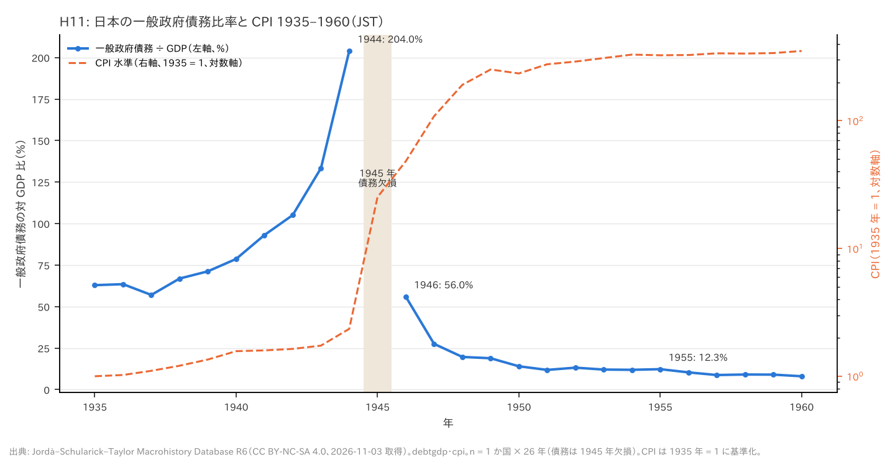
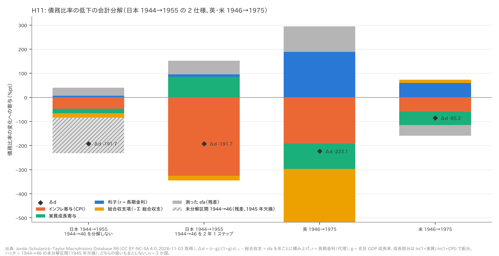
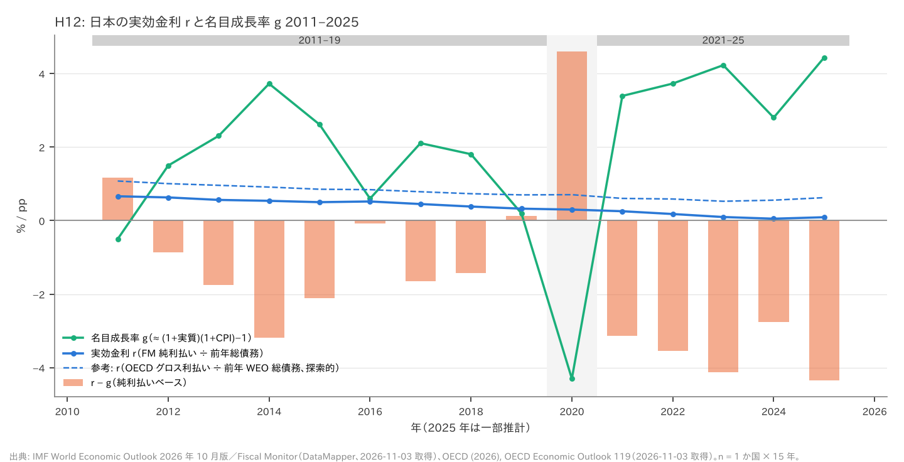
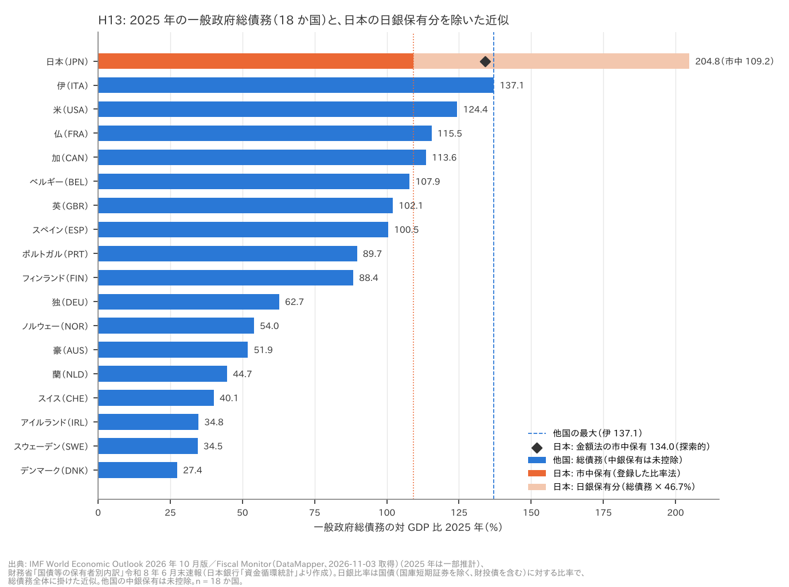
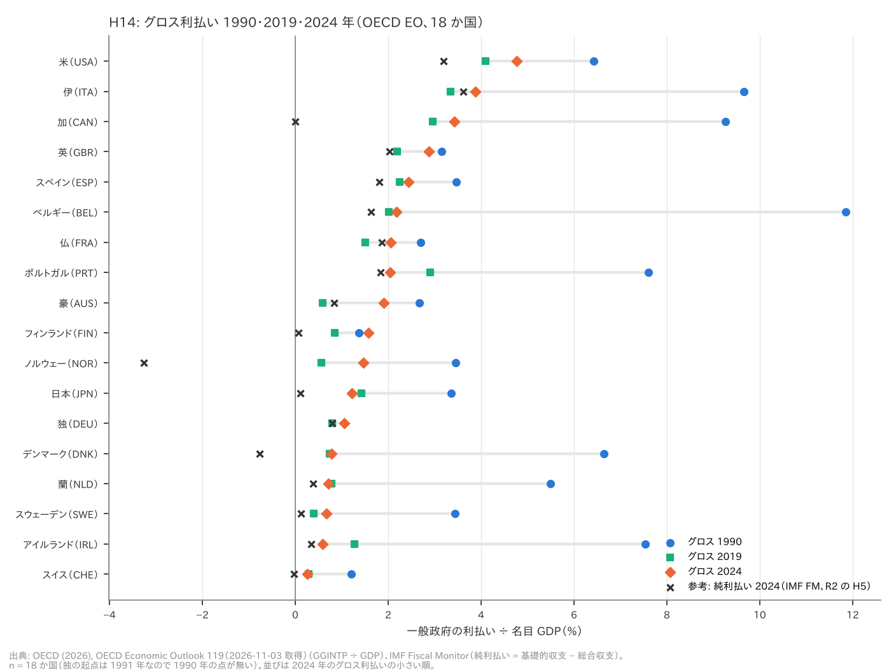

# R4: 日本の戦後の債務消滅、2019〜25 年の r − g、日銀保有を除いた市中保有、グロス利払い（H11〜H14、事後追加）（2026-11-03, theme: public-debt）

## 要約（記述と会計分解のみ。因果の主張はしない）
H11〜H14 は R1〜R3 の後に立てた**事後追加**の仮説で、事前登録の H1〜H6 と同じ重みでは読まない。判定は設計書の閾値どおり。

- **H11 の判定は 1944 → 1946 年の扱いに依存する（分解しない: 中間／2 年 1 ステップ: 整合）。どちらを主にするかの規則は設計書に無かった。** JST の日本の債務比率は 1944 年 204.0% から 1955 年 12.3% へ 191.7 pt 下がった。1945 年は欠損している。
  - 1944 → 1946 年を 2 年 1 ステップで分解すると、成長部分全体（名目 GDP の膨張）が低下幅の 1.25 倍になる。ln 比で配分したインフレ寄与は 1.70 になるが、これは逆算した実質成長が −68% になるためで、CPI と GDP デフレータのずれによる人工物の可能性が高い。
  - 1944 → 1946 年を分解しない場合、その 148.0 pt（低下幅の 0.77）は構成上そのまま残差に入る。判定は中間（残差 0.60 = 未分解区間 0.77 + 測った sfa −0.17、インフレ 0.25）になる。
  - 分けて測れる 1946 → 1955 年（43.7 pt）では、会計上インフレが最大の寄与（低下幅の 1.08 倍）だった。
- **H12 は整合。** IMF の日本では、2021〜2025 年の 5 年すべてで r − g < 0 だった（−2.75〜−4.35 pp）。平均 (g − r) は 2011–19 年の 1.09 pp から 2021–25 年の 3.58 pp に広がった。r は平均 0.51% から 0.14% に下がり、g は 1.60% から 3.72% に上がった。OECD のグロス利払いで r を作り直しても整合（0.72 → 3.14 pp、探索的）。
- **H13 は不支持（首位ではない）。** 日銀の国債保有額を名目 GDP で割って総債務から引く金額法では、日本の市中保有は約 134%（探索的）。他国の未修正の総債務と並べると、伊（137.1%）に次ぐ 2 位で、差は 3 pt。登録した簡便法（総債務 204.8% ×（1 − 日銀比率 46.7%））では 109.2% で 5 位だが、この近似は控除が過大になる向きにある（金額法より 24.8 pt 多く引く）。どちらの方法でも首位ではないので、登録済みの判定（不支持）は同じである。ただし金額法にも偏りが残る（日銀の国庫短期証券の保有、他国の中銀保有はどちらも未控除）。伊との差 3 pt は、この不確実性の範囲内である。
- **H14 は整合。** OECD のグロス利払い対 GDP 比で H5 を再判定すると、前半（2019 年が起点の半分以下）13 / 18、後半（2024 年 > 2019 年）13 / 18。R2 の純利払い（IMF FM）による H5 は中間（11 / 18・7 / 18）だった。グロスで測ると、2022 年以降の上昇が過半の国に現れる。日本はグロスでも後半を満たさない（2019 年 1.43% → 2024 年 1.23%）。日本の 2024 年はグロス 1.23%、利子受取 1.34%、OECD の純利払いは −0.12% だった。

## 問いと仮説
`design/themes/public-debt.md` の節「事後追加（2026-11-03 夜、R4。…R1〜R3 の結果を見た後に立て、追加データ（OECD Economic Outlook のグロス利払い、財務省の国債保有者別内訳）を見る前に固定。JST の日本 1940〜56 年の債務比率・CPI・名目成長率と、IMF の日本 2019〜25 年の値は R4 の設計時に一覧した（自己申告））」から引用する。

- **H11**: 「JST の日本について 1944 → 1946 年（1945 年欠損）と 1946 → 1955 年の Δd を、R1 と同じ恒等式で (r − g) 項・総合収支項・残差に分け、さらに (r − g) 項を インフレ寄与（CPI 上昇）と実質成長寄与（名目成長 − CPI 上昇）に分ける。判定: 1944 → 1955 年の低下（約 190 pt）のうち、インフレ寄与が半分以上なら整合、実質成長寄与か総合収支項の方が大きければ不支持。残差（通貨改革・預金封鎖・GDP 改定）が半分以上なら『分解できない（帳簿上の消滅）』として中間。同じ分解を英国（1946 → 1975）と米国（1946 → 1975）に当て、日本と向きを比べる（記述）。」
  - 設計書の「逸脱の記録（2026-11-03、R4 のレビュー後）」: 1944 → 1946 年の扱いは設計書で決めていなかった。H11 は**どちらの扱いも主とせず**、「判定は 1944→46 年の扱いに依存（分解しない: 中間／2 年 1 ステップ: 整合）」と報告する。表の「残差」は「未分解区間」と「測った sfa」に分ける。
- **H12**: 「IMF の純利払い ÷ 前年債務（r）と名目成長率の近似（g）で、2021〜2025 年の各年に r − g < 0 であり、かつ 2021〜25 年平均の (g − r) が 2011〜19 年平均より大きければ整合。どちらかが崩れれば不支持。副: 2025 年は推計。純利払いの偏りの向き（r を過小）を明記。」
- **H13**: 「財務省『国債等の保有者別内訳』の最新版 1 時点から日本銀行の保有比率 s を取り、市中保有の一般政府総債務比率 ≒ 総債務（WEO、同年）×（1 − s）を出す（近似。登録時は『過小修正』と書いたが誤り。比率 s を総債務全体に掛けると国債以外の債務（地方債・借入金・T-Bill）からも差し引くので過大に差し引き、市中保有を過小評価する。R4 で訂正、2026-11-03。金額ベース（日銀保有額 ÷ 名目 GDP を引く）を検算として併記する）。判定: この市中保有比率でも日本が 18 か国の総債務（他国は未修正）で首位なら『日銀を除いても首位』で H6(b) の後半（どの定義でも首位）は整合、首位でなければ不支持。他国の中銀保有は未採用なので片側だけの比較であることを明記。」
- **H14**: 「OECD Economic Outlook の一般政府グロス利払い（GGINTP）÷ 名目 GDP で、R2 の H5 を同じ閾値・同じ年（起点 1990、2019、2024）で再判定する。判定は H5 と同じ（前半 ≥ 10 かつ後半 ≥ 10 で整合、前半のみで中間）。あわせて、グロスと純の差（利子受取）が日本で何 pt かを記述。」
- 共通: 「因果は主張しない。H11 の『インフレで消した』は会計上の分解であり、政策意図（金融抑圧）は文献の見立てとして分けて書く。」

推定したい量: 国を単位とした記述的な国数・順位・平均と、会計恒等式による寄与の配分。因果効果は推定しない。

**事後追加であることの具体的な意味**: 設計書の自己申告どおり、JST の日本 1940〜56 年の債務比率・CPI・名目成長率と、IMF の日本 2019〜25 年の値は、基準を決める前に一覧されていた。H11 と H12 は、結果の向きをある程度知ったうえで立てた仮説である。H13 の日銀比率と H14 の OECD グロス利払いは、基準の固定後に mart に入った。ただし、WEO の総債務（H13 の分母）と FM の純利払い（H14 の比較対象）は R2 で見ている。設計書への登録と追加データの取得が同じ作業日に行われたため、「データを見る前に固定した」は git の履歴では確かめられない。

**事前登録（設計書の R4 節）に無い決定**（いずれも本 report で初めて決めた）:
1. **H11 の 1944 → 1946 年の扱い（どちらも主としない）**: 1945 年は債務比率・名目 GDP・総合収支が欠損し、1946 年の名目 GDP 成長率も欠損している（前年が無い）。年次の恒等式はこの区間に使えないので、次の 2 通りを出した。
   - **分解しない**: この区間の Δd（−148.0 pt）を分解せず、全部を「未分解区間」に入れる。1946 → 1955 年は年ごとに分解する（t = 1947〜1955 の 9 年。欠損年なし）。
   - **2 年 1 ステップ**: 逸脱 2 のとおり。
   - 経緯: 初版では「分解しない」を主仕様にした。これは設計書ではなく作業指示の推奨によるものだった。設計書の文言（「1944 → 1946 年の Δd を恒等式で分ける」）は、むしろ 2 年 1 ステップで分解する読みに近い。また「分解しない」扱いでは、148/192 = 0.77 が構成上残差に入り、判定（中間）をほぼ決めてしまう。methodology-reviewer の指摘を受け、どちらも主としないことにした。この逸脱は設計書の H11 に日付付き（「逸脱の記録（2026-11-03、R4 のレビュー後）」）で記録済みである。
2. **H11 の 2 年 1 ステップの入力**: 1944 → 1946 年を 2 年 1 ステップで分解した。入力は次のとおり。1945 年は補間していない。
   - 名目成長率 G: JST の名目 GDP 水準の比 1946/1944（staged の `gdp`）。555.2%。
   - インフレ Π: CPI 水準の比 1946/1944（staged の `cpi`）。1951.3%。
   - 実効金利 R: 長期金利の 1945・1946 年の複利。7.51%。
   - 総合収支: 1946 年の値 +0.75% を 2 回分（+1.51%）。1945 年は欠損。
   - 「1946 年の年率で 2 回」という置き方は、g の 1946 年が欠損しているので使えなかった。代わりに水準の比を使った。総合収支の置き方（× 2、× 1、0）で判定が変わらないことは頑健性表に示した。
3. **mart 以外の入力**: 2 年 1 ステップの G・Π は `data/staged/jst/macrohistory.parquet` の水準から計算した。mart は成長率しか持たず、1946 年の成長率が欠けているためである。H13 の金額ベースの検算（探索的）には `data/staged/mof/jgb_holders.parquet`（保有額、億円）と `data/staged/oecd/eo_interest.parquet`（名目 GDP、円）を使った。どれもパイプラインの出力で、手では変えていない。
4. **H11 の配分規則**: (r−g) 項 = Σ(r − g)/(100 + g)·d₋₁ を、「利子」r/(100 + g)·d₋₁ と「成長」−g/(100 + g)·d₋₁ に分けた。さらに成長の部分を ln(1 + 実質成長) : ln(1 + CPI 上昇) の比で、実質成長とインフレに配分した（R3 の `split_rg` と同じ規則）。実質成長は (1 + g)/(1 + π) − 1 で、名目 GDP 成長率と CPI から逆算した。
   - 「インフレ寄与」はこの配分によるインフレの部分である。
   - 利子の部分（債務を増やす向き）は、設計書の 3 分類（インフレ・実質成長・総合収支）のどれにも入らない。割合の表では別の列に置いた。
5. **H11 の割合と判定の順序**: 各寄与 ÷ Δd を「低下幅に対する割合」とした（正 = 低下に寄与。全項目の和は 1）。設計書の「残差」は、「未分解区間（1944→46）」と「測った sfa」の和として 2 列に分けて示す（判定は和で行う）。設計書の 3 条件は同時に満たされうるが、評価の順序は書かれていない。本 report は次の順に評価した。
   - (i) インフレ ≥ 0.5 → 整合
   - (ii) 残差 ≥ 0.5 → 中間
   - (iii) 実質成長か総合収支項がインフレより大きい → 不支持
   - (iv) どれでもない → 中間
   (i) を先に置いたのは、設計書の記載順に従ったためである。どちらの扱いでも、順序を変えても結論は同じになる。「分解しない」はインフレ 0.25 で (i) を満たさず、残差 0.60 で (ii) に当たる。総合収支 0.09 と実質成長 0.10 はインフレより小さいので、(iii) にも当たらない。「2 年 1 ステップ」は残差が負（−0.30）で、インフレ 1.70 は他のどの寄与よりも大きい。
6. **H11 の英・米**: 設計書は「記述」としている。判定はしないが、比較のために同じ規則を機械的に当てた結果を参考として表に載せた。
7. **H12 の操作化**: r_t = FM 純利払い_t ÷ WEO 総債務_{t−1} × 100、g_t = (1 + 実質成長)(1 + CPI) − 1。R3 と同じ定義で、関数（`rate_series`・`nominal_growth_series`・`period_mean`）も R3 のものを使った。2021〜2025 年の 1 年でも欠ければ (a) は満たさない扱いにした（実際には欠けた年は無い）。
8. **H13 の年と比率**: 日銀比率は 2026 年 6 月末（速報）の国債（国庫短期証券を除き、財投債を含む）に対する比率。設計書の「同年」の総債務には、最も近い WEO の実績年である 2025 年（一部推計）を使い、2024 年を併記した。同値は首位に含める（実際には同値は無い）。
9. **H13 の近似の向き（訂正済み）**: 登録時の文言は「過小修正」だったが、R4 で訂正した（設計書、2026-11-03）。(1 − s) を総債務全体に掛けると、日銀がほとんど持たない国債以外の債務（地方債・借入金など）からも s の割合を差し引く。そのため控除は**過大**になり、市中保有は**過小**に出る。金額による検算（探索的、後述）でも、控除は 24.8 pt 過大だった。判定の閾値と式は登録どおりに使い、金額法を検算として併記した。
10. **H14 の起点**: mart では、独のグロス利払いは 1991 年から始まっている（他の 17 か国は 1990 年から）。R2 と同じ規則（1990 年以降で最初に値のある年）で、独だけ 1991 年を起点にした。H5 の「前半を満たさなければ不支持」は R2 の補完ルールをそのまま使った（`judge_h5`・`h5_counts` を import）。
11. **頑健性の追加仕様はすべて探索的・事後**である。H11 の総合収支を基礎的収支に近似する仕様（R1 の `impute_primary` と同じ式）、2 年 1 ステップの総合収支の置き方、1946 → 1955 年だけの割合、成長部分全体の割合。H12 の 2021–24 年、OECD グロス利払いによる r。H13 の金額ベース。H14 の後半 2023・2025 年、中間年 2021、起点 2001、OECD 純利払い。

## データ
| 変数 | 出典 | 定義・単位 | 期間・国 | 備考（欠損・断絶） |
|---|---|---|---|---|
| 債務比率 d（H11） | JST R6 `debtgdp`、source `jst`、general_gov_gross/debt_gdp | 対 GDP %。概ね一般政府、国・時代により中央政府 | 日本 1935–1960、英・米 1946–1975 | 日本 1945 年は欠損。1944 年 204.0%、1946 年 56.0%、1955 年 12.3% |
| r（H11） | JST `ltrate`、macro/ltrate | 名目長期金利 % | 同上 | 実効金利ではなく代理。金融抑圧期は実効金利がさらに低いとみられ、利子の寄与（正）を過大に、(r−g) 項の負を過小に出す向き |
| g（H11） | JST `gdp` の前年比、macro/ngdp_growth | 名目 GDP 成長率 % | 同上 | 日本は 1945・1946 年が欠損（1945 年の GDP が無い） |
| CPI 上昇率（H11） | JST `cpi` の前年比、macro/cpi_inflation | % | 同上 | 日本 1945 年 975.6%、1946 年 90.7%、1947 年 125.3% |
| 総合収支（H11 の pb） | JST (`revenue` − `expenditure`) ÷ `gdp`、general_gov_gross/fiscal_balance_gdp | 対 GDP %、黒字が正。**利払い込み** | 同上 | 基礎的収支ではない（R1 と同じ代理）。日本は 1935〜1960 年の全年で黒字（戦時の 1941〜44 年も +1.0〜+2.3%）になっている（後述の限界） |
| 名目 GDP・CPI 水準（H11 の 2 年 1 ステップ） | `data/staged/jst/macrohistory.parquet` の `gdp`・`cpi` | 水準 | 日本 1944・1946 年 | 1944 → 1946 年の 2 年変化の計算にだけ使った |
| 総債務（H12・H13） | IMF WEO 2026 年 10 月版 `GGXWDG_NGDP`、`imf_weo` | 一般政府、対 GDP % | 1980–2025、18 か国 719 国・年 | 2025 年は一部推計。日本 2024 年 213.6%、2025 年 204.8% |
| 実質成長率・CPI（H12） | WEO `NGDP_RPCH`・`PCPIPCH` | % | 1980–2025 | g は CPI による近似（GDP デフレータではない） |
| 純利払い（H12・H14 比較） | IMF FM（基礎的財政収支 − 総合収支）、`imf_fm`/interest_gdp | 利払い − 利子受取、対 GDP % | 1990–2025、626 国・年 | 純利払いなので r を過小に出す |
| グロス利払い・利子受取・純利払い（H12 副・H14） | OECD Economic Outlook 119 `GGINTP`・`GGINTR`・`GNINTP` ÷ `GDP`、`oecd_eo` | 一般政府、対 GDP %（現地通貨を同年の名目 GDP で割る） | 1990–2025、18 か国 647 国・年 | 独は 1991 年から。2025 年は推計を含む。SNA ベースで IMF FM とは定義・版が違う |
| 日銀保有比率 s（H13） | 財務省「国債等の保有者別内訳」令和 8 年 6 月末速報（日本銀行「資金循環統計」より作成）、`mof_holdings`/jgb_holders/share_boj | 国債（国庫短期証券を除き、財投債を含む）に占める日銀保有 % | JPN、1 時点（year = 2026） | 46.7%。過去時点は取れない（URL の中身が四半期ごとに差し替わる） |
| 日銀保有額・国債合計（H13 探索） | `data/staged/mof/jgb_holders.parquet` の `amount_oku_yen` | 億円 | 2026 年 6 月末 | 日銀 4,700,401 億円、合計 10,065,133 億円 |
| 名目 GDP（H13 探索） | `data/staged/oecd/eo_interest.parquet` の `ngdp_lcu` | 円 | 日本 2025 年 | 663.4 兆円（推計を含む） |

mart: `data/marts/public_debt_panel.parquet`（114,670 行、6 列: iso3 str, year int64, unit str, metric str, value float64, source str。long 形式）。R4 は JST 18 か国の上表の系列だけを使う。
- 生成: `uv run socioscope run public-debt fetch && ... stage && ... mart`。raw の取得は 2026-11-03、manifest は `data/raw/manifest.jsonl`。
- 出典表記:
  - JST: Jordà, Schularick & Taylor (2017), "Macrofinancial History and the New Business Cycle Facts", NBER Macroeconomics Annual 2016（CC BY-NC-SA 4.0、非商用）。
  - Source: International Monetary Fund, World Economic Outlook (October 2026) / Fiscal Monitor, https://www.imf.org/external/datamapper 。IMF データの商用再利用には事前許可が要る。
  - OECD (2026), OECD Economic Outlook 119, https://sdmx.oecd.org (accessed 2026-11-03)。
  - 財務省「国債等の保有者別内訳」（日本銀行「資金循環統計」より作成）、政府標準利用規約（第 2.0 版）。
- 欠損は補完していない（日本 1945 年も補間していない）。

## 方法
記述統計と、債務動態の会計恒等式による分解だけを使う。回帰はせず、標準誤差も出さない（1〜18 か国という母集団全体の記述）。乱数は使わない。

- **H11 の分解**: 年ごとに Δd_t = (r_t − g_t)/(100 + g_t)·d_{t−1} − pb_t + sfa_t を計算し、期間で足し上げる。
  - 計算は R1 の `decompose_debt_change` に JST の系列を渡す（`decompose_jst`）。
  - pb は総合収支（黒字が正）。「総合収支項」= −Σ総合収支。負なら債務を減らす向き。
  - 内訳は `split_rg_jst`（逸脱 4）。分解する年は `decompose_jst` と同じにしたので、利子 + 実質成長 + インフレ + 未配分 = (r−g) 項が必ず成り立つ。未配分は CPI が欠けて配分できない年の成長部分で、実際には 0 だった。R3 の `split_rg` と同じ値になることをテストで確かめた。
  - 「分解しない」扱いは「1944 → 1946 年の未分解区間」と「1946 → 1955 年の年ごとの分解」を `chain` でつないだ。「2 年 1 ステップ」扱いは「2 年 1 ステップ」（`decompose_multi_year`・`split_multi_year`）と同じ 1946 → 1955 年をつないだ。
  - 恒等式 Δd = (r−g) 項 + 総合収支項 + 測った sfa + 未分解区間 が閉じることを、テストと、スクリプト内の assert（誤差 < 1e-9）で確かめた。sfa = 0 の合成系列から Δd を再現できることもテストで固定した。
- **H12**: 年ごとに r・g・r − g を出し、`judge_h12` で (a) 2021〜2025 の各年 r − g < 0、(b) 平均 (g − r) の比較 を判定する。
- **H13**: 日本だけ 総債務 ×（1 − s）に置き換え、18 か国の WEO 総債務と並べて順位を出す（`market_held`・`judge_h13`）。探索的に、日銀の保有額 ÷ 名目 GDP（`boj_holdings_gdp`）を総債務から引く金額ベースの値も出した。
- **H14**: R2 の `h5_counts`・`judge_h5` を、OECD のグロス利払いにそのまま当てた。
- **出力**: 表と判定は、スクリプトの標準出力（`reports/r4_output.md`）からそのまま写した。2 回実行して出力が一致することを確かめた。

## 結果

### H11: 日本 1944 → 1955 年（判定: 1944→46 年の扱いに依存。分解しない: **中間**／2 年 1 ステップ: **整合**）

どちらを主にするかの規則は設計書に無かった（逸脱 1）。以下、2 つの扱いを同じ重みで並べる。





入力（日本、JST）。単位: d・総合収支は対 GDP %、r・g・CPI は %。

| 年 | d | r = 長期金利 | g = 名目 GDP 成長率 | CPI 上昇率 | 総合収支 |
|---|---|---|---|---|---|
| 1943 | 133.4 | 3.77 | 17.4 | 6.0 | +2.28 |
| 1944 | 204.0 | 3.76 | 16.7 | 35.3 | +1.56 |
| 1945 | – | 3.69 | – | 975.6 | – |
| 1946 | 56.0 | 3.69 | – | 90.7 | +0.75 |
| 1947 | 27.5 | 3.69 | 176.2 | 125.3 | +0.64 |
| 1948 | 19.7 | 5.54 | 99.1 | 75.9 | +1.71 |
| 1949 | 18.9 | 5.51 | 29.5 | 31.9 | +1.70 |
| 1950 | 14.0 | 5.50 | 16.9 | −6.9 | +2.05 |
| 1951 | 11.9 | 5.50 | 37.9 | 18.0 | +2.59 |
| 1952 | 13.2 | 5.50 | 14.2 | 5.0 | +3.19 |
| 1953 | 12.1 | 10.18 | 12.9 | 6.6 | +2.79 |
| 1954 | 11.9 | 6.32 | 11.1 | 6.4 | +1.79 |
| 1955 | 12.3 | 8.60 | 10.2 | −1.2 | +1.22 |

分解（pt。負 = 債務比率を下げる向き）。

| 1944→46 年の扱い | 区間 | Δd | インフレ | 実質成長 | 利子 | (r−g) 項 計 | 総合収支項 | 測った sfa | 未分解区間 |
|---|---|---|---|---|---|---|---|---|---|
| 分解しない: 1944→46 | 1944→1946 | −148.0 | 0 | 0 | 0 | 0 | 0 | 0 | −148.0 |
| 2 年 1 ステップ: 1944→46 | 1944→1946 | −148.0 | −277.8 | +104.9 | +2.3 | −170.5 | −1.5 | +24.0 | 0 |
| 共通: 1946→55 を年ごと（9 / 9 年） | 1946→1955 | −43.7 | −47.3 | −18.5 | +7.2 | −58.6 | −17.7 | +32.6 | 0 |
| **分解しない: 1944→1955 計** | | **−191.7** | −47.3 | −18.5 | +7.2 | −58.6 | −17.7 | +32.6 | −148.0 |
| **2 年 1 ステップ: 1944→1955 計** | | **−191.7** | −325.0 | +86.4 | +9.5 | −229.1 | −19.2 | +56.6 | 0 |

低下幅（191.7 pt）に対する割合（正 = 低下に寄与。和 = 1）。

| 1944→46 年の扱い | 成長部分全体（名目 GDP の膨張） | うちインフレ | うち実質成長 | 利子 | 総合収支項 | 未分解区間（1944→46） | 測った sfa | 残差 計 | 判定 |
|---|---|---|---|---|---|---|---|---|---|
| 分解しない | 0.34 | 0.25 | 0.10 | −0.04 | 0.09 | 0.77 | −0.17 | **0.60** | **中間** |
| 2 年 1 ステップ | 1.25 | **1.70** | −0.45 | −0.05 | 0.10 | – | −0.30 | −0.30 | **整合** |
| 参考: 1946→1955 だけ（低下 43.7 pt、探索的・事後） | 1.50 | 1.08 | 0.42 | −0.16 | 0.40 | – | −0.75 | −0.75 | （整合に当たる） |

成長部分全体 = インフレ + 実質成長（いずれも ln 比で配分した値）。判定は設計書どおり、インフレの列と「残差 計」で行う。

- **2 年 1 ステップ（整合）**: 1944 → 1946 年に名目 GDP は約 6.6 倍、CPI は約 20.5 倍になった。この 2 年の (r−g) 項 −170.5 pt は、Δd −148.0 pt より大きい。まず成長部分全体（名目 GDP の膨張）で見ると、1944 → 1955 年の低下幅の 1.25 倍にあたる。この値は実質とインフレの配分に依存しない。
  - ln 比で配分すると、インフレ寄与は 1.70、実質成長は −0.45 になる。どちらも 1 を超える・負になるので、誤読しやすい。これは CPI（20.5 倍）が名目 GDP（6.6 倍）を大きく上回り、逆算した実質成長が −68% になるためである。この −68% は、CPI と GDP デフレータのずれ（闇価格・公定価格の扱い、統計の断絶）による人工物の可能性が高い。インフレ寄与 1.70 という数字そのものには意味を持たせない。成長部分全体 1.25 のうちインフレが半分以上を占めることは、実質成長が −68% より大きい（例えば 0 付近）とみなしても変わらない。
- **分解しない（中間）**: 1944 → 1946 年の 148.0 pt（低下幅の 0.77）は、未分解区間として構成上そのまま残差に入る。測った sfa（1946 → 1955 年）は −0.17 で、残差の計は 0.60（閾値 0.50）。インフレ寄与は 0.25 で、閾値に届かない。成長部分全体を全部インフレに配分しても 0.34 で、閾値 0.5 に届かない。つまりこの扱いでは、配分の規則にかかわらず中間になる。判定を決めているのは「1944 → 1946 年を分解しない」という構成そのものである。
- **1946 → 1955 年（両方の扱いに共通）**: 低下 43.7 pt のうち、インフレ −47.3 pt（1.08 倍）が最大の寄与だった。実質成長 −18.5、総合収支 −17.7、利子 +7.2、sfa +32.6。年別では 1947 年（−28.4 pt のうちインフレ −28.6）と 1948 年（−7.9 のうち −11.2）に集中している。1950 年以降の低下は小さく、インフレの寄与も小さい（output の年別表）。
- **記事で言える上限**:
  - 1944 → 1946 年の 148 pt は、名目 GDP 約 6.6 倍・CPI 約 20 倍という分母の膨張で、算術的に説明できる大きさである。ただし同じ時期に、新円切替・預金封鎖（1946 年 2 月）、財産税、戦時補償の打ち切り（戦時補償特別税）が重なっている。年次データでは、これらと分母の膨張を分けられない。
  - 分けて測れる 1946 → 1955 年の 44 pt については、会計上インフレが最大の寄与だった。
  - 「返済ではなく」は付けない。JST の日本の戦時の総合収支は黒字になっており（限界を参照）、収支の側の数字の信頼性が低いからである。
- **英国・米国 1946 → 1975 年（記述）**

  | 国 | Δd | インフレ | 実質成長 | 利子 | 総合収支項 | sfa | 割合: インフレ / 実質 / 収支 / 残差 |
  |---|---|---|---|---|---|---|---|
  | 英 | −223.1（269.8 → 46.7） | −192.2 | −104.8 | +189.5 | −221.1 | +105.4 | 0.86 / 0.47 / 0.99 / −0.47 |
  | 米 | −85.3（118.9 → 33.6） | −59.7 | −54.9 | +59.9 | +13.7 | −44.3 | 0.70 / 0.64 / −0.16 / 0.52 |

  - どちらも 29 / 29 年分解できた。H11 の規則を機械的に当てると、どちらもインフレ ≥ 0.5 に当たる（参考、判定しない）。
  - 向きは日本と違う。英国は 30 年かけて下げ、インフレ（0.86）と総合収支の黒字（0.99）がどちらも大きい。長期金利による利子の寄与（+189.5）も大きく、日本のように残差が一気に動く年は無い。米国はインフレ（0.70）と実質成長（0.64）がほぼ同じ大きさで、総合収支は債務を増やす向き（+13.7）だった。
  - 日本は数年で消え、英米は 30 年かけて薄めた。速さが違う。

### H12: 日本の r − g 2011〜2025 年（判定: **整合**）



| 年 | d_{t−1} | 純利払い / GDP（FM） | r | g | r − g | 参考: グロス利払い / GDP（OECD） | 参考: r − g（グロス） |
|---|---|---|---|---|---|---|---|
| 2011 | 178.6 | 1.18 | 0.66 | −0.50 | +1.16 | 1.92 | +1.58 |
| 2012 | 190.6 | 1.20 | 0.63 | 1.50 | −0.87 | 1.92 | −0.49 |
| 2013 | 197.1 | 1.11 | 0.56 | 2.31 | −1.74 | 1.89 | −1.35 |
| 2014 | 201.2 | 1.08 | 0.54 | 3.73 | −3.19 | 1.84 | −2.81 |
| 2015 | 203.6 | 1.02 | 0.50 | 2.61 | −2.11 | 1.74 | −1.76 |
| 2016 | 200.1 | 1.04 | 0.52 | 0.60 | −0.08 | 1.69 | +0.24 |
| 2017 | 202.1 | 0.91 | 0.45 | 2.11 | −1.66 | 1.59 | −1.32 |
| 2018 | 203.1 | 0.78 | 0.38 | 1.81 | −1.42 | 1.49 | −1.08 |
| 2019 | 203.7 | 0.66 | 0.33 | 0.20 | +0.13 | 1.43 | +0.50 |
| 2020 | 206.3 | 0.62 | 0.30 | −4.30 | +4.60 | 1.46 | +5.01 |
| **2021** | 228.8 | 0.59 | 0.26 | 3.39 | **−3.14** | 1.38 | −2.79 |
| **2022** | 222.6 | 0.40 | 0.18 | 3.73 | **−3.55** | 1.31 | −3.14 |
| **2023** | 228.0 | 0.22 | 0.10 | 4.23 | **−4.13** | 1.20 | −3.70 |
| **2024** | 220.1 | 0.12 | 0.05 | 2.80 | **−2.75** | 1.23 | −2.25 |
| **2025（一部推計）** | 213.6 | 0.20 | 0.09 | 4.44 | **−4.35** | 1.34 | −3.81 |

単位: d は対 GDP %、利払いは対 GDP %、r・g は %、r − g は pp。

- (a) 2021〜2025 年の 5 年すべてで r − g < 0。
- (b) 平均 (g − r) は 2011–19 年 1.09 pp、2021–25 年 3.58 pp で、広がった。**判定: 整合。**
- 平均 r は 0.51% → 0.14% と下がり、平均 g は 1.60% → 3.72% と上がった。差が広がったのは、両方が動いた結果である。2022 年以降の金利上昇は、2024 年までの実効金利（純利払い ÷ 前年債務）にはまだ表れていない。2025 年（推計）に純利払いが 0.12% → 0.20% に上がったのが最初の兆しである。
- 純利払いは r を過小に出す（偏りの向き）。グロス利払いで r を作り直しても、(a) は 5 / 5 年で満たし、平均 (g − r) は 0.72 → 3.14 pp と広がる（探索的・事後）。グロスの実効金利は 2021〜25 年で 0.53〜0.63% だった。
- R3 の H8 では、2021–24 年に日本の (r−g) 項は −29.5 pt で、基礎的赤字（pb 項 +13.2）を上回って比率を下げた。H12 はその年次の背景にあたる。

### H13: 日銀保有を除いた市中保有（判定: **不支持**。金額法では約 134% で伊に次ぐ 2 位〈差 3 pt〉、登録した比率法では 5 位）



- **金額法（探索的・事後、先に示す）**: 日銀の国債保有額 470.0 兆円（2026 年 6 月末）÷ 名目 GDP 663.4 兆円（OECD、2025 年）= 70.8%。2025 年の総債務 204.8% から引くと、市中保有は **134.0%** になる。他国の未修正の総債務と並べると、伊（137.1%）に次ぐ **2 位**で、差は 3.1 pt。
- **登録した比率法**: 204.8% ×（1 − 0.467）= 109.2%（控除 95.6 pt）で 5 位。この簡便法は控除が過大になる向きの近似で、金額法より 24.8 pt 多く引く（逸脱 9）。2024 年（併記）は 213.6% × 0.533 = 113.8% で 3 位（伊 134.7%、米 122.3% が上）。

2025 年の順位（比率法）:

| 順位 | 国 | 値（%） | 備考 |
|---|---|---|---|
| 1 | 伊 | 137.1 | 総債務（未修正） |
| 2 | 米 | 124.4 | 総債務（未修正） |
| 3 | 仏 | 115.5 | 総債務（未修正） |
| 4 | 加 | 113.6 | 総債務（未修正） |
| **5** | **日本** | **109.2** | **市中保有（比率法）。金額法なら 134.0 で 2 位** |
| 6 | ベルギー | 107.9 | 総債務（未修正） |
| 7 | 英 | 102.1 | 総債務（未修正） |
| 8 | スペイン | 100.5 | 総債務（未修正） |

- **判定: 不支持。** 登録済みの判定（首位なら整合、首位でなければ不支持）は、比率法でも金額法でも同じ（首位ではない）である。
- 比率法で日本が首位に残るには、日銀比率が 33.1%（2025 年）・36.9%（2024 年）以下である必要がある（他国は未修正のまま）。
- **金額法に残る偏りと不確実性**:
  - 国債（T-Bill を除く）全体は 1,006.5 兆円（GDP の 151.7%）。WEO の総債務 204.8% との差 53.1 pt は、国債以外の債務と定義差（額面と評価方法の違いを含む）である。
  - 日銀は国庫短期証券も保有しているが、本データには無く、控除していない。控除すれば日本の値は下がる。
  - 保有の時点（2026 年 6 月末）と GDP の年（2025 年）がずれている。名目 GDP が 4.7% 大きければ、日本は首位になる。
  - 他国の中央銀行保有も控除していない（次項）。
  - これらの偏りの大きさと向きは揃っていない。伊との差 3 pt は、この不確実性の範囲内である。「首位ではない」は登録した規則の結果だが、「市中保有では伊の方が重い」とまでは言えない。
- **片側の比較**: 他国の中央銀行保有（ユーロシステムの PSPP・PEPP、FRB、イングランド銀行の APF など）は控除していない。他国も控除すれば他国の値は下がるので、この比較は日本に不利な向きである。設計書もこの点を明記している。
- **H6(b) との関係**: R2 の H6(b)（純債務と市中保有の両方で日本の順位が下がる）は不支持だった。この判定は変わらない。R2 は (b) を連言と読み、純債務で順位が下がらない時点で不支持になっている。H13 が加えたのは、市中保有の側の答えである。日本の順位は 1 位から、金額法で 2 位、比率法で 5 位（2024 年は 3 位）に下がり、「どの定義でも首位」とは言えない。ただし 2 位との差は不確実性の範囲内で、他国を修正すれば順位は戻りうる。
- 設計書の落とし穴のとおり、統合政府で見ると、日銀保有の国債は付利の当座預金という別の負債に置き換わっている。市中保有比率は「利上げ時の負担」を見る補助指標で、債務が消えたことを意味しない。

### H14: グロス利払いで H5 を再判定（判定: **整合**。前半 13 / 18、後半 13 / 18）



表は 2024 年のグロス利払いの大きい順。単位は対 GDP %。

| 国 | 起点年 | 起点 | 2019 | 2024 | 2025（推計） | 2019 / 起点 | 2019 ≤ 起点/2 | 2024 > 2019 | 参考: FM 純 2024 |
|---|---|---|---|---|---|---|---|---|---|
| 米 | 1990 | 6.43 | 4.10 | 4.77 | 4.72 | 0.64 | × | ○ | 3.19 |
| 伊 | 1990 | 9.66 | 3.34 | 3.88 | 3.86 | 0.35 | ○ | ○ | 3.61 |
| 加 | 1990 | 9.27 | 2.96 | 3.43 | 3.35 | 0.32 | ○ | ○ | 0.01 |
| 英 | 1990 | 3.15 | 2.19 | 2.88 | 3.28 | 0.70 | × | ○ | 2.02 |
| スペイン | 1990 | 3.47 | 2.25 | 2.43 | 2.39 | 0.65 | × | ○ | 1.81 |
| ベルギー | 1990 | 11.85 | 2.01 | 2.18 | 2.22 | 0.17 | ○ | ○ | 1.63 |
| 仏 | 1990 | 2.70 | 1.51 | 2.06 | 2.23 | 0.56 | × | ○ | 1.86 |
| ポルトガル | 1990 | 7.60 | 2.90 | 2.05 | 1.94 | 0.38 | ○ | × | 1.84 |
| 豪 | 1990 | 2.68 | 0.59 | 1.90 | 1.91 | 0.22 | ○ | ○ | 0.83 |
| フィンランド | 1990 | 1.37 | 0.85 | 1.57 | 1.64 | 0.62 | × | ○ | 0.07 |
| ノルウェー | 1990 | 3.46 | 0.56 | 1.46 | 1.48 | 0.16 | ○ | ○ | −3.26 |
| **日本** | 1990 | 3.36 | 1.43 | 1.23 | 1.34 | 0.42 | ○ | × | 0.12 |
| 独 | **1991** | 2.67 | 0.79 | 1.06 | 1.11 | 0.30 | ○ | ○ | 0.80 |
| デンマーク | 1990 | 6.65 | 0.74 | 0.78 | 0.81 | 0.11 | ○ | ○ | −0.77 |
| 蘭 | 1990 | 5.50 | 0.78 | 0.71 | 0.71 | 0.14 | ○ | × | 0.38 |
| スウェーデン | 1990 | 3.44 | 0.40 | 0.68 | 0.61 | 0.12 | ○ | ○ | 0.13 |
| アイルランド | 1990 | 7.53 | 1.27 | 0.58 | 0.46 | 0.17 | ○ | × | 0.34 |
| スイス | 1990 | 1.21 | 0.29 | 0.27 | 0.25 | 0.24 | ○ | × | −0.03 |

- 前半（2019 ≤ 起点 / 2）13 / 18。満たさないのは米・英・スペイン・仏・フィンランド。起点が 0 以下で定義できない国は無い（純利払いと違って、グロスは負にならない）。
- 後半（2024 > 2019）13 / 18。満たさないのはポルトガル・日本・蘭・アイルランド・スイス。**判定: 整合。**
- R2 の H5（IMF FM の純利払い）は前半 11 / 18、後半 7 / 18 で中間だった。R2 は「純利払いはグロスより上昇を小さく見せうる（未検証）」と書いていた。H14 の結果はこの見立てと整合する。後半が 7 → 13 か国に増えたのは、利子受取も金利とともに増え、純額の上昇を打ち消していた国があるためとみられる（加: グロス +0.47 pt、FM 純 −0.11 pt。ノルウェー・デンマーク・豪など）。ただし OECD と IMF FM は定義・版が違うので、差のすべてを利子受取に帰すことはできない。
- 18 か国中央値: 1990 年 3.47%、2007 年 2.16%、2019 年 1.35%、2022 年 1.26%、2024 年 1.74%、2025 年 1.78%。
- **日本のグロスと純**: 2024 年はグロス 1.23%、利子受取 1.34%、OECD の純利払い −0.12%（純利子受取）。グロス − 純 = 1.34 pt で、18 か国中 5 番目に大きい（ノルウェー 4.79、加 1.75、フィンランド 1.50、デンマーク 1.44 に次ぐ）。OECD で日本の純利払いが負なのは 2024・2025 年。IMF FM の純利払いは 2024 年 +0.12% で、符号が逆である。定義・版の違い（FM は基礎的収支と総合収支の差から導出、EO は SNA の利子の受払い）によるもので、どちらが正しいかは本データでは決められない。
  - **含意（記述）**: 一般政府は、年金積立金（GPIF など）や外為特会の外貨準備などの金融資産を持ち、その利子を受け取っている。グロスで 1.2% の利払いがあっても、利子の受払いを差し引くとほぼ 0 になる。H6(b)（R2）で、日本の総債務と純債務の差が 72.5 pt あったことと対応する。ただし資産側は外貨・株式など債務と性質が違う資産を含む。資産の利回りが金利上昇に追随するとは限らない（未検証）。配当は SNA の利子に入らないので、OECD の利子受取には含まれないとみられる（定義の確認は未実施）。
  - 日本のグロス利払いは 1990 年 3.36% → 2019 年 1.43% → 2024 年 1.23% → 2025 年 1.34%（推計）。前半は満たし、後半は満たさない。グロスで見ても、日本では 2024 年までに利払いの対 GDP 比の反転は起きていない。

### 「終焉」論はどの指標で支えられるか（R3 の表に H11〜H14〈R4、事後追加〉を加えたもの）

「判定」列は設計書の閾値による判定そのもの（H1〜H6 は事前登録、H7〜H14 は事後追加）。それ以外の見方は「補足」列に書く。

| 論の主張 | 対応する指標 | 判定 | 補足（事後・探索・別の読み方） |
|---|---|---|---|
| 「負債は増え続けてきた」（公的債務） | H2: 1945→1975 年の低下 | **中間**（10 / 18） | R1 参照 |
| 「いまの公的債務は歴史的に前例がない」 | H1 | **中間**（6 / 18）。2019 年の副判定は**整合** | R1 参照 |
| 「総負債（公的 + 民間）は前例のない水準」 | H3b | **不支持**（2019 年で 2 / 18） | R1・R2 参照 |
| シュトレーク: インフレ → 公的債務 → 家計債務 | H3 | **整合** | R1 参照 |
| 戦後の負債は「返済」より「成長・インフレ・低金利」で薄められた | H2b | **整合**（15 / 18） | R1 参照 |
| 水野: 名目利子率ゼロは前例がない | H4(a) | **不支持** | R1 参照 |
| 「r < g は 2010 年代に特有」 | H4(b) | **整合**（つまり「特有」とは言えない） | R1 参照 |
| 日本は先進国で最も終焉に近い | H6(a)・H6(b) | (a) **整合**、(b) **不支持**（純債務でも首位） | 市中保有は H13 を参照 |
| 利払いは 2010 年代に軽く、2022 年以降に反転 | H5（純利払い / GDP） | **中間**（前半 11 / 18、後半 7 / 18） | グロスでの再判定は H14 |
| 2010 年代: 薄める仕組みはあったが、基礎的赤字が打ち消した（事後追加） | H7: 2010→2019 年の分解 | **中間**（(a) 15 / 18、(b) 6 / 18） | R3 参照 |
| 2021–24 年: 赤字のまま、インフレと成長で薄めた（事後追加） | H8: 2020→2024 年の分解 | **整合**（16 / 18、1.86、13 / 18）。副判定 2019→2024 年は**不支持**（(a) 6 / 18） | R3 参照 |
| シュトレーク (iv) の前半: 民間から国家へのバトン 2008–19（事後追加） | H9 | **不支持**（8 / 18） | R3 参照 |
| 金利が上がっても、歳入に対する利払いは 1990 年代より軽い（事後追加） | H10: 純利払い ÷ 歳入 | (a) **整合**（14 / 18）、(c) 2025 年も**整合** | R3 参照 |
| **日本は 1944 年の債務をインフレで消した**（事後追加） | H11: 1944→1955 年の分解 | 1944→46 年の扱いに依存（分解しない: **中間**／2 年 1 ステップ: **整合**）。どちらを主にするかの規則は設計書に無かった | 2 年 1 ステップの成長部分全体（名目 GDP の膨張）は 1.25 倍。分けて測れる 1946→55 年はインフレ 1.08 倍（探索的・事後）。1944→46 年の 148 pt は新円切替・預金封鎖・財産税・戦時補償打ち切りと分けられない。英・米 1946→75 年もインフレ ≥ 0.5（記述） |
| **金利上昇後も、日本の r − g は債務を薄める向きに強まった**（事後追加） | H12: 日本の r − g 2021–25 | **整合**（5 / 5 年 r < g、g − r 1.09 → 3.58 pp） | グロス利払いの r でも整合（探索的・事後）。2025 年は推計 |
| **日銀保有を除いても日本の債務は首位**（事後追加） | H13: 総債務 ×（1 − 日銀比率） | **不支持**（首位ではない。金額法で約 134%・伊に次ぐ 2 位〈差 3 pt〉、登録した比率法で 5 位） | 比率法は控除が過大になる向きの近似。金額法にも日銀の T-Bill・他国の中銀保有の未控除が残り、差 3 pt は不確実性の範囲内 |
| **利払いの反転はグロスでは過半の国に見える**（事後追加） | H14: OECD グロス利払いで H5 を再判定 | **整合**（前半 13 / 18、後半 13 / 18） | 日本は後半を満たさない（1.43 → 1.23%）。OECD の純利払いでは中間（12 / 7、探索的・事後） |
| 政治的な債権者優位、中央銀行 | H3(iv)・（数値化しない） | 対象外 | このレポートでは判断できない |

H11〜H14 の判定を並べると、次のようになる。
- 日本の 1944 年の債務が消えたことの判定は、1944 → 1946 年の扱いに依存する（分解しない: 中間／2 年 1 ステップ: 整合）。分けて測れる 1946 年以降は、インフレによる会計上の薄まりと整合する（H11）。
- 2021〜25 年の日本では、r と g の差は 2010 年代より債務を薄める向きに広がった（H12 整合）。
- 日銀保有を除くと、日本は首位ではない（金額法で伊に次ぐ 2 位、差 3 pt）。ただし比較は片側だけで、差は不確実性の範囲内である（H13 不支持）。
- グロスの利払いで見ると、2024 年には 18 か国の過半で利払いが 2019 年より重くなった。日本はその中に入らない（H14 整合、日本は例外）。

どれも会計上の分解と記述であり、インフレや金利が債務を減らしたという因果を示すものではない。

## 頑健性
試した仕様をすべて挙げる。登録済みの判定（H11 は 1944 → 1946 年の 2 通りの扱い、H13 は比率法の 2025 年と併記の 2024 年）以外は、すべて**探索的・事後**である。判定の閾値は動かしていない。

**H11**

| 仕様 | インフレ割合 | 残差割合（未分解区間 + 測った sfa） | 判定 |
|---|---|---|---|
| 1944→46 を分解しない + 1946→55 を年ごと | 0.25 | 0.60（0.77 − 0.17） | 中間 |
| 1944→46 を 2 年 1 ステップ（総合収支 1946 年 × 2） | 1.70 | −0.30（– − 0.30） | 整合 |
| 2 年 1 ステップ、総合収支 1946 年 × 1（探索的・事後） | 1.70 | −0.29 | 整合 |
| 2 年 1 ステップ、総合収支 0（探索的・事後） | 1.70 | −0.29 | 整合 |
| 分解しない、総合収支を基礎的収支に近似（pb ≈ 総合収支 + r/(1+g)·d₋₁、探索的・事後） | 0.25 | 0.56 | 中間 |
| 1946→55 年だけ（探索的・事後） | 1.08 | −0.75 | （整合に当たる） |
| 1946→55 年だけ、基礎的収支に近似（探索的・事後） | 1.08 | −0.91 | （整合に当たる） |
| 成長部分全体（名目 GDP の膨張）の割合: 分解しない 0.34・2 年 1 ステップ 1.25（探索的・事後） | – | – | 分解しない扱いは配分によらず閾値未満 |

- H11 の判定を分けるのは、1944 → 1946 年を分解するかどうかの一点である。他の仕様では動かない。
- 英・米 1946 → 1975 年に基礎的収支の近似を当てると、インフレ割合は変わらない（0.86・0.70）。総合収支項が大きく動き（英 −221.1 → −410.6）、残差がそれを打ち消す。

**H12**

| 仕様 | (a) 各年 r−g<0 | 2021–25 平均 g−r | 2011–19 平均 g−r | 判定 |
|---|---|---|---|---|
| 主: FM 純利払い、2021–25 | ○ | 3.58 | 1.09 | 整合 |
| 2025 年（一部推計）を除く 2021–24（探索的・事後） | ○ | 3.39 | 1.09 | 整合 |
| OECD グロス利払い ÷ 前年 WEO 総債務（設計書の副、探索的） | ○ | 3.14 | 0.72 | 整合 |
| OECD グロス、2021–24（探索的・事後） | ○ | 2.97 | 0.72 | 整合 |

**H13**

| 仕様 | 日本の値 | 順位 | 判定 |
|---|---|---|---|
| 金額法: 2025 年総債務 − 日銀保有額 ÷ 名目 GDP（探索的・事後） | 134.0 | 2 / 18 | 不支持（伊と 3.1 pt 差。名目 GDP が 4.7% 大きければ首位） |
| 登録した比率法: 2025 年、総債務 × (1 − 0.467)（控除が過大になる向き） | 109.2 | 5 / 18 | 不支持 |
| 比率法、併記: 2024 年 | 113.8 | 3 / 18 | 不支持 |

**H14**

| 仕様 | 前半 | 後半 | 判定 |
|---|---|---|---|
| 主: OECD グロス、起点 1990（独 1991）/ 2019 / 2024 | 13 / 18 | 13 / 18 | 整合 |
| 後半 2019 vs 2025（推計、探索的・事後） | 13 / 18 | 13 / 18 | 整合 |
| 後半 2019 vs 2023（探索的・事後） | 13 / 18 | 11 / 18 | 整合 |
| 中間年 2021（探索的・事後） | 14 / 18 | 15 / 18 | 整合 |
| 起点を全国 2001 年（探索的・事後） | 10 / 18 | 13 / 18 | 整合 |
| OECD 純利払い（起点が 0 以下で定義不能 2、探索的・事後） | 12 / 18 | 7 / 18 | 中間 |
| 参考: IMF FM 純利払い（R2 の H5 主判定） | 11 / 18 | 7 / 18 | 中間 |

- H14 は、グロスで測る限りどの仕様でも整合である。純利払いにすると、OECD・IMF FM のどちらでも後半が 7 / 18 に落ちて中間になる。H5 の判定は、利払いの定義（グロスか純か）で決まる。データ源（OECD か IMF か）では決まらない。
- 起点を 2001 年にすると、前半は 10 / 18 で閾値ちょうどになる。前半の余裕は、1990 年代前半に利払いが重かった国（ベルギー 11.85%、伊 9.66%、加 9.27% など）に支えられている。

## 限界・言えないこと
- **因果は何も言えない。** 分解は会計恒等式による寄与の配分で、「インフレが債務を消した」という因果効果の推定ではない。
  - 「インフレで消した」は、名目 GDP の膨張が債務比率の分母を大きくしたという会計上の言い換えである。
  - 戦後日本のインフレを「金融抑圧」として債務削減のために使った（または容認した）という政策意図の解釈は、Reinhart & Sbrancia（2011/2015、"The Liquidation of Government Debt"）などの文献の見立てである。本 report の数字はそれを検証していない。インフレの原因（供給の崩壊、日銀引受の戦時国債、復興金融金庫の融資、価格統制の解除）も論じていない。
  - r・g・収支は同時に決まる。インフレは g を押し上げ、遅れて名目金利にも効く。
- **H11 の 1944 → 1946 年は年次データでは分解できない。**
  - 1945 年の債務・GDP が欠損している。1946 年には新円切替と預金封鎖（2 月）、財産税、戦時補償特別税（戦時補償債務の実質的な打ち切り）が重なる。「分解しない」扱いでは、これらと GDP 統計の断絶がすべて未分解区間（0.77）に入る。
  - 「2 年 1 ステップ」の分解は、2 年の累積で 1 回だけ恒等式を当てた近似である。2 年の途中の債務の動き（戦時の追加借入、終戦処理）は sfa（+24.0）に入る。
  - CPI（20.5 倍）が名目 GDP（6.6 倍）を大きく上回るため、逆算した実質成長は −68% になり、インフレの配分が大きく出る。この −68% は、CPI と GDP デフレータのずれ（闇市価格・配給価格の扱い、統計の断絶）による人工物の可能性が高い。成長部分全体の割合（1.25）は配分に依存しないので、本文ではこちらを先に示した。
- **H11 の r は長期金利で代理している。** 戦後日本の長期金利は、1952 年まで 3.7〜5.5% に固定的だった。実際の国債利回り・実効金利がこれと違えば、利子の寄与（+7.2 pt）も変わる。金融抑圧期は実効金利が低いとみられ、その場合は利子の正の寄与が過大で、(r−g) 項の負は過小になる（R1 と同じ向き）。
- **「返済ではなく」とは言えない。** 設計書の整合の言い換え（「返済ではなくインフレで消した」）のうち「返済ではなく」は、総合収支の数字の信頼性が低いので付けない（次項）。
- **H11 の pb は総合収支（利払い込み）で代理している**（R1 と同じ）。利子が (r−g) 項と総合収支項の両方に入るので、二重計上の分は残差に入る。基礎的収支に近似した仕様でも判定は変わらなかった。
  - JST の日本の総合収支は、1941〜44 年の戦時にも黒字（+1.0〜+2.3%）になっている。実際の戦費（臨時軍事費特別会計など）の赤字を捉えていない可能性が高い（JST の歳入・歳出の範囲は未確認）。戦後の黒字（1946〜55 年）も同じ範囲の数字なので、総合収支項 −17.7 pt の大きさは割り引いて読む。
- **H11 の英・米は記述で、日本と同じ精度ではない。** 英国は総合収支項（−221.1）と利子（+189.5）がどちらも大きく、残差 +105.4 で打ち消し合う。分解の信頼度は低い。JST の債務は国・時代により中央政府の値で（R1 参照）、英国・米国の一般政府とは範囲が違う可能性がある。
- **H12 は日本 1 か国の 15 年の記述である。**
  - r は純利払いから出しているので、グロスから出した r より低い（2021〜25 年で 0.3〜0.5 pp）。グロスでも判定は変わらなかった。
  - g は CPI による近似で、GDP デフレータとのずれの向きは年で違う。
  - 2025 年は一部推計。除いても判定は同じだった。
  - 実効金利は既発債の平均で、市場金利の上昇は満期の到来につれて遅れて効く。2025 年以降、r が上がって差が縮む可能性は H12 の範囲外である。
- **H13 は片側だけの近似比較である。**
  - 登録した比率法は控除が過大で、日本に不利な向き（逸脱 9。登録時の文言は「過小修正」で、R4 で訂正した〈設計書、2026-11-03〉）。このため金額法を先に示した。
  - 他国の中央銀行保有は控除していないので、こちらも日本に不利な向き。
  - 金額法でも、日銀の国庫短期証券の保有は控除していない（日本に有利な向き）。伊との差 3 pt は、これらの偏りの範囲内である。「日本は首位ではない」は登録した規則の結果だが、言い切れる結論ではない。
  - 日銀比率は 2026 年 6 月末の 1 時点で、2025 年の総債務・名目 GDP と時点がずれている。
  - 金額ベースの値（134.0%）は、国債の額面と WEO の総債務の評価方法（額面・時価）の違いを含む。
- **H14 の OECD と IMF FM は定義・版が違う。** 日本の 2024 年の純利払いは OECD で −0.12%、FM で +0.12% と符号が逆である。グロスと純の差を「利子受取」と読めるのは OECD 内部の比較だけである。H14 と R2 の H5 の差は、利払いの定義の差（グロスか純か）と、データ源の差の両方を含む。ただし OECD の純利払いでも後半は 7 / 18 で、FM と同じだった。このことから、差の大部分は定義の差とみられる。
- **事後追加の仮説である。** 設計書の自己申告どおり、日本の 1940〜56 年と 2019〜25 年の値は、基準を決める前に見られていた。事前登録の H1〜H6 と同じ重みで読まない。
- **母集団**: H11・H12 は日本（と英・米の記述）、H13・H14 は JST の 18 先進国。「資本主義国家」一般には広げられない。
- **国レベルの記述である。** 戦後のインフレが債務比率を下げたことは、国全体の会計の話である。個々の家計（預金・国債の保有者）がどれだけ損をしたかは読み取れない。
- 「資本主義の終焉」そのものは観測できない。本 report が言えるのは、事後追加の 4 つの基準それぞれの判定だけである。

## 再現手順
```bash
export PATH=/usr/local/sbin:/usr/local/bin:/usr/sbin:/usr/bin:/sbin:/bin:/root/.local/bin  # この環境のみ
uv run socioscope run public-debt fetch && uv run socioscope run public-debt stage && uv run socioscope run public-debt mart
uv run --no-sync python themes/public-debt/src/theme_public_debt/analysis/a20261103_r4_japan_inflation_holders.py > themes/public-debt/reports/r4_output.md
uv run --no-sync pytest themes/public-debt/tests/test_analysis_r4.py -q
```
- 入力: `data/marts/public_debt_panel.parquet`（114,670 行、6 列: iso3 str, year int64, unit str, metric str, value float64, source str）。
- 使用した (source, unit, metric):
  - `jst`: general_gov_gross/debt_gdp、general_gov_gross/fiscal_balance_gdp、macro/ltrate、macro/ngdp_growth、macro/cpi_inflation
  - `imf_weo`: general_gov_gross/debt_gdp、macro/rgdp_growth、macro/cpi_inflation
  - `imf_fm`: general_gov_gross/interest_gdp
  - `oecd_eo`: general_gov_gross/gross_interest_gdp、interest_received_gdp、net_interest_gdp
  - `mof_holdings`: jgb_holders/share_boj
  - staged（逸脱 3）: `jst/macrohistory`（gdp・cpi 水準、日本 1944・1946）、`mof/jgb_holders`（amount_oku_yen）、`oecd/eo_interest`（ngdp_lcu、日本）
- 標準出力: `reports/r4_output.md`（本 report の表と判定の出所）。スクリプトは決定的（乱数なし）で、2 回実行して出力が一致することを確かめた。
- 図: `reports/figures/` の 5 枚。
  - `r4_h11_japan_debt_cpi.png`（日本 1935–1960 の債務比率と CPI、2 軸。CPI は対数軸）
  - `r4_h11_decomposition.png`（日本 2 仕様・英・米の分解の積み上げ棒）
  - `r4_h12_japan_r_g.png`
  - `r4_h13_market_held.png`（2025 年の 18 か国総債務、日本は日銀保有分と市中に色分け）
  - `r4_h14_gross_interest_dots.png`（1990・2019・2024 年のグロス利払いと 2024 年の FM 純利払い）
- テスト（`tests/test_analysis_r4.py`）で次を確認する。
  - 複利・水準比の計算
  - sfa = 0 の合成系列で Δd を再現すること
  - (r−g) 項の内訳（利子・実質成長・インフレ・未配分）の和が (r−g) 項に一致すること。CPI 欠損年は未配分に入ること。R3 の `split_rg` と同じ値になること
  - 2 年 1 ステップの分解が、pb = 0・sfa = 0 で 2 年分の年次の経路を再現すること
  - 分解しない区間と `chain` で恒等式が閉じること。連続しない区間を拒否すること
  - 総合収支 → 基礎的収支の近似
  - 低下幅に対する割合の和が 1 になること、符号の約束
  - `judge_h11`（等号、順序、補完）・`judge_h12`（欠損年、等しい平均）・`judge_h13`（同値）
  - 市中保有と日銀保有額の対 GDP 比
- R1 の `decompose_debt_change`・`YearObs`・`Decomposition`、R2 の `series`・`at`・`h5_counts`・`judge_h5`・`base_year`・`halved`・`rank_desc`、R3 の `rate_series`・`nominal_growth_series`・`period_mean` を import して再利用した（R1〜R3 のファイルは変更していない）。
- LLM 構造化は使っていない。

## チェックリスト回答
- **A**:
  - H11〜H14 は**事後追加**の仮説である。R1〜R3 の結果を見た後に立て、判定基準は追加データ（OECD のグロス利払い、財務省の保有者別内訳）を見る前に設計書へ固定した。ただし設計書の自己申告どおり、日本の 1940〜56 年と 2019〜25 年の値は基準を決める前に見られていた。このことを明記した。
  - 設計書に無い決定は「事前登録に無い決定」1〜11 に列挙した。主なものは、1944 → 1946 年の 2 通りの扱い（どちらも主としない。初版は作業指示に従い一方を主にしていたことと、設計書に日付付きで記録したことを書いた）、staged の使用、H11 の配分規則と判定の順序、H13 の年と近似の向きの訂正、H14 の独の起点。
  - 頑健性の仕様には「探索的・事後」と書いた。
  - 推定量は、国単位の記述的な国数・順位・平均と、会計恒等式による寄与の配分。
- **B**:
  - 出典・定義・単位・取得日（2026-11-03）は manifest と `design/data-sources.md` に一致する。
  - 欠損を列挙した: 日本 1945 年の債務・GDP、1946 年の成長率、OECD の独 1990 年。補完も補間もしていない。
  - 定義の差を列挙した: 長期金利 / 実効金利、総合収支 / 基礎的収支、CPI / デフレータ、純 / グロス、OECD / IMF、国債 / 一般政府総債務、JST 日本の戦時収支の範囲。
  - 母集団（日本 1 か国、英米の記述、18 か国）とその影響を書いた。
- **C**:
  - 因果は主張しない（識別戦略なし、記述と会計分解のみ）。
  - 「インフレで消した」は会計上の分解の言い換えで、金融抑圧という政策意図は文献の見立てとして分けた。
  - 同時決定（インフレ → g と r）を限界に挙げた。
  - 国レベルの比率を家計・個人に読み替えていない。
- **D**:
  - 母集団全体の記述なので、標準誤差は出していない。
  - 試した仕様を全部載せた: H11 8 通り、H12 4 通り、H13 3 通り、H14 7 通り。判定が動いたものも含む。H11 は 1944 → 1946 年の扱いで中間 / 整合に分かれる。H14 は純利払いにすると中間になる。
  - 判定が何で動くかを書いた。
- **E**:
  - 判定は設計書の判定語（整合・中間・不支持）だけで書いた。事後・探索の見方は「補足」列と頑健性表に分けた。「整合」「寄与（会計上）」を使い、因果語は使っていない。
  - 図には軸・単位・出典・n を明記した。対数軸（H11 の CPI）は明示した。
  - 「限界・言えないこと」の節がある。
  - 再現手順、mart のスキーマ・行数、使用した系列を書いた。LLM は使っていない。
